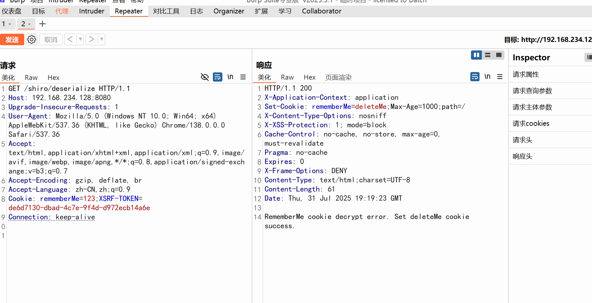
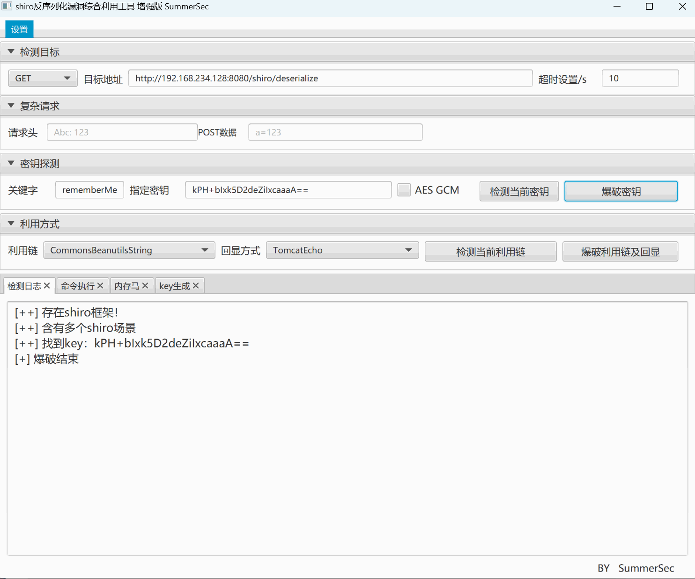
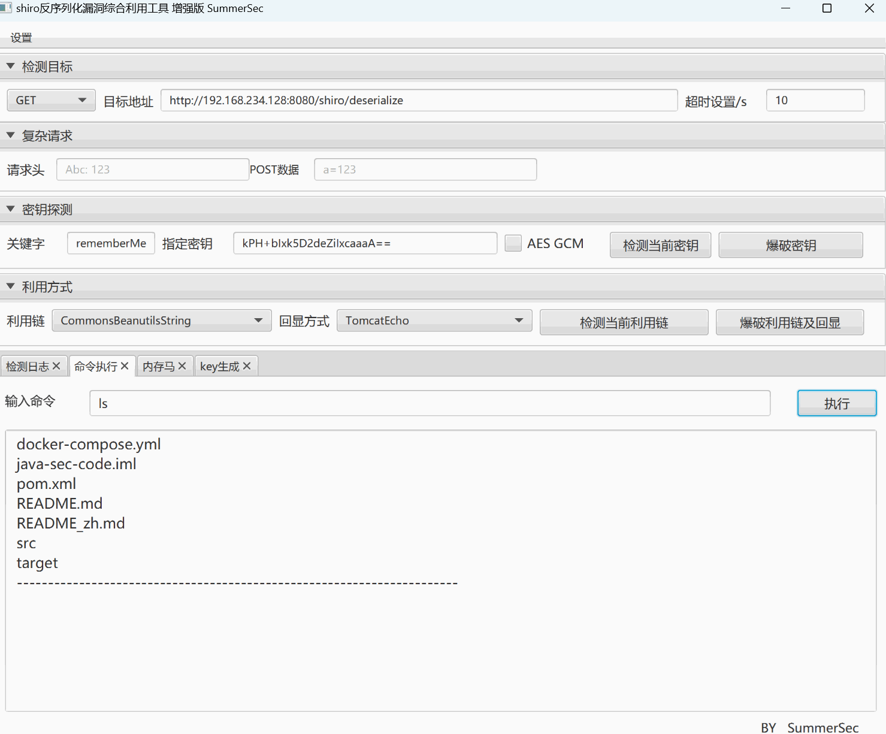

# Shiro反序列化漏洞学习

## 漏洞原理与过程

Shiro反序列化主要是Apache Shiro提供了一个remember 的功能，用户登录成功后会生成经过加密并编码的cookie，保存在浏览器中方便用户的日常使用。

而服务器对cookie的处理流程就是先获取浏览器上保存的cookie，然后将其base64解码，再进行AES解密，再将其反序列化进行校验。

而漏洞就是出现在这里，我们都知道AES它是一个硬编码，他是有默认密钥的，如果程序员没有去修改或者过于简单，那我们就可以进行cookie重构，先构造我们的恶意代码，然后将恶意代码进行序列化，然后AES加密(密钥我们已经爆破出来了)再进行base64编码，形成我们新的cookie，而服务器在处理时就会按照刚才的处理流程，就会在服务端触发我们构造的恶意代码。

---

### **过程**

1. 加密过程：用户在登录时勾选 "Remember Me" 功能，Shiro 会将用户身份信息序列化后进行 AES 加密和 Base64 编码，然后存储在 cookie 的 RememberMe 字段中。
2. 解密过程：当用户再次访问服务器时，服务器会从 cookie 中提取 RememberMe 字段，进行 Base64 解码和 AES 解密，最后反序列化以获取用户身份信息。
3. 攻击者利用：攻击者可以利用已知的或通过爆破得到的 AES 密钥，构造恶意的序列化对象，并按照 Shiro 的加密解密流程进行处理，生成恶意的 RememberMe cookie。当服务器处理这个恶意 cookie 时，就会触发反序列化漏洞，执行攻击者的代码。

---

### Shiro-550 反序列化漏洞原理

Shiro-550 漏洞的根本原因在于 Shiro 使用了一个硬编码的 AES 加密密钥，这个密钥在 Shiro 的源码中是默认的，因此任何人都可以使用这个密钥来构造 RememberMe 的值，进而让服务器执行反序列化操作。攻击者可以创建一个恶意对象，对其进行序列化、AES 加密和 Base64 编码，然后将其作为 RememberMe cookie 发送给服务器。服务器在解码和反序列化这个 cookie 时，会执行其中的恶意代码。

### Shiro-721 反序列化漏洞原理

与 Shiro-550 类似，Shiro-721 漏洞也涉及到 RememberMe 功能，但它的 AES 加密密钥通常是随机生成的，不容易被猜测。攻击者需要使用有效的用户信息和 RememberMe cookie 来执行 Padding Oracle 攻击，构造恶意的 RememberMe 字段进行反序列化攻击。这种攻击利用了 AES-128-CBC 模式中的 Padding Oracle 漏洞，允许攻击者在不知道加密密钥的情况下，通过填充错误的响应时间来推断出加密过程中的秘密信息。

---

## 漏洞复现

这里由于我的docker有问题无法使用vulhub靶场里的shiro来复现，就用java-sec-code靶场来复现。

源码：

```
public class Shiro {

    byte[] KEYS = java.util.Base64.getDecoder().decode("kPH+bIxk5D2deZiIxcaaaA==");
    private final static String DELETE_ME = "deleteMe";
    AesCipherService acs = new AesCipherService();


    @GetMapping(value = "/shiro/deserialize")
    public String shiro_deserialize(HttpServletRequest req, HttpServletResponse res) {
        Cookie cookie = getCookie(req, Constants.REMEMBER_ME_COOKIE);
        if (null == cookie) {
            return "No rememberMe cookie. Right?";
        }

        try {
            String rememberMe = cookie.getValue();
            byte[] b64DecodeRememberMe = java.util.Base64.getDecoder().decode(rememberMe);
            byte[] aesDecrypt = acs.decrypt(b64DecodeRememberMe, KEYS).getBytes();
            ByteArrayInputStream bytes = new ByteArrayInputStream(aesDecrypt);
            ObjectInputStream in = new ObjectInputStream(bytes);
            in.readObject();
            in.close();
        } catch (Exception e){
            if (CookieUtils.addCookie(res, "rememberMe", DELETE_ME)){
                log.error(e.getMessage());
                return "RememberMe cookie decrypt error. Set deleteMe cookie success.";
            }
        }

        return "Shiro deserialize";
    }
}
```

这关很类似于Shiro反序列化漏洞。从Cookie中获取rememberMe字段，然后进行[base64解码](https://so.csdn.net/so/search?q=base64解码&spm=1001.2101.3001.7020)，然后进行反序列化。与shiro不同的是，该漏洞不需要使用AES进行加密，而是直接进行了base64编码。

抓包看看发现了Shiro框架的明显特征，没有勾选rememberMe响应包的set-Cookie中就会有rememberMe=deleteMe。



这里本来是要用ysoserial工具来生成payload然后再进行base64编码然后AES加密，我这里图方便就直接使用Shiro反序列化工具了。

直接填入url地址，然后爆破出密钥



然后检测利用链，然后直接在工具内进行命令执行。



#### 防御

1. **升级shiro版本**
2. **限制rememberMe字段长度**


