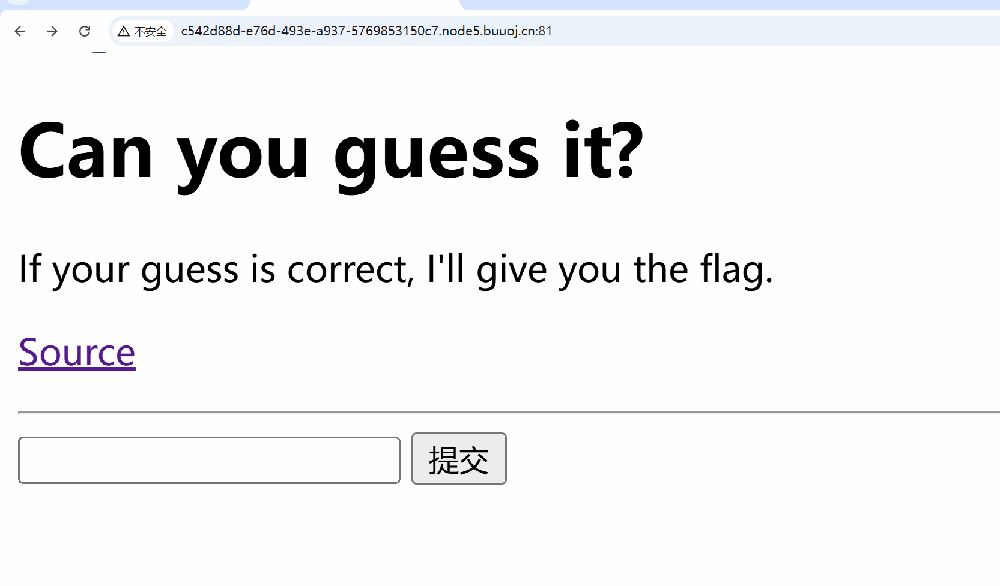

# Zer0pts2020-Can+you+guess+it



点一下source出现源码

```
<?php
include 'config.php'; // FLAG is defined in config.php

if (preg_match('/config\.php\/*$/i', $_SERVER['PHP_SELF'])) {
  exit("I don't know what you are thinking, but I won't let you read it :)");
}

if (isset($_GET['source'])) {
  highlight_file(basename($_SERVER['PHP_SELF']));
  exit();
}

$secret = bin2hex(random_bytes(64));
if (isset($_POST['guess'])) {
  $guess = (string) $_POST['guess'];
  if (hash_equals($secret, $guess)) {
    $message = 'Congratulations! The flag is: ' . FLAG;
  } else {
    $message = 'Wrong.';
  }
}
?>
<!doctype html>
<html lang="en">
  <head>
    <meta charset="utf-8">
    <title>Can you guess it?</title>
  </head>
  <body>
    <h1>Can you guess it?</h1>
    <p>If your guess is correct, I'll give you the flag.</p>
    <p><a href="?source">Source</a></p>
    <hr>
<?php if (isset($message)) { ?>
    <p><?= $message ?></p>
<?php } ?>
    <form action="index.php" method="POST">
      <input type="text" name="guess">
      <input type="submit">
    </form>
  </body>
</html>
```

代码审计

## 知识点

### $_SERVER[‘PHP_SELF’]

当前执行脚本的文件名，相对于网站根目录。
举个例子

```php
http://localhost/aaa/index.php?a=1&b=32

$_SERVER['PHP_SELF'] = "/aaa/index.php";
```

---

**正则表达式**

‘/config.php/*$/i’：过滤config.php，且大小写不敏感

---

### basename函数

basename() 函数可以返回路径的最后一部分名称，它会去掉文件名]开头的非ASCII值
如果目录末尾是不可见值，会返回上一级目录
此处配合文件读取可被利用

---

### bin2hex(random_bytes(64));

这一行代码将生成的随机字节序列转换为十六进制字符串
如果传入的guess的值跟这个随机生成的值相同，显示flag
这里生成很长的一段字符串，每次变化，所以无法利用此处

### PHP URL解析

我们可以利用basename()函数，末尾如果是不可见值会返回上一级目录的特性来解这题，

**PHP在根据URI解析到对应文件后会忽略掉URL中多余的部分**

我们需要访问的页面是index.php，末尾是config.php

```
payload：/index.php/config.php/%ff
```

再点击source即可看到flag

这里主要是利用basename返回上一级目录的特性返回config.php，然后通过highlight_file来高亮显示
