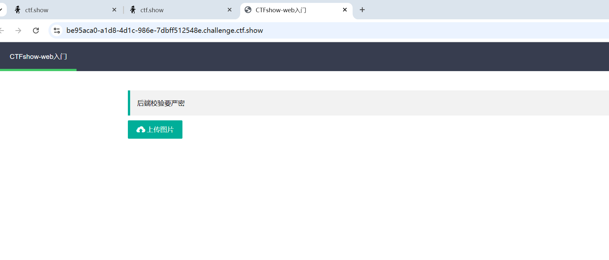
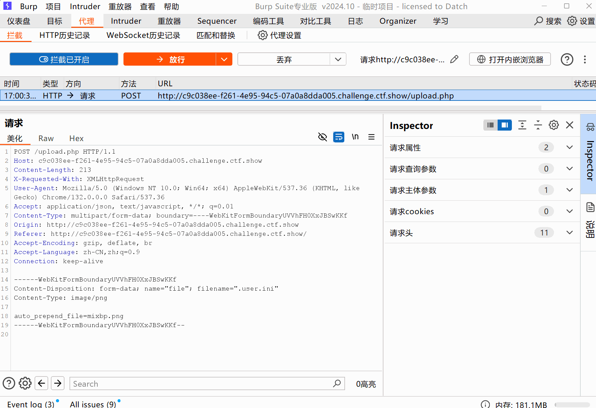
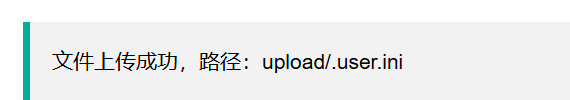
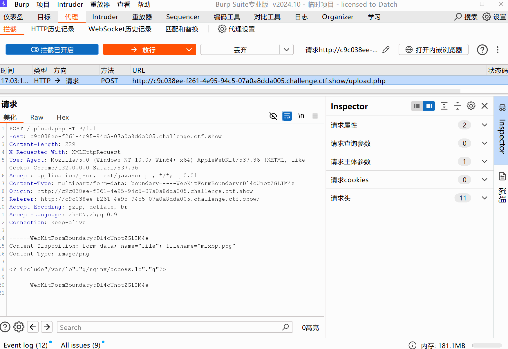
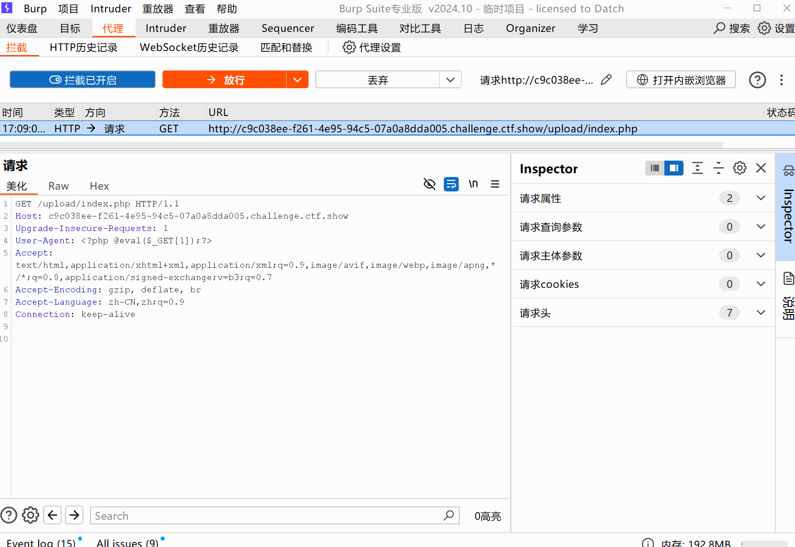
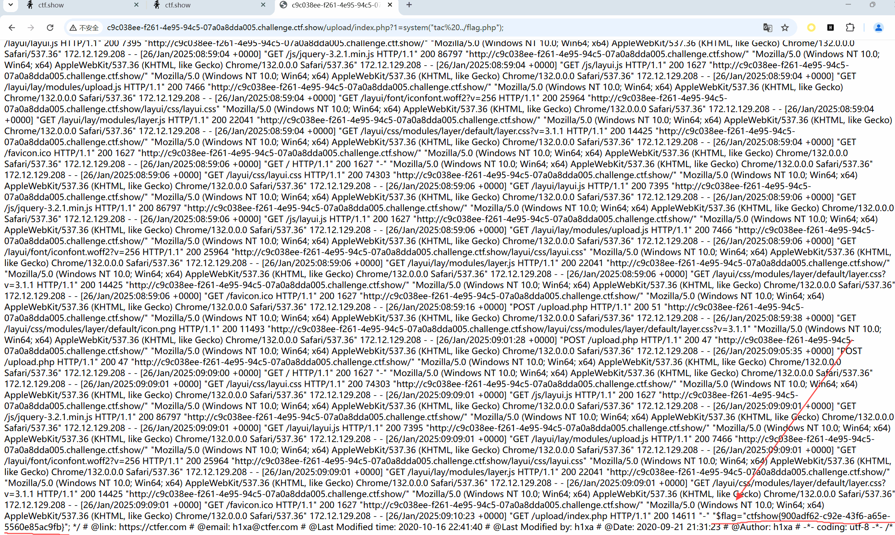

经过测试发现这题禁用了很多字符,``{}()[];，查了之后才知道这题涉及到了日志包含。

步骤：

首先上传我们的.user.ini文件，写上`auto_prepend_file=mixbp.png`，这可以让我们的mixbp.png内的代码包含进upload文件夹下的php文件，但是这里会有前端验证，直接上传是不行的先改后缀.png，然后抓包后修改



上传成功，还可在重放器中查看返回包，发现服务器为nginx



接着上传我们的mixbp.png文件里面写了日志包含代码，注意这里的log被过滤了所以使用字符拼接绕过`<=include"/var/lo"."g/nginx/access.lo"."g"?>`，



然后我们访问upload下的index.php文件并拦截请求，修改ua头



然后使用get传参?1=system("tac ../flag.php");即可得到flag，（这里使用伪协议直接读取也行）

```
system("tac ../flag.php"); 时，程序将：

访问父目录中的 flag.php 文件。
以反向顺序打印该文件的内容到控制台
```


