# web-信息搜集

## web-1（源码查看）

打开页面，显示where is flag？，这里直接右键查看源代码就能看到flag了

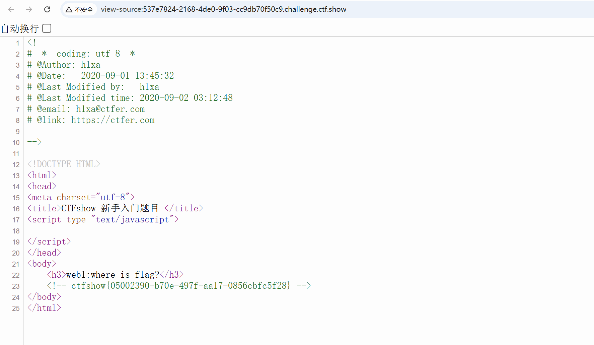

---

## web-2（源码查看）

打开页面显示无法查看源代码（F12和右键查看源代码被禁），这里可以使用ctrl+u快捷键查看源代码，或者在url头部添加 view-source:

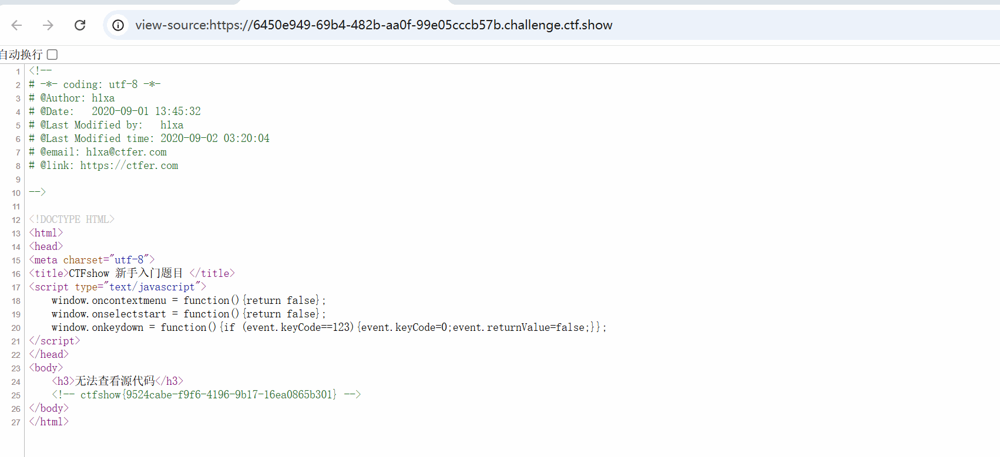

---

## web-3（响应包信息查看）

页面还是显示where is flag?，查看源代码也没发现flag，这里使用burpsuite抓包看看

把请求包放在重放器里然后发送，发现flag在响应中

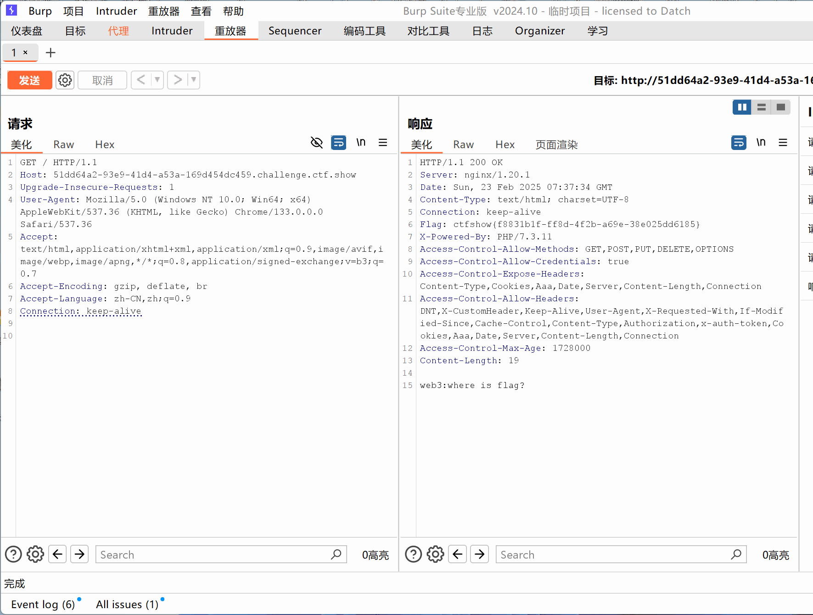

---

## web-4（robots.txt）

题目简介写了robots.txt可能泄露信息，所以直接访问robots.txt，显示flagishere.txt

再次访问这个文件即可拿到flag

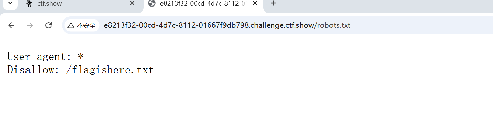

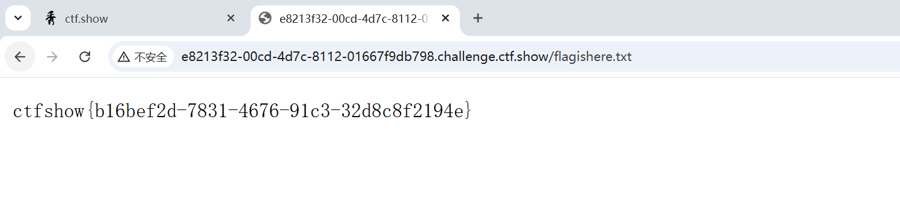

参考链接：[【每天学习一点新知识】robots.txt详解-CSDN博客](https://blog.csdn.net/m0_51683653/article/details/127252676?utm_medium=distribute.pc_relevant.none-task-blog-2~default~baidujs_utm_term~default-5-127252676-blog-7918528.235^v43^pc_blog_bottom_relevance_base7&spm=1001.2101.3001.4242.4&utm_relevant_index=8)

**什么是robots.txt?**

 **robots.txt是一个协议,我们可以把它理解为一个网站的"管家",它会告诉搜索引擎哪些页面可以访问,哪些页面不能访问。也可以规定哪些搜索引擎可以访问我们的网站而哪些搜索引擎不能爬取我们网站的信息等等,是网站管理者指定的"君子协议"。**

**当一个搜索机器人（有的叫搜索蜘蛛）访问一个站点时，它会首先检查该站点根目录下是否存在robots.txt，如果存在，搜索机器人就会按照该文件中的内容来确定访问的范围；如果该文件不存在，那么搜索机器人就沿着链接抓取。**

**另外，robots.txt必须放置在一个站点的根目录下，而且文件名必须全部小写。**

---

## web-5（phps源码泄露）

题目简介提示phps源码泄露，所以直接访问index.phps，然后会弹出下载框，将index.phps下载下来用记事本打开发现flag

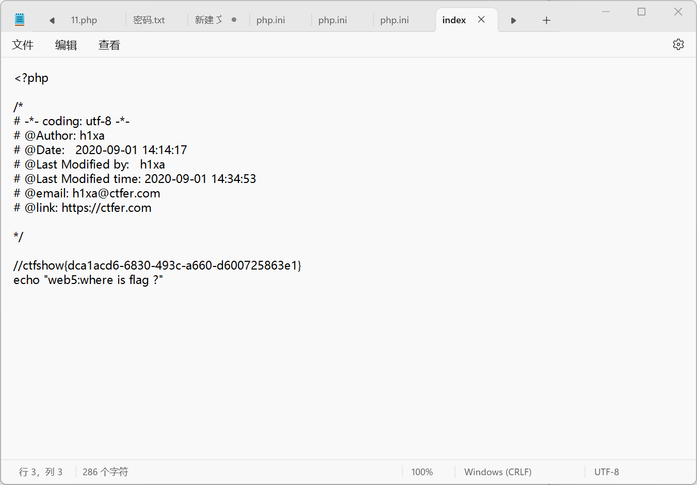

---

## web-6（压缩文件泄露）

用dirsearch扫一下目录发现一个www.zip文件，结合题目提示的压缩文件泄露，所以直接访问这个文件，然后会自动下载下来

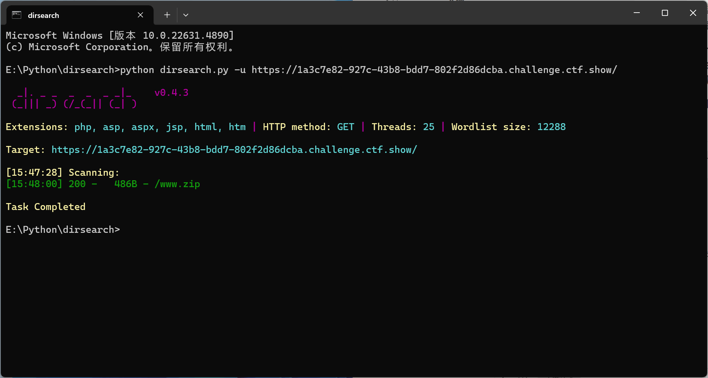

解压发现两个文件，打开fl00g.txt找到flag

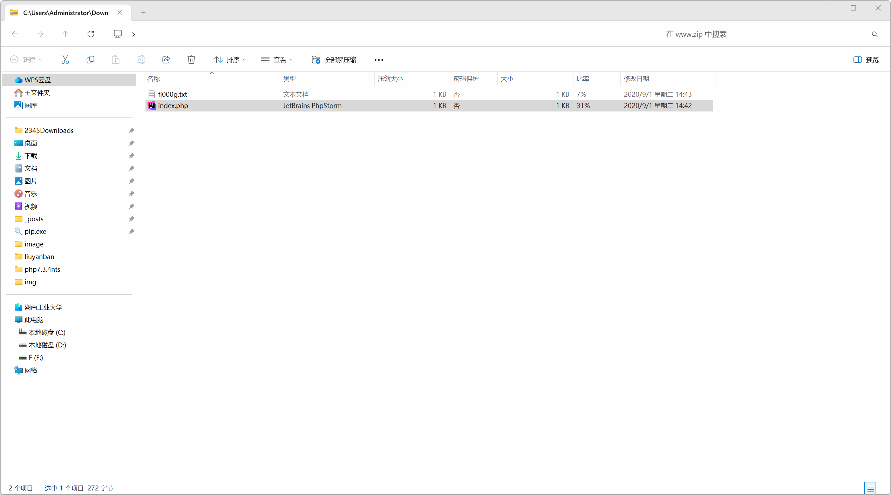

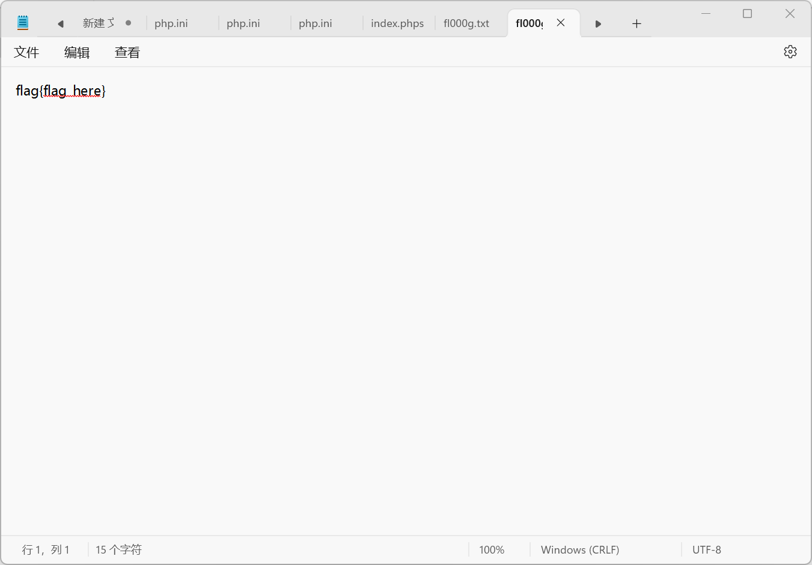

---

## web-7（git代码泄露）

考察git代码泄露，直接访问url/.git/index.php

和上一关方法相同，使用dirsearch扫一下目录

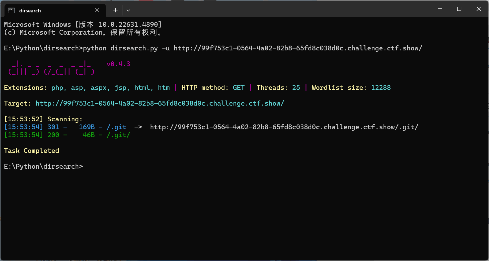

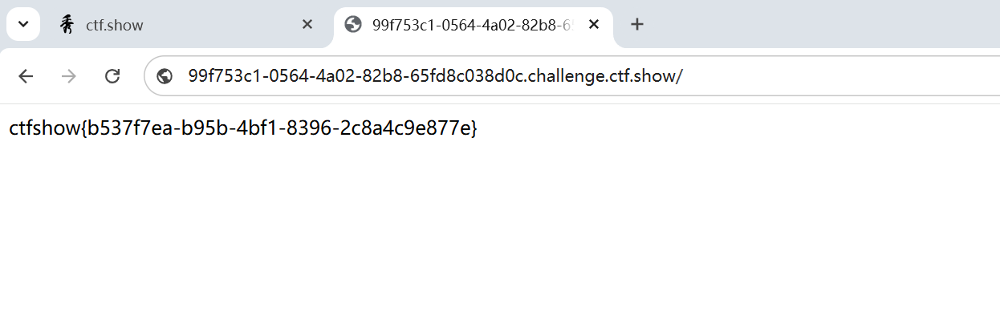

---

## web-8（svn泄露）

考察信息svn泄露,直接访问url/.svn/，一样用dirsearch扫一下，发现一个.svn文件，访问之后就是flag

---

## web-9（vim缓存泄露）

考察vim缓存信息泄露，直接访问url/index.php.swp 注：上面的信息泄露可以参考 https://blog.csdn.net/a597934448/article/details/105431367

在使用vim时会创建临时缓存文件，关闭vim时缓存文件则会被删除，当vim异常退出后，因为未处理缓存文件，导致可以通过缓存文件恢复原始文件内容

以 index.php 为例：

第一次产生的交换文件名为 .index.php.swp

再次意外退出后，将会产生名为 .index.php.swo 的交换文件

第三次产生的交换文件则为 .index.php.swn

所以根据提示直接访问index.php.swp即可拿到flag

---

## web-10（查看cookie信息）

根据提示猜测flag在cookie里，直接F12查看cookie即可拿到flag，但是需要解码，或者使用burpsuite抓包，在请求头的cookie中也可拿到flag

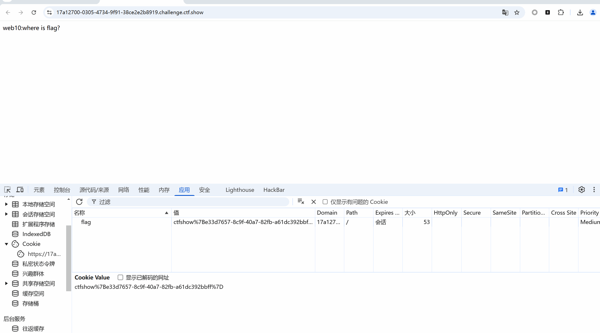

---

## web-11（域名解析）

题目提示域名也可以隐藏信息。

**查询域名解析地址 基本格式：nslookup host [server]**

**查询域名的指定解析类型的解析记录 基本格式：nslookup -type=type host [server]**

**查询全部 基本格式：nslookup -query=any host [server]**

**编辑nslookup -query=any flag.ctfshow.com**

**C:\Users\16032>nslookup -query=any flag.ctfshow.com 服务器: public-dns-a.baidu.com Address: 180.76.76.76 非权威应答: flag.ctfshow.com text = "flag{just_seesee}"**

所以直接使用命令： nslookup -qt=txt flag.ctfshow.com即可

也可直接使用域名解析网站直接解析ctfshow.com

---

## web-12（网站信息泄露）

打开发现是个网站，先查看robots.txt文件，就能得到用户名admin。

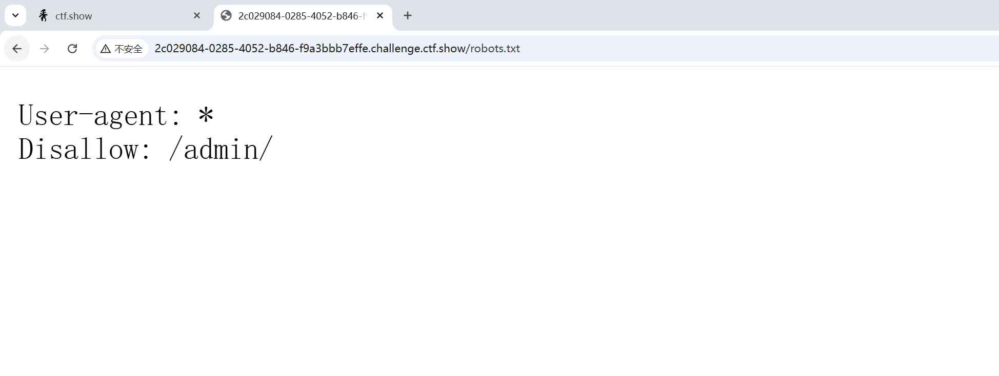

用dirsearch扫出/admin，访问发现是管理员登录页面。但是我们只有用户名，无法登录

在网页里看看，发现最下面有一行数字，猜测就是密码


直接登录就能拿到flag了

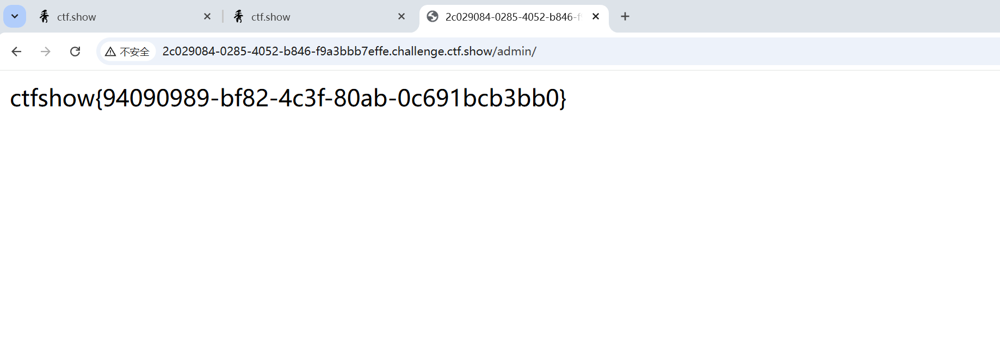

这里的意思是管理员密码有时也会在页面中吗？

---

## web-13（网站信息泄露）

打开又是一个网页，这里发现最下面有个document可以点击，点进去是一个pdf文件


pdf内写了默认后台地址、默认用户名、默认密码

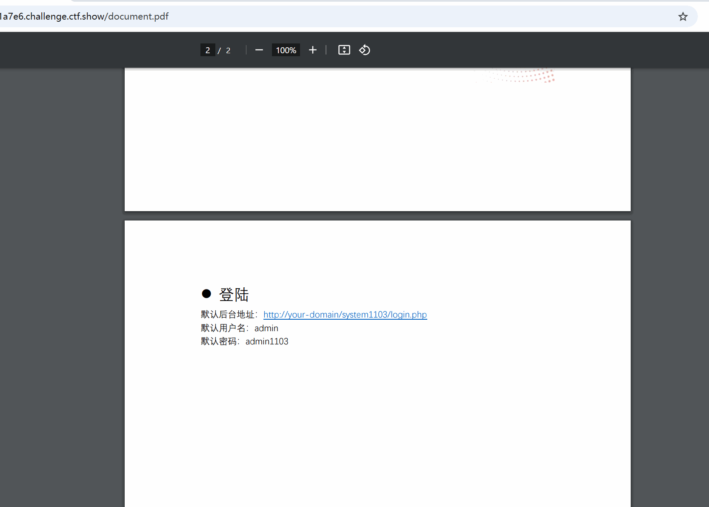

我们将默认后台地址中的your-domain改成题目的地址，然后使用用户名和密码登录即可拿到flag

---

## web-14（网站信息泄露）

根据题目提示访问editor，这里用diresearch扫一遍也行。

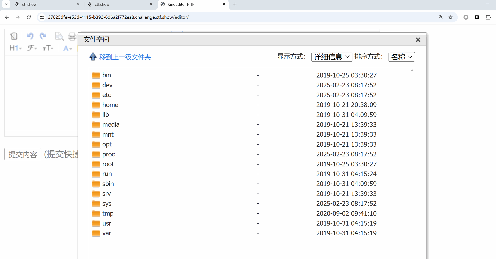

点击插入文件，里面有个文件空间，发现 居然是服务器中的文件（非本地），于是浏览一下目录 在var/www/html目录 中，存在 一个nothinghere有一个文件 fl000g.txt 直接访问这个fl000g.txt 即可获得flag!

**url访问/nothinghere/fl000g.txt即可获取flag**

## web-15（网站信息泄露）

打开页面发现最下面有个邮箱号`1156631961@qq.com`，记下来，然后访问/admin，发现是一个后台登录页面。猜测用户名是admin，但是不知道密码。

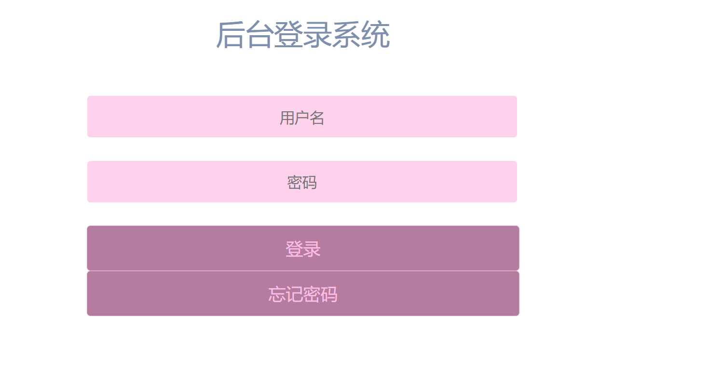

点开忘记密码发现有个密保，问我们所在地是哪个城市，直接qq查找上面的邮箱中的qq号，可以查到个人简介所在地是西安。


重置密码成功。

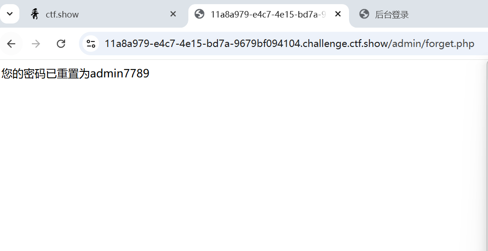

登录后台即可拿到flag

---

## web-16（探针泄露）

题目提示探针，所以访问tz.php。

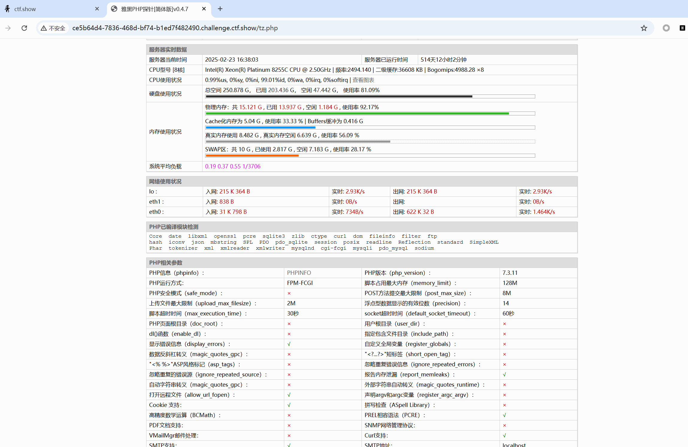

然后点开phpinfo，ctrl+f查找flag，即可拿到flag

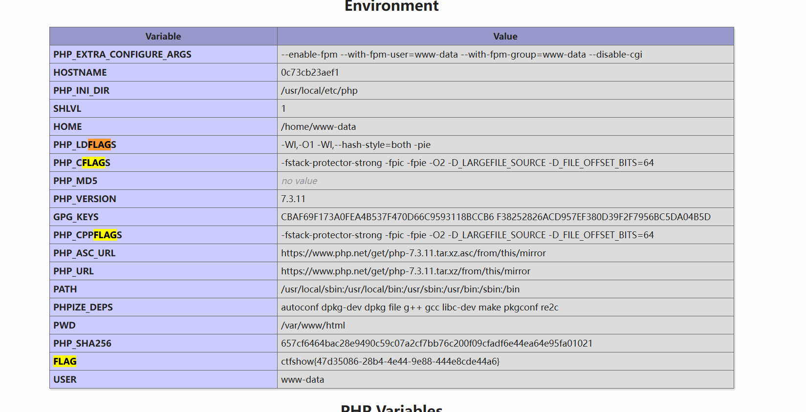

[**php**探针](https://blog.csdn.net/weixin_43790779/article/details/108834213?ops_request_misc=%7B%22request%5Fid%22%3A%22171310161416800185843688%22%2C%22scm%22%3A%2220140713.130102334..%22%7D&request_id=171310161416800185843688&biz_id=0&utm_medium=distribute.pc_search_result.none-task-blog-2~all~sobaiduend~default-1-108834213-null-null.142^v100^control&utm_term=PHP探针&spm=1018.2226.3001.4187)

---

## web-17（sql文件备份泄露）

题目提示sql文件备份，dirsearch扫一遍发现/backup.sql直接访问自动下载下来

打开之后拿到flag

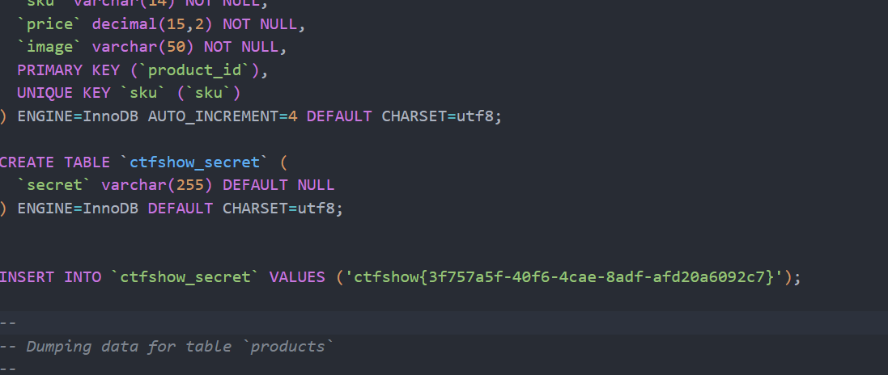

---

## web-18（js前端分析）

打开之后发现是个小游戏，然后提示要玩到101分才给flag，发现难度不是给人玩的。

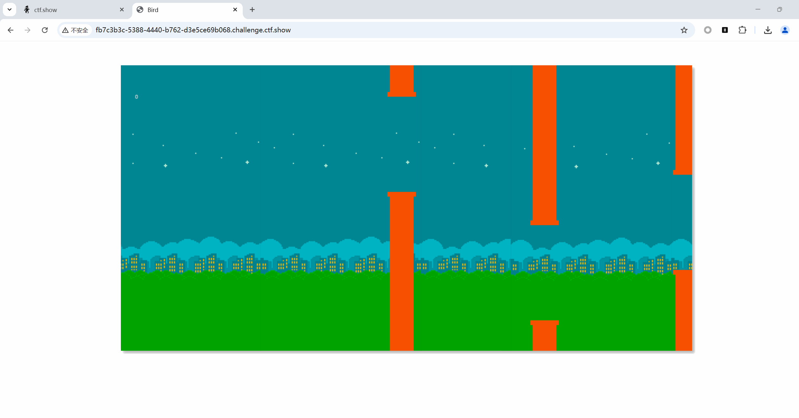

查看源码发现一个js文件，点开，然后分析js代码。当score>120时，且game_over这个参数为false时，即可赢，于是打开开发者模式中的console，直接赋值score=130 game_over=false 然后，执行游戏 的run() 即可得到 "你赢了

直接控制台改分数即可

```
score = 101
run()
```

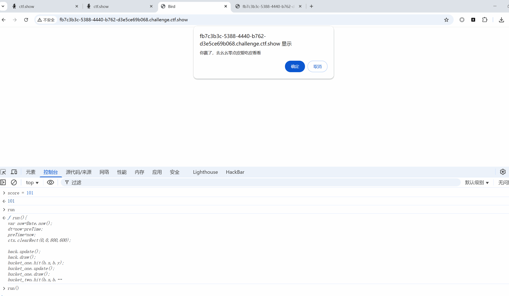

显示“你赢了，去幺幺零点皮爱吃皮看看”，一看就是拼音

访问110.php即可拿到flag

---

## web-19（前端密钥泄露）

打开后发现是个登录界面，题目提示密钥不要放在前端，所以我们查看下源代码，然后发现密钥真的在前端。

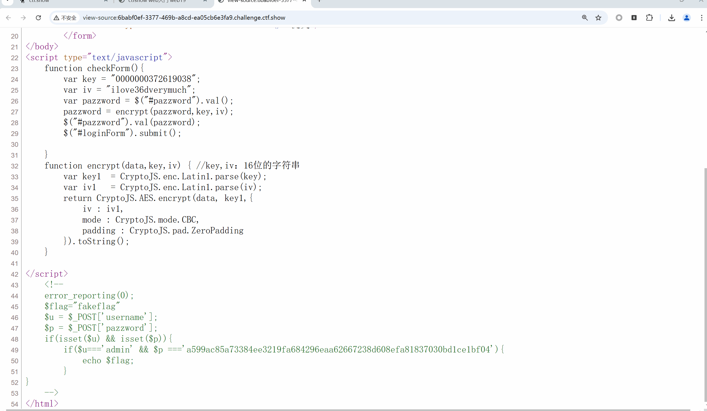

分析前端代码，发现只要post传参值判定正确即可输出flag

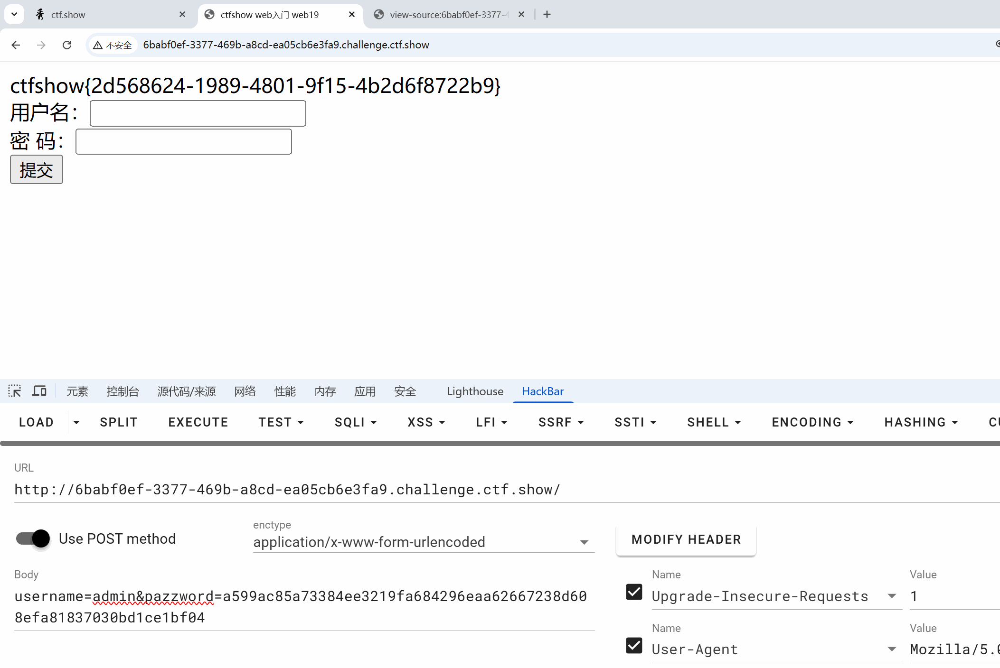

---

## web-20（mdb文件泄露）

mdb文件是早期asp+access构架的数据库文件 直接查看url路径添加/db/db.mdb 下载文件通过txt打开或者通过EasyAccess.exe打开搜索flag flag{ctfshow_old_database}

然后会自动给我们下载下来，记事本打开crtl+f查找flag即可

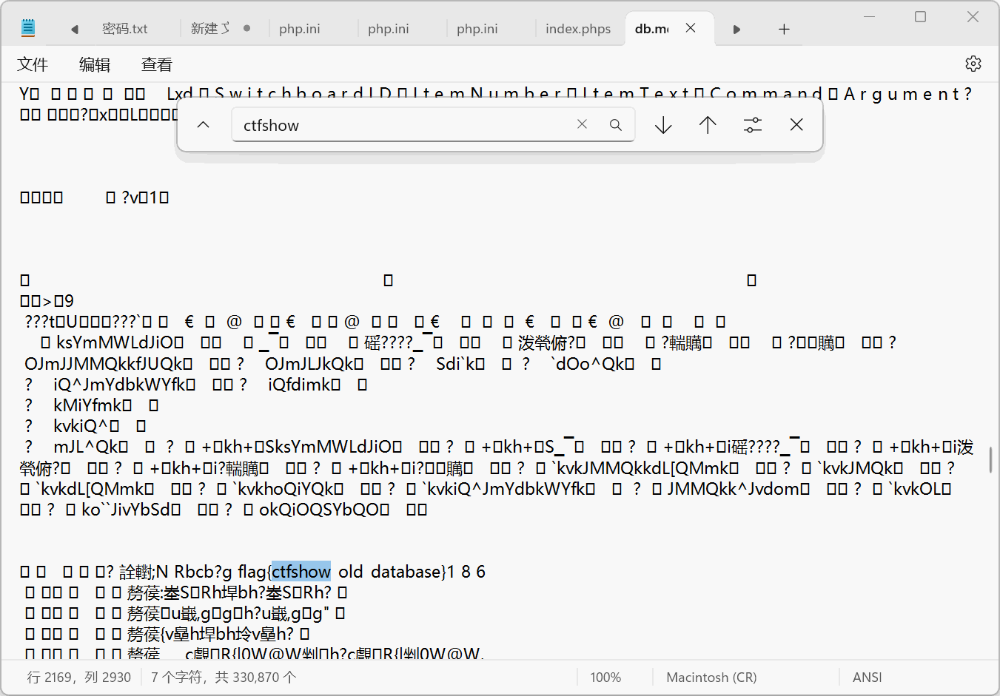


