# docker学习

# 初识docker

## 安装docker

```
# yum包更新
yum update
# 安装所需要的软件包
yum install -y yum-utils device-mapper-persistent-date lvm2
# 设置yum源
yum-config-manager --add-repo https://download.docker.com/linux/centos/docker-ce.repo
# 安装docker，出现输入的界面都按y
yum install -y docker-ce
# 查看docker版本，验证是否验证成功
docker -v
```

---

## docker架构

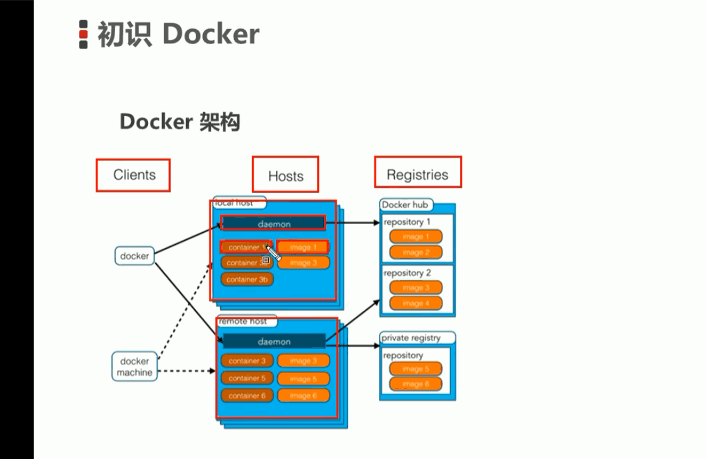

---

## 配置镜像加速器

```
sudo mkdir -p /etc/docker
sudo tee /etc/docker/daemon.json <<-'EOF'
{
  "registry-mirrors": ["https://zktok1yl.mirror.aliyuncs.com"]
}
EOF
sudo systemctl daemon-reload
sudo systemctl restart docker
```

---

# docker命令

## 服务相关命令

### 启动docker服务

```
systemctl start docker
```

### 停止docker服务

```
systemctl stop docker
```

### 重启docker服务

```
systemctl restart docker
```

### 查看docker服务状态

```
systemctl status docker
```

### 开机启动docker服务

```
systemctl enable docker
```

---

## docker镜像相关命令

### 查看镜像

```
docker images
```

### 查看所有镜像的id

```
docker image -q
```

### 搜索镜像

```
docker search 镜像名称
```

### 拉取镜像

```
不写版本号默认latest最新版
docker pull 镜像名称
写版本号
docker pull 镜像名称:版本号
```

### 删除镜像

```
通过imageid删除
docker rmi IMAGE_ID

通过tag(版本号)删除
docker rmi 镜像名称:版本号

删除所有镜像
docker rmi `docker images -q`
```

---

## docker容器相关命令

### 查看容器

```
docker ps # 查看正在运行的容器
docker ps -a # 查看所有容器
```

### 创建并启动容器

```
docker run 参数
```

参数说明：

```
-i 保持容器运行。通常与-t同时使用。加入it这两个参数后，容器创建后自动进入容器转给你，退出容器后，容器自动关闭
-t 为容器重新分配一个伪输入终端，通常与-i同时使用。
-d 以守护（后台）模式运行容器。创建一个容器在后台运行，需要使用docker exec进入容器。退出后，容器不会关闭
-it 创建的容器一般称为交互式容器，-id创建的容器一般称为守护式容器
--name 为创建的容器命名
```

示例：

```
docker run -it --name c1 centos:7 /bin/bash
exit
dokcer ps -a
------------------
docker run -id --name c2 centos:7
docker ps -a
docker exec -it c2 /bin/bash
exit
docker ps -a
```

### 进入容器

```
docker exec 参数 # 退出容器，容器不会关闭
```

### 停止容器

```
docker stop 容器名称
```

### 启动容器

```
docker start 容器名称
```

### 删除容器

如果容器是运行状态则删除失败，需要停止容器才能删除

```
docker rm 容器名称
docker rm 容器id

删除所有容器
docker rm `docker ps -aq`
```

### 查看容器信息

```
docker inspect 容器名称
```

---

# docker容器的数据卷

## 数据卷

- 数据卷是宿主机中的一个目录或文件
- 当容器目录和数据卷目录绑定后，对方的修改会立即同步
- 一个数据卷可以被多个容器同时挂载

- 一个容器也可以被挂载多个数据卷

### 数据卷作用

- 容器数据持久化
- 外部机器和容器间接通信
- 容器之间数据交换

## 配置数据卷

创建启动容器时，使用-v参数 设置数据卷

```
docker run ... -v 宿主机目录(文件):容器内目录(文件) ...
```

注意事项

1. 目录必须是绝对路径
2. 如果目录不存在，会自动创建
3. 可以挂载多个数据卷

示例：

```
docker run -it --name=c1 -v /root/data:/root/data_container centos:7 /bin/bash
```

---

## 数据卷容器

多容器进行数据交换

​	1、多个容器挂载同一个数据卷

​	2、数据卷容器

### 配置数据卷容器

- 创建一个容器，挂载一个目录，让其他容器继承自该容器(--volume-from)
- 通过简单方式实现数据卷配置

1、创建启动c3数据卷容器，使用-v参数 设置数据卷

```
docker run -it --name=c3 -v /volume centos:7 /bin/bash
```

2、创建启动c1 c2 容器，使用--volumes-from参数 设置数据卷

```
docker run -it --name=c1 --volumes-from c3 centos:7 /bin/bash

docker run -it --name=c2 --volumes-from c3 centos:7 /bin/bash
```

---

# docker应用部署

## 部署mysql

- 容器内的网络服务和外部机器不能直接通信
- 外部机器和宿主机可以直接通信
- 宿主机和容器可以直接通信
- 当容器中的网络服务需要被外部机器访问时，可以将容器中提供服务的端口映射到宿主机的端口上。外部机器访问宿主机的该端口，从而间接访问容器的服务。
- 这种操作称为：**端口映射**

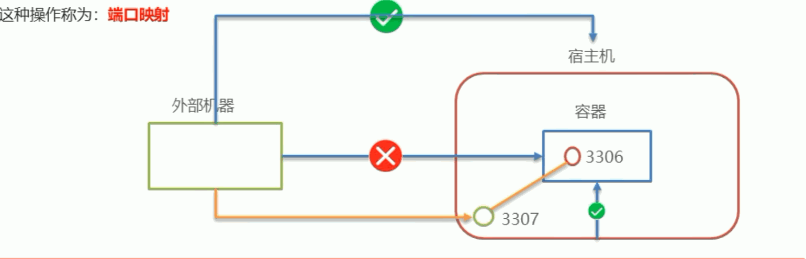

---

1、搜索mysql镜像

```
docker search mysql
```

2、拉取mysql镜像

```
docker pull mysql:5.6
```

3、创建容器，设置端口映射、目录映射

```
# 在/root目录下创建mysql目录用于存储mysql数据信息
mkdir ~/mysql
cd ~/mysql
```

```
docker run -id \
-p 3307:3306 \
--name=c_mysql \
--privileged=true \
-v $PWD/conf:/etc/mysql/conf.d \
-v $PWD/logs:/logs \
-v $PWD/data:/var/lib/mysql \
-e MYSQL_ROOT_PASSWORD=123456 \
mysql:5.6
```

参数说明：

- `-p 3307:3306`：将容器的 3306 端口映射到宿主机的 3307 端口。
- `-v $PWD/conf:/etc/mysql/conf.d`：将主机当前目录下的 conf/my.cnf 挂载到容器的 `/etc/mysql/my.cnf`。配置目录
- `-v $PWD/logs:/logs`：将主机当前目录下的 logs 目录挂载到容器的 `/logs`。日志目录
- `-v $PWD/data:/var/lib/mysql`：将主机当前目录下的 data 目录挂载到容器的 `/var/lib/mysql`。数据目录
- `-e MYSQL_ROOT_PASSWORD=123456`：初始化 root 用户的密码。

进入容器

```
docker exec -it c_mysql /bin/bash
```

然后通过外部机器连接

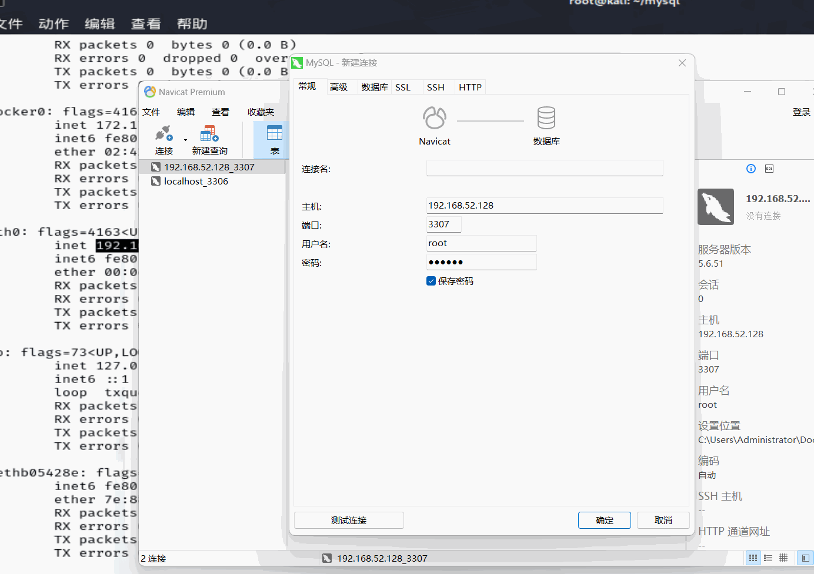

---

## Tomcat部署

1、搜索tomcat镜像

```
docker search tomcat
```

2、拉取tomcat镜像

```
docker pull tomcat
```

3、创建容器，设置端口映射、目录映射

```
# 在/root目录下创建tomcat目录用于存储tomcat数据信息
mkdir ~/tomcat
cd ~/tomcat
```

```
docker run -id --name=c_tomcat \
-p 8080:8080 \
-v $PWD:/usr/local/tomcat/webapps \
tomcat
```

参数说明：

- -p 8080:8080 将容器8080端口映射到主机的8080端口
- -v $PWD:/usr/local/tomcat/webapps 将主机中当前目录挂载到容器的webapps

容器创建后tomcat会自动运行

然后使用外部机器访问tomcat即可

---

## Nginx部署

1、搜索nginx镜像

```
docker search nginx
```

2、拉取nginx镜像

```
docker pull nginx
```

3、创建容器，设置端口映射、目录映射

```
# 在/root目录下创建nginx目录用于存储nginx数据信息
mkdir ~/nginx
cd ~/nginx
mkdir conf
cd conf
# 在~/nginx/conf/下创建nginx.conf文件，粘贴下面内容
vim nginx.conf
```

```
user  nginx;
worker_processes  1;

error_log  /var/log/nginx/error.log warn;
pid        /var/run/nginx.pid;


events {
    worker_connections  1024;
}


http {
    include       /etc/nginx/mime.types;
    default_type  application/octet-stream;

    log_format  main  '$remote_addr - $remote_user [$time_local] "$request" '
                      '$status $body_bytes_sent "$http_referer" '
                      '"$http_user_agent" "$http_x_forwarded_for"';

    access_log  /var/log/nginx/access.log  main;

    sendfile        on;
    #tcp_nopush     on;

    keepalive_timeout  65;

    #gzip  on;

    include /etc/nginx/conf.d/*.conf;
}
```


创建容器

```
docker run -id --name=c_nginx \
-p 80:80 \
-v $PWD/conf/nginx.conf:/etc/nginx/nginx.conf \
-v $PWD/logs:/var/log/nginx \
-v $PWD/html:/usr/share/nginx/html \
nginx
```

参数说明

- -p 80:80 将容器的80端口映射到宿主机的80端口
- -v $PWD/conf/nginx.conf:/etc/nginx/nginx.conf 将主机当前目录下的/conf/nginx.conf挂载到容器的:/etc/nginx/nginx.conf 配置目录
- -v $PWD/logs:/var/log/nginx 将主机当前目录下的logs目录挂载到容器的/var/log/nginx 日志目录

使用外部机器访问nginx

---

## Redis部署

搜索redis镜像

```
docker search redis
```

拉取redis镜像

```
docker pull redis:5.0
```

创建容器，设置端口映射

```
docker run -id --name=c_redis -p 6379:6379 redis:5.0
```

使用外部机器连接redis

```
./redis-cli.exe -h 192.168.149.135 -p 6379
```

---

# dockerfile

## docker镜像原理


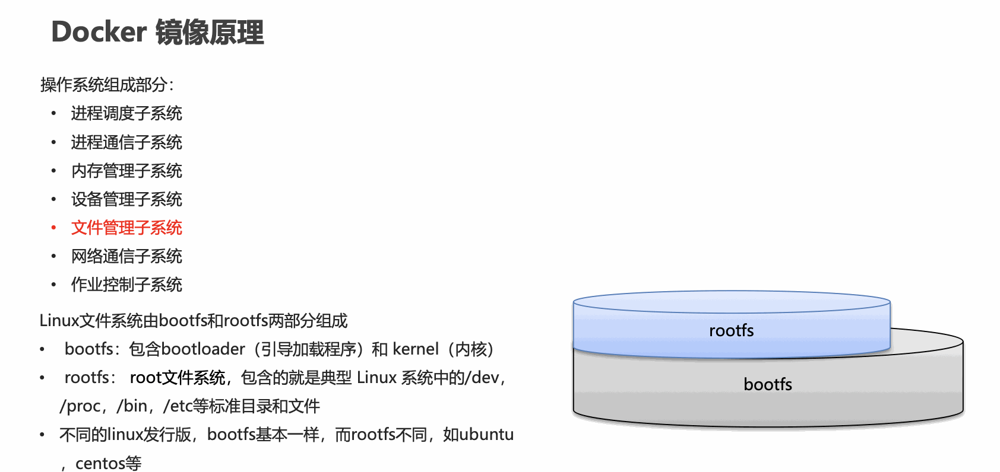

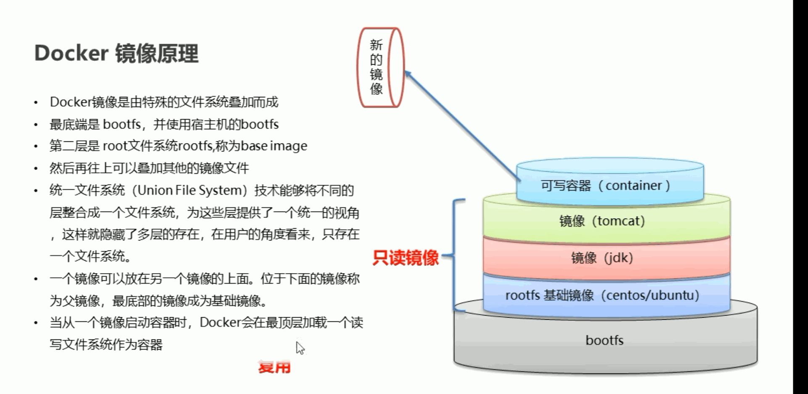

---

## 镜像制作

1、容器转为镜像

```
docker commit 容器id 镜像名称:版本号
```

```
docker save -o 压缩文件名称 镜像名称:版本号
```

```
docker load -i 压缩文件名称
```

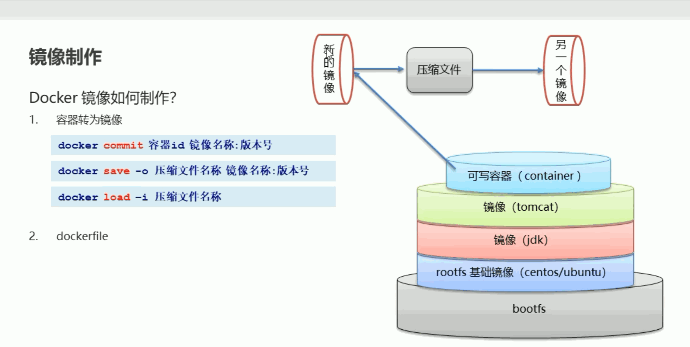

## dockerfile概念

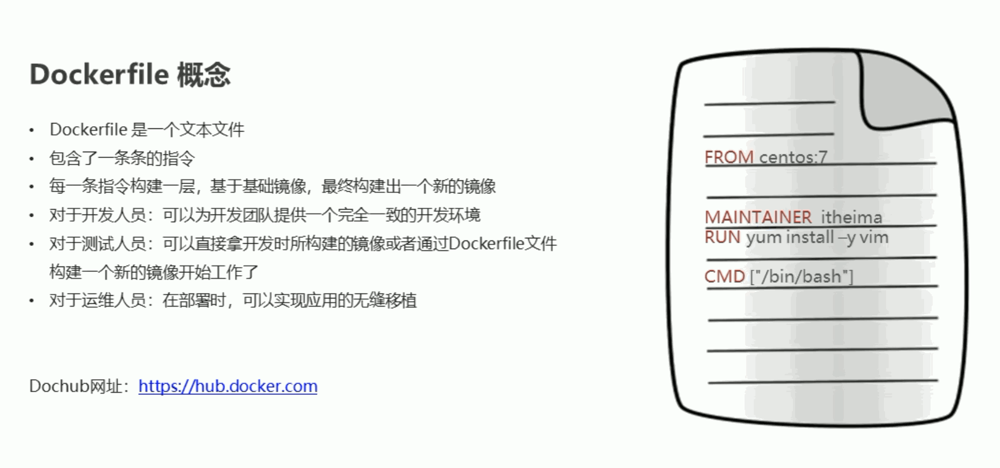

## dockerfile关键字

| 关键字      | 作用                     | 备注                                                         |
| ----------- | ------------------------ | ------------------------------------------------------------ |
| FROM        | 指定父镜像               | 指定dockerfile基于那个image构建                              |
| MAINTAINER  | 作者信息                 | 用来标明这个dockerfile谁写的                                 |
| LABEL       | 标签                     | 用来标明dockerfile的标签 可以使用Label代替Maintainer 最终都是在docker image基本信息中可以查看 |
| RUN         | 执行命令                 | 执行一段命令 默认是/bin/sh 格式: RUN command 或者 RUN [“command” , “param1”,”param2”] |
| CMD         | 容器启动命令             | 提供启动容器时候的默认命令 和ENTRYPOINT配合使用.格式 CMD command param1 param2 或者 CMD [“command” , “param1”,”param2”] |
| ENTRYPOINT  | 入口                     | 一般在制作一些执行就关闭的容器中会使用                       |
| COPY        | 复制文件                 | build的时候复制文件到image中                                 |
| ADD         | 添加文件                 | build的时候添加文件到image中 不仅仅局限于当前build上下文 可以来源于远程服务 |
| ENV         | 环境变量                 | 指定build时候的环境变量 可以在启动的容器的时候 通过-e覆盖 格式ENV name=value |
| ARG         | 构建参数                 | 构建参数 只在构建的时候使用的参数 如果有ENV 那么ENV的相同名字的值始终覆盖arg的参数 |
| VOLUME      | 定义外部可以挂载的数据卷 | 指定build的image那些目录可以启动的时候挂载到文件系统中 启动容器的时候使用 -v 绑定 格式 VOLUME [“目录”] |
| EXPOSE      | 暴露端口                 | 定义容器运行的时候监听的端口 启动容器的使用-p来绑定暴露端口 格式: EXPOSE 8080 或者 EXPOSE 8080/udp |
| WORKDIR     | 工作目录                 | 指定容器内部的工作目录 如果没有创建则自动创建 如果指定/ 使用的是绝对地址 如果不是/开头那么是在上一条workdir的路径的相对路径 |
| USER        | 指定执行用户             | 指定build或者启动的时候 用户 在RUN CMD ENTRYPONT执行的时候的用户 |
| HEALTHCHECK | 健康检查                 | 指定监测当前容器的健康监测的命令 基本上没用 因为很多时候 应用本身有健康监测机制 |
| ONBUILD     | 触发器                   | 当存在ONBUILD关键字的镜像作为基础镜像的时候 当执行FROM完成之后 会执行 ONBUILD的命令 但是不影响当前镜像 用处也不怎么大 |
| STOPSIGNAL  | 发送信号量到宿主机       | 该STOPSIGNAL指令设置将发送到容器的系统调用信号以退出。       |
| SHELL       | 指定执行脚本的shell      | 指定RUN CMD ENTRYPOINT 执行命令的时候 使用的shell            |

---

## dockerfile案例

### 部署springboot项目

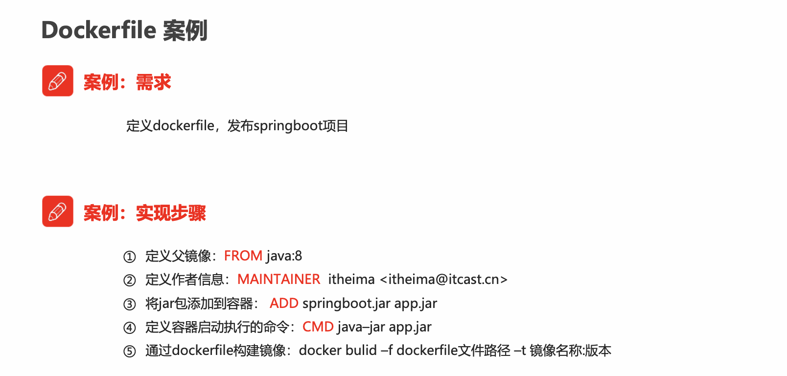

准备好springboot jar包并传至宿主机的根目录

创建docker-files目录，并把jar包移动进去

```
mkdir docker-files
mv HelloDocker-0.0.1-SNAPSHOT.jar ./docker-files/
```

创建dockerfile文件并编辑

```
FROM java:8
MAINTAINER itheima <itheima@itcast.cn>
ADD HelloDocker-0.0.1-SNAPSHOT.jar app.jar
CMD java -jar app.jar
```

根据dockerfile制作镜像

```
docker build -f ./dockerfile -t app .
```

启动并做端口映射

```
docker run -id -p 9000:8080 app
```

成功访问

---

### 自定义centos

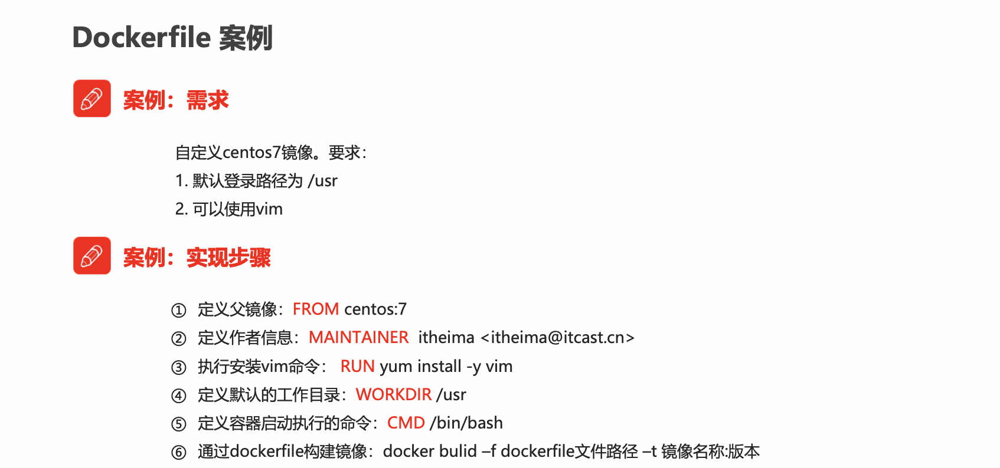

先创建docker-files目录

```
mkdir docker-files
cd docker-files
```

编辑dockerfile文件

```
vim centos_dockerfile
```

```
FROM centos:7
MAINTAINER itheima<itheima@itcast.cn>
RUN yum install -y vim
WORKDIR /usr
CMD /bin/bash
```

构建镜像

```
docker build -f centos_dockerfile -t itheima_centos:1 .
```

创建容器

```
docker run -it --name=c5 itheima_centos:1
```

---

# docker服务编排

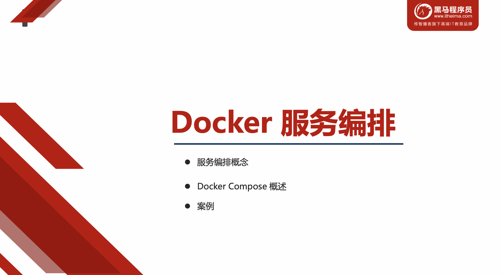

## 服务编排

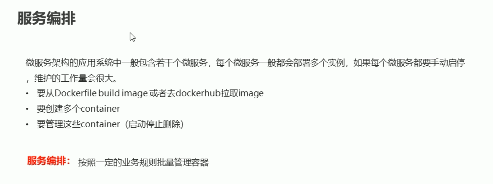

## docker compose

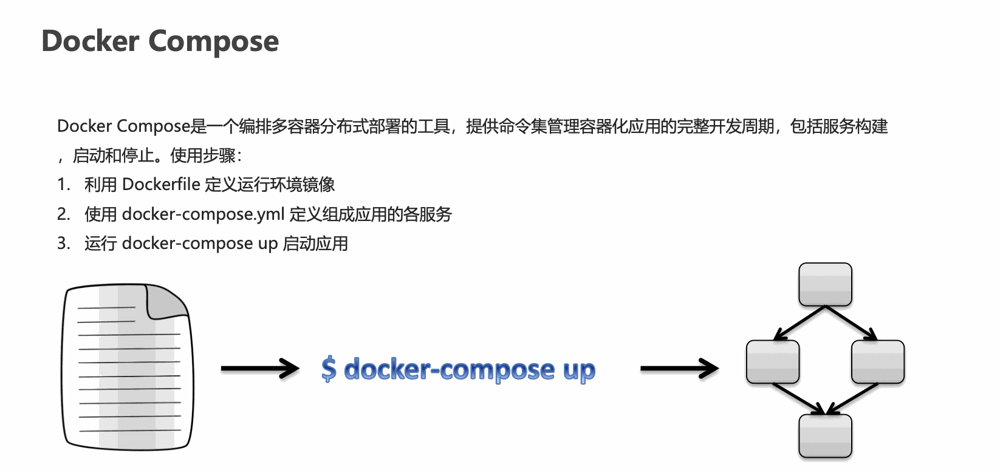

---

### dsocker Compose 安装使用

#### 一、安装Docker Compose

```
# Compose目前已经完全支持Linux、Mac OS和Windows，在我们安装Compose之前，需要先安装Docker。下面我 们以编译好的二进制包方式安装在Linux系统中。 
curl -L https://github.com/docker/compose/releases/download/1.22.0/docker-compose-`uname -s`-`uname -m` -o /usr/local/bin/docker-compose
# 设置文件可执行权限 
chmod +x /usr/local/bin/docker-compose
# 查看版本信息 
docker-compose --version
或者
docker-compose -v
```

#### 二、卸载Docker Compose

```
# 二进制包方式安装的，删除二进制文件即可
rm /usr/local/bin/docker-compose
```

### 三、 使用docker compose编排nginx+springboot项目

1、创建docker-compose目录

```
mkdir ~/docker-compose
cd ~/docker-compose
```

2、编写 docker-compose.yml 文件

```
vim docker-compose.yml
```

```
version: '3'
services:
  nginx:
   image: nginx
   ports:
    - 80:80
   links:
    - app
   volumes:
    - ./nginx/conf.d:/etc/nginx/conf.d
  app:
    image: app
    expose:
      - "8080"
```

3、创建./nginx/conf.d目录

```
mkdir -p ./nginx/conf.d
```

4、在./nginx/conf.d目录下 编写itheima.conf文件

```
cd ./nginx
vim itheima.conf
```

```
server {
    listen 80;
    access_log off;

    location / {
        proxy_pass http://app:8080;
    }
   
}
```

5、在~/docker-compose 目录下 使用docker-compose 启动容器

```
docker-compose up
```

6、测试访问

```
http://192.168.149.135/hello
```

---

# docker私有仓库

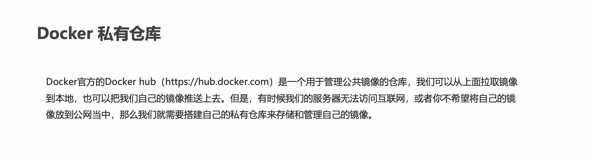

## 私有仓库搭建

```
# 1、拉取私有仓库镜像 
docker pull registry
# 2、启动私有仓库容器 
docker run -id --name=registry -p 5000:5000 registry
# 3、打开浏览器 输入地址http://私有仓库服务器ip:5000/v2/_catalog，看到{"repositories":[]} 表示私有仓库 搭建成功
# 4、修改daemon.json   
vim /etc/docker/daemon.json    
# 在上述文件中添加一个key，保存退出。此步用于让 docker 信任私有仓库地址；注意将私有仓库服务器ip修改为自己私有仓库服务器真实ip 
{"insecure-registries":["私有仓库服务器ip:5000"]} 
# 5、重启docker 服务 
systemctl restart docker
docker start registry
```

---

## 将镜像上传至私有仓库

```
# 1、标记镜像为私有仓库的镜像     
docker tag centos:7 私有仓库服务器IP:5000/centos:7
 
# 2、上传标记的镜像     
docker push 私有仓库服务器IP:5000/centos:7
```

---

##  从私有仓库拉取镜像

```
docker pull 私有仓库服务器ip:5000/centos:7
```

---

# Docker 相关观念

## Docker容器化虚拟化与传统虚拟机比较

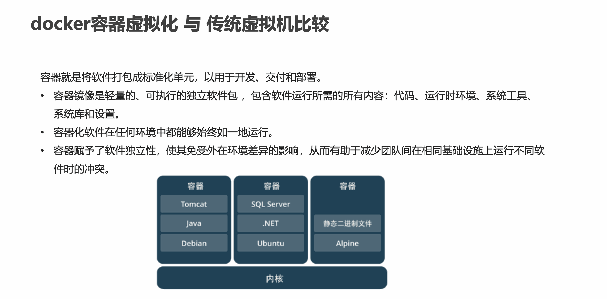

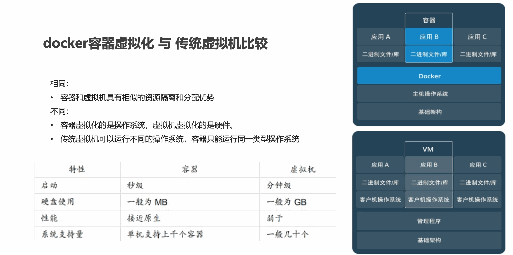


