# Linux目录结构

Linux的目录结构是一个树型结构

windows系统可以拥有多个盘符，如C盘，D盘，E盘

Linux没有盘符这个概念，只有一个根目录/，所有文件都在它下面


### Linux路径的描述方式

在Linux中，路径之间的层级关系，使用：/来表示

在windows系统中，路径之间的层级关系，使用：\来表示


## FinalShell

连接前先输入

```
sudo service ssh start
```


# Linux命令入门

## Linux命令基础

**什么是命令、命令行**

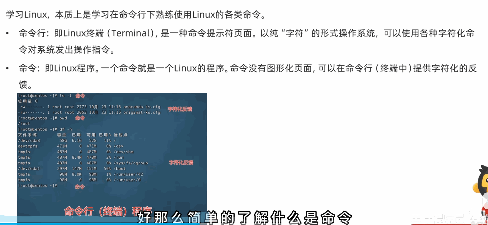

**Linux命令基础格式**

无论是什么命令，用于什么用途，在Linux中，命令有其通用的格式：
command [-options] [parameter]

- commad：命令本身
- -options：[可选，非必填]命令的一些选项，可以通过选项控制命令的行为细节
- parameter：[可选，非必填]命令的参数，多数用于命令的指向目标等

语法中的[]，表示可选的意思

示例：

```
ls -l /home/itheima, ls是命令本身，-l是选项,/home/itheima是参数
	意思是以列表形式，显示/home/itheima目录内的内容

cp -r test1 test2, cp是命令本身，-r是选项，test1和test2是参数
	意思是复制文件夹test1 成为 test2
```

### ls命令入门（列出目录下内容）

**ls命令**

**ls命令的作用是列出目录下的内容，语法细节如下：**

**`ls [-a -l -h] [Linux路径]`**

-a -l -h是可选的选项

Linux路径是此命令可选的参数

当不适用选项和参数，直接使用ls命令本体，表示：以平铺形式，列出当前工作目录下的内容。

**HOME目录和工作目录**

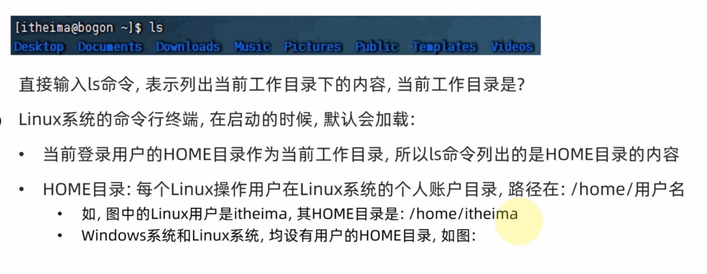

### ls命令的参数和选项

**ls命令的参数**

当ls不适用参数，表示列出：当前工作目录的内容，即用户的HOME目录

当使用参数，ls命令的参数表示：指定一个Linux路径，列出指定路径的内容

```
ls / 列出根目录的内容
```

**ls命令的选项**

- -a选项，表示：all的意思，即列出全部文件（包含隐藏的文件/文件夹）
- -l选项，表示：以列表（竖向排列）的形式展示内容，并展示更多信息
- -h选项，表示：以易于阅读的形式，列出文件大小，如K、M、G，必需搭配-l一起使用

**ls命令选项的组合使用**
语法中的选项是可以组合使用的，比如学习的-a和-l可以组合应用

写法：

```
ls -l -a
ls -la
ls -al
```

三种写法都一样，表示同时应用-l和-a的功能

**ls选项和参数的组合使用**

```
ls -la /
ls -lh
ls -lah
ls -l -a -h
```

## 目录切换相关命令（cd/pwd）

#### cd（切换工作目录）

当Linux终端（命令行）打开的时候，会默认以用户的HOME目录作为当前的工作目录

我们可以通过cd命令，更改当前所在的工作目录。

cd命令来自英文：Change Directory

**语法：`cd [Linux路径]`**

- cd命令无需选项，只有参数，表示要切换到哪个目录下
- cd命令直接执行，不写参数，表示回到用户的HOME目录

#### pwd（查看当前工作目录）

通过ls来验证当前的工作目录，其实是不恰当的。

我们可以通过pwd命令，来查看当前所在的工作目录。

pwd命令来自：Print Work Directory

**语法：`pwd`**

- **pwd命令，无选项，无参数，直接输入pwd即可**

## 相对路径和绝对路径

绝对路径：以根目录做起点，描述路径的方式，路径以/开头

相对路径：以当前目录做起点，描述路径的方式，路径不需以/开头

## 特殊路径符

- .	表示当前目录，比如cd ./Desktop 表示切换到当前目录下的Desktop目录内，和cd Desktop效果一致
- ..       表示上一级目录，比如：cd .. 即可切换到上一级目录，cd ../.. 切换到上二级目录
- ~       表示HOME目录，比如：cd ~ 即可切换到HOME目录或cd ~ /Desktop，切换到HOME内的Desktop目录

## 创建目录命令（mkdir）

通过mkdir命令可以创建新的目录（文件夹）

mkdir：Make Directory

**语法：mkdir [-p] Linux路径**

- 参数必填，表示Linux路径，即要创建的文件夹的路径，相对路径或绝对路径均可
- -p选项可选，表示自动创建不存在的父目录，适用于创建连续多层级的目录

```
mkdir itheima
mkdir /home/itheima/test
mkdir ./test2
mkdir ../test3
mkdir ~/test3
```

**mkdir -p 选项**

如果想要一次性创建多个层级的目录

可以通过-p选项，将一整个链条都创建完成

```
mkdir -p itcast/good/666	
```

## 文件操作命令

### touch（创建文件）

可以通过touch命令创建文件

**语法：`**touch Linux路径`****

- touch命令无选项，参数必填，表示要创建的文件路径，相对、绝对、特殊路径符均可以使用

```
touch test.txt
```

### cat命令（查看文件内容）

准备好文件内容后，可以通过cat查看内容。

**语法：`cat Linux路径`**

- cat同样没有选项，只有必填参数，参数表示：被查看的文件路径，相对、绝对、特殊路径符都可以使用

```
cat test.txt
```

### more命令（查看文件内容）

more命令同样可以查看文件内容，同cat不同的是：

- cat是直接将内容全部显示出来
- more支持翻页，如果文件内容过多，可以一页页的展示

**语法：`more Linux路径`**

- 同样没有选项，只有必填参数，参数表示：被查看的文件路径，相对、绝对、特殊路径符都可以使用

**在查看的过程中，通过空格翻页**

**通过q退出查看**

### cp命令（复制文件文件夹）

cp命令可以用于复制文件\文件夹，cp命令：copy

**语法：`cp [-r] 参数1 参数2`**

- **-r选项，可选，用于复制文件夹使用，表示递归**
- **参数1，Linux路径，表示被复制的文件或文件夹**
- **参数2，Linux路径，表示要复制去的地方**

```
cp test.txt test2.txt
cp test.txt ./test2.txt
cp test.txt /home/itheima/test2.txt

复制文件夹
cp -r itheima itheima2
```

### mv（移动文件或文件夹）

**mv命令可以用于移动文件\文件夹**

**mv命令：move**

**语法：`mv 参数1 参数2`**

- 参数1，Linux路径，表示被移动的文件或文件夹
- 参数2，Linux路径，表示要移动去的地方，如果目标不存在，则进行改名，确保目标存在

```
移动文件
mv test.txt Desktop/

改名
mv test2.txt test3.txt

文件夹的移动
mv test Desktop/
```

### rm（删除文件、文件夹）

**rm命令可用于删除文件、文件夹**

rm命令：remove

**语法：`rm [-r -f] 参数1 参数2 ...... 参数N`**

- 同cp命令一样，-r选项用于删除文件夹

- -f表示force，强制删除（不会弹出提示确认信息）

  - 普通用户删除内容不会弹出提示，只有root管理员用户删除内容会有提示

  - 所以一般普通用户用不到-f选项

  - 演示强制删除，-f选项

    可以通过su - root，并输入密码临时切换到root用户体验

    通过输入exit命令，退回普通用户

- 参数1、参数2、......、参数N表示要删除的文件或文件夹路径，安装空格隔开

```
删除文件
rm test3.txt

删除文件夹
rm -r test2

多个文件夹的删除
rm -r test2 test3 test4 itheima
```

#### rm删除文件、文件夹-通配符

rm命令支持通配符*，用来做模糊匹配

- 符号*表示通配符，即匹配任意内容（包含空），示例：
- test*,表示匹配任何以test开头的内容
- *test，表示匹配任何以test结尾的内容
- \*test\*，表示匹配任何包含test的内容

```
演示：
删除所有以test开头的文件或文件夹
rm -r test*
```

**注意：**

**rm -rf /**

**rm -rf /***

**等同于格式化**

## 查找命令

### which（查找命令的程序文件）

**语法：`which 要查找的命令`**

```
which cd
which pwd
which touch
which mkdir
which cp
which mv
```

### find（按文件名查找文件）

在Linux系统中，可以通过find命令去搜索指定的文件

语法：`find 起始路径 -name "被查找文件名"`

-name	表示以文件名搜索

```
find / -name "test"
```

#### find命令-通配符

被查找文件名，支持使用通配符*来做模糊匹配

```
find / -name "test*"
find / -name "*test"
find / -name "*test*"
```

#### find命令-按文件大小查找文件

语法：find 起始路径 -size +|- n [kMG]

- +、-表示大于和小于
- n表示大小数字
- KMG表示大小单位，k（小写字母）表示kb，M表示MB，G表示GB

示例：

```
查找小于10KB的文件：find / -size -10k
查找大于100MB的文件：find / -size +100M
查找大于1GB的文件：find / -size +1G
```

#### 比赛中常用的find命令

```
用 find / -name "flag" &2>/dev/null 找文件名带 flag 的文件

用 find / -type f | xargs grep -H -l 'flag' &2>/dev/null 找文件内容中含 flag 的文件（慎用，全盘搜索速度会很慢）最好能缩小查找范围，例如确定 flag 在 /var 目录里，那就不要从根目录开始搜索，使用 find /var -type f | xargs grep -H -l 'flag' &2>/dev/null 会更好
```

## grep、wc和管道符

### grep命令（过滤文件内容）

**可以通过grep命令，从文件中通过关键字过滤文件行。**

**语法：`grep [-n] 关键字 文件路径`**

- **选项-n，可选，表示在结果中显示匹配的行的行号**
- **参数，关键字，必填，表示过滤的关键字，带有空格或其他特殊符号，建议使用" "将关键字包围起来**
- **参数，文件路径，必填，表示要过滤的内容的文件路径，可作为内容输入端口**

```
grep "itheima" test.txt
```

### wc命令（做数量统计）

**可以通过wc命令统计文件的行数、单词数量等**

**语法：`wc [-c -m -l -w] 文件路径`**

- **选项，-c，统计bytes数量**
- **选项，-m，统计字符数量**
- **选项，-l，统计行数**
- **选项，-w，统计单词数量**
- **参数，文件路径，被统计的文件，可作为内容输入端口**

```
wc test.txt
```


### 管道符

**管道符：|**

**管道符的含义是：将管道符左边命令的结果，作为右边命令的输入**

```
cat test.txt | grep itheima
cat test.txt | wc -l
ls | grep test
ls /usr/bin | grep gtf
ls -l /usr/bin | grep gtf
ls -l /usr/bin | wc -l
```

## echo、tail和重定向符

### echo命令（输出内容）

**可以使用echo命令在命令行内输出指定内容**

**语法：`echo 输出的内容`**

- **无需选项，只有一个参数，表示要输出的内容，复杂内容可以用" "包围**

```
echo "hello linux"
```

### 反引号`（将字符当做命令执行）

**我们可以通过将命令用反引号\`将其包围，被\`包围的内容，会被作为命令执行，而非普通字符**

```
echo pwd	会输出pwd因为这里不会将pwd当做命令执行，而是普通字符
echo `pwd`
```

### 重定向符（写入和追加内容到文件）

**重定向符：>和>>**

- **\>,将左侧命令的结果，覆盖写入到符号右侧指定的文件中**
- **\>>，将左侧命令的结果，追加写入到符号右侧指定的文件中**

``` 
echo "Hello Linux" > itheima.txt
echo "Hello itheima" > itheima.txt
echo "Hello itcast" >> itheima.txt
```

### tail命令（查看文件尾部内容）

使用tail命令，可以查看文件尾部内容，跟踪文件的最新更改，语法如下：

**`tail [-f -num] Linux路径`**

- 参数，Linux路径，表示被跟踪的文件路径
- 选项，-f，表示持续跟踪（跟踪文件更改）
- 选项，-num，表示查看尾部多少行，不填默认10行

```
tail test.txt
tail -5 test.txt
tail -20 test.txt
```

## vi编辑器

### vi\vim编辑器介绍：

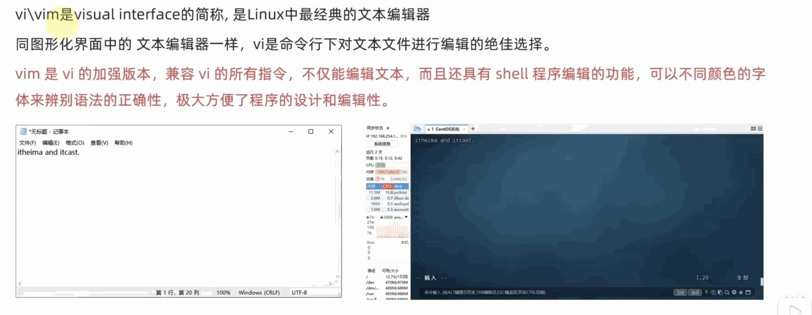

### vi\vim编辑器的三种工作模式

**命令模式：**

​		**命令模式下，所敲的按键编辑器都理解为命令，以命令驱动执行不同的功能**

​		**此模式下，不能自由进行文本编辑**

**输入模式：**

​		**也就是所谓的编辑模式、插入模式。**

​		**此模式下，可以对文件内容进行自由编辑**

**底线命令模式**

​		**以：开始，通常用于文件的保存、退出**

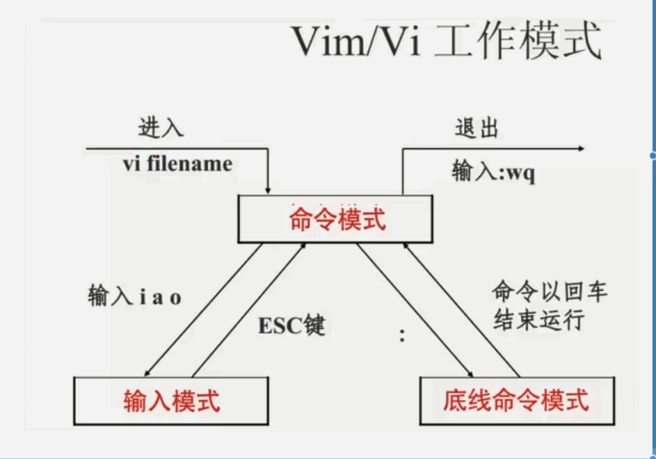

### 命令模式快捷键

命令模式下常见快捷键

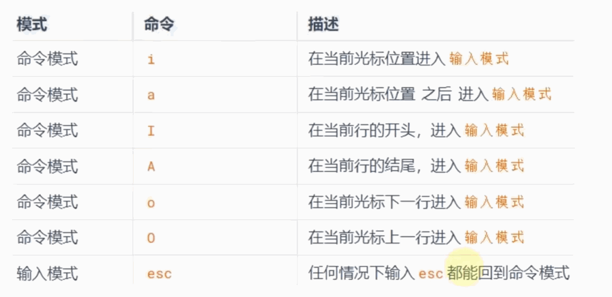

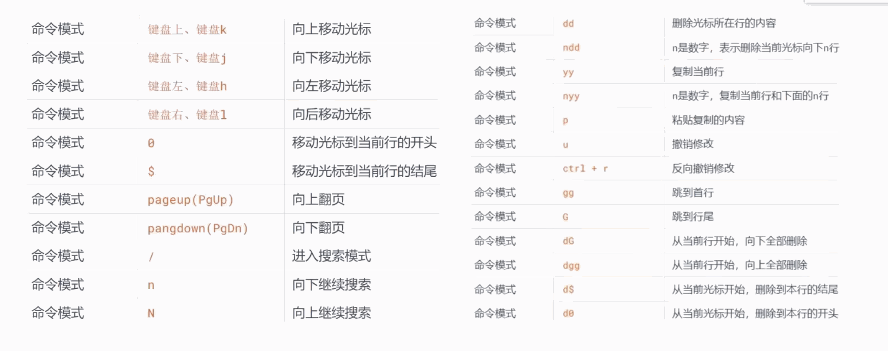

### 底线命令模式

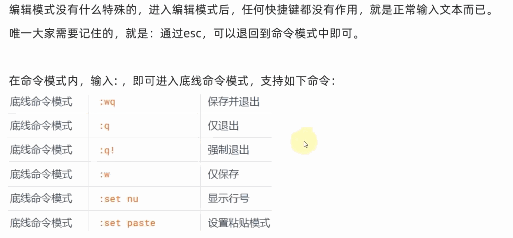

# Linux用户和权限

## Linux的root用户

**root用户（超级管理员）**

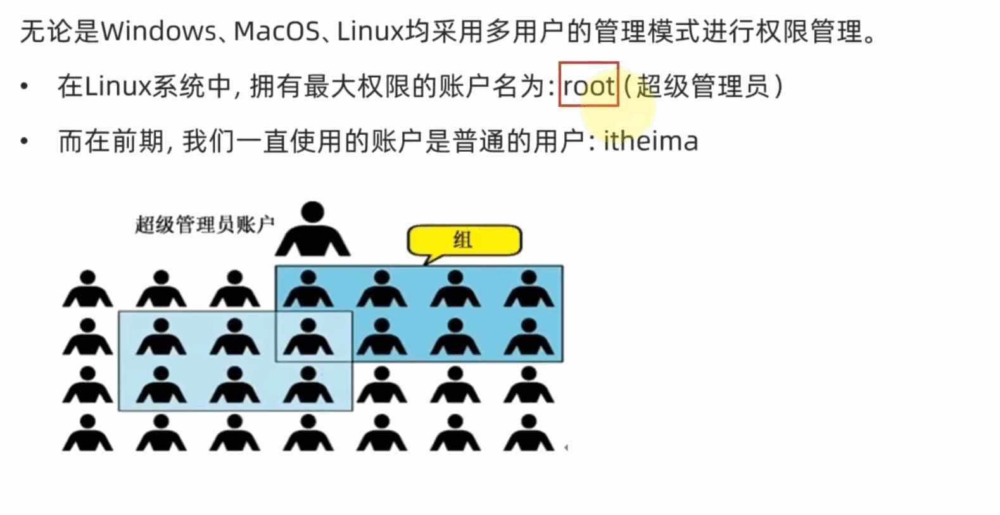

root用户拥有最大的系统操作权限，而普通用户在许多地方的权限是受限的。

例如：使用普通用户无法在根目录下创建文件，root用户可以

- 普通用户的权限，一般在其HOME目录内是不受限的、
- 一旦出了HOME目录，大多数地方，普通用户仅有只读和执行权限，无修改权限

### su和exit命令（切换用户）

su命令就是用于账户切换的系统命令，su：Switch User

**语法：`su [-] [用户名]`**

- -符号是可选的，表示是否在切换用户后加载环境变量（建议带上）
- 参数：用户名，表示要切换的用户，用户名可以省略，省略表示切换到root
- 切换用户后，可以通过exit命令退回上一个用户，也可以使用快捷键：ctrl+d

使用普通用户，切换到其他用户需要输入密码，如切换到root用户

使用root用户切换到其他用户，无需密码，可以直接切换

### sudo命令（临时获得root权限执行命令）

可以使用sudo命令，为普通的命令授权，临时以root身份执行

**语法：`sudo 其他命令`**

- 在其他命令之前，带上sudo，即可为这一条命令临时赋予root授权
- 但是并不是所有的用户，都有权利使用sudo，我们需要为普通用户配置sudo认证

配置sudo认证

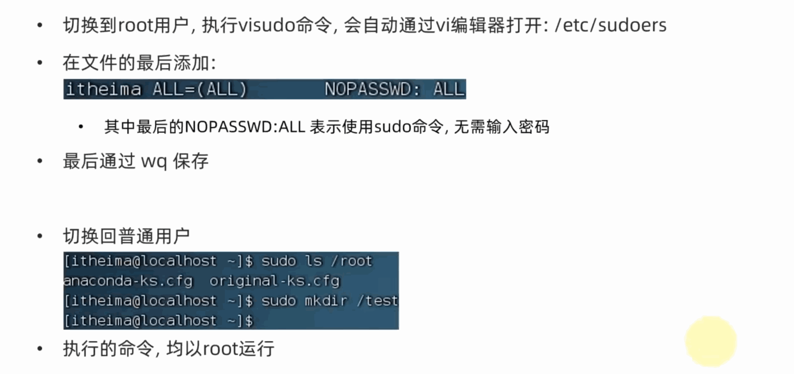

## 用户、用户组管理

### 用户、用户组

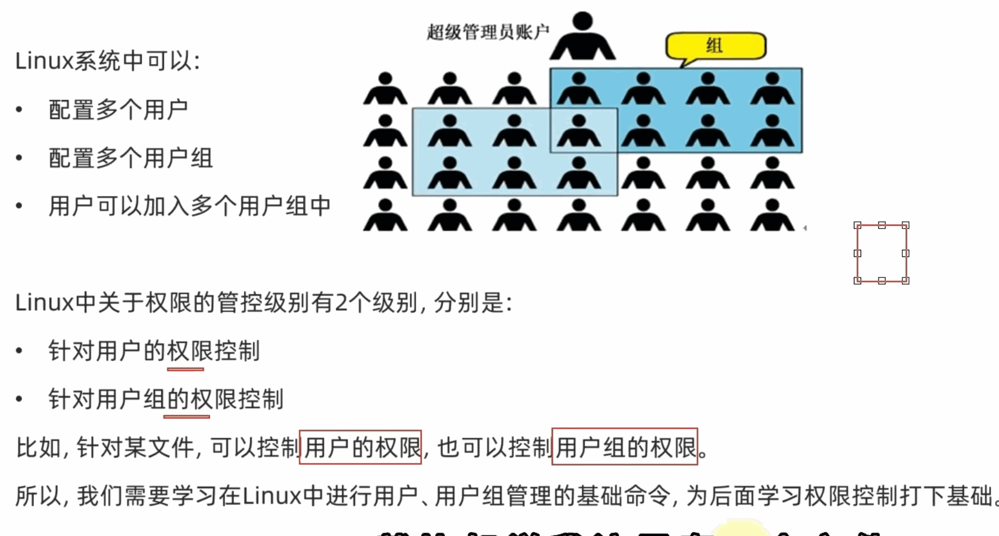

### 用户组管理

**以下命令需root用户执行**

```
创建用户组
groupadd 用户组名

删除用户组
groupdel 用户组名
```

### 用户管理

以下命令需root用户执行

```
创建用户
useradd [-g -d] 用户名
	选项：-g指定用户的组，不指定-g，会创建同名组并自动加入，指定-g需要组已经存在，如已存在同名组，必需使用-g
	选项：-d指定用户HOME路径，不指定，HOME目录默认在：/home/用户名

删除用户
userdel [-r] 用户名
	选项：-r，删除用户的HOME目录，不使用-r，删除用户时，HOME目录保留
	
查看用户所属组
id [用户名]
	参数：用户名，被查看的用户，如果不提供则查看自身
	
修改用户所属组
usermod -aG 用户组 用户名
将指定用户加入指定的用户组
```

### getent（查看当前系统中有哪些用户）

**使用getent命令，可以查看当前系统中有哪些用户**

**语法：`getent passwd`**

共有7份信息，分别是：

用户名：密码（x）：用户ID：组ID：描述信息（无用）：HOME目录：执行终端（默认bash）

**使用getent命令，同样可以查看当前系统中有哪些用户组**

**语法：`getent group`**

包含3份信息：

组名称：组认证（显示为x）：组ID

## 查看权限控制

### 认知权限信息

通过ls -l可以以列表形式查看内容，并显示权限细节

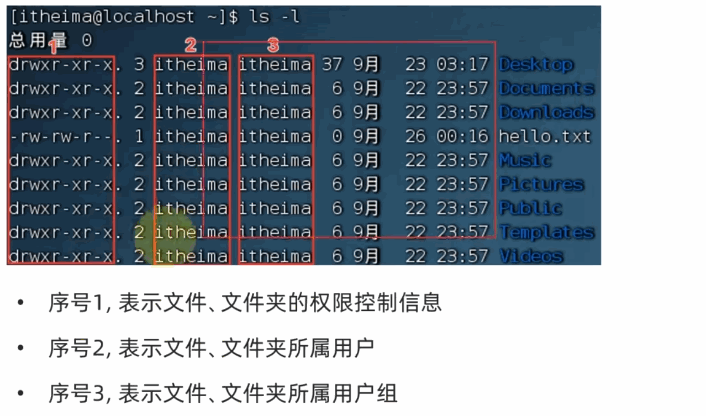

**权限细节：**
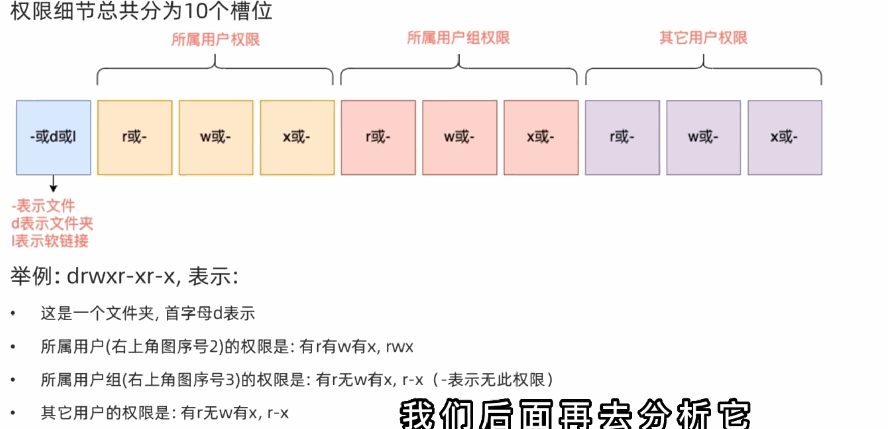

**rwx**

- r表示读权限
- w表示写权限
- x表示执行权限

**针对文件、文件夹的不同，rwx的含义有细微差别**

r，针对文件可以查看文件内容

​	针对文件夹，可以查看文件夹内容，如ls命令

w，针对文件表示可以修改此文件

​	针对文件夹，可以在文件夹内：创建、删除、改名等操作

x，针对文件表示可以将文件作为程序执行

​	针对文件夹，表示可以更改工作目录到此文件夹，即cd进入

## 修改权限控制 - chmod

### chmod命令

我们可以使用chmod命令，修改文件、文件夹的权限信息。

**注意：只有文件、文件夹的所属用户或root用户可以修改**

**语法：`chmod [-R] 权限 文件或文件夹`**

**选项：-R，对文件夹内的全部内容应用同样的操作**

```
chmod u=rwx,g=rx,o=x hello.txt，将文件权限修改为：rwxr-x--x
	其中：u表示user所属用户权限，g表示group组权限，o表示other其他用户权限
	
chmod -R u=rwx,g=rx,o=x test，将文件夹test以及文件夹内全部内容权限设置为：rwxr-x--x
```

### 权限的数字序号

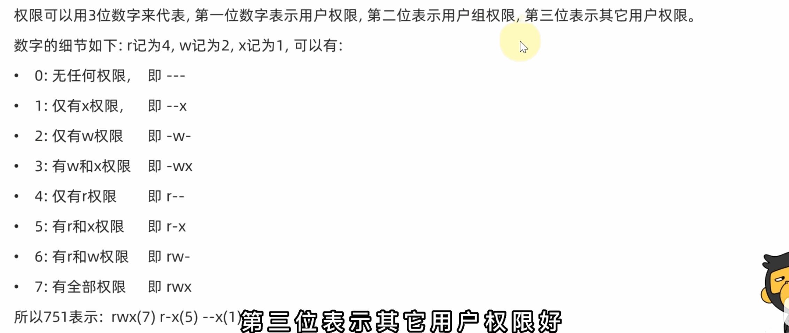

## 修改权限控制 - chown

### chown命令

使用chown命令，可以修改文件、文件夹的所属用户和用户组

**注意：普通用户无法修改所属为其它用户或组，所以此命令只适用于root用户执行**

**语法：`chown [-R] [用户] [:] [用户组] 文件或文件夹`**

- **选项，-R，同chmod，对文件夹内全部内容应用相同规则**
- **选项，用户，修改所属用户**
- **选项，用户组，修改所属用户组**
- **:用于分隔用户和用户组**

```
chown root hello.txt，将hello.txt所属用户修改为root
chown :root hello.txt，将hello.txt所属用户组修改为root
chown root:itheima hello.txt，将hello.txt所属用户修改为root，所属组修改为itheima
chown -R root test，将文件夹test的所属用于修改为root并对文件夹内全部内容应用同样规则
```

# Linux实用操作

## 各类小技巧（快捷键）

常用快捷键

```
ctrl + c	强制停止
ctrl + d	退出或登出

历史命令搜索
history	查看历史输入过的命令
!	自动执行上一次匹配前缀的命令
ctrl + r	输入内容去匹配历史命令	回车执行，键盘左右键得到此命令但不执行

光标移动快捷键
ctrl + a	跳到命令开头
ctrl + e	跳到命令结尾
ctrl + 键盘左键	向左跳一个单词
ctrl + 键盘右键	向右跳一个单词

清屏
ctrl + l	清空终端内容
clear	清屏
```
