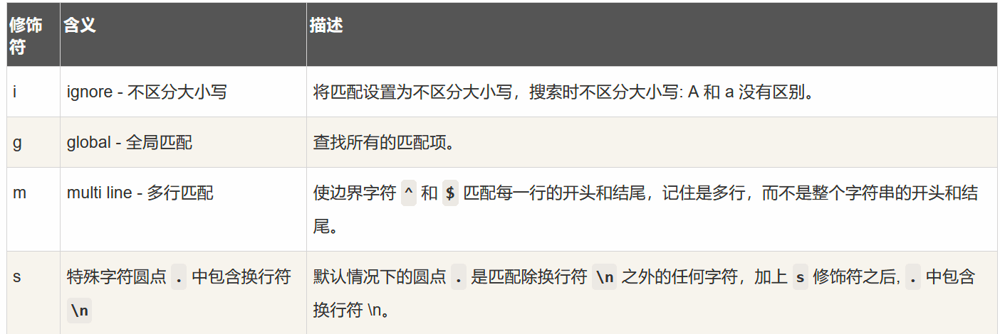
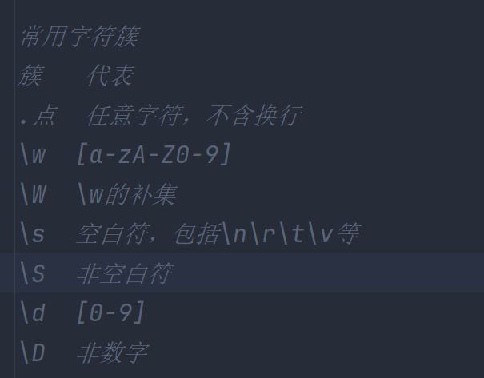
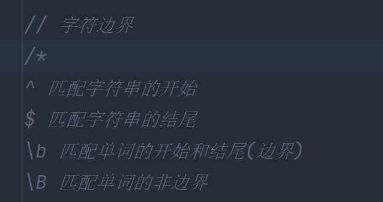
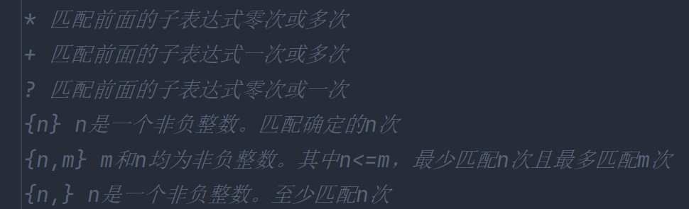
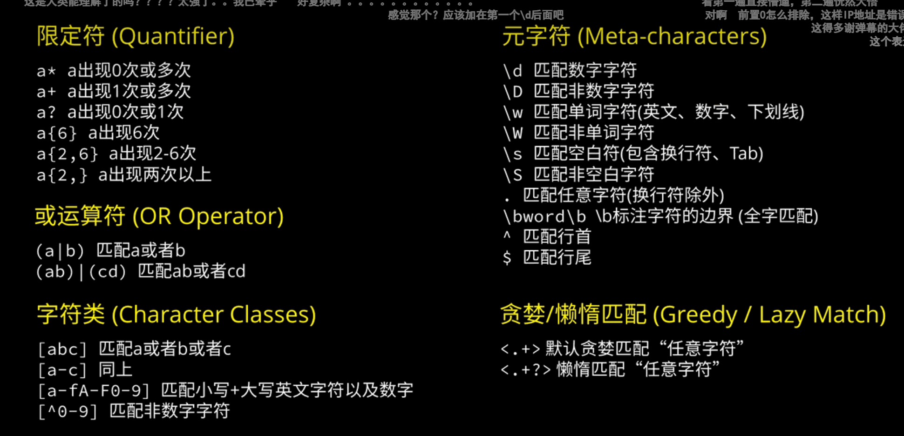

# 正则表达式简介

**正则表达式**（Regular Expression，简称regex或regexp）是一种用于描述和匹配字符串模式的工具，广泛应用于文本处理中，包括搜索、替换和验证字符串。

### 主要用途

正则表达式的主要用途包括：

1. ‌**文本搜索**‌：在大文本中查找特定的子字符串。
2. ‌**文本替换**‌：将匹配的子字符串替换为其他字符串。
3. ‌**字符串验证**‌：验证输入是否符合特定格式（如邮箱地址、电话号码、邮政编码等）。
4. ‌**数据提取**‌：从文本中提取符合特定模式的数据‌

# 正则表达式的学习

## 修饰符

标记也称为修饰符，正则表达式的标记用于指定额外的匹配策略。

标记不写在正则表达式里，标记位于表达式之外

常用的修饰符：



## 元字符

### 常用的字符簇

```
																	
匹配范围
具体字符(字面值)--> 比如说找a,b,hi
字符边界(下面加粗)--> 从哪开始到哪结束
字符集合[ace],[0123456789]--> 里面任意条件符合的找出来
字符补集[^qxz]--> 里面任意条件符合的不要
字符范围[a-z0-9]--> 注意:必须是连续的，不能写a-Z
字符簇(系统定义好的常用集合)
```



### 字符边界



比如^a会去匹配行首的a

a$会去匹配行尾的a

### 限定符

用来限定匹配几个



### 匹配多个字符

()

例如(ab)+,表示匹配ab出现1次或者多次

### 或运算符

|

比如：(cat|dog)b，表示匹配catb或者dogb

如果是：cat|dogb，表示匹配cat或者dogb

### 集合和补集

集合：[]

比如[abcd]表示能匹配的字符是a,b,c,d

补集\[^abcd]表示能匹配的字符是除了a,b,c,d的其他所有字符

### 总结



## PHP中关于正则表达式的函数

preg_match_all()	通过一个正则表达式匹配字符串

例如：

```
																	
$str = 'hello o2o 2b9 250';
$patt = '/\b[a-zA-Z]+\b|\b[0-9]+\b/'; // 或者的用法
preg_match_all($patt,$str,$res);
```

preg_replace()	执行一个正则表达式的搜索和替换

例如：

```
																	
//把所有空格替换成一个空格
$str = "tommorw         is           another         day";
$patt = "/\s{1,}/"; 表示至少匹配一个空格
echo preg_replace($patt,' ',$str);
```

preg_split()	通过一个正则表达式分割字符串

例如：

```
																	
$str = 'tommorw is another day,o2o ,you dont bird me idont bird you';
$patt = '/\W{1,}/';
print_r(preg_split($patt,$str));
```

## 贪婪模式和非贪婪模式

贪婪模式：表示尽量往后匹配

```
																	
<?php
// 贪婪模式 尽量往后匹配
$str = 'ksda good goooood good kl s ja dfs dk ';
$patt = '/g.+d/'; // god  .点  任意字符，不含换行
preg_match_all($patt, $str, $res);
print_r($res);
?>
```

结果：

```
																	
Array
(
    [0] => Array
        (
            [0] => good goooood good kl s ja dfs d
        )

)
```

***


非贪婪模式：在数量限定词后面加?

```
																	
$str = 'ksda good goooood good kl s ja dfs dk ';
$patt = '/g.+?d/'; // god  .点  任意字符，不含换行
preg_match_all($patt, $str, $res);
print_r($res);
```

结果：

```
																	
Array
(
    [0] => Array
        (
            [0] => good
            [1] => goooood
            [2] => good
        )

)
```

区别：可以发现贪婪模式会尽量往后匹配整段字符串，而非贪婪模式会匹配单段满足条件的字符串

## 后向引用

在后面表达式中引用前面括号内的结果，第一个括号为\1 第二个为\2

例如：

```
																	
<?php

$str = "txt hello,high,bom,mum,afewaa,bafsdab,ceagiac";
// $patt = '/\bt\w+t\b/';

// 后向引用
$patt = '/\b([a-z])\w+\1\b/';  // 引用前面括号里的结果 第一个括号为\1 第二个为\2
preg_match_all($patt, $str, $res);
print_r($res);

?>
```

## 断言 


后行断言和先行断言有时候被称为断言，它们是特殊类型的 **非捕获组**（用于匹配模式，但不包括在匹配列表中）。当我们在一种特定模式之前或者之后有这种模式时，会优先使用断言。 例如我们想获取输入字符串 $4.44 and $10.88 中带有前缀 $ 的所有数字。我们可以使用这个正则表达式 (?<=\$)[0-9\.]*，表示：获取包含 . 字符且前缀为 $ 的所有数字。 以下是正则表达式中使用的断言：

| ***\*符号\**** | ***\*描述\**** |
| -------------- | -------------- |
| ?=             | 正向先行断言   |
| ?!             | 负向先行断言   |
| ?<=            | 正向后行断言   |
| ?<!            | 负向后行断言   |

### 正向先行断言


正向先行断言认为第一部分的表达式的后面必须是先行断言表达式。返回的匹配结果仅包含与第一部分表达式匹配的文本。 要在一个括号内定义一个正向先行断言，在括号中问号和等号是这样使用的 (?=...)。先行断言表达式写在括号中的等号后面。 例如正则表达式 (T|t)he(?=\sfat)，表示：匹配大写字母 T 或小写字母 t，后面跟字母 h，后跟字母 e。 在括号中，我们定义了正向先行断言，它会引导正则表达式引擎匹配后面跟着 fat 的 The 或 the。

"(T|t)he(?=\sfat)" => [The](#learn-regex) fat cat sat on the mat.

### 负向先行断言


当我们需要指定第一部分表达式的后面不跟随某一内容时，使用负向先行断言。负向先行断言的定义跟我们定义的正向先行断言一样， 唯一的区别在于我们使用否定符号 ! 而不是等号 =，例如 (?!...)。 我们来看看下面的正则表达式 (T|t)he(?!\sfat)，表示：从输入字符串中获取全部 The 或者 the 且不匹配 fat 前面加上一个空格字符。

"(T|t)he(?!\sfat)" => The fat cat sat on [the](#learn-regex) mat.

### 正向后行断言


正向后行断言用于获取跟随在特定模式之后的所有匹配内容。正向后行断言表示为 (?<=...)。例如正则表达式 (?<=(T|t)he\s)(fat|mat)，表示：从输入字符串中获取在单词 The 或 the 之后的所有 fat 和 mat 单词。

"(?<=(T|t)he\s)(fat|mat)" => The [fat](#learn-regex) cat sat on the [mat](#learn-regex).

### 负向后行断言


负向后行断言是用于获取不跟随在特定模式之后的所有匹配的内容。负向后行断言表示为 (?<!...)。例如正则表达式 (?<!(T|t)he\s)(cat)，表示：在输入字符中获取所有不在 The 或 the 之后的所有单词 cat。

"(?<!(T|t)he\s)(cat)" => The cat sat on [cat](#learn-regex).
