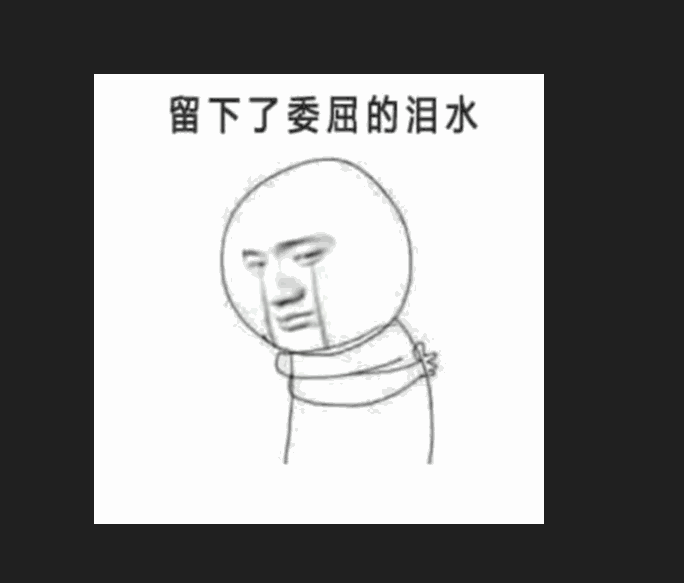
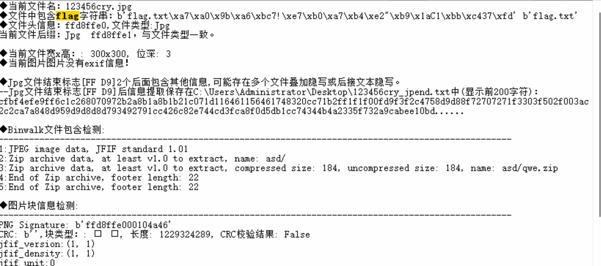
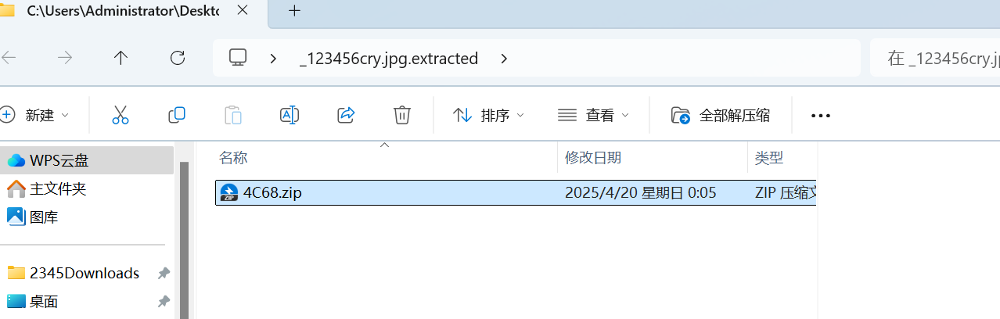
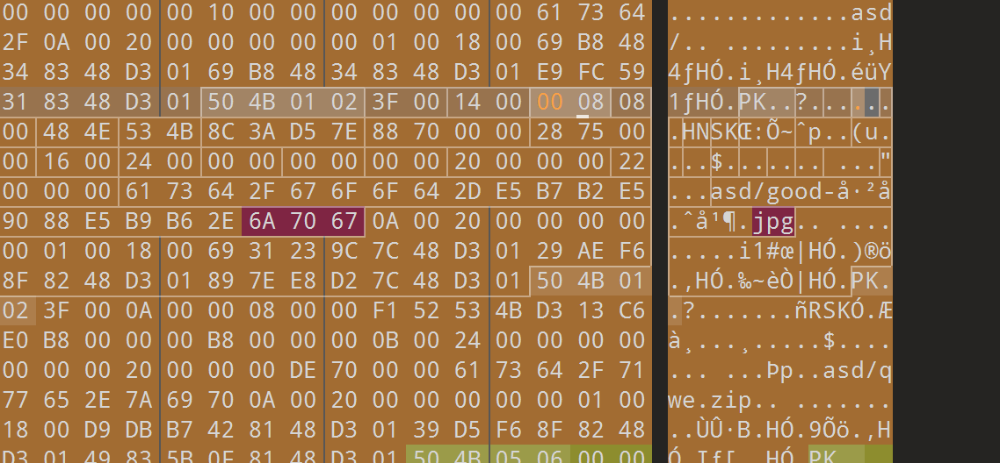
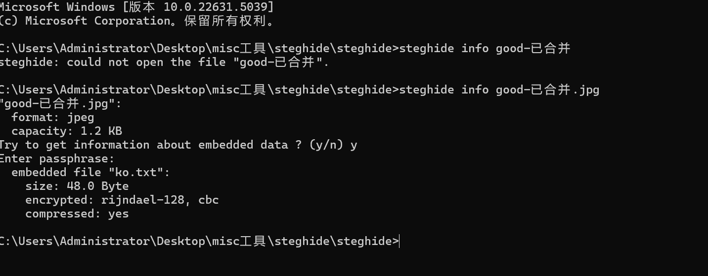

# 九连环

首先下载zip文件，然后解压出来一个jpg图片



直接放随波逐流里分析，发现隐藏了很多文件在里面。



使用Binwalk提取文件，提取出来一个c文件



解压看看发现存在一个qwe.zip和good-已合并.jpg图片文件，qwe.zip可以正常解压，但是jpg文件需要密码，猜测是zip伪加密。

用010editor打开4C68.zip，然后搜索jpg，将目录区的01改为00去除伪加密



现在得到了一张图片和一个压缩包，压缩包需要密码，试了前面学过的几种方法都找不到密码，然后发现是一种新的隐写方式 steghide

用steghide查看文件隐藏内容：

语法：steghide info filename

```
steghide info good-已合并.jpg
```



发现隐藏了一个ko.txt文件，然后继续用steghide提取隐藏文件

语法：steghide extract -sf filename

```
steghide extract -sf good-已合并.jpg
```

然后注意需要按一次空格。

打开ko.txt，得到压缩包密码

```
看到这个图片就是压缩包的密码：
bV1g6t5wZDJif^J7
```

然后使用密码将qwe.zip中的flag.txt解压出来，得到flag

```
flag{1RTo8w@&4nK@z*XL}
```

