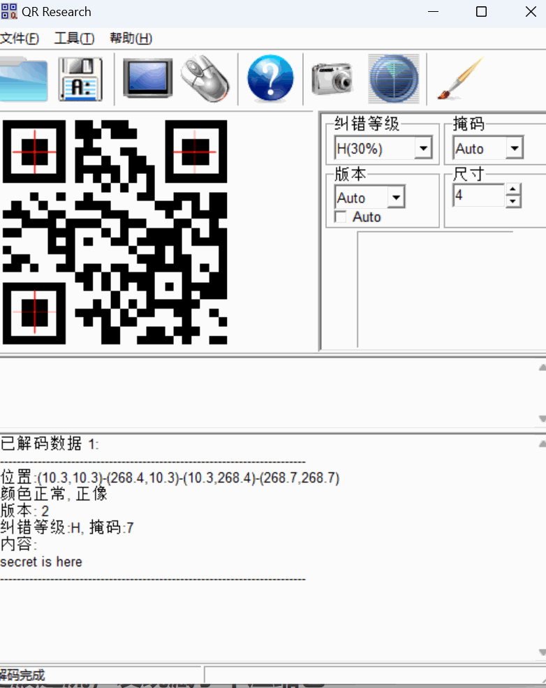
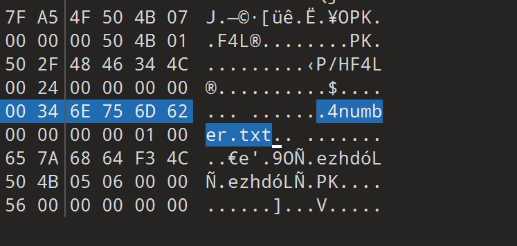
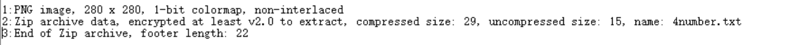
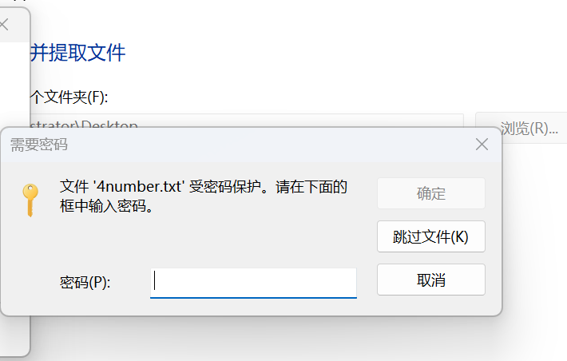
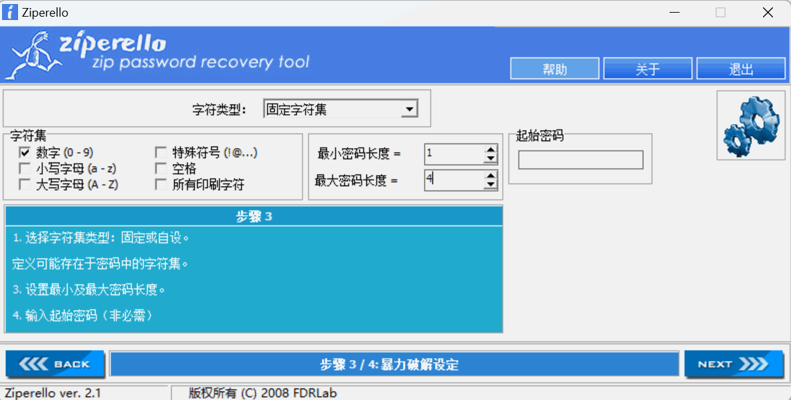
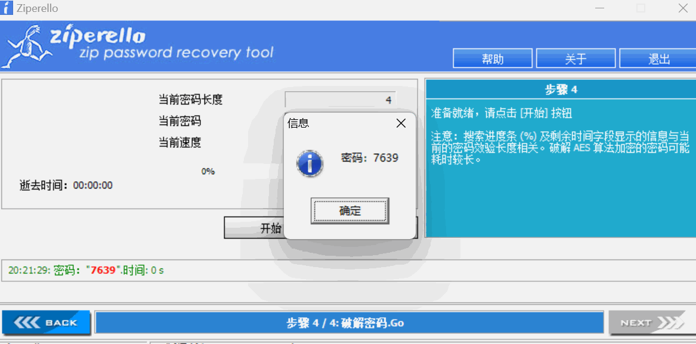

# 二维码1

下载打开压缩包，是一个二维码


然后用QR_Research扫一下二维码，得到secret is here



用010editor打开，发现藏了个4number.txt文件



拖入随波逐流，发现藏了个压缩包



直接使用随波逐流工具binwalk分离，得到1D7.zip压缩包，但是打开压缩包要密码



用ziperello工具暴力破解，通过4number文件名的提示可以猜测密码为4个数字，所以字符集选择数字，然后最小密码长度与最大密码长度调为4



得到密码7639



将4number.txt解压出来，然后打开得到flag

```
CTF{vjpw_wnoei}

将CTF改为flag

flag{vjpw_wnoei}
```

