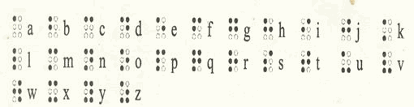
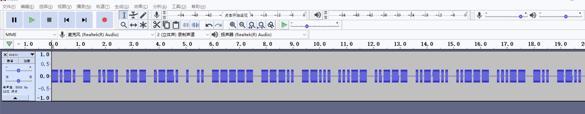
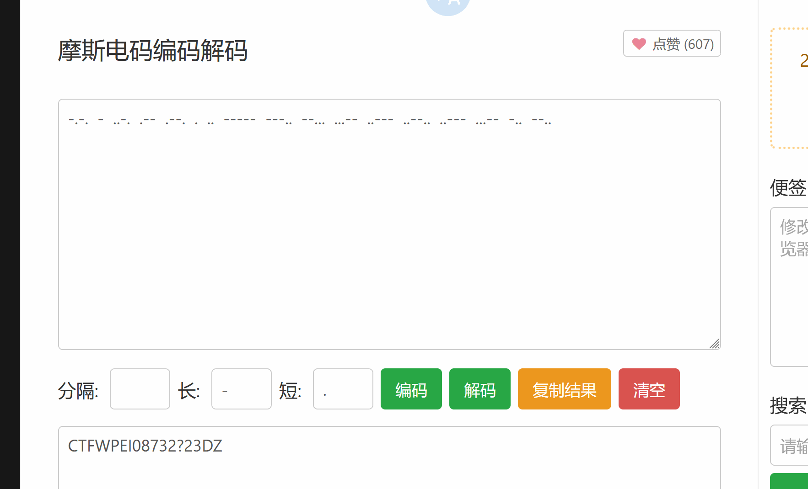

# 假如给我三天光明

首先题目给了一个zip文件，解压下来之后是一个，music.zip和pic.jpg，然后music里可以看到是一个音频文件。

先打开看看图片


查了一下说是盲文，去网上找了个字母盲文对照图



读出来的密文是：kmdonowg，应该就是music.zip的解压密码了

将音频文件解压下来，打开停了一下发现很像摩斯密码，用audacity打开看看

\

解密出摩斯密码

```
-.-.  -  ..-.  .--  .--.  .  ..  -----  ---..  --...  ...--  ..---  ..--..  ..---  ...--  -..  --..
```

然后解码



```
CTFWPEI08732?23D
```

换小写

```
flag{wpei08732?23dz}
```

