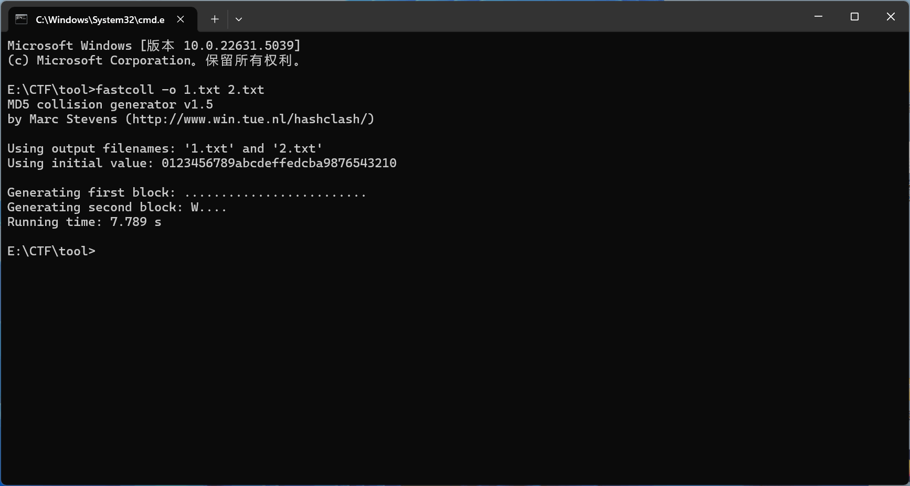
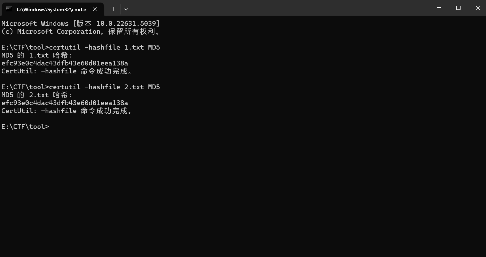
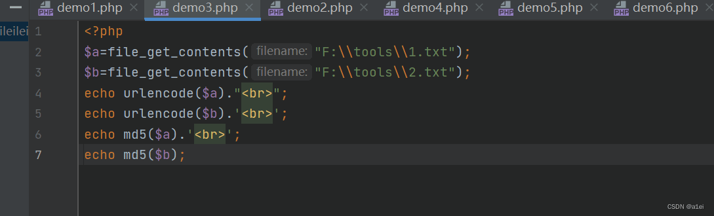
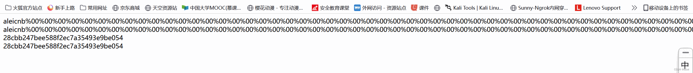

# 所以你说你懂MD5?

首先先看题目

```
<?php
session_start();
highlight_file(__FILE__);
// 所以你说你懂 MD5 了?

$apple = $_POST['apple'];
$banana = $_POST['banana'];
if (!($apple !== $banana && md5($apple) === md5($banana))) {
    die('加强难度就不会了?');
}

// 什么? 你绕过去了?
// 加大剂量!
// 我要让他成为 string
$apple = (string)$_POST['appple'];
$banana = (string)$_POST['bananana'];
if (!((string)$apple !== (string)$banana && md5((string)$apple) == md5((string)$banana))) {
    die('难吗?不难!');
}

// 你还是绕过去了?
// 哦哦哦, 我少了一个等于号
$apple = (string)$_POST['apppple'];
$banana = (string)$_POST['banananana'];
if (!((string)$apple !== (string)$banana && md5((string)$apple) === md5((string)$banana))) {
    die('嘻嘻, 不会了? 没看直播回放?');
}

// 你以为这就结束了
if (!isset($_SESSION['random'])) {
    $_SESSION['random'] = bin2hex(random_bytes(16)) . bin2hex(random_bytes(16)) . bin2hex(random_bytes(16));
}

// 你想看到 random 的值吗?
// 你不是很懂 MD5 吗? 那我就告诉你他的 MD5 吧
$random = $_SESSION['random'];
echo md5($random);
echo '<br />';

$name = $_POST['name'] ?? 'user';

// check if name ends with 'admin'
if (substr($name, -5) !== 'admin') {
    die('不是管理员也来凑热闹?');
}

$md5 = $_POST['md5'];
if (md5($random . $name) !== $md5) {
    die('伪造? NO NO NO!');
}

// 认输了, 看样子你真的很懂 MD5
// 那 flag 就给你吧
echo "看样子你真的很懂 MD5";
echo file_get_contents('/flag'); 加强难度就不会了?
```

---

第一个地方用的强比较，可以利用数组绕过

```
POST：
apple[]=1&banana[]=2
```

第二个地方对我们传入的值进行了String强转，不能用数组绕过了，会变成Array，可以使用科学计数法绕过，可以利用第二个地方的弱比较, 让 `0e` 开头的字符串使 php 误认为是科学计数法, 从而转换为 0

```
apple[]=1&banana[]=2&apppple=240610708&bananana=314282422
```

第三个地方两个判断都是强比较，这时就只能用MD5强碰撞就是需要找到真实的 MD5 值一致的内容, 我们可以使用 fastcoll 工具

通过调用：

```
fastcoll -o a a1
```

---

## 知识点

### MD5强碰撞工具fastcoll使用

终端打开

然后输入

```
fastcoll -o 1.txt 2.txt
```



由于生成的文件是十六进制编码后的结果，这里用hxd打开，可以看到生成的1.txt和2.txt都有初始的aleicnb

在windows终端中输入

```
certutil -hashfile 1.txt MD5
certutil -hashfile 2.txt MD5
```



可以发现这两个文件的MD5值相同



从两个文件获取内容和md5值，用url编码输出不可见字符



这样得到了一串不相等但是md5值相等的字符内容，可以在url传参或者在php内部进行url解码一下


